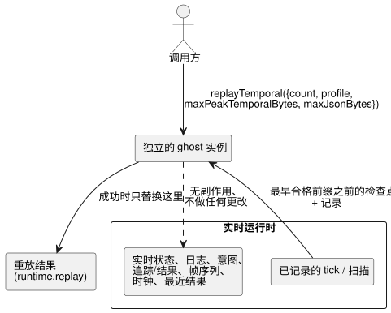

<!-- translation-source: docs/TEMPORAL-REPLAY.md -->
[英文原文](TEMPORAL-REPLAY.md)

# 通过 WASM 适配器进行时间重放

时间重放（temporal replay）会在一个独立的“ghost”实例中重新执行已经记录的 tick，因此你可以在不干扰实时运行的情况下检查执行证据。静态时间资源规划（一次重放需要多少内存）在
[TEMPORAL-RESOURCES.md](TEMPORAL-RESOURCES.zh.md) 中规定。

`GhostFlowRuntime` 和 `FramedGhostFlowRuntime` 都以同步调用的形式提供这个底层适配器操作：

```js
const replay = runtime.replayTemporal({
  count,
  profile,
  maxPeakTemporalBytes,
  maxJsonBytes,
});
const lastSuccessfulReplay = runtime.replay;
```

调用方必须显式传入 profile 和两个预算，它们没有默认值。适配器会检查 `count` 和两个预算都是正的安全
u32 值。重放封装会保留已记录的输入、逻辑 tick、样本身份标识和时间纪元（temporal epoch）。在任何一次成功重放之前，
`replay` getter 返回 `null`。

封装的结构如下：

```text
{ format: "GhostFlow/temporal-replay-v1",
  mode: "legacy" | "framed",
  checkpointTick,
  records: [TickRecord | { format: "GhostFlow/scan-outcome-v1",
                          scanId, logicalTimeMs, trace: TickRecord }] }
```

**记录从何而来。**

- **legacy** 适配器使用运行时已记录的 tick 历史。
- **framed** 适配器使用创建它的那次 `ScanDriver` 运行中的记录。它记录的第一个 tick 是扫描 ID 零，即使被包装的运行时此前已经执行过 tick 也是如此。之后的每条记录使用
  `scanId = tick - firstScanTick`。逻辑时间来自已记录的时钟输入。

重放会选取最早的合格记录前缀，并从紧邻该前缀之前的检查点开始。`count` 不会被截断：它绝不会为了适配而被悄悄减小。

**与实时运行隔离。** 如图所示，重放在一个独立的 ghost 实例中运行。它不会派发副作用，也不会改变实时的待处理输入、状态、日志（journal）、意图、追踪/结果、帧序列、时钟或最近结果。被拒绝的请求会让先前的重放和实时执行都保持不变。成功的重放只替换那份独立的重放结果。



**内存预算。**

| 预算 | 涵盖 | 不涵盖 |
| --- | --- | --- |
| `maxPeakTemporalBytes` | core 时间 arena、检查点、证明（proof）和追踪的计量 | 标量/模块克隆以及分配器元数据 |
| `maxJsonBytes` | 保留的重放结果加上候选 JSON 缓冲区 | JavaScript 解析出的对象和复制的文本（调用方自有的分配） |

适配器必须在分配之前统计转义后的 UTF-8 字节数，并且必须避免产生无上界的中间字符串。

**底层 WASM 导出。** 导出函数为 `gf_replay_temporal` 和
`gf_frame_replay_temporal`。成功结果通过 `gf_replay_ptr/len` 和 `gf_frame_replay_ptr/len` 暴露。它们绝不会覆盖实时追踪或 framed 结果数据。

**适用范围。** 该操作为已安装的程序提供执行证据。仅凭它本身，并不能确立 Reference §6.8 中持久的
Program/源闭包/设置/绑定/运行身份标识，也不提供候选程序的假设（what-if）重放、外来检查点恢复、环境模拟或持久连续性。完整的持久重放和假设重放仍在此 API 之外。硬件和物理 I/O 证据同样不在本文档范围内。
