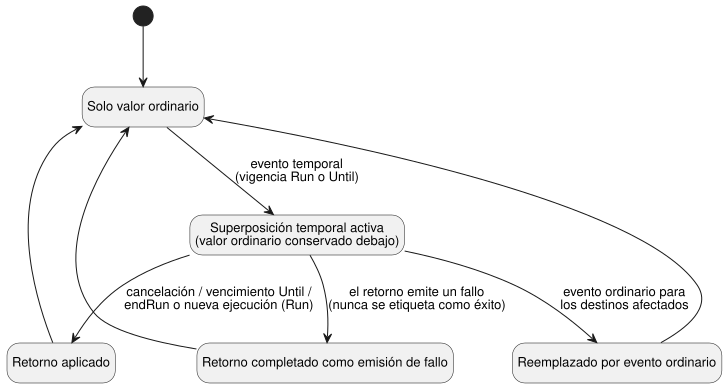

<!-- translation-source: docs/TEMPORARY-SETTINGS-HOST.md -->
[Original en inglés](TEMPORARY-SETTINGS-HOST.md)

# Host de referencia de ajustes temporales

`TemporarySettingsHost` implementa el ciclo de vida de superposición (overlay)
adoptado en la Referencia §5.2. Un **ajuste temporal** (una *superposición*)
cambia un ajuste durante una vigencia limitada y después vuelve al valor
ordinario que estaba en vigor antes. El host no añade ninguna palabra clave de
GhostFlow.

**División del trabajo.**

| Propiedad del host | Ejecutado en el núcleo compartido de Rust (a través de `ControlRuntime`) |
| --- | --- |
| concesiones a actores, identidad de Program/ejecución, una capa de superposición, vigencia, procedencia del retorno, admisión | expresiones, estado de control, temporizadores, emisiones Result tipadas, transacciones de escaneo |

**Activación.** La activación recibe:

- un artefacto literario (literate) compilado exacto;
- un `runId`;
- `grants`, que asigna a cada actor los ID de configuración que puede cambiar;
- una capacidad de historial acotada;
- el perfil de contexto existente.

Antes de la activación, el host vuelve a compilar los bytes de la fuente y
compara el bytecode y el manifiesto. Los artefactos compuestos deben
suministrarse junto con sus cierres de importación.

**Qué debe suministrar el host anfitrión.** Las concesiones a actores, la
identidad de ejecución, las observaciones de reloj de confianza y el
almacenamiento aprobado de puntos de control provienen del host anfitrión
(embedding host). Una etiqueta de actor/origen no es autenticación. Este
adaptador no emite ejecuciones de Device, no obtiene un reloj, no persiste
almacenamiento ni toca salidas físicas.

## Solicitudes y observaciones

`step(packet, event)` acepta el paquete de control existente más un evento de
host identificado opcional.

Todo evento nombra:

- `kind`;
- los valores exactos `programFingerprint`, `sourceSha256` y `runId`;
- `eventId` y `baseRevision`;
- `actor` y `reason`.

Tipos de evento:

- Los eventos `temporary` y `ordinary` llevan `changes`: una lista no vacía sin
  duplicados, donde cada entrada tiene un `configId` y un `result` tipado.
- Los eventos `cancel` nombran los ID de las superposiciones originales en
  `cancelOverlayIds`.

El host asigna la posición efectiva de aplicación. Los hechos de ajustes en
bruto no pueden eludirla.

**Reglas para un evento temporal.**

- Requiere exactamente una vigencia explícita para todo el grupo:
  `{ kind: 'Run' }` o `{ kind: 'Until', dateTimeMs }`. `dateTimeMs` es un
  DateTime absoluto en milisegundos.
- Cada destino debe ser editable por el operador y estar concedido al actor.
- Cada valor, y el valor ordinario de retorno registrado, debe cumplir el
  tipo, los límites, la cuadrícula y la capacidad de lista del Program actual.

El host rechaza estas solicitudes antes de cualquier paso del núcleo: vigencia
omitida, anidamiento, un Program/fuente/ejecución ajenos, una revisión
obsoleta, un evento duplicado, un destino desconocido y una solicitud no
autorizada.

Una cancelación debe consolidarse antes de una nueva solicitud temporal. Para
reemplazar solo una parte de un grupo temporal por valores ordinarios, envíe un
único evento que cancele todo el grupo y realice los nuevos cambios ordinarios.

**Cómo se conserva y se restaura el valor ordinario.** El valor ordinario en
vigor justo antes del evento temporal permanece en la capa subyacente. Un nuevo
evento ordinario elimina las superposiciones afectadas y aplica el nuevo Result
ordinario de forma atómica. Un vencimiento antiguo nunca puede sobrescribirlo
después.

Una carga útil ordinaria no válida mantiene el comportamiento existente del
núcleo: un `fault(SettingsInvalid)` agregado, conservando la revisión de
ajustes.

Una cancelación o un vencimiento registran los Result efectivos y cómo terminó
el retorno:

- el retorno se aplicó;
- el retorno fue reemplazado por un evento ordinario; o
- el retorno se completó como una emisión de fallo.

Un fallo nunca se etiqueta como un retorno exitoso. El diagrama resume estos
resultados.

## Vigencia, retorno y reinicio

**Vigencia `Run`.** La superposición retorna en `endRun(packet)`, o antes de la
primera decisión de una ejecución *distinta* restaurada. `endRun` evalúa la
transacción final de retorno de ajustes y cierra esa ejecución del host; los
pasos posteriores se rechazan.

**Vigencia `Until`.** La superposición permanece activa hasta su vencimiento,
incluso a través de reinicios aprobados del mismo Program exacto. El intervalo
de incertidumbre del tiempo de pared de confianza debe mostrar de qué lado del
vencimiento está la hora actual. Si la hora es desconocida, o el intervalo
abarca el vencimiento, la validez de la vigencia se marca como no disponible y
se bloquea la evaluación del control. Una cancelación explícita puede
recuperarse de esta situación sin adivinar si la hora es válida.

**Fallo y reintento.** Si falla un retorno o una transacción de control, el
host conserva los ajustes, las superposiciones, el resultado consolidado y el
punto de control. Un reintento válido reutiliza la identidad que no fue
aceptada.

**Punto de control y restauración.** `checkpoint()` vincula lo siguiente
mediante un resumen (digest): el Program/fuente exactos, los Result ordinarios,
las superposiciones, el punto de control del núcleo, la revisión/posiciones
completadas y el historial acotado.

- Restaurar mediante `instantiate` requiere `restoreApproved: true` y un
  `runId` recién suministrado.
- El resumen detecta corrupción. No autentica el almacenamiento.
- La ruta de restauración valida toda la procedencia de la superposición, la
  instantánea de permisos, el evento de creación, el vencimiento, los
  destinos/valores de reversión y el estado efectivo del núcleo.
- Restaura los ajustes y las identidades terminales de contexto en un núcleo
  nuevo. No restaura el estado de control de la VM ni la memoria de los
  temporizadores.
- Las revisiones de ajustes persisten; las posiciones de aplicación pertenecen
  a la nueva ejecución.
- Las decisiones de restauración y de vigencia terminan antes de la primera
  decisión de control.

**Cambio de Program.** El Program Q nunca recibe automáticamente la
superposición del Program P. Q requiere una solicitud nueva identificada,
autorizada y validada.

## Límite de retorno de TimeSlots

La etiqueta de origen de ajustes de contexto `2`, `temporaryReturn`, está
reservada para los retornos de ciclo de vida que el host ha validado. Como
otras etiquetas de origen, no constituye una autorización.

Un cambio `temporaryReturn`:

- requiere destinos editables por el operador;
- mantiene todas las comprobaciones de tipo, rango, cuadrícula, capacidad y
  duplicados;
- puede reutilizar una clave de fila ya asignada en ese flujo, lo que conserva
  la identidad ordinaria oculta por una superposición;
- no puede usar una clave no asignada.

Los cambios ordinarios `operatorEdit` y `producerObservation` siguen
rechazando claves retiradas. El host de referencia admite solo claves de
retorno registradas. Los cambios ordinarios compuestos rechazan claves fuera de
las filas ordinarias actuales o subyacentes.

El nuevo origen es una extensión aditiva de GFSF5/6. Los runtimes más antiguos
rechazan la nueva etiqueta y no deben consumir estas solicitudes.

**Evidencia.** Las pruebas de REF-05-018 ejecutan la titularidad real de
Run/Until, la revalidación de P a Q, la cancelación de grupos, el tratamiento
conservador de la no disponibilidad, los fallos ordinarios y el rechazo de
procedencia falsificada incluso cuando su resumen es correcto. Rust nativo y
WASM framed comparan los resultados completos del núcleo, los ajustes y los
bytes de los puntos de control, incluidos un retorno fallido y su reintento.
Esta es semántica de host de referencia con evidencia suministrada. No es
orquestación de API de producción, despliegue en Device, un corte físico ni el
cierre general de #89.
