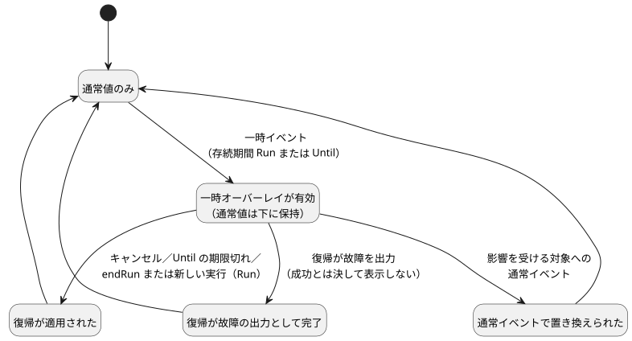

<!-- translation-source: docs/TEMPORARY-SETTINGS-HOST.md -->
[英語の原文](TEMPORARY-SETTINGS-HOST.md)

# 一時設定のリファレンスホスト

`TemporarySettingsHost`は、Reference §5.2で採用されたオーバーレイのライフサイクルを実装します。**一時設定**（*オーバーレイ*）は、限られた存続期間だけ設定を変更し、その後、それ以前に有効だった通常値へ復帰します。このホストはGhostFlowのキーワードを追加しません。

**役割分担。**

| ホストが所有するもの | 共有Rustコアで（`ControlRuntime`を通じて）実行されるもの |
| --- | --- |
| アクターの権限付与、Program／実行（run）の同一性、1つのオーバーレイ層、存続期間、復帰の来歴、受け入れ | 式、`control`の状態、タイマー、型付きのResult出力、スキャントランザクション |

**有効化。** 有効化では次のものを受け取ります。

- 厳密にコンパイルされた文芸的（literate）アーティファクト
- `runId`
- 各アクターを、そのアクターが変更してよい`config`のIDに対応付ける`grants`
- 上限のある履歴容量
- 既存のコンテキストプロファイル

有効化の前に、ホストはソースのバイト列を再コンパイルし、バイトコードとマニフェストを比較します。合成されたアーティファクトは、そのインポートのクロージャとともに与えなければなりません。

**組み込み側のホストが与えなければならないもの。** アクターの権限付与、実行の同一性、信頼できるクロックの観測、承認されたチェックポイントのストレージは、すべて組み込み側のホストから与えられます。アクター／オリジンのラベルは認証ではありません。このアダプタは、デバイスの実行を発行したり、クロックを取得したり、ストレージを永続化したり、物理出力に触れたりはしません。

## 要求と観測

`step(packet, event)`は、既存の`control`パケットと、省略可能な識別付きホストイベントを受け付けます。

すべてのイベントは、次のものを指定します。

- `kind`
- 厳密な`programFingerprint`、`sourceSha256`、`runId`
- `eventId`と`baseRevision`
- `actor`と`reason`

イベントの種類：

- `temporary`イベントと`ordinary`イベントは`changes`を持ちます。これは重複のない空でないリストで、各エントリは`configId`と型付きの`result`を持ちます。
- `cancel`イベントは、元のオーバーレイのIDを`cancelOverlayIds`で指定します。

有効な適用位置はホストが割り当てます。生の設定の事実でこれを迂回することはできません。

**一時イベントの規則。**

- グループ全体に対して、明示的な存続期間をちょうど1つ必要とします。`{ kind: 'Run' }`または`{ kind: 'Until', dateTimeMs }`です。`dateTimeMs`はミリ秒単位の絶対的なDateTimeです。
- すべての対象はオペレーターが編集可能で、かつそのアクターに権限が付与されていなければなりません。
- すべての値、および記録される通常の復帰値は、現在のProgramの型、範囲、グリッド、リスト容量を満たさなければなりません。

ホストは、コアのステップの前に次の要求を拒否します。存続期間の省略、入れ子、外部のProgram／ソース／実行、古いリビジョン、重複したイベント、未知の対象、権限のない要求です。

新しい一時要求の前に、キャンセルが確定していなければなりません。一時グループの一部だけを通常値で置き換えるには、グループ全体のキャンセルと新しい通常の変更の両方を行う1つのイベントを送信してください。

**通常値の保持と復元の方法。** 一時イベントの直前に有効だった通常値は、下層に残ります。新しい通常イベントは、影響を受けるオーバーレイを取り除き、新しい通常のResultをアトミックに適用します。その後で古い期限切れがそれを上書きすることは決してありません。

無効な通常のペイロードに対しては、コアの既存の振る舞いが維持されます。すなわち、集約された`fault(SettingsInvalid)`となり、設定のリビジョンは保持されます。

キャンセルまたは期限切れでは、有効なResultと、復帰がどのように終わったかが記録されます。

- 復帰が適用された。
- 復帰が通常イベントによって置き換えられた。
- 復帰が故障の出力として完了した。

故障が成功した復帰として表示されることは決してありません。次の図は、これらの結果をまとめたものです。

## 存続期間、復帰、再起動

**`Run`の存続期間。** オーバーレイは、`endRun(packet)`のとき、または復元された*別の*実行の最初の判断の前に復帰します。`endRun`は最後の設定復帰トランザクションを評価し、そのホストの実行を閉じます。それ以降のステップは拒否されます。

**`Until`の存続期間。** オーバーレイは、期限切れまで有効なままです。まったく同じProgramの承認された再起動をまたぐ場合も同様です。信頼できる壁時計時刻の不確実性区間によって、現在時刻が期限のどちら側にあるかが示されなければなりません。時刻が不明な場合、または区間が期限をまたいでいる場合は、存続期間の有効性は利用不可とされ、`control`の評価はブロックされます。明示的なキャンセルを行えば、時刻が有効かどうかを推測することなくこの状態から復旧できます。

**失敗と再試行。** 復帰トランザクションまたは`control`トランザクションが失敗した場合、ホストは設定、オーバーレイ、確定済みの結果、チェックポイントを保持します。有効な再試行では、受け入れられなかった同一性を再利用します。

**チェックポイントと復元。** `checkpoint()`は、次のものをダイジェストで結び付けます。厳密なProgram／ソース、通常のResult、オーバーレイ、コアのチェックポイント、完了したリビジョン／位置、上限のある履歴です。

- `instantiate`を通じて復元するには、`restoreApproved: true`と、新たに与える`runId`が必要です。
- ダイジェストは破損を検出します。ストレージを認証するものではありません。
- 復元経路は、オーバーレイの来歴全体、権限のスナップショット、作成イベント、期限、ロールバックの対象／値、コアの有効な状態を検証します。
- 設定とコンテキストの終端の同一性を、新しいコアに復元します。VMの`control`状態やタイマーのメモリは復元しません。
- 設定のリビジョンは永続化されます。適用位置は新しい実行に属します。
- 復元と存続期間の判断は、最初の`control`判断の前に完了します。

**Programの変更。** Program Qが、Program Pのオーバーレイを自動的に受け取ることは決してありません。Qには、識別され、権限が付与され、検証された新しい要求が必要です。

## TimeSlotsの復帰境界

コンテキスト設定のオリジンタグ`2`、`temporaryReturn`は、ホストが検証したライフサイクルの復帰のために予約されています。他のオリジンラベルと同様に、これは権限付与ではありません。

`temporaryReturn`の変更は、次のとおりです。

- オペレーターが編集可能な対象を必要とします。
- 型、範囲、グリッド、容量、重複のすべての検査を維持します。
- そのストリームですでに割り当てられた行キーを再利用できます。これにより、オーバーレイによって隠されていた通常の同一性が保たれます。
- 割り当てられていないキーは使用できません。

通常の`operatorEdit`と`producerObservation`の変更は、引き続き廃止されたキーを拒否します。リファレンスホストは、記録された復帰キーだけを受け入れます。複合的な通常の変更は、現在の、または下層にある通常の行の外にあるキーを拒否します。

新しいオリジンは、GFSF5/6への追加的な拡張です。古いランタイムは新しいタグを拒否し、これらの要求を処理してはなりません。

**証拠。** REF-05-018のテストは、実際のRun／Untilの所有、PからQへの再検証、グループのキャンセル、保守的な利用不可の扱い、通常の故障、そしてダイジェストが正しい場合でも偽造された来歴を拒否することを実行します。ネイティブのRustとframedのWASMは、失敗した復帰とその再試行を含め、コアの完全な結果、設定、チェックポイントのバイト列を比較します。これらは、与えられた証拠に基づくリファレンスホストのセマンティクスです。本番APIのオーケストレーション、デバイスへの配備、物理的な遮断、#89の全般的な完了を意味するものではありません。
