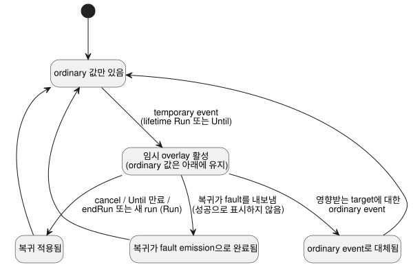

<!-- translation-source: docs/TEMPORARY-SETTINGS-HOST.md -->
[영문 원문](TEMPORARY-SETTINGS-HOST.md)

# 임시 설정 reference host

`TemporarySettingsHost`는 Reference §5.2에서 채택한 overlay 수명주기를
구현합니다. **임시 설정**(*overlay*)은 정해진 수명 동안 설정을 바꾼 뒤, 그 전에
적용되던 ordinary(일반) 값으로 복귀합니다. 이 host는 GhostFlow 키워드를 추가하지
않습니다.

**작업 분담.**

| host가 담당 | 공유 Rust 코어에서 실행(`ControlRuntime` 경유) |
| --- | --- |
| actor 권한 부여(grant), Program/run identity, 단일 overlay 계층, lifetime, 복귀 provenance, admission | 식, control 상태, 타이머, 타입이 지정된 Result emission, 스캔 트랜잭션 |

**활성화.** 활성화는 다음을 받습니다.

- 정확히 컴파일된 literate artifact
- `runId`
- 각 actor를 그 actor가 변경할 수 있는 config ID에 대응시키는 `grants`
- 크기가 제한된 history 용량
- 기존 context profile

활성화하기 전에 host는 소스 바이트를 재컴파일하고 바이트코드와 manifest를
비교합니다. 조합된 artifact는 import closure와 함께 제공해야 합니다.

**상위 host가 제공해야 하는 것.** actor 권한 부여, run identity, 신뢰할 수 있는
시계 관측, 승인된 checkpoint 저장소는 모두 이 어댑터를 포함하는 상위 host가
제공합니다. actor/origin 라벨은 인증이 아닙니다. 이 어댑터는 Device run을
발급하거나, 시계를 획득하거나, 저장소에 영속화하거나, 물리 출력을 건드리지
않습니다.

## 요청과 관측

`step(packet, event)`는 기존 control packet과 선택적인 식별된 host event를
받습니다.

모든 event는 다음을 명시합니다.

- `kind`
- 정확한 `programFingerprint`, `sourceSha256`, `runId`
- `eventId`와 `baseRevision`
- `actor`와 `reason`

event 종류는 다음과 같습니다.

- `temporary`와 `ordinary` event는 `changes`를 담습니다. 이는 비어 있지 않고
  중복이 없는 목록이며, 각 항목에는 `configId`와 타입이 지정된 `result`가
  있습니다.
- `cancel` event는 `cancelOverlayIds`에 원래 overlay ID를 명시합니다.

유효 적용 위치(position)는 host가 할당합니다. raw settings 사실로 이를 우회할 수
없습니다.

**temporary event의 규칙.**

- 그룹 전체에 대해 정확히 하나의 명시적 lifetime이 필요합니다.
  `{ kind: 'Run' }` 또는 `{ kind: 'Until', dateTimeMs }`입니다. `dateTimeMs`는
  밀리초 단위의 절대 DateTime입니다.
- 모든 target은 운영자가 편집할 수 있어야 하며 해당 actor에게 허용되어 있어야
  합니다.
- 모든 값과 기록된 ordinary 복귀 값은 현재 Program의 타입, 범위, grid, 목록 용량을
  만족해야 합니다.

host는 다음 요청을 코어 step 이전에 거부합니다. lifetime 누락, 중첩, 다른
Program/source/run, 오래된 revision, 중복 event, 알 수 없는 target, 권한 없는 요청.

새 temporary 요청 전에 cancellation이 확정되어 있어야 합니다. temporary 그룹의
일부만 ordinary 값으로 바꾸려면, 그룹 전체를 취소하면서 새 ordinary 변경을 함께
수행하는 event 하나를 제출하십시오.

**ordinary 값의 유지와 복원.** temporary event 직전에 적용되던 ordinary 값은 아래
계층에 남아 있습니다. 새 ordinary event는 영향받는 overlay를 제거하고 새 ordinary
Result를 원자적으로 적용합니다. 그 이후에는 오래된 만료가 이 값을 절대 덮어쓸 수
없습니다.

잘못된 ordinary payload는 코어의 기존 동작을 그대로 따릅니다. 즉, 그룹 전체에 대한
`fault(SettingsInvalid)`가 나오고 settings revision은 보존됩니다.

cancellation이나 만료는 유효 Result와 복귀가 어떻게 끝났는지를 기록합니다.

- 복귀가 적용되었습니다.
- 복귀가 ordinary event로 대체되었습니다.
- 복귀가 fault emission으로 완료되었습니다.

fault는 절대 성공한 복귀로 표시되지 않습니다. 다이어그램은 이 결과들을 요약합니다.

## Lifetime, 복귀와 재시작

**`Run` lifetime.** overlay는 `endRun(packet)` 시점에, 또는 복원된 *다른* run의 첫
판단 전에 복귀합니다. `endRun`은 마지막 settings 복귀 트랜잭션을 평가하고 그 host
run을 닫습니다. 이후 step은 거부됩니다.

**`Until` lifetime.** overlay는 만료될 때까지 활성 상태로 유지되며, 정확히 같은
Program의 승인된 재시작을 거쳐도 유지됩니다. 신뢰할 수 있는 벽시계 시간의 불확실성
구간이 현재 시각이 만료의 어느 쪽에 있는지 보여 주어야 합니다. 시각을 알 수 없거나
구간이 만료 시점에 걸쳐 있으면 lifetime 유효성은 사용 불가(unavailable)로 표시되고
control 평가가 차단됩니다. 명시적 cancellation을 사용하면 시각이 유효한지 추측하지
않고도 이 상태에서 복구할 수 있습니다.

**실패와 재시도.** 복귀 트랜잭션이나 control 트랜잭션이 실패하면 host는 settings,
overlay, 확정된 outcome, checkpoint를 유지합니다. 유효한 재시도는 수락되지 않았던
identity를 재사용합니다.

**Checkpoint와 복원.** `checkpoint()`는 다음을 digest로 함께 묶습니다. 정확한
Program/source, ordinary Result, overlay, 코어 checkpoint, 완료된
revision/position, 크기가 제한된 history.

- `instantiate`를 통한 복원에는 `restoreApproved: true`와 새로 제공한 `runId`가
  필요합니다.
- digest는 손상을 검출합니다. 저장소를 인증하지는 않습니다.
- 복원 경로는 전체 overlay provenance, 권한 snapshot, 생성 event, 만료, rollback
  target/값, 코어 유효 상태를 검증합니다.
- settings와 context terminal identity를 새 코어에 복원합니다. VM control 상태나
  타이머 메모리는 복원하지 않습니다.
- settings revision은 유지되고, 적용 위치는 새 run에 속합니다.
- 복원과 lifetime 판단은 첫 control 판단 전에 끝납니다.

**Program 변경.** Program Q는 Program P의 overlay를 자동으로 받지 않습니다. Q에는
식별되고, 권한이 부여되고, 검증된 새 요청이 필요합니다.

## TimeSlots 복귀 경계

context settings origin tag `2`인 `temporaryReturn`은 host가 검증한 수명주기
복귀용으로 예약되어 있습니다. 다른 origin 라벨과 마찬가지로 이것은 권한 부여가
아닙니다.

`temporaryReturn` 변경은 다음과 같습니다.

- 운영자가 편집할 수 있는 target이 필요합니다.
- 타입, 범위, grid, 용량, 중복 검사를 모두 유지합니다.
- 해당 stream에서 이미 할당된 row key를 재사용할 수 있으며, 이를 통해 overlay에
  가려진 ordinary identity를 보존합니다.
- 할당되지 않은 key는 사용할 수 없습니다.

ordinary `operatorEdit`와 `producerObservation` 변경은 여전히 retired key를
거부합니다. reference host는 기록된 복귀 key만 허용합니다. 복합 ordinary 변경은
현재 ordinary row나 아래 계층의 ordinary row에 속하지 않는 key를 거부합니다.

새 origin은 GFSF5/6에 대한 추가적(additive) 확장입니다. 이전 런타임은 새 tag를
거부하며, 이 요청을 소비해서는 안 됩니다.

**증거.** REF-05-018 테스트는 실제 Run/Until 소유권, P에서 Q로의 재검증, 그룹
cancellation, 보수적인 unavailable 처리, ordinary fault, 그리고 digest가 올바르더라도
위조된 provenance의 거부를 실행합니다. native Rust와 framed WASM은 실패한 복귀와 그
재시도를 포함하여 전체 코어 outcome, settings, checkpoint 바이트를 비교합니다. 이는
제공된 증거를 사용하는 reference-host 의미입니다. 프로덕션 API 오케스트레이션,
Device 배포, 물리적 차단, #89의 전반적 완료를 뜻하지 않습니다.
