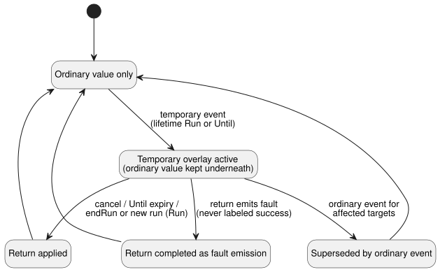

# Temporary settings reference host

`TemporarySettingsHost` implements the adopted overlay lifecycle from
Reference §5.2. A **temporary setting** (an *overlay*) changes a setting for a
limited lifetime and then returns to the ordinary value that was in effect
before it. The host adds no GhostFlow keyword.

**Division of work.**

| Owned by the host | Executed in the shared Rust core (through `ControlRuntime`) |
| --- | --- |
| actor grants, Program/run identity, one overlay layer, lifetime, return provenance, admission | expressions, control state, timers, typed Result emissions, scan transactions |

**Activation.** Activation receives:

- an exact compiled literate artifact;
- a `runId`;
- `grants`, mapping each actor to the config IDs it may change;
- a bounded history capacity;
- the existing context profile.

Before activation, the host recompiles the source bytes and compares the
bytecode and manifest. Composed artifacts must be supplied together with their
import closures.

**What the embedding host must supply.** Actor grants, run identity, trusted
clock observations, and approved checkpoint storage all come from the
embedding host. An actor/origin label is not authentication. This adapter does
not issue Device runs, acquire a clock, persist storage, or touch physical
outputs.

## Requests and observations

`step(packet, event)` accepts the existing control packet plus an optional
identified host event.

Every event names:

- `kind`;
- the exact `programFingerprint`, `sourceSha256`, and `runId`;
- `eventId` and `baseRevision`;
- `actor` and `reason`.

Event kinds:

- `temporary` and `ordinary` events carry `changes`: a nonempty list with no
  duplicates, where each entry has a `configId` and a typed `result`.
- `cancel` events name the original overlay IDs in `cancelOverlayIds`.

The host allocates the effective application position. Raw settings facts
cannot bypass it.

**Rules for a temporary event.**

- It requires exactly one explicit lifetime for the whole group:
  `{ kind: 'Run' }` or `{ kind: 'Until', dateTimeMs }`. `dateTimeMs` is an
  absolute DateTime in milliseconds.
- Every target must be operator-editable and granted to the actor.
- Every value, and the recorded ordinary return value, must satisfy the current
  Program's type, bounds, grid, and list capacity.

The host rejects these requests before any core step: omitted lifetime,
nesting, a foreign Program/source/run, a stale revision, a duplicate event, an
unknown target, and an unauthorized request.

A cancellation must be committed before a new temporary request. To replace
only part of a temporary group with ordinary values, submit one event that both
cancels the whole group and makes the new ordinary changes.

**How the ordinary value is kept and restored.** The ordinary value in effect
just before the temporary event stays in the underlying layer. A new ordinary
event removes the affected overlays and applies the new ordinary Result
atomically. An old expiry can never overwrite it afterwards.

An invalid ordinary payload keeps the core's existing behavior: an aggregate
`fault(SettingsInvalid)`, with the settings revision preserved.

A cancellation or expiry records the effective Results and how the return
ended:

- the return was applied;
- the return was superseded by an ordinary event; or
- the return completed as a fault emission.

A fault is never labeled as a successful return. The diagram summarizes these
outcomes.

## Lifetime, return and restart

**`Run` lifetime.** The overlay returns on `endRun(packet)`, or before the
first decision of a restored *different* run. `endRun` evaluates the final
settings-return transaction and closes that host run; later steps are
rejected.

**`Until` lifetime.** The overlay stays active until expiry, including across
approved restarts of the exact same Program. The trusted wall-time uncertainty
interval must show which side of the expiry the current time is on. If the time
is unknown, or the interval straddles the expiry, lifetime validity is marked
unavailable and control evaluation is blocked. An explicit cancellation can
recover from this without guessing whether the time is valid.

**Failure and retry.** If a return or control transaction fails, the host
keeps the settings, overlays, committed outcome, and checkpoint. A valid retry
reuses the identity that was not accepted.

**Checkpoint and restore.** `checkpoint()` binds the following together with a
digest: the exact Program/source, ordinary Results, overlays, core checkpoint,
completed revision/positions, and bounded history.

- Restoring through `instantiate` requires `restoreApproved: true` and a newly
  supplied `runId`.
- The digest detects corruption. It does not authenticate storage.
- The restore path validates the entire overlay provenance, the permission
  snapshot, the creation event, the expiry, the rollback targets/values, and
  the core effective state.
- It restores settings and context terminal identities into a fresh core. It
  does not restore VM control state or timer memory.
- Settings revisions persist; application positions belong to the new run.
- Restore and lifetime decisions finish before the first control decision.

**Changing Program.** Program Q never receives Program P's overlay
automatically. Q requires a fresh request that is identified, authorized, and
validated.

## TimeSlots return boundary

Context settings origin tag `2`, `temporaryReturn`, is reserved for lifecycle
returns that the host has validated. Like other origin labels, it is not
authorization.

A `temporaryReturn` change:

- requires operator-editable targets;
- keeps all type, range, grid, capacity, and duplicate checks;
- may reuse a row key already allocated in that stream, which preserves the
  ordinary identity hidden by an overlay;
- cannot use an unallocated key.

Ordinary `operatorEdit` and `producerObservation` changes still reject retired
keys. The reference host admits only recorded return keys. Compound ordinary
changes reject keys outside the current or underlying ordinary rows.

The new origin is an additive extension of GFSF5/6. Older runtimes reject the
new tag and must not consume these requests.

**Evidence.** The REF-05-018 tests execute real Run/Until ownership, P-to-Q
revalidation, group cancellation, conservative unavailable handling, ordinary
faults, and rejection of forged provenance even when its digest is correct.
Native Rust and framed WASM compare complete core outcomes, settings, and
checkpoint bytes, including a failed return and its retry. These are
reference-host semantics with supplied evidence. They are not production API
orchestration, Device deployment, a physical cutoff, or general closure of
#89.
