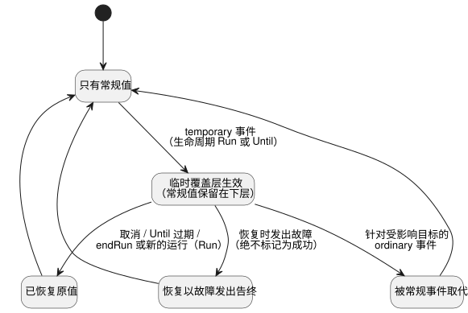

<!-- translation-source: docs/TEMPORARY-SETTINGS-HOST.md -->
[英文原文](TEMPORARY-SETTINGS-HOST.md)

# 临时设置参考宿主

`TemporarySettingsHost` 实现了 Reference §5.2 中已采纳的覆盖层生命周期。**临时设置**（即*覆盖层*，overlay）在有限的生命周期内改变某项设置，之后恢复为此前生效的常规值。该宿主不新增任何 GhostFlow 关键字。

**分工。**

| 由宿主负责 | 在共享 Rust core 中执行（通过 `ControlRuntime`） |
| --- | --- |
| 执行者授权、Program/运行身份标识、单一覆盖层、生命周期、恢复来源（provenance）、准入（admission） | 表达式、控制状态、定时器、带类型的 Result 发出、扫描事务 |

**激活。** 激活时接收：

- 一个精确的已编译文学式（literate）构件；
- 一个 `runId`；
- `grants`，将每个执行者映射到其可修改的 config ID；
- 一个有界的历史容量；
- 现有的上下文 profile。

激活之前，宿主会重新编译源字节，并比较字节码和清单。组合构件必须与其导入闭包一起提供。

**嵌入宿主必须提供的内容。** 执行者授权、运行身份标识、可信的时钟观测以及经批准的检查点存储，都由嵌入宿主提供。执行者/来源标签并不是身份验证。本适配器不签发设备运行、不获取时钟、不持久化存储，也不触碰物理输出。

## 请求与观测

`step(packet, event)` 接受现有的控制数据包，外加一个可选的、带标识的宿主事件。

每个事件都会指明：

- `kind`；
- 精确的 `programFingerprint`、`sourceSha256` 和 `runId`；
- `eventId` 和 `baseRevision`；
- `actor` 和 `reason`。

事件类型：

- `temporary` 和 `ordinary` 事件携带 `changes`：一个非空且无重复的列表，其中每个条目都有一个 `configId` 和一个带类型的 `result`。
- `cancel` 事件在 `cancelOverlayIds` 中指明原始的覆盖层 ID。

由宿主分配实际生效的应用位置。原始的设置事实无法绕过它。

**临时事件的规则。**

- 它要求整个组恰好有一个显式生命周期：
  `{ kind: 'Run' }` 或 `{ kind: 'Until', dateTimeMs }`。`dateTimeMs` 是以毫秒表示的绝对 DateTime。
- 每个目标都必须可由操作员编辑，并且已授权给该执行者。
- 每个值以及记录下来的常规恢复值，都必须满足当前 Program 的类型、范围、网格和列表容量。

在任何 core 步骤之前，宿主会拒绝以下请求：省略生命周期、嵌套、外来的 Program/源/运行、陈旧的修订版、重复事件、未知目标以及未经授权的请求。

取消必须在新的临时请求之前提交。若只想用常规值替换临时组中的一部分，请提交一个事件，同时取消整个组并做出新的常规更改。

**常规值如何保留和恢复。** 临时事件之前生效的常规值保留在下层。新的常规事件会移除受影响的覆盖层，并原子地应用新的常规 Result。此后，旧的过期绝不能再覆盖它。

无效的常规载荷保持 core 的现有行为：一个聚合的
`fault(SettingsInvalid)`，并保留设置修订版。

取消或过期会记录生效的 Result 以及恢复是如何结束的：

- 恢复已应用；
- 恢复被常规事件取代；或
- 恢复以故障发出告终。

故障绝不会被标记为成功恢复。下图总结了这些结果。

## 生命周期、恢复与重启

**`Run` 生命周期。** 覆盖层在 `endRun(packet)` 时恢复，或在一个已恢复的*不同*运行的第一次判定之前恢复。`endRun` 会求值最后一次设置恢复事务，并关闭该宿主运行；之后的步骤会被拒绝。

**`Until` 生命周期。** 覆盖层在过期之前一直有效，包括跨越完全相同 Program 的经批准重启。可信墙钟时间的不确定区间必须表明当前时间位于过期时刻的哪一侧。如果时间未知，或该区间跨越过期时刻，则生命周期有效性被标记为不可用，并阻止控制求值。显式取消可以从这种状态恢复，而无需猜测时间是否有效。

**失败与重试。** 如果恢复或控制事务失败，宿主会保留设置、覆盖层、已提交的结果和检查点。有效的重试会复用未被接受的那个身份标识。

**检查点与恢复。** `checkpoint()` 用一个摘要将以下内容绑定在一起：精确的 Program/源、常规 Result、覆盖层、core 检查点、已完成的修订版/位置以及有界历史。

- 通过 `instantiate` 恢复时，需要 `restoreApproved: true` 和一个新提供的 `runId`。
- 摘要用于检测损坏，它并不对存储进行身份验证。
- 恢复路径会校验完整的覆盖层来源、权限快照、创建事件、过期时间、回滚目标/值以及 core 的生效状态。
- 它将设置和上下文终端身份标识恢复到一个全新的 core 中。它不恢复 VM 控制状态或定时器内存。
- 设置修订版会持久保留；应用位置属于新的运行。
- 恢复和生命周期判定在第一次控制判定之前完成。

**更换 Program。** Program Q 绝不会自动接收 Program P 的覆盖层。Q 需要一个新的、带标识的、经过授权和校验的请求。

## TimeSlots 恢复边界

上下文设置来源标签 `2`，即 `temporaryReturn`，保留给经宿主校验的生命周期恢复使用。与其他来源标签一样，它并不代表授权。

一次 `temporaryReturn` 更改：

- 要求目标可由操作员编辑；
- 保留所有类型、范围、网格、容量和重复检查；
- 可以复用该流中已分配的行键，从而保留被覆盖层隐藏的常规身份标识；
- 不能使用未分配的键。

常规的 `operatorEdit` 和 `producerObservation` 更改仍会拒绝已停用的键。参考宿主只准入已记录的恢复键。复合常规更改会拒绝当前常规行或下层常规行之外的键。

新的来源是对 GFSF5/6 的增量扩展。旧版运行时会拒绝这个新标签，并且不得处理这些请求。

**证据。** REF-05-018 测试实际执行了 Run/Until 所有权、P 到 Q 的重新校验、组取消、保守的不可用处理、常规故障，以及对伪造来源的拒绝（即使其摘要正确）。
原生 Rust 和 framed WASM 会比较完整的 core 结果、设置和检查点字节，包括一次失败的恢复及其重试。这些是带有所提供证据的参考宿主语义。它们不是生产环境的 API 编排、设备部署、物理切断，也不意味着 #89 已全面关闭。
