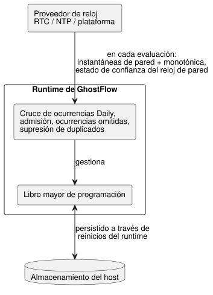
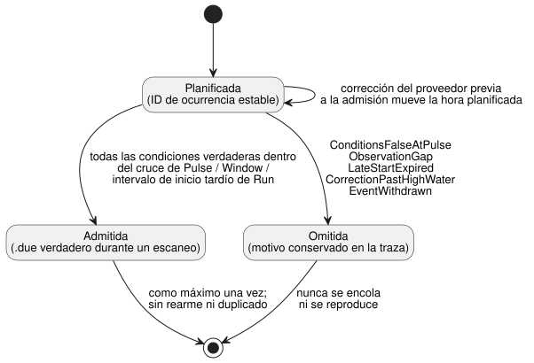
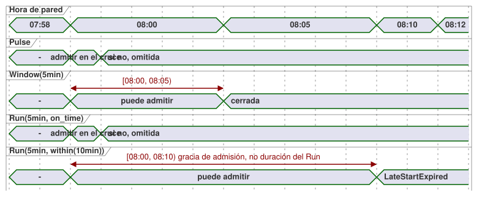

<!-- translation-source: docs/TIME-AND-SCHEDULE-CONTRACT.md -->
[Original en inglés](TIME-AND-SCHEDULE-CONTRACT.md)

# Propuesta de contrato de tiempo y programación (Schedule)

Seguimiento: issue del lenguaje #23 / integración `TASK-85.2` / revisiones R15–R17.

Este documento es el traspaso de diseño mínimo y coherente para:

- DateTime y tiempo transcurrido monotónico;
- programaciones recurrentes;
- eventos solares y de mareas;
- calendarios laborales;
- respaldo (fallback) explícito.

No es un marco temporal general. No afirma que todas las formas de superficie
que se describen abajo estén implementadas. `Duration`, los temporizadores de
tiempo transcurrido, `DailySlots` y el host Solar acotado ya existen. Los tipos
y políticas restantes son propuestas para T2–T4 y para la revisión conjunta.

Los metadatos aditivos del temporizador Bool de verdad continua y su contrato
de compatibilidad se especifican por separado en
`CONTINUOUS-BOOL-TIMER-CONTRACT.md` (NT-T1-A/#46). Ese contrato no cambia el
temporizador `elapsed(state)` existente que se describe aquí.

**En este documento:** significado de producto confirmado → qué está
implementado hoy → el límite de ejecución Daily aprobado → dominios de valores
y de relojes → instantáneas de reloj → el valor `Schedule` y la admisión de
ocurrencias → recurrencia, Cron, DST y medianoche → calendarios laborales →
eventos naturales y respaldo → vectores de aceptación → qué decide aún la
revisión conjunta.

## Significado de producto confirmado

Estas decisiones de producto están cerradas:

- **Señales legibles.** Los valores de control y las salidas forman señales que
  varían en el tiempo, pero la fuente sigue siendo legible como nombres,
  expresiones, estado anterior/siguiente explícito y conexiones de salida. Los
  usuarios no escriben la infraestructura de suscripciones/operadores.
- **Un `Schedule` se evalúa de forma continua.** No es una llamada a función
  diferida ni un hilo en segundo plano. Una decisión perdida nunca se encola
  silenciosamente para más tarde.
- **Dos dominios de reloj.** El tiempo de calendario y el tiempo transcurrido
  monotónico son dominios de reloj distintos. Corregir el reloj de pared nunca
  rebobina ni prolonga un temporizador de tiempo transcurrido ya admitido.
- **Los eventos naturales necesitan contexto.** El control solar y
  lunar/de mareas requiere la hora actual más el contexto de la instalación. Un
  contexto ausente, no fiable u obsoleto es `Unknown`, no `false`.
- **Respaldo explícito.** Toda regla de tiempo natural tiene un respaldo
  explícito. No se infiere ninguna política de gracia por desconexión de NTP,
  de recuperación de lo perdido (catch-up), de inicio tardío, de pausa, de
  reintento ni de reinicio.
- **El conocimiento tácito no es semántica de ejecución.** Una premisa común
  confirmada puede convertirse en fuente o política explícitas. Descubrir y
  confirmar el conocimiento tácito corresponde al flujo de trabajo de
  autoría/revisión, no a la semántica de ejecución del lenguaje.

## Límite de la implementación actual

Lo que existe hoy y sus carencias conocidas:

- **`Duration`.** La sintaxis es un número entero no negativo de milisegundos,
  escrito con `ms`, `s`, `min` o `h`. La ruta actual de literales de control
  aún no aplica el máximo de entero seguro, mientras que el dialecto
  independiente de restricciones usa un límite `i32` positivo. Son carencias de
  implementación, no dos tipos Duration base distintos.
- **Temporizadores de tiempo transcurrido.** `timer x = elapsed(flag)` usa la
  entrada monotónica generada `__gf_now_ms`. Consolida el estado del
  temporizador junto con el tick de control exitoso.
- **Proveedores de ocurrencias.** `DailySlots<15min>` y `Solar` son
  proveedores de ocurrencias propiedad del host. La fuente los ve como entradas
  booleanas `.due` que son verdaderas durante un escaneo. No accionan salidas.
- **Requisitos de Solar.** Solar requiere una zona horaria, coordenadas
  literales, salida/puesta del sol más un desfase exacto y `fallback = skip`.
  El proveedor nativo actual admite un perfil acotado de zonas horarias y
  años. Un contexto no admitido falla de forma cerrada (fail closed).
- **Tratamiento de saltos de reloj.** Los proveedores existentes establecen una
  línea base tras el arranque/la recuperación, suprimen eventos duplicados ante
  retrocesos del reloj de pared y omiten grandes saltos hacia adelante del
  reloj de pared. Solar también comprueba el salto monotónico entre escaneos;
  `DailySlots` v1 no lo hace. Sus límites actuales de 60 segundos son
  comportamiento de compatibilidad. No son un valor predeterminado oculto
  universal para el nuevo contrato de Schedule.
- **El soporte de zonas horarias difiere según el host.** Solar en el navegador
  acepta las zonas IANA de la plataforma. El proveedor portable actual de Rust
  admite solo `Asia/Seoul`, `UTC` y `Etc/UTC`. Hasta que ambos consumidores
  superen los mismos vectores de zonas, un paquete solo puede declarar el
  perfil que ambos comparten explícitamente. Que el compilador lo acepte no
  basta para tener soporte entre hosts.

Consulte [SOLAR-SCHEDULE.es.md](SOLAR-SCHEDULE.es.md) para el comportamiento
implementado. Esta propuesta conserva esos artefactos y exige un versionado
explícito para cualquier semántica posterior.

## Límite de ejecución Daily aprobado — 2026-09-23

Esta decisión divide en tres la responsabilidad de las programaciones `Daily`:

- **Proveedor de reloj (RTC/NTP/plataforma):** suministra a cada evaluación
  instantáneas del reloj de pared y del reloj monotónico, y el estado de
  confianza del reloj de pared.
- **Runtime de GhostFlow:** calcula los cruces de ocurrencias `Daily`, la
  admisión, las ocurrencias omitidas y la supresión de duplicados, y gestiona
  el libro mayor (ledger) de programación.
- **Almacenamiento del host:** persiste ese libro mayor a través de los
  reinicios del runtime.



La fuente de tiempo subyacente puede reemplazarse sin cambiar la semántica de
`Daily`. Esto asigna la responsabilidad de ejecución del
[contrato de programación de la Referencia §3.5](reference/03-time-and-schedules.es.md);
no añade ninguna política de lenguaje nueva.

## Dominios de valores y de relojes

| Dominio | Contrato mínimo | Notas |
| --- | --- | --- |
| `Duration` | milisegundos enteros exactos no negativos, `0..2^53-1` | longitud relativa; aritmética verificada; sin unidad de mes/año |
| `Date` | fecha gregoriana, años `1970..9999` | sin hora ni zona horaria |
| `TimeOfDay` | `00:00:00.000..23:59:59.999` | sin fecha, desfase ni recurrencia |
| `DateTime` | instante UTC exacto con resolución de milisegundos, desde la época Unix hasta `9999-12-31T23:59:59.999Z` | el literal requiere `Z` o un desfase UTC numérico; el valor no lleva zona IANA |
| instante monotónico | milisegundos exactos no negativos solo del host, más la época de arranque/ejecución | nunca se formatea como hora civil ni se escribe como literal de reloj de pared |

**Reglas de rango.**

- El límite común de transporte exacto es el rango de enteros seguros de
  JavaScript. Los instantes `DateTime` del rango civil declarado caben en él.
- Son diagnósticos: el segundo intercalar `:60`, `24:00`, un literal DateTime
  sin desfase y las fechas inexistentes.
- Una zona horaria IANA pertenece a un Schedule recurrente o a un contexto,
  nunca a un instante DateTime.
- Las construcciones que semánticamente requieren un retardo positivo pueden
  rechazar el cero. Esto no cambia el rango base de `Duration`.
- T2 debe aplicar el rango exacto de forma coherente a los literales de
  control, las restricciones, los valores del manifiesto y el intercambio
  nativo/WASM.

**Aritmética mínima.** El conjunto es deliberadamente pequeño:

- `DateTime ± Duration -> DateTime`, con rango verificado.
- `Duration + Duration`, y una resta verificada que se mantiene no negativa.
- Las comparaciones de DateTime y de TimeOfDay requieren que ambos lados tengan
  el mismo tipo.
- `TimeOfDay + Duration` no da la vuelta a medianoche. Resuélvalo con una Date
  y una zona horaria dentro de un Schedule.
- `DateTime - DateTime` no está en el perfil mínimo, porque `Duration` es no
  negativo. Compare instantes o use `elapsed` monotónico en su lugar. Añada un
  tipo de diferencia con signo solo cuando un caso de control demostrado lo
  necesite.
- Los días, meses y años de calendario no son Durations de milisegundos fijos.

**Escritura de literales.** El límite recomendado para los literales de fuente
sigue siendo el candidato de plantilla etiquetada: `date\`2026-09-15\``,
`time\`06:30\`` y `datetime\`2026-09-15T06:30:00+09:00\``. R15 revisa estas
escrituras. Son literales de tiempo de compilación, no análisis de cadenas en
tiempo de ejecución.

## Instantánea de reloj y responsabilidad

Cada escaneo aceptado recibe exactamente una instantánea inmutable del host:

```text
ClockSnapshot {
  monotonicMs
  bootEpoch
  wallMs?              // exact DateTime instant
  wallQuality          // Trusted | Unknown(reason)
  uncertaintyMs?
  sourceRevision?
}
```

**Quién lee el reloj.** El driver obtiene la hora NTP/RTC/de plataforma y
decide si es de confianza. El compilador y la VM nunca abren una conexión de
red ni leen el reloj de una máquina.

**Cómo se usa la instantánea.**

- `wallMs` sin una calidad de confianza no es tiempo de calendario utilizable.
- Una regresión monotónica (el tiempo monotónico retrocede) rechaza el
  escaneo.
- Una corrección del reloj de pared hacia adelante o hacia atrás se acepta
  como una nueva observación. La marca de agua alta (high-water mark) de
  ocurrencias y la identidad de las ocurrencias evitan duplicados.

**Mantener la última hora de confianza.** Seguir usando la última hora de pared
de confianza sería una política explícita, conceptualmente
`hold_last for Duration then <fallback>`, medida en tiempo monotónico. Este
documento no la habilita. R17 decide si exponerla. `skip` sigue siendo el único
respaldo mínimo requerido.

## Schedule es un valor reactivo tipado

La forma conceptual compacta es:

```text
Schedule = {
  trigger: TriggerRule,
  day: DayRule?,
  when: BoolPredicate?,
  basis: Pulse | Window(Duration) | Run(Duration, LateStartPolicy),
  timezone: IanaZone,
  context: installation bindings,
  fallback: Fallback,
  dst: DstPolicy,
  gap: ObservationGapPolicy
}
```

**Un tipo producto, no tres clases.** `Schedule` es un tipo producto con una
variante de base de duración (`basis`). No es `Cron | Window | Run` como tres
clases equivalentes.

- Las reglas de disparo incluyen: un DateTime único, un TimeOfDay diario, un
  Cron con nombre de cinco campos y cada evento solar/de mareas.
- El valor almacenado describe un flujo. Leerlo no pone en marcha ningún
  equipo.
- `when` es una expresión de dependencias compilada estáticamente sobre
  entradas y estado declarados. No es un cierre (closure) ni una función de
  retorno (callback) en tiempo de ejecución.
- Las restricciones globales de salida siguen siendo una etapa posterior y
  separada. Aun así, pueden bloquear la salida solicitada de un Run admitido.

**Decisión por escaneo.** En cada escaneo, la resolución produce `True`,
`False` o `Unknown(reason)`, junto con las revisiones de regla/contexto. El
respaldo resuelve `Unknown`; negar `Unknown` nunca lo convierte en permiso para
operar. Las proyecciones públicas siguen siendo valores de control ordinarios:

- `.due` es verdadero durante un escaneo aceptado cuando se admite una
  ocurrencia.
- Una Window puede exponer un nivel que es verdadero solo mientras la ventana
  semiabierta y todos los predicados actuales sean verdaderos.
- El estado de ejecución de un Run y `.active` se reducen a estado y
  temporizadores explícitos. No son una tarea asíncrona oculta.

**Observación lateral (sidecar).** El límite ejecutable mínimo lleva una
observación lateral atómica junto con la entrada `.due` generada:

```text
ScheduleObservation {
  format: GhostFlow/schedule-observation-v1
  scheduleId             // stable declaration/source-map identity
  definitionRevision     // exact loaded code/package revision
  decision: False | Due | Unknown(reason)
  disposition?           // Before | PredicateFalse | AlreadyAdmitted | Missed(reason)
  occurrence? { id, sourceKey, plannedWallMs, sourceDate?, scheduledLocalDate }
  providerRevision?
  contextRevisions
}
```

**Códigos de motivo.** Los motivos Unknown y los motivos de omisión (Missed)
son conjuntos separados:

| Tipo | Motivos iniciales |
| --- | --- |
| Unknown | `ClockUnknown`, `LocationUnknown`, `EventUnavailable`, `PredictionMissing`, `PredictionStale`, `CalendarMissing`, `CalendarOutOfRange`, `ZoneUnsupported` |
| Missed | `ConditionsFalseAtPulse`, `ObservationGap`, `LateStartExpired`, `CorrectionPastHighWater`, `EventWithdrawn` |

Un motivo Unknown nunca se reutiliza para un predicado `when` ordinario falso
ni para una ocurrencia omitida conocida.

**`skip` conserva la evidencia.** `fallback = skip` resuelve una admisión
Unknown a `.due = false` para la VM. No borra `decision = Unknown(reason)` de
la traza del mismo escaneo aceptado. Ramificar en la fuente según una calidad
no resuelta queda fuera del perfil mínimo. Añadirlo más adelante requiere un
Result/Decision tipado en lugar de otro Bool no verificado. Así se mantiene la
compatibilidad actual de `.due`, sin pretender que el Bool por sí solo lleve
la procedencia.

**Identidad de ocurrencia.** Cada ocurrencia planificada tiene una identidad
estable. La clave canónica es el `scheduleId` estable más una clave de
ocurrencia de origen:

- DateTime fijo: el DateTime;
- diario/Cron: la franja local, más el pliegue (fold) de DST cuando
  corresponda;
- solar: el tipo de evento más la Date de origen;
- de mareas: la clave estable de estación/evento del proveedor.

La revisión de la definición cargada, la revisión del proveedor y la hora
planificada corregida son metadatos, no identidad. Consecuencias:

- Un intercambio en caliente (hot-swap) o una corrección del proveedor antes de
  la admisión mueve o reinterpreta la misma ocurrencia. No crea una segunda.
- Una programación deliberadamente nueva obtiene un `scheduleId` nuevo.
- Volver a reproducir una ocurrencia ya admitida requiere una acción del
  operador separada y explícita, no una edición incidental de la fuente.

La clave se procesa con SHA-256 para formar el ID público de la ocurrencia y se
persiste en el libro mayor de marca de agua alta/admisión.

**Como máximo una vez.** Una ocurrencia puede admitirse como máximo una vez, de
modo que una condición que permanece verdadera no crea una ejecución en cada
escaneo. Una condición que se vuelve verdadera más tarde solo puede admitir una
ocurrencia dentro de una Window explícita o de un intervalo de inicio tardío.
Pasar a falso y luego de nuevo a verdadero dentro de la misma ocurrencia no la
rearma. Los intentos repetidos requieren una política explícita de disparo
repetitivo/rearme.



**Cuándo se permite la admisión (basis).**

| Basis | Primera admisión permitida | En otro caso |
| --- | --- | --- |
| `Pulse` | solo en el cruce, si todas las condiciones son verdaderas en ese momento (sin intervalo tardío) | omitida |
| `Window(5min)` | en `[planned, planned + 5min)` | — |
| `Run(5min, on_time)` | solo en el cruce observado | omitida |
| `Run(5min, within(10min))` | en `[planned, planned + 10min)`; la gracia positiva no es la duración de la ejecución | `LateStartExpired` |

No alcanzar el intervalo semiabierto `within(...)` produce `LateStartExpired`,
nunca una llamada encolada.
`on_time` y `within` son las únicas variantes mínimas de `LateStartPolicy`.
Todo manifiesto de Run lleva exactamente un valor etiquetado: `{ kind: on_time }`
o `{ kind: within, withinMs: <exact positive Duration> }`.

La línea de tiempo siguiente compara los intervalos de admisión para una hora
planificada de 08:00.



**Duración del Run.** Un Run admitido mide su duración desde la admisión real,
en tiempo monotónico. El tiempo transcurrido del Run corre de forma continua
desde la admisión. No se pausa por una salida solicitada falsa, ni porque una
restricción global bloquee la salida final. El tiempo en ON solicitado, el
tiempo acumulado en ON seguro y el tiempo continuo en ON seguro son
expresiones de temporizador explícitas y separadas, no modos ocultos del Run.
Ninguna de ellas demuestra un movimiento físico.

## Recurrencia, Cron, DST y medianoche

**`cron5`.** La escritura mínima de Cron se llama `cron5` para que nadie tenga
que adivinar el dialecto: minuto, hora, día del mes, mes y día de la semana;
sin segundos. El Cron tradicional usa una sorprendente regla OR cuando ambos
campos de día están definidos. Para evitarla, el primer perfil rechaza una
regla que restrinja a la vez el día del mes y el día de la semana. La zona
horaria es obligatoria.

**DST.** La recurrencia en hora civil requiere un tratamiento explícito del
horario de verano (DST), aunque la zona de la instalación no tenga
actualmente ninguna transición:

- hora local inexistente: `skip` o `next_valid`;
- hora local repetida: `first`, `second`, `both` o `skip`.

Ninguna opción se selecciona silenciosamente. Un literal DateTime con desfase
fijo no tiene ambigüedad de DST.

**Medianoche.** Las ventanas son semiabiertas. Cuando el desfase de un evento
solar/de mareas cruza la medianoche, el filtro de día usa la Date local del
inicio programado resuelto; la traza también conserva la fecha de origen del
evento natural. Un cambio de día nunca detiene un Run ya admitido, salvo que
una regla separada de continuación/restricción así lo indique.

**Campos obligatorios del manifiesto.** El nuevo manifiesto de Schedule
requiere:

- `dstMissing` (`skip | next_valid`);
- `dstRepeated` (`first | second | both | skip`);
- `gapPolicy = skip`;
- un `maxObservationGapMs` exacto y positivo.

La escritura en la fuente sigue abierta a la revisión R16, pero los valores
ausentes son diagnósticos de T3.

**`DailySlots` v1 heredado.** El `DailySlots` v1 existente es un descriptor
heredado. Su comportamiento de compatibilidad observado es
inexistente=`skip`, repetida=`first`, brecha=`skip after 60000ms`. No se
reetiqueta silenciosamente como el nuevo perfil. La migración emite los campos
explícitos y una nueva identidad de manifiesto/runtime.

**Brechas de observación.** El nuevo perfil comprueba la continuidad de la
observación usando ambos campos de `ClockSnapshot`s aceptadas consecutivas.
Existe una brecha cuando **cualquiera** de los dos, el delta monotónico **o**
el delta positivo del reloj de pared, supera `maxObservationGapMs`. Un
retroceso del reloj de pared por sí solo se gestiona con la regla de la marca
de agua alta, pero no puede ocultar un delta monotónico excesivo. Esta
comprobación no depende de la velocidad de sondeo del host ni de la fuente de
corrección NTP.

El `gapPolicy = skip` mínimo tiene prioridad sobre la admisión tardía de Pulse,
Window y Run:

- Toda ocurrencia aún no admitida cuyo intervalo de admisión se cruce con la
  brecha se marca como omitida con `ObservationGap`.
- El escaneo actual o uno posterior no puede revivirla solo porque una Window
  o un intervalo `within(...)` sigan abiertos.
- El arranque inicial y la recuperación de la confianza establecen una línea
  base de la misma forma, fallando de forma cerrada.
- Cualquier política futura de reproducción/recuperación de lo perdido
  (catch-up) debe nombrarse por separado.

**Perfil de zonas horarias.** El mismo manifiesto nombra una revisión exacta de
`timezoneProfile`. Un paquete firmado la vincula como una capacidad de host
requerida. Los hosts de navegador y nativos rechazan un perfil o una zona que
no admiten antes de la activación del runtime. Que el compilador acepte una
cadena IANA no es evidencia de que todos los consumidores la implementen.

## Reglas de día del calendario laboral

Las reglas de día de la semana, de día festivo oficial y de trabajo
planificado son cosas distintas:

- `day\`mon..fri\`` usa solo la Date local resuelta.
- `day\`holiday\`` usa una instantánea de un calendario de festivos con nombre.
- `day\`workday\`` / `day\`offday\`` usan un calendario laboral de
  sitio/cuadrilla con nombre.
- "Día laborable" significa trabajo planificado, no presencia observada de
  trabajadores.

**Instantáneas de calendario.** Una instantánea de calendario laboral vincula
el ID del calendario, la revisión, la zona horaria y el rango de cobertura.
Precedencia, de mayor a menor:

1. excepción de fecha explícita;
2. política de festivos declarada;
3. patrón semanal.

Las excepciones en conflicto para la misma fecha no son válidas. Los datos
ausentes o fuera de cobertura son `Unknown`; en ese caso, workday y offday son
ambos Unknown. La regla de día de un Schedule limita solo la elegibilidad de
admisión. No afecta a un Run ya activo.

**Escritura y turnos nocturnos.** La superficie provisional usa
`on = day\`...\`` y `calendar = workers`; R16 revisa la escritura. El primer
perfil define etiquetas de día solo para fechas de calendario. No infiere la
fecha laboral de un turno nocturno. Se rechaza una definición de calendario que
intente un intervalo de trabajo que cruce la medianoche; en su lugar, los
autores pueden dividir ventanas de tiempo explícitas en la medianoche. Un tipo
de turno posterior puede añadir la atribución de fecha laboral sin cambiar
estas etiquetas de día.

## Contexto de eventos naturales y respaldo

**Vinculaciones de contexto.**

- El contexto de un evento solar vincula la zona horaria, la revisión de la
  ubicación, el tipo de evento y la revisión del cálculo del proveedor.
- El contexto de un evento de mareas vincula además la estación/el modelo, la
  revisión de la predicción, la cobertura y el vencimiento.

**Identidad de los eventos de mareas.** Un perfil de proveedor de mareas se
acepta solo si suministra un ID de evento opaco que sea estable entre
revisiones de predicción y único entre varios eventos del mismo tipo en una
estación. La clave de ocurrencia de origen es espacio de nombres del proveedor
+ ID de estación + ese ID de evento. La hora o el ordinal dentro del mismo día
nunca se usan como identidad de corrección. Un proveedor sin esta capacidad
puede suministrar una instantánea inmutable, pero no puede declarar soporte de
correcciones.

La pleamar y la bajamar son eventos de ocurrencia. La marea viva/muerta es una
condición clasificada y no se le puede aplicar un desfase como si fuera un
DateTime. El lenguaje no supone ni un número fijo de mareas por día ni que una
predicción demuestre el nivel físico del agua.

**Correcciones del proveedor.** Las correcciones conservan la identidad estable
del evento definida arriba.

- Antes de la admisión, la predicción válida más reciente puede mover el
  instante planificado.
- Si el instante se mueve hasta la marca de agua alta de observación o por
  detrás de ella, la ocurrencia se omite con `CorrectionPastHighWater`. No se
  recupera.
- Una retirada explícita por parte del proveedor se omite con
  `EventWithdrawn`.
- Un reordenamiento no puede cambiar los ID estables.
- Tras la admisión, una revisión o una retirada no crean un duplicado ni
  cancelan el Run admitido.

La ubicación ausente, el reloj no fiable, el evento no admitido/polar, la
predicción ausente u obsoleta y el calendario no disponible siguen siendo
motivos distinguibles en la traza.

**Respaldo.** Toda regla del nuevo perfil que dependa del contexto natural,
temporal o de calendario requiere `fallback`. El valor mínimo admitido es
`skip`: no emitir ninguna ocurrencia nueva y conservar el motivo. `skip` no
apaga un Run ya admitido ni borra temporizadores monotónicos. Una alternativa
de TimeOfDay fijo solo tiene sentido mientras el reloj civil y la zona horaria
sigan siendo de confianza, de modo que aún necesita un respaldo terminal como
`skip`. La recuperación establece una nueva línea base. Ninguna ocurrencia
omitida se vuelve a reproducir salvo que más adelante se añada una política
explícita de recuperación de lo perdido (catch-up).

`DailySlots` v1 sigue siendo legible bajo su antigua identidad de runtime
declarada sin un campo de respaldo. La migración de T3 debe producir un
respaldo explícito. Nunca debe tratar esa aceptación heredada como permiso para
omitir el respaldo en fuentes nuevas.

## Vectores de aceptación de T2–T4

Estos ID son vectores semánticos estables. R15–R17 pueden cambiar la escritura
provisional antes de que los vectores se conviertan en fixtures de fuente.

| ID | Escenario | Resultado esperado | Responsable |
| --- | --- | --- | --- |
| T1-TYPE-01 | límites válidos/no válidos de Date, TimeOfDay y DateTime con desfase | valores normalizados exactos / diagnósticos de compilación | T2 |
| T1-TYPE-02 | el reloj de pared retrocede mientras el tiempo monotónico avanza | el temporizador de tiempo transcurrido avanza; ninguna ocurrencia duplicada | T2/T4 |
| T1-TYPE-03 | DateTime más Duration cruza la medianoche UTC/local | instante exacto; sin vuelta modular por día | T2 |
| T1-DURATION-01 | `0ms`, máximo seguro, máximo+1 a través de control/restricciones/ABI | los dos primeros exactos donde la construcción permite cero; el desbordamiento se rechaza de forma coherente | T2 |
| T1-PULSE-01 | Pulse a las 08:00, predicado de inicio falso en el cruce y luego verdadero a las 08:10 | omitida, no encolada | T4 |
| T1-WINDOW-01 | Window de 08:00–09:00; el predicado es verdadero por primera vez a las 08:10 y luego alterna | una admisión a las 08:10; sin rearme en la misma ventana | T4 |
| T1-RUN-01 | planificado a las 08:00, `Run(5min, within(10min))` admitido a las 08:02 | objetivo 08:07 monotónico; una corrección del reloj de pared no lo cambia | T2/T4 |
| T1-RUN-02 | Run activo mientras la salida solicitada/segura está bloqueada durante un minuto | el Run se completa igualmente desde la admisión; temporizadores solicitado/seguro separados registran sus propios valores | T4 |
| T1-RUN-03 | el predicado de `Run(5min, on_time)` se vuelve verdadero después del cruce, o `within(10min)` llega a las 08:10 | omitida con el motivo exacto; nunca encolada | T3/T4 |
| T1-FALLBACK-01 | una regla natural omite el respaldo | diagnóstico de compilación | T3 |
| T1-FALLBACK-02 | reloj/ubicación/evento/predicción no disponibles con `skip` | sin due; se conserva el motivo Unknown exacto | T4 |
| T1-RECOVERY-01 | la confianza se recupera tras un evento omitido | solo línea base; sin recuperación de lo perdido ni duplicado | T4 |
| T1-REVISION-01 | la predicción se mueve antes/después de la admisión de la ocurrencia | hora más reciente previa a la admisión / sin duplicado posterior a la admisión | T4 |
| T1-REVISION-02 | un intercambio en caliente de fuente no relacionado conserva un ID de declaración de programación | mismo ID de ocurrencia; sin admisión duplicada | T3/T4 |
| T1-DST-01 | TimeOfDay local inexistente y repetido | se aplica la política de DST explícita seleccionada; una política ausente se rechaza | T3/T4 |
| T1-DST-02 | TimeOfDay local repetido con `both` | dos claves de ocurrencia distinguidas por el pliegue de DST | T3/T4 |
| T1-ZONE-01 | un paquete solicita una zona IANA fuera del perfil declarado de un host | rechazo antes de la activación; no recurrir a un desfase adivinado | T3/T4 |
| T1-CRON-01 | `cron5` restringe a la vez el día del mes y el día de la semana | diagnóstico de compilación, no una suposición OR/AND | T3 |
| T1-CALENDAR-01 | día de semana normal / festivo entre semana / trabajo especial en fin de semana / día libre temporal | workday, offday, workday, offday | T4 |
| T1-CALENDAR-02 | trabajo especial en festivo / instantánea ausente o vencida | workday / Unknown tanto para workday como para offday | T4 |
| T1-MIDNIGHT-01 | el desfase de un evento natural cruza la medianoche con un filtro de día | se filtra por la Date de inicio resuelta; se conserva la Date del evento de origen | T4 |
| T1-MIDNIGHT-02 | un calendario laboral intenta un intervalo nocturno sin atribución de turno | diagnóstico de configuración/compilación; sin suponer la fecha anterior | T3 |
| T1-ACTIVE-01 | el día laborable cambia o el contexto falla después de admitir un Run | el filtro de admisión por sí solo no lo detiene | T4 |
| T1-TIDE-01 | predicción de pleamar/bajamar válida; marea viva/muerta usada como evento con desfase | la ocurrencia se resuelve / diagnóstico de tipo en compilación | T3/T4 |
| T1-TIDE-02 | dos eventos del mismo tipo se reordenan, o uno se mueve por detrás de la marca de agua alta/se retira | los ID estables preservan la correspondencia; el evento movido/retirado se omite y nunca se vuelve a reproducir | T4 |
| T1-GAP-01 | el delta monotónico o el delta positivo de pared supera el límite firmado de la regla/perfil | `ObservationGap`, sin reproducción inferida; un retroceso de pared no puede ocultar una brecha monotónica | T4 |
| T1-GAP-02 | una brecha excesiva se solapa con una Window o un intervalo `within(...)` que de otro modo estarían abiertos | la brecha prevalece; la ocurrencia se omite con `ObservationGap` y no puede admitirse más tarde | T4 |

**Responsabilidades.**

- T2 debe conservar las identidades de DateTime y monotónicas en el
  intercambio nativo/WASM.
- T3 es responsable de la sintaxis y de los diagnósticos de campos
  obligatorios.
- T4 es responsable de la resolución de proveedores, la calidad/el respaldo,
  la identidad de ocurrencias, la supresión de duplicados y la recuperación.
- Las pruebas de drivers establecen por separado los datos de
  NTP/RTC/ubicación/mareas en el dispositivo de destino.

## Límite de la revisión conjunta

La revisión conjunta decide solo estos puntos:

- **R15:** escritura de Date/TimeOfDay/DateTime etiquetados,
  `Schedule`/Pulse/Window/Run y `cron5`. La separación entre calendario y
  monotónico no se reabre.
- **R16:** escritura de día/calendario, semántica de workday/offday, ejemplos
  de DST y de medianoche.
- **R17:** escritura del respaldo y si se permite un `hold_last` explícito y
  acotado.

La ubicación específica de la instalación, la estación de mareas, el contenido
del calendario, el retardo de los equipos y la incertidumbre aceptable no son
valores predeterminados del lenguaje. La revisión elige cómo expresarlos. La
implementación y la aceptación física siguen siendo trabajo posterior.
