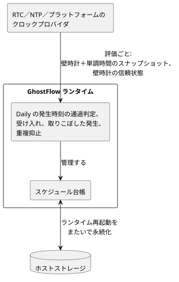
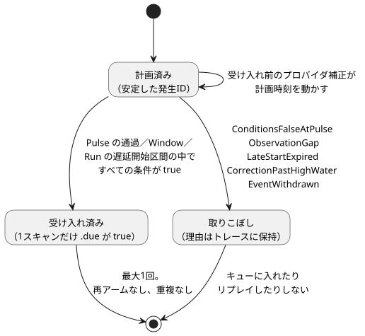
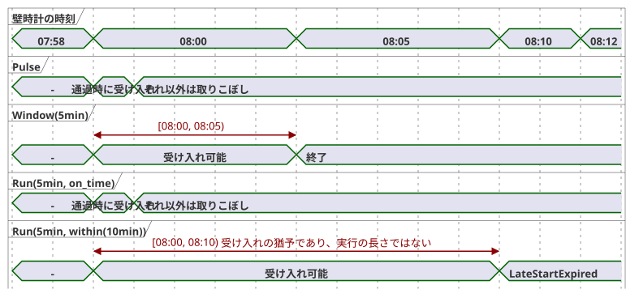

<!-- translation-source: docs/TIME-AND-SCHEDULE-CONTRACT.md -->
[英語の原文](TIME-AND-SCHEDULE-CONTRACT.md)

# 時間とスケジュールの契約の提案

追跡：言語issue #23／統合`TASK-85.2`／レビューR15〜R17。

この文書は、次の項目についての、最小限で一貫した設計の引き継ぎ資料です。

- DateTimeと単調な経過時間
- 繰り返しのスケジュール
- 太陽と潮汐のイベント
- 稼働カレンダー
- 明示的なフォールバック

これは汎用的な時間フレームワークではありません。以下に示すすべての表面形式が実装済みであると主張するものでもありません。`Duration`、経過タイマー、`DailySlots`、上限のあるSolarホストはすでに存在します。残りの型と方針は、T2〜T4および合同レビューのための提案です。

追加的な連続真（continuous-true）のBoolタイマーのメタデータとその互換性契約は、`CONTINUOUS-BOOL-TIMER-CONTRACT.md`（NT-T1-A/#46）で別に規定されています。その契約は、ここで説明する既存の`elapsed(state)`タイマーを変更しません。

**この文書の内容：** 確定した製品上の意味 → 現在実装されているもの → 承認されたDailyの実行境界 → 値とクロックの領域 → クロックのスナップショット → `Schedule`値と発生の受け入れ → 繰り返し、Cron、DST、真夜中 → 稼働カレンダー → 自然イベントとフォールバック → 受け入れベクトル → 合同レビューでまだ決めること。

## 確定した製品上の意味

次の製品上の決定は確定しています。

- **読みやすい信号。** 制御値と出力は時間とともに変化する信号を形成しますが、ソースは名前、式、明示的な前状態／次状態、出力接続として読みやすいまま保たれます。ユーザーが購読や演算子の配管を書くことはありません。
- **`Schedule`は継続的に評価されます。** 遅延された関数呼び出しでも、バックグラウンドスレッドでもありません。取りこぼした判断が、後で実行するために黙ってキューに入れられることは決してありません。
- **2つのクロック領域。** 暦の時刻と単調な経過時間は、異なるクロック領域です。壁時計を補正しても、すでに受け入れられた経過タイマーが巻き戻されたり延長されたりすることは決してありません。
- **自然イベントにはコンテキストが必要です。** 太陽および月／潮汐による制御には、現在時刻に加えて設置場所のコンテキストが必要です。欠落した、信頼できない、または古いコンテキストは`Unknown`であり、`false`ではありません。
- **明示的なフォールバック。** すべての自然時間の規則は、明示的なフォールバックを持ちます。NTP切断時の猶予、追いつき（catch-up）、遅延開始、一時停止、再試行、再起動の方針が推論されることはありません。
- **暗黙知は実行セマンティクスではありません。** 確認された共通の前提は、明示的なソースや方針になることがあります。暗黙知の発見と確認は、作成／レビューのワークフローに属し、言語の実行セマンティクスには属しません。

## 現在の実装の境界

現在存在するものと、その既知のギャップは次のとおりです。

- **`Duration`。** 構文は、`ms`、`s`、`min`、`h`を付けて書く、負でないミリ秒単位の整数です。現在の`control`のリテラル経路はまだ安全な整数の最大値を強制していません。一方、単独の制約方言は正の`i32`の上限を使用しています。これらは実装上のギャップであり、2つの異なる基本Duration型があるわけではありません。
- **経過タイマー。** `timer x = elapsed(flag)`は、生成された単調な`__gf_now_ms`入力を使用します。タイマーの状態は、成功した`control`のtickとともに確定されます。
- **発生プロバイダ。** `DailySlots<15min>`と`Solar`は、ホストが所有する発生プロバイダです。ソースからは、1スキャンだけtrueになる`.due`のBoolean入力として見えます。これらが出力を操作することはありません。
- **Solarの要件。** Solarには、タイムゾーン、リテラルの座標、日の出／日の入りと厳密なオフセット、そして`fallback = skip`が必要です。現在のネイティブプロバイダは、上限のあるタイムゾーンと年のプロファイルをサポートします。サポートされていないコンテキストはフェイルクローズします。
- **クロックのジャンプの扱い。** 既存のプロバイダは、起動／復旧の後にベースラインを確立し、壁時計の巻き戻しをまたぐ重複イベントを抑止し、大きな前方への壁時計のギャップをスキップします。Solarは単調なスキャンギャップも検査しますが、`DailySlots` v1は検査しません。現在の60秒という上限は互換性のための振る舞いです。新しいSchedule契約に対する普遍的な隠れた既定値ではありません。
- **タイムゾーンのサポートはホストによって異なります。** ブラウザのSolarは、プラットフォームのIANAゾーンを受け付けます。現在のポータブルなRustプロバイダは、`Asia/Seoul`、`UTC`、`Etc/UTC`だけをサポートします。両方の利用側が同じゾーンベクトルに合格するまでは、パッケージが主張できるのは、両者が明示的に共有するプロファイルだけです。コンパイラが受け入れたというだけでは、ホストをまたいだサポートにはなりません。

実装済みの振る舞いについては、[SOLAR-SCHEDULE.ja.md](SOLAR-SCHEDULE.ja.md)を参照してください。この提案はそれらのアーティファクトを維持し、今後のセマンティクスには明示的なバージョン付けを要求します。

## 承認されたDailyの実行境界 — 2026-09-23

この決定は、`Daily`スケジュールの責任を3つに分けます。

- **クロックプロバイダ（RTC／NTP／プラットフォーム）：** 各評価に、壁時計と単調クロックのスナップショット、および壁時計の信頼状態を与えます。
- **GhostFlowランタイム：** `Daily`の発生時刻の通過、受け入れ、取りこぼした発生、重複抑止を計算し、スケジュール台帳を管理します。
- **ホストストレージ：** その台帳をランタイムの再起動をまたいで永続化します。



基盤となる時刻源は、`Daily`のセマンティクスを変えずに置き換えることができます。この決定は[Reference §3.5のスケジュール契約](reference/03-time-and-schedules.ja.md)に対する実行責任を割り当てるものであり、新しい言語方針を追加するものではありません。

## 値とクロックの領域

| 領域 | 最小限の契約 | 備考 |
| --- | --- | --- |
| `Duration` | 厳密な負でない整数ミリ秒、`0..2^53-1` | 相対的な長さ。検査付き算術。月／年の単位なし |
| `Date` | グレゴリオ暦の日付、年は`1970..9999` | 時刻やタイムゾーンなし |
| `TimeOfDay` | `00:00:00.000..23:59:59.999` | 日付、オフセット、繰り返しなし |
| `DateTime` | ミリ秒精度の厳密なUTC瞬間、Unixエポックから`9999-12-31T23:59:59.999Z`まで | リテラルには`Z`または数値のUTCオフセットが必要。値はIANAゾーンを持たない |
| 単調な瞬間 | ホスト専用の厳密な負でないミリ秒と、起動／実行のエポック | 常用時として書式化されることも、壁時計のリテラルとして記述されることもない |

**範囲の規則。**

- 共通の厳密な転送上限は、JavaScriptの安全な整数の範囲です。宣言された常用時の範囲内の`DateTime`の瞬間は、その中に収まります。
- 次のものは診断になります。うるう秒の`:60`、`24:00`、オフセットのないDateTimeリテラル、存在しない日付。
- IANAタイムゾーンは繰り返しのScheduleまたはコンテキストに属し、DateTimeの瞬間に属することは決してありません。
- 意味上、正の遅延を必要とする構文はゼロを拒否してもかまいません。これは基本の`Duration`の範囲を変えるものではありません。
- T2は、`control`のリテラル、制約、マニフェストの値、ネイティブ／WASM間の受け渡しに対して、厳密な範囲を一貫して適用しなければなりません。

**最小限の算術。** この集合は意図的に小さくしてあります。

- `DateTime ± Duration -> DateTime`（範囲の検査付き）。
- `Duration + Duration`、および負にならない範囲での検査付きの減算。
- DateTimeとTimeOfDayの比較では、両辺が同じ型でなければなりません。
- `TimeOfDay + Duration`は真夜中で折り返しません。Schedule内でDateとタイムゾーンを使って解決してください。
- `Duration`は負にならないため、`DateTime - DateTime`は最小プロファイルに含まれません。代わりに瞬間を比較するか、単調な`elapsed`を使用してください。符号付きの差分型は、実証された制御のケースで必要になった場合にだけ追加します。
- 暦の日、月、年は、固定ミリ秒のDurationではありません。

**リテラルの綴り。** 推奨されるソースリテラルの境界は、引き続きタグ付きテンプレートの候補です。`date\`2026-09-15\``、`time\`06:30\``、`datetime\`2026-09-15T06:30:00+09:00\``です。R15がこれらの綴りをレビューします。これらはコンパイル時のリテラルであり、実行時の文字列解析ではありません。

## クロックのスナップショットと責任

受け入れられた各スキャンは、変更不可能なホストのスナップショットをちょうど1つ受け取ります。

```text
ClockSnapshot {
  monotonicMs
  bootEpoch
  wallMs?              // 厳密な DateTime の瞬間
  wallQuality          // Trusted | Unknown(reason)
  uncertaintyMs?
  sourceRevision?
}
```

**クロックを読むのは誰か。** ドライバがNTP／RTC／プラットフォームの時刻を取得し、それが信頼できるかどうかを判断します。コンパイラとVMが、ネットワーク接続を開いたりマシンのクロックを読んだりすることは決してありません。

**スナップショットの使い方。**

- 信頼された品質を伴わない`wallMs`は、使用可能な暦の時刻ではありません。
- 単調時間の後退（単調時間が戻ること）があると、そのスキャンは拒否されます。
- 前方または後方への壁時計の補正は、新しい観測として受け入れられます。発生のハイウォーターマークと発生の同一性によって重複が防止されます。

**最後に信頼された時刻の保持。** 最後に信頼された壁時計時刻を使い続けることは明示的な方針であり、概念的には単調時間で測る`hold_last for Duration then <fallback>`です。この文書はそれを有効にしません。それを公開するかどうかはR17が決定します。必須の最小フォールバックは、引き続き`skip`だけです。

## Scheduleは型付きのリアクティブな値

簡潔な概念上の形は次のとおりです。

```text
Schedule = {
  trigger: TriggerRule,
  day: DayRule?,
  when: BoolPredicate?,
  basis: Pulse | Window(Duration) | Run(Duration, LateStartPolicy),
  timezone: IanaZone,
  context: installation bindings,
  fallback: Fallback,
  dst: DstPolicy,
  gap: ObservationGapPolicy
}
```

**3つの種類ではなく、1つの直積型。** `Schedule`は、継続時間の基準のバリアント（`basis`）を1つ持つ直積型です。3つの同等な種類としての`Cron | Window | Run`ではありません。

- トリガー規則には、1つのDateTime、毎日のTimeOfDay、名前付きの5フィールドCron、各太陽／潮汐イベントが含まれます。
- 格納された値はストリームを表します。それを読んでも機器が始動することはありません。
- `when`は、宣言された入力と状態に対する、静的にコンパイルされた依存式です。実行時のクロージャやコールバックではありません。
- グローバルな出力制約は、引き続き後段の別の段階です。それらは、受け入れられたRunの要求出力をブロックすることができます。

**スキャンごとの判断。** 各スキャンで、解決は`True`、`False`、`Unknown(reason)`のいずれかを、規則／コンテキストのリビジョンとともに返します。フォールバックが`Unknown`を解決します。`Unknown`を否定しても、それが作動の許可に変わることは決してありません。公開される射影は、通常の制御値のままです。

- `.due`は、1つの発生が受け入れられたときに、受け入れられた1スキャンだけtrueになります。
- Windowは、半開区間のウィンドウと現在のすべての述語がtrueである間だけtrueになるレベルを公開できます。
- Runの実行状態と`.active`は、明示的な状態とタイマーへとローワリングされます。隠れた非同期タスクではありません。

**サイドカー観測。** 最小の実行可能な境界は、生成された`.due`入力とともに、1つのアトミックなサイドカー観測を運びます。

```text
ScheduleObservation {
  format: GhostFlow/schedule-observation-v1
  scheduleId             // 安定した宣言／ソースマップの同一性
  definitionRevision     // 読み込まれたコード／パッケージの厳密なリビジョン
  decision: False | Due | Unknown(reason)
  disposition?           // Before | PredicateFalse | AlreadyAdmitted | Missed(reason)
  occurrence? { id, sourceKey, plannedWallMs, sourceDate?, scheduledLocalDate }
  providerRevision?
  contextRevisions
}
```

**理由コード。** Unknownの理由と取りこぼしの理由は、別々の集合です。

| 種類 | 初期の理由 |
| --- | --- |
| Unknown | `ClockUnknown`、`LocationUnknown`、`EventUnavailable`、`PredictionMissing`、`PredictionStale`、`CalendarMissing`、`CalendarOutOfRange`、`ZoneUnsupported` |
| Missed | `ConditionsFalseAtPulse`、`ObservationGap`、`LateStartExpired`、`CorrectionPastHighWater`、`EventWithdrawn` |

Unknownの理由が、通常のfalseの`when`述語や、既知の取りこぼした発生に再利用されることは決してありません。

**`skip`は証拠を保持します。** `fallback = skip`は、Unknownの受け入れをVMに対して`.due = false`へと解決します。同じ受け入れられたスキャンのトレースから`decision = Unknown(reason)`を消すことはありません。未解決の品質に基づいてソース内で分岐することは、最小プロファイルの範囲外です。後でそれを追加するには、検査されないBoolをもう1つ追加するのではなく、型付きのResult／Decisionが必要です。こうして、Boolだけで来歴を運べるふりをすることなく、現在の`.due`の互換性が保たれます。

**発生の同一性。** 計画された各発生は、安定した同一性を持ちます。正準のキーは、安定した`scheduleId`とソースの発生キーの組です。

- 固定のDateTime：そのDateTime
- 毎日／Cron：ローカルのスロット。該当する場合はDSTの重複区間（fold）も加える
- 太陽：イベントの種類とソースのDate
- 潮汐：プロバイダの安定した観測点／イベントのキー

読み込まれた定義のリビジョン、プロバイダのリビジョン、補正された計画時刻はメタデータであり、同一性ではありません。その結果は次のとおりです。

- 受け入れ前のホットスワップやプロバイダの補正は、同じ発生を移動したり解釈し直したりします。2つ目の発生を作ることはありません。
- 意図的に新しくしたスケジュールには、新しい`scheduleId`が与えられます。
- すでに受け入れられた発生をもう一度実行するには、付随的なソース編集ではなく、別個の明示的なオペレーター操作が必要です。

キーはSHA-256でハッシュ化されて公開の発生IDとなり、ハイウォーター／受け入れの台帳に永続化されます。

**最大1回。** 発生は最大1回しか受け入れられません。そのため、trueのままの条件がスキャンごとに実行を作ることはありません。後からtrueになった条件が発生を受け入れられるのは、明示的なWindowまたは遅延開始区間の中だけです。同じ発生の中でfalseになってから再びtrueになっても、再アームされることはありません。繰り返しの試行には、明示的な繰り返しのトリガー／再アームの方針が必要です。



**受け入れが許される時（basis）。**

| basis | 最初の受け入れが許される時 | それ以外 |
| --- | --- | --- |
| `Pulse` | 通過時のみ、かつその時点ですべての条件がtrueの場合（遅延の区間なし） | 取りこぼし |
| `Window(5min)` | `[planned, planned + 5min)`の中 | — |
| `Run(5min, on_time)` | 観測された通過時のみ | 取りこぼし |
| `Run(5min, within(10min))` | `[planned, planned + 10min)`の中。正の猶予は実行の長さではない | `LateStartExpired` |

半開区間の`within(...)`を逃すと`LateStartExpired`となり、キューに入れられた呼び出しになることは決してありません。
`on_time`と`within`は、最小限の`LateStartPolicy`のバリアントのすべてです。すべてのRunマニフェストは、タグ付きの値をちょうど1つ持ちます。`{ kind: on_time }`または`{ kind: within, withinMs: <exact positive Duration> }`です。

次のタイムラインは、計画時刻が08:00の場合の受け入れ区間を比較したものです。



**Runの継続時間。** 受け入れられたRunは、実際の受け入れの時点から単調時間で継続時間を測ります。Runの経過時間は、受け入れから連続して進みます。要求出力がfalseになっても、グローバルな制約が最終出力をブロックしても、一時停止しません。要求ONの時間、安全ONの累積時間、連続した安全ONの時間は、隠れたRunのモードではなく、別々の明示的なタイマー式です。いずれも物理的な動作を証明するものではありません。

## 繰り返し、Cron、DST、真夜中

**`cron5`。** 方言を誰も推測しなくて済むように、最小のCronの綴りは`cron5`と名付けられています。分、時、日、月、曜日の5つで、秒はありません。従来のCronでは、日のフィールドが両方とも設定されたときに意外なOR規則が使われます。これを避けるため、最初のプロファイルは、日（day-of-month）と曜日（day-of-week）の両方を制約する規則を拒否します。タイムゾーンは必須です。

**DST。** 常用時による繰り返しには、設置場所のゾーンに現在は移行がない場合でも、明示的なDSTの扱いが必要です。

- 存在しないローカル時刻：`skip`または`next_valid`
- 繰り返されるローカル時刻：`first`、`second`、`both`、`skip`のいずれか

どの選択肢も黙って選ばれることはありません。固定オフセットのDateTimeリテラルには、DSTの曖昧さはありません。

**真夜中。** ウィンドウは半開区間です。太陽／潮汐のオフセットが真夜中をまたぐ場合、日のフィルタは、解決された予定開始時刻のローカルDateを使用します。トレースには、自然イベントのソースの日付も保持されます。別の継続／制約の規則がそう定めない限り、日付が変わっても、すでに受け入れられたRunが止まることは決してありません。

**必須のマニフェストフィールド。** 新しいScheduleマニフェストには、次のものが必要です。

- `dstMissing`（`skip | next_valid`）
- `dstRepeated`（`first | second | both | skip`）
- `gapPolicy = skip`
- 厳密な正の`maxObservationGapMs`

ソースの綴りはまだR16のレビュー対象ですが、値の欠落はT3の診断になります。

**レガシーの`DailySlots` v1。** 既存の`DailySlots` v1は、レガシーのディスクリプタです。その観測された互換性の振る舞いは、nonexistent=`skip`、repeated=`first`、gap=`skip after 60000ms`です。黙って新しいプロファイルとしてラベルを付け替えられることはありません。移行では、明示的なフィールドと、新しいマニフェスト／ランタイムの同一性が出力されます。

**観測ギャップ。** 新しいプロファイルは、連続して受け入れられた`ClockSnapshot`の両方のフィールドを使って、観測の連続性を検査します。単調時間の差分と正の壁時計の差分の**どちらか一方でも**`maxObservationGapMs`を超えると、ギャップが存在します。壁時計の巻き戻しだけであればハイウォーターの規則で扱われますが、それによって過大な単調時間の差分を隠すことはできません。この検査は、ホストのポーリング速度やNTPの補正源には依存しません。

最小限の`gapPolicy = skip`は、Pulse、Window、Runの遅延受け入れよりも優先されます。

- まだ受け入れられていない発生のうち、その受け入れ区間がギャップと交わるものはすべて、`ObservationGap`で取りこぼしとされます。
- Windowや`within(...)`の区間がまだ開いているというだけで、現在のスキャンやそれ以降のスキャンがそれを復活させることはできません。
- 初回起動と信頼の復旧も、同じフェイルクローズの方法でベースラインを確立します。
- 将来のリプレイ／追いつきの方針は、別に名前を付けなければなりません。

**タイムゾーンプロファイル。** 同じマニフェストが、厳密な`timezoneProfile`のリビジョンを指定します。署名されたパッケージは、それを必須のホストケイパビリティとしてバインドします。ブラウザとネイティブのホストは、サポートしていないプロファイルやゾーンを、ランタイムの有効化の前に拒否します。コンパイラがIANA文字列を受け入れたことは、すべての利用側がそれを実装している証拠にはなりません。

## 稼働カレンダーの日の規則

曜日、祝日、計画された稼働の規則は、それぞれ別のものです。

- `day\`mon..fri\``は、解決されたローカルDateだけを使用します。
- `day\`holiday\``は、名前付きの祝日カレンダーのスナップショットを使用します。
- `day\`workday\``／`day\`offday\``は、名前付きの現場／班の稼働カレンダーを使用します。
- 「稼働日」は計画された稼働を意味し、観測された作業者の在席を意味するものではありません。

**カレンダーのスナップショット。** 稼働カレンダーのスナップショットは、カレンダーID、リビジョン、タイムゾーン、カバー範囲をバインドします。優先順位は、高い順に次のとおりです。

1. 明示的な日付の例外
2. 宣言された祝日の方針
3. 週のパターン

同じ日付に対する矛盾する例外は無効です。欠落したデータやカバー範囲外のデータは`Unknown`であり、その場合は稼働日と休業日の両方がUnknownになります。Scheduleの日の規則が制限するのは、受け入れの適格性だけです。すでに有効なRunには影響しません。

**綴りと夜勤。** 暫定的な表面形式は`on = day\`...\``と`calendar = workers`を使用します。R16がその綴りをレビューします。最初のプロファイルは、暦の日付に対してだけ日のタグを定義します。夜勤の業務日付は推論しません。真夜中をまたぐ稼働区間を定義しようとするカレンダー定義は拒否されます。作成者は代わりに、明示的な時間ウィンドウを真夜中で分割できます。後のシフト型によって、これらの日のタグを変えずに業務日付の帰属を追加できます。

## 自然イベントのコンテキストとフォールバック

**コンテキストのバインディング。**

- 太陽イベントのコンテキストは、タイムゾーン、位置のリビジョン、イベントの種類、プロバイダの計算リビジョンをバインドします。
- 潮汐イベントのコンテキストは、さらに観測点／モデル、予測のリビジョン、カバー範囲、有効期限もバインドします。

**潮汐イベントの同一性。** 潮汐プロバイダのプロファイルが受け入れられるのは、予測のリビジョンをまたいで安定し、1つの観測点における同じ種類の複数のイベントの間で一意な、不透明なイベントIDを与える場合だけです。ソースの発生キーは、プロバイダの名前空間＋観測点ID＋そのイベントIDです。時刻や同日内の序数が補正の同一性として使われることは決してありません。このケイパビリティを持たないプロバイダは、変更不可能なスナップショットを与えることはできますが、補正のサポートを主張することはできません。

満潮／干潮は発生イベントです。大潮／小潮は分類された条件であり、DateTimeであるかのようにオフセットすることはできません。言語は、1日あたりの潮汐の回数が固定であることも、予測が物理的な水位を証明することも前提としません。

**プロバイダの補正。** 補正は、上で定義した安定したイベントの同一性を保持します。

- 受け入れの前であれば、最新の有効な予測が計画された瞬間を動かしてもかまいません。
- 瞬間が観測のハイウォーターマークの位置またはそれより前に動いた場合、その発生は`CorrectionPastHighWater`で取りこぼしとされます。追いつきは行われません。
- プロバイダによる明示的な取り下げは、`EventWithdrawn`で取りこぼしとされます。
- 並べ替えによって安定したIDが変わることはありません。
- 受け入れの後は、リビジョンや取り下げによって重複が作られることも、受け入れられたRunがキャンセルされることもありません。

位置の欠落、信頼できないクロック、サポートされていない／極地のイベント、予測の欠落または古さ、利用できないカレンダーは、トレースの中で区別可能な理由のまま残ります。

**フォールバック。** 自然、時刻、カレンダーのコンテキストに依存する新しいプロファイルの規則はすべて、`fallback`を必要とします。サポートされる最小の値は`skip`で、新しい発生を出さず、理由を保持します。`skip`は、すでに受け入れられたRunを止めることも、単調タイマーを消すこともありません。固定TimeOfDayの代替は、常用時のクロックとタイムゾーンが信頼されている間しか意味を持たないため、やはり`skip`のような終端のフォールバックが必要です。復旧は新しいベースラインを確立します。後で明示的な追いつきの方針が追加されない限り、取りこぼした発生がリプレイされることはありません。

`DailySlots` v1は、宣言された古いランタイムの同一性の下で、フォールバックのフィールドなしでも引き続き読み込めます。T3の移行では、明示的なフォールバックを生成しなければなりません。そのレガシーの受け入れを、新しいソースでフォールバックを省略してよいという許可として扱ってはなりません。

## T2〜T4の受け入れベクトル

これらのIDは、安定したセマンティクスのベクトルです。ベクトルがソースのフィクスチャになる前に、R15〜R17が暫定的な綴りを変更する可能性があります。

| ID | シナリオ | 期待される結果 | 担当 |
| --- | --- | --- | --- |
| T1-TYPE-01 | 有効／無効なDate、TimeOfDay、オフセット付きDateTimeの境界 | 厳密に正規化された値／コンパイル診断 | T2 |
| T1-TYPE-02 | 単調時間が進む間に壁時計が後退する | 経過タイマーは進む。発生の重複なし | T2/T4 |
| T1-TYPE-03 | DateTimeにDurationを加えるとUTC／ローカルの真夜中をまたぐ | 厳密な瞬間。日単位の剰余による折り返しなし | T2 |
| T1-DURATION-01 | `0ms`、安全な最大値、最大値+1を`control`／制約／ABIに通す | 最初の2つは、構文がゼロを許す場合は厳密に通る。オーバーフローは一貫して拒否 | T2 |
| T1-PULSE-01 | 08:00のPulseで、開始の述語が通過時にfalse、08:10にtrue | 取りこぼし。キューに入れない | T4 |
| T1-WINDOW-01 | 08:00〜09:00のWindowで、述語が08:10に初めてtrueになり、その後切り替わる | 08:10に1回受け入れ。同じウィンドウ内で再アームなし | T4 |
| T1-RUN-01 | 計画08:00、`Run(5min, within(10min))`が08:02に受け入れ | 目標は単調時間で08:07。壁時計の補正はこれを変えない | T2/T4 |
| T1-RUN-02 | 要求／安全出力が1分間ブロックされている間にRunが有効 | Runは受け入れから計測して完了する。要求／安全の別々のタイマーはそれぞれの値を記録 | T4 |
| T1-RUN-03 | `Run(5min, on_time)`の述語が通過後にtrueになる、または`within(10min)`が08:10に達する | 厳密な理由で取りこぼし。キューには決して入れない | T3/T4 |
| T1-FALLBACK-01 | 自然の規則がフォールバックを省略 | コンパイル診断 | T3 |
| T1-FALLBACK-02 | `skip`のもとでクロック／位置／イベント／予測が利用不可 | dueなし。厳密なUnknownの理由を保持 | T4 |
| T1-RECOVERY-01 | イベントを取りこぼした後に信頼が復旧 | ベースラインのみ。追いつきなし、重複なし | T4 |
| T1-REVISION-01 | 発生の受け入れ前／後に予測が動く | 受け入れ前の最新時刻／受け入れ後の重複なし | T4 |
| T1-REVISION-02 | 無関係なソースのホットスワップで、1つのスケジュール宣言IDが保持される | 同じ発生ID。受け入れの重複なし | T3/T4 |
| T1-DST-01 | 存在しない／繰り返されるローカルのTimeOfDay | 選択された明示的なDST方針。方針がなければ拒否 | T3/T4 |
| T1-DST-02 | `both`での繰り返されるローカルのTimeOfDay | DSTの重複区間（fold）で区別される2つの発生キー | T3/T4 |
| T1-ZONE-01 | パッケージが、あるホストの宣言されたプロファイル外のIANAゾーンを要求 | 有効化の前に拒否。推測したオフセットにフォールバックしない | T3/T4 |
| T1-CRON-01 | `cron5`が日と曜日の両方を制約 | コンパイル診断。OR／ANDを推測しない | T3 |
| T1-CALENDAR-01 | 通常の平日／平日の祝日／週末の特別稼働／臨時の休業日 | 稼働日、休業日、稼働日、休業日 | T4 |
| T1-CALENDAR-02 | 祝日の特別稼働／欠落または期限切れのスナップショット | 稼働日／稼働日と休業日の両方がUnknown | T4 |
| T1-MIDNIGHT-01 | 日のフィルタ付きで、自然イベントのオフセットが真夜中をまたぐ | フィルタは解決された開始のDateを使用。ソースイベントのDateを保持 | T4 |
| T1-MIDNIGHT-02 | 稼働カレンダーが、シフトの帰属なしに夜をまたぐ区間を試みる | 構成／コンパイル診断。前日の推測なし | T3 |
| T1-ACTIVE-01 | Runの受け入れ後に稼働日が変わる、またはコンテキストが失敗する | 受け入れのフィルタだけではRunは止まらない | T4 |
| T1-TIDE-01 | 満潮／干潮の予測が有効。大潮／小潮をオフセットイベントとして使用 | 発生は解決される／コンパイル時の型診断 | T3/T4 |
| T1-TIDE-02 | 同じ種類の2つのイベントが並べ替わる、または1つがハイウォーターより前に動く／取り下げられる | 安定したIDで対応付けを維持。動いた／取り下げられたイベントは取りこぼしとし、決してリプレイしない | T4 |
| T1-GAP-01 | 単調時間の差分または正の壁時計の差分が、署名された規則／プロファイルの上限を超える | `ObservationGap`。推論によるリプレイなし。壁時計の巻き戻しで単調時間のギャップを隠すことはできない | T4 |
| T1-GAP-02 | 過大なギャップが、本来なら開いているWindowや`within(...)`の区間と重なる | ギャップが優先。発生は`ObservationGap`で取りこぼしとなり、後から受け入れることはできない | T4 |

**担当。**

- T2は、ネイティブ／WASM間の受け渡しをまたいで、DateTimeと単調時間の同一性を保持しなければなりません。
- T3は、構文と必須フィールドの診断を担当します。
- T4は、プロバイダの解決、品質／フォールバック、発生の同一性、重複抑止、復旧を担当します。
- ドライバのテストでは、対象デバイス上のNTP／RTC／位置／潮汐データを別途確立します。

## 合同レビューの境界

合同レビューで決めるのは、次の点だけです。

- **R15：** タグ付きのDate／TimeOfDay／DateTime、`Schedule`／Pulse／Window／Run、`cron5`の綴り。暦時間と単調時間の分離は再検討しません。
- **R16：** 日／カレンダーの綴り、稼働日／休業日のセマンティクス、DSTと真夜中の例。
- **R17：** フォールバックの綴り、および明示的で上限のある`hold_last`を許可するかどうか。

設置場所固有の位置、潮汐の観測点、カレンダーの内容、機器の遅延、許容される不確実性は、言語の既定値ではありません。レビューでは、それらをどのように記述するかを選びます。実装と物理的な受け入れは、引き続き下流の作業です。
