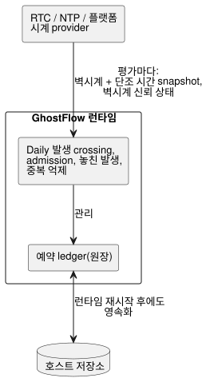
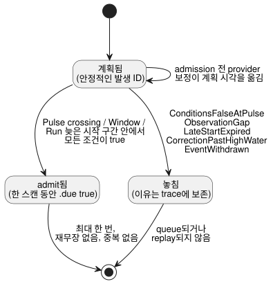
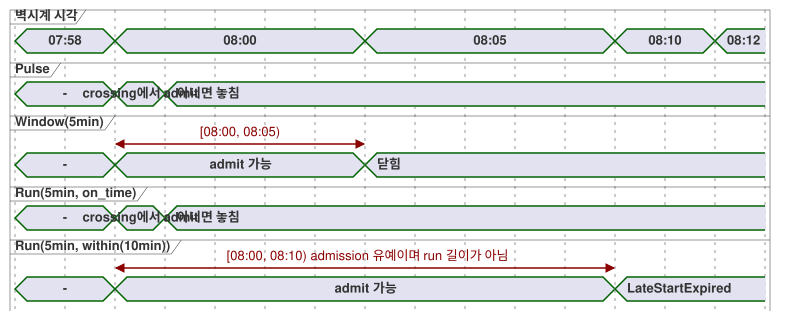

<!-- translation-source: docs/TIME-AND-SCHEDULE-CONTRACT.md -->
[영문 원문](TIME-AND-SCHEDULE-CONTRACT.md)

# 시간과 Schedule 계약 제안

추적: language 이슈 #23 / integration `TASK-85.2` / 검토 R15–R17.

이 문서는 다음 항목을 위한 최소한의 일관된 설계 인계 문서입니다.

- DateTime과 단조 경과 시간
- 반복 예약
- 태양 및 조석 이벤트
- 업무 달력
- 명시적 fallback

이 문서는 범용 temporal 프레임워크가 아닙니다. 아래의 모든 표면 형식이 구현되었다고
주장하지도 않습니다. `Duration`, 경과 시간 타이머, `DailySlots`, 범위가 제한된 Solar
호스트는 이미 존재합니다. 나머지 타입과 정책은 T2–T4와 공동 검토를 위한 제안입니다.

추가적인 continuous-true Bool 타이머 metadata와 그 호환성 계약은
`CONTINUOUS-BOOL-TIMER-CONTRACT.md`(NT-T1-A/#46)에 별도로 명세되어 있습니다. 그
계약은 여기서 설명하는 기존 `elapsed(state)` 타이머를 바꾸지 않습니다.

**이 문서의 구성:** 확정된 제품 의미 → 현재 구현된 것 → 승인된 Daily 실행 경계 →
값과 시계 영역 → 시계 snapshot → `Schedule` 값과 발생 admission → 반복, Cron, DST와
자정 → 업무 달력 → 자연 이벤트와 fallback → 수용 벡터 → 공동 검토가 아직 결정할 사항.

## 확정된 제품 의미

다음 제품 결정은 확정되었습니다.

- **읽기 쉬운 신호.** 제어 값과 출력은 시간에 따라 변하는 신호를 이루지만, 소스는
  이름, 식, 명시적인 이전/다음 상태, 출력 연결로 읽기 쉽게 유지됩니다. 사용자는
  subscription/operator 배관 코드를 작성하지 않습니다.
- **`Schedule`은 연속적으로 평가됩니다.** 지연된 함수 호출이나 백그라운드 스레드가
  아닙니다. 놓친 판단은 나중을 위해 조용히 queue에 쌓이는 일이 절대 없습니다.
- **두 개의 시계 영역.** 달력 시간과 단조 경과 시간은 서로 다른 시계 영역입니다.
  벽시계를 보정해도 이미 admit된 경과 시간 타이머가 되감기거나 연장되는 일은 절대
  없습니다.
- **자연 이벤트에는 문맥이 필요합니다.** 태양 및 달/조석 제어에는 현재 시각과 설치
  문맥이 필요합니다. 없거나, 신뢰할 수 없거나, stale(오래된 값)인 문맥은 `false`가
  아니라 `Unknown`입니다.
- **명시적 fallback.** 모든 자연 시간 규칙에는 명시적 fallback이 있습니다. NTP 연결
  끊김 유예, catch-up, 늦은 시작, 일시 정지, 재시도, 재시작 정책은 추론하지 않습니다.
- **암묵지는 실행 의미가 아닙니다.** 확인된 공통 전제는 명시적인 소스나 정책이 될 수
  있습니다. 암묵지를 발견하고 확인하는 일은 언어 실행 의미가 아니라 작성/검토
  워크플로에 속합니다.

## 현재 구현 경계

현재 존재하는 것과 알려진 빈틈은 다음과 같습니다.

- **`Duration`.** 문법은 `ms`, `s`, `min`, `h`로 쓰는 음이 아닌 정수 밀리초입니다.
  현재 control 리터럴 경로는 아직 safe-integer 최댓값을 강제하지 않고, 독립
  constraints 방언은 양의 `i32` 상한을 사용합니다. 이는 구현상의 빈틈이며, 서로 다른
  두 가지 기본 Duration 타입이 아닙니다.
- **경과 시간 타이머.** `timer x = elapsed(flag)`는 생성된 단조 `__gf_now_ms` 입력을
  사용합니다. 성공한 control tick과 함께 타이머 상태를 확정합니다.
- **발생 provider.** `DailySlots<15min>`과 `Solar`는 호스트가 소유하는 발생
  provider입니다. 소스에서는 한 스캔 동안 true인 `.due` Boolean 입력으로 보입니다.
  이들은 출력을 작동시키지 않습니다.
- **Solar 요구 사항.** Solar에는 시간대, 리터럴 좌표, rise/set과 정확한 offset,
  `fallback = skip`이 필요합니다. 현재 native provider는 범위가 제한된 시간대 및 연도
  profile을 지원합니다. 지원하지 않는 문맥은 fail-closed로 처리됩니다.
- **시계 점프 처리.** 기존 provider는 부팅/복구 후 baseline을 세우고, 벽시계
  rollback 동안 중복 이벤트를 억제하며, 큰 정방향 벽시계 공백은 건너뜁니다. Solar는
  단조 스캔 공백도 검사하지만 `DailySlots` v1은 검사하지 않습니다. 현재의 60초 상한은
  호환성 동작입니다. 새 Schedule 계약의 범용 숨은 기본값이 아닙니다.
- **시간대 지원은 호스트마다 다릅니다.** 브라우저 Solar는 플랫폼의 IANA zone을
  받습니다. 현재 이식 가능한 Rust provider는 `Asia/Seoul`, `UTC`, `Etc/UTC`만
  지원합니다. 두 소비자가 같은 zone 벡터를 통과하기 전까지 패키지는 둘이 명시적으로
  공유하는 profile만 주장할 수 있습니다. 컴파일러가 받아들인다고 해서 호스트 간 지원이
  되는 것은 아닙니다.

구현된 동작은 [SOLAR-SCHEDULE.md](SOLAR-SCHEDULE.ko.md)를 참고하십시오. 이 제안은
그 artifact를 보존하며, 이후의 모든 의미에 대해 명시적인 버전 관리를 요구합니다.

## 승인된 Daily 실행 경계 — 2026-09-23

이 결정은 `Daily` 예약의 책임을 세 갈래로 나눕니다.

- **시계 provider(RTC/NTP/플랫폼):** 각 평가에 벽시계 및 단조 시계 snapshot과
  벽시계 신뢰 상태를 공급합니다.
- **GhostFlow 런타임:** `Daily` 발생 crossing, admission, 놓친 발생, 중복 억제를
  계산하고 예약 ledger(원장)를 관리합니다.
- **호스트 저장소:** 런타임 재시작 후에도 그 ledger를 영속화합니다.



기반 시간 소스를 교체해도 `Daily` 의미는 바뀌지 않습니다. 이 결정은
[Reference §3.5 예약 계약](reference/03-time-and-schedules.md#35-schedule의-공통-의미)의
실행 책임을 배정할 뿐이며, 새로운 언어 정책을 추가하지 않습니다.

## 값과 시계 영역

| 영역 | 최소 계약 | 비고 |
| --- | --- | --- |
| `Duration` | 정확한 음이 아닌 정수 밀리초, `0..2^53-1` | 상대 길이, 검사된 산술, 월/연 단위 없음 |
| `Date` | 그레고리력 날짜, 연도 `1970..9999` | 시각이나 시간대 없음 |
| `TimeOfDay` | `00:00:00.000..23:59:59.999` | 날짜, offset, 반복 없음 |
| `DateTime` | 밀리초 해상도의 정확한 UTC 시점, Unix epoch부터 `9999-12-31T23:59:59.999Z`까지 | 리터럴에는 `Z` 또는 숫자 UTC offset이 필요하며, 값은 IANA zone을 갖지 않음 |
| 단조 시점 | 호스트 전용의 정확한 음이 아닌 밀리초와 boot/run epoch | 상용시로 서식화하거나 벽시계 리터럴로 작성하지 않음 |

**범위 규칙.**

- 공통의 정확한 전송 상한은 JavaScript의 safe integer 범위입니다. 선언된 상용시
  범위의 `DateTime` 시점은 그 안에 들어갑니다.
- 다음은 진단 대상입니다. 윤초 `:60`, `24:00`, offset이 없는 DateTime 리터럴,
  존재하지 않는 날짜.
- IANA 시간대는 반복 Schedule이나 문맥에 속하며, DateTime 시점에는 절대 속하지
  않습니다.
- 의미상 양의 지연이 필요한 구문은 0을 거부할 수 있습니다. 이것이 기본 `Duration`
  범위를 바꾸지는 않습니다.
- T2는 control 리터럴, 제약, manifest 값, native/WASM 교환에 정확한 범위를 일관되게
  적용해야 합니다.

**최소 산술.** 이 집합은 의도적으로 작습니다.

- `DateTime ± Duration -> DateTime`, 범위 검사 포함.
- `Duration + Duration`, 그리고 음이 아닌 결과를 유지하는 검사된 뺄셈.
- DateTime과 TimeOfDay 비교는 양쪽이 같은 타입이어야 합니다.
- `TimeOfDay + Duration`은 자정에서 wrap되지 않습니다. Schedule 안에서 Date와 시간대로
  해석하십시오.
- `Duration`이 음이 아니므로 `DateTime - DateTime`은 최소 profile에 없습니다. 대신
  시점을 비교하거나 단조 `elapsed`를 사용하십시오. 부호 있는 차이 타입은 실증된 제어
  사례가 필요로 할 때만 추가합니다.
- 달력상의 일, 월, 연은 고정 밀리초 Duration이 아닙니다.

**리터럴 표기.** 권장되는 소스 리터럴 경계는 여전히 tagged-template 후보입니다.
`date\`2026-09-15\``, `time\`06:30\``,
`datetime\`2026-09-15T06:30:00+09:00\``. R15가 이 표기를 검토합니다. 이들은 컴파일
시점 리터럴이며, 런타임 문자열 파싱이 아닙니다.

## 시계 snapshot과 책임

수락된 각 스캔은 변경 불가능한 호스트 snapshot을 정확히 하나 받습니다.

```text
ClockSnapshot {
  monotonicMs
  bootEpoch
  wallMs?              // 정확한 DateTime 시점
  wallQuality          // Trusted | Unknown(reason)
  uncertaintyMs?
  sourceRevision?
}
```

**시계를 읽는 주체.** Driver가 NTP/RTC/플랫폼 시간을 얻고, 그것을 신뢰할지 결정합니다.
컴파일러와 VM은 네트워크 연결을 열거나 기계 시계를 읽는 일이 절대 없습니다.

**snapshot의 사용 방식.**

- 신뢰 품질이 없는 `wallMs`는 사용 가능한 달력 시간이 아닙니다.
- 단조 역행(단조 시간이 뒤로 가는 것)은 스캔을 거부합니다.
- 벽시계의 정방향 또는 역방향 보정은 새로운 관측으로 수락됩니다. 발생 high-water
  mark와 발생 identity가 중복을 막습니다.

**마지막 신뢰 시각 유지.** 마지막으로 신뢰한 벽시계 시각을 계속 사용하는 것은 명시적인
정책이 되어야 하며, 개념적으로는 단조 시간으로 측정하는
`hold_last for Duration then <fallback>`입니다. 이 문서는 이를 활성화하지 않습니다.
노출 여부는 R17이 결정합니다. `skip`은 여전히 유일한 필수 최소 fallback입니다.

## Schedule은 타입이 지정된 반응형 값입니다

간결한 개념 형태는 다음과 같습니다.

```text
Schedule = {
  trigger: TriggerRule,
  day: DayRule?,
  when: BoolPredicate?,
  basis: Pulse | Window(Duration) | Run(Duration, LateStartPolicy),
  timezone: IanaZone,
  context: installation bindings,
  fallback: Fallback,
  dst: DstPolicy,
  gap: ObservationGapPolicy
}
```

**세 종류가 아닌 하나의 곱 타입.** `Schedule`은 하나의 duration-basis variant(`basis`)를
가진 곱 타입(product type)입니다. 동등한 세 종류인 `Cron | Window | Run`이 아닙니다.

- trigger 규칙에는 하나의 DateTime, 매일의 TimeOfDay, 이름이 붙은 5필드 Cron, 각 태양/조석
  이벤트가 포함됩니다.
- 저장된 값은 stream을 기술합니다. 값을 읽는다고 설비가 시작되지는 않습니다.
- `when`은 선언된 입력과 상태에 대한, 정적으로 컴파일되는 의존 식입니다. 런타임
  closure나 callback이 아닙니다.
- 전역 출력 제약은 나중의 별도 단계로 남습니다. 이 제약은 여전히 admit된 Run의 요청
  출력을 차단할 수 있습니다.

**스캔별 판단.** 매 스캔마다 해석 결과는 rule/context revision과 함께 `True`, `False`,
`Unknown(reason)` 중 하나가 됩니다. fallback이 `Unknown`을 해소합니다. `Unknown`을
부정한다고 해서 작동 허가가 되는 일은 절대 없습니다. 공개 projection은 일반 제어 값으로
남습니다.

- `.due`는 발생 하나가 admit될 때, 수락된 스캔 하나 동안 true입니다.
- Window는 반열린 window와 현재의 모든 predicate가 true인 동안에만 true인 레벨을 노출할
  수 있습니다.
- Run의 실행 상태와 `.active`는 명시적인 상태와 타이머로 하향 변환됩니다. 숨은 비동기
  작업이 아닙니다.

**사이드카 관측.** 최소 실행 경계는 생성된 `.due` 입력과 함께 원자적인 사이드카 관측
하나를 전달합니다.

```text
ScheduleObservation {
  format: GhostFlow/schedule-observation-v1
  scheduleId             // 안정적인 선언/source-map identity
  definitionRevision     // 정확히 로드된 코드/패키지 revision
  decision: False | Due | Unknown(reason)
  disposition?           // Before | PredicateFalse | AlreadyAdmitted | Missed(reason)
  occurrence? { id, sourceKey, plannedWallMs, sourceDate?, scheduledLocalDate }
  providerRevision?
  contextRevisions
}
```

**이유 코드.** Unknown 이유와 missed 이유는 별개의 집합입니다.

| 종류 | 초기 이유 |
| --- | --- |
| Unknown | `ClockUnknown`, `LocationUnknown`, `EventUnavailable`, `PredictionMissing`, `PredictionStale`, `CalendarMissing`, `CalendarOutOfRange`, `ZoneUnsupported` |
| Missed | `ConditionsFalseAtPulse`, `ObservationGap`, `LateStartExpired`, `CorrectionPastHighWater`, `EventWithdrawn` |

Unknown 이유는 일반적인 false `when` predicate나 알려진 놓친 발생에 절대 재사용되지
않습니다.

**`skip`은 증거를 보존합니다.** `fallback = skip`은 VM을 위해 Unknown admission을
`.due = false`로 해소합니다. 같은 수락 스캔의 trace에서
`decision = Unknown(reason)`을 지우지는 않습니다. 해소되지 않은 품질에 따라 소스에서
분기하는 것은 최소 profile 밖입니다. 나중에 이를 추가하려면 검사되지 않는 Bool을 또
만드는 대신 타입이 지정된 Result/Decision이 필요합니다. 이렇게 하여 Bool 하나가
provenance를 담고 있는 척하지 않으면서도 현재의 `.due` 호환성을 유지합니다.

**발생 identity.** 계획된 각 발생에는 안정적인 identity가 있습니다. 정본 key는 안정적인
`scheduleId`와 소스 발생 key를 합친 것입니다.

- 고정 DateTime: 그 DateTime
- daily/Cron: 로컬 slot, 그리고 해당되는 경우 DST fold
- 태양: 이벤트 종류와 소스 Date
- 조석: provider의 안정적인 station/event key

로드된 정의 revision, provider revision, 보정된 계획 시각은 identity가 아니라
metadata입니다. 그 결과는 다음과 같습니다.

- admission 전의 핫스왑이나 provider 보정은 같은 발생을 옮기거나 재해석합니다. 두 번째
  발생을 만들지 않습니다.
- 의도적으로 새로 만든 예약은 새 `scheduleId`를 받습니다.
- 이미 admit된 발생을 다시 재생하려면 우연한 소스 편집이 아니라, 별도의 명시적인
  운영자 조치가 필요합니다.

key는 SHA-256으로 해시되어 공개 발생 ID가 되며, high-water/admission ledger에
영속화됩니다.

**최대 한 번.** 발생은 최대 한 번만 admit될 수 있으므로, 계속 true인 조건이 스캔마다
run을 만들지 않습니다. 나중에 true가 된 조건은 명시적인 Window나 늦은 시작 구간 안에서만
발생을 admit할 수 있습니다. 같은 발생 안에서 false가 되었다가 다시 true가 되어도
재무장(rearm)되지 않습니다. 반복 시도에는 명시적인 반복 trigger/rearm 정책이 필요합니다.



**admission이 허용되는 때(basis).**

| Basis | 첫 admission 허용 | 그 밖의 경우 |
| --- | --- | --- |
| `Pulse` | crossing 시점에 모든 조건이 true일 때만(늦은 구간 없음) | missed |
| `Window(5min)` | `[planned, planned + 5min)` 안에서 | — |
| `Run(5min, on_time)` | 관측된 crossing 시점에만 | missed |
| `Run(5min, within(10min))` | `[planned, planned + 10min)` 안에서. 양의 유예는 run 길이가 아님 | `LateStartExpired` |

반열린 `within(...)` 구간을 놓치면 queue된 호출이 아니라 `LateStartExpired`가 됩니다.
`on_time`과 `within`이 유일한 최소 `LateStartPolicy` variant입니다. 모든 Run
manifest는 정확히 하나의 tagged 값을 담습니다. `{ kind: on_time }` 또는
`{ kind: within, withinMs: <exact positive Duration> }`입니다.

아래 타임라인은 계획 시각이 08:00일 때의 admission 구간을 비교합니다.



**Run 지속 시간.** admit된 Run은 실제 admission 시점부터 단조 시간으로 지속 시간을
측정합니다. Run 경과 시간은 admission부터 연속으로 흐릅니다. 요청 출력이 false가
되거나, 전역 제약이 최종 출력을 차단해도 일시 정지되지 않습니다. 요청 ON 시간, 안전 ON
누적 시간, 연속 안전 ON 시간은 숨은 Run 모드가 아니라 각각 별도의 명시적 타이머 식입니다.
그중 어느 것도 물리적 움직임을 증명하지 않습니다.

## 반복, Cron, DST와 자정

**`cron5`.** 최소 Cron 표기는 아무도 방언을 추측할 필요가 없도록 `cron5`라는 이름을
붙였습니다. 분, 시, 일(day-of-month), 월, 요일(day-of-week)로 구성되며 초는 없습니다.
전통적인 Cron은 두 날짜 필드가 모두 설정되면 의외의 OR 규칙을 사용합니다. 이를 피하기
위해 첫 profile은 day-of-month와 day-of-week를 모두 제한하는 규칙을 거부합니다. 시간대는
필수입니다.

**DST.** 상용시 반복에는 현재 설치 zone에 전환이 없더라도 명시적인 서머타임(DST)
처리가 필요합니다.

- 존재하지 않는 로컬 시각: `skip` 또는 `next_valid`
- 반복되는 로컬 시각: `first`, `second`, `both`, `skip`

어떤 선택지도 조용히 선택되지 않습니다. 고정 offset DateTime 리터럴에는 DST 모호성이
없습니다.

**자정.** window는 반열린 구간입니다. 태양/조석 offset이 자정을 넘으면, day 필터는
해석된 예약 시작 시점의 로컬 Date를 사용합니다. trace는 자연 이벤트의 소스 날짜도
보존합니다. 별도의 continuation/제약 규칙이 그렇게 정하지 않는 한, 날짜가 바뀐다고
이미 admit된 Run이 멈추는 일은 절대 없습니다.

**필수 manifest 필드.** 새 Schedule manifest에는 다음이 필요합니다.

- `dstMissing` (`skip | next_valid`)
- `dstRepeated` (`first | second | both | skip`)
- `gapPolicy = skip`
- 정확한 양수 `maxObservationGapMs`

소스 표기는 아직 R16 검토 대상이지만, 값이 없으면 T3 진단입니다.

**레거시 `DailySlots` v1.** 기존 `DailySlots` v1은 레거시 descriptor입니다. 관측된
호환성 동작은 nonexistent=`skip`, repeated=`first`, gap=`skip after 60000ms`입니다.
이것이 새 profile로 조용히 이름만 바뀌지는 않습니다. 마이그레이션은 명시적인 필드와
새 manifest/런타임 identity를 생성합니다.

**관측 공백.** 새 profile은 연속으로 수락된 `ClockSnapshot`의 두 필드를 모두 사용하여
관측 연속성을 검사합니다. 단조 차이 **또는** 양의 벽시계 차이 중 **하나라도**
`maxObservationGapMs`를 넘으면 공백이 있는 것입니다. 벽시계 rollback 자체는
high-water 규칙으로 처리되지만, 과도한 단조 차이를 숨길 수는 없습니다. 이 검사는
호스트의 polling 속도나 NTP 보정 소스에 의존하지 않습니다.

최소 `gapPolicy = skip`은 Pulse, Window, Run의 늦은 admission보다 우선합니다.

- admission 구간이 공백과 겹치는, 아직 admit되지 않은 모든 발생은 `ObservationGap`과
  함께 missed로 표시됩니다.
- Window나 `within(...)` 구간이 아직 열려 있다는 이유만으로 현재 스캔이나 이후 스캔이
  그 발생을 되살릴 수는 없습니다.
- 최초 부팅과 신뢰 복구도 같은 fail-closed 방식으로 baseline을 세웁니다.
- 향후의 replay/catch-up 정책은 별도로 이름을 붙여야 합니다.

**시간대 profile.** 같은 manifest는 정확한 `timezoneProfile` revision을 명시합니다.
서명된 패키지는 이를 필수 호스트 capability로 묶습니다. 브라우저 및 native 호스트는
지원하지 않는 profile이나 zone을 런타임 활성화 전에 거부합니다. 컴파일러가 IANA 문자열을
받아들였다는 것은 모든 소비자가 이를 구현한다는 증거가 아닙니다.

## 업무 달력 day 규칙

평일, 공휴일, 계획 근무 규칙은 서로 다릅니다.

- `day\`mon..fri\``는 해석된 로컬 Date만 사용합니다.
- `day\`holiday\``는 이름이 붙은 공휴일 달력 snapshot을 사용합니다.
- `day\`workday\`` / `day\`offday\``는 이름이 붙은 현장/작업조 업무 달력을 사용합니다.
- "업무일"은 계획된 근무를 뜻하며, 관측된 작업자 재실을 뜻하지 않습니다.

**달력 snapshot.** 업무 달력 snapshot은 달력 ID, revision, 시간대, 적용 범위를 함께
묶습니다. 우선순위는 높은 것부터 다음과 같습니다.

1. 명시적 날짜 예외
2. 선언된 공휴일 정책
3. 주간 패턴

같은 날짜에 대해 충돌하는 예외는 유효하지 않습니다. 없거나 적용 범위 밖인 데이터는
`Unknown`이며, 이 경우 workday와 offday가 모두 Unknown입니다. Schedule의 day 규칙은
admission 자격만 제한합니다. 이미 활성인 Run에는 영향을 주지 않습니다.

**표기와 야간 교대.** 잠정 표면은 `on = day\`...\``와 `calendar = workers`를
사용하며, R16이 이 표기를 검토합니다. 첫 profile은 달력 날짜에 대해서만 day tag를
정의합니다. 야간 교대의 업무 기준 날짜(business date)는 추론하지 않습니다. 자정을 넘는
근무 구간을 시도하는 달력 정의는 거부됩니다. 대신 작성자는 명시적인 시간 window를
자정에서 나눌 수 있습니다. 이후의 교대(shift) 타입은 이 day tag를 바꾸지 않고 업무 기준
날짜 귀속을 추가할 수 있습니다.

## 자연 이벤트 문맥과 fallback

**문맥 바인딩.**

- 태양 이벤트 문맥은 시간대, 위치 revision, 이벤트 종류, provider 계산 revision을
  묶습니다.
- 조석 이벤트 문맥은 여기에 더해 station/model, 예측 revision, 적용 범위, 만료를
  묶습니다.

**조석 이벤트 identity.** 조석 provider profile은 예측 revision이 바뀌어도 안정적이고,
한 station에서 같은 종류의 여러 이벤트 사이에서 고유한 불투명 이벤트 ID를 공급할 때만
수락됩니다. 소스 발생 key는 provider namespace + station ID + 그 이벤트 ID입니다. 시각이나
같은 날 안의 서수는 보정 identity로 절대 사용되지 않습니다. 이 capability가 없는
provider는 변경 불가능한 snapshot을 공급할 수는 있지만, 보정 지원을 주장할 수는
없습니다.

만조/간조는 발생 이벤트입니다. 사리/조금은 분류된 조건이며, DateTime처럼 offset을 줄 수
없습니다. 언어는 하루의 조석 횟수가 고정되어 있다고 가정하지 않으며, 예측이 물리적
수위를 증명한다고도 가정하지 않습니다.

**provider 보정.** 보정은 위에서 정의한 안정적인 이벤트 identity를 유지합니다.

- admission 전에는 가장 최신의 유효한 예측이 계획 시점을 옮길 수 있습니다.
- 시점이 관측 high-water mark와 같거나 그 뒤로 이동하면, 그 발생은
  `CorrectionPastHighWater`와 함께 missed가 됩니다. catch-up되지 않습니다.
- provider의 명시적 철회는 `EventWithdrawn`과 함께 missed가 됩니다.
- 순서가 바뀌어도 안정적인 ID는 바뀌지 않습니다.
- admission 후의 revision이나 철회는 중복을 만들지도, admit된 Run을 취소하지도
  않습니다.

위치 없음, 신뢰할 수 없는 시계, 지원하지 않거나 극지방인 이벤트, 없거나 stale인 예측,
사용할 수 없는 달력은 trace에서 서로 구별되는 이유로 남습니다.

**Fallback.** 자연, 시간, 달력 문맥에 의존하는 모든 새 profile 규칙에는 `fallback`이
필요합니다. 최소 지원 값은 `skip`입니다. 새 발생을 내지 않고 이유를 보존합니다.
`skip`은 이미 admit된 Run을 끄거나 단조 타이머를 지우지 않습니다. 고정 TimeOfDay
대안은 상용 시계와 시간대가 계속 신뢰될 때만 의미가 있으므로, 여전히 `skip` 같은 최종
fallback이 필요합니다. 복구는 새 baseline을 세웁니다. 나중에 명시적 catch-up 정책이
추가되지 않는 한, 놓친 발생은 재생되지 않습니다.

`DailySlots` v1은 fallback 필드 없이도 선언된 이전 런타임 identity 아래에서 계속 읽을
수 있습니다. T3 마이그레이션은 명시적 fallback을 생성해야 합니다. 그 레거시 수락을 새
소스에서 fallback을 생략해도 된다는 허가로 취급해서는 절대 안 됩니다.

## T2–T4 수용 벡터

이 ID들은 안정적인 의미 벡터입니다. R15–R17은 벡터가 소스 픽스처가 되기 전에 잠정
표기를 바꿀 수 있습니다.

| ID | 시나리오 | 예상 결과 | 담당 |
| --- | --- | --- | --- |
| T1-TYPE-01 | 유효/무효 Date, TimeOfDay, offset DateTime 경계 | 정확한 정규화 값 / 컴파일 진단 | T2 |
| T1-TYPE-02 | 단조 시간이 진행하는 동안 벽시계가 뒤로 이동 | 경과 시간 타이머 진행, 중복 발생 없음 | T2/T4 |
| T1-TYPE-03 | DateTime + Duration이 UTC/로컬 자정을 넘음 | 정확한 시점, 하루 단위 modulo wrap 없음 | T2 |
| T1-DURATION-01 | control/constraints/ABI를 통한 `0ms`, safe 최댓값, 최댓값+1 | 구문이 0을 허용하면 앞의 두 값은 정확, overflow는 일관되게 거부 | T2 |
| T1-PULSE-01 | 08:00 Pulse, 시작 predicate가 crossing 시 false였다가 08:10에 true | missed, queue되지 않음 | T4 |
| T1-WINDOW-01 | 08:00–09:00 Window, predicate가 08:10에 처음 true가 된 뒤 토글 | 08:10에 admission 한 번, 같은 window 재무장 없음 | T4 |
| T1-RUN-01 | 계획 08:00, `Run(5min, within(10min))`이 08:02에 admit | 목표 08:07(단조), 벽시계 보정이 이를 바꾸지 않음 | T2/T4 |
| T1-RUN-02 | Run이 활성인 동안 요청/안전 출력이 1분간 차단됨 | Run은 여전히 admission 기준으로 완료, 별도의 요청/안전 타이머는 각자의 값을 기록 | T4 |
| T1-RUN-03 | `Run(5min, on_time)` predicate가 crossing 후 true가 되거나, `within(10min)`이 08:10에 도달 | 정확한 이유와 함께 missed, 절대 queue되지 않음 | T3/T4 |
| T1-FALLBACK-01 | 자연 규칙에서 fallback 생략 | 컴파일 진단 | T3 |
| T1-FALLBACK-02 | `skip`인 상태에서 시계/위치/이벤트/예측을 사용할 수 없음 | due 없음, 정확한 Unknown 이유 보존 | T4 |
| T1-RECOVERY-01 | 놓친 이벤트 후 신뢰 복구 | baseline만 세움, catch-up 없음, 중복 없음 | T4 |
| T1-REVISION-01 | 발생 admission 전/후에 예측이 이동 | admission 전 최신 시각 / admission 후 중복 없음 | T4 |
| T1-REVISION-02 | 관련 없는 소스 핫스왑이 예약 선언 ID 하나를 유지 | 같은 발생 ID, 중복 admission 없음 | T3/T4 |
| T1-DST-01 | 존재하지 않는 로컬 TimeOfDay와 반복되는 로컬 TimeOfDay | 선택된 명시적 DST 정책, 정책이 없으면 거부 | T3/T4 |
| T1-DST-02 | `both`를 사용한 반복 로컬 TimeOfDay | DST fold로 구별되는 발생 key 두 개 | T3/T4 |
| T1-ZONE-01 | 패키지가 한 호스트의 선언된 profile 밖의 IANA zone을 요청 | 활성화 전에 거부, 추측한 offset으로 fallback하지 않음 | T3/T4 |
| T1-CRON-01 | `cron5`가 day-of-month와 day-of-week를 모두 제한 | 컴파일 진단, OR/AND 추측 아님 | T3 |
| T1-CALENDAR-01 | 일반 평일 / 평일 공휴일 / 주말 특별 근무 / 임시 휴무일 | workday, offday, workday, offday | T4 |
| T1-CALENDAR-02 | 공휴일 특별 근무 / snapshot 없음 또는 만료 | workday / workday와 offday 모두 Unknown | T4 |
| T1-MIDNIGHT-01 | day 필터가 있는 상태에서 자연 이벤트 offset이 자정을 넘음 | 해석된 시작 Date로 필터링, 소스 이벤트 Date 보존 | T4 |
| T1-MIDNIGHT-02 | 업무 달력이 교대 귀속 없이 야간 구간을 시도 | 구성/컴파일 진단, 이전 날짜 추측 없음 | T3 |
| T1-ACTIVE-01 | Run admit 후 업무일이 바뀌거나 문맥이 실패 | admission 필터만으로는 멈추지 않음 | T4 |
| T1-TIDE-01 | 만조/간조 예측이 유효함, 사리/조금을 offset 이벤트로 사용 | 발생이 해석됨 / 컴파일 타입 진단 | T3/T4 |
| T1-TIDE-02 | 같은 종류의 이벤트 두 개의 순서가 바뀌거나, 하나가 high-water 뒤로 이동/철회됨 | 안정적인 ID로 대응이 유지됨, 이동/철회된 이벤트는 missed이며 절대 재생되지 않음 | T4 |
| T1-GAP-01 | 단조 차이 또는 양의 벽시계 차이가 서명된 규칙/profile 상한을 넘음 | `ObservationGap`, 추론된 재생 없음, 벽시계 rollback이 단조 공백을 가릴 수 없음 | T4 |
| T1-GAP-02 | 과도한 공백이 다른 조건상 열려 있는 Window나 `within(...)` 구간과 겹침 | 공백이 우선, 발생은 `ObservationGap`과 함께 missed이며 이후 admit될 수 없음 | T4 |

**담당.**

- T2는 native/WASM 교환 전반에서 DateTime과 단조 identity를 보존해야 합니다.
- T3는 문법과 필수 필드 진단을 담당합니다.
- T4는 provider 해석, 품질/fallback, 발생 identity, 중복 억제, 복구를 담당합니다.
- Driver 테스트는 대상 장치에서 NTP/RTC/위치/조석 데이터를 별도로 확립합니다.

## 공동 검토 경계

공동 검토는 다음 사항만 결정합니다.

- **R15:** tagged Date/TimeOfDay/DateTime, `Schedule`/Pulse/Window/Run, `cron5` 표기.
  달력 시간과 단조 시간의 분리는 다시 논의하지 않습니다.
- **R16:** day/달력 표기, workday/offday 의미, DST와 자정 예시.
- **R17:** fallback 표기, 그리고 명시적이고 범위가 제한된 `hold_last`를 허용할지 여부.

설치별 위치, 조석 관측소, 달력 내용, 설비 지연, 허용 가능한 불확실성은 언어 기본값이
아닙니다. 검토는 이들을 어떻게 기술할지를 선택합니다. 구현과 물리적 수용은 후속 작업으로
남습니다.
