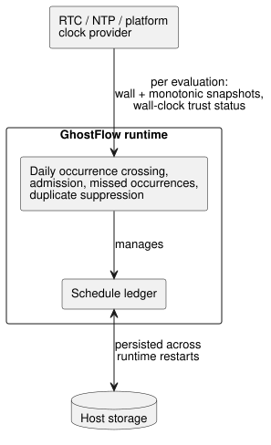
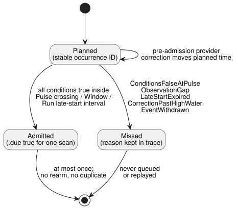
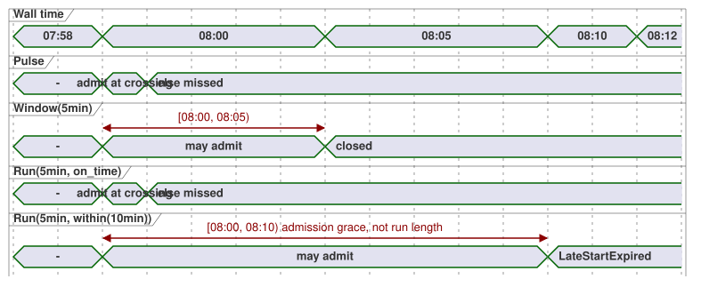

# Time and Schedule contract proposal

Tracking: language issue #23 / integration `TASK-85.2` / reviews R15–R17.

This document is the minimum coherent design handoff for:

- DateTime and monotonic elapsed time;
- recurring schedules;
- solar and tidal events;
- work calendars;
- explicit fallback.

It is not a general temporal framework. It does not claim that every surface
form below is implemented. `Duration`, elapsed timers, `DailySlots`, and the
bounded Solar host already exist. The remaining types and policies are
proposals for T2–T4 and for joint review.

The additive continuous-true Bool timer metadata and its compatibility
contract are specified separately in `CONTINUOUS-BOOL-TIMER-CONTRACT.md`
(NT-T1-A/#46). That contract does not change the existing `elapsed(state)`
timer described here.

**In this document:** confirmed product meaning → what is implemented today →
the approved Daily execution boundary → value and clock domains → clock
snapshots → the `Schedule` value and occurrence admission → recurrence, Cron,
DST and midnight → work calendars → natural events and fallback → acceptance
vectors → what joint review still decides.

## Confirmed product meaning

These product decisions are settled:

- **Readable signals.** Control values and outputs form time-varying signals,
  but source stays readable as names, expressions, explicit old/next state, and
  output connections. Users do not write subscription/operator plumbing.
- **A `Schedule` is evaluated continuously.** It is not a delayed function call
  or a background thread. A missed decision is never silently queued for later.
- **Two clock domains.** Calendar time and monotonic elapsed time are
  different clock domains. Correcting the wall clock never rewinds or extends
  an elapsed timer that was already admitted.
- **Natural events need context.** Solar and lunar/tidal control requires the
  current time plus installation context. Missing, untrusted, or stale context
  is `Unknown`, not `false`.
- **Explicit fallback.** Every natural-time rule has an explicit fallback. No
  NTP-disconnection grace, catch-up, late start, pause, retry, or restart
  policy is inferred.
- **Tacit knowledge is not execution semantics.** A confirmed common premise
  may become explicit source or policy. Discovering and confirming tacit
  knowledge belongs to the authoring/review workflow, not to language
  execution semantics.

## Current implementation boundary

What exists today, and its known gaps:

- **`Duration`.** The syntax is a non-negative whole number of milliseconds,
  written with `ms`, `s`, `min`, or `h`. The current control literal path does
  not yet enforce the safe-integer maximum, while the standalone constraints
  dialect uses a positive `i32` bound. These are implementation gaps, not two
  different base Duration types.
- **Elapsed timers.** `timer x = elapsed(flag)` uses the generated monotonic
  `__gf_now_ms` input. It commits timer state together with the successful
  control tick.
- **Occurrence providers.** `DailySlots<15min>` and `Solar` are host-owned
  occurrence providers. Source sees them as `.due` Boolean inputs that are
  true for one scan. They do not operate outputs.
- **Solar requirements.** Solar requires a timezone, literal coordinates,
  rise/set plus an exact offset, and `fallback = skip`. The current native
  provider supports a bounded timezone and year profile. Unsupported context
  fails closed.
- **Clock-jump handling.** Existing providers establish a baseline after
  boot/recovery, suppress duplicate events across wall-clock rollback, and skip
  large forward wall-clock gaps. Solar also checks the monotonic scan gap;
  `DailySlots` v1 does not. Their current 60-second bounds are compatibility
  behavior. They are not a universal hidden default for the new Schedule
  contract.
- **Timezone support differs by host.** Browser Solar accepts the platform's
  IANA zones. The current portable Rust provider supports only `Asia/Seoul`,
  `UTC`, and `Etc/UTC`. Until both consumers pass the same zone vectors, a
  package may claim only the profile they explicitly share. Compiler
  acceptance alone is not cross-host support.

See [SOLAR-SCHEDULE.md](SOLAR-SCHEDULE.md) for implemented behavior. This
proposal preserves those artifacts and requires explicit versioning for any
later semantics.

## Approved Daily execution boundary — 2026-09-23

This decision splits responsibility for `Daily` schedules three ways:

- **Clock provider (RTC/NTP/platform):** supplies each evaluation with wall and
  monotonic clock snapshots and the wall-clock trust status.
- **GhostFlow runtime:** calculates `Daily` occurrence crossings, admission,
  missed occurrences, and duplicate suppression, and manages the schedule
  ledger.
- **Host storage:** persists that ledger across runtime restarts.



The underlying time source can be replaced without changing `Daily`
semantics. This assigns execution responsibility for the
[Reference §3.5 schedule contract](reference/03-time-and-schedules.md#35-schedule의-공통-의미);
it does not add a new language policy.

## Value and clock domains

| Domain | Minimum contract | Notes |
| --- | --- | --- |
| `Duration` | exact non-negative integer milliseconds, `0..2^53-1` | relative length; checked arithmetic; no month/year unit |
| `Date` | Gregorian date, years `1970..9999` | no time or timezone |
| `TimeOfDay` | `00:00:00.000..23:59:59.999` | no date, offset or recurrence |
| `DateTime` | exact UTC instant at millisecond resolution, Unix epoch through `9999-12-31T23:59:59.999Z` | literal requires `Z` or numeric UTC offset; the value carries no IANA zone |
| monotonic instant | host-only exact non-negative milliseconds plus boot/run epoch | never formatted as civil time or authored as a wall-clock literal |

**Range rules.**

- The common exact transport bound is JavaScript's safe integer range.
  `DateTime` instants in the declared civil range fit inside it.
- These are diagnostics: leap-second `:60`, `24:00`, a DateTime literal without
  an offset, and nonexistent dates.
- An IANA timezone belongs to a recurring Schedule or context, never to a
  DateTime instant.
- Constructs that semantically require a positive delay may reject zero. This
  does not change the base `Duration` range.
- T2 must apply the exact range consistently to control literals, constraints,
  manifest values, and native/WASM exchange.

**Minimum arithmetic.** The set is deliberately small:

- `DateTime ± Duration -> DateTime`, with checked range.
- `Duration + Duration`, and checked subtraction that stays non-negative.
- DateTime and TimeOfDay comparisons require both sides to have the same type.
- `TimeOfDay + Duration` does not wrap at midnight. Resolve it with a Date and
  timezone inside a Schedule.
- `DateTime - DateTime` is not in the minimum profile, because `Duration` is
  non-negative. Compare instants or use monotonic `elapsed` instead. Add a
  signed delta type only when a demonstrated control case needs it.
- Calendar days, months, and years are not fixed-millisecond Durations.

**Literal spelling.** The recommended source-literal boundary is still the
tagged-template candidate: `date\`2026-09-15\``, `time\`06:30\`` and
`datetime\`2026-09-15T06:30:00+09:00\``. R15 reviews these spellings. They are
compile-time literals, not runtime string parsing.

## Clock snapshot and responsibility

Each accepted scan receives exactly one immutable host snapshot:

```text
ClockSnapshot {
  monotonicMs
  bootEpoch
  wallMs?              // exact DateTime instant
  wallQuality          // Trusted | Unknown(reason)
  uncertaintyMs?
  sourceRevision?
}
```

**Who reads the clock.** The Driver obtains NTP/RTC/platform time and decides
whether it is trusted. The compiler and VM never open a network connection or
read a machine clock.

**How the snapshot is used.**

- `wallMs` without a trusted quality is not usable calendar time.
- A monotonic regression (monotonic time going backward) rejects the scan.
- A forward or backward wall-clock correction is accepted as a new
  observation. The occurrence high-water mark and occurrence identity prevent
  duplicates.

**Holding the last trusted time.** Continuing to use the last trusted wall
time would be an explicit policy, conceptually
`hold_last for Duration then <fallback>`, measured in monotonic time. This
document does not enable it. R17 decides whether to expose it. `skip` remains
the only required minimum fallback.

## Schedule is a typed reactive value

The compact conceptual shape is:

```text
Schedule = {
  trigger: TriggerRule,
  day: DayRule?,
  when: BoolPredicate?,
  basis: Pulse | Window(Duration) | Run(Duration, LateStartPolicy),
  timezone: IanaZone,
  context: installation bindings,
  fallback: Fallback,
  dst: DstPolicy,
  gap: ObservationGapPolicy
}
```

**One product type, not three kinds.** `Schedule` is a product type with one
duration-basis variant (`basis`). It is not `Cron | Window | Run` as three
equivalent kinds.

- Trigger rules include: one DateTime, a daily TimeOfDay, a named five-field
  Cron, and each solar/tidal event.
- The stored value describes a stream. Reading it does not start equipment.
- `when` is a statically compiled dependency expression over declared inputs
  and state. It is not a runtime closure or callback.
- Global output constraints remain a later, separate stage. They can still
  block the requested output of an admitted Run.

**Per-scan decision.** At every scan, resolution yields `True`, `False`, or
`Unknown(reason)`, together with the rule/context revisions. Fallback resolves
`Unknown`; negating `Unknown` never turns it into permission to operate.
Public projections remain ordinary control values:

- `.due` is true for one accepted scan when one occurrence is admitted.
- A Window may expose a level that is true only while the half-open window
  and all current predicates are true.
- A Run's execution state and `.active` are lowered to explicit state and
  timers. They are not a hidden asynchronous task.

**Sidecar observation.** The minimum executable boundary carries one atomic
sidecar observation together with the generated `.due` input:

```text
ScheduleObservation {
  format: GhostFlow/schedule-observation-v1
  scheduleId             // stable declaration/source-map identity
  definitionRevision     // exact loaded code/package revision
  decision: False | Due | Unknown(reason)
  disposition?           // Before | PredicateFalse | AlreadyAdmitted | Missed(reason)
  occurrence? { id, sourceKey, plannedWallMs, sourceDate?, scheduledLocalDate }
  providerRevision?
  contextRevisions
}
```

**Reason codes.** Unknown reasons and missed reasons are separate sets:

| Kind | Initial reasons |
| --- | --- |
| Unknown | `ClockUnknown`, `LocationUnknown`, `EventUnavailable`, `PredictionMissing`, `PredictionStale`, `CalendarMissing`, `CalendarOutOfRange`, `ZoneUnsupported` |
| Missed | `ConditionsFalseAtPulse`, `ObservationGap`, `LateStartExpired`, `CorrectionPastHighWater`, `EventWithdrawn` |

An Unknown reason is never reused for an ordinary false `when` predicate or
for a known missed occurrence.

**`skip` keeps the evidence.** `fallback = skip` resolves an Unknown admission
to `.due = false` for the VM. It does not erase `decision = Unknown(reason)`
from the same accepted scan's trace. Branching in source on unresolved quality
is outside the minimum profile. Adding it later requires a typed
Result/Decision rather than another unchecked Bool. So current `.due`
compatibility is kept, without pretending that the Bool alone carries
provenance.

**Occurrence identity.** Each planned occurrence has a stable identity. The
canonical key is the stable `scheduleId` plus a source occurrence key:

- fixed DateTime: the DateTime;
- daily/Cron: the local slot, plus the DST fold when applicable;
- solar: the event kind plus the source Date;
- tidal: the provider's stable station/event key.

The loaded definition revision, provider revision, and corrected planned time
are metadata, not identity. Consequences:

- A hot-swap or provider correction before admission moves or reinterprets the
  same occurrence. It does not create a second one.
- A deliberately new schedule gets a new `scheduleId`.
- Replaying an already admitted occurrence requires a separate, explicit
  operator action, not an incidental source edit.

The key is SHA-256 hashed to form the public occurrence ID and is persisted in
the high-water/admission ledger.

**At most once.** An occurrence can be admitted at most once, so a condition
that stays true does not create a run every scan. A condition that becomes
true later can admit an occurrence only inside an explicit Window or
late-start interval. Turning false and then true again inside the same
occurrence does not rearm it. Repeated attempts require an explicit repeating
trigger/rearm policy.



**When admission is allowed (basis).**

| Basis | First admission allowed | Otherwise |
| --- | --- | --- |
| `Pulse` | only at the crossing, if all conditions are true then (no late interval) | missed |
| `Window(5min)` | in `[planned, planned + 5min)` | — |
| `Run(5min, on_time)` | only at the observed crossing | missed |
| `Run(5min, within(10min))` | in `[planned, planned + 10min)`; the positive grace is not the run length | `LateStartExpired` |

Missing the half-open `within(...)` interval yields `LateStartExpired`, never
a queued call.
`on_time` and `within` are the only minimum `LateStartPolicy` variants. Every
Run manifest carries exactly one tagged value: `{ kind: on_time }` or
`{ kind: within, withinMs: <exact positive Duration> }`.

The timeline below compares the admission intervals for a planned time of
08:00.



**Run duration.** An admitted Run measures its duration from the actual
admission, in monotonic time. Run elapsed time runs continuously from
admission. It is not paused by a false requested output, or by a global
constraint blocking the final output. Requested-ON time, safe-ON accumulated
time, and continuous safe-ON time are separate explicit timer expressions, not
hidden Run modes. None of them proves physical motion.

## Recurrence, Cron, DST and midnight

**`cron5`.** The minimum Cron spelling is named `cron5` so that no one has to
guess the dialect: minute, hour, day-of-month, month, and day-of-week; no
seconds. Traditional Cron uses a surprising OR rule when both day fields are
set. To avoid it, the first profile rejects a rule that constrains both
day-of-month and day-of-week. Timezone is mandatory.

**DST.** Civil-time recurrence requires explicit DST handling, even if the
installation zone currently has no transition:

- nonexistent local time: `skip` or `next_valid`;
- repeated local time: `first`, `second`, `both`, or `skip`.

No option is silently selected. A fixed-offset DateTime literal has no DST
ambiguity.

**Midnight.** Windows are half-open. When a solar/tidal offset crosses
midnight, the day filter uses the local Date of the resolved scheduled start;
the trace also keeps the natural event's source date. A day change never stops
an already admitted Run, unless a separate continuation/constraint rule says
so.

**Required manifest fields.** The new Schedule manifest requires:

- `dstMissing` (`skip | next_valid`);
- `dstRepeated` (`first | second | both | skip`);
- `gapPolicy = skip`;
- an exact positive `maxObservationGapMs`.

The source spelling is still open to R16 review, but missing values are T3
diagnostics.

**Legacy `DailySlots` v1.** Existing `DailySlots` v1 is a legacy descriptor.
Its observed compatibility behavior is nonexistent=`skip`, repeated=`first`,
gap=`skip after 60000ms`. It is not silently relabeled as the new profile.
Migration emits the explicit fields and a new manifest/runtime identity.

**Observation gaps.** The new profile checks observation continuity using both
fields of consecutive accepted `ClockSnapshot`s. A gap exists when **either**
the monotonic delta **or** the positive wall-clock delta exceeds
`maxObservationGapMs`. Wall rollback alone is handled by the high-water rule,
but it cannot hide an excessive monotonic delta. This check does not depend on
the host's polling speed or on the NTP correction source.

The minimum `gapPolicy = skip` takes precedence over Pulse, Window, and Run
late admission:

- Every not-yet-admitted occurrence whose admission interval intersects the
  gap is marked missed with `ObservationGap`.
- The current or a later scan cannot revive it just because a Window or
  `within(...)` interval is still open.
- Initial boot and trust recovery establish a baseline in the same fail-closed
  way.
- Any future replay/catch-up policy must be separately named.

**Timezone profile.** The same manifest names an exact `timezoneProfile`
revision. A signed package binds it as a required host capability. Browser and
native hosts reject a profile or zone they do not support before runtime
activation. The compiler accepting an IANA string is not evidence that every
consumer implements it.

## Work-calendar day rules

Weekday, public-holiday, and planned-work rules are different things:

- `day\`mon..fri\`` uses only the resolved local Date.
- `day\`holiday\`` uses a named holiday calendar snapshot.
- `day\`workday\`` / `day\`offday\`` use a named site/crew work calendar.
- "Workday" means planned work, not observed worker presence.

**Calendar snapshots.** A work-calendar snapshot binds the calendar ID,
revision, timezone, and coverage range. Precedence, highest first:

1. explicit date exception;
2. declared holiday policy;
3. weekly pattern.

Conflicting exceptions for the same date are invalid. Missing or
out-of-coverage data is `Unknown`; in that case workday and offday are both
Unknown. A Schedule's day rule limits admission eligibility only. It does not
affect an already active Run.

**Spelling and overnight shifts.** The provisional surface uses
`on = day\`...\`` and `calendar = workers`; R16 reviews the spelling. The first
profile defines day tags only for calendar dates. It does not infer the
business date of an overnight shift. A calendar definition that attempts a
work interval crossing midnight is rejected; authors may split explicit time
windows at midnight instead. A later shift type can add business-date
attribution without changing these day tags.

## Natural event context and fallback

**Context bindings.**

- Solar event context binds the timezone, location revision, event kind, and
  provider calculation revision.
- Tidal event context also binds the station/model, prediction revision,
  coverage, and expiry.

**Tidal event identity.** A tidal provider profile is accepted only if it
supplies an opaque event ID that is stable across prediction revisions and
unique among multiple same-kind events at one station. The source occurrence
key is provider namespace + station ID + that event ID. Time or same-day
ordinal is never used as a correction identity. A provider without this
capability may supply an immutable snapshot, but cannot claim correction
support.

High/low tides are occurrence events. Spring/neap is a classified condition and
cannot be offset as if it were a DateTime. The language assumes neither a fixed
number of tides per day nor that a prediction proves the physical water level.

**Provider corrections.** Corrections keep the stable event identity defined
above.

- Before admission, the newest valid prediction may move the planned instant.
- If the instant moves to or behind the observation high-water mark, the
  occurrence is missed with `CorrectionPastHighWater`. It is not caught up.
- An explicit provider withdrawal is missed with `EventWithdrawn`.
- Reordering cannot change stable IDs.
- After admission, a revision or withdrawal neither creates a duplicate nor
  cancels the admitted Run.

Missing location, untrusted clock, unsupported/polar event, missing or stale
prediction, and unavailable calendar remain distinguishable reasons in the
trace.

**Fallback.** Every new-profile rule that depends on natural, time, or
calendar context requires `fallback`. The minimum supported value is `skip`:
issue no new occurrence and keep the reason. `skip` does not turn off an
already admitted Run or erase monotonic timers. A fixed-TimeOfDay alternative
only makes sense while the civil clock and timezone remain trusted, so it
still needs a terminal fallback such as `skip`. Recovery establishes a new
baseline. No missed occurrence is replayed unless an explicit catch-up policy
is added later.

`DailySlots` v1 remains readable under its declared old runtime identity
without a fallback field. T3 migration must produce an explicit fallback. It
must never treat that legacy acceptance as permission to omit fallback in new
source.

## T2–T4 acceptance vectors

These IDs are stable semantic vectors. R15–R17 may change the provisional
spelling before the vectors become source fixtures.

| ID | Scenario | Expected result | Owner |
| --- | --- | --- | --- |
| T1-TYPE-01 | valid/invalid Date, TimeOfDay and offset DateTime boundaries | exact normalized values / compile diagnostics | T2 |
| T1-TYPE-02 | wall clock moves backward while monotonic time advances | elapsed timer advances; no duplicate occurrence | T2/T4 |
| T1-TYPE-03 | DateTime plus Duration crosses UTC/local midnight | exact instant; no modulo-day wrap | T2 |
| T1-DURATION-01 | `0ms`, safe maximum, maximum+1 through control/constraints/ABI | first two exact where construct permits zero; overflow rejected consistently | T2 |
| T1-PULSE-01 | 08:00 Pulse, start predicate false at crossing then true at 08:10 | missed, not queued | T4 |
| T1-WINDOW-01 | 08:00–09:00 Window; predicate first true 08:10, later toggles | one 08:10 admission; no same-window rearm | T4 |
| T1-RUN-01 | planned 08:00, `Run(5min, within(10min))` admitted 08:02 | target 08:07 monotonic; wall correction does not change it | T2/T4 |
| T1-RUN-02 | Run active while requested/safe output is blocked for one minute | Run still completes from admission; separate requested/safe timers record their own values | T4 |
| T1-RUN-03 | `Run(5min, on_time)` predicate becomes true after crossing, or `within(10min)` reaches 08:10 | missed with the exact reason; never queued | T3/T4 |
| T1-FALLBACK-01 | natural rule omits fallback | compile diagnostic | T3 |
| T1-FALLBACK-02 | clock/location/event/prediction unavailable with `skip` | no due; exact Unknown reason retained | T4 |
| T1-RECOVERY-01 | trust recovers after a missed event | baseline only; no catch-up and no duplicate | T4 |
| T1-REVISION-01 | prediction moves before/after occurrence admission | newest pre-admission time / no post-admission duplicate | T4 |
| T1-REVISION-02 | unrelated source hot-swap retains one schedule declaration ID | same occurrence ID; no duplicate admission | T3/T4 |
| T1-DST-01 | nonexistent and repeated local TimeOfDay | selected explicit DST policy; absent policy rejected | T3/T4 |
| T1-DST-02 | repeated local TimeOfDay with `both` | two occurrence keys distinguished by DST fold | T3/T4 |
| T1-ZONE-01 | package requests an IANA zone outside one host's declared profile | reject before activation; do not fall back to a guessed offset | T3/T4 |
| T1-CRON-01 | `cron5` constrains both day-of-month and day-of-week | compile diagnostic, not OR/AND guess | T3 |
| T1-CALENDAR-01 | normal weekday / weekday holiday / weekend special work / temporary offday | workday, offday, workday, offday | T4 |
| T1-CALENDAR-02 | holiday special work / missing or expired snapshot | workday / Unknown for both workday and offday | T4 |
| T1-MIDNIGHT-01 | natural-event offset crosses midnight with a day filter | filter resolved start Date; source event Date retained | T4 |
| T1-MIDNIGHT-02 | work calendar attempts an overnight interval without shift attribution | configuration/compile diagnostic; no prior-date guess | T3 |
| T1-ACTIVE-01 | workday changes or context fails after a Run is admitted | admission filter alone does not stop it | T4 |
| T1-TIDE-01 | high/low prediction valid; spring/neap used as offset event | occurrence resolves / compile type diagnostic | T3/T4 |
| T1-TIDE-02 | two same-kind events reorder or one moves behind high-water/is withdrawn | stable IDs preserve matching; moved/withdrawn event is missed, never replayed | T4 |
| T1-GAP-01 | monotonic delta or positive wall delta exceeds the signed rule/profile bound | `ObservationGap`, no inferred replay; wall rollback cannot mask a monotonic gap | T4 |
| T1-GAP-02 | excessive gap overlaps an otherwise-open Window or `within(...)` interval | gap wins; occurrence is missed with `ObservationGap` and cannot be admitted later | T4 |

**Ownership.**

- T2 must preserve DateTime and monotonic identities across native/WASM
  exchange.
- T3 owns syntax and mandatory-field diagnostics.
- T4 owns provider resolution, quality/fallback, occurrence identity,
  duplicate suppression, and recovery.
- Driver tests separately establish NTP/RTC/location/tidal data on the target
  device.

## Joint-review boundary

Joint review decides only these points:

- **R15:** tagged Date/TimeOfDay/DateTime, `Schedule`/Pulse/Window/Run, and
  `cron5` spelling. The calendar-vs-monotonic separation is not reopened.
- **R16:** day/calendar spelling, workday/offday semantics, DST and midnight
  examples.
- **R17:** fallback spelling, and whether an explicit bounded `hold_last` is
  allowed.

Installation-specific location, tide station, calendar contents, equipment
delay, and acceptable uncertainty are not language defaults. The review
chooses how to state them. Implementation and physical acceptance remain
downstream work.
