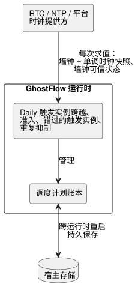
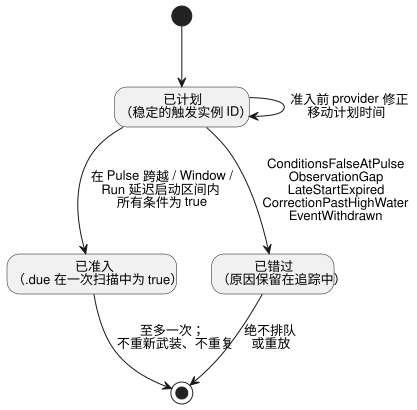
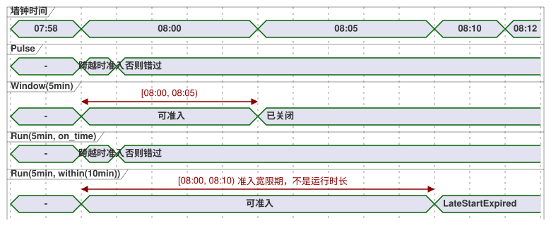

<!-- translation-source: docs/TIME-AND-SCHEDULE-CONTRACT.md -->
[英文原文](TIME-AND-SCHEDULE-CONTRACT.md)

# 时间与调度计划契约提案

跟踪：语言 issue #23 / 集成 `TASK-85.2` / 评审 R15–R17。

本文档是以下内容的最小一致性设计交接：

- DateTime 与单调经过时间；
- 周期性调度计划（schedule）；
- 太阳事件与潮汐事件；
- 工作日历；
- 显式回退（fallback）。

它不是一个通用的时间框架。它并不声称下文的每一种表层写法都已实现。`Duration`、经过时间定时器、`DailySlots` 以及有界的 Solar 宿主已经存在。其余的类型和策略是针对 T2–T4 以及联合评审的提案。

增量式的 continuous-true Bool 定时器元数据及其兼容性契约，单独在 `CONTINUOUS-BOOL-TIMER-CONTRACT.md`
（NT-T1-A/#46）中规定。该契约不改变本文所述的现有 `elapsed(state)` 定时器。

**本文内容：** 已确认的产品含义 → 目前已实现的内容 → 已批准的 Daily 执行边界 → 值域与时钟域 → 时钟快照 → `Schedule` 值与触发实例（occurrence）准入 → 周期、Cron、DST 与午夜 → 工作日历 → 自然事件与回退 → 验收向量 → 联合评审仍需决定的事项。

## 已确认的产品含义

以下产品决策已经确定：

- **可读的信号。** 控制值和输出构成随时间变化的信号，但源码仍以名称、表达式、显式的旧/新状态以及输出连接的形式保持可读。用户不需要编写订阅/运算符之类的管道代码。
- **`Schedule` 被持续求值。** 它不是延迟的函数调用，也不是后台线程。错过的判定绝不会被悄悄排队留待以后执行。
- **两个时钟域。** 日历时间和单调经过时间是不同的时钟域。校正墙钟绝不会倒回或延长一个已经准入的经过时间定时器。
- **自然事件需要上下文。** 太阳和月相/潮汐控制需要当前时间加上安装上下文。缺失、不可信或陈旧（stale）的上下文是 `Unknown`，而不是 `false`。
- **显式回退。** 每条自然时间规则都有一个显式回退。不会推断任何 NTP 断连宽限、补执行（catch-up）、延迟启动、暂停、重试或重启策略。
- **隐性知识不是执行语义。** 已确认的共同前提可以成为显式的源码或策略。发现和确认隐性知识属于编写/评审工作流，而不属于语言执行语义。

## 当前实现边界

目前已有的内容及其已知缺口：

- **`Duration`。** 语法是一个以毫秒为单位的非负整数，写作 `ms`、`s`、`min` 或 `h`。当前的控制字面量路径尚未强制执行安全整数上限，而独立的约束方言使用正的 `i32` 上界。这些是实现缺口，而不是两种不同的基础 Duration 类型。
- **经过时间定时器。** `timer x = elapsed(flag)` 使用生成的单调
  `__gf_now_ms` 输入。它在控制 tick 成功时一并提交定时器状态。
- **触发实例 provider。** `DailySlots<15min>` 和 `Solar` 是由宿主拥有的触发实例 provider。源码将它们视为 `.due` 布尔输入，在一次扫描中为 true。它们不操作输出。
- **Solar 的要求。** Solar 要求时区、字面量坐标、日出/日落加上精确偏移，以及 `fallback = skip`。当前的原生 provider 支持有界的时区和年份 profile。不受支持的上下文会以失败关闭（fail closed）的方式处理。
- **时钟跳变处理。** 现有 provider 在启动/恢复后建立基线，在墙钟回退时抑制重复事件，并跳过较大的墙钟向前跳变。Solar 还会检查单调扫描间隙；`DailySlots` v1 则不检查。它们当前的 60 秒上限属于兼容性行为，并不是新 Schedule 契约的通用隐藏默认值。
- **不同宿主的时区支持不同。** 浏览器端 Solar 接受平台提供的 IANA 时区。当前可移植的 Rust provider 只支持 `Asia/Seoul`、
  `UTC` 和 `Etc/UTC`。在两个使用方通过相同的时区向量之前，软件包只能声明它们显式共享的 profile。仅凭编译器接受，并不意味着跨宿主支持。

已实现的行为请参见 [SOLAR-SCHEDULE.md](SOLAR-SCHEDULE.zh.md)。本提案保留这些构件，并要求以后的任何语义都必须显式进行版本化。

## 已批准的 Daily 执行边界 —— 2026-09-23

该决定将 `Daily` 调度计划的职责分为三部分：

- **时钟提供方（RTC/NTP/平台）：** 为每次求值提供墙钟和单调时钟快照，以及墙钟的可信状态。
- **GhostFlow 运行时：** 计算 `Daily` 触发实例的跨越、准入、错过的触发实例和重复抑制，并管理调度计划账本（ledger）。
- **宿主存储：** 跨运行时重启持久保存该账本。



底层时间源可以替换，而不改变 `Daily` 的语义。这为
[Reference §3.5 调度计划契约](reference/03-time-and-schedules.zh.md)分配了执行职责；它不新增任何语言策略。

## 值域与时钟域

| 域 | 最小契约 | 说明 |
| --- | --- | --- |
| `Duration` | 精确的非负整数毫秒，`0..2^53-1` | 相对长度；带检查的算术；没有月/年单位 |
| `Date` | 公历日期，年份 `1970..9999` | 没有时间或时区 |
| `TimeOfDay` | `00:00:00.000..23:59:59.999` | 没有日期、偏移或周期 |
| `DateTime` | 毫秒精度的精确 UTC 瞬时，从 Unix 纪元到 `9999-12-31T23:59:59.999Z` | 字面量需要 `Z` 或数值 UTC 偏移；该值不携带 IANA 时区 |
| 单调瞬时 | 仅限宿主的精确非负毫秒数，加上启动/运行纪元 | 绝不格式化为民用时间，也绝不作为墙钟字面量编写 |

**范围规则。**

- 通用的精确传输上界是 JavaScript 的安全整数范围。声明的民用范围内的
  `DateTime` 瞬时都能落在其中。
- 以下情况会产生诊断：闰秒 `:60`、`24:00`、没有偏移的 DateTime 字面量以及不存在的日期。
- IANA 时区属于周期性 Schedule 或上下文，绝不属于 DateTime 瞬时。
- 在语义上要求正延迟的结构可以拒绝零。这不会改变基础 `Duration` 的范围。
- T2 必须在控制字面量、约束、清单值以及原生/WASM 交换中一致地应用这一精确范围。

**最小算术。** 该集合刻意保持很小：

- `DateTime ± Duration -> DateTime`，带范围检查。
- `Duration + Duration`，以及结果保持非负的带检查减法。
- DateTime 和 TimeOfDay 的比较要求两侧类型相同。
- `TimeOfDay + Duration` 不会在午夜回绕。请在 Schedule 中借助 Date 和时区来解析它。
- `DateTime - DateTime` 不在最小 profile 中，因为 `Duration` 是非负的。请改为比较瞬时，或使用单调的 `elapsed`。只有当某个已证实的控制用例需要时，才添加带符号的差值类型。
- 日历上的日、月、年不是固定毫秒数的 Duration。

**字面量写法。** 推荐的源码字面量边界仍是带标签模板的候选方案：`date\`2026-09-15\``、`time\`06:30\`` 和
`datetime\`2026-09-15T06:30:00+09:00\``。R15 评审这些写法。它们是编译期字面量，而不是运行时的字符串解析。

## 时钟快照与职责

每次被接受的扫描恰好接收一个不可变的宿主快照：

```text
ClockSnapshot {
  monotonicMs
  bootEpoch
  wallMs?              // 精确的 DateTime 瞬时
  wallQuality          // Trusted | Unknown(reason)
  uncertaintyMs?
  sourceRevision?
}
```

**由谁读取时钟。** 驱动程序获取 NTP/RTC/平台时间，并判断它是否可信。编译器和 VM 绝不打开网络连接，也绝不读取机器时钟。

**快照如何使用。**

- 没有可信质量的 `wallMs` 不是可用的日历时间。
- 单调回退（单调时间倒退）会导致扫描被拒绝。
- 向前或向后的墙钟校正会作为新的观测被接受。触发实例高水位标记和触发实例身份标识可防止重复。

**保持最后一个可信时间。** 继续使用最后一个可信墙钟时间将是一项显式策略，概念上为
`hold_last for Duration then <fallback>`，以单调时间度量。本文档不启用它。R17 决定是否开放它。`skip` 仍是唯一必需的最小回退。

## Schedule 是带类型的响应式值

其紧凑的概念结构为：

```text
Schedule = {
  trigger: TriggerRule,
  day: DayRule?,
  when: BoolPredicate?,
  basis: Pulse | Window(Duration) | Run(Duration, LateStartPolicy),
  timezone: IanaZone,
  context: installation bindings,
  fallback: Fallback,
  dst: DstPolicy,
  gap: ObservationGapPolicy
}
```

**一个积类型，而不是三种类别。** `Schedule` 是一个积类型，带有一个持续时间基准变体（`basis`）。它不是由三种对等类别构成的 `Cron | Window | Run`。

- 触发规则包括：单个 DateTime、每日 TimeOfDay、具名的五字段 Cron，以及每种太阳/潮汐事件。
- 存储的值描述的是一个流。读取它不会启动设备。
- `when` 是基于已声明输入和状态、经静态编译的依赖表达式。它不是运行时闭包或回调。
- 全局输出约束仍是后续的独立阶段。它们仍然可以阻止已准入 Run 的请求输出。

**逐扫描判定。** 在每次扫描中，解析会得出 `True`、`False` 或
`Unknown(reason)`，并附带规则/上下文的修订版。回退负责解析
`Unknown`；对 `Unknown` 取反绝不会把它变成运行许可。公开投影仍然是普通的控制值：

- 当一个触发实例被准入时，`.due` 在一次被接受的扫描中为 true。
- Window 可以暴露一个电平，仅当处于半开窗口内且当前所有谓词都为 true 时才为 true。
- Run 的执行状态和 `.active` 会被降级为显式的状态和定时器。它们不是隐藏的异步任务。

**旁路观测。** 最小可执行边界会随生成的 `.due` 输入一起携带一个原子的旁路（sidecar）观测：

```text
ScheduleObservation {
  format: GhostFlow/schedule-observation-v1
  scheduleId             // 稳定的声明/源码映射身份标识
  definitionRevision     // 精确的已加载代码/软件包修订版
  decision: False | Due | Unknown(reason)
  disposition?           // Before | PredicateFalse | AlreadyAdmitted | Missed(reason)
  occurrence? { id, sourceKey, plannedWallMs, sourceDate?, scheduledLocalDate }
  providerRevision?
  contextRevisions
}
```

**原因代码。** Unknown 原因和错过原因是两个独立的集合：

| 类别 | 初始原因 |
| --- | --- |
| Unknown | `ClockUnknown`、`LocationUnknown`、`EventUnavailable`、`PredictionMissing`、`PredictionStale`、`CalendarMissing`、`CalendarOutOfRange`、`ZoneUnsupported` |
| 错过（Missed） | `ConditionsFalseAtPulse`、`ObservationGap`、`LateStartExpired`、`CorrectionPastHighWater`、`EventWithdrawn` |

Unknown 原因绝不会被复用于普通的 `when` 谓词为 false 的情况，也不会被复用于已知的错过触发实例。

**`skip` 保留证据。** `fallback = skip` 会把 Unknown 准入对 VM 解析为 `.due = false`。它不会从同一次被接受扫描的追踪中抹去 `decision = Unknown(reason)`。在源码中根据未解析的质量进行分支不在最小 profile 之内。以后若要添加，需要一个带类型的
Result/Decision，而不是又一个未经检查的 Bool。这样既保留了当前 `.due` 的兼容性，也不假装单个 Bool 就能承载来源（provenance）信息。

**触发实例身份标识。** 每个计划的触发实例都有一个稳定的身份标识。规范键是稳定的 `scheduleId` 加上一个源触发实例键：

- 固定 DateTime：该 DateTime；
- 每日/Cron：本地时段，适用时加上 DST 折叠（fold）；
- 太阳：事件类别加上源 Date；
- 潮汐：provider 稳定的站点/事件键。

已加载的定义修订版、provider 修订版和校正后的计划时间都是元数据，而不是身份标识。由此带来的结果：

- 在准入之前发生的热替换或 provider 校正，会移动或重新解释同一个触发实例，而不会创建第二个。
- 刻意新建的调度计划会获得新的 `scheduleId`。
- 重放一个已经准入的触发实例，需要一个独立的显式操作员操作，而不是一次附带的源码编辑。

该键经 SHA-256 哈希形成公开的触发实例 ID，并持久保存在高水位/准入账本中。

**至多一次。** 一个触发实例至多被准入一次，因此一直为 true 的条件不会在每次扫描时都创建一次运行。之后才变为 true 的条件，只能在显式的 Window 或延迟启动区间内准入触发实例。在同一个触发实例内先变为 false 再变为 true，并不会重新武装（rearm）它。重复尝试需要显式的重复触发/重新武装策略。



**何时允许准入（basis）。**

| 基准 | 允许首次准入的时机 | 否则 |
| --- | --- | --- |
| `Pulse` | 仅在跨越时刻，且当时所有条件都为 true（没有延迟区间） | 错过 |
| `Window(5min)` | 在 `[planned, planned + 5min)` 内 | — |
| `Run(5min, on_time)` | 仅在观测到的跨越时刻 | 错过 |
| `Run(5min, within(10min))` | 在 `[planned, planned + 10min)` 内；正的宽限期不是运行时长 | `LateStartExpired` |

错过半开的 `within(...)` 区间会得到 `LateStartExpired`，绝不会产生排队的调用。
`on_time` 和 `within` 是仅有的最小 `LateStartPolicy` 变体。每个
Run 清单恰好携带一个带标签的值：`{ kind: on_time }` 或
`{ kind: within, withinMs: <exact positive Duration> }`。

下面的时间线比较了计划时间为 08:00 时的各准入区间。



**Run 时长。** 已准入的 Run 从实际准入时刻开始，以单调时间度量其时长。Run 的经过时间从准入起持续计时。它不会因为请求输出为 false 而暂停，也不会因为全局约束阻止最终输出而暂停。请求为 ON 的时间、安全意图为 ON 的累计时间以及安全意图连续为 ON 的时间，是各自独立的显式定时器表达式，而不是隐藏的 Run 模式。它们都不能证明物理动作已经发生。

## 周期、Cron、DST 与午夜

**`cron5`。** 最小的 Cron 写法命名为 `cron5`，这样就没有人需要猜测方言：分钟、小时、月中日、月份和星期几；没有秒。传统 Cron 在两个日期字段都被设置时，会使用一个出人意料的 OR 规则。为了避免这一点，第一个 profile 会拒绝同时约束月中日和星期几的规则。时区是必填项。

**DST。** 民用时间周期需要显式的 DST 处理，即使安装所在时区目前没有切换：

- 不存在的本地时间：`skip` 或 `next_valid`；
- 重复的本地时间：`first`、`second`、`both` 或 `skip`。

不会悄悄选择任何选项。固定偏移的 DateTime 字面量没有 DST 歧义。

**午夜。** 窗口是半开的。当太阳/潮汐偏移跨越午夜时，日期过滤器使用解析后计划开始时刻的本地 Date；追踪中还会保留自然事件的源日期。日期变更绝不会停止一个已经准入的 Run，除非另有独立的延续/约束规则这样规定。

**必需的清单字段。** 新的 Schedule 清单要求：

- `dstMissing`（`skip | next_valid`）；
- `dstRepeated`（`first | second | both | skip`）；
- `gapPolicy = skip`；
- 一个精确的正值 `maxObservationGapMs`。

源码写法仍有待 R16 评审，但缺失的值属于 T3 诊断。

**旧版 `DailySlots` v1。** 现有的 `DailySlots` v1 是一个旧版描述符。其观测到的兼容性行为为 nonexistent=`skip`、repeated=`first`、
gap=`skip after 60000ms`。它不会被悄悄重新标记为新的 profile。迁移时会输出显式字段以及新的清单/运行时身份标识。

**观测间隙。** 新的 profile 使用相邻两次被接受的 `ClockSnapshot` 的两个字段来检查观测连续性。当单调差值**或**正的墙钟差值**任一**超过
`maxObservationGapMs` 时，即存在间隙。单独的墙钟回退由高水位规则处理，但它不能掩盖过大的单调差值。这项检查不依赖宿主的轮询速度，也不依赖 NTP 校正源。

最小的 `gapPolicy = skip` 优先于 Pulse、Window 和 Run 的延迟准入：

- 准入区间与该间隙相交、且尚未准入的每个触发实例，都会以 `ObservationGap` 标记为错过。
- 当前或之后的扫描不能仅因为 Window 或
  `within(...)` 区间仍然打开就让它复活。
- 初次启动和可信性恢复以同样的失败关闭方式建立基线。
- 将来的任何重放/补执行策略都必须单独命名。

**时区 profile。** 同一清单会指明一个精确的 `timezoneProfile`
修订版。签名的软件包将其绑定为一项必需的宿主能力（capability）。浏览器宿主和原生宿主会在运行时激活之前拒绝它们不支持的 profile 或时区。编译器接受某个 IANA 字符串，并不能证明每个使用方都实现了它。

## 工作日历的日期规则

星期、公共节假日和计划工作规则是不同的东西：

- `day\`mon..fri\`` 只使用解析后的本地 Date。
- `day\`holiday\`` 使用一个具名的节假日日历快照。
- `day\`workday\`` / `day\`offday\`` 使用一个具名的站点/班组工作日历。
- “工作日”表示计划的工作，而不是观测到的工人在岗情况。

**日历快照。** 工作日历快照绑定日历 ID、修订版、时区和覆盖范围。优先级从高到低为：

1. 显式日期例外；
2. 声明的节假日策略；
3. 每周模式。

同一日期上相互冲突的例外是无效的。缺失或超出覆盖范围的数据为 `Unknown`；在这种情况下，workday 和 offday 都是 Unknown。Schedule 的日期规则只限制准入资格，不影响已经处于活动状态的 Run。

**写法与跨夜班次。** 暂定的表层写法使用
`on = day\`...\`` 和 `calendar = workers`；R16 评审该写法。第一个 profile 只为日历日期定义日期标签。它不推断跨夜班次的业务日期。试图定义跨越午夜的工作区间的日历定义会被拒绝；作者可以改为在午夜处拆分显式时间窗口。以后的班次类型可以在不改变这些日期标签的前提下添加业务日期归属。

## 自然事件上下文与回退

**上下文绑定。**

- 太阳事件上下文绑定时区、位置修订版、事件类别和 provider 计算修订版。
- 潮汐事件上下文还会绑定站点/模型、预测修订版、覆盖范围和过期时间。

**潮汐事件身份标识。** 只有当潮汐 provider profile 提供一个不透明的事件 ID，该 ID 在各预测修订版之间保持稳定，并且在同一站点的多个同类事件之间唯一时，才会被接受。源触发实例键为 provider 命名空间 + 站点 ID + 该事件 ID。时间或当日序号绝不用作校正身份标识。不具备这一能力的 provider 可以提供不可变快照，但不能声称支持校正。

高潮/低潮是触发实例事件。大潮/小潮是一种分类条件，不能像 DateTime 那样施加偏移。语言既不假定每天有固定数量的潮汐，也不假定预测能够证明物理水位。

**provider 校正。** 校正保持上文定义的稳定事件身份标识。

- 在准入之前，最新的有效预测可以移动计划瞬时。
- 如果瞬时被移动到观测高水位标记处或其之前，该触发实例以 `CorrectionPastHighWater` 被错过，不会被补执行。
- provider 的显式撤回以 `EventWithdrawn` 被错过。
- 重新排序不能改变稳定 ID。
- 在准入之后，修订或撤回既不会创建重复项，也不会取消已准入的 Run。

缺失位置、不可信时钟、不受支持/极地事件、缺失或陈旧的预测以及不可用的日历，在追踪中仍是可区分的原因。

**回退。** 新 profile 中每条依赖自然、时间或日历上下文的规则都需要 `fallback`。最小支持值是 `skip`：不签发新的触发实例，并保留原因。`skip` 不会关闭已经准入的 Run，也不会抹去单调定时器。固定 TimeOfDay 的替代方案只有在民用时钟和时区仍然可信时才有意义，因此它仍然需要一个终端回退，例如 `skip`。恢复会建立新的基线。除非以后添加显式的补执行策略，否则不会重放任何错过的触发实例。

`DailySlots` v1 在其声明的旧运行时身份标识下，即使没有 fallback 字段也仍可读取。T3 迁移必须生成显式回退。它绝不能把这种旧版接受视为在新源码中省略回退的许可。

## T2–T4 验收向量

这些 ID 是稳定的语义向量。在这些向量成为源码 fixture 之前，R15–R17 可以修改暂定写法。

| ID | 场景 | 预期结果 | 负责方 |
| --- | --- | --- | --- |
| T1-TYPE-01 | 有效/无效的 Date、TimeOfDay 和带偏移 DateTime 的边界 | 精确的规范化值 / 编译诊断 | T2 |
| T1-TYPE-02 | 墙钟倒退而单调时间前进 | 经过时间定时器前进；没有重复的触发实例 | T2/T4 |
| T1-TYPE-03 | DateTime 加 Duration 跨越 UTC/本地午夜 | 精确瞬时；不按天取模回绕 | T2 |
| T1-DURATION-01 | `0ms`、安全最大值、最大值+1 经过控制/约束/ABI | 前两者在结构允许零时为精确值；溢出被一致拒绝 | T2 |
| T1-PULSE-01 | 08:00 Pulse，启动谓词在跨越时为 false，08:10 时变为 true | 错过，不排队 | T4 |
| T1-WINDOW-01 | 08:00–09:00 Window；谓词在 08:10 首次为 true，之后反复切换 | 08:10 准入一次；同一窗口内不重新武装 | T4 |
| T1-RUN-01 | 计划 08:00，`Run(5min, within(10min))` 在 08:02 准入 | 单调时间目标为 08:07；墙钟校正不会改变它 | T2/T4 |
| T1-RUN-02 | Run 处于活动状态时，请求/安全输出被阻止一分钟 | Run 仍从准入时刻起计时并完成；独立的请求/安全定时器记录各自的值 | T4 |
| T1-RUN-03 | `Run(5min, on_time)` 的谓词在跨越后才变为 true，或 `within(10min)` 到达 08:10 | 以精确原因被错过；绝不排队 | T3/T4 |
| T1-FALLBACK-01 | 自然规则省略回退 | 编译诊断 | T3 |
| T1-FALLBACK-02 | 在 `skip` 下时钟/位置/事件/预测不可用 | 不到期；保留精确的 Unknown 原因 | T4 |
| T1-RECOVERY-01 | 错过事件后可信性恢复 | 仅建立基线；不补执行，也不重复 | T4 |
| T1-REVISION-01 | 预测在触发实例准入之前/之后移动 | 采用最新的准入前时间 / 准入后不产生重复 | T4 |
| T1-REVISION-02 | 无关的源码热替换保留了同一个调度计划声明 ID | 相同的触发实例 ID；没有重复准入 | T3/T4 |
| T1-DST-01 | 不存在的和重复的本地 TimeOfDay | 采用所选的显式 DST 策略；缺少策略则被拒绝 | T3/T4 |
| T1-DST-02 | 使用 `both` 的重复本地 TimeOfDay | 两个触发实例键，以 DST 折叠区分 | T3/T4 |
| T1-ZONE-01 | 软件包请求的 IANA 时区超出某个宿主声明的 profile | 在激活前拒绝；不回退到猜测的偏移 | T3/T4 |
| T1-CRON-01 | `cron5` 同时约束月中日和星期几 | 编译诊断，而不是猜测 OR/AND | T3 |
| T1-CALENDAR-01 | 普通工作日 / 工作日节假日 / 周末特别工作 / 临时休息日 | workday、offday、workday、offday | T4 |
| T1-CALENDAR-02 | 节假日特别工作 / 缺失或过期的快照 | workday / workday 和 offday 均为 Unknown | T4 |
| T1-MIDNIGHT-01 | 带日期过滤器时，自然事件偏移跨越午夜 | 过滤器使用解析后的开始 Date；保留源事件 Date | T4 |
| T1-MIDNIGHT-02 | 工作日历在没有班次归属的情况下尝试定义跨夜区间 | 配置/编译诊断；不猜测前一日期 | T3 |
| T1-ACTIVE-01 | Run 准入后工作日变化或上下文失效 | 仅靠准入过滤器不会停止它 | T4 |
| T1-TIDE-01 | 高潮/低潮预测有效；大潮/小潮被用作偏移事件 | 触发实例得以解析 / 编译类型诊断 | T3/T4 |
| T1-TIDE-02 | 两个同类事件重新排序，或其中一个移到高水位之后/被撤回 | 稳定 ID 保持匹配；被移动/撤回的事件被错过，绝不重放 | T4 |
| T1-GAP-01 | 单调差值或正的墙钟差值超过签名规则/profile 的上界 | `ObservationGap`，不推断重放；墙钟回退不能掩盖单调间隙 | T4 |
| T1-GAP-02 | 过大的间隙与原本仍打开的 Window 或 `within(...)` 区间重叠 | 间隙优先；触发实例以 `ObservationGap` 被错过，且之后不能被准入 | T4 |

**职责归属。**

- T2 必须在原生/WASM 交换中保持 DateTime 和单调身份标识。
- T3 负责语法和必填字段诊断。
- T4 负责 provider 解析、质量/回退、触发实例身份标识、重复抑制和恢复。
- 驱动程序测试单独在目标设备上确立 NTP/RTC/位置/潮汐数据。

## 联合评审边界

联合评审只决定以下几点：

- **R15：** 带标签的 Date/TimeOfDay/DateTime、`Schedule`/Pulse/Window/Run 以及
  `cron5` 的写法。日历时间与单调时间的分离不再重新讨论。
- **R16：** 日期/日历写法、workday/offday 语义、DST 和午夜示例。
- **R17：** 回退写法，以及是否允许显式的有界 `hold_last`。

特定于安装的位置、潮汐站点、日历内容、设备延迟和可接受的不确定性都不是语言默认值。评审决定如何表述它们。实现和物理验收仍是下游工作。
