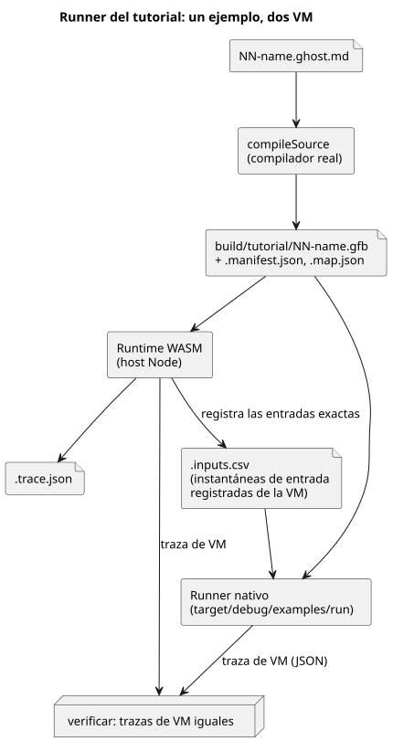

<!-- translation-source: docs/TUTORIAL.md -->
[Original en inglés](TUTORIAL.md)

# Tutorial de ejecución en el host

Este tutorial ejecuta cuatro pequeños programas de ejemplo de GhostFlow en su
computadora (el *host*) y comprueba que se comporten como se documenta. No se
conecta nada a hardware real. Cada salida es una *intención virtual*: un valor
que el programa pediría a un actuador, registrado en un archivo en lugar de
accionar una bomba o una válvula.

**Antes de empezar.** Necesita una máquina macOS o Linux con Node.js 22+, npm y
Rust/Cargo con el target `wasm32-unknown-unknown`. Consulte los
[requisitos de verificación](VERIFICATION.es.md) para ver los comandos exactos
de configuración. La ruta del runner nativo que usa el tutorial es específica de
POSIX, por lo que Windows no está soportado.

**Dos formas de ejecutarlo.**

- `npm test` ejecuta la compuerta completa del lenguaje en este checkout
  independiente. El tutorial es un paso de esa compuerta.
- `npm run tutorial` ejecuta solo el tutorial. Úselo después de haber instalado
  las dependencias y las cadenas de herramientas nativa/WASM. Compila ambos
  runners (el runner nativo y el runtime WASM) y luego ejecuta
  `tools/tutorial.mjs`.

Cualquiera de los dos comandos escribe los resultados del tutorial en su disco
local al ejecutarse.

**Qué cubre el tutorial.** Cada ejemplo es un archivo de fuente literaria
(literate): prosa en Markdown con código GhostFlow dentro. Léalos en orden; cada
uno añade una idea.

| Ejemplo | Fuente | Qué comprueba el runner |
|---|---|---|
| Latch | [01-latch.ghost.md](../examples/tutorial/01-latch.ghost.es.md) | Prioridad de paro, estado retenido, requisito bomba/válvula |
| Programación horaria | [02-watering.ghost.md](../examples/tutorial/02-watering.ghost.es.md) | Franja diaria, temporizador de tiempo transcurrido, estados secuenciales de válvulas |
| Humedad | [03-moisture.ghost.md](../examples/tutorial/03-moisture.ghost.es.md) | Mediana, manejo de valores obsoletos (stale)/desconexión y recuperación sin arranque automático |
| Estación compartida | [04-extra-valves.ghost.md](../examples/tutorial/04-extra-valves.ghost.es.md) | Dos controles que comparten una estación mediante su política de restricciones generada |
| Reproducción (replay) | VM aislada que usa las instantáneas de entrada del latch | Repetición determinista de entradas virtuales registradas |

En palabras sencillas:

- **Latch** — al pulsar *start*, la bomba se enciende y permanece encendida;
  *stop* siempre gana; la bomba solo puede funcionar cuando la válvula está
  abierta.
- **Programación horaria** — una franja horaria diaria de 15 minutos inicia una
  secuencia de riego. Abre dos válvulas una tras otra (nunca ambas a la vez) y
  temporiza cada fase con un temporizador de tiempo transcurrido.
- **Humedad** — el valor del sensor se suaviza con una mediana. Un sensor
  obsoleto o desconectado lleva la salida a un estado seguro (bomba apagada).
  Cuando el sensor se recupera, la bomba **no** vuelve a arrancar por sí sola;
  se requiere un nuevo arranque.
- **Estación compartida** — un segundo control añade dos válvulas nuevas y
  comparte la misma estación de bombeo con el ejemplo de programación horaria,
  usando la política de restricciones que genera el compilador.
- **Reproducción** — una VM nueva y aislada recibe las entradas registradas del
  latch y debe producir exactamente la misma traza. Nunca da órdenes al runtime
  original ni a ningún driver físico.

**Cómo funcionan las comprobaciones.** El runner compila cada control con el
punto de entrada real del compilador, `compileSource`. Después ejecuta el
programa en el runtime WASM y registra la instantánea exacta de entradas de cada
tick (paso de decisión lógica). Las mismas instantáneas se entregan al runner
nativo, y el tutorial verifica que las dos salidas JSON de traza de la VM sean
iguales.

El diagrama siguiente muestra este flujo para un ejemplo.



Esta comparación solo cubre la ejecución de la VM sobre entradas comunes. No
compara el muestreo físico, la sincronización de relojes ni el comportamiento
del host MCU.

**Pruebe un control a mano.** Estos dos comandos compilan el ejemplo del latch y
lo ejecutan con el runner nativo sobre las entradas de `01-latch.csv`:

```sh
node tools/ghostc.mjs examples/tutorial/01-latch.ghost.md build/tutorial/latch.gfb
cargo run --locked --offline -p ghostflow-core --example run -- build/tutorial/latch.gfb examples/tutorial/01-latch.csv
```

El primer comando escribe el archivo de bytecode `latch.gfb`. El segundo imprime
una línea JSON por tick.

**Dónde quedan las salidas.** Cada archivo `.gfb` generado tiene dos archivos
complementarios: `.manifest.json` y `.map.json`. La evidencia del tutorial se
guarda en `build/tutorial/`:

- `build/tutorial/evidence.json` — el resumen de todos los escenarios;
- archivos `.trace.json` e `.inputs.csv` por programa;
- los archivos de política, vinculación (binding) y traza de la estación
  compartida.

Son salidas locales ignoradas (no se incluyen en commits). Se regeneran
a partir de la versión fuente cada vez que se ejecuta el tutorial.

**Una nota sobre el campo `hardware`.** El runner del tutorial, sin cambios,
sigue escribiendo el campo heredado `hardware: "deferred-by-user"`. En este
repositorio del lenguaje es metadato de evidencia heredado y exclusivo del host.
No es una autorización vigente y no dice nada sobre el estado de la placa de
otro proyecto. La compuerta del host de nivel superior registra explícitamente
`hardwareTested: false` y `llmTested: false`.

**Próximos pasos.** Consulte los [límites de implementación](IMPLEMENTATION.es.md)
y los [requisitos de verificación](VERIFICATION.es.md).
