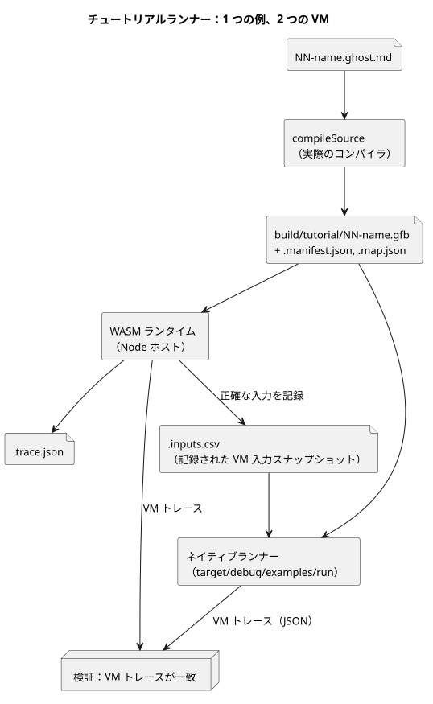

<!-- translation-source: docs/TUTORIAL.md -->
[英語の原文](TUTORIAL.md)

# ホスト実行チュートリアル

このチュートリアルでは、4 つの小さな GhostFlow サンプルプログラムをお使いのコンピュータ（*ホスト*）上で実行し、ドキュメントどおりに動作することを確認します。実際のハードウェアには何も接続しません。すべての出力は*仮想的な意図*です。つまり、プログラムがアクチュエータに取らせようとする値であり、ポンプやバルブを駆動する代わりにファイルへ記録されます。

**始める前に。** Node.js 22 以上、npm、そして `wasm32-unknown-unknown` ターゲットを備えた Rust/Cargo がインストールされた macOS または Linux マシンが必要です。正確なセットアップコマンドは[検証要件](VERIFICATION.ja.md)を参照してください。チュートリアルで使うネイティブランナーのパスは POSIX 固有のため、Windows はサポートされていません。

**2 つの実行方法。**

- `npm test` は、このスタンドアロンのチェックアウトで言語ゲート全体を実行します。チュートリアルはそのゲートの 1 ステップです。
- `npm run tutorial` はチュートリアルだけを実行します。依存関係とネイティブ/WASM ツールチェーンをインストールした後に使用してください。両方のランナー（ネイティブランナーと WASM ランタイム）をビルドし、その後 `tools/tutorial.mjs` を実行します。

どちらのコマンドも、実行時にチュートリアルの結果をローカルディスクに書き込みます。

**チュートリアルの内容。** 各サンプルは文芸的ソース（literate）ファイルで、Markdown の文章の中に GhostFlow コードが含まれています。順番に読んでください。各サンプルで 1 つずつ考え方が加わります。

| サンプル | ソース | ランナーが確認すること |
|---|---|---|
| ラッチ | [01-latch.ghost.md](../examples/tutorial/01-latch.ghost.ja.md) | 停止優先、保持される状態、ポンプ/バルブの前提条件 |
| スケジュール | [02-watering.ghost.md](../examples/tutorial/02-watering.ghost.ja.md) | 毎日のスロット、経過時間タイマー、順次切り替わるバルブの状態 |
| 水分 | [03-moisture.ghost.md](../examples/tutorial/03-moisture.ghost.ja.md) | 中央値、stale/断線の扱い、自動起動しない復旧 |
| 共有ステーション | [04-extra-valves.ghost.md](../examples/tutorial/04-extra-valves.ghost.ja.md) | 生成された制約ポリシーを通じて 1 つのステーションを共有する 2 つの制御 |
| リプレイ | ラッチの入力スナップショットを使う分離された VM | 記録された仮想入力の決定的な再実行 |

わかりやすく言うと、次のとおりです。

- **ラッチ** — *start* を押すとポンプがオンになり、オンのままになります。*stop* は常に優先されます。ポンプはバルブが開いているときにだけ動作できます。
- **スケジュール** — 毎日 15 分間のタイムスロットが灌水シーケンスを開始します。2 つのバルブを順番に開き（同時に両方を開くことは決してありません）、各フェーズの時間を経過時間タイマーで計ります。
- **水分** — センサ値は中央値で平滑化されます。センサが stale（古い）または断線している場合、出力は安全側（ポンプオフ）になります。センサが復旧しても、ポンプは自動では再起動**しません**。新たな起動が必要です。
- **共有ステーション** — 2 つ目の制御が新しいバルブを 2 つ追加し、コンパイラが生成する制約ポリシーを使って、スケジュールのサンプルと同じポンプステーションを共有します。
- **リプレイ** — 新しく分離された VM にラッチの記録済み入力を与え、まったく同じトレースを生成させます。この VM が元のランタイムや物理ドライバに指令を出すことは決してありません。

**確認の仕組み。** ランナーは、実際のコンパイラのエントリポイントである `compileSource` で各制御をコンパイルします。次に WASM ランタイムでプログラムを実行し、すべての tick（論理判断の単位）の入力スナップショットを正確に記録します。同じスナップショットをネイティブランナーにも与え、チュートリアルは 2 つの VM トレースの JSON 出力が等しいことを検証します。

次の図は、1 つのサンプルについてこの流れを示しています。



この比較が対象とするのは、共通の入力に対する VM の実行だけです。物理的なサンプリング、クロック同期、MCU ホストの動作は比較しません。

**1 つの制御を手動で試す。** 次の 2 つのコマンドはラッチのサンプルをコンパイルし、`01-latch.csv` の入力を使ってネイティブランナーで実行します。

```sh
node tools/ghostc.mjs examples/tutorial/01-latch.ghost.md build/tutorial/latch.gfb
cargo run --locked --offline -p ghostflow-core --example run -- build/tutorial/latch.gfb examples/tutorial/01-latch.csv
```

1 つ目のコマンドはバイトコードファイル `latch.gfb` を書き出します。2 つ目は tick ごとに 1 行の JSON を出力します。

**出力の保存先。** 生成される各 `.gfb` ファイルには、`.manifest.json` と `.map.json` の 2 つのサイドカーファイルが付きます。チュートリアルの証拠は `build/tutorial/` に置かれます。

- `build/tutorial/evidence.json` — すべてのシナリオの要約
- プログラムごとの `.trace.json` ファイルと `.inputs.csv` ファイル
- 共有ステーションのポリシー、バインディング、トレースのファイル

これらは無視されるローカル出力です（コミットされません）。チュートリアルを実行するたびに、ソースリリースから再生成されます。

**`hardware` フィールドについての注意。** 変更されていないチュートリアルランナーは、今もレガシーフィールド `hardware: "deferred-by-user"` を書き込みます。この言語リポジトリでは、これは引き継がれたホスト専用の証拠メタデータです。現在の承認ではなく、他のプロジェクトのボードの状態について何かを示すものでもありません。トップレベルのホストゲートは、`hardwareTested: false` と `llmTested: false` を明示的に記録します。

**次のステップ。** [実装上の制限](IMPLEMENTATION.ja.md)と[検証要件](VERIFICATION.ja.md)を参照してください。
