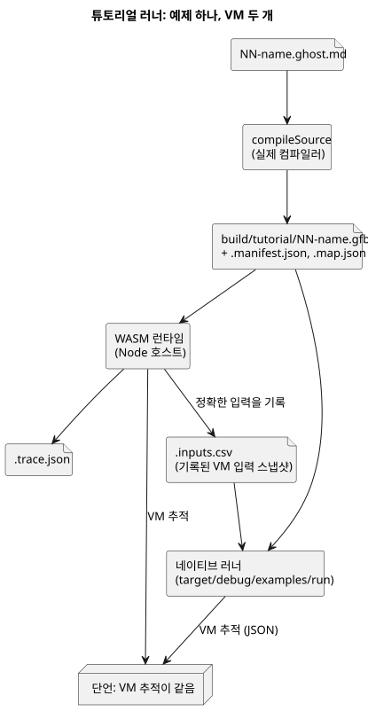

<!-- translation-source: docs/TUTORIAL.md -->
[영문 원문](TUTORIAL.md)

# 호스트 실행 튜토리얼

이 튜토리얼은 작은 GhostFlow 예제 프로그램 네 개를 여러분의 컴퓨터(*호스트*)에서
실행하고, 문서에 적힌 대로 동작하는지 확인합니다. 실제 하드웨어에는 아무것도
연결하지 않습니다. 모든 출력은 *가상 의도*입니다. 즉 프로그램이 액추에이터에
요청할 값을 펌프나 밸브를 구동하는 대신 파일에 기록한 것입니다.

**시작하기 전에.** Node.js 22 이상, npm, 그리고 `wasm32-unknown-unknown` 대상을
갖춘 Rust/Cargo가 설치된 macOS 또는 Linux 컴퓨터가 필요합니다. 정확한 설정 명령은
[검증 요구 사항](VERIFICATION.ko.md)을 참조하세요. 튜토리얼이 사용하는 네이티브
러너 경로는 POSIX 전용이므로 Windows는 지원하지 않습니다.

**실행하는 두 가지 방법.**

- `npm test`는 이 독립 체크아웃의 전체 언어 게이트를 실행합니다. 튜토리얼은 이
  게이트의 한 단계입니다.
- `npm run tutorial`은 튜토리얼만 실행합니다. 의존성과 네이티브/WASM 도구 체인을
  설치한 뒤에 사용합니다. 이 명령은 두 러너(네이티브 러너와 WASM 런타임)를 빌드한
  다음 `tools/tutorial.mjs`를 실행합니다.

어느 명령이든 실행할 때 튜토리얼 결과를 로컬 디스크에 기록합니다.

**튜토리얼에서 다루는 내용.** 각 예제는 문서형 소스(literate source) 파일입니다.
Markdown 설명 안에 GhostFlow 코드가 들어 있습니다. 순서대로 읽으세요. 예제마다
아이디어가 하나씩 추가됩니다.

| 예제 | 소스 | 러너가 확인하는 내용 |
|---|---|---|
| 래치 | [01-latch.ghost.md](../examples/tutorial/01-latch.ghost.md) | 정지 우선, 유지되는 상태, 펌프/밸브 전제 조건 |
| 예약 | [02-watering.ghost.md](../examples/tutorial/02-watering.ghost.md) | 일일 시간 구간, 경과 시간 타이머, 순차적인 밸브 상태 |
| 수분 | [03-moisture.ghost.md](../examples/tutorial/03-moisture.ghost.md) | 중앙값, stale/연결 끊김 처리, 자동 시작 없는 복구 |
| 공유 스테이션 | [04-extra-valves.ghost.md](../examples/tutorial/04-extra-valves.ghost.md) | 생성된 제약 정책으로 하나의 스테이션을 공유하는 두 제어 |
| 재생 | 래치 입력 스냅샷을 사용하는 격리된 VM | 기록된 가상 입력의 결정적 반복 실행 |

쉽게 말하면 다음과 같습니다.

- **래치** — *start*를 누르면 펌프가 켜지고 계속 켜져 있습니다. *stop*이 항상
  우선합니다. 펌프는 밸브가 열려 있을 때만 동작할 수 있습니다.
- **예약** — 매일 15분짜리 시간 구간이 관수 순서를 시작합니다. 이 순서는 밸브 두
  개를 차례로 엽니다(두 밸브를 동시에 열지 않습니다). 각 단계의 시간은 경과 시간
  타이머로 잽니다.
- **수분** — 센서 값을 중앙값으로 평활화합니다. 센서가 stale(오래된 값)이 되거나
  연결이 끊기면 출력을 안전한 상태(펌프 꺼짐)로 둡니다. 센서가 복구되어도 펌프는
  저절로 다시 시작하지 **않습니다**. 새로운 시작이 필요합니다.
- **공유 스테이션** — 두 번째 제어가 새 밸브 두 개를 추가하고, 컴파일러가 생성한
  제약 정책을 사용해 예약 예제와 같은 펌프 스테이션을 공유합니다.
- **재생** — 새로 만든 격리된 VM에 래치의 기록된 입력을 넣고, 정확히 같은 추적을
  만들어 내야 합니다. 이 VM은 원래 런타임이나 어떤 물리 드라이버에도 명령을 보내지
  않습니다.

**검사 방식.** 러너는 실제 컴파일러 진입점인 `compileSource`로 각 제어를
컴파일합니다. 그런 다음 WASM 런타임에서 프로그램을 실행하고 모든 tick의 정확한 입력
스냅샷을 기록합니다. 같은 스냅샷을 네이티브 러너에 넣고, 튜토리얼은 두 VM 추적
JSON 출력이 같은지 단언합니다.

아래 다이어그램은 예제 하나에 대한 이 흐름을 보여 줍니다.



이 비교는 공통 입력에 대한 VM 실행만 다룹니다. 물리 샘플링, 시계 동기화, MCU 호스트
동작은 비교하지 않습니다.

**제어 하나를 직접 실행해 보기.** 다음 두 명령은 래치 예제를 컴파일하고,
`01-latch.csv`의 입력으로 네이티브 러너에서 실행합니다.

```sh
node tools/ghostc.mjs examples/tutorial/01-latch.ghost.md build/tutorial/latch.gfb
cargo run --locked --offline -p ghostflow-core --example run -- build/tutorial/latch.gfb examples/tutorial/01-latch.csv
```

첫 번째 명령은 바이트코드 파일 `latch.gfb`를 씁니다. 두 번째 명령은 tick마다 JSON
한 줄을 출력합니다.

**출력 위치.** 생성된 모든 `.gfb` 파일에는 사이드카 파일 두 개, `.manifest.json`과
`.map.json`이 함께 생깁니다. 튜토리얼 증거는 `build/tutorial/`에 있습니다.

- `build/tutorial/evidence.json` — 모든 시나리오의 요약
- 프로그램별 `.trace.json`과 `.inputs.csv` 파일
- 공유 스테이션의 정책, 바인딩, 추적 파일

이 파일들은 무시되는 로컬 출력이며 커밋하지 않습니다. 튜토리얼을 실행할 때마다 소스
릴리스에서 다시 생성됩니다.

**`hardware` 필드에 대한 참고.** 변경되지 않은 튜토리얼 러너는 여전히 기존 필드
`hardware: "deferred-by-user"`를 씁니다. 이 언어 저장소에서 이 필드는 상속된 호스트
전용 증거 메타데이터입니다. 현재의 권한 부여가 아니며, 다른 프로젝트의 보드 상태에
대해서도 아무것도 말하지 않습니다. 최상위 호스트 게이트는 `hardwareTested: false`와
`llmTested: false`를 명시적으로 기록합니다.

**다음 단계.** [구현 제한](IMPLEMENTATION.ko.md)과
[검증 요구 사항](VERIFICATION.ko.md)을 참조하세요.
