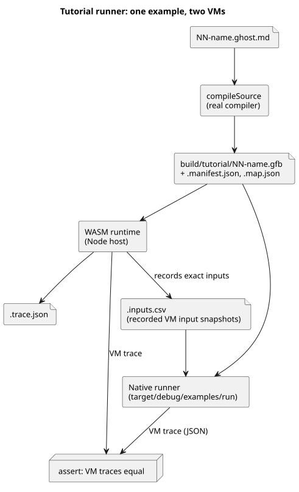

# Host execution tutorial

This tutorial runs four small GhostFlow example programs on your computer (the
*host*) and checks that they behave as documented. Nothing is connected to real
hardware. Every output is a *virtual intent*: a value the program would ask an
actuator to take, recorded in a file instead of driving a pump or valve.

**Before you start.** You need a macOS or Linux machine with Node.js 22+, npm,
and Rust/Cargo with the `wasm32-unknown-unknown` target. See
[verification requirements](VERIFICATION.md) for the exact setup commands. The
native runner path used by the tutorial is POSIX-specific, so Windows is not
supported.

**Two ways to run it.**

- `npm test` runs the complete language gate in this standalone checkout. The
  tutorial is one step of that gate.
- `npm run tutorial` runs only the tutorial. Use it after you have installed the
  dependencies and the native/WASM toolchains. It builds both runners (the
  native runner and the WASM runtime) and then executes `tools/tutorial.mjs`.

Either command writes the tutorial results to your local disk when it runs.

**What the tutorial covers.** Each example is a literate source file: Markdown
prose with GhostFlow code inside. Read them in order; each one adds one idea.

| Example | Source | What the runner checks |
|---|---|---|
| Latch | [01-latch.ghost.md](../examples/tutorial/01-latch.ghost.md) | Stop priority, retained state, pump/valve requirement |
| Schedule | [02-watering.ghost.md](../examples/tutorial/02-watering.ghost.md) | Daily slot, elapsed timer, sequential valve states |
| Moisture | [03-moisture.ghost.md](../examples/tutorial/03-moisture.ghost.md) | Median, stale/disconnect handling and recovery without automatic start |
| Shared station | [04-extra-valves.ghost.md](../examples/tutorial/04-extra-valves.ghost.md) | Two controls sharing a station through its generated constraint policy |
| Replay | Isolated VM using latch input snapshots | Deterministic repeat of recorded virtual inputs |

In plain words:

- **Latch** — pressing *start* turns the pump on and it stays on; *stop* always
  wins; the pump may only run when the valve is open.
- **Schedule** — a daily 15-minute time slot starts a watering sequence. It
  opens two valves one after another (never both at once), timing each phase
  with an elapsed-time timer.
- **Moisture** — the sensor value is smoothed with a median. A stale or
  disconnected sensor makes the output safe (pump off). When the sensor
  recovers, the pump does **not** restart on its own; a new start is required.
- **Shared station** — a second control adds two new valves and shares the
  same pump station with the schedule example, using the constraint policy the compiler
  generates.
- **Replay** — a fresh, isolated VM is fed the latch's recorded inputs and must
  produce exactly the same trace. It never commands the original runtime or any
  physical driver.

**How the checks work.** The runner compiles each control with the real
compiler entry point, `compileSource`. It then runs the program in the WASM
runtime and records the exact input snapshot of every tick. The same snapshots
are fed to the native runner, and the tutorial asserts that the two VM trace
JSON outputs are equal.

The diagram below shows this flow for one example.



This comparison only covers VM execution on common inputs. It does not compare
physical sampling, clock synchronization, or MCU host behavior.

**Try one control by hand.** These two commands compile the latch example and
run it with the native runner on the inputs in `01-latch.csv`:

```sh
node tools/ghostc.mjs examples/tutorial/01-latch.ghost.md build/tutorial/latch.gfb
cargo run --locked --offline -p ghostflow-core --example run -- build/tutorial/latch.gfb examples/tutorial/01-latch.csv
```

The first command writes the bytecode file `latch.gfb`. The second prints one
JSON line per tick.

**Where the outputs go.** Every generated `.gfb` file has two sidecar files:
`.manifest.json` and `.map.json`. Tutorial evidence lives in
`build/tutorial/`:

- `build/tutorial/evidence.json` — the summary of all scenarios;
- per-program `.trace.json` and `.inputs.csv` files;
- the shared-station policy, binding, and trace files.

These are ignored local outputs (not committed). They are regenerated from the
source release each time you run the tutorial.

**A note on the `hardware` field.** The unchanged tutorial runner still writes
the legacy field `hardware: "deferred-by-user"`. In this language repository it
is inherited host-only evidence metadata. It is not a current authorization, and
it says nothing about another project's board status. The top-level host gate
explicitly records `hardwareTested: false` and `llmTested: false`.

**Next steps.** See [implementation limits](IMPLEMENTATION.md) and
[verification requirements](VERIFICATION.md).
