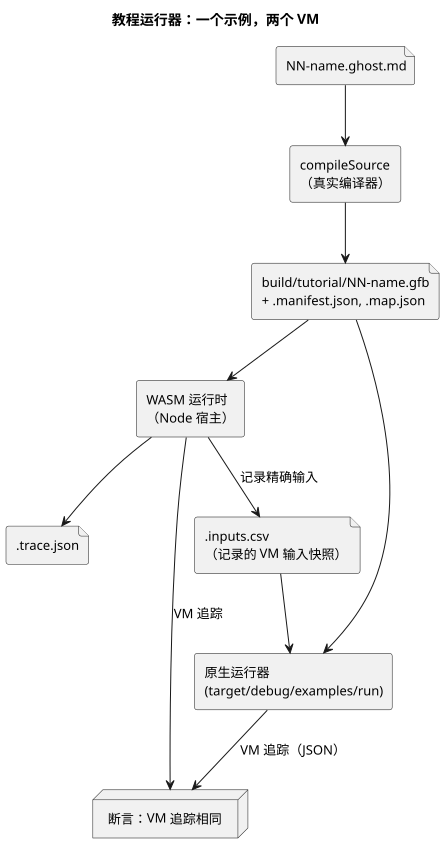

<!-- translation-source: docs/TUTORIAL.md -->
[英文原文](TUTORIAL.md)

# 宿主执行教程

本教程在你的计算机（即*宿主*，host）上运行四个小型 GhostFlow 示例程序，并检查它们的行为是否与文档一致。整个过程不连接任何真实硬件。每个输出都是*虚拟意图*：即程序希望执行器采用的值，它被记录到文件中，而不是去驱动泵或阀门。

**开始之前。** 需要一台装有 Node.js 22+、npm，以及带 `wasm32-unknown-unknown` 目标的 Rust/Cargo 的 macOS 或 Linux 机器。具体的安装命令见[验证要求](VERIFICATION.zh.md)。本教程使用的原生运行器路径是 POSIX 专用的，因此不支持 Windows。

**两种运行方式。**

- `npm test` 在这个独立检出（checkout）中运行完整的语言关卡（gate）。教程是该关卡中的一个步骤。
- `npm run tutorial` 只运行教程。请在安装好依赖以及原生/WASM 工具链之后使用。它会构建两个运行器（原生运行器和 WASM 运行时），然后执行 `tools/tutorial.mjs`。

无论使用哪条命令，运行时都会把教程结果写入本地磁盘。

**教程涵盖的内容。** 每个示例都是一个文学式源文件（literate）：Markdown 正文中嵌有 GhostFlow 代码。请按顺序阅读；每个示例都只引入一个新概念。

| 示例 | 源文件 | 运行器检查的内容 |
|---|---|---|
| 锁存 | [01-latch.ghost.md](../examples/tutorial/01-latch.ghost.zh.md) | 停止优先、保持的状态、泵/阀门要求 |
| 调度计划 | [02-watering.ghost.md](../examples/tutorial/02-watering.ghost.zh.md) | 每日时段、经过时间定时器、阀门的顺序状态 |
| 湿度 | [03-moisture.ghost.md](../examples/tutorial/03-moisture.ghost.zh.md) | 中值、陈旧/断线处理，以及恢复后不自动启动 |
| 共享泵站 | [04-extra-valves.ghost.md](../examples/tutorial/04-extra-valves.ghost.zh.md) | 两个 `control` 通过生成的约束策略共享一个泵站 |
| 重放 | 使用锁存输入快照的隔离 VM | 对记录的虚拟输入进行确定性的重复执行 |

通俗地说：

- **锁存** —— 按下 *start* 会让泵开启并保持开启；*stop* 总是优先；只有阀门打开时泵才可以运行。
- **调度计划** —— 每天一个 15 分钟的时段会启动一个浇水序列。它依次打开两个阀门（绝不同时打开两个），并用经过时间定时器为每个阶段计时。
- **湿度** —— 传感器值经过中值平滑。传感器陈旧或断线时，输出会变为安全状态（泵关闭）。传感器恢复后，泵**不会**自行重新启动；需要一次新的启动。
- **共享泵站** —— 第二个 `control` 增加了两个新阀门，并使用编译器生成的约束策略，与调度计划示例共享同一个泵站。
- **重放** —— 向一个全新的隔离 VM 输入锁存示例记录下的输入，它必须产生完全相同的追踪。它绝不会向原始运行时或任何物理驱动程序发出命令。

**检查的工作方式。** 运行器使用真实的编译器入口 `compileSource` 编译每个 `control`。然后在 WASM 运行时中运行程序，并记录每个 tick（逻辑决策步）的精确输入快照。同样的快照会输入原生运行器，教程断言两个 VM 追踪的 JSON 输出相同。

下图展示了一个示例的这一流程。



这种比较只涵盖相同输入下的 VM 执行。它不比较物理采样、时钟同步或 MCU 宿主的行为。

**手动试运行一个 `control`。** 下面两条命令编译锁存示例，并用原生运行器以 `01-latch.csv` 中的输入运行它：

```sh
node tools/ghostc.mjs examples/tutorial/01-latch.ghost.md build/tutorial/latch.gfb
cargo run --locked --offline -p ghostflow-core --example run -- build/tutorial/latch.gfb examples/tutorial/01-latch.csv
```

第一条命令写出字节码文件 `latch.gfb`。第二条命令为每个 tick 打印一行 JSON。

**输出的位置。** 每个生成的 `.gfb` 文件都有两个附属文件：`.manifest.json` 和 `.map.json`。教程证据位于 `build/tutorial/`：

- `build/tutorial/evidence.json` —— 所有场景的汇总；
- 每个程序的 `.trace.json` 和 `.inputs.csv` 文件；
- 共享泵站的策略、绑定和追踪文件。

这些都是被忽略的本地输出（不提交）。每次运行教程时，它们都会从源码发布版本重新生成。

**关于 `hardware` 字段。** 未修改的教程运行器仍会写入旧版字段 `hardware: "deferred-by-user"`。在这个语言仓库中，它是继承下来的仅限宿主的证据元数据。它不是当前的授权，也不说明其他项目的板卡状态。顶层宿主关卡会明确记录 `hardwareTested: false` 和 `llmTested: false`。

**后续步骤。** 参见[实现限制](IMPLEMENTATION.zh.md)和[验证要求](VERIFICATION.zh.md)。
