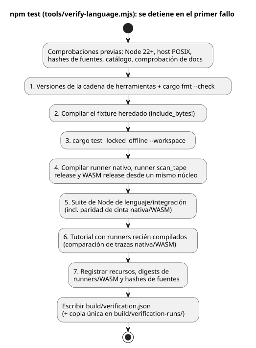
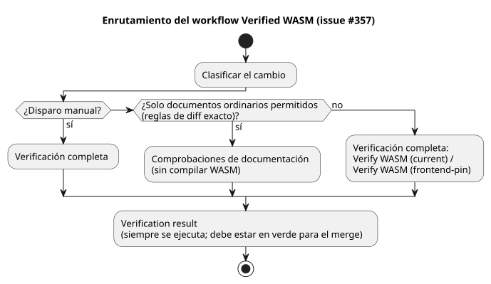

<!-- translation-source: docs/VERIFICATION.md -->
[Original en inglés](VERIFICATION.md)

# Verificación del repositorio independiente del lenguaje

Este documento explica cómo el repositorio independiente del lenguaje GhostFlow
demuestra su propio resultado de compilación y pruebas, qué cubre ese resultado
y qué no cubre.

El exportador copia archivos fuente y superposiciones (overlays), no resultados
de compilaciones anteriores. Ningún resultado PASS se hereda del espacio de
trabajo de migración. Para establecer su propio resultado, Main ejecuta estos
comandos en el repositorio recién exportado:

```sh
npm ci --ignore-scripts
rustup component add rustfmt
rustup target add wasm32-unknown-unknown
npm test
```

**Requisitos.**

- Node.js 22 o posterior, y npm;
- Rust/Cargo con soporte para lockfile v4, además de rustfmt;
- el target WASM `wasm32-unknown-unknown`;
- un enlazador nativo de macOS/Linux.

La configuración puede requerir acceso a la red. Las compuertas de verificación
en sí usan Cargo sin conexión y bloqueado (offline, locked) y no usan ninguna
API, LLM, puerto serie, servicio de red ni driver físico. La ruta del ejecutable
nativo del tutorial conservado es específica de POSIX. La exportación inicial no
declara soporte para Windows.

`tools/verify-language.mjs` ejecuta las compuertas siguientes en orden. Se
detiene en el primer comando que falla y conserva el informe del fallo. (Antes
del paso 1 también ejecuta comprobaciones previas: versión de Node, host POSIX,
hashes de las fuentes, el catálogo de requisitos, `npm run docs:check` y el
catálogo del currículo de PLC.)

1. Leer las versiones de la cadena de herramientas y comprobar el formato de
   Rust.
2. Compilar el fixture heredado que requiere `include_bytes!` en las pruebas
   unitarias de Rust.
3. Ejecutar las pruebas de Rust del workspace con el lockfile existente.
4. Compilar el runner nativo heredado, el runner `scan_tape` con tramas en modo
   release y el WASM release a partir del mismo núcleo.
5. Ejecutar la suite explícita de Node del lenguaje/contrato de integración,
   incluida la paridad de cinta nativa/WASM con tramas (consulte
   [SCAN-TAPE-PARITY.md](SCAN-TAPE-PARITY.es.md)).
6. Ejecutar el tutorial con runners recién compilados y comparar las trazas
   nativa/WASM.
7. Registrar el informe de recursos nativos, los digests de ambos runners
   nativos, el digest del WASM y los hashes de las fuentes.

El diagrama resume esta secuencia.



**Qué cubre la suite de Node.** Cubre:

- errores del compilador y extracción de fuentes literarias (literate);
- mapas de artefactos y ejecución de controles con conocimiento del manifiesto;
- restricciones/política, programaciones horarias y admisión de ocurrencias;
- comportamiento de la ABI de señales/estación;
- el libro mayor (ledger) de archivos de referencia;
- comprobaciones puras de rechazo de identidad/evidencia de integración con un
  fixture ficticio.

Algunas pruebas de adaptadores usan objetos ABI inyectados. El comportamiento
real del WASM compilado se ejercita por separado en las pruebas de
control/estación y en la paridad del tutorial. Estas pruebas son cobertura de
conformidad a nivel de fuente. No son una prueba de todo el comportamiento del
runtime ni de los dispositivos.

**La regresión de velocidad del VFD.** La regresión canónica
`examples/vfd-speed.ghost.md` compila un control mixto Bool/Number y comprueba
ocho tramas secuenciales `vm.safe` en el WASM release. También comprueba los
tipos de entrada/salida emitidos.

- El fallo original ocurrió con el WASM de SHA-256
  `3a8450b3001e04f52fe6a3a2e7d4cde0c16316171e69f345483ecde2d319ef36`. Ese
  binario rechazaba el GFB de 232 bytes antes del primer escaneo con
  `unknown expression opcode`.
- Al recompilar el WASM desde la revisión del lenguaje
  `fa0a005e43bd98ce0cb22e49b263d89ee796cd30` se obtuvo el SHA-256
  `b4495901b3399c57ed0a0b204b4d226b03819bcc251c368d9dcfa82b147c32b3`, y ese
  binario superó las ocho tramas.
- Se desconoce la revisión de compilación del binario anterior. Estas
  observaciones establecen un binario *reutilizado* incompatible, no un defecto
  del compilador ni del cargador a nivel de fuente.

El `npm test` completo recompila el WASM antes de esta regresión, por lo que
falla si ese par recién creado de compilador/runtime es incompatible. El
`npm run test:node` parcial falla cuando reutiliza un binario WASM incompatible.

Después de una compilación verificada, `node --test tests/vfd-speed.test.mjs` es
la invocación headless focalizada. Cada ejecución exitosa escribe un archivo
nuevo en `build/vfd-speed-runs/`. El archivo mantiene el escenario esperado
separado de las trazas observadas de la VM y registra:

- los hashes de la fuente y del escenario;
- la revisión del compilador y el hash del árbol de fuentes;
- el hash del bytecode y el hash del WASM.

La prueba también rechaza, antes de cualquier escaneo, entradas ausentes, tipos
Bool y Number incorrectos, NaN e infinito. Son salidas de control virtuales; la
traza no mide la velocidad del motor ni la tensión física.

**Dónde se guardan los resultados.**

| Ruta | Contenido |
|---|---|
| `build/verification.json` | El último resultado completo del host |
| `build/verification-runs/` | Archivos únicos que conservan resultados anteriores |
| `build/tutorial/` | Los programas y trazas regenerados del tutorial |
| `build/verification-node.json` | El resultado del `npm run test:node` parcial |

Todo esto es evidencia de ejecución ignorada (no se incluye en commits). El
`npm run test:node` parcial requiere el WASM existente y las compilaciones
nativas release (los runners `run`, `scan_tape` y `scenario_scan`). Escribe
`build/verification-node.json` y deja intacto el último resultado completo.

**Fuera del alcance.** La aceptación de la API, la evaluación genuina con el
lenguaje de los agricultores, la compatibilidad del firmware, la carga en la
placa, GPIO, el cableado y la operación física requieren, cada uno, pruebas de
consumidor identificadas por separado. No asocie esas afirmaciones a un informe
exitoso del host de este repositorio.

Para las entregas (handoffs) de GitHub Actions direccionadas por revisión y los
límites de su verificación por parte del consumidor, consulte
[Artefactos WASM de CI](WASM-CI-ARTIFACTS.es.md).

**Enrutamiento de CI.** Según el [issue #357](https://github.com/callin2/ghostflow-language/issues/357),
el workflow Verified WASM, que se activa siempre, selecciona uno de dos
carriles:

- comprobaciones de documentación, o
- los jobs completos existentes `Verify WASM (current)` / `Verify WASM (frontend-pin)`.

La lista de permitidos conservadora de documentos ordinarios y las reglas de
diff exacto están registradas en el
[flujo de trabajo de desarrollo](DEVELOPMENT-WORKFLOW.es.md). Todos los demás
cambios y todos los disparos manuales ejecutan la verificación completa. Cuando
una revisión exacta necesita una entrega de WASM verificado, use el disparo
manual con `source_sha`. Un éxito solo de documentación no compila WASM y no
establece el comportamiento del compilador ni del runtime.



La comprobación final `Verification result` se ejecuta incluso cuando un carril
se omite o falla. Falla cuando:

- la clasificación falló, se canceló o se omitió;
- el modo falta o es desconocido;
- el carril seleccionado no tuvo éxito.

Solo el carril no seleccionado puede omitirse. Un fallo inesperado, una
cancelación o un resultado ausente en ese carril también hacen fallar la
comprobación. Este resultado debe estar en verde antes del merge; las
protecciones de rama existentes no cambian. El enrutamiento y la propagación del
resultado tienen pruebas de regresión en `tests/ci-verification-routing.test.mjs`,
que también figura en la suite completa del lenguaje.
