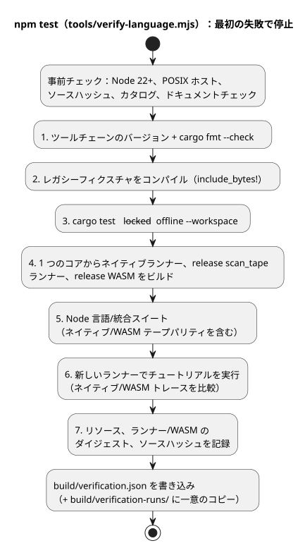
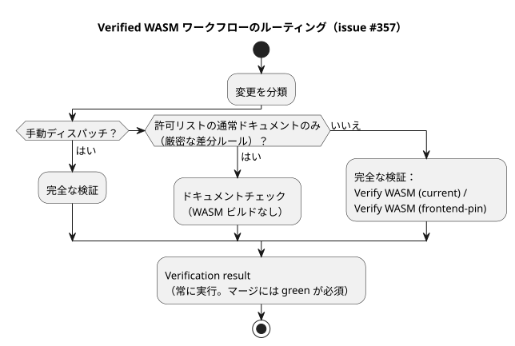

<!-- translation-source: docs/VERIFICATION.md -->
[英語の原文](VERIFICATION.md)

# スタンドアロン言語の検証

このドキュメントでは、スタンドアロンの GhostFlow 言語リポジトリが自身のビルドとテストの結果をどのように証明するか、その結果が何を対象とし、何を対象としないかを説明します。

エクスポータがコピーするのはソースファイルとオーバーレイであり、以前のビルド結果ではありません。移行用ワークスペースから PASS 結果を引き継ぐことはありません。独自の結果を確立するために、Main は新しくエクスポートされたリポジトリで次のコマンドを実行します。

```sh
npm ci --ignore-scripts
rustup component add rustfmt
rustup target add wasm32-unknown-unknown
npm test
```

**要件。**

- Node.js 22 以降と npm
- lockfile v4 をサポートする Rust/Cargo、および rustfmt
- `wasm32-unknown-unknown` WASM ターゲット
- macOS/Linux のネイティブリンカー

セットアップにはネットワークアクセスが必要になる場合があります。検証ゲート自体は、オフラインかつロックされた Cargo を使い、API、LLM、シリアルポート、ネットワークサービス、物理ドライバは使用しません。保持されているチュートリアルのネイティブ実行ファイルのパスは POSIX 固有です。最初のエクスポートは Windows のサポートを主張しません。

`tools/verify-language.mjs` は、以下のゲートを順番に実行します。最初に失敗したコマンドで停止し、失敗レポートを保持します。（ステップ 1 の前に、事前チェックとして Node のバージョン、POSIX ホスト、ソースハッシュ、要件カタログ、`npm run docs:check`、PLC カリキュラムカタログも確認します。）

1. ツールチェーンのバージョンを読み取り、Rust のフォーマットを確認します。
2. Rust のユニットテストで `include_bytes!` が必要とするレガシーフィクスチャをコンパイルします。
3. 既存の lockfile を使ってワークスペースの Rust テストを実行します。
4. 同じコアから、レガシーネイティブランナー、release 版のフレーム化された `scan_tape` ランナー、release 版 WASM をビルドします。
5. フレーム化されたネイティブ/WASM テープのパリティ（一致性）を含む、明示的な言語/統合契約の Node スイートを実行します（[SCAN-TAPE-PARITY.md](SCAN-TAPE-PARITY.ja.md) を参照）。
6. 新しくビルドしたランナーでチュートリアルを実行し、ネイティブ/WASM のトレースを比較します。
7. ネイティブのリソースレポート、両方のネイティブランナーのダイジェスト、WASM のダイジェスト、ソースハッシュを記録します。

次の図はこの手順をまとめたものです。



**Node スイートが対象とする範囲。** 対象は次のとおりです。

- コンパイラのエラーと文芸的ソース（literate）の抽出
- アーティファクトマップと、マニフェストを考慮した制御の実行
- 制約/ポリシー、スケジュール、発生（オカレンス）の受け入れ（admission）
- 信号/ステーションの ABI の振る舞い
- リファレンスファイルの台帳
- 架空のフィクスチャを使った、純粋な統合の同一性/証拠の拒否チェック

一部のアダプタテストは、注入された ABI オブジェクトを使用します。実際にコンパイルされた WASM の振る舞いは、制御/ステーションのテストとチュートリアルのパリティで別途検証されます。これらのテストはソースレベルの適合性を確認するものです。すべてのランタイムやデバイスの振る舞いを証明するものではありません。

**VFD 速度の回帰テスト。** 正本の `examples/vfd-speed.ghost.md` の回帰テストは、Bool/Number が混在する制御をコンパイルし、release 版 WASM で 8 つの連続した `vm.safe` フレームを確認します。また、出力される入力/出力の型も確認します。

- 元の失敗は、WASM の SHA-256 が `3a8450b3001e04f52fe6a3a2e7d4cde0c16316171e69f345483ecde2d319ef36` のときに発生しました。そのバイナリは、最初のスキャンの前に 232 バイトの GFB を `unknown expression opcode` で拒否しました。
- 言語リビジョン `fa0a005e43bd98ce0cb22e49b263d89ee796cd30` から WASM を再ビルドすると SHA-256 `b4495901b3399c57ed0a0b204b4d226b03819bcc251c368d9dcfa82b147c32b3` が得られ、そのバイナリは 8 フレームすべてに合格しました。
- 以前のバイナリのビルドリビジョンは不明です。これらの観測から言えるのは、互換性のない*再利用された*バイナリだったということであり、ソースのコンパイラやローダーの欠陥ではありません。

完全な `npm test` はこの回帰テストの前に WASM を再ビルドするため、新しいコンパイラ/ランタイムの組み合わせに互換性がなければ失敗します。部分的な `npm run test:node` は、互換性のない WASM バイナリを再利用すると失敗します。

検証済みのビルドの後は、`node --test tests/vfd-speed.test.mjs` が対象を絞ったヘッドレスの実行方法です。実行が成功するたびに、`build/vfd-speed-runs/` の下に新しいファイルが書き込まれます。このファイルは、期待されるシナリオと観測された VM トレースを分けて保持し、次を記録します。

- ソースとシナリオのハッシュ
- コンパイラのリビジョンとソースツリーのハッシュ
- バイトコードのハッシュと WASM のハッシュ

このテストは、欠落した入力、誤った Bool 型と Number 型、NaN、無限大も、スキャンの前に拒否します。これらは仮想的な制御出力であり、トレースはモーターの速度や物理的な電圧を測定するものではありません。

**結果の保存先。**

| パス | 内容 |
|---|---|
| `build/verification.json` | 最新の完全なホスト結果 |
| `build/verification-runs/` | 以前の結果を保持する一意のファイル |
| `build/tutorial/` | 再生成されたチュートリアルのプログラムとトレース |
| `build/verification-node.json` | 部分的な `npm run test:node` の結果 |

これらはすべて無視される実行の証拠です（コミットされません）。部分的な `npm run test:node` には、既存の WASM と release 版のネイティブビルド（`run`、`scan_tape`、`scenario_scan` ランナー）が必要です。これは `build/verification-node.json` を書き込み、最新の完全な結果はそのまま残します。

**対象外。** API の受け入れ、実際の農業従事者の言葉による評価、ファームウェアの互換性、ボードへのアップロード、GPIO、配線、物理的な動作には、それぞれ別途特定された利用側のテストが必要です。このリポジトリのホストレポートが成功したからといって、それらの主張を付け加えてはなりません。

リビジョン指定の GitHub Actions による受け渡しと、その利用側検証の限界については、[WASM CI アーティファクト](WASM-CI-ARTIFACTS.ja.md)を参照してください。

**CI のルーティング。** [issue #357](https://github.com/callin2/ghostflow-language/issues/357) に基づき、常にトリガーされる Verified WASM ワークフローは、次の 2 つのレーンのいずれかを選択します。

- ドキュメントチェック
- 既存の完全な `Verify WASM (current)` / `Verify WASM (frontend-pin)` ジョブ

保守的な通常ドキュメントの許可リストと厳密な差分ルールは、[開発ワークフロー](DEVELOPMENT-WORKFLOW.ja.md)に記録されています。それ以外のすべての変更と、すべての手動ディスパッチは完全な検証を実行します。特定のリビジョンについて検証済み WASM の受け渡しが必要な場合は、`source_sha` を指定して手動ディスパッチを使用してください。ドキュメントのみの成功では WASM はビルドされず、コンパイラやランタイムの振る舞いは確立されません。



最終的な `Verification result` チェックは、レーンがスキップされたり失敗したりした場合でも実行されます。次の場合に失敗します。

- 分類が失敗した、キャンセルされた、またはスキップされた
- モードが欠落している、または不明である
- 選択されたレーンが成功しなかった

スキップしてよいのは、選択されなかったレーンだけです。そのレーンで予期しない失敗、キャンセル、結果の欠落があった場合も、このチェックは失敗します。この結果はマージ前に green でなければなりません。既存のブランチ保護は変更されません。ルーティングと結果の伝播は `tests/ci-verification-routing.test.mjs` で回帰テストされており、このテストは完全な言語スイートにも含まれています。
