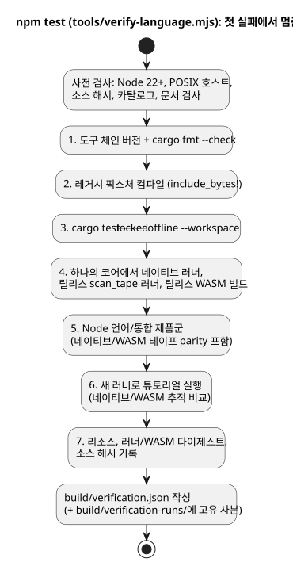
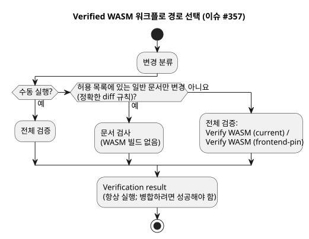

<!-- translation-source: docs/VERIFICATION.md -->
[영문 원문](VERIFICATION.md)

# 독립 언어 검증

이 문서는 독립 GhostFlow 언어 저장소가 자체 빌드와 테스트 결과를 어떻게 입증하는지,
그 결과가 무엇을 다루고 무엇을 다루지 않는지 설명합니다.

내보내기 도구(exporter)는 이전 빌드 결과가 아니라 소스 파일과 오버레이를 복사합니다.
마이그레이션 작업 공간의 PASS 결과는 승계되지 않습니다. 자체 결과를 확보하기 위해
Main은 새로 내보낸 저장소에서 다음 명령을 실행합니다.

```sh
npm ci --ignore-scripts
rustup component add rustfmt
rustup target add wasm32-unknown-unknown
npm test
```

**요구 환경.**

- Node.js 22 이상과 npm
- 잠금 파일 v4를 지원하는 Rust/Cargo, 그리고 rustfmt
- `wasm32-unknown-unknown` WASM 대상
- macOS/Linux 네이티브 링커

설정 단계에는 네트워크 접근이 필요할 수 있습니다. 검증 게이트 자체는 오프라인·잠금
모드의 Cargo를 사용하며 API, LLM, 직렬 포트, 네트워크 서비스, 물리 드라이버를
사용하지 않습니다. 유지되는 튜토리얼의 네이티브 실행 파일 경로는 POSIX 전용입니다.
초기 내보내기는 Windows 지원을 주장하지 않습니다.

`tools/verify-language.mjs`는 아래 게이트를 순서대로 실행합니다. 처음 실패한
명령에서 멈추고 실패 보고서를 보존합니다. (1단계 전에 사전 검사도 실행합니다. Node
버전, POSIX 호스트, 소스 해시, 요구 사항 카탈로그, `npm run docs:check`, PLC 커리큘럼
카탈로그를 확인합니다.)

1. 도구 체인 버전을 읽고 Rust 형식을 검사합니다.
2. Rust 단위 테스트의 `include_bytes!`에 필요한 레거시 픽스처를 컴파일합니다.
3. 기존 잠금 파일로 워크스페이스 Rust 테스트를 실행합니다.
4. 같은 코어에서 레거시 네이티브 러너, 릴리스 프레임 방식 `scan_tape` 러너, 릴리스
   WASM을 빌드합니다.
5. 프레임 방식 네이티브/WASM 테이프 parity(동등성)를 포함한 명시적 언어/통합 계약 Node
   제품군을 실행합니다([SCAN-TAPE-PARITY.ko.md](SCAN-TAPE-PARITY.ko.md) 참조).
6. 새로 빌드한 러너로 튜토리얼을 실행하고 네이티브/WASM 추적을 비교합니다.
7. 네이티브 리소스 보고서, 두 네이티브 러너의 다이제스트, WASM 다이제스트, 소스
   해시를 기록합니다.

다이어그램은 이 순서를 요약합니다.



**Node 제품군이 다루는 범위.** 다음을 다룹니다.

- 컴파일러 오류와 문서형 소스(literate) 추출
- 아티팩트 맵과 매니페스트를 인식하는 제어 실행
- 제약/정책, 예약, 발생(occurrence) admission(수용)
- 신호/스테이션 ABI 동작
- 참조 파일 ledger(원장)
- 가상의 픽스처를 사용하는 순수 통합 identity/증거 거부 검사

일부 어댑터 테스트는 주입된 ABI 객체를 사용합니다. 실제로 컴파일된 WASM 동작은
제어/스테이션 테스트와 튜토리얼 parity에서 별도로 실행됩니다. 이 테스트들은 소스 수준
적합성 범위입니다. 모든 런타임 또는 장치 동작에 대한 증명이 아닙니다.

**VFD 속도 회귀 테스트.** 정본 회귀 테스트인 `examples/vfd-speed.ghost.md`는
Bool/Number 혼합 제어를 컴파일하고, 릴리스 WASM에서 순차적인 `vm.safe` 프레임 8개를
확인합니다. 생성된 입력/출력 타입도 확인합니다.

- 원래 실패는 WASM SHA-256
  `3a8450b3001e04f52fe6a3a2e7d4cde0c16316171e69f345483ecde2d319ef36`에서
  발생했습니다. 이 바이너리는 첫 스캔 전에 232바이트 GFB를
  `unknown expression opcode`로 거부했습니다.
- 언어 리비전 `fa0a005e43bd98ce0cb22e49b263d89ee796cd30`에서 WASM을 다시 빌드하자
  SHA-256 `b4495901b3399c57ed0a0b204b4d226b03819bcc251c368d9dcfa82b147c32b3`이
  나왔고, 이 바이너리는 프레임 8개를 모두 통과했습니다.
- 이전 바이너리의 빌드 리비전은 알 수 없습니다. 이 관측은 호환되지 않는 바이너리가
  *재사용*되었음을 보여 줄 뿐이며, 소스 컴파일러나 로더의 결함을 뜻하지 않습니다.

전체 `npm test`는 이 회귀 테스트 전에 WASM을 다시 빌드하므로, 새로 빌드한
컴파일러/런타임 쌍이 호환되지 않으면 실패합니다. 부분 명령 `npm run test:node`는
호환되지 않는 WASM 바이너리를 재사용하면 실패합니다.

검증된 빌드 뒤에는 `node --test tests/vfd-speed.test.mjs`가 집중된 헤드리스 실행
방법입니다. 실행이 성공할 때마다 `build/vfd-speed-runs/` 아래에 새 파일을 씁니다. 이
파일은 기대 시나리오를 관측된 VM 추적과 분리해 보관하며 다음을 기록합니다.

- 소스 해시와 시나리오 해시
- 컴파일러 리비전과 소스 트리 해시
- 바이트코드 해시와 WASM 해시

이 테스트는 스캔 전에 누락된 입력, 잘못된 Bool 및 Number 타입, NaN, 무한대도
거부합니다. 이 값들은 가상 제어 출력입니다. 추적은 모터 속도나 물리 전압을 측정하지
않습니다.

**결과 저장 위치.**

| 경로 | 내용 |
|---|---|
| `build/verification.json` | 최신 전체 호스트 결과 |
| `build/verification-runs/` | 이전 결과를 보존하는 고유 파일 |
| `build/tutorial/` | 다시 생성한 튜토리얼 프로그램과 추적 |
| `build/verification-node.json` | 부분 명령 `npm run test:node`의 결과 |

이 파일들은 모두 무시되는 실행 증거이며 커밋하지 않습니다. 부분 명령
`npm run test:node`에는 기존 WASM과 릴리스 네이티브 빌드(`run`, `scan_tape`,
`scenario_scan` 러너)가 필요합니다. 이 명령은 `build/verification-node.json`을 쓰고
최신 전체 결과는 그대로 둡니다.

**범위 밖.** API 수용, 실제 농민 언어 평가, 펌웨어 호환성, 보드 업로드, GPIO, 배선,
물리 동작은 각각 별도로 식별된 소비자 테스트가 필요합니다. 이 저장소의 성공한 호스트
보고서에 그런 주장을 덧붙이지 마세요.

리비전 지정 GitHub Actions 인계와 그 소비자 검증 한계는
[WASM CI 아티팩트](WASM-CI-ARTIFACTS.ko.md)를 참조하세요.

**CI 경로 선택.** [이슈 #357](https://github.com/callin2/ghostflow-language/issues/357)에
따라 항상 트리거되는 Verified WASM 워크플로는 두 경로 중 하나를 선택합니다.

- 문서 검사, 또는
- 기존 전체 `Verify WASM (current)` / `Verify WASM (frontend-pin)` 작업

보수적인 일반 문서 허용 목록과 정확한 diff 규칙은
[개발 워크플로](DEVELOPMENT-WORKFLOW.ko.md)에 기록되어 있습니다. 그 밖의 모든 변경과
모든 수동 실행은 전체 검증을 실행합니다. 특정 리비전에 대해 검증된 WASM 인계가
필요하면 `source_sha`를 지정해 수동 실행하세요. 문서 전용 성공은 WASM을 빌드하지
않으며 컴파일러나 런타임 동작을 입증하지 않습니다.



최종 `Verification result` 검사는 경로가 건너뛰어지거나 실패해도 실행됩니다. 다음
경우에 실패합니다.

- 분류가 실패했거나, 취소되었거나, 건너뛰어진 경우
- 모드가 없거나 알 수 없는 경우
- 선택된 경로가 성공하지 않은 경우

선택되지 않은 경로만 건너뛸 수 있습니다. 그 경로에서 예상치 못한 실패, 취소, 결과
누락이 생겨도 이 검사는 실패합니다. 병합 전에 이 결과가 성공(녹색)이어야 합니다. 기존
브랜치 보호 설정은 바뀌지 않습니다. 경로 선택과 결과 전파는
`tests/ci-verification-routing.test.mjs`로 회귀 테스트하며, 이 테스트는 전체 언어
제품군에도 등록되어 있습니다.
