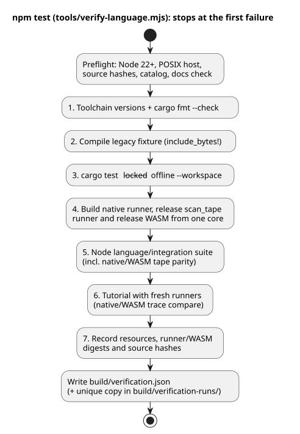
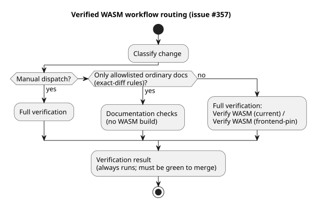

# Standalone language verification

This document explains how the standalone GhostFlow language repository proves
its own build and test result, what that result covers, and what it does not.

The exporter copies source files and overlays, not previous build results. No
PASS result is inherited from the migration workspace. To establish its own
result, Main runs these commands in the newly exported repository:

```sh
npm ci --ignore-scripts
rustup component add rustfmt
rustup target add wasm32-unknown-unknown
npm test
```

**Requirements.**

- Node.js 22 or newer, and npm;
- Rust/Cargo that supports lockfile v4, plus rustfmt;
- the `wasm32-unknown-unknown` WASM target;
- a macOS/Linux native linker.

Setup can require network access. The verification gates themselves use
offline, locked Cargo and no API, LLM, serial port, network service, or physical
driver. The retained tutorial's native executable path is POSIX-specific. The
initial export does not claim Windows support.

`tools/verify-language.mjs` runs the gates below in order. It stops at the first
command that fails and keeps the failure report. (Before step 1 it also runs
preflight checks: Node version, POSIX host, source hashes, the requirement
catalog, `npm run docs:check`, and the PLC curriculum catalog.)

1. Read toolchain versions and check Rust formatting.
2. Compile the legacy fixture required by `include_bytes!` in Rust unit tests.
3. Run workspace Rust tests with the existing lockfile.
4. Build the legacy native runner, release framed `scan_tape` runner and release
   WASM from the same core.
5. Run the explicit language/integration-contract Node suite, including framed
   native/WASM tape parity (see [SCAN-TAPE-PARITY.md](SCAN-TAPE-PARITY.md)).
6. Execute the tutorial with freshly built runners and compare native/WASM traces.
7. Record the native resource report, both native runner digests, WASM digest
   and source hashes.

The diagram summarizes this sequence.



**What the Node suite covers.** It covers:

- compiler errors and literate extraction;
- artifact maps and manifest-aware control execution;
- constraints/policy, schedules, and occurrence admission;
- signals/station ABI behavior;
- the reference file ledger;
- pure integration identity/evidence rejection checks using a fictional fixture.

Some adapter tests use injected ABI objects. Real compiled WASM behavior is
exercised separately by the control/station tests and by tutorial parity. These
tests are source-level conformance coverage. They are not a proof of all runtime
or device behavior.

**The VFD speed regression.** The canonical `examples/vfd-speed.ghost.md`
regression compiles a mixed Bool/Number control and checks eight sequential
`vm.safe` frames in the release WASM. It also checks the emitted input/output
types.

- The original failure occurred with WASM SHA-256
  `3a8450b3001e04f52fe6a3a2e7d4cde0c16316171e69f345483ecde2d319ef36`. That
  binary rejected the 232-byte GFB before the first scan with
  `unknown expression opcode`.
- Rebuilding WASM from language revision
  `fa0a005e43bd98ce0cb22e49b263d89ee796cd30` produced SHA-256
  `b4495901b3399c57ed0a0b204b4d226b03819bcc251c368d9dcfa82b147c32b3`, and that
  binary passed all eight frames.
- The earlier binary's build revision is unknown. These observations establish
  an incompatible *reused* binary, not a defect in the source compiler or loader.

The full `npm test` rebuilds WASM before this regression, so it fails if that
fresh compiler/runtime pair is incompatible. The partial `npm run test:node`
fails when it reuses an incompatible WASM binary.

After a verified build, `node --test tests/vfd-speed.test.mjs` is the focused
headless invocation. Each successful run writes a new file under
`build/vfd-speed-runs/`. The file keeps the expected scenario separate from the
observed VM traces and records:

- source and scenario hashes;
- compiler revision and source-tree hash;
- bytecode hash and WASM hash.

The test also rejects missing inputs, wrong Bool and Number types, NaN, and
infinity before any scan. These are virtual control outputs; the trace does not
measure motor speed or physical voltage.

**Where results are stored.**

| Path | Contents |
|---|---|
| `build/verification.json` | The latest full host result |
| `build/verification-runs/` | Unique files that retain previous results |
| `build/tutorial/` | The regenerated tutorial programs and traces |
| `build/verification-node.json` | The result of the partial `npm run test:node` |

All of these are ignored execution evidence (not committed). The partial
`npm run test:node` requires the existing WASM and the release native builds
(the `run`, `scan_tape`, and `scenario_scan` runners). It writes
`build/verification-node.json` and leaves the latest full result intact.

**Out of scope.** API acceptance, genuine farmer-language evaluation, firmware
compatibility, board upload, GPIO, wiring, and physical operation each require
separately identified consumer tests. Do not attach those claims to a
successful host report from this repository.

For revision-addressed GitHub Actions handoffs and their consumer verification
limits, see [WASM CI artifacts](WASM-CI-ARTIFACTS.md).

**CI routing.** Under [issue #357](https://github.com/callin2/ghostflow-language/issues/357),
the always-triggered Verified WASM workflow selects one of two lanes:

- documentation checks, or
- the existing full `Verify WASM (current)` / `Verify WASM (frontend-pin)` jobs.

The conservative ordinary-document allowlist and exact-diff rules are recorded
in [Development workflow](DEVELOPMENT-WORKFLOW.md). All other changes and all
manual dispatches run full verification. When an exact revision needs a
verified WASM handoff, use manual dispatch with `source_sha`. A
documentation-only success does not build WASM and does not establish compiler
or runtime behavior.



The final `Verification result` check runs even when a lane is skipped or
fails. It fails when:

- classification failed, was cancelled, or was skipped;
- the mode is missing or unknown;
- the selected lane was not successful.

Only the nonselected lane may be skipped. An unexpected failure, cancellation,
or missing result in that lane also fails the check. This result must be green
before merge; existing branch protections are unchanged. Routing and result
propagation are regression-tested by `tests/ci-verification-routing.test.mjs`,
which is also listed in the full language suite.
