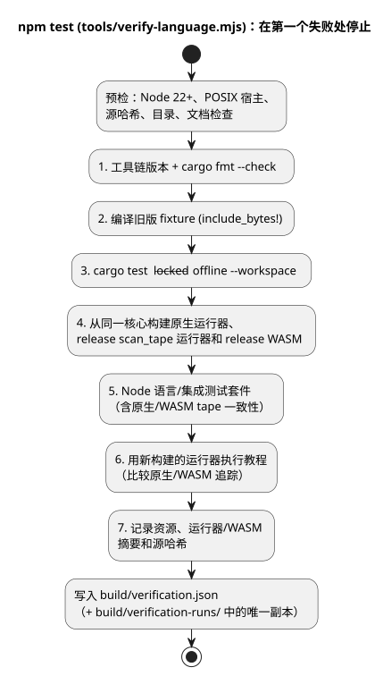
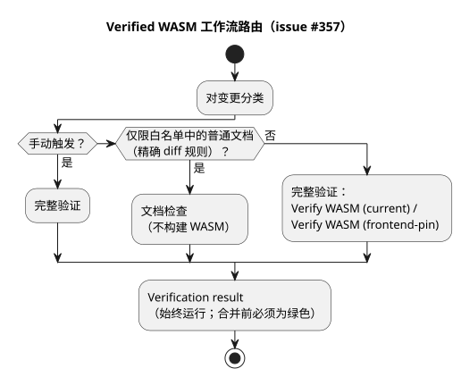

<!-- translation-source: docs/VERIFICATION.md -->
[英文原文](VERIFICATION.md)

# 独立语言验证

本文档说明独立的 GhostFlow 语言仓库如何证明自身的构建和测试结果、该结果涵盖什么，以及不涵盖什么。

导出器复制的是源文件和覆盖层（overlay），而不是以前的构建结果。没有任何 PASS 结果是从迁移工作区继承而来的。为了建立自己的结果，Main 在新导出的仓库中运行以下命令：

```sh
npm ci --ignore-scripts
rustup component add rustfmt
rustup target add wasm32-unknown-unknown
npm test
```

**要求。**

- Node.js 22 或更高版本，以及 npm；
- 支持 lockfile v4 的 Rust/Cargo，以及 rustfmt；
- `wasm32-unknown-unknown` WASM 目标；
- macOS/Linux 原生链接器。

安装准备可能需要网络访问。验证关卡本身使用离线、锁定（locked）的 Cargo，不使用任何 API、LLM、串口、网络服务或物理驱动程序。保留下来的教程的原生可执行文件路径是 POSIX 专用的。初始导出不声称支持 Windows。

`tools/verify-language.mjs` 按顺序运行以下关卡。它在第一条失败的命令处停止，并保留失败报告。（在第 1 步之前，它还会运行预检：Node 版本、POSIX 宿主、源哈希、需求目录、`npm run docs:check` 以及 PLC 课程目录。）

1. 读取工具链版本并检查 Rust 格式。
2. 编译 Rust 单元测试中 `include_bytes!` 所需的旧版 fixture。
3. 使用现有的 lockfile 运行工作区的 Rust 测试。
4. 从同一核心构建旧版原生运行器、release 版分帧 `scan_tape` 运行器和 release 版 WASM。
5. 运行明确列出的语言/集成契约 Node 测试套件，其中包括分帧的原生/WASM tape 一致性（参见 [SCAN-TAPE-PARITY.md](SCAN-TAPE-PARITY.zh.md)）。
6. 用新构建的运行器执行教程，并比较原生/WASM 追踪。
7. 记录原生资源报告、两个原生运行器的摘要、WASM 摘要以及源哈希。

下图概括了这一顺序。



**Node 测试套件涵盖的内容。** 它涵盖：

- 编译器错误和文学式提取；
- 制品映射以及感知清单（manifest）的 `control` 执行；
- 约束/策略、调度计划以及触发实例（occurrence）准入；
- 信号/泵站 ABI 行为；
- 参考文件账本；
- 使用虚构 fixture 的纯集成身份标识/证据拒绝检查。

部分适配器测试使用注入的 ABI 对象。真实编译出的 WASM 行为则由 `control`/泵站测试和教程一致性单独验证。这些测试属于源码层面的一致性覆盖，并不能证明所有运行时或设备行为。

**VFD 速度回归测试。** 规范的 `examples/vfd-speed.ghost.md` 回归测试会编译一个混合 Bool/Number 的 `control`，并在 release 版 WASM 中检查八个连续的 `vm.safe` 帧。它还会检查生成的输入/输出类型。

- 最初的失败发生在 WASM SHA-256 为 `3a8450b3001e04f52fe6a3a2e7d4cde0c16316171e69f345483ecde2d319ef36` 时。该二进制文件在第一次扫描之前就以 `unknown expression opcode` 拒绝了 232 字节的 GFB。
- 从语言修订版 `fa0a005e43bd98ce0cb22e49b263d89ee796cd30` 重新构建 WASM，得到 SHA-256 `b4495901b3399c57ed0a0b204b4d226b03819bcc251c368d9dcfa82b147c32b3`，该二进制文件通过了全部八帧。
- 较早那个二进制文件的构建修订版未知。这些观测结果表明问题出在一个不兼容的、*被复用的*二进制文件上，而不是源码编译器或加载器的缺陷。

完整的 `npm test` 会在这个回归测试之前重新构建 WASM，因此如果这对新构建的编译器/运行时不兼容，它就会失败。部分执行的 `npm run test:node` 在复用不兼容的 WASM 二进制文件时会失败。

在构建经过验证之后，`node --test tests/vfd-speed.test.mjs` 是专门的无界面（headless）调用方式。每次成功运行都会在 `build/vfd-speed-runs/` 下写入一个新文件。该文件把预期场景与观测到的 VM 追踪分开保存，并记录：

- 源码和场景的哈希；
- 编译器修订版和源码树哈希；
- 字节码哈希和 WASM 哈希。

该测试还会在任何扫描之前拒绝缺失的输入、错误的 Bool 和 Number 类型、NaN 以及无穷大。这些是虚拟的控制输出；追踪并不测量电机速度或物理电压。

**结果的存放位置。**

| 路径 | 内容 |
|---|---|
| `build/verification.json` | 最新的完整宿主结果 |
| `build/verification-runs/` | 保留以前结果的唯一文件 |
| `build/tutorial/` | 重新生成的教程程序和追踪 |
| `build/verification-node.json` | 部分执行的 `npm run test:node` 的结果 |

这些都是被忽略的执行证据（不提交）。部分执行的 `npm run test:node` 需要现有的 WASM 和 release 版原生构建（`run`、`scan_tape` 和 `scenario_scan` 运行器）。它写入 `build/verification-node.json`，并保持最新的完整结果不变。

**不在范围内。** API 验收、真实的农户语言评估、固件兼容性、板卡上传、GPIO、接线以及物理运行，每一项都需要单独标识的使用方测试。不得把这些声明附加到本仓库成功的宿主报告上。

关于按修订版寻址的 GitHub Actions 交接及其使用方验证的限制，参见 [WASM CI 制品](WASM-CI-ARTIFACTS.zh.md)。

**CI 路由。** 根据 [issue #357](https://github.com/callin2/ghostflow-language/issues/357)，始终触发的 Verified WASM 工作流会在两条通道中选择一条：

- 文档检查，或
- 现有的完整 `Verify WASM (current)` / `Verify WASM (frontend-pin)` 作业。

保守的普通文档白名单和精确 diff 规则记录在[开发工作流程](DEVELOPMENT-WORKFLOW.zh.md)中。所有其他变更以及所有手动触发都会运行完整验证。当某个确切修订版需要经过验证的 WASM 交接时，请使用带 `source_sha` 的手动触发。仅文档检查的成功不会构建 WASM，也不能证明编译器或运行时的行为。



即使某条通道被跳过或失败，最终的 `Verification result` 检查也会运行。在以下情况下它会失败：

- 分类失败、被取消或被跳过；
- 模式缺失或未知；
- 被选中的通道没有成功。

只有未被选中的通道可以被跳过。该通道中出现意外失败、取消或结果缺失，同样会使检查失败。合并前该结果必须为绿色；现有的分支保护规则保持不变。路由和结果传递由 `tests/ci-verification-routing.test.mjs` 进行回归测试，该测试也列在完整的语言测试套件中。
