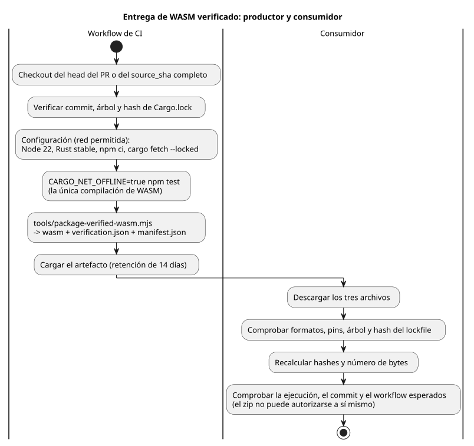

<!-- translation-source: docs/WASM-CI-ARTIFACTS.md -->
[Original en inglés](WASM-CI-ARTIFACTS.md)

# Artefactos WASM de CI de GhostFlow direccionados por revisión

El issue [language #97](https://github.com/callin2/ghostflow-language/issues/97)
define la entrega (handoff) que desbloquea la compuerta de WASM real de
[frontend #210](https://github.com/callin2/farm_studio_frontend/issues/210).
Aquí, una *entrega* es un artefacto de CI: un binario WASM junto con la
evidencia de que se compiló y verificó a partir de una revisión exacta de la
fuente.

Este documento es un contrato de workflow y de verificación. No se afirma que
exista ningún artefacto hasta que una ejecución alojada lo produzca y una
verificación independiente de la descarga sea exitosa.

**En este documento:** alcance y dependencias; configuración y la compuerta de
pruebas; el paquete, el informe y el manifiesto; carga, nomenclatura y
verificación de la descarga.

El diagrama muestra toda la canalización, desde el checkout hasta la
verificación por parte del consumidor.



## Alcance y dependencias

- Compilar el head del PR actualmente en checkout, nunca una ref de merge.
- Compilar el pin de lenguaje activo del frontend:
  b2f2874dd0238207558dfa4cc83077d322356a6c.
- Una ejecución manual puede proporcionar opcionalmente source_sha. Si se omite,
  se usa el commit actual del workflow. Si se proporciona, debe ser un SHA de
  commit completo de 40 caracteres hexadecimales (en minúsculas). Los SHA
  cortos, las ramas, las etiquetas y las refs mutables no son válidos.
- source.commit es el pin exacto de prueba de la fuente del lenguaje. ci.commit
  registra el head del PR en checkout del workflow, el head del push o el commit
  del disparo, y ambos pueden ser distintos.
- #97 permanece abierto hasta que una ejecución alojada real produzca un
  artefacto y su descarga se verifique. Un resultado exitoso local de Rust no lo
  cierra.
- [API #30](https://github.com/callin2/farm_studio_api/issues/30) es
  independiente. [Frontend #207](https://github.com/callin2/farm_studio_frontend/issues/207)
  es el contexto padre. [Frontend #211](https://github.com/callin2/farm_studio_frontend/issues/211)
  incluye trabajo de rendimiento; este artefacto no representa una entrega real
  para Android.

Antes de empaquetar, el workflow debe resolver y registrar el commit exacto de
la fuente, el árbol y el hash de Cargo.lock. Debe fallar si:

- el commit solicitado no está disponible;
- el checkout rastreado tiene modificaciones pendientes (dirty); o
- el hash de una fuente rastreada es distinto.

El verificador y la entrega comparten un único inventario completo de hashes de
fuentes en `tools/verification-sources.mjs`, que incluye todos los crates. Se
rechaza una entrada del informe con contenido modificado, y también una entrada
ausente o sobrante.

## Configuración y compuerta

Durante la configuración se permite el acceso a la red:

1. Hacer checkout del head del PR o del source_sha completo solicitado y
   verificar su commit y su árbol.
2. Instalar Node 22 y Rust stable. Registrar las salidas exactas de node, npm,
   rustc, cargo y rustc -vV. Son procedencia, no una afirmación de
   reproducibilidad.
3. Ejecutar npm ci --ignore-scripts.
4. Ejecutar cargo fetch --locked para las dependencias de crates.io del main
   actual, incluidas las dependencias del verificador de paquetes nativo.

Durante la verificación, Cargo debe estar sin conexión y bloqueado (offline,
locked). Esto no afirma que todo acceso a la red esté deshabilitado
globalmente. El npm test completo actual ya invoca la compilación de WASM, así
que ejecute esa compuerta existente con Cargo sin conexión:

```sh
CARGO_NET_OFFLINE=true npm test
```

No añada una segunda compilación manual de WASM después del paso completo de
pruebas/informe. Esa única compilación existente es el origen del binario
empaquetado y de sus hashes.

## Paquete, informe y manifiesto

La implementación principal es tools/package-verified-wasm.mjs. Entrega tres
archivos:

```text
ghostflow_wasm.wasm
verification.json
manifest.json
```

El informe (`verification.json`) debe exigir:

```json
{
  "format": "GhostFlow/language-verification-v1",
  "scope": "language-host",
  "passed": true,
  "wasm": {
    "builtByThisRun": true,
    "sha256": "<packaged binary sha256>",
    "bytes": 0
  }
}
```

El script lanza un error ante datos de fuente, informe, binario o manifiesto
inválidos o que no coinciden. Los campos wasm.sha256 y wasm.bytes del informe
deben coincidir con el binario empaquetado.

manifest.json debe contener el formato "GhostFlow/verified-wasm-artifact-v1" y
estos campos:

| Grupo | Campos |
|---|---|
| source | source.repository, source.commit, source.tree, source.cargoLockSha256 |
| binary | binary.path, binary.bytes, binary.sha256 |
| verification | verification.path, verification.sha256, verification.scope |
| toolchain | toolchain.node, toolchain.npm, toolchain.rustc, toolchain.cargo, toolchain.rustcVerbose |
| build | build.command ["npm", "test"], target wasm32-unknown-unknown y profile release |
| ci | ci.repository, ci.commit, ci.workflowRef, ci.workflowSha, ci.runId, ci.runAttempt, ci.runUrl |

Tres aclaraciones:

- ci.workflowSha es el commit que contiene el workflow, no el SHA del blob del
  archivo del workflow.
- Las versiones de las herramientas registran lo que se ejecutó; no hacen que el
  artefacto sea reproducible.
- Los valores SHA-256 proporcionan comprobaciones de integridad, no una
  atestación firmada.

## Carga, nomenclatura y verificación de la descarga

Cargue el artefacto solo después de que tanto el npm test completo existente
como el script de empaquetado se completen con éxito. Use una retención de 14
días y este nombre:

```text
ghostflow-wasm-<current|frontend-pin>-<source_sha>-<runid>-<attempt>
```

Una ejecución fallida puede cargar un informe de fallo por separado, pero nunca
una entrega de WASM fallida. No hay binario de respaldo (fallback) ni sello de
compilación fabricado.

El consumidor debe verificar los archivos descargados contra valores esperados
de confianza:

1. Exigir los tres archivos y analizar el manifiesto y el informe.
2. Comprobar los formatos exactos, el repositorio esperado, el pin de la fuente,
   el árbol, el hash del lockfile, el target, el perfil y los requisitos del
   informe.
3. Recalcular los hashes y el número de bytes del binario y del informe, y
   compararlos con el manifiesto y el informe.
4. Comprobar la ejecución alojada esperada, el head ci.commit, la ref del
   workflow y el commit del workflow. El zip descargado y su manifiesto no
   pueden autorizarse a sí mismos.

Las compilaciones normales desde la fuente siguen siendo compatibles. Este
artefacto es una entrega de compilación verificada. No es un sello completo de
protección del frontend ni un mapeo de dispositivo instalado. No se introduce
ningún motor semántico ni sustituto en JavaScript.
