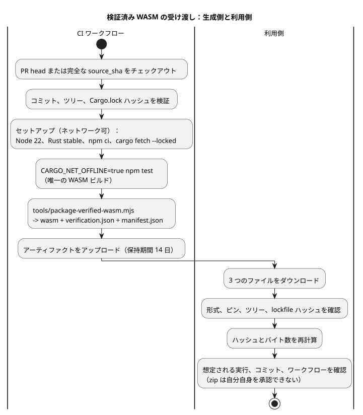

<!-- translation-source: docs/WASM-CI-ARTIFACTS.md -->
[英語の原文](WASM-CI-ARTIFACTS.md)

# リビジョン指定の GhostFlow WASM CI アーティファクト

Issue [language #97](https://github.com/callin2/ghostflow-language/issues/97) は、[frontend #210](https://github.com/callin2/farm_studio_frontend/issues/210) の実際の WASM ゲートのブロックを解除する受け渡し（handoff）を定義します。ここでいう*受け渡し*とは CI アーティファクトのことで、WASM バイナリと、それが特定のソースリビジョンからビルドされ検証されたことを示す証拠のセットです。

このドキュメントは、ワークフローと検証の契約です。ホストされた実行がアーティファクトを生成し、独立したダウンロード検証に合格するまでは、どのアーティファクトも存在するとは主張しません。

**このドキュメントの内容：** 範囲と依存関係、セットアップとテストゲート、パッケージ・レポート・マニフェスト、アップロード・命名・ダウンロード検証。

次の図は、チェックアウトから利用側の検証までのパイプライン全体を示しています。



## 範囲と依存関係

- 現在チェックアウトされている PR head をビルドします。マージ ref は決してビルドしません。
- フロントエンドの有効な言語ピンをビルドします：
  b2f2874dd0238207558dfa4cc83077d322356a6c。
- 手動実行では、任意で source_sha を指定できます。省略した場合は、現在のワークフローのコミットを使用します。指定する場合は、完全な 40 桁の 16 進数（小文字）のコミット SHA でなければなりません。短縮 SHA、ブランチ、タグ、変更可能な ref は無効です。
- source.commit は、言語ソースのテストピンそのものです。ci.commit は、ワークフローがチェックアウトした PR head、push head、またはディスパッチのコミットを記録します。この 2 つは異なる場合があります。
- #97 は、実際にホストされた実行がアーティファクトを生成し、そのダウンロードが検証されるまでオープンのままです。ローカルの Rust の合格だけではクローズしません。
- [API #30](https://github.com/callin2/farm_studio_api/issues/30) は独立しています。[Frontend #207](https://github.com/callin2/farm_studio_frontend/issues/207) は親のコンテキストです。[Frontend #211](https://github.com/callin2/farm_studio_frontend/issues/211) にはパフォーマンスの作業が含まれます。このアーティファクトは、実際の Android への配信を表すものではありません。

パッケージ化の前に、ワークフローは正確なソースコミット、ツリー、Cargo.lock のハッシュを解決して記録しなければなりません。次の場合は失敗しなければなりません。

- 要求されたコミットが利用できない
- 追跡対象のチェックアウトがダーティである
- 追跡対象ソースのハッシュが異なる

検証器と受け渡しは、`tools/verification-sources.mjs` にある 1 つの完全なソースハッシュの一覧を共有しており、そこにはすべてのクレートが含まれます。内容が変わったレポートのエントリは拒否され、欠落したエントリや余分なエントリも拒否されます。

## セットアップとゲート

セットアップ中はネットワークアクセスが許可されます。

1. PR head または要求された完全な source_sha をチェックアウトし、そのコミットとツリーを検証します。
2. Node 22 と Rust stable をインストールします。node、npm、rustc、cargo、rustc -vV の正確な出力を記録します。これらは来歴（provenance）であり、再現性を主張するものではありません。
3. npm ci --ignore-scripts を実行します。
4. 現在の main の crates.io 依存関係（ネイティブパッケージ検証器の依存関係を含む）について、cargo fetch --locked を実行します。

検証中、Cargo はオフラインかつロックされた状態でなければなりません。これは、すべてのネットワークアクセスが全体的に無効化されていると主張するものではありません。現在の完全な npm test はすでに WASM のビルドを呼び出すため、その既存のゲートを Cargo オフラインで実行します。

```sh
CARGO_NET_OFFLINE=true npm test
```

完全なテスト/レポートのステップの後に、2 回目の手動 WASM ビルドを追加してはなりません。その単一の既存ビルドが、パッケージ化されるバイナリとそのハッシュの出所です。

## パッケージ、レポート、マニフェスト

主な実装は tools/package-verified-wasm.mjs です。次の 3 つのファイルを受け渡します。

```text
ghostflow_wasm.wasm
verification.json
manifest.json
```

レポート（`verification.json`）は、次の内容を必須としなければなりません。

```json
{
  "format": "GhostFlow/language-verification-v1",
  "scope": "language-host",
  "passed": true,
  "wasm": {
    "builtByThisRun": true,
    "sha256": "<packaged binary sha256>",
    "bytes": 0
  }
}
```

スクリプトは、ソース、レポート、バイナリ、マニフェストのデータが無効または不一致の場合に例外を投げます。レポートの wasm.sha256 と wasm.bytes は、パッケージ化されたバイナリと一致しなければなりません。

manifest.json は、format "GhostFlow/verified-wasm-artifact-v1" と次のフィールドを含まなければなりません。

| グループ | フィールド |
|---|---|
| source | source.repository、source.commit、source.tree、source.cargoLockSha256 |
| binary | binary.path、binary.bytes、binary.sha256 |
| verification | verification.path、verification.sha256、verification.scope |
| toolchain | toolchain.node、toolchain.npm、toolchain.rustc、toolchain.cargo、toolchain.rustcVerbose |
| build | build.command ["npm", "test"]、target wasm32-unknown-unknown、profile release |
| ci | ci.repository、ci.commit、ci.workflowRef、ci.workflowSha、ci.runId、ci.runAttempt、ci.runUrl |

3 つの補足があります。

- ci.workflowSha は、ワークフローを含むコミットです。ワークフローファイルの blob SHA ではありません。
- ツールのバージョンは実行されたものを記録します。アーティファクトを再現可能にするものではありません。
- SHA-256 の値は完全性のチェックを提供するものであり、署名された証明（attestation）ではありません。

## アップロード、命名、ダウンロード検証

既存の完全な npm test とパッケージ化スクリプトの両方が成功した後にだけアップロードします。保持期間は 14 日とし、次の名前を使用します。

```text
ghostflow-wasm-<current|frontend-pin>-<source_sha>-<runid>-<attempt>
```

失敗した実行は、別の失敗レポートをアップロードしてもかまいませんが、失敗した WASM の受け渡しは決してアップロードしません。フォールバックのバイナリはなく、捏造されたビルドスタンプもありません。

利用側は、ダウンロードしたファイルを信頼できる期待値に照らして検証しなければなりません。

1. 3 つのファイルがそろっていることを要求し、マニフェストとレポートを解析します。
2. 正確な形式、想定されるリポジトリ、ソースピン、ツリー、lockfile のハッシュ、ターゲット、プロファイル、レポートの要件を確認します。
3. バイナリとレポートのハッシュとバイト数を再計算し、マニフェストおよびレポートと比較します。
4. 想定されるホストされた実行、ci.commit の head、ワークフローの ref、ワークフローのコミットを確認します。ダウンロードした zip とそのマニフェストは、自分自身を承認することはできません。

通常のソースビルドも引き続きサポートされます。このアーティファクトは検証済みビルドの受け渡しです。フロントエンドの完全なガードスタンプでも、インストール済みデバイスのマッピングでもありません。意味論エンジンや JavaScript による代替は導入されません。
