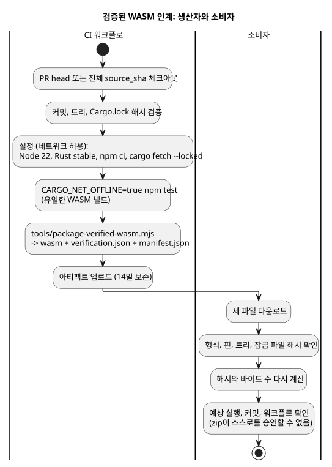

<!-- translation-source: docs/WASM-CI-ARTIFACTS.md -->
[영문 원문](WASM-CI-ARTIFACTS.md)

# 리비전 지정 GhostFlow WASM CI 아티팩트

이슈 [language #97](https://github.com/callin2/ghostflow-language/issues/97)은
[frontend #210](https://github.com/callin2/farm_studio_frontend/issues/210)의
실제 WASM 게이트를 진행할 수 있게 하는 인계(handoff)를 정의합니다. 여기서 *인계*란
CI 아티팩트를 뜻합니다. 즉 WASM 바이너리와, 그것이 정확한 소스 리비전에서 빌드되고
검증되었다는 증거를 함께 묶은 것입니다.

이 문서는 워크플로 및 검증 계약입니다. 호스팅 실행이 아티팩트를 만들고 독립적인
다운로드 검증이 통과하기 전까지는 어떤 아티팩트도 존재한다고 주장하지 않습니다.

**이 문서의 내용:** 범위와 의존성, 설정과 테스트 게이트, 패키지·보고서·매니페스트,
업로드·이름 지정·다운로드 검증.

다이어그램은 체크아웃부터 소비자 검증까지 전체 파이프라인을 보여 줍니다.



## 범위와 의존성

- 병합 ref가 아니라 현재 체크아웃된 PR head를 빌드합니다.
- 프런트엔드의 활성 언어 핀
  b2f2874dd0238207558dfa4cc83077d322356a6c를 빌드합니다.
- 수동 실행에서는 선택적으로 source_sha를 제공할 수 있습니다. 생략하면 현재
  워크플로 커밋을 사용합니다. 제공하는 경우 40자리 16진수(소문자) 전체 커밋 SHA여야
  합니다. 짧은 SHA, 브랜치, 태그, 변경 가능한 ref는 유효하지 않습니다.
- source.commit은 정확한 언어 소스 테스트 핀입니다. ci.commit은 워크플로가
  체크아웃한 PR head, push head 또는 dispatch 커밋을 기록하며, 두 값은 다를 수
  있습니다.
- 실제 호스팅 실행이 아티팩트를 만들고 그 다운로드 검증이 통과할 때까지 #97은 열려
  있습니다. 로컬 Rust 통과만으로는 이 이슈를 닫지 않습니다.
- [API #30](https://github.com/callin2/farm_studio_api/issues/30)은 별개입니다.
  [Frontend #207](https://github.com/callin2/farm_studio_frontend/issues/207)은
  상위 맥락입니다. [Frontend #211](https://github.com/callin2/farm_studio_frontend/issues/211)에는
  성능 작업이 포함됩니다. 이 아티팩트는 실제 Android 배포를 나타내지 않습니다.

패키징 전에 워크플로는 정확한 소스 커밋, 트리, Cargo.lock 해시를 확인하고 기록해야
합니다. 다음 경우에는 실패해야 합니다.

- 요청한 커밋을 사용할 수 없는 경우
- 추적되는 체크아웃에 변경 사항이 남아 있는(dirty) 경우
- 추적되는 소스의 해시가 다른 경우

검증기와 인계는 `tools/verification-sources.mjs`에 있는 하나의 완전한 소스 해시
목록을 공유하며, 이 목록은 모든 크레이트를 포함합니다. 내용이 바뀐 보고서 항목은
거부되며, 빠진 항목이나 추가된 항목도 마찬가지로 거부됩니다.

## 설정과 게이트

설정 단계에서는 네트워크 접근을 허용합니다.

1. PR head 또는 요청된 전체 source_sha를 체크아웃하고 커밋과 트리를 검증합니다.
2. Node 22와 Rust stable을 설치합니다. node, npm, rustc, cargo, rustc -vV의 정확한
   출력을 기록합니다. 이것은 provenance(출처) 정보이며 재현성을 주장하는 것이
   아닙니다.
3. npm ci --ignore-scripts를 실행합니다.
4. 네이티브 패키지 검증기 의존성을 포함해, 현재 main의 crates.io 의존성에 대해
   cargo fetch --locked를 실행합니다.

검증 중에는 Cargo가 오프라인·잠금 모드여야 합니다. 이것이 모든 네트워크 접근을
전역적으로 비활성화한다는 주장은 아닙니다. 현재 전체 npm test가 이미 WASM 빌드를
호출하므로, Cargo를 오프라인으로 두고 그 기존 게이트를 실행합니다.

```sh
CARGO_NET_OFFLINE=true npm test
```

전체 테스트/보고서 단계 뒤에 두 번째 수동 WASM 빌드를 추가하지 마세요. 기존의 그 단일
빌드가 패키징되는 바이너리와 그 해시의 출처입니다.

## 패키지, 보고서, 매니페스트

주 구현은 tools/package-verified-wasm.mjs입니다. 이 스크립트는 다음 세 파일을
인계합니다.

```text
ghostflow_wasm.wasm
verification.json
manifest.json
```

보고서(`verification.json`)는 다음을 요구해야 합니다.

```json
{
  "format": "GhostFlow/language-verification-v1",
  "scope": "language-host",
  "passed": true,
  "wasm": {
    "builtByThisRun": true,
    "sha256": "<packaged binary sha256>",
    "bytes": 0
  }
}
```

스크립트는 잘못되었거나 서로 일치하지 않는 소스, 보고서, 바이너리, 매니페스트
데이터에 대해 예외를 던집니다. 보고서의 wasm.sha256과 wasm.bytes는 패키징된
바이너리와 일치해야 합니다.

manifest.json에는 format "GhostFlow/verified-wasm-artifact-v1"과 다음 필드가
있어야 합니다.

| 그룹 | 필드 |
|---|---|
| source | source.repository, source.commit, source.tree, source.cargoLockSha256 |
| binary | binary.path, binary.bytes, binary.sha256 |
| verification | verification.path, verification.sha256, verification.scope |
| toolchain | toolchain.node, toolchain.npm, toolchain.rustc, toolchain.cargo, toolchain.rustcVerbose |
| build | build.command ["npm", "test"], target wasm32-unknown-unknown, profile release |
| ci | ci.repository, ci.commit, ci.workflowRef, ci.workflowSha, ci.runId, ci.runAttempt, ci.runUrl |

세 가지를 분명히 해 둡니다.

- ci.workflowSha는 워크플로 파일의 blob SHA가 아니라 워크플로를 포함한 커밋입니다.
- 도구 버전은 무엇이 실행되었는지를 기록할 뿐, 아티팩트를 재현 가능하게 만들지
  않습니다.
- SHA-256 값은 무결성 검사를 제공할 뿐, 서명된 증명(attestation)이 아닙니다.

## 업로드, 이름 지정, 다운로드 검증

기존 전체 npm test와 패키징 스크립트가 모두 성공한 뒤에만 업로드합니다. 보존 기간은
14일이며 이름은 다음 형식을 사용합니다.

```text
ghostflow-wasm-<current|frontend-pin>-<source_sha>-<runid>-<attempt>
```

실패한 실행은 별도의 실패 보고서를 업로드할 수 있지만, 실패한 WASM 인계는 절대
업로드하지 않습니다. fallback 바이너리도, 꾸며낸 빌드 표시도 없습니다.

소비자는 다운로드한 파일을 신뢰할 수 있는 기대값과 비교해 검증해야 합니다.

1. 세 파일이 모두 있는지 요구하고 매니페스트와 보고서를 파싱합니다.
2. 정확한 형식, 기대 저장소, 소스 핀, 트리, 잠금 파일 해시, 대상, 프로필, 보고서 요구
   사항을 확인합니다.
3. 바이너리와 보고서의 해시 및 바이트 수를 다시 계산해 매니페스트 및 보고서와
   비교합니다.
4. 예상한 호스팅 실행, ci.commit head, 워크플로 ref, 워크플로 커밋을 확인합니다.
   다운로드한 zip과 그 매니페스트는 스스로를 승인할 수 없습니다.

일반 소스 빌드도 계속 지원합니다. 이 아티팩트는 검증된 빌드 인계입니다. 완전한
프런트엔드 가드 표시나 설치된 장치 매핑이 아닙니다. 의미 엔진이나 JavaScript 대체
구현은 도입하지 않습니다.
