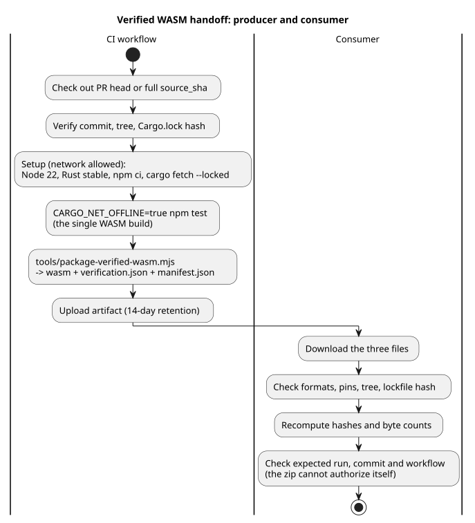

# Revision-addressed GhostFlow WASM CI artifacts

Issue [language #97](https://github.com/callin2/ghostflow-language/issues/97)
defines the handoff that unblocks [frontend #210](https://github.com/callin2/farm_studio_frontend/issues/210)'s
real WASM gate. A *handoff* here is a CI artifact: a WASM binary plus the
evidence that it was built and verified from an exact source revision.

This document is a workflow and verification contract. No artifact is claimed
to exist until a hosted run produces it and an independent download
verification passes.

**In this document:** scope and dependencies; setup and the test gate; the
package, report, and manifest; upload, naming, and download verification.

The diagram shows the whole pipeline, from checkout to consumer verification.



## Scope and dependencies

- Build the current checked-out PR head, never a merge ref.
- Build the frontend active language pin:
  b2f2874dd0238207558dfa4cc83077d322356a6c.
- A manual run may optionally provide source_sha. If omitted, use the current
  workflow commit. If provided, it must be a full 40-hex (lowercase) commit SHA. Short
  SHAs, branches, tags, and mutable refs are invalid.
- source.commit is the exact language source test pin. ci.commit records the
  workflow's checked-out PR head, push head, or dispatch commit, and the two may
  differ.
- #97 remains open until an actual hosted run produces an artifact and its
  download verifies. A local Rust pass does not close it.
- [API #30](https://github.com/callin2/farm_studio_api/issues/30) is
  independent. [Frontend #207](https://github.com/callin2/farm_studio_frontend/issues/207)
  is parent context. [Frontend #211](https://github.com/callin2/farm_studio_frontend/issues/211)
  includes performance work; this artifact does not represent real Android
  delivery.

Before packaging, the workflow must resolve and record the exact source commit,
tree, and Cargo.lock hash. It must fail if:

- the requested commit is unavailable;
- the tracked checkout is dirty; or
- a tracked-source hash differs.

The verifier and the handoff share one complete source hash inventory in
`tools/verification-sources.mjs`, which includes every crate. A report entry
with changed contents is rejected, and so is a missing or an extra entry.

## Setup and gate

Network access is allowed during setup:

1. Check out the PR head or requested full source_sha and verify its commit and
   tree.
2. Install Node 22 and Rust stable. Record exact node, npm, rustc, cargo, and
   rustc -vV outputs. These are provenance, not a reproducibility claim.
3. Run npm ci --ignore-scripts.
4. Run cargo fetch --locked for current main's crates.io dependencies,
   including native package verifier dependencies.

During verification, Cargo must be offline and locked. This does not claim that
all network access is globally disabled. The current full npm test already
invokes the WASM build, so run that existing gate with Cargo offline:

```sh
CARGO_NET_OFFLINE=true npm test
```

Do not add a second manual WASM build after the full test/report step. That
single existing build is the source of the packaged binary and its hashes.

## Package, report, and manifest

The main implementation is tools/package-verified-wasm.mjs. It hands off three
files:

```text
ghostflow_wasm.wasm
verification.json
manifest.json
```

The report (`verification.json`) must require:

```json
{
  "format": "GhostFlow/language-verification-v1",
  "scope": "language-host",
  "passed": true,
  "wasm": {
    "builtByThisRun": true,
    "sha256": "<packaged binary sha256>",
    "bytes": 0
  }
}
```

The script throws on invalid or mismatched source, report, binary, or manifest
data. The report's wasm.sha256 and wasm.bytes must match the packaged binary.

manifest.json must contain format "GhostFlow/verified-wasm-artifact-v1" and
these fields:

| Group | Fields |
|---|---|
| source | source.repository, source.commit, source.tree, source.cargoLockSha256 |
| binary | binary.path, binary.bytes, binary.sha256 |
| verification | verification.path, verification.sha256, verification.scope |
| toolchain | toolchain.node, toolchain.npm, toolchain.rustc, toolchain.cargo, toolchain.rustcVerbose |
| build | build.command ["npm", "test"], target wasm32-unknown-unknown, and profile release |
| ci | ci.repository, ci.commit, ci.workflowRef, ci.workflowSha, ci.runId, ci.runAttempt, ci.runUrl |

Three clarifications:

- ci.workflowSha is the commit that contains the workflow, not the workflow
  file's blob SHA.
- Tool versions record what ran; they do not make the artifact reproducible.
- SHA-256 values provide integrity checks, not a signed attestation.

## Upload, naming, and download verification

Upload only after the full existing npm test and the packaging script both
succeed. Use 14-day retention and this name:

```text
ghostflow-wasm-<current|frontend-pin>-<source_sha>-<runid>-<attempt>
```

A failed run may upload a separate failure report, but never a failed WASM
handoff. There is no fallback binary and no fabricated build stamp.

The consumer must verify the downloaded files against trusted expected values:

1. Require the three files and parse the manifest and report.
2. Check exact formats, expected repository, source pin, tree, lockfile hash,
   target, profile, and report requirements.
3. Recompute binary and report hashes and byte counts and compare them with the
   manifest and report.
4. Check the expected hosted run, ci.commit head, workflow ref, and workflow
   commit. The downloaded zip and its manifest cannot authorize themselves.

Normal source builds remain supported. This artifact is a verified build
handoff. It is not a full frontend guard stamp or an installed device mapping.
No semantic engine or JavaScript substitute is introduced.
