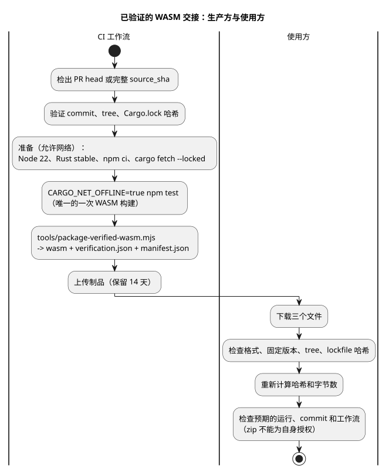

<!-- translation-source: docs/WASM-CI-ARTIFACTS.md -->
[英文原文](WASM-CI-ARTIFACTS.md)

# 按修订版寻址的 GhostFlow WASM CI 制品

Issue [language #97](https://github.com/callin2/ghostflow-language/issues/97) 定义了一种交接（handoff），用于解除 [frontend #210](https://github.com/callin2/farm_studio_frontend/issues/210) 中真实 WASM 关卡的阻塞。这里的*交接*是指一个 CI 制品：一个 WASM 二进制文件，加上证明它由某个确切源码修订版构建并验证的证据。

本文档是一份工作流程与验证契约。在托管运行实际产出制品并通过独立的下载验证之前，不声称任何制品已经存在。

**本文内容：** 范围和依赖；安装准备与测试关卡；包、报告和清单；上传、命名和下载验证。

下图展示了从检出到使用方验证的完整流水线。



## 范围和依赖

- 构建当前检出的 PR head，绝不构建 merge ref。
- 构建 frontend 当前使用的语言固定版本（pin）：b2f2874dd0238207558dfa4cc83077d322356a6c。
- 手动运行可以选择提供 source_sha。如果省略，则使用当前工作流的 commit。如果提供，它必须是完整的 40 位十六进制（小写）commit SHA。短 SHA、分支、标签以及可变的 ref 都无效。
- source.commit 是确切的语言源码测试固定版本。ci.commit 记录工作流检出的 PR head、push head 或 dispatch commit，两者可能不同。
- 在实际的托管运行产出制品并且其下载通过验证之前，#97 保持打开状态。本地 Rust 测试通过并不能关闭它。
- [API #30](https://github.com/callin2/farm_studio_api/issues/30) 是独立的。[Frontend #207](https://github.com/callin2/farm_studio_frontend/issues/207) 是上层背景。[Frontend #211](https://github.com/callin2/farm_studio_frontend/issues/211) 包含性能工作；本制品并不代表真实的 Android 交付。

在打包之前，工作流必须解析并记录确切的源码 commit、tree 和 Cargo.lock 哈希。在以下情况下它必须失败：

- 请求的 commit 不可用；
- 被跟踪的检出存在未提交的修改（dirty）；或
- 某个被跟踪源文件的哈希不一致。

验证器和交接共享 `tools/verification-sources.mjs` 中的同一份完整源哈希清单，其中包含每一个 crate。内容发生变化的报告条目会被拒绝，缺失或多余的条目同样会被拒绝。

## 安装准备与关卡

安装准备期间允许网络访问：

1. 检出 PR head 或请求的完整 source_sha，并验证其 commit 和 tree。
2. 安装 Node 22 和 Rust stable。记录 node、npm、rustc、cargo 以及 rustc -vV 的确切输出。这些是来源信息，并不是可复现性声明。
3. 运行 npm ci --ignore-scripts。
4. 为当前 main 的 crates.io 依赖运行 cargo fetch --locked，其中包括原生包验证器的依赖。

验证期间，Cargo 必须处于离线和锁定状态。这并不声称全局禁用了所有网络访问。当前完整的 npm test 已经会调用 WASM 构建，因此在 Cargo 离线的情况下运行这一现有关卡：

```sh
CARGO_NET_OFFLINE=true npm test
```

不要在完整的测试/报告步骤之后再额外手动构建一次 WASM。现有的这唯一一次构建，就是被打包的二进制文件及其哈希的来源。

## 包、报告和清单

主要实现是 tools/package-verified-wasm.mjs。它交接三个文件：

```text
ghostflow_wasm.wasm
verification.json
manifest.json
```

报告（`verification.json`）必须要求：

```json
{
  "format": "GhostFlow/language-verification-v1",
  "scope": "language-host",
  "passed": true,
  "wasm": {
    "builtByThisRun": true,
    "sha256": "<packaged binary sha256>",
    "bytes": 0
  }
}
```

当源码、报告、二进制文件或清单数据无效或不一致时，脚本会抛出错误。报告中的 wasm.sha256 和 wasm.bytes 必须与被打包的二进制文件一致。

manifest.json 必须包含 format "GhostFlow/verified-wasm-artifact-v1" 以及以下字段：

| 分组 | 字段 |
|---|---|
| source | source.repository, source.commit, source.tree, source.cargoLockSha256 |
| binary | binary.path, binary.bytes, binary.sha256 |
| verification | verification.path, verification.sha256, verification.scope |
| toolchain | toolchain.node, toolchain.npm, toolchain.rustc, toolchain.cargo, toolchain.rustcVerbose |
| build | build.command ["npm", "test"]、target wasm32-unknown-unknown 以及 profile release |
| ci | ci.repository, ci.commit, ci.workflowRef, ci.workflowSha, ci.runId, ci.runAttempt, ci.runUrl |

三点说明：

- ci.workflowSha 是包含该工作流的 commit，而不是工作流文件的 blob SHA。
- 工具版本记录的是实际运行的内容；它们并不能使制品可复现。
- SHA-256 值提供的是完整性检查，而不是签名证明（attestation）。

## 上传、命名和下载验证

只有在完整的现有 npm test 和打包脚本都成功之后才上传。使用 14 天保留期以及以下名称：

```text
ghostflow-wasm-<current|frontend-pin>-<source_sha>-<runid>-<attempt>
```

失败的运行可以上传单独的失败报告，但绝不上传失败的 WASM 交接。不存在回退（fallback）二进制文件，也没有伪造的构建戳记。

使用方必须根据可信的预期值验证下载的文件：

1. 要求三个文件齐全，并解析清单和报告。
2. 检查确切的格式、预期的仓库、源码固定版本、tree、lockfile 哈希、target、profile 以及报告要求。
3. 重新计算二进制文件和报告的哈希及字节数，并与清单和报告进行比较。
4. 检查预期的托管运行、ci.commit head、workflow ref 以及工作流 commit。下载的 zip 及其清单不能为自身授权。

正常的源码构建仍然受支持。本制品是经过验证的构建交接，它不是完整的 frontend 守护戳记（guard stamp），也不是已安装的设备映射。这里没有引入任何语义引擎或 JavaScript 替代实现。
