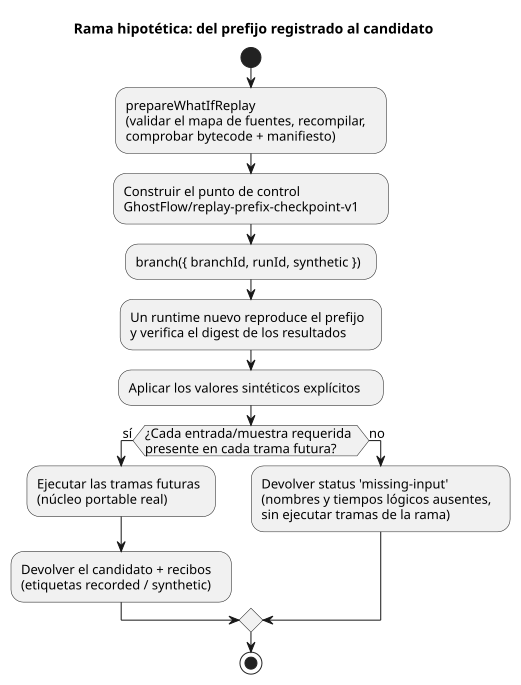

<!-- translation-source: docs/WHAT-IF-REPLAY.md -->
[Original en inglés](WHAT-IF-REPLAY.md)

# Reproducción hipotética acotada

Una *reproducción hipotética* (what-if replay) vuelve a ejecutar un historial de
control registrado y luego pregunta: «¿qué habría ocurrido si algunas entradas
futuras hubieran sido distintas?». El resultado es una *rama*: una ejecución
(run) virtual y separada que nunca toca la original.

`prepareWhatIfReplay` en `runtimes/wasm/what-if-replay.mjs` implementa el límite
de entradas ausentes de la Referencia §6.8
([Reproducción, ghost y ramas](reference/06-composition-and-replay.es.md)) y de
REF-06-019, usando el núcleo portable real. Es una API de host de referencia en
Node con capacidades de actuador virtuales y sin destino físico: nada de lo que
calcula puede accionar hardware real.

El diagrama muestra cómo se procesa una solicitud de rama.

**Entradas que aporta el host.** El host proporciona:

- una compilación canónica y los bytes del WASM;
- identidades explícitas para la línea de tiempo, la instancia, la ejecución, la
  revisión inmutable de la fuente y la revisión de la vinculación (binding)
  virtual;
- tramas registradas `prefix`/`future`.

Cada trama contiene `nowMs`, las `inputs` externas completas y las `samples` del
sensor. Cada muestra lleva su identidad registrada, marca de tiempo, valor y
calidad.

**Comprobaciones del artefacto y perfil soportado.** El adaptador valida el mapa
de fuentes del artefacto, recompila el cierre inmutable de fuentes y comprueba
que el bytecode y el manifiesto coincidan exactamente. El perfil acepta solo
controles simples: sin ajustes, programaciones horarias, contextos,
controladores, objetivos ni adaptadores posteriores a eventos (after-event). Su
revisión de ajustes es cero. El acondicionamiento de sensores usa el host de
referencia existente. Las expresiones, el estado y las salidas requested/safe se
ejecutan en Rust.

**El punto de control base.** El formato del punto de control (checkpoint) es
explícitamente `GhostFlow/replay-prefix-checkpoint-v1`. Contiene:

- el estado inicial canónico y un prefijo registrado completo y acotado;
- el digest del prefijo y el digest de los resultados efectivamente ejecutados;
- los digests exactos del Program/cierre de fuentes y las identidades de origen.

Una rama reconstruye este prefijo en un runtime nuevo y verifica el digest de
sus resultados. Es un punto de control basado en eventos (event-sourced): no
importa memoria de una VM ajena. Como se reproducen las mismas muestras, se
conserva el historial del acondicionador (por ejemplo, el estado del filtro).

**Límites.** Una solicitud acepta como máximo 256 tramas en total y 1 MiB de
registros de entrada. Los tiempos lógicos deben ser estrictamente crecientes.
Los datos que pertenecen al llamador se copian antes de que la preparación se
suspenda (await), de modo que una mutación posterior por parte del llamador no
puede convertirse en evidencia registrada.

**Creación de una rama.** `branch({ branchId, runId, synthetic })` exige
identidades distintas de las del origen. Antes de ejecutar cualquier trama
futura, comprueba cada entrada y muestra de sensor requerida en cada trama. Si
faltan registros, devuelve `status: 'missing-input'` con los nombres y tiempos
lógicos ausentes, y no ejecuta ninguna trama de la rama. Una muestra anterior,
un valor predeterminado o una predicción del entorno nunca pueden llenar ese
hueco.

**Valores sintéticos.** Un valor virtual explícito contiene `offset`, `kind`
(`inputs` o `samples`), `name`, `value` y `provenance: 'synthetic'`. Los valores
virtuales aportan valores ausentes o sustituyen a los registrados, y aun así
deben cumplir el contrato de entrada/sensor de referencia. Se rechazan los
destinos duplicados, los nombres desconocidos y los valores mal formados.

**Resultados.** Un recibo completado etiqueta cada entrada como `recorded` o
`synthetic`. Las muestras virtuales nunca se convierten en evidencia física
registrada. Un resultado candidato incluye las tramas reales, el estado de la
VM, las salidas requested/safe y los fallos de sensor. Si las grabaciones
futuras originales están completas, el resultado también incluye los resultados
originales reales en los tiempos lógicos correspondientes. En caso contrario,
`original` es null; nunca se inventa.

**Aislamiento.** Cada solicitud usa runtimes desechables y copias privadas. Los
recibos devueltos no pueden modificar la base. Tanto las ramas rechazadas como
las completadas conservan los registros originales, las identidades y las
instancias en vivo que se ejecutan por separado. La API no acepta ningún runtime
en vivo, libro mayor (ledger), programación horaria instalada ni callback
físico. Solo compara el mismo Program. Lo siguiente sigue siendo trabajo aparte:
reemplazo de la fuente, puntos de control ajenos, emisión de identidades de
vinculación/ejecución de producción, ciclo de vida del Device, almacenamiento
duradero de ramas y modelos del entorno.

**Pruebas.** `tests/what-if-replay.test.mjs` comprueba registros ausentes, muestras
sintéticas de éxito y de fallo, ticks lógicos correspondientes, originales
inmutables, continuación en vivo, mutación por parte del llamador y
manipulación del artefacto. Nativo y WASM ejecutan el mismo bytecode y los
mismos campos de sensor acondicionados por la referencia, y la prueba compara
las trazas completas de la VM. Esto demuestra la paridad de ejecución portable.
No demuestra un driver de sensor nativo de producción ni el comportamiento del
hardware.
