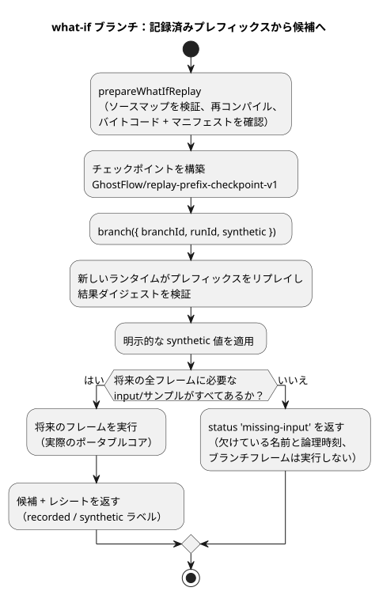

<!-- translation-source: docs/WHAT-IF-REPLAY.md -->
[英語の原文](WHAT-IF-REPLAY.md)

# 有界の what-if リプレイ

*what-if リプレイ*は、記録された制御の履歴を再実行したうえで、「もし将来の入力の一部が違っていたら、何が起きていたか？」を問うものです。その結果が*ブランチ*です。ブランチは独立した仮想的な実行であり、元の実行には決して影響しません。

`runtimes/wasm/what-if-replay.mjs` の `prepareWhatIfReplay` は、実際のポータブルコアを使って、リファレンス §6.8（[リプレイ、ゴースト、ブランチ](reference/06-composition-and-replay.ja.md)）と REF-06-019 の入力欠落の境界を実装しています。これは仮想的なアクチュエータのケイパビリティを持ち、物理的な出力先を持たない Node のリファレンスホスト API です。ここで計算されるものが実際のハードウェアを駆動することはありません。

次の図は、1 つのブランチ要求がどのように処理されるかを示しています。

**ホストからの入力。** ホストは次のものを提供します。

- 正準のコンパイル結果と WASM のバイト列
- タイムライン、インスタンス、実行（run）、不変のソースリビジョン、仮想バインディングリビジョンの明示的な同一性
- 記録された `prefix`/`future` フレーム

各フレームには、`nowMs`、外部の `inputs` の完全なセット、センサの `samples` が含まれます。各サンプルは、記録された同一性、タイムスタンプ、値、品質を持ちます。

**アーティファクトのチェックとサポートされるプロファイル。** アダプタはアーティファクトのソースマップを検証し、不変のソースクロージャを再コンパイルし、バイトコードとマニフェストが完全に一致することを確認します。プロファイルが受け付けるのは単純な制御だけです。設定、スケジュール、コンテキスト、コントローラ、制御目標、after-event アダプタは使えません。設定のリビジョンは 0 です。センサの調整（コンディショニング）には既存のリファレンスホストを使用します。式、状態、requested/safe 出力は Rust で実行されます。

**ベースラインのチェックポイント。** チェックポイントの形式は明示的に `GhostFlow/replay-prefix-checkpoint-v1` です。次の内容を含みます。

- 正準の初期状態と、完全かつ有界の記録済みプレフィックス
- プレフィックスのダイジェストと、実際に実行された結果のダイジェスト
- Program/ソースクロージャの正確なダイジェストと、元の実行の同一性

ブランチは新しいランタイム上でこのプレフィックスを再構築し、その結果のダイジェストを検証します。これはイベントソーシング型のチェックポイントであり、外部の VM メモリをインポートしません。同じサンプルがリプレイされるため、コンディショナの履歴（たとえばフィルタの状態）も保たれます。

**制限。** 1 つの要求で受け付けるのは、合計 256 フレームまで、入力レコード 1 MiB までです。論理時刻は狭義単調に増加しなければなりません。呼び出し側が所有するデータは、準備処理が中断（await）する前にコピーされるため、呼び出し側が後からデータを変更しても、それが記録済みの証拠になることはありません。

**ブランチの作成。** `branch({ branchId, runId, synthetic })` には、元の実行とは異なる同一性が必要です。将来のフレームを実行する前に、すべてのフレームで必要なすべての入力とセンササンプルを確認します。レコードが欠けている場合は、欠けている名前と論理時刻を添えて `status: 'missing-input'` を返し、ブランチのフレームは 1 つも実行しません。以前のサンプル、既定値、環境の予測でこの欠落を埋めることは決してできません。

**synthetic 値。** 明示的な仮想値は、`offset`、`kind`（`inputs` または `samples`）、`name`、`value`、`provenance: 'synthetic'` を含みます。仮想値は欠けている値を補ったり、記録された値を置き換えたりしますが、それでもリファレンスの入力/センサの契約を満たさなければなりません。重複した対象、不明な名前、不正な形式の値は拒否されます。

**結果。** 完了したレシートは、すべての入力に `recorded` または `synthetic` のラベルを付けます。仮想サンプルが記録済みの物理的な証拠になることは決してありません。候補の結果には、実際のフレーム、VM の状態、requested/safe 出力、センサの故障（fault）が含まれます。元の将来の記録が完全な場合は、一致する論理時刻における元の実際の結果も含まれます。そうでない場合、`original` は null であり、決して捏造されることはありません。

**分離。** 各要求は、使い捨てのランタイムと非公開のコピーを使用します。返されたレシートがベースラインを変更することはできません。拒否されたブランチも完了したブランチも、元の記録、同一性、別に実行中のライブインスタンスを保持します。この API は、ライブランタイム、台帳、インストール済みのスケジュール、物理的なコールバックを受け付けません。比較するのは同じ Program だけです。次の項目は別の作業として残っています：ソースの置換、外部のチェックポイント、本番用のバインディング/実行の同一性の発行、Device のライフサイクル、永続的なブランチの保存、環境モデル。

**テスト。** `tests/what-if-replay.test.mjs` は、欠落したレコード、synthetic による成功と故障のサンプル、一致する論理 tick、不変の元データ、ライブの継続、呼び出し側による変更、アーティファクトの改ざんを確認します。ネイティブと WASM は同じバイトコードと、リファレンスで調整されたセンサフィールドを実行し、テストは VM トレース全体を比較します。これはポータブルな実行のパリティ（一致性）を証明します。本番用のネイティブセンサドライバやハードウェアの振る舞いを証明するものではありません。
