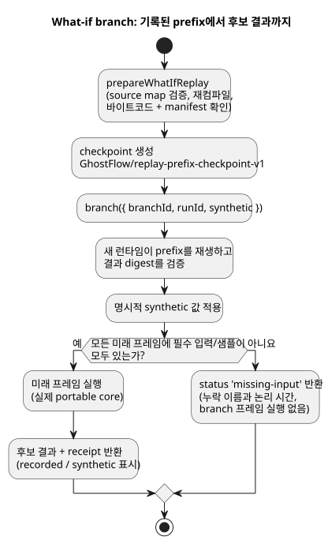

<!-- translation-source: docs/WHAT-IF-REPLAY.md -->
[영문 원문](WHAT-IF-REPLAY.md)

# 제한된 what-if 재생

*what-if 재생*은 기록된 제어 이력을 다시 실행한 뒤 "앞으로의 입력 일부가 달랐다면
어떻게 되었을까?"를 묻습니다. 그 결과가 *branch(분기)*입니다. branch는 원본에 절대
손대지 않는, 별도의 가상 실행입니다.

`runtimes/wasm/what-if-replay.mjs`의 `prepareWhatIfReplay`는 실제 portable core를
사용해 Reference §6.8([재생, ghost, branch](reference/06-composition-and-replay.md))과
REF-06-019의 누락 입력 경계를 구현합니다. 이것은 가상 액추에이터 capability를 갖고 물리
출력 sink가 없는 Node reference host API입니다. 이 API가 계산하는 어떤 것도 실제
하드웨어를 구동할 수 없습니다.

다이어그램은 branch 요청 하나가 처리되는 과정을 보여 줍니다.

**호스트가 제공하는 입력.** 호스트는 다음을 제공합니다.

- canonical compilation과 WASM 바이트
- timeline, instance, 실행(run), 불변 source revision, 가상 binding revision에 대한
  명시적 식별자
- 기록된 `prefix`/`future` 프레임

각 프레임에는 `nowMs`, 완전한 외부 `inputs`, 센서 `samples`가 들어 있습니다. 각
샘플은 기록된 식별자, 타임스탬프, 값, 품질을 담습니다.

**아티팩트 검사와 지원 프로필.** 어댑터는 아티팩트 source map을 검증하고, 불변 source
closure를 다시 컴파일한 뒤, 바이트코드와 manifest가 정확히 일치하는지 확인합니다. 이
프로필은 plain control만 받습니다. 설정, 예약, context, controller, objective,
after-event 어댑터는 허용하지 않습니다. settings revision은 0입니다. 센서
conditioning은 기존 reference host를 사용합니다. 식, 상태, requested/safe 출력은
Rust에서 실행됩니다.

**기준 checkpoint.** checkpoint 형식은 명시적으로
`GhostFlow/replay-prefix-checkpoint-v1`입니다. 여기에는 다음이 들어 있습니다.

- canonical 초기 상태와 완전하고 제한된 기록 prefix
- prefix digest와, 실제로 실행된 결과의 digest
- 정확한 Program/source-closure digest와 원본 식별자

branch는 새 런타임에서 이 prefix를 다시 구성하고 그 결과 digest를 검증합니다. 이것은
event-sourced checkpoint입니다. 외부 VM 메모리를 가져오지 않습니다. 같은 샘플을 다시
재생하므로 conditioner 이력(예: 필터 상태)이 보존됩니다.

**한도.** 요청 하나는 최대 총 256프레임, 입력 기록 1 MiB까지 받습니다. 논리 시간은
엄격하게 증가해야 합니다. 호출자가 소유한 데이터는 준비 과정이 일시 중단(await)되기
전에 복사되므로, 이후 호출자가 데이터를 바꾸더라도 그것이 기록된 증거가 될 수
없습니다.

**branch 만들기.** `branch({ branchId, runId, synthetic })`는 원본과 다른 식별자를
요구합니다. 미래 프레임을 하나라도 실행하기 전에, 모든 프레임에서 필요한 모든 입력과
센서 샘플을 확인합니다. 기록이 누락되었으면 누락된 이름과 논리 시간과 함께
`status: 'missing-input'`을 반환하고, branch 프레임은 하나도 실행하지 않습니다. 이전
샘플, 기본값, 환경 예측으로 빈자리를 채우는 일은 절대 없습니다.

**synthetic 값.** 명시적 가상 값에는 `offset`, `kind`(`inputs` 또는 `samples`),
`name`, `value`, `provenance: 'synthetic'`이 들어 있습니다. 가상 값은 누락된 값을
제공하거나 기록된 값을 대체하며, 그래도 reference 입력/센서 계약을 만족해야 합니다.
중복 대상, 알 수 없는 이름, 형식이 잘못된 값은 거부됩니다.

**결과.** 완료된 receipt는 모든 입력에 `recorded` 또는 `synthetic` 표시를 붙입니다.
가상 샘플은 절대 기록된 물리 증거가 되지 않습니다. 후보(candidate) 결과에는 실제 프레임,
VM 상태, requested/safe 출력, 센서 fault가 포함됩니다. 원래의 미래 기록이 완전하면,
결과에는 일치하는 논리 시간의 실제 원본 결과도 포함됩니다. 그렇지 않으면 `original`은
null이며, 절대 지어내지 않습니다.

**격리.** 각 요청은 일회용 런타임과 비공개 복사본을 사용합니다. 반환된 receipt로 기준
상태를 바꿀 수 없습니다. 거부된 branch와 완료된 branch 모두 원본 기록, 식별자, 별도로
실행 중인 live instance를 보존합니다. 이 API는 live 런타임, ledger, 설치된 예약, 물리
callback을 받지 않습니다. 같은 Program만 비교합니다. 다음은 별도 작업으로 남아
있습니다. source 교체, 외부 checkpoint, 운영용 binding/run 식별자 발급, Device
lifecycle, 영구 branch 저장소, 환경 모델.

**테스트.** `tests/what-if-replay.test.mjs`는 누락된 기록, synthetic 성공 및 fault
샘플, 일치하는 논리 tick, 원본의 불변성, live 실행의 계속, 호출자 변경, 아티팩트 변조를
검사합니다. native와 WASM은 같은 바이트코드와 reference conditioning을 거친 센서 필드를
실행하고, 테스트는 전체 VM 추적을 비교합니다. 이것은 portable 실행 parity(동등성)를
입증합니다. native 운영용 센서 드라이버나 하드웨어 동작을 입증하지는 않습니다.
