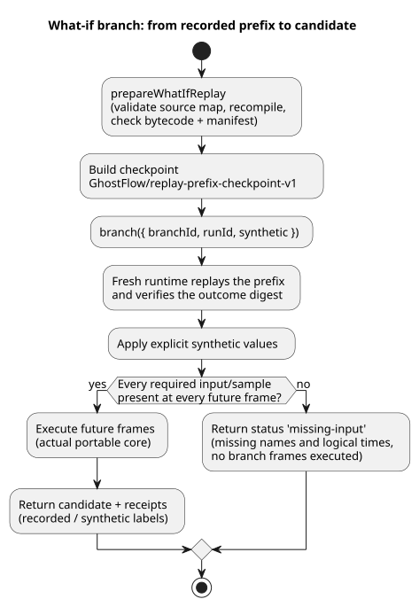

# Bounded what-if replay

A *what-if replay* re-runs a recorded control history and then asks "what would
have happened if some future inputs had been different?" The result is a
*branch*: a separate, virtual run that never touches the original.

`prepareWhatIfReplay` in `runtimes/wasm/what-if-replay.mjs` implements the
missing-input boundary of Reference §6.8
([Replay, ghost, and branches](reference/06-composition-and-replay.en.md)) and
REF-06-019, using the actual portable core. It is a Node reference host API with
virtual actuator capabilities and no physical sink: nothing it computes can
drive real hardware.

The diagram shows how one branch request is handled.

**Inputs from the host.** The host supplies:

- a canonical compilation and the WASM bytes;
- explicit identities for the timeline, instance, run, immutable source
  revision, and virtual binding revision;
- recorded `prefix`/`future` frames.

Each frame contains `nowMs`, the complete external `inputs`, and sensor
`samples`. Each sample carries its recorded identity, timestamp, value, and
quality.

**Artifact checks and supported profile.** The adapter validates the artifact
source map, recompiles the immutable source closure, and checks that the
bytecode and manifest match exactly. The profile accepts only plain controls:
no settings, schedules, contexts, controllers, objectives, or after-event
adapters. Its settings revision is zero. Sensor conditioning uses the existing
reference host. Expressions, state, and requested/safe outputs execute in Rust.

**The baseline checkpoint.** The checkpoint format is explicitly
`GhostFlow/replay-prefix-checkpoint-v1`. It contains:

- the canonical initial state and a complete, bounded recorded prefix;
- the prefix digest and the digest of its actually executed outcomes;
- exact Program/source-closure digests and origin identities.

A branch rebuilds this prefix on a fresh runtime and verifies its outcome
digest. This is an event-sourced checkpoint: it does not import foreign VM
memory. Because the same samples are replayed, conditioner history (for
example, filter state) is preserved.

**Limits.** A request accepts at most 256 total frames and 1 MiB of input
records. Logical times must increase strictly. Caller-owned data is copied
before preparation suspends (awaits), so a later mutation by the caller cannot
become recorded evidence.

**Creating a branch.** `branch({ branchId, runId, synthetic })` requires
identities that differ from the origin. Before executing any future frame, it
checks every required input and sensor sample at every frame. If records are
missing, it returns `status: 'missing-input'` with the missing names and logical
times, and executes no branch frames. An earlier sample, a default, or an
environmental prediction can never fill the gap.

**Synthetic values.** An explicit virtual value contains `offset`, `kind`
(`inputs` or `samples`), `name`, `value`, and `provenance: 'synthetic'`.
Virtual values supply missing values or replace recorded ones, and they must
still satisfy the reference input/sensor contract. Duplicate targets, unknown
names, and malformed values are rejected.

**Results.** A completed receipt labels every input `recorded` or `synthetic`.
Virtual samples never become recorded physical evidence. A candidate result
includes the actual frames, VM state, requested/safe outputs, and sensor
faults. If the original future recordings are complete, the result also includes
the actual original outcomes at matched logical times. Otherwise `original` is
null; it is never invented.

**Isolation.** Each request uses disposable runtimes and private copies.
Returned receipts cannot mutate the baseline. Rejected and completed branches
both preserve the original records, identities, and separately running live
instances. The API accepts no live runtime, ledger, installed schedule, or
physical callback. It compares the same Program only. The following remain
separate work: source replacement, foreign checkpoints, production
binding/run identity issuance, Device lifecycle, durable branch storage, and
environmental models.

**Tests.** `tests/what-if-replay.test.mjs` checks missing records, synthetic
success and fault samples, matched logical ticks, immutable originals, live
continuation, caller mutation, and artifact tampering. Native and WASM execute
the same bytecode and reference-conditioned sensor fields, and the test compares
the complete VM traces. This proves portable execution parity. It does not prove
a native production sensor driver or hardware behavior.
