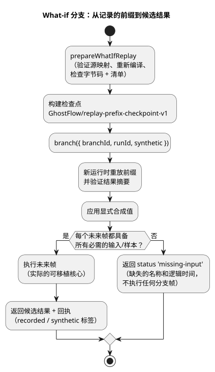

<!-- translation-source: docs/WHAT-IF-REPLAY.md -->
[英文原文](WHAT-IF-REPLAY.md)

# 有界的 what-if 重放

*what-if 重放*会重新运行一段记录的控制历史，然后询问：“如果某些未来输入不同，会发生什么？”其结果是一个*分支*：一次独立的虚拟运行，绝不会触及原始运行。

`runtimes/wasm/what-if-replay.mjs` 中的 `prepareWhatIfReplay` 使用实际的可移植核心，实现了参考 §6.8（[重放、ghost 与分支](reference/06-composition-and-replay.zh.md)）和 REF-06-019 中的缺失输入边界。它是一个 Node 参考宿主 API，带有虚拟执行器能力（capability），没有物理输出端：它计算的任何内容都无法驱动真实硬件。

下图展示了一次分支请求的处理过程。

**来自宿主的输入。** 宿主提供：

- 一个规范的编译结果和 WASM 字节；
- 时间线、实例、运行（run）、不可变源码修订版以及虚拟绑定修订版的显式身份标识；
- 记录的 `prefix`/`future` 帧。

每一帧包含 `nowMs`、完整的外部 `inputs` 以及传感器 `samples`。每个样本都带有其记录的身份标识、时间戳、值和质量。

**制品检查和支持的配置。** 适配器会验证制品的源映射，重新编译不可变的源码闭包，并检查字节码和清单是否完全一致。该配置只接受普通的 `control`：不允许设置、调度计划、上下文、控制器、控制目标或事件后（after-event）适配器。其设置修订版为零。传感器调理使用现有的参考宿主。表达式、状态以及请求/安全输出在 Rust 中执行。

**基线检查点。** 检查点格式明确为 `GhostFlow/replay-prefix-checkpoint-v1`。它包含：

- 规范的初始状态和一段完整、有界的记录前缀；
- 前缀摘要以及其实际执行结果的摘要；
- 确切的 Program/源码闭包摘要和来源身份标识。

分支会在新的运行时上重建该前缀，并验证其结果摘要。这是一种事件溯源（event-sourced）检查点：它不导入外部的 VM 内存。由于重放的是相同的样本，调理器历史（例如滤波器状态）得以保留。

**限制。** 一次请求最多接受 256 个帧和 1 MiB 的输入记录。逻辑时间必须严格递增。调用方拥有的数据会在准备过程挂起（await）之前被复制，因此调用方之后的修改不会变成记录的证据。

**创建分支。** `branch({ branchId, runId, synthetic })` 要求使用与来源不同的身份标识。在执行任何未来帧之前，它会检查每一帧中每个必需的输入和传感器样本。如果记录缺失，它返回 `status: 'missing-input'` 以及缺失的名称和逻辑时间，并且不执行任何分支帧。较早的样本、默认值或环境预测绝不能填补这一缺口。

**合成值。** 显式的虚拟值包含 `offset`、`kind`（`inputs` 或 `samples`）、`name`、`value` 以及 `provenance: 'synthetic'`。虚拟值可以补充缺失的值或替换记录的值，但仍必须满足参考输入/传感器契约。重复的目标、未知的名称以及格式错误的值都会被拒绝。

**结果。** 完成的回执会把每个输入标记为 `recorded` 或 `synthetic`。虚拟样本绝不会变成记录的物理证据。候选结果包括实际的帧、VM 状态、请求/安全输出以及传感器故障。如果原始的未来记录是完整的，结果还会包括在匹配的逻辑时间上实际的原始结果。否则 `original` 为 null；它绝不会被编造。

**隔离。** 每次请求都使用一次性的运行时和私有副本。返回的回执无法修改基线。被拒绝和已完成的分支都会保留原始记录、身份标识以及单独运行的实时实例。该 API 不接受实时运行时、账本、已安装的调度计划或物理回调。它只比较同一个 Program。以下内容仍属于单独的工作：源码替换、外部检查点、生产环境的绑定/运行身份标识签发、Device 生命周期、持久化的分支存储以及环境模型。

**测试。** `tests/what-if-replay.test.mjs` 检查缺失记录、合成值的成功与故障样本、匹配的逻辑 tick、不可变的原始数据、实时运行的继续、调用方修改以及制品篡改。原生和 WASM 执行相同的字节码和经过参考调理的传感器字段，测试会比较完整的 VM 追踪。这证明了可移植执行的一致性（parity）。它并不能证明原生生产环境传感器驱动程序或硬件的行为。
