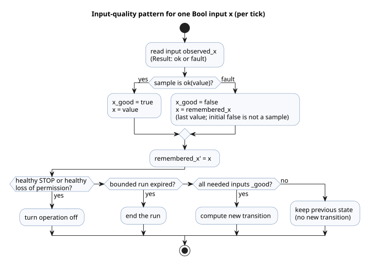
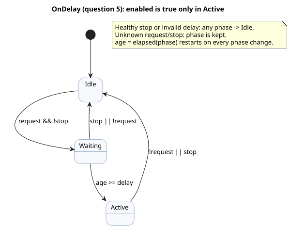
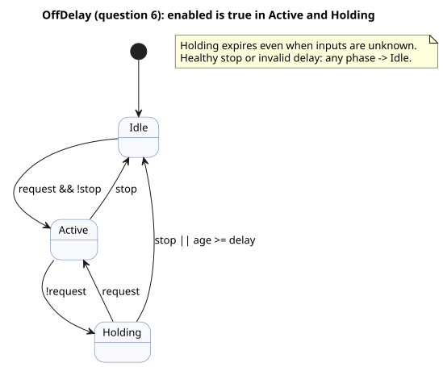
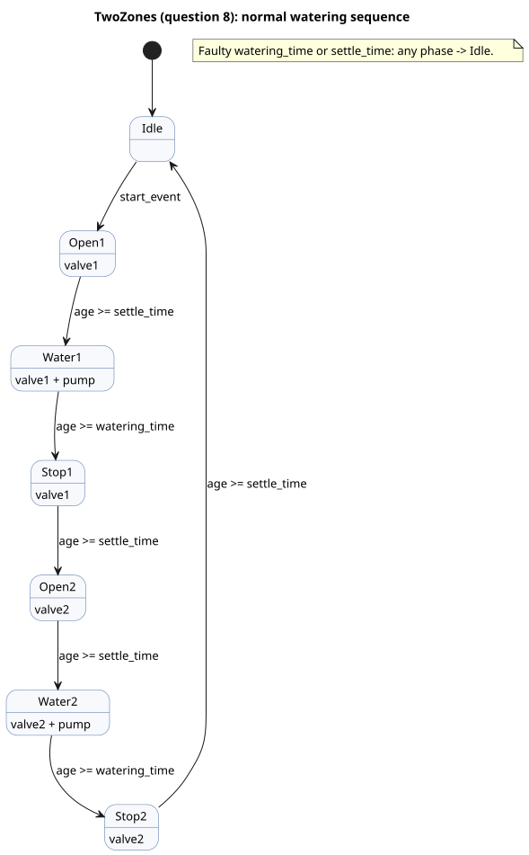
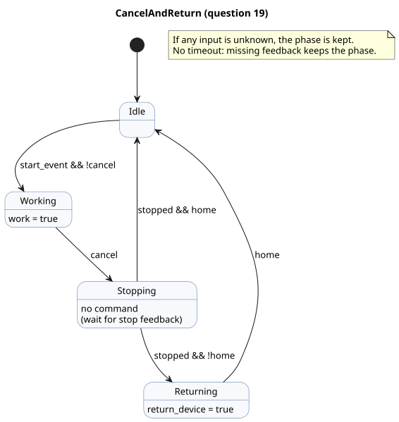
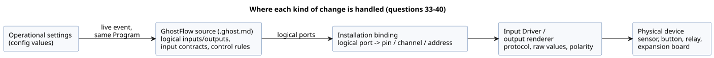

# GhostFlow Coding FAQ

This FAQ answers one kind of question: “How do I code this behavior?”
For each question you get working code, a description of how it behaves (including edge cases), and the reason it is written that way.

- The rules of the language are defined by the [Language Reference](LANGUAGE-REFERENCE.md), not by this FAQ.
- Which part of a requirement belongs to the language, the runtime, the Driver, the installation, or the UI is listed per question in
  [Reference Chapter 8](reference/08-language-runtime-and-device-boundaries.md#83-faq-전체-책임표).

**In this document**

- Questions 1–16: basic patterns — buttons, self-holding, timers, schedules, hysteresis, counters, settings, alarms, mutual exclusion, and functions.
- Questions 17–23: interlocks, cancellation, calendar-based scheduling, and usage-based control.
- Questions 24–31: operator-editable settings, calendars, daylight saving time, tides, and moon phase.
- Question 32: behavior after a power outage.
- Questions 33–40: replacing sensors, relays, GPIO pins, and expansion boards without changing control code.
- Question 41: checking and compiling documents with the `ghostc` CLI.

**About the input revision.** Since the 2026-10-05 external-input revision, every declaration that carries quality information uses `input`.
Existing conditioning and explicit `Result` fault branches are unchanged. Earlier `sensor` excerpts are kept under `tests/fixtures/history/issue531/`.

**About the revised examples.** When the producer of an input is in an unknown state (a fault), the examples explicitly keep two kinds of memory inside the source: the last observed value and the last displayed output.
The initial value of that memory is *not* a healthy sample from the producer.
Quality guards make sure that an unknown request never creates a new transition. A healthy STOP and the loss of a permission still take priority, and bounded run periods still expire.
The examples do not infer physical equipment faults, and they do not require automatic controllers to press START.
See [How to read the examples](#how-to-read-the-examples) for a walk-through of this pattern.

**Review status.** Reviewed against dev on 2026-10-01: [`a7333e56bc25c73fd6167b1182269b96cb671d05`](https://github.com/callin2/ghostflow-language/tree/a7333e56bc25c73fd6167b1182269b96cb671d05).
Some questions carry a status tag. Each tagged question has a status note that names the affected scope.

| Tag | Meaning |
|---|---|
| `[Undecided]` | A language or contract decision is still open. |
| `[Partially unsupported]` | The stated scope is not available in this dev. |
| `[Changed]` | This dev supersedes the original advice. |

A question without a tag has still not been verified against a physical Device, API, or UI integration.

## Questions

1. [How do I write a program file?](#q01)
2. [How do I turn an output on only while a button is held?](#q02)
3. [How do I keep running after releasing Start and stop with the Stop button?](#q03)
4. [How do I run for five minutes after starting and stop automatically? [Changed]](#q04)
5. [How do I turn on after a request persists for two seconds? [Changed]](#q05)
6. [How do I turn off three seconds after the request disappears? [Changed]](#q06)
7. [How do I irrigate every day at 6:00 AM and 6:45 PM?](#q07)
8. [How do I irrigate zone 1 and then zone 2? [Changed]](#q08)
9. [How do I turn on at low moisture without switching repeatedly at the boundary?](#q09)
10. [How do I fill a tank below the lower limit and stop at the upper limit?](#q10)
11. [How do I emit a completion signal after three sensor detections?](#q11)
12. [How do I make “five minutes” an editable field on the screen? [Changed]](#q12)
13. [How do I retain an alarm after the fault clears and release it with Reset?](#q13)
14. [How do I prevent two outputs from turning on together?](#q14)
15. [How do I start 30 minutes after sunrise?](#q15)
16. [How do I reuse the same calculation in several places?](#q16)
17. [How do I implement an interlock?](#q17)
18. [Is self-holding supported?](#q18)
19. [Can I move a particular device when the user cancels partway through?](#q19)
20. [How do I schedule an operation at sunrise?](#q20)
21. [Can I schedule operations by day of the week? [Partially unsupported]](#q21)
22. [Can I control a device based on its accumulated operating time? [Partially unsupported]](#q22)
23. [Can I run cleaning based on the daily operation count regardless of automatic or manual mode?](#q23)
24. [Can I change just the operating time later without a firmware update? [Changed]](#q24)
25. [Can I change a setting field's label and UI component?](#q25)
26. [Can I limit the range of editable setting values?](#q26)
27. [Can I use different settings for each day of the week? [Changed]](#q27)
28. [Can I use different control logic only on public holidays?](#q28)
29. [Can I account for daylight saving time in control?](#q29)
30. [Can I control operations based on high and low tide? [Partially unsupported]](#q30)
31. [Can I control operations based on spring/neap tides or the moon phase? [Changed]](#q31)
32. [Can I code the behavior after power returns following an outage?](#q32)
33. [Can I replace a temperature sensor without changing the control code? [Changed]](#q33)
34. [Are sensor settings separate from GhostFlow source? Do they change at different intervals?](#q34)
35. [Can I replace a sensor without recompiling the control program, like changing only a printer Driver?](#q35)
36. [Should the separation of device replacement and recompilation also be in the language spec?](#q36)
37. [If I connect a button to another GPIO pin, can I just change the input mapping?](#q37)
38. [Can I connect a different relay by changing only the output GPIO mapping?](#q38)
39. [Can I increase the output count with an expansion board such as Waveshare?](#q39)
40. [Can I also map the inputs and outputs of an RS485 I/O expansion board?](#q40)
41. [How do I check or compile a document with the compiler CLI?](#q41)

## How to read the examples

- **Independent programs.** Each `control` example is a complete, independent program. Do not paste several examples into one control as they are.
- **Where code goes.** Put code in top-level `ghost` blocks of a `.ghost.md` document. Question 1 shows a complete document.
- **Fragments.** A *fragment* is a declaration or expression that you place inside an existing control.
- **Design notation.** *Design notation* is notation that the Reference also marks as design notation; the current compiler may not accept it.
- **Input meanings.** Each question states what its input names mean. A variable name does not decide the physical contact polarity or the communication method.
- **Outputs are intent.** An output is a logical intent, not a confirmation. To know that a valve is really open, read a separate feedback input; do not reuse the output value.
- **Syntax basis.** Every answer ends with a **Syntax basis** list that links to the Reference chapter and section for each notation used.
  The common `control`, `input`, and `output` declarations follow [Reference §1.4 Syntax notation](reference/01-source-and-syntax.md#14-문법-표기법).

**The recurring input-quality pattern.** Almost every example starts with the same four lines for each Bool input `x`:

- `input observed_x: Bool;` declares the input. Reading it gives a `Result`: `ok(value)` for a healthy sample, or `fault(reason)` when the producer's state is unknown.
- `let x_good = ...` is `true` only when this tick's sample is healthy.
- `let x = ...` is the healthy value, or—on a fault—the last value remembered in `remembered_x`.
- `remembered_x' = x;` updates that memory. Its initial value (`false`) is a source-local starting value, not a sample from the producer.

The transition expressions then use these values in a fixed order:

1. A healthy STOP, or a healthy loss of permission (for example `low_water_good && low_water`), turns operation off first.
2. A bounded run whose time has expired ends, even if some inputs are faulty.
3. A new transition is computed only when every input it depends on is `_good`.
4. Otherwise the previous state is kept (`... else running`).

Some examples also keep a `displayed_<output>` state. It holds the last output intent while inputs are unknown, using the same order.
The comment `// Source-local display memory is initialized here; faults remain producer unknown.` marks this pattern in the code.



The diagram shows how one input sample flows through the quality guard: a healthy sample updates the value and memory, and a fault keeps the remembered value but blocks new transitions.

<a id="q01"></a>
## 1. How do I write a program file?

Write a `.ghost.md` document. It holds both the explanation and the code.

````markdown
# 버튼으로 램프 켜기

버튼을 누르고 있는 동안 램프를 켠다.

```ghost
control ButtonLamp {
  state displayed_lamp: Bool = false;
  displayed_lamp' = if button_good && !button then false else if button_good then button else displayed_lamp;
  // Source-local display memory is initialized here; faults remain producer unknown.
  state remembered_button: Bool = false;
  let button_good = case observed_button { ok(_) => true; fault(_) => false; };
  let button = case observed_button { ok(value) => value; fault(_) => remembered_button; };
  remembered_button' = button;
  input observed_button: Bool;
  output lamp: Bool;

  lamp <- displayed_lamp';
}
```
````

People read the Markdown explanation. The `ghost` blocks contain the control rules.
A document can have several `ghost` blocks between paragraphs of explanation; together they form one program, in document order.
Splitting code into blocks does not create execution stages or waiting periods.

**Why write it this way?** The behavior and the reason for choosing it stay together in one document.

**Syntax basis**

- `.ghost.md`, top-level `ghost` blocks: [Reference §1.1 — Execution block extraction](reference/01-source-and-syntax.md#실행-블록-추출)
- `control`, input/output declarations: [Reference §1.4 Syntax notation](reference/01-source-and-syntax.md#14-문법-표기법)
- `<-` output connection: [Reference §2.8 Ticks and state snapshots](reference/02-types-expressions-state.md#28-tick과-상태-snapshot)

<a id="q02"></a>
## 2. How do I turn an output on only while a button is held?

No memory is needed, so connect the input straight to the output.
Here, `button = true` means the button is pressed, and `stop = true` means a stop is requested.

```ghost
control HoldToRun {
  state displayed_pump: Bool = false;
  displayed_pump' = if button_good && !button then false else if stop_good && stop then false else if button_good && stop_good then button && !stop else displayed_pump;
  // Source-local display memory is initialized here; faults remain producer unknown.
  state remembered_button: Bool = false;
  let button_good = case observed_button { ok(_) => true; fault(_) => false; };
  let button = case observed_button { ok(value) => value; fault(_) => remembered_button; };
  remembered_button' = button;
  state remembered_stop: Bool = false;
  let stop_good = case observed_stop { ok(_) => true; fault(_) => false; };
  let stop = case observed_stop { ok(value) => value; fault(_) => remembered_stop; };
  remembered_stop' = stop;
  input observed_button: Bool;
  input observed_stop: Bool;
  output pump: Bool;

  pump <- displayed_pump';
}
```

When the button is released or a stop is requested, the output intent turns off in that same evaluation.
If the button and stop are both true, `!stop` makes the output false.

**Why is there no state?** The current inputs alone decide the result. Nothing about an earlier press needs to be remembered.

**Syntax basis**

- `Bool`, `true`/`false`: [Reference §2.1 Value kinds](reference/02-types-expressions-state.md#21-값-종류)
- `&&`, `!`: [Reference §2.6 Expressions and operators](reference/02-types-expressions-state.md#26-표현식과-연산자)
- `<-`: [Reference §2.8 Ticks and state snapshots](reference/02-types-expressions-state.md#28-tick과-상태-snapshot)

<a id="q03"></a>
## 3. How do I keep running after releasing Start and stop with the Stop button?

Remember in `state` whether the pump is running. In this example, releasing Stop does not restart operation by itself.
To start again, the Start button must be released and then pressed again.

```ghost
control StartStop {
  // Source-local display memory is initialized here; faults remain producer unknown.
  state remembered_start: Bool = false;
  let start_good = case observed_start { ok(_) => true; fault(_) => false; };
  let start = case observed_start { ok(value) => value; fault(_) => remembered_start; };
  remembered_start' = start;
  state remembered_stop: Bool = false;
  let stop_good = case observed_stop { ok(_) => true; fault(_) => false; };
  let stop = case observed_stop { ok(value) => value; fault(_) => remembered_stop; };
  remembered_stop' = stop;
  input observed_start: Bool;
  input observed_stop: Bool;
  output pump: Bool;
  state armed: Bool = false;
  state running: Bool = false;

  let start_event = armed && start;

  armed' = if stop_good && stop then false else if start_good && stop_good then (!stop && !start) else armed;
  running' = if stop_good && stop then false else if start_good && stop_good then (!stop && (start_event || running)) else running;
  pump <- running';
}
```

- `running` is the running state from the previous tick. It stays true when the button is released after starting.
- `armed` remembers that a release of the Start button was seen while no stop was active.
- A button already held down at initialization does not start operation. A new press is accepted only after a release.
- Stop has priority over both self-holding and start requests.

**Why use `running'` for the output?** So that a stop in the current evaluation reaches the output immediately, in the same tick.

**Syntax basis**

- `state`, previous state and `running'`: [Reference §2.8 Ticks and state snapshots](reference/02-types-expressions-state.md#28-tick과-상태-snapshot)
- `let`: [Reference §2.7 Pure functions and calculation composition](reference/02-types-expressions-state.md#27-순수-함수와-계산-조합)
- `!`, `&&`, `||`: [Reference §2.6 Expressions and operators](reference/02-types-expressions-state.md#26-표현식과-연산자)

Related example: [START/STOP](../examples/curriculum/pc-02-start-stop.ghost.md).

<a id="q04"></a>
## 4. How do I run for five minutes after starting and stop automatically? [Changed]

> **Current dev status:** The `duration` setting now yields a `Result`. The `age < duration` comparison below does not compile unless `case` handles `ok`/`fault`. [Current contract](reference/05-settings-and-observation.md#기본값과-유효값).

Combine the running state with the time spent in that state.
End operation when `stop` or `low_water` is true. While running, ignore new start requests.

```ghost
control FiveMinuteRun {
  // Source-local display memory is initialized here; faults remain producer unknown.
  state remembered_start: Bool = false;
  let start_good = case observed_start { ok(_) => true; fault(_) => false; };
  let start = case observed_start { ok(value) => value; fault(_) => remembered_start; };
  remembered_start' = start;
  state remembered_stop: Bool = false;
  let stop_good = case observed_stop { ok(_) => true; fault(_) => false; };
  let stop = case observed_stop { ok(value) => value; fault(_) => remembered_stop; };
  remembered_stop' = stop;
  state remembered_low_water: Bool = false;
  let low_water_good = case observed_low_water { ok(_) => true; fault(_) => false; };
  let low_water = case observed_low_water { ok(value) => value; fault(_) => remembered_low_water; };
  remembered_low_water' = low_water;
  input observed_start: Bool;
  input observed_stop: Bool;
  input observed_low_water: Bool;
  output pump, valve: Bool;
  config duration: Duration = 5min;
  state armed: Bool = false;
  state running: Bool = false;
  timer age = elapsed(running);

  let permit = !stop && !low_water;
  let start_event = armed && start;

  armed' = if low_water_good && low_water then false else if stop_good && stop then false else if start_good && stop_good && low_water_good then (permit && !start) else armed;
  running' = if low_water_good && low_water then false else if stop_good && stop then false else if running && !(case duration { ok(value) => age < value; fault(_) => false; }) then false else if start_good && stop_good && low_water_good then (if !permit then false
    else if running then (case duration { ok(value) => age < value; fault(_) => false; })
    else start_event) else running;

  valve <- running';
  pump <- running';
  require pump => valve;
}
```

When `running` becomes true, `age` starts from zero. Operation ends at the first tick where `age >= duration`.
Holding the button down does not start another five minutes automatically.
To restart after the time expires, press the button again. After a stop or a low-water condition, the permission must recover and a button release must be seen first.

**Why not `sleep(5min)`?** Stop and low water must still be checked on every tick during the wait.

**Syntax basis**

- `config duration: Duration`, `5min`: [Reference §5.1 config declarations](reference/05-settings-and-observation.md#51-config-선언), [§3.1 — Duration](reference/03-time-and-schedules.md#duration)
- `timer age = elapsed(running)`: [Reference §3.2 Elapsed time after state changes](reference/03-time-and-schedules.md#32-상태-변경-뒤의-경과-시간)
- `if ... then ... else`: [Reference §2.6 — Conditional expressions](reference/02-types-expressions-state.md#조건식)
- `require pump => valve`: [Reference §4.7 Output intent and constraints](reference/04-sensors-constraints-control.md#47-requested-safe-applied-confirmed)

<a id="q05"></a>
## 5. How do I turn on after a request persists for two seconds? [Changed]

> **Current dev status:** The `delay` setting now yields a `Result`. Handle `ok`/`fault` with `case` before the `age >= delay` comparison below. [Current contract](reference/05-settings-and-observation.md#기본값과-유효값).

Keep two situations apart: a request has been received, and the output is actually on.

```ghost
control OnDelay {
  // Source-local display memory is initialized here; faults remain producer unknown.
  state remembered_request: Bool = false;
  let request_good = case observed_request { ok(_) => true; fault(_) => false; };
  let request = case observed_request { ok(value) => value; fault(_) => remembered_request; };
  remembered_request' = request;
  state remembered_stop: Bool = false;
  let stop_good = case observed_stop { ok(_) => true; fault(_) => false; };
  let stop = case observed_stop { ok(value) => value; fault(_) => remembered_stop; };
  remembered_stop' = stop;
  input observed_request: Bool;
  input observed_stop: Bool;
  output enabled: Bool;
  config delay: Duration = 2s;
  type Phase = Idle | Waiting | Active;
  state phase: Phase = Idle;
  timer age = elapsed(phase);

  phase' = if !(case delay { ok(_) => true; fault(_) => false; }) then Idle else if stop_good && stop then Idle else if request_good && stop_good then (case phase {
    Idle => if request && !stop then Waiting else Idle;
    Waiting => if stop || !request then Idle
      else if (case delay { ok(value) => age >= value; fault(_) => false; }) then Active else Waiting;
    Active => if request && !stop then Active else Idle;
  }) else phase;

  enabled <- phase' == Active;
}
```

If the request disappears while waiting, the wait is cancelled. A new request starts a fresh two seconds.
Each transition happens at the tick that observes its condition. One long tick does not jump through several stages at once.



The diagram shows the three phases of `OnDelay`; `enabled` is true only in `Active`.

**Why are stages needed?** They make “no request,” “waiting two seconds,” and “on” explicit and separate.

**Syntax basis**

- `type Phase`, `case`: [Reference §2.4 Enums and exhaustive branches](reference/02-types-expressions-state.md#24-enum과-빠짐없는-분기)
- `state phase`, `phase'`: [Reference §2.8 Ticks and state snapshots](reference/02-types-expressions-state.md#28-tick과-상태-snapshot)
- `elapsed(phase)`, `2s`: [Reference §3.2 Elapsed time after state changes](reference/03-time-and-schedules.md#32-상태-변경-뒤의-경과-시간), [§3.1 — Duration](reference/03-time-and-schedules.md#duration)

Related example: [Independent timer patterns](../examples/curriculum/pc-06-timer-patterns.ghost.md).

<a id="q06"></a>
## 6. How do I turn off three seconds after the request disappears? [Changed]

> **Current dev status:** The `delay` setting now yields a `Result`. Handle `ok`/`fault` with `case` before the `age >= delay` comparison below. [Current contract](reference/05-settings-and-observation.md#기본값과-유효값).

Add a *holding* stage that begins when the request is released. If the request comes back during holding, stay on.

```ghost
control OffDelay {
  // Source-local display memory is initialized here; faults remain producer unknown.
  state remembered_request: Bool = false;
  let request_good = case observed_request { ok(_) => true; fault(_) => false; };
  let request = case observed_request { ok(value) => value; fault(_) => remembered_request; };
  remembered_request' = request;
  state remembered_stop: Bool = false;
  let stop_good = case observed_stop { ok(_) => true; fault(_) => false; };
  let stop = case observed_stop { ok(value) => value; fault(_) => remembered_stop; };
  remembered_stop' = stop;
  input observed_request: Bool;
  input observed_stop: Bool;
  output enabled: Bool;
  config delay: Duration = 3s;
  type Phase = Idle | Active | Holding;
  state phase: Phase = Idle;
  timer age = elapsed(phase);

  phase' = if phase == Holding && (case delay { ok(value) => age >= value; fault(_) => true; }) then Idle else if !(case delay { ok(_) => true; fault(_) => false; }) then Idle else if stop_good && stop then Idle else if request_good && stop_good then (case phase {
    Idle => if request && !stop then Active else Idle;
    Active => if stop then Idle
      else if !request then Holding else Active;
    Holding => if stop then Idle
      else if request then Active
      else if (case delay { ok(value) => age >= value; fault(_) => false; }) then Idle else Holding;
  }) else phase;

  enabled <- phase' in {Active, Holding};
}
```

The three seconds are counted from entering `Holding`. A stop turns the output off at once, without waiting for the delay.
`elapsed(phase)` is the time spent in the current stage. It is not a total across several ON intervals.



The diagram shows the phases of `OffDelay`; `enabled` is true in `Active` and `Holding`.

**Why not share the ON-delay timer?** Each condition needs its own remembered start time.

**Syntax basis**

- `type`, `case`, `in {Active, Holding}`: [Reference §2.4 Enums and exhaustive branches](reference/02-types-expressions-state.md#24-enum과-빠짐없는-분기)
- `elapsed(phase)`: [Reference §3.2 Elapsed time after state changes](reference/03-time-and-schedules.md#32-상태-변경-뒤의-경과-시간)
- Distinguishing stage elapsed time from accumulation: [Reference §3.4 Accumulated time and rolling budgets](reference/03-time-and-schedules.md#34-누적-시간과-rolling-budget)

<a id="q07"></a>
## 7. How do I irrigate every day at 6:00 AM and 6:45 PM?

Use the schedule's `.due` as the start condition. Use a timer for how long to run.

```ghost
control DailyWatering {
  // Source-local display memory is initialized here; faults remain producer unknown.
  state remembered_stop: Bool = false;
  let stop_good = case observed_stop { ok(_) => true; fault(_) => false; };
  let stop = case observed_stop { ok(value) => value; fault(_) => remembered_stop; };
  remembered_stop' = stop;
  input observed_stop: Bool;
  output pump: Bool;
  schedule starts: DailySlots<15min> {
    timezone = "Asia/Seoul";
    selected = [06:00, 18:45];
    dst_missing = skip;
    dst_repeated = first;
    basis = pulse;
    when = true;
    clock = trusted_only;
    gap = skip_after(60s);
    recovery = baseline;
    fallback = skip;
  }
  let duration = 5min;
  state running: Bool = false;
  timer age = elapsed(running);

  running' = if stop_good && stop then false else if running && !(age < duration) then false else if stop_good then (!stop && (if running then age < duration else starts.due)) else running;
  pump <- running';
}
```

`DailySlots<15min>` does not mean “run every 15 minutes.” It means the start times are chosen from a 15-minute grid, and only the `selected` times occur.
This example does not queue a scheduled start that arrives while it is already running. It also does not run, later, a start time that passed while it was stopped.

**Why separate the schedule and the timer?** Calendar time decides *when* to start; monotonic elapsed time decides *how long* to run.

**Syntax basis**

- `schedule`, `DailySlots<15min>`, `timezone`, `selected`, `.due`: [Reference §3.6 Selected DailySlots](reference/03-time-and-schedules.md#36-선택된-dailyslots)
- Distinguishing schedule occurrences from operation: [Reference §3.5 Common Schedule semantics](reference/03-time-and-schedules.md#35-schedule의-공통-의미)
- `elapsed(running)`: [Reference §3.2 Elapsed time after state changes](reference/03-time-and-schedules.md#32-상태-변경-뒤의-경과-시간)

<a id="q08"></a>
## 8. How do I irrigate zone 1 and then zone 2? [Changed]

> **Current dev status:** The `watering_time` and `settle_time` settings now yield `Result`s. Handle `ok`/`fault` with `case` before the time comparisons below. [Current contract](reference/05-settings-and-observation.md#기본값과-유효값).

Write the sequence as an enum, and connect each output to the stages in which it is allowed.
This example shows the normal operating sequence. Each zone goes through three steps:
request the valve to open and wait two seconds, supply water for five minutes, then request the pump to stop and wait two seconds to settle.

```ghost
control TwoZones {
  // Source-local display memory is initialized here; faults remain producer unknown.
  state remembered_start: Bool = false;
  let start_good = case observed_start { ok(_) => true; fault(_) => false; };
  let start = case observed_start { ok(value) => value; fault(_) => remembered_start; };
  remembered_start' = start;
  input observed_start: Bool;
  output pump, valve1, valve2: Bool;
  type Phase = Idle | Open1 | Water1 | Stop1 | Open2 | Water2 | Stop2;
  state phase: Phase = Idle;
  state armed: Bool = false;
  timer age = elapsed(phase);
  config watering_time: Duration = 5min;
  config settle_time: Duration = 2s;

  let start_event = armed && start;
  armed' = if start_good then (phase == Idle && !start) else armed;

  phase' = if !(case watering_time { ok(_) => true; fault(_) => false; } && case settle_time { ok(_) => true; fault(_) => false; }) then Idle else if phase != Idle || start_good then (case phase {
    Idle => if start_event then Open1 else Idle;
    Open1 => if (case settle_time { ok(value) => age >= value; fault(_) => false; }) then Water1 else Open1;
    Water1 => if (case watering_time { ok(value) => age >= value; fault(_) => false; }) then Stop1 else Water1;
    Stop1 => if (case settle_time { ok(value) => age >= value; fault(_) => false; }) then Open2 else Stop1;
    Open2 => if (case settle_time { ok(value) => age >= value; fault(_) => false; }) then Water2 else Open2;
    Water2 => if (case watering_time { ok(value) => age >= value; fault(_) => false; }) then Stop2 else Water2;
    Stop2 => if (case settle_time { ok(value) => age >= value; fault(_) => false; }) then Idle else Stop2;
  }) else phase;

  valve1 <- phase' in {Open1, Water1, Stop1};
  valve2 <- phase' in {Open2, Water2, Stop2};
  pump <- phase' in {Water1, Water2};
  require pump => (valve1 || valve2);
  require !(valve1 && valve2);
}
```



The diagram shows the seven phases in order and which outputs each phase turns on.

Requests that arrive during operation are not queued. After the sequence completes, release the button and press it again to restart.
The two-second wait in this code does not confirm that the valve has actually opened.
If you need open/close feedback and a way to interrupt the sequence, follow the
[Sequential control example using feedback](../examples/curriculum/pc-09-sequential-water-supply.ghost.md).

**Why not write a loop?** In every stage, the program must remember where it is while it keeps evaluating new inputs.

**Syntax basis**

- `type Phase`, `case`, `in { ... }`: [Reference §2.4 Enums and exhaustive branches](reference/02-types-expressions-state.md#24-enum과-빠짐없는-분기)
- `phase'` and simultaneous state transitions: [Reference §2.8 Ticks and state snapshots](reference/02-types-expressions-state.md#28-tick과-상태-snapshot)
- `elapsed(phase)`: [Reference §3.2 Elapsed time after state changes](reference/03-time-and-schedules.md#32-상태-변경-뒤의-경과-시간)
- `require`, `=>`, output mutual exclusion: [Reference §4.7 Output intent and constraints](reference/04-sensors-constraints-control.md#47-requested-safe-applied-confirmed)

<a id="q09"></a>
## 9. How do I turn on at low moisture without switching repeatedly at the boundary?

Use different thresholds for turning on and turning off (hysteresis). Also handle sensor faults explicitly.

```ghost
control MoistureControl {
  state displayed_pump: Bool = false;
  displayed_pump' = if stop_good && stop then false else if stop_good then requested && !stop else displayed_pump;
  // Source-local display memory is initialized here; faults remain producer unknown.
  state remembered_stop: Bool = false;
  let stop_good = case observed_stop { ok(_) => true; fault(_) => false; };
  let stop = case observed_stop { ok(value) => value; fault(_) => remembered_stop; };
  remembered_stop' = stop;
  input observed_stop: Bool;
  input moisture: Percent {
    sample = 1s;
    valid = 0% .. 100%;
    filter = median(5);
    stale_after = 3s;
    recover_after = 3 samples;
  }
  signal dry = hysteresis(moisture,
    on_below: 30%, off_above: 35%, initial: false);
  output pump: Bool;

  let requested = case dry {
    ok(value) => value;
    fault(_) => false;
  };
  pump <- displayed_pump';
}
```

- A healthy moisture value below 30% turns the pump on. A value above 35% turns it off. At either boundary, and anywhere between them, the previous decision is kept.
- If the filter is not ready yet, or the recovery conditions are not met, the value follows the fault path, and the pump also turns off.
- The sampling interval and limits are choices made for this program. They are not defaults for every sensor.
- When healthy measurements return, operation resumes automatically based on a fresh moisture evaluation. If a manual restart is required instead, add separate state for it.

**Why not just write `moisture < 30%`?** That alone handles neither signal quality nor oscillation at the boundary.

**Syntax basis**

- `input`, `sample`, `valid`, `filter`, `stale_after`, `recover_after`: [Reference §4.2 Sample contracts and sensor processing order](reference/04-sensors-constraints-control.md#42-샘플-계약과-sensor-처리-순서)
- `median`, `signal`, `hysteresis`, named arguments: [Reference §4.3 filter and signal operations](reference/04-sensors-constraints-control.md#43-filter와-signal-연산)
- `case`, `ok(value)`, `fault(_)`: [Reference §4.1 sensor and Result quality](reference/04-sensors-constraints-control.md#41-sensor와-result-품질)

<a id="q10"></a>
## 10. How do I fill a tank below the lower limit and stop at the upper limit?

Remember whether filling is in progress. `low_level_reached` means the water has reached the lower level sensor,
and `high_level_reached` means it has reached the upper level sensor.

```ghost
control TankLevel {
  // Source-local display memory is initialized here; faults remain producer unknown.
  state remembered_low_level_reached: Bool = false;
  let low_level_reached_good = case observed_low_level_reached { ok(_) => true; fault(_) => false; };
  let low_level_reached = case observed_low_level_reached { ok(value) => value; fault(_) => remembered_low_level_reached; };
  remembered_low_level_reached' = low_level_reached;
  state remembered_high_level_reached: Bool = false;
  let high_level_reached_good = case observed_high_level_reached { ok(_) => true; fault(_) => false; };
  let high_level_reached = case observed_high_level_reached { ok(value) => value; fault(_) => remembered_high_level_reached; };
  remembered_high_level_reached' = high_level_reached;
  input observed_low_level_reached: Bool;
  input observed_high_level_reached: Bool;
  output fill_pump: Bool;
  type Phase = Idle | Filling | SensorConflict;
  state phase: Phase = Idle;
  let conflict = high_level_reached && !low_level_reached;

  phase' = if low_level_reached_good && high_level_reached_good then (case phase {
    Idle => if conflict then SensorConflict
      else if !low_level_reached then Filling else Idle;
    Filling => if conflict then SensorConflict
      else if high_level_reached then Idle else Filling;
    SensorConflict => if conflict then SensorConflict else Idle;
  }) else phase;

  fill_pump <- phase' == Filling;
}
```

- Filling does not stop as soon as the water rises past the lower level again. Once filling has started, it continues up to the upper level.
- If only the upper-level input is true while the lower-level input is false, the sensors contradict each other. The pump turns off (`SensorConflict`). After the contradiction clears, the program passes through `Idle` once before it evaluates again.

**Why not just invert one input?** Start and stop use different thresholds, so the previous operating state is needed.

**Syntax basis**

- `type Phase`, `case`: [Reference §2.4 Enums and exhaustive branches](reference/02-types-expressions-state.md#24-enum과-빠짐없는-분기)
- `state`, `phase'`, `<-`: [Reference §2.8 Ticks and state snapshots](reference/02-types-expressions-state.md#28-tick과-상태-snapshot)
- `if`, `!`, `&&`: [Reference §2.6 Expressions and operators](reference/02-types-expressions-state.md#26-표현식과-연산자)

Original example: [Tank hysteresis](../examples/curriculum/pc-07-tank-hysteresis.ghost.md).

<a id="q11"></a>
## 11. How do I emit a completion signal after three sensor detections?

Count *events* where the input changes from false to true (rising edges), not ticks where it is true.
This example uses the Reference's exact integer type `Int`.

```ghost
control CountThree {
  // Source-local display memory is initialized here; faults remain producer unknown.
  state remembered_detected: Bool = false;
  let detected_good = case observed_detected { ok(_) => true; fault(_) => false; };
  let detected = case observed_detected { ok(value) => value; fault(_) => remembered_detected; };
  remembered_detected' = detected;
  state remembered_reset: Bool = false;
  let reset_good = case observed_reset { ok(_) => true; fault(_) => false; };
  let reset = case observed_reset { ok(value) => value; fault(_) => remembered_reset; };
  remembered_reset' = reset;
  input observed_detected: Bool;
  input observed_reset: Bool;
  output done: Bool;
  state previous: Bool = false;
  state count: Int = 0;
  let rising = detected && !previous;

  previous' = if detected_good && reset_good then (detected) else previous;
  count' = if reset_good && reset then 0 else if detected_good && reset_good then (if reset then 0
    else if rising && count < 3 then count + 1
    else count) else count;
  done <- count' >= 3;
}
```

- A detection signal that stays true counts only once. The counter stops at three.
- If reset and a detection arrive in the same tick, reset wins.
- An input that is already true at startup counts as the first detection.
- If you show the counter on screen, state what it counts explicitly in the intent link. Do not rely on its name.

**Why `Int` rather than `Number`?** A count must never be approximate or silently rounded.

**Syntax basis**

- `Int`, integer operations and comparisons: [Reference §2.3 Exact integer design](reference/02-types-expressions-state.md#23-정확한-정수-설계)
- State memory in `previous`, `count`, and `count'`: [Reference §2.8 Ticks and state snapshots](reference/02-types-expressions-state.md#28-tick과-상태-snapshot)
- Public meaning of counters: [Reference §5.3 — Descriptors and snapshots](reference/05-settings-and-observation.md#descriptor와-snapshot)

<a id="q12"></a>
## 12. How do I make “five minutes” an editable field on the screen? [Changed]

> **Current dev status:** Setting declarations and live updates are supported. The `age < duration` advice below follows the earlier model, where a setting was read as a plain scalar. Handle the current setting `Result` with `case`. [Current contract](reference/05-settings-and-observation.md#기본값과-유효값).

Declare an operational setting with its type, range, increment, permission, and display name.
Use this **fragment** in place of the `duration` declaration in [example 4](#q04).

```ghost
config duration: Duration = 5min {
  min = 1min;
  max = 20min;
  step = 1min;
  access = operator;
  label = "관수 시간";
}
```

The control expression still uses `age < duration`.
The screen receives the setting's description and builds a time field that accepts 1 to 20 minutes in 1-minute steps.
The screen decides whether to show a text field, a selection list, or a slider.

Changing an operational setting is an *atomic live event*: it changes effective values within the same program and the same run.

- When several values change at once, validate them all and apply them together. If any one is invalid, change none of them.
- Do not reset a running timer to zero.
- Example: a run has already lasted six minutes, and the limit is reduced from ten to five minutes. In the first evaluation that uses the new value, `age < duration` is false, and operation ends.

**Why not just find the `5min` literal and show it on screen?** Not every constant is meant to be adjusted by an operator.

**Syntax basis**

- `config`, `min`, `max`, `step`, `access`, `label`: [Reference §5.1 config declarations](reference/05-settings-and-observation.md#51-config-선언)
- Default and effective values: [Reference §5.1 — Default and effective values](reference/05-settings-and-observation.md#기본값과-유효값)
- Atomic changes during execution: [Reference §5.2 — atomic live event](reference/05-settings-and-observation.md#atomic-live-event)

<a id="q13"></a>
## 13. How do I retain an alarm after the fault clears and release it with Reset?

Keep the fault input's current value separate from the state that remembers the fault.
This example handles only the alarm memory. `fault_active = true` means the cause is still present.

```ghost
control AlarmMemory {
  // Source-local display memory is initialized here; faults remain producer unknown.
  state remembered_fault_active: Bool = false;
  let fault_active_good = case observed_fault_active { ok(_) => true; fault(_) => false; };
  let fault_active = case observed_fault_active { ok(value) => value; fault(_) => remembered_fault_active; };
  remembered_fault_active' = fault_active;
  state remembered_reset: Bool = false;
  let reset_good = case observed_reset { ok(_) => true; fault(_) => false; };
  let reset = case observed_reset { ok(value) => value; fault(_) => remembered_reset; };
  remembered_reset' = reset;
  input observed_fault_active: Bool;
  input observed_reset: Bool;
  output alarm: Bool;
  state latched: Bool = false;
  state reset_armed: Bool = false;
  let reset_event = reset_armed && reset;

  reset_armed' = if fault_active_good && reset_good then (!fault_active && !reset) else reset_armed;
  latched' = if fault_active_good && reset_good then (fault_active || (latched && !reset_event)) else latched;
  alarm <- latched';
}
```

- `latched` stays true after the fault cause disappears. It clears only when the cause is gone *and* Reset has been released and pressed again.
- If `fault_active` and `reset` are both true, `fault_active` wins.
- Reset is not a command to restart equipment.

**Why is this different from `alarm <- fault_active`?** The current cause and the memory of a past fault are different pieces of information.
For equipment cleanup, position feedback, and multiple fault causes, see the
[Fault and reset example](../examples/curriculum/pc-10-fault-alarm-reset.ghost.md).

**Syntax basis**

- `state latched`, `reset_armed`, next state `'`: [Reference §2.8 Ticks and state snapshots](reference/02-types-expressions-state.md#28-tick과-상태-snapshot)
- `let`, pure event conditions: [Reference §2.7 Pure functions and calculation composition](reference/02-types-expressions-state.md#27-순수-함수와-계산-조합)
- `fault_active || (latched && !reset_event)`: [Reference §2.6 Expressions and operators](reference/02-types-expressions-state.md#26-표현식과-연산자)

<a id="q14"></a>
## 14. How do I prevent two outputs from turning on together?

Write each request on its own, then add a mutual exclusion constraint.

```ghost
control ExclusiveDirections {
  state displayed_forward: Bool = false;
  displayed_forward' = if forward_request_good && !forward_request then false else if forward_request_good then forward_request else displayed_forward;
  state displayed_reverse: Bool = false;
  displayed_reverse' = if reverse_request_good && !reverse_request then false else if reverse_request_good then reverse_request else displayed_reverse;
  // Source-local display memory is initialized here; faults remain producer unknown.
  state remembered_forward_request: Bool = false;
  let forward_request_good = case observed_forward_request { ok(_) => true; fault(_) => false; };
  let forward_request = case observed_forward_request { ok(value) => value; fault(_) => remembered_forward_request; };
  remembered_forward_request' = forward_request;
  state remembered_reverse_request: Bool = false;
  let reverse_request_good = case observed_reverse_request { ok(_) => true; fault(_) => false; };
  let reverse_request = case observed_reverse_request { ok(value) => value; fault(_) => remembered_reverse_request; };
  remembered_reverse_request' = reverse_request;
  input observed_forward_request: Bool;
  input observed_reverse_request: Bool;
  output forward, reverse: Bool;

  forward <- displayed_forward';
  reverse <- displayed_reverse';
  require !(forward && reverse);
}
```

When both requests are true, both outputs are false after the constraint is applied. The order in which outputs are written does not pick a winner.
This constraint alone does not add a delay when the direction changes. If you need one, see the
[Direction-change state and timer example](../examples/curriculum/pc-04-direction-interlock.ghost.md).

**Why not quietly block one output inside the other's expression?** So that each request and the conflict rule can be read and explained on their own.

**Syntax basis**

- `require !(forward && reverse)` and mutual exclusion: [Reference §4.7 Output intent and constraints](reference/04-sensors-constraints-control.md#47-requested-safe-applied-confirmed)
- Constraint syntax skeleton: [Reference §1.4 Syntax notation](reference/01-source-and-syntax.md#14-문법-표기법)

<a id="q15"></a>
## 15. How do I start 30 minutes after sunrise?

Declare a `Solar` schedule and use its `.due` as the start condition.
This **fragment** replaces the `starts` declaration in [example 7](#q07).

```ghost
schedule starts: Solar {
  timezone = "Asia/Seoul";
  latitude = 37.5665;
  longitude = 126.9780;
  at = sun`rise + 30min`;
  fallback = skip;
  basis = pulse;
  when = true;
  clock = trusted_only;
  gap = skip_after(60s);
  recovery = baseline;
}
```

- Replace the example coordinates with those of the real site. The existing `duration` and timer decide how long to run after `starts.due`.
- If sunrise cannot be determined, this example skips the new run. It does not disguise that reason as the normal “not time to start yet.”
- `fallback = skip` does not add a rule that cancels a run that has already started.

**Why specify location, time zone, and fallback?** Natural events depend on where the system is installed, and what to do when that information is unknown must also be explicit.

**Syntax basis**

- `schedule ...: Solar`, location/time zone, ``sun`rise + 30min` ``: [Reference §3.9 — Selected Solar notation](reference/03-time-and-schedules.md#선택된-solar-표기)
- `fallback = skip`: [Reference §3.9 — Fallback and recovery for natural references](reference/03-time-and-schedules.md#자연-기준의-fallback과-회복)
- Meaning of `.due`: [Reference §3.5 Common Schedule semantics](reference/03-time-and-schedules.md#35-schedule의-공통-의미)

<a id="q16"></a>
## 16. How do I reuse the same calculation in several places?

Extract a pure function and pass in the values it needs as arguments.

```ghost
fn permitted(request: Bool, stop: Bool, enabled: Bool) -> Bool {
  request && !stop && enabled
}

control TwoRequests {
  state displayed_zone1: Bool = false;
  displayed_zone1' = if enabled_good && !enabled then false else if request1_good && !request1 then false else if stop_good && !stop then false else if enabled_good && request1_good && stop_good then permitted(request1, stop, enabled) else displayed_zone1;
  state displayed_zone2: Bool = false;
  displayed_zone2' = if enabled_good && !enabled then false else if request2_good && !request2 then false else if stop_good && !stop then false else if enabled_good && request2_good && stop_good then permitted(request2, stop, enabled) else displayed_zone2;
  // Source-local display memory is initialized here; faults remain producer unknown.
  state remembered_request1: Bool = false;
  let request1_good = case observed_request1 { ok(_) => true; fault(_) => false; };
  let request1 = case observed_request1 { ok(value) => value; fault(_) => remembered_request1; };
  remembered_request1' = request1;
  state remembered_request2: Bool = false;
  let request2_good = case observed_request2 { ok(_) => true; fault(_) => false; };
  let request2 = case observed_request2 { ok(value) => value; fault(_) => remembered_request2; };
  remembered_request2' = request2;
  state remembered_stop: Bool = false;
  let stop_good = case observed_stop { ok(_) => true; fault(_) => false; };
  let stop = case observed_stop { ok(value) => value; fault(_) => remembered_stop; };
  remembered_stop' = stop;
  state remembered_enabled: Bool = false;
  let enabled_good = case observed_enabled { ok(_) => true; fault(_) => false; };
  let enabled = case observed_enabled { ok(value) => value; fault(_) => remembered_enabled; };
  remembered_enabled' = enabled;
  input observed_request1: Bool;
  input observed_request2: Bool;
  input observed_stop: Bool;
  input observed_enabled: Bool;
  output zone1, zone2: Bool;

  zone1 <- displayed_zone1';
  zone2 <- displayed_zone2';
}
```

A function does not remember anything between calls. Reusing a pure calculation is different from duplicating a *behavior* that has timers or self-holding memory.
For such behaviors, independent state, ports, settings, and connections follow [Behavior composition](reference/06-composition-and-replay.md).

**Why not let the function quietly read external state?** The same arguments must always give the same result, and every dependency of a call must be visible at the call site.

**Syntax basis**

- `fn`, parameters, `-> Bool`, function calls: [Reference §2.7 Pure functions and calculation composition](reference/02-types-expressions-state.md#27-순수-함수와-계산-조합)
- Function declaration syntax skeleton: [Reference §1.4 Syntax notation](reference/01-source-and-syntax.md#14-문법-표기법)
- Independence of behaviors with memory: [Reference §6.2 Definitions, instances, and logical ports](reference/06-composition-and-replay.md#62-definition-instance와-논리-port)

<a id="q17"></a>
## 17. How do I implement an interlock?

An *interlock* blocks an operation whose conditions are not met, or operations that conflict with each other.
Use two tools:

- Put the conditions that permit operation into the state transition expressions.
- Express required relationships between outputs with `require`.

### Run only when conditions are met

Here is “run the pump only when the valve is confirmed open and the water is not low.”
`valve_open` is an input that confirms the valve has actually opened. `low_water` detects low water,
and `stop` is a stop request. Do not use the valve-open *output* value in place of `valve_open`.

```ghost
control PumpInterlock {
  // Source-local display memory is initialized here; faults remain producer unknown.
  state remembered_start: Bool = false;
  let start_good = case observed_start { ok(_) => true; fault(_) => false; };
  let start = case observed_start { ok(value) => value; fault(_) => remembered_start; };
  remembered_start' = start;
  state remembered_stop: Bool = false;
  let stop_good = case observed_stop { ok(_) => true; fault(_) => false; };
  let stop = case observed_stop { ok(value) => value; fault(_) => remembered_stop; };
  remembered_stop' = stop;
  state remembered_valve_open: Bool = false;
  let valve_open_good = case observed_valve_open { ok(_) => true; fault(_) => false; };
  let valve_open = case observed_valve_open { ok(value) => value; fault(_) => remembered_valve_open; };
  remembered_valve_open' = valve_open;
  state remembered_low_water: Bool = false;
  let low_water_good = case observed_low_water { ok(_) => true; fault(_) => false; };
  let low_water = case observed_low_water { ok(value) => value; fault(_) => remembered_low_water; };
  remembered_low_water' = low_water;
  input observed_start: Bool;
  input observed_stop: Bool;
  input observed_valve_open: Bool;
  input observed_low_water: Bool;
  output pump: Bool;
  state armed: Bool = false;
  state running: Bool = false;

  let permit = !stop && valve_open && !low_water;
  let start_event = armed && start;

  armed' = if low_water_good && low_water then false else if valve_open_good && !valve_open then false else if stop_good && stop then false else if start_good && stop_good && valve_open_good && low_water_good then (permit && !start) else armed;
  running' = if low_water_good && low_water then false else if valve_open_good && !valve_open then false else if stop_good && stop then false else if start_good && stop_good && valve_open_good && low_water_good then (permit && (running || start_event)) else running;
  pump <- running';
}
```

`permit` is evaluated on every tick, even while running. If the valve-open confirmation disappears, or low water or a stop occurs,
both `running'` and the pump intent turn off. The conditions coming back does not restart operation by itself.
After permission returns, release Start and press it again.
This is the restart policy chosen for this example.

### Prevent simultaneous operation of two outputs

To forbid two outputs from being on together, such as forward and reverse, add an output constraint.

```ghost
control DirectionInterlock {
  state displayed_forward: Bool = false;
  displayed_forward' = if forward_request_good && !forward_request then false else if forward_request_good then forward_request else displayed_forward;
  state displayed_reverse: Bool = false;
  displayed_reverse' = if reverse_request_good && !reverse_request then false else if reverse_request_good then reverse_request else displayed_reverse;
  // Source-local display memory is initialized here; faults remain producer unknown.
  state remembered_forward_request: Bool = false;
  let forward_request_good = case observed_forward_request { ok(_) => true; fault(_) => false; };
  let forward_request = case observed_forward_request { ok(value) => value; fault(_) => remembered_forward_request; };
  remembered_forward_request' = forward_request;
  state remembered_reverse_request: Bool = false;
  let reverse_request_good = case observed_reverse_request { ok(_) => true; fault(_) => false; };
  let reverse_request = case observed_reverse_request { ok(value) => value; fault(_) => remembered_reverse_request; };
  remembered_reverse_request' = reverse_request;
  input observed_forward_request: Bool;
  input observed_reverse_request: Bool;
  output forward, reverse: Bool;

  forward <- displayed_forward';
  reverse <- displayed_reverse';
  require !(forward && reverse);
}
```

- If both requests are true, both constrained outputs are false. The output written first does not win.
- You can express the same mutual exclusion with `mutex(forward, reverse);`.
- To wait before changing direction, use separate state and a timer.

`require pump => valve;` means “the pump output intent requires the valve output intent.”
Confirm that the valve has actually opened through a separate input, as in the first example.
Output constraints also do not reset state automatically. If a new start must be required after conditions clear,
write the state transitions and restart conditions explicitly, as in the first example.
This software logic does not replace an emergency stop.

### Grouping local and shared resource constraints

**Local groups.** You can collect a control's Bool output constraints into a named local group, such as
`constraints LocalRules { require pump => valve; }`. A `mutex` can also go inside the group.

- The name only helps readers find the explanation. It does not widen the scope to other controls or to a whole physical installation.
- All mandatory conditions are combined with AND. A priority cannot bypass them.
- Optional `check` analysis is separate: it is a nonblocking advisory.

**Shared resources.** When several request paths use the same logical resource, declare shared rules with
`constraints SharedRules for station`. The [complete execution example](../examples/bound-resource-execution.ghost.md)
checks automatic, manual, and fallback requests through the same Rust guard. The steps are:

1. `compileSourceSync` produces a checked descriptor. This descriptor is not executable.
2. Pass the exact source/artifact identities, stable resource IDs, and mode/input and output mappings
   explicitly to `compileBoundResourceControl`.
3. Execute through the reference host's actual Rust/WASM scan path.

The example supplies the complete binding and the recorded inputs.

**Violations and recovery.**

- A violation before start denies the new admission.
- A new claim that conflicts with the current holder (the incumbent) keeps the incumbent's admission and the previous safe outputs. The new claim is not hidden in a retry queue.
- For a violation during execution, the example's authored response is
  `pump1 = false; valve1 = true;`. Safety is not a universal “all OFF” rule.
- After a trip, each affected exclusive group needs an observation in which all claims are neutral, followed by a fresh claim.
- A require-only group must first observe requested values equal to the authored safe values; then it checks a fresh request.
- Connected groups must recover together in the same scan.

**Scope of the executable subset.** It covers one Bool GFB1 v1/v3 control in which every output is explicitly
protected. Writers in one installation share a registry that refuses any additional
active writer for the same stable ID. Context/PID, shared-policy import
composition, and cooperative arbitration across several VMs are outside this subset.
The results are logical requested/safe intents. They are not evidence that a renderer applied them, that a
valve opened, or that the field installation is correct. For the rules and stages, see [Reference §4.8](reference/04-sensors-constraints-control.en.md#48-common-constraints-notation-and-operations)
and [the constraint contract](CONSTRAINTS.en.md#shared-bool-execution).

**Why separate these two approaches?** *How* the operating state changes and *which* output combinations are allowed
are two different control rules, and each must be written explicitly.

**Syntax basis**

- `let permit`, named pure calculations: [Reference §2.7 Pure functions and calculation composition](reference/02-types-expressions-state.md#27-순수-함수와-계산-조합)
- `state`, `running'`, `<-`: [Reference §2.8 Ticks and state snapshots](reference/02-types-expressions-state.md#28-tick과-상태-snapshot)
- `!`, `&&`, `||`: [Reference §2.6 Expressions and operators](reference/02-types-expressions-state.md#26-표현식과-연산자)
- `require`, `mutex`, `=>`, distinguishing requested/safe outputs: [Reference §4.7 Output intent and constraints](reference/04-sensors-constraints-control.md#47-requested-safe-applied-confirmed)
- Declaration forms of `require` and `mutex`: [Reference §1.4 Syntax notation](reference/01-source-and-syntax.md#14-문법-표기법)

<a id="q18"></a>
## 18. Is self-holding supported?

Yes. Remember the previous running state in `state`, and use that value again in the next-state expression.
Here is basic self-holding, which stays on after Start is released.

```ghost
control SelfHolding {
  // Source-local display memory is initialized here; faults remain producer unknown.
  state remembered_start: Bool = false;
  let start_good = case observed_start { ok(_) => true; fault(_) => false; };
  let start = case observed_start { ok(value) => value; fault(_) => remembered_start; };
  remembered_start' = start;
  state remembered_stop: Bool = false;
  let stop_good = case observed_stop { ok(_) => true; fault(_) => false; };
  let stop = case observed_stop { ok(value) => value; fault(_) => remembered_stop; };
  remembered_stop' = stop;
  input observed_start: Bool;
  input observed_stop: Bool;
  output pump: Bool;
  state running: Bool = false;

  running' = if stop_good && stop then false else if start_good && stop_good then (!stop && (start || running)) else running;
  pump <- running';
}
```

- When `start` is true, `running'` becomes true.
- On the next tick, `start` may be false, but the previous `running` is true, so operation continues.
- When `stop` is true, `running'` is false. Stop wins even if Start and Stop arrive together.
- `pump` follows `running'` from the current evaluation.

With this basic expression, if `start` is still true when Stop is released, operation turns back on.
If you need “release Start and press it again,” also use
[the restart permission state from question 3](#q03).

**Why include the previous state in the expression?** Keeping the self-holding memory explicit in `running`
lets you read the start, hold, and release conditions in one expression.

**Syntax basis**

- `state running: Bool = false`, previous state `running`, next state `running'`: [Reference §2.8 Ticks and state snapshots](reference/02-types-expressions-state.md#28-tick과-상태-snapshot)
- `!stop && (start || running)`: [Reference §2.6 Expressions and operators](reference/02-types-expressions-state.md#26-표현식과-연산자)
- `pump <- running'`: [Reference §1.4 Output connection syntax](reference/01-source-and-syntax.md#14-문법-표기법), [§2.8 Reading next state in outputs](reference/02-types-expressions-state.md#28-tick과-상태-snapshot)

<a id="q19"></a>
## 19. Can I move a particular device when the user cancels partway through?

Yes. When a cancel input arrives, move to a follow-up stage and connect that stage's outputs.
This example goes through four steps: request the original task to stop → confirm it stopped → run the return device → confirm the home position.
`stopped` and `home` are inputs that confirm the actual stop and the home position.

```ghost
control CancelAndReturn {
  // Source-local display memory is initialized here; faults remain producer unknown.
  state remembered_start: Bool = false;
  let start_good = case observed_start { ok(_) => true; fault(_) => false; };
  let start = case observed_start { ok(value) => value; fault(_) => remembered_start; };
  remembered_start' = start;
  state remembered_cancel: Bool = false;
  let cancel_good = case observed_cancel { ok(_) => true; fault(_) => false; };
  let cancel = case observed_cancel { ok(value) => value; fault(_) => remembered_cancel; };
  remembered_cancel' = cancel;
  state remembered_stopped: Bool = false;
  let stopped_good = case observed_stopped { ok(_) => true; fault(_) => false; };
  let stopped = case observed_stopped { ok(value) => value; fault(_) => remembered_stopped; };
  remembered_stopped' = stopped;
  state remembered_home: Bool = false;
  let home_good = case observed_home { ok(_) => true; fault(_) => false; };
  let home = case observed_home { ok(value) => value; fault(_) => remembered_home; };
  remembered_home' = home;
  input observed_start: Bool;
  input observed_cancel: Bool;
  input observed_stopped: Bool;
  input observed_home: Bool;
  output work, return_device: Bool;
  type Phase = Idle | Working | Stopping | Returning;
  state phase: Phase = Idle;
  state armed: Bool = false;

  let start_event = armed && start;
  armed' = if start_good && cancel_good && stopped_good && home_good then (phase == Idle && !start && !cancel) else armed;
  phase' = if start_good && cancel_good && stopped_good && home_good then (case phase {
    Idle => if !cancel && start_event then Working else Idle;
    Working => if cancel then Stopping else Working;
    Stopping => if !stopped then Stopping else if home then Idle else Returning;
    Returning => if home then Idle else Returning;
  }) else phase;
  work <- phase' == Working;
  return_device <- phase' == Returning;
  require !(work && return_device);
}
```

- `Stopping` waits for feedback that the original task has stopped. It does not send a return command yet.
- The return device is commanded only in `Returning`. Returning continues until the home position is confirmed, even if cancel is released.
- Without stop or home-position confirmation, the program stays in that stage. This example has no timeout policy.
- It does not restart automatically after a cancellation. In the waiting state, release Start and Cancel, then give a new start request.
- This example is an ordinary task cancellation. Do not use it as a rule that allows extra motion during an emergency stop.



The diagram shows the four phases and the feedback that moves the program from one phase to the next.

**Why return only after the stop is confirmed?** So that the original task and the return command never move the device at the same time,
and the logical state is not confused with the physical state during cancellation.

**Syntax basis**

- Meaning of phase transitions and state snapshots: [Reference §2.8 Ticks and state snapshots](reference/02-types-expressions-state.md#28-tick과-상태-snapshot)
- Device feedback separating requested, applied, and confirmed: [Reference §4.7 requested, safe, applied, confirmed](reference/04-sensors-constraints-control.md#47-requested-safe-applied-confirmed)
- `type Phase`, `case`: [Reference §2.4 Enums and exhaustive branches](reference/02-types-expressions-state.md#24-enum과-빠짐없는-분기)
- `let`, `if`, Bool operations and comparisons: [Reference §2.6 Expressions and operators](reference/02-types-expressions-state.md#26-표현식과-연산자)

<a id="q20"></a>
## 20. How do I schedule an operation at sunrise?

Use the `Solar` schedule's `.due` as the start condition. This fragment targets the moment of sunrise itself.

```ghost
schedule starts: Solar {
  timezone = "Asia/Seoul";
  latitude = 37.5665;
  longitude = 126.9780;
  at = sun`rise`;
  fallback = skip;
  basis = pulse;
  when = true;
  clock = trusted_only;
  gap = skip_after(60s);
  recovery = baseline;
}
```

Replace the coordinates and time zone with those of the real site. When `starts.due` is true, admit a new occurrence.
The existing `duration` and control state decide how long to run. If sunrise cannot be calculated,
the new run is skipped. `fallback = skip` does not cancel a run that was already admitted.

**Why use `.due`?** It keeps the occurrence of a natural event separate from operating state transitions,
which preserves the boundary between schedule evaluation and device control.

**Syntax basis**

- `schedule ...: Solar`, ``sun`rise` ``, location/time zone and `fallback`: [Reference §3.9 Selected Solar notation](reference/03-time-and-schedules.md#선택된-solar-표기)
- `.due` and occurrence admission: [Reference §3.5 Common Schedule semantics](reference/03-time-and-schedules.md#35-schedule의-공통-의미)
- `fallback = skip` and recovery: [Reference §3.9 Fallback and recovery for natural references](reference/03-time-and-schedules.md#자연-기준의-fallback과-회복)

<a id="q21"></a>
## 21. Can I schedule operations by day of the week? [Partially unsupported]

> **Current dev status:** The weekday-range filter ``day`mon..fri` `` is unsupported. The alternative below—``day`workday` ``/``day`offday` `` with an installation calendar—is supported. [Current contract](reference/03-time-and-schedules.md#38-dst-자정과-work-calendar).

Express a weekday condition in the schedule's `on` field. For example, to start at 6:00 AM Monday through Friday,
combine the time condition with the weekday condition below.
This fragment uses syntax selected in the Reference, but the current compiler's weekday-range filter does not support it yet.
For a schedule that compiles and runs with the current compiler, use ``day`workday` `` or ``day`offday` `` with an installation calendar.

```ghost
on = day`mon..fri`;
```

The weekday filter applies to the local date of the calculated scheduled start. Public holidays and site workdays follow different rules from weekdays,
so do not read ``day`mon..fri` `` as a public-holiday calendar.
DST and midnight-boundary policies also follow the schedule contract.

**Why keep weekday and time separate?** The same start time must be combinable with different date conditions, such as weekdays, public holidays, or site workdays.

**Syntax basis**

- `on` and distinguishing weekdays, public holidays, and workdays: [Reference §3.8 DST, midnight, and work calendars](reference/03-time-and-schedules.md#38-dst-자정과-work-calendar)
- Selected schedule semantics of `DailySlots` and `.due`: [Reference §3.6 Selected DailySlots](reference/03-time-and-schedules.md#36-선택된-dailyslots)
- Time zones and local date boundaries: [Reference §3.1 Time values and clock domains](reference/03-time-and-schedules.md#31-시간값과-시계-영역)


<a id="q22"></a>
## 22. Can I control a device based on its accumulated operating time? [Partially unsupported]

> **Current dev status:** The example that consumes an externally confirmed accumulated `Duration` is supported. Executable `on_time` accounts currently support durable *applied* evidence only; native account execution for the requested, safe, and confirmed stages is unsupported. [Current contract](../tools/control.mjs#L1521).

Receive the accumulated operating time as a `Duration` value and use it in conditions.
First decide **over which period you accumulate, and what counts as operation**.

| Desired criterion | Accumulation scope |
|---|---|
| Ten minutes of total operation in this task | Sum of ON intervals since the task started |
| Twenty minutes of operation in the last hour | A continuously moving one-hour window |
| One hour of total operation today | Today's date in the specified time zone |
| One hundred hours of total operation since maintenance | Since an explicit maintenance reset |

This control example *consumes* an accumulated value. `used` is an input that sums the same device's confirmed ON intervals
over the chosen scope. `usage_valid` says whether that sum is valid.
The code does not include the declaration that produces the accumulated value.

```ghost
control UsageLimit {
  state displayed_device: Bool = false;
  displayed_device' = if request_good && !request then false else if usage_valid_good && !usage_valid then false else if request_good && usage_valid_good && used_good then request && usage_valid && within_limit else displayed_device;
  // Source-local display memory is initialized here; faults remain producer unknown.
  state remembered_request: Bool = false;
  let request_good = case observed_request { ok(_) => true; fault(_) => false; };
  let request = case observed_request { ok(value) => value; fault(_) => remembered_request; };
  remembered_request' = request;
  state remembered_usage_valid: Bool = false;
  let usage_valid_good = case observed_usage_valid { ok(_) => true; fault(_) => false; };
  let usage_valid = case observed_usage_valid { ok(value) => value; fault(_) => remembered_usage_valid; };
  remembered_usage_valid' = usage_valid;
  state remembered_used: Duration = 0ms;
  let used_good = case observed_used { ok(_) => true; fault(_) => false; };
  let used = case observed_used { ok(value) => value; fault(_) => remembered_used; };
  remembered_used' = used;
  input observed_request: Bool;
  input observed_usage_valid: Bool;
  input observed_used: Duration;
  output device: Bool;
  config max_use: Duration = 1h;

  let within_limit = case max_use {
    ok(value) => used < value;
    fault(_) => false;
  };
  device <- displayed_device';
}
```

Once the total reaches the limit, no further run requests are issued. A strict usage limit that also covers the delay until the device physically stops
needs the reservation and settlement rules of Reference §3.10 as well.
`elapsed(running)` measures time since the last state change. It does not add up repeated ON/OFF intervals.

To include both automatic and manual operation, aggregate one common operation record for the equipment instead of keeping a timer per command source.
Decide whether you count output requests, outputs that passed constraints, applied commands, or actual feedback.
Without feedback, do not call the time a command was applied “actual operating time.”

Declare an accumulated record with `account`, and query, for example, the last 60 seconds with `used(account, rolling(60s))`.
An `on_time` declaration specifies the target, the evidence basis (requested, safe, applied, or confirmed), and persistence.
Do not assume that this notation implies per-task or post-maintenance reset and retention policies.

**Why are separate accumulation semantics needed?** Checking only continuous operating time misses usage spread over many short runs.

**Syntax basis**

- `Duration`, `1h`: [Reference §3.1 Time values and clock domains — Duration](reference/03-time-and-schedules.md#duration)
- `&&`, `<`: [Reference §2.6 Expressions and operators](reference/02-types-expressions-state.md#26-표현식과-연산자)
- Difference between `elapsed` and accumulation: [Reference §3.2 Elapsed time after state changes](reference/03-time-and-schedules.md#32-상태-변경-뒤의-경과-시간)
- Accumulation targets/scopes and `account`, `on_time`, `used`: [Reference §3.4 Accumulated time and rolling budgets](reference/03-time-and-schedules.md#34-누적-시간과-rolling-budget)
- Combined automatic/manual aggregation and daily limits: [Reference §3.10 Time-based usage constraints](reference/03-time-and-schedules.md#310-시간-기반-사용량-제약)
- `config max_use`: [Reference §5.1 config declarations](reference/05-settings-and-observation.md#51-config-선언)

<a id="q23"></a>
## 23. Can I run cleaning based on the daily operation count regardless of automatic or manual mode?

Combine a count condition with a cleaning sequence.
Do not count automatic and manual start commands separately. Instead, **count the operations of the same device in one place**.
Switching from automatic to manual while the device keeps running does not count as a new operation.

For example, choose this policy: “After ten normal-operation starts today (Seoul time), clean once when the current run ends.”
Here, one OFF→ON transition of the operation-confirmation signal counts as one operation.
If only completed runs should count, count completion events instead of starts.

This **fragment** reads the daily count. `Int` is the Reference's exact integer type.
`today_starts` is today's combined count of automatic and manual normal operations; `count_valid` says whether that count is valid.

```ghost
input today_starts: Int;
input count_valid: Bool;
let wash_due = case count_valid {
  ok(valid) => if valid then case today_starts {
    ok(count) => count >= 10; fault(_) => false;
  } else false;
  fault(_) => false;
};
```

`today_starts` is not a built-in name, and this fragment does not declare the daily counter itself.
Declare the daily count with `account` and `count_events` from §3.10. Specify the input event IDs,
the evidence basis, and the date boundaries. A retransmission of the same event counts only once.
`on_time` sums time; `count_events` counts events. Do not use one in place of the other.

The cleaning sequence for the example above works as follows. This describes behavior; it is not executable syntax.

```text
Reach ten normal operations today → remember cleaning is needed
Confirm the current normal operation has ended → start the cleaning stage
Confirm cleaning completion → clear the request and remember cleaning completed for that date
```

- Turning the same device on *for cleaning* is not counted as a normal operation in this example.
- No new normal operation starts during cleaning. The same condition applies to automatic and manual requests.
- Remember the cleaning request in state. A one-tick pulse can be lost while the device is busy.
- In this policy, a date change does not cancel a cleaning request that is already remembered, or cleaning that is in progress.
- “Clean once a day” and “clean every ten operations” are different policies. This example cleans once a day.

A real daily-count contract must define the time zone, date boundaries, restoration after a restart, clock corrections, and what happens when the count is unknown.
A plain `state count = 0` declaration does not create a persistent per-date count.
Write the cleaning stages and outputs with enum state, as in [the sequential control of question 8](#q08).

**Why count independently of the operating mode?** The need for cleaning depends on how much the device was used, not on who commanded it.

**Syntax basis**

- `Int` and exact counts: [Reference §2.3 Exact integer design](reference/02-types-expressions-state.md#23-정확한-정수-설계)
- `let`, `&&`, `>=`: [Reference §2.6 Expressions and operators](reference/02-types-expressions-state.md#26-표현식과-연산자)
- Cleaning-stage enums and `case`: [Reference §2.4 Enums and exhaustive branches](reference/02-types-expressions-state.md#24-enum과-빠짐없는-분기)
- Remembering previous inputs, counts, and cleaning requests: [Reference §2.8 Ticks and state snapshots](reference/02-types-expressions-state.md#28-tick과-상태-snapshot)
- Distinguishing commands from physical operation: [Reference §4.7 requested, safe, applied, confirmed](reference/04-sensors-constraints-control.md#47-requested-safe-applied-confirmed)
- Related principles of daily equipment aggregation — time aggregation rules, not count syntax: [Reference §3.10 Time-based usage constraints](reference/03-time-and-schedules.md#310-시간-기반-사용량-제약)

<a id="q24"></a>
## 24. Can I change just the operating time later without a firmware update? [Changed]

> **Current dev status:** Live updates and `TimeSlots` connections are supported. The `age < duration` advice below follows the earlier model, where a setting was read as a plain scalar. Handle the current setting `Result` with `case`. [Current contract](reference/05-settings-and-observation.md#기본값과-유효값).

Yes. Declare **how long to run** as a `Duration` setting that operators can edit.
This **fragment** replaces the `duration` declaration in [the timed operation of question 4](#q04).

```ghost
config duration: Duration = 5min {
  min = 1min;
  max = 20min;
  step = 1min;
  access = operator;
  label = "작동 시간";
}
```

Changing five minutes to ten minutes on screen changes the setting's effective value.
You do not need to edit the source, recompile the program, update firmware, or restart.
The declaration defines the type and range; the screen uses that description to build a field.
Accepted values of ordinary operational settings survive a device restart.

The change applies within the same run, and elapsed time is not reset.
With `age < duration`:

- If you increase five minutes to ten after three minutes have passed, the run is now compared against ten minutes in total.
- If you reduce the limit to five minutes after six minutes have passed, operation ends at the first evaluation that uses the new value.

“Keep the current task as it is and use the new time from the next task” needs an explicit control rule:
copy the setting into separate state when the task starts. That is not the default change behavior of `config`.

**When to start** is a different setting from how long to run.
Instead of the fixed `selected` list in `DailySlots`, connect a `TimeSlots` config.
This setting declaration fragment accepts up to eight times on a 15-minute grid.

```ghost
config watering_slots: TimeSlots<15min, 8> = [time`06:00`, time`18:45`] {
  access = operator;
  label = "관수 시작 시각";
}
```

Write `selected = watering_slots;` inside `DailySlots<15min>` in the same control.
Changing the times is also a live event and needs no recompilation. A newly added time that is already in the past does not run,
and removing a slot does not, by itself, cancel a run that has already started.

**Why mark adjustable values in advance?** So the language draws a clear line between what operators may change and what counts as changing the program's rules.

**Syntax basis**

- `config`, `Duration`, `min`, `max`, `step`, `access`, `label`: [Reference §5.1 config declarations](reference/05-settings-and-observation.md#51-config-선언)
- Source defaults and operational effective values: [Reference §5.1 Default and effective values](reference/05-settings-and-observation.md#기본값과-유효값)
- Changes without recompilation or restart: [Reference §5.2 atomic live event](reference/05-settings-and-observation.md#atomic-live-event)
- Preserving ordinary settings after restart: [Reference §5.2 Lifecycles and temporary settings](reference/05-settings-and-observation.md#생명주기와-임시-설정)
- `elapsed` and existing elapsed time: [Reference §3.2 Elapsed time after state changes](reference/03-time-and-schedules.md#32-상태-변경-뒤의-경과-시간)
- Scheduled times in `selected`: [Reference §3.6 Selected DailySlots](reference/03-time-and-schedules.md#36-선택된-dailyslots)

<a id="q25"></a>
## 25. Can I change a setting field's label and UI component?

Set the label with the language's `label` field. The cabinet-view creating the screen chooses the UI component.
This **fragment** shows the setting from [question 24](#q24) as “Cleaning time.”

```ghost
config duration: Duration = 5min {
  min = 1min;
  max = 20min;
  step = 1min;
  access = operator;
  label = "세척 시간";
}
```

A screen that uses this declaration can pick a suitable input method, for example:

| Screen input method | Setting semantics that must be kept |
|---|---|
| Time field | Read a Duration value and check the 1–20-minute range and 1-minute steps |
| Selection list | Offer only allowed values from 1 to 20 minutes |
| Slider | Apply the same range and step |

Whatever component is used, the value's type, range, step, and change permissions stay the same.
`label` is a human-readable name. It does not change the setting ID or its permissions.

GhostFlow has no syntax such as `widget = slider` for choosing a specific component.
That choice belongs to the cabinet-view. “The screen can choose” also does not mean
the language gives operators a menu to switch component types themselves.

**Why decide the screen's appearance outside the language?** So the same “Cleaning time” setting can be edited in a way that suits phones and device screens,
while the control semantics and validation rules stay identical.

**Syntax basis**

- `config`, `label`, `min`, `max`, `step`, `access`: [Reference §5.1 config declarations](reference/05-settings-and-observation.md#51-config-선언)
- Separating UI appearance from language semantics: [Reference §5.3 Cabinet-view-independent observation model](reference/05-settings-and-observation.md#53-cabinet-view-독립-관찰-모델)
- Descriptions conveying setting IDs, types, and permissions: [Reference §5.3 Descriptors and snapshots](reference/05-settings-and-observation.md#descriptor와-snapshot)

<a id="q26"></a>
## 26. Can I limit the range of editable setting values?

Yes. `min` and `max` define an inclusive allowed range, and `step` defines the increment.
This **fragment** allows operating times from 1 to 20 minutes, in 1-minute steps only.

```ghost
config duration: Duration = 5min {
  min = 1min;
  max = 20min;
  step = 1min;
  access = operator;
  label = "작동 시간";
}
```

| Input value | Result |
|---|---|
| 1, 5, or 20 minutes | Accepted |
| 30 seconds or 21 minutes | Rejected: outside the range |
| 1 minute 30 seconds | Rejected: inside the range, but not on the 1-minute grid |

`step` defines a grid that starts at `min`. For example, a 1-minute minimum with a 2-minute step
allows 1, 3, 5 minutes, and so on. The default value must also be inside the range and on the grid.
Values with a different unit or type are also rejected. Values are never rounded or clamped to a boundary automatically.

The validation rules apply everywhere, not only to the range a slider shows. Other fields and setting requests
follow the same rules. If any value in a multi-setting change is invalid, none is applied.
To forbid operator changes completely, declare `access = designer`.

**Why put the range in the language?** So that every screen and every request path can only feed author-approved values into control.

**Syntax basis**

- `min`, `max`, `step`, default validation and `access`: [Reference §5.1 config declarations](reference/05-settings-and-observation.md#51-config-선언)
- Accepting or rejecting multiple settings together: [Reference §5.2 atomic live event](reference/05-settings-and-observation.md#atomic-live-event)

<a id="q27"></a>
## 27. Can I use different settings for each day of the week? [Changed]

> **Current dev status:** The duration chosen by the conditional is also a `Result`. Handle `ok`/`fault` with `case` before comparing the operating time. [Current contract](reference/05-settings-and-observation.md#기본값과-유효값).

Yes. Declare each day-type value as its own `config`, then pick one with a conditional expression.
For example, run five minutes on weekdays and ten on weekends.
Each setting can have its own label and editable range.

This is a **setting-selection fragment**. `is_weekday` is an input that is true Monday through Friday
in the site's time zone. `calendar_valid` says whether that date decision is valid.
Neither input is a built-in variable; whatever produces them supplies the site date and its validity.
To restrict the schedule itself by weekday, use the `on = day` filter in Reference §3.8.

```ghost
input is_weekday, calendar_valid: Bool;
config weekday_duration: Duration = 5min {
  min = 1min;
  max = 20min;
  step = 1min;
  access = operator;
  label = "평일 작동 시간";
}
config weekend_duration: Duration = 10min {
  min = 1min;
  max = 20min;
  step = 1min;
  access = operator;
  label = "주말 작동 시간";
}
let duration = case is_weekday {
  ok(weekday) => case (if weekday then weekday_duration else weekend_duration) {
    ok(value) => present(value); fault(_) => absent;
  };
  fault(_) => absent;
};
let can_start = case calendar_valid { ok(valid) => valid; fault(_) => false; };
```

Check `can_start` as part of the start condition, and use `duration` in the operating-time comparison.
If the date is unknown, do not fall back to the weekend setting and start a new run.
This fragment does not operate the device on its own. Connect start, stop, and outputs through operating rules.

For a separate value for each day from Monday to Sunday, define seven settings in the same way,
and select one with an enum weekday input and exhaustive `case` branches.
Public holidays and site workdays are conditions separate from weekdays.

If the `duration` expression above is read continuously during operation, a change of weekday or setting makes the evaluation use the new value.
To finish the current run with the duration chosen on the day it started, copy the chosen value into state at the start.
Day-specific settings do not decide what happens to tasks that cross midnight; that policy must be written separately.

**Why separate the settings from the selection condition?** Operators can change only the per-day durations, while the authored control rules keep deciding which value applies on which day.

**Syntax basis**

- Weekday-specific `config`, labels, ranges, and permissions: [Reference §5.1 config declarations](reference/05-settings-and-observation.md#51-config-선언)
- `let` and `if ... then ... else`: [Reference §2.6 Expressions and operators](reference/02-types-expressions-state.md#26-표현식과-연산자)
- Enums for seven weekdays and `case`: [Reference §2.4 Enums and exhaustive branches](reference/02-types-expressions-state.md#24-enum과-빠짐없는-분기)
- Remembering values at start: [Reference §2.8 Ticks and state snapshots](reference/02-types-expressions-state.md#28-tick과-상태-snapshot)
- Weekdays, public holidays, workdays, and date boundaries: [Reference §3.8 DST, midnight, and work calendars](reference/03-time-and-schedules.md#38-dst-자정과-work-calendar)
- Setting changes during execution: [Reference §5.2 atomic live event](reference/05-settings-and-observation.md#atomic-live-event)

<a id="q28"></a>
## 28. Can I use different control logic only on public holidays?

Yes. Use the public-holiday condition to choose between different control expressions.
You can change not only times or setting values, but also operating conditions and sequences.

This example ventilates on ordinary days when people are present or the temperature is high,
and on public holidays only when the temperature is high.
`is_holiday` is an input decided from the site time zone and a chosen public-holiday calendar.
`calendar_valid` says whether the holiday decision for that date is valid.
Neither name is a built-in variable, and this code does not look up holidays itself.

```ghost
control HolidayVentilation {
  state displayed_fan: Bool = false;
  displayed_fan' = if calendar_valid_good && !calendar_valid then false else if stop_good && stop then false else if calendar_valid_good && hot_good && is_holiday_good && occupied_good && stop_good then calendar_valid && !stop && request else displayed_fan;
  // Source-local display memory is initialized here; faults remain producer unknown.
  state remembered_is_holiday: Bool = false;
  let is_holiday_good = case observed_is_holiday { ok(_) => true; fault(_) => false; };
  let is_holiday = case observed_is_holiday { ok(value) => value; fault(_) => remembered_is_holiday; };
  remembered_is_holiday' = is_holiday;
  state remembered_calendar_valid: Bool = false;
  let calendar_valid_good = case observed_calendar_valid { ok(_) => true; fault(_) => false; };
  let calendar_valid = case observed_calendar_valid { ok(value) => value; fault(_) => remembered_calendar_valid; };
  remembered_calendar_valid' = calendar_valid;
  state remembered_occupied: Bool = false;
  let occupied_good = case observed_occupied { ok(_) => true; fault(_) => false; };
  let occupied = case observed_occupied { ok(value) => value; fault(_) => remembered_occupied; };
  remembered_occupied' = occupied;
  state remembered_hot: Bool = false;
  let hot_good = case observed_hot { ok(_) => true; fault(_) => false; };
  let hot = case observed_hot { ok(value) => value; fault(_) => remembered_hot; };
  remembered_hot' = hot;
  state remembered_stop: Bool = false;
  let stop_good = case observed_stop { ok(_) => true; fault(_) => false; };
  let stop = case observed_stop { ok(value) => value; fault(_) => remembered_stop; };
  remembered_stop' = stop;
  input observed_is_holiday: Bool;
  input observed_calendar_valid: Bool;
  input observed_occupied: Bool;
  input observed_hot: Bool;
  input observed_stop: Bool;
  output fan: Bool;

  let normal_request = occupied || hot;
  let holiday_request = hot;
  let request = if is_holiday then holiday_request else normal_request;
  fan <- displayed_fan';
}
```

- `stop` applies to both branches.
- When the calendar decision is invalid, this example explicitly chooses to turn ventilation off.
- If the equipment needs another mandatory action, such as high-temperature protection, its rule for an unknown calendar must satisfy that need too.
- Do not arbitrarily treat an unknown date as an ordinary day or as a public holiday.

Public holidays are not the same as Saturdays and Sundays. Define the region, whether substitute holidays are included,
and the period for which the calendar is valid. If you mean “days the site is closed,” use a site work calendar instead of public holidays.
To attach a holiday filter to a schedule, use ``on = day`holiday`;`` and `calendar = holidays;`.
Declare the logical calendar provider with `calendar holidays: HolidayCalendar;`.
That declaration does not create the example's `is_holiday` Bool input automatically.

The example picks a branch for the current date on every evaluation. It does not show how to switch
an ongoing sequential task to a different sequence when the date changes. To keep a started task on its original sequence,
store the chosen branch in state at the start, and apply the new date's rule only to new tasks.

**Why separate holiday detection from control expressions?** Calendars differ by region, but the program must still show and explain explicitly what to do on public holidays.

**Syntax basis**

- `let`, `if ... then ... else`, `||`, `&&`, `!`: [Reference §2.6 Expressions and operators](reference/02-types-expressions-state.md#26-표현식과-연산자)
- `input`, `output`, `<-`: [Reference §1.4 Syntax notation](reference/01-source-and-syntax.md#14-문법-표기법)
- Public holidays, site workdays, and calendar validity scope: [Reference §3.8 DST, midnight, and work calendars](reference/03-time-and-schedules.md#38-dst-자정과-work-calendar)
- Remembering branches at task start: [Reference §2.8 Ticks and state snapshots](reference/02-types-expressions-state.md#28-tick과-상태-snapshot)

<a id="q29"></a>
## 29. Can I account for daylight saving time in control?

Yes. For **schedules based on local time**, specify an IANA time zone,
together with explicit policies for times that disappear or repeat during a daylight saving (DST) transition.
**How long to run** uses monotonic elapsed time, so DST never lengthens or shortens a run.

This is a schedule declaration **fragment** with a time zone.

```ghost
schedule starts: DailySlots<15min> {
  timezone = "America/New_York";
  selected = [06:00];
  dst_missing = skip;
  dst_repeated = first;
  basis = pulse;
  when = true;
  clock = trusted_only;
  gap = skip_after(60s);
  recovery = baseline;
  fallback = skip;
}
```

This schedule fires at 6:00 AM local time in New York. That is different from adding a fixed UTC offset by hand.
The declaration skips a time that does not exist and picks the first of two repeated times.
Reference §3.8 defines these transition policies.

| Transition situation | Policy | Meaning |
|---|---|---|
| Clock jumps forward; the scheduled time does not exist | `skip` | Skip that occurrence |
| Same situation | `next_valid` | Use the next valid time |
| Clock moves back; the scheduled time occurs twice | `first` | Use only the first |
| Same situation | `second` | Use only the second |
| Same situation | `both` | Use each one as a separate occurrence |
| Same situation | `skip` | Skip that occurrence |

Write the policies inside the schedule, for example `dst_missing = skip;` and `dst_repeated = first;`.
Choose the actual policy to match how the site is meant to operate.
With `both`, the two occurrences have different identifiers.
Whether each one actually starts operation depends on control rules, such as how requests are handled while running.
When the same occurrence is seen again only because the clock was corrected, it does not count as a new occurrence.

Write how long to run after a scheduled start as in [question 7](#q07).
With `timer age = elapsed(running)` and `age < duration`, the comparison uses the same monotonic elapsed time
even if the local clock changes during the run.
Do not cancel a run that has already started merely because the date or the DST period changes.

**Why keep the two kinds of time separate?** “6:00 AM local time” describes a daily timetable,
whereas “run the pump for five minutes” describes a real duration.

**Syntax basis**

- Time zones and distinguishing calendar time from monotonic time: [Reference §3.1 Time values and clock domains](reference/03-time-and-schedules.md#31-시간값과-시계-영역)
- `DailySlots`, `timezone`, `selected`: [Reference §3.6 Selected DailySlots](reference/03-time-and-schedules.md#36-선택된-dailyslots)
- Policies for missing and repeated times: [Reference §3.8 DST, midnight, and work calendars](reference/03-time-and-schedules.md#38-dst-자정과-work-calendar)
- Schedule occurrence identity and duplicate suppression: [Reference §3.5 Occurrence identity and duplicate suppression](reference/03-time-and-schedules.md#occurrence-identity와-중복-억제)
- `elapsed(running)`: [Reference §3.2 Elapsed time after state changes](reference/03-time-and-schedules.md#32-상태-변경-뒤의-경과-시간)

<a id="q30"></a>
## 30. Can I control operations based on high and low tide? [Partially unsupported]

> **Current dev status:** High/low tide events and offsets are supported. The `run(10min, on_time)` notation below is design notation; the compiler supports `run(_, within(_))`. [Current contract](reference/03-time-and-schedules.md#pulse-window-run-range).

Yes. Use the predicted high- or low-tide time as the reference point for schedule occurrences,
and specify the offset before or after it separately from the operating length.
The two requirements below have different reference points and different operating lengths.

```text
30 minutes before high tide → start operation → run for ten minutes
20 minutes after low tide → start operation → run for five minutes
```

In a `Tide` schedule, the first requirement looks like this. The fragment omits the declared prediction provider and the common policies.

```ghost
at = tide`high - 30min`;
basis = run(10min, on_time);
```

The schedule decides *when to start* from predicted times. Once a run has started, its length is measured with monotonic time.
Specify the tide station or prediction model for the location, the prediction revision, its validity period, and its expiry time.
Do not derive site high/low tide times from the moon phase alone, and do not assume a fixed number of tides per day.

- **High/low tide:** A specific predicted time. It can serve as a reference point, such as “30 minutes before” or “20 minutes after.”
- **Spring/neap tide:** A classification (state or period) of the tidal range. Use it as a condition that permits a schedule, not as a point such as “30 minutes before spring tide.”
- **Actual water level:** A sensor condition, separate from predicted times. Connect it separately if control must confirm the real water level.

If predictions are missing or stale, follow the explicit fallback. The minimal policy, `skip`, skips new runs.
Do not run the same tide event twice when predictions are revised.
A revised or withdrawn prediction does not, by itself, cancel a run that has already started,
and data that comes back later does not make past occurrences run late.
These rules depend on whether the prediction data and times are valid, not on internet connectivity as such.

**Why keep predicted times and operating length separate?** So that a prediction update cannot change the length of a run that has already started,
and the tide event that caused the start stays identifiable.

**Syntax basis**

- High/low tide occurrences, offsets, spring/neap tides, and prediction revisions: [Reference §3.9 Moon and tides](reference/03-time-and-schedules.md#달과-조석)
- Unknown/expired predictions and fallback: [Reference §3.9 Fallback and recovery for natural references](reference/03-time-and-schedules.md#자연-기준의-fallback과-회복)
- Schedule starts and `Run` duration: [Reference §3.5 Pulse, Window, Run](reference/03-time-and-schedules.md#pulse-window-run-range)
- Calendar time and monotonic elapsed time: [Reference §3.1 Time values and clock domains](reference/03-time-and-schedules.md#31-시간값과-시계-영역)

<a id="q31"></a>
## 31. Can I control operations based on spring/neap tides or the moon phase? [Changed]

> **Current dev status:** `tide_is` and `moon_is` return `Result<Bool, TemporalContextFault>`. For `when = tide_is(...)` below, handle `ok`/`fault` with `case`. The separate Bool-input fragment is still valid. [Current contract](reference/03-time-and-schedules.md#달과-조석).

Yes. Treat spring/neap tide as **a classification (state or period) of the tidal range**,
and the moon phase as a separate condition. When a condition holds, it can permit a schedule or select
different control rules. Use `tide_is` or `moon_is` in schedule conditions.

| Example desired behavior | Role of the condition |
|---|---|
| Run at 6:00 AM, but only during neap tides | Neap-tide status permits the timed schedule to start |
| Use a shorter run time during spring tides | Spring-tide status selects the setting value |
| Allow schedules only when a given moon-phase condition holds | The moon-phase decision permits starting |

This Reference fragment connects a declared `TidePredictions` provider to the schedule's permission condition.

```ghost
when = tide_is(harbor_tides, tide`neap`);
```

You can also receive the conditions as inputs and connect them to control expressions, as in this **fragment**.
`is_neap` is a neap-tide decision from site tide data, `tide_valid` is its validity,
and `schedule_due` is this start event from a separate schedule. None of these are built-in variables,
and the fragment neither calculates tides nor queries data.

```ghost
input is_neap, tide_valid, schedule_due: Bool;
let start_allowed = case tide_valid {
  ok(valid) => if valid then case is_neap {
    ok(neap) => if neap then case schedule_due {
      ok(due) => due; fault(_) => false;
    } else false;
    fault(_) => false;
  } else false;
  fault(_) => false;
};
```

Use `start_allowed` as the start condition while the operating state is waiting.
Connecting this one-shot schedule event directly to an output would not give sustained operation.
Keep the run going after the start with state and a timer, as in [question 7](#q07).
If the condition is used only to permit starting, the end of the neap-tide period does not cancel a task in progress.

Spring/neap tides are not points in time, so do not attach offsets such as “30 minutes before spring tide.”
For an exact starting point such as “30 minutes before high tide,” use [the high/low tide events of question 30](#q30).
Do not use the moon phase alone in place of a site spring/neap classification or high-tide times.
The data contract must clearly define how spring/neap tides are classified and over what range moon-phase conditions are evaluated.
If data is missing or expired, follow the explicit fallback; do not treat it as a normal condition.
The fragment above forbids new runs when validity is false.

**Why tell events apart from state conditions?** Separating “when to start” from “during which period starting is allowed”
avoids requesting a new run on every evaluation throughout the same period.

**Syntax basis**

- Classification meaning of spring/neap tides and distinction from moon phase: [Reference §3.9 Moon and tides](reference/03-time-and-schedules.md#달과-조석)
- Established typed notation and external data boundaries: [Reference §3.11 Established time syntax and boundaries](reference/03-time-and-schedules.md#311-확정된-시간-문법과-경계)
- Unknown/expired data and fallback: [Reference §3.9 Fallback and recovery for natural references](reference/03-time-and-schedules.md#자연-기준의-fallback과-회복)
- Schedule occurrences and start permission conditions: [Reference §3.5 Common Schedule semantics](reference/03-time-and-schedules.md#35-schedule의-공통-의미)
- `input`, `Bool`: [Reference §1.4 Syntax notation](reference/01-source-and-syntax.md#14-문법-표기법)
- `let`, `&&`: [Reference §2.6 Expressions and operators](reference/02-types-expressions-state.md#26-표현식과-연산자)

<a id="q32"></a>
## 32. Can I code the behavior after power returns following an outage?

Yes. Write the behavior after a restart by choosing the initial state and the transition conditions that follow it.
For example, you can wait in the stopped state, run only after readiness is confirmed, or run a home-return stage first—all
with state and input conditions. Do not assume a built-in construct such as `on_power_restore`.

This example chooses to **start from the declared initial values, without restoring the previous running state**.
After power returns, readiness must be confirmed, and Start must be released and pressed again before the pump runs.
`ready` confirms that sensors and devices are ready for a new run.

```ghost
control RestartAndWait {
  // Source-local display memory is initialized here; faults remain producer unknown.
  state remembered_ready: Bool = false;
  let ready_good = case observed_ready { ok(_) => true; fault(_) => false; };
  let ready = case observed_ready { ok(value) => value; fault(_) => remembered_ready; };
  remembered_ready' = ready;
  state remembered_start: Bool = false;
  let start_good = case observed_start { ok(_) => true; fault(_) => false; };
  let start = case observed_start { ok(value) => value; fault(_) => remembered_start; };
  remembered_start' = start;
  state remembered_stop: Bool = false;
  let stop_good = case observed_stop { ok(_) => true; fault(_) => false; };
  let stop = case observed_stop { ok(value) => value; fault(_) => remembered_stop; };
  remembered_stop' = stop;
  input observed_ready: Bool;
  input observed_start: Bool;
  input observed_stop: Bool;
  output pump: Bool;
  state armed: Bool = false;
  state running: Bool = false;

  let start_event = armed && start;
  armed' = if ready_good && !ready then false else if stop_good && stop then false else if ready_good && start_good && stop_good then (ready && !stop && !start) else armed;
  running' = if ready_good && !ready then false else if stop_good && stop then false else if ready_good && start_good && stop_good then (ready && !stop && (running || start_event)) else running;
  pump <- running';
}
```

- At startup, `running` and `armed` are false. Booting with Start held down does not start the pump.
- A new start request is accepted only after an evaluation in which `ready` is true and both Stop and Start are released.
- If `ready` becomes false or `stop` becomes true while running, operation is released. Even after readiness returns, a new start request is required.

If you need several stages, such as returning home or inspecting, make a preparation stage the initial enum state,
and move on device feedback as in [question 19](#q19).
This rule decides output intent from the moment GhostFlow starts evaluating.
The real pin and relay states between power-on and the first evaluation are decided by the boot policy of the device and the output renderer.

**Resuming the task that was running before the outage is a separate policy.** Ordinary operational settings survive a restart,
but that alone does not restore operating stages or timers.
To resume, specify which state and times are kept, whether the outage time counts as operating time,
and whether the current device positions and sensor readings match the restored state.
This example does not restore any such checkpoint.

By default, sensors start again from `NotReady` after a reboot.
Do not treat an old healthy value as confirmation of readiness.
The initial state alone also cannot tell a power restoration from an ordinary restart.
To behave differently only after a power restoration, a contract must supply the restart cause through a separate input.

**Why specify a restart policy?** Retained settings, restored task state, and the current state of the physical devices
are different facts. “Power came back” is not, by itself, a reason that explains resuming the previous operation.

**Syntax basis**

- `state` initial values, previous/next states, output intent: [Reference §2.8 Ticks and state snapshots](reference/02-types-expressions-state.md#28-tick과-상태-snapshot)
- `let`, `&&`, `||`, `!`: [Reference §2.6 Expressions and operators](reference/02-types-expressions-state.md#26-표현식과-연산자)
- Preparation/return-stage enums and `case`: [Reference §2.4 Enums and exhaustive branches](reference/02-types-expressions-state.md#24-enum과-빠짐없는-분기)
- Sensor reboot and explicit restoration: [Reference §4.2 Sample contracts and sensor processing order](reference/04-sensors-constraints-control.md#42-샘플-계약과-sensor-처리-순서)
- Boundaries of setting retention, new executions, and boot outputs: [Reference §5.2 Lifecycles and temporary settings](reference/05-settings-and-observation.md#생명주기와-임시-설정)

<a id="q33"></a>
## 33. Can I replace a temperature sensor without changing the control code? [Changed]

> **Current dev status:** The `Number` example below is still valid. The statement that dedicated quantity notation is only design scope is outdated: `Temperature`, `TemperatureDelta`, and unit literals are now supported. [Current contract](reference/02-types-expressions-state.md#29-물리량과-단위).

**If the same logical input contract is kept, the control code can stay unchanged.**
The program reads a logical role, such as “greenhouse temperature,” instead of a sensor model name or a pin number.
Installation bindings connect the actual sensor that supplies the value.

This example reads a temperature normalized to Celsius.
The input contract of this example states that the `Number` value of `temperature` is in Celsius.
`Number` itself does not check temperature units. Dedicated physical-quantity notation is described in Reference §2.9 (see the status note above for what is now supported).

```ghost
control TemperatureMonitor {
  input temperature: Number;
  output high_temperature, sensor_fault: Bool;

  high_temperature <- case temperature {
    ok(value) => value >= 30.0;
    fault(_) => false;
  };
  sensor_fault <- case temperature {
    ok(_) => false;
    fault(_) => true;
  };
}
```

If sensor B supplies the temperature of the same location under the same contract, replacing sensor A with B leaves this expression unchanged.
A sensor error is reported through a separate fault output; it is never turned into a normal temperature of zero.

| What changes with the replacement | Where it is handled |
|---|---|
| Connection address, pin, physical device | Installation binding |
| Communication method, raw-value interpretation, unit conversion | Driver and the input supply boundary |
| Comparing the logical temperature with 30 degrees | The control expression stays the same if the input contract is unchanged |
| A different measurement target, units, range, sampling period, or quality guarantee | Check contract compatibility, and change the declarations and rules as needed |

For example, a much slower replacement sensor may fail the existing `stale_after` condition.
Two sensors are not compatible merely because both produce numbers.
Check the new sensor's own samples and quality. Do not treat the old sensor's last healthy value as a measurement from the new sensor.

Keeping the control source does not mean the device is discovered automatically, or that the Driver stays the same.
The new sensor's communication must be supported, and the actual connection and the new binding must be verified.
If the input is interrupted during the replacement, the sensor-fault rules already written in the program apply.

**Why separate the logical role from the actual sensor?** So the control intent “notify when the temperature is high” can be reused
without tying it to a manufacturer, a communication method, or the wiring.

**Syntax basis**

- `input`, `ok(value)`, `fault(_)`: [Reference §4.1 sensor and Result quality](reference/04-sensors-constraints-control.md#41-sensor와-result-품질)
- Unit, sample, quality, and recovery contracts: [Reference §4.2 Sample contracts and sensor processing order](reference/04-sensors-constraints-control.md#42-샘플-계약과-sensor-처리-순서)
- Distinguishing `Number` from dedicated physical quantities: [Reference §2.1 Value kinds](reference/02-types-expressions-state.md#21-값-종류), [§2.9 Physical quantities and units](reference/02-types-expressions-state.md#29-물리량과-단위)
- `>=` comparison: [Reference §2.6 Expressions and operators](reference/02-types-expressions-state.md#26-표현식과-연산자)
- Separating logical inputs from installation connections: [Reference §6.3 Parameters, settings, dependencies, and bindings](reference/06-composition-and-replay.md#63-parameters-settings-dependencies와-bindings)

<a id="q34"></a>
## 34. Are sensor settings separate from GhostFlow source? Do they change at different intervals?

**The physical sensor connection is kept apart from the control source, and it has its own change history.**
However, not every “sensor setting” lives outside the source.
The declarations and rules that define how control accepts sensor values belong to the GhostFlow source.
Here, the canonical control source is one `.ghost.md` document.

| Category | Contents | What a change produces |
|---|---|---|
| GhostFlow source | Logical sensor declarations and types; `sample`, `valid`, `filter`, `stale_after`, `recover_after`; error handling; control expressions | A source revision; a new Program candidate when execution rules change |
| Installation profile/binding | Which actual device, port, and address each logical sensor uses; the capabilities provided | An installation/profile/binding revision plus a compatibility check |
| Operational settings | Overrides of values exposed as `config` in the source | A settings revision within the same Program and run |



The diagram shows the layers used in questions 33–40: settings change values inside the same Program, the source names logical ports, and bindings, Drivers, and renderers connect those ports to physical devices.

For example, the logical declaration from [question 33](#q33) stays in the source.

```ghost
input temperature: Number;
```

Replacing sensor A with B changes the connection shown below. This is an explanation, not a file format or executable syntax.

```text
Logical sensor temperature → installation binding → actual sensor A
Logical sensor temperature → new binding → actual sensor B
```

If B satisfies the same input contract, the control source can stay unchanged.
By contrast, changing the source's `stale_after` declaration from “error if there is no new measurement for three seconds” to “ten seconds”
changes the control contract itself, so it is a source change.
A field does not become a live operational setting just because it concerns a sensor.

An operator changing an exposed run time from five to ten minutes is yet another kind of change.
The source and the Program stay the same; only the setting value changes, within the same run.
This operational-setting path does not change physical bindings or sensor dependencies.

So **change intervals and revisions are separate, but this does not prescribe a storage format of exactly two files**.
How installation information is stored (files or a database) is separate from the language's `.ghost.md` source contract.
Even when the source and the bindings change independently, their input contracts must be checked for compatibility when they are used together.
Do not treat a physical connection change as something that can be applied immediately during operation, like an ordinary setting change.
The installation contract defines the application procedure and revision boundaries for structural changes.

**Why separate the lifecycles?** Replacing a sensor, changing control rules,
and adjusting a run time each need different validation and different change histories.

**Syntax basis**

- Canonical `.ghost.md` document: [Reference §1.1 Why one document is the source](reference/01-source-and-syntax.md#11-왜-문서-하나가-소스인가)
- `input` declarations: [Reference §4.1 sensor and Result quality](reference/04-sensors-constraints-control.md#41-sensor와-result-품질)
- Sample/filter/validity rules declared in source: [Reference §4.2 Sample contracts and sensor processing order](reference/04-sensors-constraints-control.md#42-샘플-계약과-sensor-처리-순서)
- Logical roles and physical endpoints: [Reference §6.2 Definitions, instances, and logical ports](reference/06-composition-and-replay.md#62-definition-instance와-논리-port)
- Separate lifecycle for each change: [Reference §6.3 Parameters, settings, dependencies, and bindings](reference/06-composition-and-replay.md#63-parameters-settings-dependencies와-bindings)
- Source changes and live setting changes: [Reference §5.2 Source changes and operational setting changes](reference/05-settings-and-observation.md#52-소스-변경과-운영-설정-변경)
- Application boundaries for structural changes and setting changes: [Reference §4.10 Modes and live settings](reference/04-sensors-constraints-control.md#410-mode와-live-settings)

<a id="q35"></a>
## 35. Can I replace a sensor without recompiling the control program, like changing only a printer Driver?

Yes. **If the new sensor satisfies the existing logical input contract, you do not recompile the GhostFlow control program.**
It is the same separation that lets a word processor use a common printing interface instead of being recompiled for every printer.
The Driver handles sensor-specific communication and data interpretation. The installation binding picks which sensor is used.

| Analogy | Role in GhostFlow |
|---|---|
| Word document and print request | Control rules and logical inputs/outputs in `.ghost.md` |
| Common printing interface | Logical device contract specifying types, units, quality, and so on |
| Printer selection | Actual device selection in installation bindings |
| Printer Driver | Driver handling device-specific communication and raw-value interpretation |

For example, this **fragment** says nothing about the manufacturer or the communication method that supplies the temperature.

```ghost
input temperature: Number;
```

If the installation contract defines this value as a Celsius temperature, the new Driver must supply values with the same meaning and the same quality information.
Sharing the `Number` type does not, by itself, make units or sampling periods compatible.
For a replacement that meets the same contract, keep the existing source and the compiled Program, and update only the installation connection.

How Drivers are added or changed is the responsibility of the execution environment.
This separation does not mean Drivers can be installed dynamically on an MCU.
Whether supporting a device needs a firmware change, and whether the GhostFlow control program needs recompilation,
are two separate decisions.

**Why separate them this way?** When Drivers absorb device-specific differences, the same program can run in different installations,
and the control intent is not tied to particular hardware.

**Syntax basis**

- `input` and healthy-value/error contracts: [Reference §4.1 sensor and Result quality](reference/04-sensors-constraints-control.md#41-sensor와-result-품질)
- Sample/quality information provided by Drivers: [Reference §4.2 Sample contracts and sensor processing order](reference/04-sensors-constraints-control.md#42-샘플-계약과-sensor-처리-순서)
- Separating logical ports from physical endpoints: [Reference §6.2 Definitions, instances, and logical ports](reference/06-composition-and-replay.md#62-definition-instance와-논리-port)
- Bindings changed independently of source: [Reference §6.3 Parameters, settings, dependencies, and bindings](reference/06-composition-and-replay.md#63-parameters-settings-dependencies와-bindings)
- Retaining source/Program with compatible replacements: [Reference §6.3 Compatible device replacement and recompilation independence](reference/06-composition-and-replay.md#호환-장치-교체와-재컴파일-독립성)

<a id="q36"></a>
## 36. Should the separation of device replacement and recompilation also be in the language spec?

Yes. It should be stated as a rule at the language/device boundary, not only shown in usage examples.
The rule is: **“Replacing a device or Driver that satisfies the same logical device contract requires neither a control source change
nor Program recompilation.”**

This principle belongs in [§12.1](LANGUAGE.md#121-호환-장치-교체는-제어-프로그램-교체가-아니다) of the language contract
and in Reference §6.3. The FAQ explains it with the analogy and the example in [question 35](#q35).
The rule adds no syntax. It defines the responsibilities and change boundaries of logical ports, Drivers, and bindings.

**Why:** If the principle appeared only in the FAQ, there would be no rule for deciding, at each device replacement, whether regenerating the program is appropriate.

**Syntax basis**

- Logical device contracts and physical connections: [Reference §6.2 Definitions, instances, and logical ports](reference/06-composition-and-replay.md#62-definition-instance와-논리-port)
- Recompilation independence and compatibility conditions: [Reference §6.3 Compatible device replacement and recompilation independence](reference/06-composition-and-replay.md#호환-장치-교체와-재컴파일-독립성)

<a id="q37"></a>
## 37. If I connect a button to another GPIO pin, can I just change the input mapping?

Yes. **If the new pin provides the same button input contract, change only the installation binding,
and keep the control source and the compiled Program.**
The program reads the logical input `start`, not a GPIO number.

```ghost
control ButtonRequest {
  state displayed_request: Bool = false;
  displayed_request' = if start_good && !start then false else if start_good then start else displayed_request;
  // Source-local display memory is initialized here; faults remain producer unknown.
  state remembered_start: Bool = false;
  let start_good = case observed_start { ok(_) => true; fault(_) => false; };
  let start = case observed_start { ok(value) => value; fault(_) => remembered_start; };
  remembered_start' = start;
  input observed_start: Bool;
  output request: Bool;
  request <- displayed_request';
}
```

In this example, the contract for `start` is: true when pressed, false when released.
The following shows the connections before and after the change. It is not binding-file syntax.

```text
Before: GPIO A → button input Driver → logical input start
After: GPIO B → button input Driver → logical input start
```

Move the button wiring to pin B, and change the actual input connected to `start` to B.

- The new pin must be usable as a button input on that board.
- Handle physical details—whether a press reads LOW or HIGH, and any required pull-up or pull-down—at the installation/Driver boundary, so the program still receives the same true/false meaning.
- Do not rename logical inputs or change control expressions to match GPIO numbers.

This is different from a live operational setting such as a run time.
Manage it as a new installation/binding revision, and follow the installation contract's application procedure.
“No recompilation needed” does not mean you may rewire during uninterrupted operation.

**Why keep GPIO numbers out of the source?** When the button's role stays the same and only the wiring location changes,
there is no reason to change the control intent or the program revision.

**Syntax basis**

- `input start: Bool`, `output`, `<-`: [Reference §1.4 Syntax notation](reference/01-source-and-syntax.md#14-문법-표기법)
- Separating logical ports from actual pins: [Reference §6.2 Definitions, instances, and logical ports](reference/06-composition-and-replay.md#62-definition-instance와-논리-port)
- Retaining source/Program with compatible input replacements: [Reference §6.3 Compatible device replacement and recompilation independence](reference/06-composition-and-replay.md#호환-장치-교체와-재컴파일-독립성)
- Distinguishing physical binding changes from live setting changes: [Reference §4.10 Modes and live settings](reference/04-sensors-constraints-control.md#410-mode와-live-settings)

<a id="q38"></a>
## 38. Can I connect a different relay by changing only the output GPIO mapping?

Yes. **For a relay that meets the same logical output contract, change the output binding,
and keep the control source and the compiled Program.**
The program uses logical outputs such as `pump`, not relay GPIO numbers.

```ghost
control PumpRequest {
  state displayed_pump: Bool = false;
  displayed_pump' = if run_request_good && !run_request then false else if stop_good && stop then false else if run_request_good && stop_good then run_request && !stop else displayed_pump;
  // Source-local display memory is initialized here; faults remain producer unknown.
  state remembered_run_request: Bool = false;
  let run_request_good = case observed_run_request { ok(_) => true; fault(_) => false; };
  let run_request = case observed_run_request { ok(value) => value; fault(_) => remembered_run_request; };
  remembered_run_request' = run_request;
  state remembered_stop: Bool = false;
  let stop_good = case observed_stop { ok(_) => true; fault(_) => false; };
  let stop = case observed_stop { ok(value) => value; fault(_) => remembered_stop; };
  remembered_stop' = stop;
  input observed_run_request: Bool;
  input observed_stop: Bool;
  output pump: Bool;
  pump <- displayed_pump';
}
```

`pump = true` is a request to run the pump. It does not directly mean “GPIO HIGH.”
The following shows the connections; it is not binding-file syntax.

```text
Before: logical output pump → output renderer → GPIO A → relay A
After: logical output pump → output renderer → GPIO B → relay B
```

If the new relay switches on at LOW, adjust polarity in renderer/installation settings
so it still carries out the same run request. The actual output values during boot and during faults are also defined at that boundary.
The `Bool` type of the logical output does not guarantee that the pin supports output, or that the electrical drive conditions,
contact ratings, wiring, and connected load are compatible.

This example replaces a relay that serves the same pump role.
It does not mean the existing control rules suit a different load or a device with a different role.
Also, a true `pump` does not confirm that the relay contact closed or that the pump actually runs.
Rules that need confirmation of operation use separate feedback inputs.

Manage output binding changes through installation revisions and their application procedures.
Not needing recompilation does not mean you may rewire during uninterrupted operation.

**Why separate logical outputs from GPIO?** Control expresses the intent “run the pump,”
and the renderer and installation connections turn it into the electrical signals that the relay needs.

**Syntax basis**

- `input`, `output`, `<-`: [Reference §1.4 Syntax notation](reference/01-source-and-syntax.md#14-문법-표기법)
- `&&`, `!`: [Reference §2.6 Expressions and operators](reference/02-types-expressions-state.md#26-표현식과-연산자)
- Distinguishing output requests from application and physical confirmation: [Reference §4.7 requested, safe, applied, confirmed](reference/04-sensors-constraints-control.md#47-requested-safe-applied-confirmed)
- Logical ports and physical endpoints, polarity, and loads: [Reference §6.2 Definitions, instances, and logical ports](reference/06-composition-and-replay.md#62-definition-instance와-논리-port)
- Retaining source/Program with compatible output replacements: [Reference §6.3 Compatible device replacement and recompilation independence](reference/06-composition-and-replay.md#호환-장치-교체와-재컴파일-독립성)
- Application boundaries of installation changes: [Reference §4.10 Modes and live settings](reference/04-sensors-constraints-control.md#410-mode와-live-settings)

<a id="q39"></a>
## 39. Can I increase the output count with an expansion board such as Waveshare?

Yes. **A logical output can connect to a channel of an expansion device, not only to a direct GPIO pin.**
The output renderer handles communication with the expansion device and controls its channels. The binding connects each logical output to its channel.

```ghost
control TwoRelayRequests {
  state displayed_relay1: Bool = false;
  displayed_relay1' = if request1_good && !request1 then false else if request1_good then request1 else displayed_relay1;
  state displayed_relay2: Bool = false;
  displayed_relay2' = if request2_good && !request2 then false else if request2_good then request2 else displayed_relay2;
  // Source-local display memory is initialized here; faults remain producer unknown.
  state remembered_request1: Bool = false;
  let request1_good = case observed_request1 { ok(_) => true; fault(_) => false; };
  let request1 = case observed_request1 { ok(value) => value; fault(_) => remembered_request1; };
  remembered_request1' = request1;
  state remembered_request2: Bool = false;
  let request2_good = case observed_request2 { ok(_) => true; fault(_) => false; };
  let request2 = case observed_request2 { ok(value) => value; fault(_) => remembered_request2; };
  remembered_request2' = request2;
  input observed_request1: Bool;
  input observed_request2: Bool;
  output relay1, relay2: Bool;
  relay1 <- displayed_relay1';
  relay2 <- displayed_relay2';
}
```

The following shows the installation connections; it is not binding-file syntax.

```text
relay1 → expansion output renderer → expansion board channel 1
relay2 → expansion output renderer → expansion board channel 2
```

For example, the [official Waveshare Modbus RTU Relay 16CH documentation](https://www.waveshare.com/wiki/Modbus_RTU_Relay_16CH)
describes controlling the relays with Modbus commands over RS485.
In that case, GhostFlow output bindings point to a device address and a relay channel instead of a GPIO number.
Do not assume that all boards use the same communication method just because they are from Waveshare.

**Do not confuse a simple multiplexer with independent output expansion.**
For example, the [TI CD74HC4067](https://www.ti.com/product/CD74HC4067) selects one channel and connects it to a common signal.
On its own, it is not an output device that holds the ON/OFF state of several relays.
Independent, sustained outputs need an expansion device or circuit that holds each channel's state, and a matching renderer contract.

Moving existing logical outputs to compatible expansion channels needs no control source change or recompilation.
However, adding logical outputs and control behavior for new devices is a program change.
The output renderer must meet the required channel count, update time, output retention, and behavior on communication failure.
Computing several outputs in one tick does not, by itself, mean the physical relays switch at the same instant.

**Why put the expansion method in the renderer?** So that connecting the same control intent to direct GPIO, an expansion chip, or communication-controlled relays
never requires adding bus commands and channel addresses to the control code.

**Syntax basis**

- Multiple `input`, `output` declarations and `<-`: [Reference §1.4 Syntax notation](reference/01-source-and-syntax.md#14-문법-표기법)
- Physical endpoints including expansion-device channels: [Reference §6.2 Definitions, instances, and logical ports](reference/06-composition-and-replay.md#62-definition-instance와-논리-port)
- Compatible binding changes and Program retention: [Reference §6.3 Compatible device replacement and recompilation independence](reference/06-composition-and-replay.md#호환-장치-교체와-재컴파일-독립성)
- Distinguishing logical commitment from actual output simultaneity: [Reference §2.8 Ticks and state snapshots](reference/02-types-expressions-state.md#28-tick과-상태-snapshot)

<a id="q40"></a>
## 40. Can I also map the inputs and outputs of an RS485 I/O expansion board?

Yes. **Connect each input and output channel of the board to a GhostFlow logical port.**
Following the board's communication protocol, the input Driver reads the inputs and the output renderer sends the output commands.
Do not put RS485 addresses or communication commands in the control source.

This is an explanatory example of installation mapping. It is neither executable syntax nor a communication frame format.

```text
Board address 1, DI channel 1 → input Driver → logical input start
Board address 1, DI channel 2 → input Driver → logical input stop
Logical output pump → output renderer → board address 1, DO channel 3
```

The control program that uses these connections is the same as with direct GPIO.

```ghost
control RemoteIoRequest {
  state displayed_pump: Bool = false;
  displayed_pump' = if start_good && !start then false else if stop_good && stop then false else if start_good && stop_good then start && !stop else displayed_pump;
  // Source-local display memory is initialized here; faults remain producer unknown.
  state remembered_start: Bool = false;
  let start_good = case observed_start { ok(_) => true; fault(_) => false; };
  let start = case observed_start { ok(value) => value; fault(_) => remembered_start; };
  remembered_start' = start;
  state remembered_stop: Bool = false;
  let stop_good = case observed_stop { ok(_) => true; fault(_) => false; };
  let stop = case observed_stop { ok(value) => value; fault(_) => remembered_stop; };
  remembered_stop' = stop;
  input observed_start: Bool;
  input observed_stop: Bool;
  output pump: Bool;
  pump <- displayed_pump';
}
```

This rule turns the output on while the start input is true. For self-holding behavior, follow [question 3](#q03).

- Manage addresses, channels, communication speed, and frame settings at the installation/Driver boundary.
- An RS485 connection does not imply that every board uses the same commands. For example, a Modbus RTU board needs that protocol plus the board's own register and channel definitions.
- Input update intervals, validity, and handling of communication failures must satisfy the existing logical input contract.
- The two Bool inputs in the code do not detect communication failures on their own. If control must tell healthy measurement inputs from faulty ones, use the `input` contract from [question 33](#q33).
- Also distinguish sending an output command, or receiving its response, from confirming that a contact or device actually operated.

When you move existing inputs and outputs to compatible RS485 channels, change the bindings
and keep the control source and the compiled Program. Adding new logical ports or control behavior is a source change.

**Why keep communication addresses out of control code?** So the same start/stop/pump rules
work unchanged for both local GPIO and communication-based I/O.

**Syntax basis**

- `input`, `output`, `<-`: [Reference §1.4 Syntax notation](reference/01-source-and-syntax.md#14-문법-표기법)
- `&&`, `!`: [Reference §2.6 Expressions and operators](reference/02-types-expressions-state.md#26-표현식과-연산자)
- Connecting communication-device channels and logical ports: [Reference §6.2 Definitions, instances, and logical ports](reference/06-composition-and-replay.md#62-definition-instance와-논리-port)
- Retaining source/Program with compatible channel changes: [Reference §6.3 Compatible device replacement and recompilation independence](reference/06-composition-and-replay.md#호환-장치-교체와-재컴파일-독립성)
- Input sample, quality, and timing contracts: [Reference §4.2 Sample contracts and sensor processing order](reference/04-sensors-constraints-control.md#42-샘플-계약과-sensor-처리-순서)
- Output application and actual operation confirmation: [Reference §4.7 requested, safe, applied, confirmed](reference/04-sensors-constraints-control.md#47-requested-safe-applied-confirmed)

<a id="q41"></a>
## 41. How do I check or compile a document with the compiler CLI?

Use the Node.js-based `ghostc` CLI. It requires Node.js 22 or later.
Run these commands from the root of the `ghostflow-language` repository.

```sh
# 산출물을 저장하지 않고 검사
npm run compile -- --check examples/scheduled-watering.ghost.md

# 컴파일하여 산출물 저장
npm run compile -- examples/scheduled-watering.ghost.md build/scheduled-watering.gfb
```

To run the CLI directly, pass the same arguments after `node tools/ghostc.mjs`.

- The input is the complete `.ghost.md` document, explanations included. Do not extract the code blocks and pass them separately.
- `--check` compiles and checks the source but writes no artifact.
- A check does not replace running the program or confirming real sensor and relay behavior.

For LLM calls, use a TOON request file in the versioned format below. A request points to the document path
and to immutable document and revision IDs. Do not copy code into the request.

```toon
format: GhostFlow/cli-request-v1
operation: check
source:
  path: examples/authoring/pump-rev-2.ghost.md
  documentId: GF-EXAMPLE-PUMP
  revisionId: rev-2
```

The document above contains intent anchors linked to outputs and constraints. To run the request, save the TOON content as
`build/request.toon`.

- A compile request adds `operation: compile` and `artifactPath`.
- Results are TOON by default; `--format json` emits the same result as JSON.
- A compilation error returns exit code 1, with diagnostics that point to the original source locations.
- An invalid request returns exit code 2 and a `GF_CLI` error.

```sh
node tools/ghostc.mjs --request build/request.toon
node tools/ghostc.mjs --request build/request.toon --format json
```

**Why pass the whole document?** So that execution rules, authoring intent, and source locations are all processed as the same canonical revision.

**Syntax basis**

- Canonical `.ghost.md` and execution blocks: [Reference §1.1 Why one document is the source](reference/01-source-and-syntax.md#11-왜-문서-하나가-소스인가)
- Responsibilities of the compiler, execution environment, and Driver: [Reference §8.2 Responsibilities by layer](reference/08-language-runtime-and-device-boundaries.md#82-계층별-책임)
- CLI arguments and execution entry points: [ghostc CLI](../tools/ghostc.mjs), [npm commands and required Node.js version](../package.json)

## When adding a FAQ

Phrase each question as “How do I write this behavior?”, not “What is this construct?”
An answer covers the meaning of the inputs, the code, the behavior at state and time boundaries, and the reason for the implementation.

- Always end an answer with **Syntax basis**. List the syntax used, and give each item the
  **Reference chapter/section number, the section title, and a direct link to that section**.
- Link every piece of syntax beyond the common declarations, and add links to example files as further reading.
- Label fragments, independent programs, and design notation clearly. Never quietly introduce new language rules in the FAQ.
