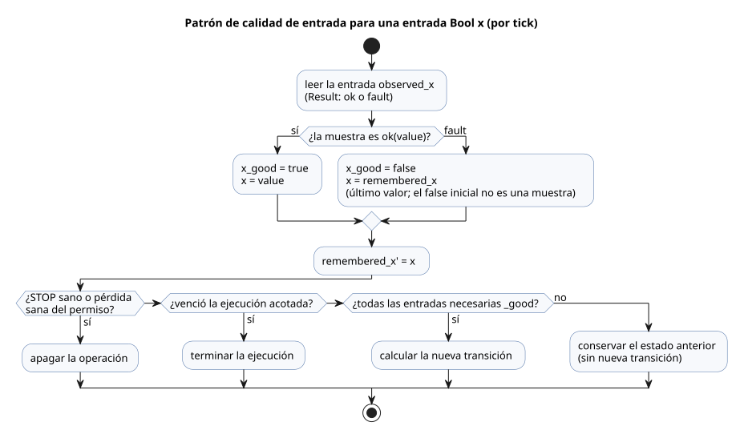
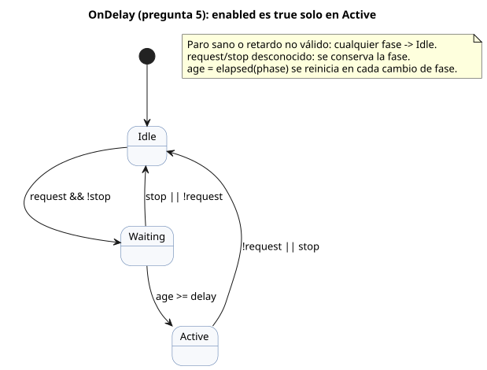
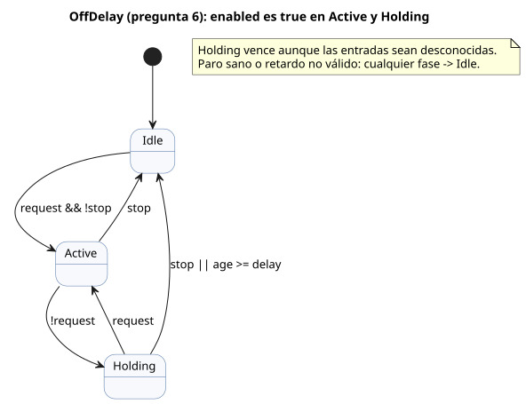
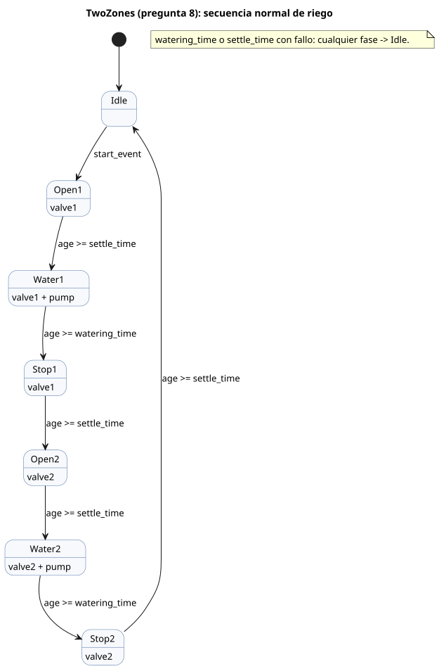
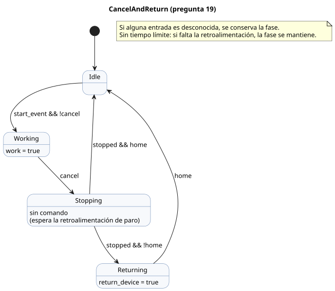
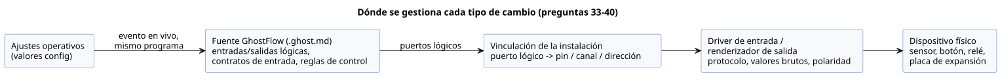

<!-- translation-source: docs/language_faq.en.md -->
[Original en inglés](language_faq.en.md)

# Preguntas frecuentes sobre programación en GhostFlow

Estas preguntas frecuentes (FAQ) responden a un único tipo de pregunta: «¿Cómo programo este comportamiento?».
Para cada pregunta se ofrece código que funciona, una descripción de su comportamiento (incluidos los casos límite) y el motivo por el que está escrito de esa manera.

- Las reglas del lenguaje las define la [Referencia del lenguaje](LANGUAGE-REFERENCE.es.md), no estas FAQ.
- Qué parte de un requisito corresponde al lenguaje, al runtime (entorno de ejecución), al driver, a la instalación o a la interfaz de usuario se indica, pregunta por pregunta, en
  el [Capítulo 8 de la Referencia](reference/08-language-runtime-and-device-boundaries.es.md).

**En este documento**

- Preguntas 1–16: patrones básicos — botones, autorretención, temporizadores, programaciones horarias, histéresis, contadores, ajustes, alarmas, exclusión mutua y funciones.
- Preguntas 17–23: enclavamientos, cancelación, programación basada en calendario y control basado en el uso.
- Preguntas 24–31: ajustes editables por el operador, calendarios, horario de verano, mareas y fase lunar.
- Pregunta 32: comportamiento tras un corte de energía.
- Preguntas 33–40: reemplazo de sensores, relés, pines GPIO y placas de expansión sin modificar el código de control.
- Pregunta 41: comprobación y compilación de documentos con la CLI `ghostc`.

**Acerca de la revisión de entradas.** Desde la revisión de entradas externas del 2026-10-05, toda declaración que transporta información de calidad usa `input`.
El acondicionamiento existente y las ramas explícitas de fallo de `Result` no cambian. Los fragmentos anteriores con `sensor` se conservan en `tests/fixtures/history/issue531/`.

**Acerca de los ejemplos revisados.** Cuando el productor de una entrada se encuentra en un estado desconocido (un fallo), los ejemplos mantienen de forma explícita dos tipos de memoria dentro de la fuente: el último valor observado y la última salida mostrada.
El valor inicial de esa memoria *no* es una muestra sana del productor.
Las guardas de calidad garantizan que una solicitud desconocida nunca cree una nueva transición. Un STOP sano y la pérdida de un permiso siguen teniendo prioridad, y los periodos de ejecución acotados siguen venciendo.
Los ejemplos no infieren fallos del equipo físico ni exigen que los controladores automáticos pulsen START.
Consulte [Cómo leer los ejemplos](#cómo-leer-los-ejemplos) para ver un recorrido por este patrón.

**Estado de la revisión.** Revisado frente a dev el 2026-10-01: [`a7333e56bc25c73fd6167b1182269b96cb671d05`](https://github.com/callin2/ghostflow-language/tree/a7333e56bc25c73fd6167b1182269b96cb671d05).
Algunas preguntas llevan una etiqueta de estado. Cada pregunta etiquetada tiene una nota de estado que indica el alcance afectado.

| Etiqueta | Significado |
|---|---|
| `[Sin decidir]` | Una decisión del lenguaje o del contrato sigue abierta. |
| `[Parcialmente no admitido]` | El alcance indicado no está disponible en este dev. |
| `[Modificado]` | Este dev sustituye la recomendación original. |

Una pregunta sin etiqueta tampoco se ha verificado todavía frente a un dispositivo físico, una API o una integración de interfaz de usuario.

## Preguntas

1. [¿Cómo escribo un archivo de programa?](#q01)
2. [¿Cómo enciendo una salida solo mientras se mantiene pulsado un botón?](#q02)
3. [¿Cómo sigo en marcha tras soltar Start y me detengo con el botón Stop?](#q03)
4. [¿Cómo funciono durante cinco minutos tras el arranque y me detengo automáticamente? [Modificado]](#q04)
5. [¿Cómo enciendo después de que una solicitud se mantenga durante dos segundos? [Modificado]](#q05)
6. [¿Cómo apago tres segundos después de que desaparezca la solicitud? [Modificado]](#q06)
7. [¿Cómo riego todos los días a las 6:00 y a las 18:45?](#q07)
8. [¿Cómo riego la zona 1 y después la zona 2? [Modificado]](#q08)
9. [¿Cómo enciendo con humedad baja sin conmutar repetidamente en el límite?](#q09)
10. [¿Cómo lleno un depósito por debajo del límite inferior y me detengo en el límite superior?](#q10)
11. [¿Cómo emito una señal de finalización tras tres detecciones del sensor?](#q11)
12. [¿Cómo convierto «cinco minutos» en un campo editable en la pantalla? [Modificado]](#q12)
13. [¿Cómo retengo una alarma después de que desaparezca el fallo y la libero con Reset?](#q13)
14. [¿Cómo evito que dos salidas se enciendan a la vez?](#q14)
15. [¿Cómo arranco 30 minutos después del amanecer?](#q15)
16. [¿Cómo reutilizo el mismo cálculo en varios lugares?](#q16)
17. [¿Cómo implemento un enclavamiento?](#q17)
18. [¿Se admite la autorretención?](#q18)
19. [¿Puedo mover un dispositivo concreto cuando el usuario cancela a mitad de camino?](#q19)
20. [¿Cómo programo una operación al amanecer?](#q20)
21. [¿Puedo programar operaciones por día de la semana?](#q21)
22. [¿Puedo controlar un dispositivo según su tiempo de operación acumulado? [Parcialmente no admitido]](#q22)
23. [¿Puedo ejecutar la limpieza según el número de operaciones diarias, sin importar el modo automático o manual?](#q23)
24. [¿Puedo cambiar más adelante solo el tiempo de operación sin actualizar el firmware? [Modificado]](#q24)
25. [¿Puedo cambiar la etiqueta y el componente de interfaz de un campo de ajuste?](#q25)
26. [¿Puedo limitar el rango de los valores de ajuste editables?](#q26)
27. [¿Puedo usar ajustes distintos para cada día de la semana? [Modificado]](#q27)
28. [¿Puedo usar una lógica de control distinta solo en los días festivos?](#q28)
29. [¿Puedo tener en cuenta el horario de verano en el control?](#q29)
30. [¿Puedo controlar operaciones según la pleamar y la bajamar? [Parcialmente no admitido]](#q30)
31. [¿Puedo controlar operaciones según las mareas vivas/muertas o la fase lunar? [Modificado]](#q31)
32. [¿Puedo programar el comportamiento cuando vuelve la energía tras un corte?](#q32)
33. [¿Puedo reemplazar un sensor de temperatura sin cambiar el código de control? [Modificado]](#q33)
34. [¿Los ajustes del sensor están separados de la fuente GhostFlow? ¿Cambian con frecuencias distintas?](#q34)
35. [¿Puedo reemplazar un sensor sin recompilar el programa de control, como quien cambia solo el driver de una impresora?](#q35)
36. [¿Debería la separación entre reemplazo de dispositivos y recompilación figurar también en la especificación del lenguaje?](#q36)
37. [Si conecto un botón a otro pin GPIO, ¿basta con cambiar el mapeo de entradas?](#q37)
38. [¿Puedo conectar otro relé cambiando solo el mapeo GPIO de salida?](#q38)
39. [¿Puedo aumentar el número de salidas con una placa de expansión como Waveshare?](#q39)
40. [¿Puedo mapear también las entradas y salidas de una placa de expansión de E/S RS485?](#q40)
41. [¿Cómo compruebo o compilo un documento con la CLI del compilador?](#q41)

## Cómo leer los ejemplos

- **Programas independientes.** Cada ejemplo de `control` es un programa completo e independiente. No pegue varios ejemplos tal cual en un mismo control.
- **Dónde va el código.** Coloque el código en bloques `ghost` de nivel superior de un documento `.ghost.md`. La pregunta 1 muestra un documento completo.
- **Fragmentos.** Un *fragmento* es una declaración o expresión que se coloca dentro de un control existente.
- **Notación de diseño.** La *notación de diseño* es aquella que la Referencia también marca como notación de diseño; el compilador actual puede no aceptarla.
- **Significado de las entradas.** Cada pregunta indica qué significan sus nombres de entrada. El nombre de una variable no determina la polaridad física del contacto ni el método de comunicación.
- **Las salidas son intención.** Una salida es una intención lógica, no una confirmación. Para saber que una válvula está realmente abierta, lea una entrada de retroalimentación aparte; no reutilice el valor de la salida.
- **Base sintáctica.** Cada respuesta termina con una lista **Base sintáctica** que enlaza al capítulo y la sección de la Referencia de cada notación utilizada.
  Las declaraciones comunes `control`, `input` y `output` siguen la [Referencia §1.4 Notación sintáctica](reference/01-source-and-syntax.es.md).

**El patrón recurrente de calidad de entrada.** Casi todos los ejemplos comienzan con las mismas cuatro líneas para cada entrada Bool `x`:

- `input observed_x: Bool;` declara la entrada. Al leerla se obtiene un `Result`: `ok(value)` para una muestra sana, o `fault(reason)` cuando el estado del productor es desconocido.
- `let x_good = ...` es `true` solo cuando la muestra de este tick es sana.
- `let x = ...` es el valor sano o, ante un fallo, el último valor recordado en `remembered_x`.
- `remembered_x' = x;` actualiza esa memoria. Su valor inicial (`false`) es un valor de partida local de la fuente, no una muestra del productor.

Después, las expresiones de transición usan estos valores en un orden fijo:

1. Un STOP sano, o una pérdida sana de permiso (por ejemplo, `low_water_good && low_water`), apaga primero la operación.
2. Una ejecución acotada cuyo tiempo ha vencido termina, aunque algunas entradas tengan fallo.
3. Solo se calcula una nueva transición cuando todas las entradas de las que depende son `_good`.
4. En caso contrario, se conserva el estado anterior (`... else running`).

Algunos ejemplos también mantienen un estado `displayed_<output>`. Este conserva la última intención de salida mientras las entradas son desconocidas, siguiendo el mismo orden.
El comentario `// Source-local display memory is initialized here; faults remain producer unknown.` señala este patrón en el código.



El diagrama muestra cómo fluye una muestra de entrada a través de la guarda de calidad: una muestra sana actualiza el valor y la memoria, y un fallo conserva el valor recordado pero bloquea las nuevas transiciones.

<a id="q01"></a>
## 1. ¿Cómo escribo un archivo de programa?

Escriba un documento `.ghost.md`. Este contiene tanto la explicación como el código.

````markdown
# 버튼으로 램프 켜기

버튼을 누르고 있는 동안 램프를 켠다.

```ghost
control ButtonLamp {
  state displayed_lamp: Bool = false;
  displayed_lamp' = if button_good && !button then false else if button_good then button else displayed_lamp;
  // Source-local display memory is initialized here; faults remain producer unknown.
  state remembered_button: Bool = false;
  let button_good = case observed_button { ok(_) => true; fault(_) => false; };
  let button = case observed_button { ok(value) => value; fault(_) => remembered_button; };
  remembered_button' = button;
  input observed_button: Bool;
  output lamp: Bool;

  lamp <- displayed_lamp';
}
```
````

Las personas leen la explicación en Markdown. Los bloques `ghost` contienen las reglas de control.
Un documento puede tener varios bloques `ghost` entre párrafos de explicación; juntos forman un solo programa, en el orden del documento.
Dividir el código en bloques no crea etapas de ejecución ni periodos de espera.

**¿Por qué se escribe así?** El comportamiento y el motivo de su elección permanecen juntos en un mismo documento.

**Base sintáctica**

- `.ghost.md`, bloques `ghost` de nivel superior: [Referencia §1.1 — Extracción de bloques de ejecución](reference/01-source-and-syntax.es.md)
- `control`, declaraciones de entrada/salida: [Referencia §1.4 Notación sintáctica](reference/01-source-and-syntax.es.md)
- Conexión de salida `<-`: [Referencia §2.8 Ticks e instantáneas de estado](reference/02-types-expressions-state.es.md)

<a id="q02"></a>
## 2. ¿Cómo enciendo una salida solo mientras se mantiene pulsado un botón?

No se necesita memoria, así que conecte la entrada directamente a la salida.
Aquí, `button = true` significa que el botón está pulsado y `stop = true` significa que se solicita un paro.

```ghost
control HoldToRun {
  state displayed_pump: Bool = false;
  displayed_pump' = if button_good && !button then false else if stop_good && stop then false else if button_good && stop_good then button && !stop else displayed_pump;
  // Source-local display memory is initialized here; faults remain producer unknown.
  state remembered_button: Bool = false;
  let button_good = case observed_button { ok(_) => true; fault(_) => false; };
  let button = case observed_button { ok(value) => value; fault(_) => remembered_button; };
  remembered_button' = button;
  state remembered_stop: Bool = false;
  let stop_good = case observed_stop { ok(_) => true; fault(_) => false; };
  let stop = case observed_stop { ok(value) => value; fault(_) => remembered_stop; };
  remembered_stop' = stop;
  input observed_button: Bool;
  input observed_stop: Bool;
  output pump: Bool;

  pump <- displayed_pump';
}
```

Cuando se suelta el botón o se solicita un paro, la intención de salida se apaga en esa misma evaluación.
Si el botón y el paro son ambos verdaderos, `!stop` hace que la salida sea falsa.

**¿Por qué no hay estado?** Las entradas actuales deciden por sí solas el resultado. No hace falta recordar nada de una pulsación anterior.

**Base sintáctica**

- `Bool`, `true`/`false`: [Referencia §2.1 Tipos de valores](reference/02-types-expressions-state.es.md)
- `&&`, `!`: [Referencia §2.6 Expresiones y operadores](reference/02-types-expressions-state.es.md)
- `<-`: [Referencia §2.8 Ticks e instantáneas de estado](reference/02-types-expressions-state.es.md)

<a id="q03"></a>
## 3. ¿Cómo sigo en marcha tras soltar Start y me detengo con el botón Stop?

Recuerde en `state` si la bomba está en marcha. En este ejemplo, soltar Stop no vuelve a arrancar la operación por sí solo.
Para arrancar de nuevo, el botón Start debe soltarse y luego pulsarse otra vez.

```ghost
control StartStop {
  // Source-local display memory is initialized here; faults remain producer unknown.
  state remembered_start: Bool = false;
  let start_good = case observed_start { ok(_) => true; fault(_) => false; };
  let start = case observed_start { ok(value) => value; fault(_) => remembered_start; };
  remembered_start' = start;
  state remembered_stop: Bool = false;
  let stop_good = case observed_stop { ok(_) => true; fault(_) => false; };
  let stop = case observed_stop { ok(value) => value; fault(_) => remembered_stop; };
  remembered_stop' = stop;
  input observed_start: Bool;
  input observed_stop: Bool;
  output pump: Bool;
  state armed: Bool = false;
  state running: Bool = false;

  let start_event = armed && start;

  armed' = if stop_good && stop then false else if start_good && stop_good then (!stop && !start) else armed;
  running' = if stop_good && stop then false else if start_good && stop_good then (!stop && (start_event || running)) else running;
  pump <- running';
}
```

- `running` es el estado de marcha del tick anterior. Sigue siendo verdadero cuando se suelta el botón tras el arranque.
- `armed` recuerda que se observó una liberación del botón Start mientras no había ningún paro activo.
- Un botón que ya está pulsado en la inicialización no arranca la operación. Solo se acepta una nueva pulsación después de una liberación.
- Stop tiene prioridad tanto sobre la autorretención como sobre las solicitudes de arranque.

**¿Por qué usar `running'` para la salida?** Para que un paro en la evaluación actual llegue a la salida de inmediato, en el mismo tick.

**Base sintáctica**

- `state`, estado anterior y `running'`: [Referencia §2.8 Ticks e instantáneas de estado](reference/02-types-expressions-state.es.md)
- `let`: [Referencia §2.7 Funciones puras y composición de cálculos](reference/02-types-expressions-state.es.md)
- `!`, `&&`, `||`: [Referencia §2.6 Expresiones y operadores](reference/02-types-expressions-state.es.md)

Ejemplo relacionado: [START/STOP](../examples/curriculum/pc-02-start-stop.ghost.es.md).

<a id="q04"></a>
## 4. ¿Cómo funciono durante cinco minutos tras el arranque y me detengo automáticamente? [Modificado]

> **Estado actual en dev:** El ajuste `duration` ahora produce un `Result`. La comparación `age < duration` de abajo no compila a menos que `case` gestione `ok`/`fault`. [Contrato actual](reference/05-settings-and-observation.es.md).

Combine el estado de marcha con el tiempo transcurrido en ese estado.
Termine la operación cuando `stop` o `low_water` sean verdaderos. Mientras está en marcha, ignore las nuevas solicitudes de arranque.

```ghost
control FiveMinuteRun {
  // Source-local display memory is initialized here; faults remain producer unknown.
  state remembered_start: Bool = false;
  let start_good = case observed_start { ok(_) => true; fault(_) => false; };
  let start = case observed_start { ok(value) => value; fault(_) => remembered_start; };
  remembered_start' = start;
  state remembered_stop: Bool = false;
  let stop_good = case observed_stop { ok(_) => true; fault(_) => false; };
  let stop = case observed_stop { ok(value) => value; fault(_) => remembered_stop; };
  remembered_stop' = stop;
  state remembered_low_water: Bool = false;
  let low_water_good = case observed_low_water { ok(_) => true; fault(_) => false; };
  let low_water = case observed_low_water { ok(value) => value; fault(_) => remembered_low_water; };
  remembered_low_water' = low_water;
  input observed_start: Bool;
  input observed_stop: Bool;
  input observed_low_water: Bool;
  output pump, valve: Bool;
  config duration: Duration = 5min;
  state armed: Bool = false;
  state running: Bool = false;
  timer age = elapsed(running);

  let permit = !stop && !low_water;
  let start_event = armed && start;

  armed' = if low_water_good && low_water then false else if stop_good && stop then false else if start_good && stop_good && low_water_good then (permit && !start) else armed;
  running' = if low_water_good && low_water then false else if stop_good && stop then false else if running && !(case duration { ok(value) => age < value; fault(_) => false; }) then false else if start_good && stop_good && low_water_good then (if !permit then false
    else if running then (case duration { ok(value) => age < value; fault(_) => false; })
    else start_event) else running;

  valve <- running';
  pump <- running';
  require pump => valve;
}
```

Cuando `running` pasa a ser verdadero, `age` empieza desde cero. La operación termina en el primer tick en que `age >= duration`.
Mantener pulsado el botón no inicia automáticamente otros cinco minutos.
Para volver a arrancar cuando vence el tiempo, pulse el botón de nuevo. Tras un paro o una condición de nivel bajo de agua, primero debe recuperarse el permiso y debe observarse una liberación del botón.

**¿Por qué no `sleep(5min)`?** Durante la espera hay que seguir comprobando el paro y el nivel bajo de agua en cada tick.

**Base sintáctica**

- `config duration: Duration`, `5min`: [Referencia §5.1 Declaraciones config](reference/05-settings-and-observation.es.md), [§3.1 — Duration](reference/03-time-and-schedules.es.md)
- `timer age = elapsed(running)`: [Referencia §3.2 Tiempo transcurrido tras los cambios de estado](reference/03-time-and-schedules.es.md)
- `if ... then ... else`: [Referencia §2.6 — Expresiones condicionales](reference/02-types-expressions-state.es.md)
- `require pump => valve`: [Referencia §4.7 Intención de salida y restricciones](reference/04-sensors-constraints-control.es.md)

<a id="q05"></a>
## 5. ¿Cómo enciendo después de que una solicitud se mantenga durante dos segundos? [Modificado]

> **Estado actual en dev:** El ajuste `delay` ahora produce un `Result`. Gestione `ok`/`fault` con `case` antes de la comparación `age >= delay` de abajo. [Contrato actual](reference/05-settings-and-observation.es.md).

Mantenga separadas dos situaciones: se ha recibido una solicitud, y la salida está realmente encendida.

```ghost
control OnDelay {
  // Source-local display memory is initialized here; faults remain producer unknown.
  state remembered_request: Bool = false;
  let request_good = case observed_request { ok(_) => true; fault(_) => false; };
  let request = case observed_request { ok(value) => value; fault(_) => remembered_request; };
  remembered_request' = request;
  state remembered_stop: Bool = false;
  let stop_good = case observed_stop { ok(_) => true; fault(_) => false; };
  let stop = case observed_stop { ok(value) => value; fault(_) => remembered_stop; };
  remembered_stop' = stop;
  input observed_request: Bool;
  input observed_stop: Bool;
  output enabled: Bool;
  config delay: Duration = 2s;
  type Phase = Idle | Waiting | Active;
  state phase: Phase = Idle;
  timer age = elapsed(phase);

  phase' = if !(case delay { ok(_) => true; fault(_) => false; }) then Idle else if stop_good && stop then Idle else if request_good && stop_good then (case phase {
    Idle => if request && !stop then Waiting else Idle;
    Waiting => if stop || !request then Idle
      else if (case delay { ok(value) => age >= value; fault(_) => false; }) then Active else Waiting;
    Active => if request && !stop then Active else Idle;
  }) else phase;

  enabled <- phase' == Active;
}
```

Si la solicitud desaparece durante la espera, la espera se cancela. Una nueva solicitud inicia dos segundos desde cero.
Cada transición ocurre en el tick que observa su condición. Un tick largo no salta varias etapas de una vez.



El diagrama muestra las tres fases de `OnDelay`; `enabled` es verdadero solo en `Active`.

**¿Por qué hacen falta etapas?** Hacen explícitos y separados los estados «sin solicitud», «esperando dos segundos» y «encendido».

**Base sintáctica**

- `type Phase`, `case`: [Referencia §2.4 Enumeraciones y ramificación exhaustiva](reference/02-types-expressions-state.es.md)
- `state phase`, `phase'`: [Referencia §2.8 Ticks e instantáneas de estado](reference/02-types-expressions-state.es.md)
- `elapsed(phase)`, `2s`: [Referencia §3.2 Tiempo transcurrido tras los cambios de estado](reference/03-time-and-schedules.es.md), [§3.1 — Duration](reference/03-time-and-schedules.es.md)

Ejemplo relacionado: [Patrones de temporizador independientes](../examples/curriculum/pc-06-timer-patterns.ghost.es.md).

<a id="q06"></a>
## 6. ¿Cómo apago tres segundos después de que desaparezca la solicitud? [Modificado]

> **Estado actual en dev:** El ajuste `delay` ahora produce un `Result`. Gestione `ok`/`fault` con `case` antes de la comparación `age >= delay` de abajo. [Contrato actual](reference/05-settings-and-observation.es.md).

Añada una etapa de *mantenimiento* que empieza cuando se libera la solicitud. Si la solicitud vuelve durante el mantenimiento, la salida sigue encendida.

```ghost
control OffDelay {
  // Source-local display memory is initialized here; faults remain producer unknown.
  state remembered_request: Bool = false;
  let request_good = case observed_request { ok(_) => true; fault(_) => false; };
  let request = case observed_request { ok(value) => value; fault(_) => remembered_request; };
  remembered_request' = request;
  state remembered_stop: Bool = false;
  let stop_good = case observed_stop { ok(_) => true; fault(_) => false; };
  let stop = case observed_stop { ok(value) => value; fault(_) => remembered_stop; };
  remembered_stop' = stop;
  input observed_request: Bool;
  input observed_stop: Bool;
  output enabled: Bool;
  config delay: Duration = 3s;
  type Phase = Idle | Active | Holding;
  state phase: Phase = Idle;
  timer age = elapsed(phase);

  phase' = if phase == Holding && (case delay { ok(value) => age >= value; fault(_) => true; }) then Idle else if !(case delay { ok(_) => true; fault(_) => false; }) then Idle else if stop_good && stop then Idle else if request_good && stop_good then (case phase {
    Idle => if request && !stop then Active else Idle;
    Active => if stop then Idle
      else if !request then Holding else Active;
    Holding => if stop then Idle
      else if request then Active
      else if (case delay { ok(value) => age >= value; fault(_) => false; }) then Idle else Holding;
  }) else phase;

  enabled <- phase' in {Active, Holding};
}
```

Los tres segundos se cuentan desde la entrada en `Holding`. Un paro apaga la salida de inmediato, sin esperar al retardo.
`elapsed(phase)` es el tiempo transcurrido en la etapa actual. No es un total acumulado de varios intervalos de encendido.



El diagrama muestra las fases de `OffDelay`; `enabled` es verdadero en `Active` y en `Holding`.

**¿Por qué no compartir el temporizador de retardo a la conexión?** Cada condición necesita su propio instante de inicio recordado.

**Base sintáctica**

- `type`, `case`, `in {Active, Holding}`: [Referencia §2.4 Enumeraciones y ramificación exhaustiva](reference/02-types-expressions-state.es.md)
- `elapsed(phase)`: [Referencia §3.2 Tiempo transcurrido tras los cambios de estado](reference/03-time-and-schedules.es.md)
- Distinguir el tiempo transcurrido en una etapa del tiempo acumulado: [Referencia §3.4 Tiempo acumulado y presupuestos móviles](reference/03-time-and-schedules.es.md)

<a id="q07"></a>
## 7. ¿Cómo riego todos los días a las 6:00 y a las 18:45?

Use `.due` de la programación horaria como condición de arranque. Use un temporizador para la duración de la marcha.

```ghost
control DailyWatering {
  // Source-local display memory is initialized here; faults remain producer unknown.
  state remembered_stop: Bool = false;
  let stop_good = case observed_stop { ok(_) => true; fault(_) => false; };
  let stop = case observed_stop { ok(value) => value; fault(_) => remembered_stop; };
  remembered_stop' = stop;
  input observed_stop: Bool;
  output pump: Bool;
  schedule starts: DailySlots<15min> {
    timezone = "Asia/Seoul";
    selected = [06:00, 18:45];
    dst_missing = skip;
    dst_repeated = first;
    basis = pulse;
    when = true;
    clock = trusted_only;
    gap = skip_after(60s);
    recovery = baseline;
    fallback = skip;
  }
  let duration = 5min;
  state running: Bool = false;
  timer age = elapsed(running);

  running' = if stop_good && stop then false else if running && !(age < duration) then false else if stop_good then (!stop && (if running then age < duration else starts.due)) else running;
  pump <- running';
}
```

`DailySlots<15min>` no significa «ejecutar cada 15 minutos». Significa que las horas de inicio se eligen sobre una cuadrícula de 15 minutos y que solo ocurren las horas indicadas en `selected`.
Este ejemplo no pone en cola un arranque programado que llega mientras ya está en marcha. Tampoco ejecuta más tarde una hora de inicio que pasó mientras estaba detenido.

**¿Por qué separar la programación horaria y el temporizador?** El tiempo de calendario decide *cuándo* arrancar; el tiempo transcurrido monotónico decide *cuánto tiempo* funcionar.

**Base sintáctica**

- `schedule`, `DailySlots<15min>`, `timezone`, `selected`, `.due`: [Referencia §3.6 DailySlots seleccionados](reference/03-time-and-schedules.es.md)
- Distinguir las ocurrencias de la programación de la operación: [Referencia §3.5 Semántica común de Schedule](reference/03-time-and-schedules.es.md)
- `elapsed(running)`: [Referencia §3.2 Tiempo transcurrido tras los cambios de estado](reference/03-time-and-schedules.es.md)

<a id="q08"></a>
## 8. ¿Cómo riego la zona 1 y después la zona 2? [Modificado]

> **Estado actual en dev:** Los ajustes `watering_time` y `settle_time` ahora producen valores `Result`. Gestione `ok`/`fault` con `case` antes de las comparaciones de tiempo de abajo. [Contrato actual](reference/05-settings-and-observation.es.md).

Escriba la secuencia como una enumeración y conecte cada salida a las etapas en las que está permitida.
Este ejemplo muestra la secuencia de operación normal. Cada zona pasa por tres pasos:
solicitar la apertura de la válvula y esperar dos segundos, suministrar agua durante cinco minutos y, por último, solicitar el paro de la bomba y esperar dos segundos a que se estabilice.

```ghost
control TwoZones {
  // Source-local display memory is initialized here; faults remain producer unknown.
  state remembered_start: Bool = false;
  let start_good = case observed_start { ok(_) => true; fault(_) => false; };
  let start = case observed_start { ok(value) => value; fault(_) => remembered_start; };
  remembered_start' = start;
  input observed_start: Bool;
  output pump, valve1, valve2: Bool;
  type Phase = Idle | Open1 | Water1 | Stop1 | Open2 | Water2 | Stop2;
  state phase: Phase = Idle;
  state armed: Bool = false;
  timer age = elapsed(phase);
  config watering_time: Duration = 5min;
  config settle_time: Duration = 2s;

  let start_event = armed && start;
  armed' = if start_good then (phase == Idle && !start) else armed;

  phase' = if !(case watering_time { ok(_) => true; fault(_) => false; } && case settle_time { ok(_) => true; fault(_) => false; }) then Idle else if phase != Idle || start_good then (case phase {
    Idle => if start_event then Open1 else Idle;
    Open1 => if (case settle_time { ok(value) => age >= value; fault(_) => false; }) then Water1 else Open1;
    Water1 => if (case watering_time { ok(value) => age >= value; fault(_) => false; }) then Stop1 else Water1;
    Stop1 => if (case settle_time { ok(value) => age >= value; fault(_) => false; }) then Open2 else Stop1;
    Open2 => if (case settle_time { ok(value) => age >= value; fault(_) => false; }) then Water2 else Open2;
    Water2 => if (case watering_time { ok(value) => age >= value; fault(_) => false; }) then Stop2 else Water2;
    Stop2 => if (case settle_time { ok(value) => age >= value; fault(_) => false; }) then Idle else Stop2;
  }) else phase;

  valve1 <- phase' in {Open1, Water1, Stop1};
  valve2 <- phase' in {Open2, Water2, Stop2};
  pump <- phase' in {Water1, Water2};
  require pump => (valve1 || valve2);
  require !(valve1 && valve2);
}
```



El diagrama muestra las siete fases en orden y qué salidas enciende cada fase.

Las solicitudes que llegan durante la operación no se ponen en cola. Cuando termina la secuencia, suelte el botón y vuelva a pulsarlo para reiniciar.
La espera de dos segundos de este código no confirma que la válvula se haya abierto realmente.
Si necesita retroalimentación de apertura/cierre y una forma de interrumpir la secuencia, siga el
[Ejemplo de control secuencial con retroalimentación](../examples/curriculum/pc-09-sequential-water-supply.ghost.es.md).

**¿Por qué no escribir un bucle?** En cada etapa, el programa debe recordar dónde se encuentra mientras sigue evaluando las nuevas entradas.

**Base sintáctica**

- `type Phase`, `case`, `in { ... }`: [Referencia §2.4 Enumeraciones y ramificación exhaustiva](reference/02-types-expressions-state.es.md)
- `phase'` y transiciones de estado simultáneas: [Referencia §2.8 Ticks e instantáneas de estado](reference/02-types-expressions-state.es.md)
- `elapsed(phase)`: [Referencia §3.2 Tiempo transcurrido tras los cambios de estado](reference/03-time-and-schedules.es.md)
- `require`, `=>`, exclusión mutua de salidas: [Referencia §4.7 Intención de salida y restricciones](reference/04-sensors-constraints-control.es.md)

<a id="q09"></a>
## 9. ¿Cómo enciendo con humedad baja sin conmutar repetidamente en el límite?

Use umbrales distintos para encender y para apagar (histéresis). Gestione también de forma explícita los fallos del sensor.

```ghost
control MoistureControl {
  state displayed_pump: Bool = false;
  displayed_pump' = if stop_good && stop then false else if stop_good then requested && !stop else displayed_pump;
  // Source-local display memory is initialized here; faults remain producer unknown.
  state remembered_stop: Bool = false;
  let stop_good = case observed_stop { ok(_) => true; fault(_) => false; };
  let stop = case observed_stop { ok(value) => value; fault(_) => remembered_stop; };
  remembered_stop' = stop;
  input observed_stop: Bool;
  input moisture: Percent {
    sample = 1s;
    valid = 0% .. 100%;
    filter = median(5);
    stale_after = 3s;
    recover_after = 3 samples;
  }
  signal dry = hysteresis(moisture,
    on_below: 30%, off_above: 35%, initial: false);
  output pump: Bool;

  let requested = case dry {
    ok(value) => value;
    fault(_) => false;
  };
  pump <- displayed_pump';
}
```

- Un valor de humedad sano por debajo del 30 % enciende la bomba. Un valor por encima del 35 % la apaga. En cualquiera de los dos límites, y en cualquier punto intermedio, se conserva la decisión anterior.
- Si el filtro todavía no está listo, o no se cumplen las condiciones de recuperación, el valor sigue la ruta de fallo y la bomba también se apaga.
- El intervalo de muestreo y los límites son elecciones hechas para este programa. No son valores predeterminados para todos los sensores.
- Cuando vuelven las mediciones sanas, la operación se reanuda automáticamente según una nueva evaluación de la humedad. Si en cambio se requiere un rearranque manual, añada un estado aparte para ello.

**¿Por qué no escribir simplemente `moisture < 30%`?** Eso por sí solo no gestiona ni la calidad de la señal ni la oscilación en el límite.

**Base sintáctica**

- `input`, `sample`, `valid`, `filter`, `stale_after`, `recover_after`: [Referencia §4.2 Contratos de muestra y orden de procesamiento de sensor](reference/04-sensors-constraints-control.es.md)
- `median`, `signal`, `hysteresis`, argumentos con nombre: [Referencia §4.3 Operaciones filter y signal](reference/04-sensors-constraints-control.es.md)
- `case`, `ok(value)`, `fault(_)`: [Referencia §4.1 sensor y calidad de Result](reference/04-sensors-constraints-control.es.md)

<a id="q10"></a>
## 10. ¿Cómo lleno un depósito por debajo del límite inferior y me detengo en el límite superior?

Recuerde si el llenado está en curso. `low_level_reached` significa que el agua ha alcanzado el sensor de nivel inferior,
y `high_level_reached` significa que ha alcanzado el sensor de nivel superior.

```ghost
control TankLevel {
  // Source-local display memory is initialized here; faults remain producer unknown.
  state remembered_low_level_reached: Bool = false;
  let low_level_reached_good = case observed_low_level_reached { ok(_) => true; fault(_) => false; };
  let low_level_reached = case observed_low_level_reached { ok(value) => value; fault(_) => remembered_low_level_reached; };
  remembered_low_level_reached' = low_level_reached;
  state remembered_high_level_reached: Bool = false;
  let high_level_reached_good = case observed_high_level_reached { ok(_) => true; fault(_) => false; };
  let high_level_reached = case observed_high_level_reached { ok(value) => value; fault(_) => remembered_high_level_reached; };
  remembered_high_level_reached' = high_level_reached;
  input observed_low_level_reached: Bool;
  input observed_high_level_reached: Bool;
  output fill_pump: Bool;
  type Phase = Idle | Filling | SensorConflict;
  state phase: Phase = Idle;
  let conflict = high_level_reached && !low_level_reached;

  phase' = if low_level_reached_good && high_level_reached_good then (case phase {
    Idle => if conflict then SensorConflict
      else if !low_level_reached then Filling else Idle;
    Filling => if conflict then SensorConflict
      else if high_level_reached then Idle else Filling;
    SensorConflict => if conflict then SensorConflict else Idle;
  }) else phase;

  fill_pump <- phase' == Filling;
}
```

- El llenado no se detiene en cuanto el agua vuelve a superar el nivel inferior. Una vez iniciado, continúa hasta el nivel superior.
- Si solo la entrada de nivel superior es verdadera mientras la de nivel inferior es falsa, los sensores se contradicen. La bomba se apaga (`SensorConflict`). Cuando la contradicción desaparece, el programa pasa una vez por `Idle` antes de volver a evaluar.

**¿Por qué no invertir simplemente una entrada?** El arranque y el paro usan umbrales distintos, por lo que se necesita el estado de operación anterior.

**Base sintáctica**

- `type Phase`, `case`: [Referencia §2.4 Enumeraciones y ramificación exhaustiva](reference/02-types-expressions-state.es.md)
- `state`, `phase'`, `<-`: [Referencia §2.8 Ticks e instantáneas de estado](reference/02-types-expressions-state.es.md)
- `if`, `!`, `&&`: [Referencia §2.6 Expresiones y operadores](reference/02-types-expressions-state.es.md)

Ejemplo original: [Histéresis de depósito](../examples/curriculum/pc-07-tank-hysteresis.ghost.es.md).

<a id="q11"></a>
## 11. ¿Cómo emito una señal de finalización tras tres detecciones del sensor?

Cuente los *eventos* en los que la entrada cambia de falso a verdadero (flancos ascendentes), no los ticks en los que es verdadera.
Este ejemplo usa el tipo de entero exacto `Int` de la Referencia.

```ghost
control CountThree {
  // Source-local display memory is initialized here; faults remain producer unknown.
  state remembered_detected: Bool = false;
  let detected_good = case observed_detected { ok(_) => true; fault(_) => false; };
  let detected = case observed_detected { ok(value) => value; fault(_) => remembered_detected; };
  remembered_detected' = detected;
  state remembered_reset: Bool = false;
  let reset_good = case observed_reset { ok(_) => true; fault(_) => false; };
  let reset = case observed_reset { ok(value) => value; fault(_) => remembered_reset; };
  remembered_reset' = reset;
  input observed_detected: Bool;
  input observed_reset: Bool;
  output done: Bool;
  state previous: Bool = false;
  state count: Int = 0;
  let rising = detected && !previous;

  previous' = if detected_good && reset_good then (detected) else previous;
  count' = if reset_good && reset then 0 else if detected_good && reset_good then (if reset then 0
    else if rising && count < 3 then count + 1
    else count) else count;
  done <- count' >= 3;
}
```

- Una señal de detección que permanece verdadera cuenta una sola vez. El contador se detiene en tres.
- Si un reset y una detección llegan en el mismo tick, gana el reset.
- Una entrada que ya es verdadera en el arranque cuenta como la primera detección.
- Si muestra el contador en pantalla, indique explícitamente qué cuenta en el vínculo de intención. No confíe en su nombre.

**¿Por qué `Int` y no `Number`?** Un recuento nunca debe ser aproximado ni redondearse silenciosamente.

**Base sintáctica**

- `Int`, operaciones y comparaciones de enteros: [Referencia §2.3 Diseño de enteros exactos](reference/02-types-expressions-state.es.md)
- Memoria de estado en `previous`, `count` y `count'`: [Referencia §2.8 Ticks e instantáneas de estado](reference/02-types-expressions-state.es.md)
- Significado público de los contadores: [Referencia §5.3 — Descriptores e instantáneas](reference/05-settings-and-observation.es.md)

<a id="q12"></a>
## 12. ¿Cómo convierto «cinco minutos» en un campo editable en la pantalla? [Modificado]

> **Estado actual en dev:** Se admiten las declaraciones de ajustes y las actualizaciones en vivo. La recomendación `age < duration` de abajo sigue el modelo anterior, en el que un ajuste se leía como un escalar simple. Gestione el `Result` actual del ajuste con `case`. [Contrato actual](reference/05-settings-and-observation.es.md).

Declare un ajuste operativo con su tipo, rango, incremento, permiso y nombre visible.
Use este **fragmento** en lugar de la declaración de `duration` del [ejemplo 4](#q04).

```ghost
config duration: Duration = 5min {
  min = 1min;
  max = 20min;
  step = 1min;
  access = operator;
  label = "관수 시간";
}
```

La expresión de control sigue usando `age < duration`.
La pantalla recibe la descripción del ajuste y construye un campo de tiempo que acepta de 1 a 20 minutos en pasos de 1 minuto.
La pantalla decide si muestra un campo de texto, una lista de selección o un control deslizante.

Cambiar un ajuste operativo es un *evento en vivo atómico*: cambia los valores efectivos dentro del mismo programa y de la misma ejecución.

- Cuando cambian varios valores a la vez, valídelos todos y aplíquelos juntos. Si alguno no es válido, no cambie ninguno.
- No reinicie a cero un temporizador en marcha.
- Ejemplo: una marcha ya dura seis minutos y el límite se reduce de diez a cinco minutos. En la primera evaluación que usa el nuevo valor, `age < duration` es falso y la operación termina.

**¿Por qué no buscar simplemente el literal `5min` y mostrarlo en pantalla?** No todas las constantes están pensadas para que las ajuste un operador.

**Base sintáctica**

- `config`, `min`, `max`, `step`, `access`, `label`: [Referencia §5.1 Declaraciones config](reference/05-settings-and-observation.es.md)
- Valores predeterminados y efectivos: [Referencia §5.1 — Valores predeterminados y efectivos](reference/05-settings-and-observation.es.md)
- Cambios atómicos durante la ejecución: [Referencia §5.2 — atomic live event](reference/05-settings-and-observation.es.md)

<a id="q13"></a>
## 13. ¿Cómo retengo una alarma después de que desaparezca el fallo y la libero con Reset?

Mantenga el valor actual de la entrada de fallo separado del estado que recuerda el fallo.
Este ejemplo gestiona solo la memoria de la alarma. `fault_active = true` significa que la causa sigue presente.

```ghost
control AlarmMemory {
  // Source-local display memory is initialized here; faults remain producer unknown.
  state remembered_fault_active: Bool = false;
  let fault_active_good = case observed_fault_active { ok(_) => true; fault(_) => false; };
  let fault_active = case observed_fault_active { ok(value) => value; fault(_) => remembered_fault_active; };
  remembered_fault_active' = fault_active;
  state remembered_reset: Bool = false;
  let reset_good = case observed_reset { ok(_) => true; fault(_) => false; };
  let reset = case observed_reset { ok(value) => value; fault(_) => remembered_reset; };
  remembered_reset' = reset;
  input observed_fault_active: Bool;
  input observed_reset: Bool;
  output alarm: Bool;
  state latched: Bool = false;
  state reset_armed: Bool = false;
  let reset_event = reset_armed && reset;

  reset_armed' = if fault_active_good && reset_good then (!fault_active && !reset) else reset_armed;
  latched' = if fault_active_good && reset_good then (fault_active || (latched && !reset_event)) else latched;
  alarm <- latched';
}
```

- `latched` sigue siendo verdadero después de que desaparezca la causa del fallo. Solo se borra cuando la causa ha desaparecido *y* Reset se ha soltado y vuelto a pulsar.
- Si `fault_active` y `reset` son ambos verdaderos, gana `fault_active`.
- Reset no es una orden para volver a arrancar el equipo.

**¿Por qué es distinto de `alarm <- fault_active`?** La causa actual y la memoria de un fallo pasado son informaciones diferentes.
Para la limpieza del equipo, la retroalimentación de posición y las causas de fallo múltiples, consulte el
[Ejemplo de fallo y reset](../examples/curriculum/pc-10-fault-alarm-reset.ghost.es.md).

**Base sintáctica**

- `state latched`, `reset_armed`, estado siguiente `'`: [Referencia §2.8 Ticks e instantáneas de estado](reference/02-types-expressions-state.es.md)
- `let`, condiciones de evento puras: [Referencia §2.7 Funciones puras y composición de cálculos](reference/02-types-expressions-state.es.md)
- `fault_active || (latched && !reset_event)`: [Referencia §2.6 Expresiones y operadores](reference/02-types-expressions-state.es.md)

<a id="q14"></a>
## 14. ¿Cómo evito que dos salidas se enciendan a la vez?

Escriba cada solicitud por separado y añada después una restricción de exclusión mutua.

```ghost
control ExclusiveDirections {
  state displayed_forward: Bool = false;
  displayed_forward' = if forward_request_good && !forward_request then false else if forward_request_good then forward_request else displayed_forward;
  state displayed_reverse: Bool = false;
  displayed_reverse' = if reverse_request_good && !reverse_request then false else if reverse_request_good then reverse_request else displayed_reverse;
  // Source-local display memory is initialized here; faults remain producer unknown.
  state remembered_forward_request: Bool = false;
  let forward_request_good = case observed_forward_request { ok(_) => true; fault(_) => false; };
  let forward_request = case observed_forward_request { ok(value) => value; fault(_) => remembered_forward_request; };
  remembered_forward_request' = forward_request;
  state remembered_reverse_request: Bool = false;
  let reverse_request_good = case observed_reverse_request { ok(_) => true; fault(_) => false; };
  let reverse_request = case observed_reverse_request { ok(value) => value; fault(_) => remembered_reverse_request; };
  remembered_reverse_request' = reverse_request;
  input observed_forward_request: Bool;
  input observed_reverse_request: Bool;
  output forward, reverse: Bool;

  forward <- displayed_forward';
  reverse <- displayed_reverse';
  require !(forward && reverse);
}
```

Cuando ambas solicitudes son verdaderas, las dos salidas son falsas tras aplicar la restricción. El orden en que se escriben las salidas no elige un ganador.
Esta restricción por sí sola no añade un retardo al cambiar de sentido. Si lo necesita, consulte el
[Ejemplo de estado y temporizador para el cambio de sentido](../examples/curriculum/pc-04-direction-interlock.ghost.es.md).

**¿Por qué no bloquear discretamente una salida dentro de la expresión de la otra?** Para que cada solicitud y la regla de conflicto puedan leerse y explicarse por separado.

**Base sintáctica**

- `require !(forward && reverse)` y exclusión mutua: [Referencia §4.7 Intención de salida y restricciones](reference/04-sensors-constraints-control.es.md)
- Esqueleto sintáctico de las restricciones: [Referencia §1.4 Notación sintáctica](reference/01-source-and-syntax.es.md)

<a id="q15"></a>
## 15. ¿Cómo arranco 30 minutos después del amanecer?

Declare una programación horaria `Solar` y use su `.due` como condición de arranque.
Este **fragmento** sustituye la declaración `starts` del [ejemplo 7](#q07).

```ghost
schedule starts: Solar {
  timezone = "Asia/Seoul";
  latitude = 37.5665;
  longitude = 126.9780;
  at = sun`rise + 30min`;
  fallback = skip;
  basis = pulse;
  when = true;
  clock = trusted_only;
  gap = skip_after(60s);
  recovery = baseline;
}
```

- Sustituya las coordenadas del ejemplo por las del emplazamiento real. La `duration` y el temporizador existentes deciden cuánto tiempo se funciona después de `starts.due`.
- Si no se puede determinar la salida del sol, este ejemplo omite la nueva ejecución. No disfraza ese motivo como el «todavía no es hora de arrancar» normal.
- `fallback = skip` no añade una regla que cancele una ejecución ya iniciada.

**¿Por qué especificar la ubicación, la zona horaria y el respaldo (fallback)?** Los eventos naturales dependen de dónde está instalado el sistema, y lo que se hace cuando esa información es desconocida también debe ser explícito.

**Base sintáctica**

- `schedule ...: Solar`, ubicación/zona horaria, ``sun`rise + 30min` ``: [Referencia §3.9 — Notación Solar seleccionada](reference/03-time-and-schedules.es.md)
- `fallback = skip`: [Referencia §3.9 — Respaldo y recuperación para referencias naturales](reference/03-time-and-schedules.es.md)
- Significado de `.due`: [Referencia §3.5 Semántica común de Schedule](reference/03-time-and-schedules.es.md)

<a id="q16"></a>
## 16. ¿Cómo reutilizo el mismo cálculo en varios lugares?

Extraiga una función pura y pásele como argumentos los valores que necesita.

```ghost
fn permitted(request: Bool, stop: Bool, enabled: Bool) -> Bool {
  request && !stop && enabled
}

control TwoRequests {
  state displayed_zone1: Bool = false;
  displayed_zone1' = if enabled_good && !enabled then false else if request1_good && !request1 then false else if stop_good && !stop then false else if enabled_good && request1_good && stop_good then permitted(request1, stop, enabled) else displayed_zone1;
  state displayed_zone2: Bool = false;
  displayed_zone2' = if enabled_good && !enabled then false else if request2_good && !request2 then false else if stop_good && !stop then false else if enabled_good && request2_good && stop_good then permitted(request2, stop, enabled) else displayed_zone2;
  // Source-local display memory is initialized here; faults remain producer unknown.
  state remembered_request1: Bool = false;
  let request1_good = case observed_request1 { ok(_) => true; fault(_) => false; };
  let request1 = case observed_request1 { ok(value) => value; fault(_) => remembered_request1; };
  remembered_request1' = request1;
  state remembered_request2: Bool = false;
  let request2_good = case observed_request2 { ok(_) => true; fault(_) => false; };
  let request2 = case observed_request2 { ok(value) => value; fault(_) => remembered_request2; };
  remembered_request2' = request2;
  state remembered_stop: Bool = false;
  let stop_good = case observed_stop { ok(_) => true; fault(_) => false; };
  let stop = case observed_stop { ok(value) => value; fault(_) => remembered_stop; };
  remembered_stop' = stop;
  state remembered_enabled: Bool = false;
  let enabled_good = case observed_enabled { ok(_) => true; fault(_) => false; };
  let enabled = case observed_enabled { ok(value) => value; fault(_) => remembered_enabled; };
  remembered_enabled' = enabled;
  input observed_request1: Bool;
  input observed_request2: Bool;
  input observed_stop: Bool;
  input observed_enabled: Bool;
  output zone1, zone2: Bool;

  zone1 <- displayed_zone1';
  zone2 <- displayed_zone2';
}
```

Una función no recuerda nada entre llamadas. Reutilizar un cálculo puro es distinto de duplicar un *comportamiento* que tiene temporizadores o memoria de autorretención.
Para esos comportamientos, el estado, los puertos, los ajustes y las conexiones independientes siguen la [Composición de comportamientos](reference/06-composition-and-replay.es.md).

**¿Por qué no dejar que la función lea discretamente un estado externo?** Los mismos argumentos deben dar siempre el mismo resultado, y todas las dependencias de una llamada deben ser visibles en el punto de llamada.

**Base sintáctica**

- `fn`, parámetros, `-> Bool`, llamadas a funciones: [Referencia §2.7 Funciones puras y composición de cálculos](reference/02-types-expressions-state.es.md)
- Esqueleto sintáctico de la declaración de funciones: [Referencia §1.4 Notación sintáctica](reference/01-source-and-syntax.es.md)
- Independencia de los comportamientos con memoria: [Referencia §6.2 Definiciones, instancias y puertos lógicos](reference/06-composition-and-replay.es.md)

<a id="q17"></a>
## 17. ¿Cómo implemento un enclavamiento?

Un *enclavamiento* (interlock) bloquea una operación cuyas condiciones no se cumplen, o las operaciones que entran en conflicto entre sí.
Use dos herramientas:

- Ponga las condiciones que permiten la operación en las expresiones de transición de estado.
- Exprese con `require` las relaciones obligatorias entre salidas.

### Funcionar solo cuando se cumplen las condiciones

Este es el caso «hacer funcionar la bomba solo cuando se confirma que la válvula está abierta y el agua no está en nivel bajo».
`valve_open` es una entrada que confirma que la válvula se ha abierto realmente. `low_water` detecta el nivel bajo de agua,
y `stop` es una solicitud de paro. No use el valor de la *salida* de apertura de la válvula en lugar de `valve_open`.

```ghost
control PumpInterlock {
  // Source-local display memory is initialized here; faults remain producer unknown.
  state remembered_start: Bool = false;
  let start_good = case observed_start { ok(_) => true; fault(_) => false; };
  let start = case observed_start { ok(value) => value; fault(_) => remembered_start; };
  remembered_start' = start;
  state remembered_stop: Bool = false;
  let stop_good = case observed_stop { ok(_) => true; fault(_) => false; };
  let stop = case observed_stop { ok(value) => value; fault(_) => remembered_stop; };
  remembered_stop' = stop;
  state remembered_valve_open: Bool = false;
  let valve_open_good = case observed_valve_open { ok(_) => true; fault(_) => false; };
  let valve_open = case observed_valve_open { ok(value) => value; fault(_) => remembered_valve_open; };
  remembered_valve_open' = valve_open;
  state remembered_low_water: Bool = false;
  let low_water_good = case observed_low_water { ok(_) => true; fault(_) => false; };
  let low_water = case observed_low_water { ok(value) => value; fault(_) => remembered_low_water; };
  remembered_low_water' = low_water;
  input observed_start: Bool;
  input observed_stop: Bool;
  input observed_valve_open: Bool;
  input observed_low_water: Bool;
  output pump: Bool;
  state armed: Bool = false;
  state running: Bool = false;

  let permit = !stop && valve_open && !low_water;
  let start_event = armed && start;

  armed' = if low_water_good && low_water then false else if valve_open_good && !valve_open then false else if stop_good && stop then false else if start_good && stop_good && valve_open_good && low_water_good then (permit && !start) else armed;
  running' = if low_water_good && low_water then false else if valve_open_good && !valve_open then false else if stop_good && stop then false else if start_good && stop_good && valve_open_good && low_water_good then (permit && (running || start_event)) else running;
  pump <- running';
}
```

`permit` se evalúa en cada tick, incluso durante la marcha. Si desaparece la confirmación de válvula abierta, o se produce un nivel bajo de agua o un paro,
tanto `running'` como la intención de la bomba se apagan. Que las condiciones vuelvan a cumplirse no rearranca la operación por sí solo.
Cuando se recupere el permiso, suelte Start y vuelva a pulsarlo.
Esta es la política de rearranque elegida para este ejemplo.

### Impedir el funcionamiento simultáneo de dos salidas

Para prohibir que dos salidas estén encendidas a la vez, como el giro directo y el inverso, añada una restricción de salida.

```ghost
control DirectionInterlock {
  state displayed_forward: Bool = false;
  displayed_forward' = if forward_request_good && !forward_request then false else if forward_request_good then forward_request else displayed_forward;
  state displayed_reverse: Bool = false;
  displayed_reverse' = if reverse_request_good && !reverse_request then false else if reverse_request_good then reverse_request else displayed_reverse;
  // Source-local display memory is initialized here; faults remain producer unknown.
  state remembered_forward_request: Bool = false;
  let forward_request_good = case observed_forward_request { ok(_) => true; fault(_) => false; };
  let forward_request = case observed_forward_request { ok(value) => value; fault(_) => remembered_forward_request; };
  remembered_forward_request' = forward_request;
  state remembered_reverse_request: Bool = false;
  let reverse_request_good = case observed_reverse_request { ok(_) => true; fault(_) => false; };
  let reverse_request = case observed_reverse_request { ok(value) => value; fault(_) => remembered_reverse_request; };
  remembered_reverse_request' = reverse_request;
  input observed_forward_request: Bool;
  input observed_reverse_request: Bool;
  output forward, reverse: Bool;

  forward <- displayed_forward';
  reverse <- displayed_reverse';
  require !(forward && reverse);
}
```

- Si ambas solicitudes son verdaderas, las dos salidas restringidas son falsas. La salida escrita primero no gana.
- Puede expresar la misma exclusión mutua con `mutex(forward, reverse);`.
- Para esperar antes de cambiar de sentido, use un estado aparte y un temporizador.

`require pump => valve;` significa «la intención de salida de la bomba requiere la intención de salida de la válvula».
Confirme que la válvula se ha abierto realmente mediante una entrada aparte, como en el primer ejemplo.
Las restricciones de salida tampoco reinician el estado automáticamente. Si debe exigirse un nuevo arranque después de que se despejen las condiciones,
escriba de forma explícita las transiciones de estado y las condiciones de rearranque, como en el primer ejemplo.
Esta lógica de software no sustituye a una parada de emergencia.

### Agrupar restricciones locales y de recursos compartidos

**Grupos locales.** Puede reunir las restricciones de salidas Bool de un control en un grupo local con nombre, como
`constraints LocalRules { require pump => valve; }`. Un `mutex` también puede ir dentro del grupo.

- El nombre solo ayuda a los lectores a encontrar la explicación. No amplía el ámbito a otros controles ni a toda una instalación física.
- Todas las condiciones obligatorias se combinan con AND. Una prioridad no puede eludirlas.
- El análisis opcional `check` es independiente: es un aviso no bloqueante.

**Recursos compartidos.** Cuando varias rutas de solicitud usan el mismo recurso lógico, declare reglas compartidas con
`constraints SharedRules for station`. El [ejemplo de ejecución completo](../examples/bound-resource-execution.ghost.es.md)
comprueba las solicitudes automáticas, manuales y de respaldo mediante la misma guarda de Rust. Los pasos son:

1. `compileSourceSync` produce un descriptor comprobado. Este descriptor no es ejecutable.
2. Pase de forma explícita a `compileBoundResourceControl` las identidades exactas de fuente/artefacto, los ID de recurso estables y los mapeos de modo/entrada y de salida.
3. Ejecute a través de la ruta de escaneo Rust/WASM real del host de referencia.

El ejemplo proporciona la vinculación completa y las entradas registradas.

**Violaciones y recuperación.**

- Una violación antes del arranque deniega la nueva admisión.
- Una nueva reclamación que entra en conflicto con el titular actual (el incumbente) conserva la admisión del incumbente y las salidas seguras anteriores. La nueva reclamación no se oculta en una cola de reintentos.
- Para una violación durante la ejecución, la respuesta escrita por el autor del ejemplo es
  `pump1 = false; valve1 = true;`. La seguridad no es una regla universal de «todo en OFF».
- Tras un disparo, cada grupo exclusivo afectado necesita una observación en la que todas las reclamaciones sean neutras, seguida de una reclamación nueva.
- Un grupo solo con `require` debe observar primero valores solicitados iguales a los valores seguros definidos por el autor; después comprueba una solicitud nueva.
- Los grupos conectados deben recuperarse juntos en el mismo escaneo.

**Alcance del subconjunto ejecutable.** Abarca un control Bool GFB1 v1/v3 en el que todas las salidas están protegidas de forma explícita.
Los escritores de una misma instalación comparten un registro que rechaza cualquier escritor
activo adicional para el mismo ID estable. Context/PID, la composición mediante importación de políticas compartidas
y el arbitraje cooperativo entre varias VM quedan fuera de este subconjunto.
Los resultados son intenciones lógicas solicitadas/seguras. No son evidencia de que un renderizador las haya aplicado, de que una
válvula se haya abierto ni de que la instalación en campo sea correcta. Para las reglas y las etapas, consulte la [Referencia §4.8](reference/04-sensors-constraints-control.es.md)
y [el contrato de restricciones](CONSTRAINTS.es.md).

**¿Por qué separar estos dos enfoques?** *Cómo* cambia el estado de operación y *qué* combinaciones de salidas se permiten
son dos reglas de control distintas, y cada una debe escribirse de forma explícita.

**Base sintáctica**

- `let permit`, cálculos puros con nombre: [Referencia §2.7 Funciones puras y composición de cálculos](reference/02-types-expressions-state.es.md)
- `state`, `running'`, `<-`: [Referencia §2.8 Ticks e instantáneas de estado](reference/02-types-expressions-state.es.md)
- `!`, `&&`, `||`: [Referencia §2.6 Expresiones y operadores](reference/02-types-expressions-state.es.md)
- `require`, `mutex`, `=>`, distinción entre salidas solicitadas/seguras: [Referencia §4.7 Intención de salida y restricciones](reference/04-sensors-constraints-control.es.md)
- Formas de declaración de `require` y `mutex`: [Referencia §1.4 Notación sintáctica](reference/01-source-and-syntax.es.md)

<a id="q18"></a>
## 18. ¿Se admite la autorretención?

Sí. Recuerde el estado de marcha anterior en `state` y vuelva a usar ese valor en la expresión del estado siguiente.
Esta es la autorretención básica, que permanece encendida después de soltar Start.

```ghost
control SelfHolding {
  // Source-local display memory is initialized here; faults remain producer unknown.
  state remembered_start: Bool = false;
  let start_good = case observed_start { ok(_) => true; fault(_) => false; };
  let start = case observed_start { ok(value) => value; fault(_) => remembered_start; };
  remembered_start' = start;
  state remembered_stop: Bool = false;
  let stop_good = case observed_stop { ok(_) => true; fault(_) => false; };
  let stop = case observed_stop { ok(value) => value; fault(_) => remembered_stop; };
  remembered_stop' = stop;
  input observed_start: Bool;
  input observed_stop: Bool;
  output pump: Bool;
  state running: Bool = false;

  running' = if stop_good && stop then false else if start_good && stop_good then (!stop && (start || running)) else running;
  pump <- running';
}
```

- Cuando `start` es verdadero, `running'` pasa a ser verdadero.
- En el tick siguiente, `start` puede ser falso, pero el `running` anterior es verdadero, así que la operación continúa.
- Cuando `stop` es verdadero, `running'` es falso. Stop gana aunque Start y Stop lleguen a la vez.
- `pump` sigue a `running'` de la evaluación actual.

Con esta expresión básica, si `start` sigue siendo verdadero cuando se suelta Stop, la operación vuelve a encenderse.
Si necesita «soltar Start y volver a pulsarlo», use también
[el estado de permiso de rearranque de la pregunta 3](#q03).

**¿Por qué incluir el estado anterior en la expresión?** Mantener explícita la memoria de autorretención en `running`
permite leer en una sola expresión las condiciones de arranque, retención y liberación.

**Base sintáctica**

- `state running: Bool = false`, estado anterior `running`, estado siguiente `running'`: [Referencia §2.8 Ticks e instantáneas de estado](reference/02-types-expressions-state.es.md)
- `!stop && (start || running)`: [Referencia §2.6 Expresiones y operadores](reference/02-types-expressions-state.es.md)
- `pump <- running'`: [Referencia §1.4 Sintaxis de la conexión de salida](reference/01-source-and-syntax.es.md), [§2.8 Lectura del estado siguiente en las salidas](reference/02-types-expressions-state.es.md)

<a id="q19"></a>
## 19. ¿Puedo mover un dispositivo concreto cuando el usuario cancela a mitad de camino?

Sí. Cuando llega una entrada de cancelación, pase a una etapa de seguimiento y conecte las salidas de esa etapa.
Este ejemplo recorre cuatro pasos: solicitar el paro de la tarea original → confirmar que se ha detenido → hacer funcionar el dispositivo de retorno → confirmar la posición de origen.
`stopped` y `home` son entradas que confirman el paro real y la posición de origen.

```ghost
control CancelAndReturn {
  // Source-local display memory is initialized here; faults remain producer unknown.
  state remembered_start: Bool = false;
  let start_good = case observed_start { ok(_) => true; fault(_) => false; };
  let start = case observed_start { ok(value) => value; fault(_) => remembered_start; };
  remembered_start' = start;
  state remembered_cancel: Bool = false;
  let cancel_good = case observed_cancel { ok(_) => true; fault(_) => false; };
  let cancel = case observed_cancel { ok(value) => value; fault(_) => remembered_cancel; };
  remembered_cancel' = cancel;
  state remembered_stopped: Bool = false;
  let stopped_good = case observed_stopped { ok(_) => true; fault(_) => false; };
  let stopped = case observed_stopped { ok(value) => value; fault(_) => remembered_stopped; };
  remembered_stopped' = stopped;
  state remembered_home: Bool = false;
  let home_good = case observed_home { ok(_) => true; fault(_) => false; };
  let home = case observed_home { ok(value) => value; fault(_) => remembered_home; };
  remembered_home' = home;
  input observed_start: Bool;
  input observed_cancel: Bool;
  input observed_stopped: Bool;
  input observed_home: Bool;
  output work, return_device: Bool;
  type Phase = Idle | Working | Stopping | Returning;
  state phase: Phase = Idle;
  state armed: Bool = false;

  let start_event = armed && start;
  armed' = if start_good && cancel_good && stopped_good && home_good then (phase == Idle && !start && !cancel) else armed;
  phase' = if start_good && cancel_good && stopped_good && home_good then (case phase {
    Idle => if !cancel && start_event then Working else Idle;
    Working => if cancel then Stopping else Working;
    Stopping => if !stopped then Stopping else if home then Idle else Returning;
    Returning => if home then Idle else Returning;
  }) else phase;
  work <- phase' == Working;
  return_device <- phase' == Returning;
  require !(work && return_device);
}
```

- `Stopping` espera la retroalimentación de que la tarea original se ha detenido. Todavía no envía un comando de retorno.
- El dispositivo de retorno solo recibe el comando en `Returning`. El retorno continúa hasta que se confirma la posición de origen, aunque se suelte la cancelación.
- Sin confirmación del paro o de la posición de origen, el programa permanece en esa etapa. Este ejemplo no tiene política de tiempo límite.
- No rearranca automáticamente tras una cancelación. En el estado de espera, suelte Start y Cancel y luego dé una nueva solicitud de arranque.
- Este ejemplo es una cancelación ordinaria de tarea. No lo use como regla que permita movimientos adicionales durante una parada de emergencia.



El diagrama muestra las cuatro fases y la retroalimentación que hace pasar el programa de una fase a la siguiente.

**¿Por qué retornar solo después de confirmar el paro?** Para que la tarea original y el comando de retorno nunca muevan el dispositivo al mismo tiempo,
y para que durante la cancelación no se confunda el estado lógico con el estado físico.

**Base sintáctica**

- Significado de las transiciones de fase y de las instantáneas de estado: [Referencia §2.8 Ticks e instantáneas de estado](reference/02-types-expressions-state.es.md)
- Retroalimentación del dispositivo que separa requested, applied y confirmed: [Referencia §4.7 requested, safe, applied, confirmed](reference/04-sensors-constraints-control.es.md)
- `type Phase`, `case`: [Referencia §2.4 Enumeraciones y ramificación exhaustiva](reference/02-types-expressions-state.es.md)
- `let`, `if`, operaciones y comparaciones Bool: [Referencia §2.6 Expresiones y operadores](reference/02-types-expressions-state.es.md)

<a id="q20"></a>
## 20. ¿Cómo programo una operación al amanecer?

Use `.due` de la programación horaria `Solar` como condición de arranque. Este fragmento apunta al momento mismo de la salida del sol.

```ghost
schedule starts: Solar {
  timezone = "Asia/Seoul";
  latitude = 37.5665;
  longitude = 126.9780;
  at = sun`rise`;
  fallback = skip;
  basis = pulse;
  when = true;
  clock = trusted_only;
  gap = skip_after(60s);
  recovery = baseline;
}
```

Sustituya las coordenadas y la zona horaria por las del emplazamiento real. Cuando `starts.due` es verdadero, admita una nueva ocurrencia.
La `duration` y el estado de control existentes deciden cuánto tiempo se funciona. Si no se puede calcular la salida del sol,
se omite la nueva ejecución. `fallback = skip` no cancela una ejecución ya admitida.

**¿Por qué usar `.due`?** Mantiene la ocurrencia de un evento natural separada de las transiciones del estado de operación,
lo que preserva el límite entre la evaluación de la programación horaria y el control de dispositivos.

**Base sintáctica**

- `schedule ...: Solar`, ``sun`rise` ``, ubicación/zona horaria y `fallback`: [Referencia §3.9 Notación Solar seleccionada](reference/03-time-and-schedules.es.md)
- `.due` y admisión de ocurrencias: [Referencia §3.5 Semántica común de Schedule](reference/03-time-and-schedules.es.md)
- `fallback = skip` y recuperación: [Referencia §3.9 Respaldo y recuperación para referencias naturales](reference/03-time-and-schedules.es.md)

<a id="q21"></a>
## 21. ¿Puedo programar operaciones por día de la semana?

Un rango como ``day`mon..fri` `` filtra un pulso `Daily` en su zona horaria declarada. El calendario de la instalación sigue definiendo `workday` y `offday`. [Contrato actual](reference/03-time-and-schedules.es.md).

Exprese una condición de día de la semana en el campo `on` de la programación horaria. Por ejemplo, para arrancar a las 6:00 de lunes a viernes,
combine la condición horaria con la condición de día de la semana de abajo.
Para una programación horaria que compile y se ejecute con el compilador actual, use ``day`workday` `` o ``day`offday` `` con un calendario de la instalación.

```ghost
on = day`mon..fri`;
```

El filtro de días de la semana se aplica a la fecha local del inicio programado calculado. Los días festivos y los días laborables del emplazamiento siguen reglas distintas de las de los días de la semana,
así que no interprete ``day`mon..fri` `` como un calendario de días festivos.
Las políticas de horario de verano (DST) y de límite de medianoche también siguen el contrato de programación horaria.

**¿Por qué mantener separados el día de la semana y la hora?** La misma hora de inicio debe poder combinarse con distintas condiciones de fecha, como días de la semana, días festivos o días laborables del emplazamiento.

**Base sintáctica**

- `on` y distinción entre días de la semana, días festivos y días laborables: [Referencia §3.8 DST, medianoche y calendarios laborales](reference/03-time-and-schedules.es.md)
- Semántica de programación seleccionada de `DailySlots` y `.due`: [Referencia §3.6 DailySlots seleccionados](reference/03-time-and-schedules.es.md)
- Zonas horarias y límites de fecha local: [Referencia §3.1 Valores de tiempo y dominios de reloj](reference/03-time-and-schedules.es.md)


<a id="q22"></a>
## 22. ¿Puedo controlar un dispositivo según su tiempo de operación acumulado? [Parcialmente no admitido]

> **Estado actual en dev:** Se admite el ejemplo que consume una `Duration` acumulada confirmada externamente. Las cuentas `on_time` ejecutables admiten actualmente solo evidencia duradera de la etapa *applied*; la ejecución nativa de cuentas para las etapas requested, safe y confirmed no se admite. [Contrato actual](../tools/control.mjs#L1521).

Reciba el tiempo de operación acumulado como un valor `Duration` y úselo en las condiciones.
Primero decida **durante qué periodo se acumula y qué cuenta como operación**.

| Criterio deseado | Ámbito de acumulación |
|---|---|
| Diez minutos de operación total en esta tarea | Suma de los intervalos de encendido desde que empezó la tarea |
| Veinte minutos de operación en la última hora | Una ventana de una hora que se desplaza de forma continua |
| Una hora de operación total hoy | La fecha de hoy en la zona horaria especificada |
| Cien horas de operación total desde el mantenimiento | Desde un reinicio explícito por mantenimiento |

Este ejemplo de control *consume* un valor acumulado. `used` es una entrada que suma los intervalos de encendido confirmados del mismo dispositivo
en el ámbito elegido. `usage_valid` indica si esa suma es válida.
El código no incluye la declaración que produce el valor acumulado.

```ghost
control UsageLimit {
  state displayed_device: Bool = false;
  displayed_device' = if request_good && !request then false else if usage_valid_good && !usage_valid then false else if request_good && usage_valid_good && used_good then request && usage_valid && within_limit else displayed_device;
  // Source-local display memory is initialized here; faults remain producer unknown.
  state remembered_request: Bool = false;
  let request_good = case observed_request { ok(_) => true; fault(_) => false; };
  let request = case observed_request { ok(value) => value; fault(_) => remembered_request; };
  remembered_request' = request;
  state remembered_usage_valid: Bool = false;
  let usage_valid_good = case observed_usage_valid { ok(_) => true; fault(_) => false; };
  let usage_valid = case observed_usage_valid { ok(value) => value; fault(_) => remembered_usage_valid; };
  remembered_usage_valid' = usage_valid;
  state remembered_used: Duration = 0ms;
  let used_good = case observed_used { ok(_) => true; fault(_) => false; };
  let used = case observed_used { ok(value) => value; fault(_) => remembered_used; };
  remembered_used' = used;
  input observed_request: Bool;
  input observed_usage_valid: Bool;
  input observed_used: Duration;
  output device: Bool;
  config max_use: Duration = 1h;

  let within_limit = case max_use {
    ok(value) => used < value;
    fault(_) => false;
  };
  device <- displayed_device';
}
```

Una vez que el total alcanza el límite, no se emiten más solicitudes de marcha. Un límite de uso estricto que cubra también el retardo hasta que el dispositivo se detiene físicamente
necesita además las reglas de reserva y liquidación de la Referencia §3.10.
`elapsed(running)` mide el tiempo desde el último cambio de estado. No suma intervalos de encendido/apagado repetidos.

Para incluir tanto la operación automática como la manual, agregue un único registro de operación común para el equipo en lugar de mantener un temporizador por cada origen de comandos.
Decida si cuenta las solicitudes de salida, las salidas que superaron las restricciones, los comandos aplicados o la retroalimentación real.
Sin retroalimentación, no llame «tiempo de operación real» al tiempo durante el cual se aplicó un comando.

Declare un registro acumulado con `account` y consulte, por ejemplo, los últimos 60 segundos con `used(account, rolling(60s))`.
Una declaración `on_time` especifica el objetivo, la base de evidencia (requested, safe, applied o confirmed) y la persistencia.
No suponga que esta notación implica políticas de reinicio y retención por tarea o posteriores al mantenimiento.

**¿Por qué se necesita una semántica de acumulación aparte?** Comprobar solo el tiempo de operación continuo pasa por alto el uso repartido en muchas marchas cortas.

**Base sintáctica**

- `Duration`, `1h`: [Referencia §3.1 Valores de tiempo y dominios de reloj — Duration](reference/03-time-and-schedules.es.md)
- `&&`, `<`: [Referencia §2.6 Expresiones y operadores](reference/02-types-expressions-state.es.md)
- Diferencia entre `elapsed` y la acumulación: [Referencia §3.2 Tiempo transcurrido tras los cambios de estado](reference/03-time-and-schedules.es.md)
- Objetivos/ámbitos de acumulación y `account`, `on_time`, `used`: [Referencia §3.4 Tiempo acumulado y presupuestos móviles](reference/03-time-and-schedules.es.md)
- Agregación combinada automática/manual y límites diarios: [Referencia §3.10 Restricciones de uso basadas en el tiempo](reference/03-time-and-schedules.es.md)
- `config max_use`: [Referencia §5.1 Declaraciones config](reference/05-settings-and-observation.es.md)

<a id="q23"></a>
## 23. ¿Puedo ejecutar la limpieza según el número de operaciones diarias, sin importar el modo automático o manual?

Combine una condición de recuento con una secuencia de limpieza.
No cuente por separado los comandos de arranque automáticos y manuales. En su lugar, **cuente en un solo lugar las operaciones del mismo dispositivo**.
Pasar de automático a manual mientras el dispositivo sigue funcionando no cuenta como una nueva operación.

Por ejemplo, elija esta política: «Tras diez arranques de operación normal hoy (hora de Seúl), limpiar una vez cuando termine la marcha actual».
Aquí, una transición de OFF→ON de la señal de confirmación de operación cuenta como una operación.
Si solo deben contar las marchas completadas, cuente los eventos de finalización en lugar de los arranques.

Este **fragmento** lee el recuento diario. `Int` es el tipo de entero exacto de la Referencia.
`today_starts` es el recuento combinado de hoy de operaciones normales automáticas y manuales; `count_valid` indica si ese recuento es válido.

```ghost
input today_starts: Int;
input count_valid: Bool;
let wash_due = case count_valid {
  ok(valid) => if valid then case today_starts {
    ok(count) => count >= 10; fault(_) => false;
  } else false;
  fault(_) => false;
};
```

`today_starts` no es un nombre integrado, y este fragmento no declara el propio contador diario.
Declare el recuento diario con `account` y `count_events` de §3.10. Especifique los ID de los eventos de entrada,
la base de evidencia y los límites de fecha. Una retransmisión del mismo evento cuenta una sola vez.
`on_time` suma tiempo; `count_events` cuenta eventos. No use uno en lugar del otro.

La secuencia de limpieza del ejemplo anterior funciona como sigue. Esto describe un comportamiento; no es sintaxis ejecutable.

```text
Se alcanzan diez operaciones normales hoy → recordar que se necesita limpieza
Se confirma que la operación normal actual ha terminado → iniciar la etapa de limpieza
Se confirma que la limpieza ha terminado → borrar la solicitud y recordar que se limpió en esa fecha
```

- Encender el mismo dispositivo *para la limpieza* no cuenta como operación normal en este ejemplo.
- Durante la limpieza no arranca ninguna operación normal nueva. La misma condición se aplica a las solicitudes automáticas y manuales.
- Recuerde la solicitud de limpieza en el estado. Un pulso de un tick puede perderse mientras el dispositivo está ocupado.
- En esta política, un cambio de fecha no cancela una solicitud de limpieza ya recordada ni una limpieza en curso.
- «Limpiar una vez al día» y «limpiar cada diez operaciones» son políticas distintas. Este ejemplo limpia una vez al día.

Un contrato real de recuento diario debe definir la zona horaria, los límites de fecha, la restauración tras un reinicio, las correcciones del reloj y qué ocurre cuando el recuento es desconocido.
Una simple declaración `state count = 0` no crea un recuento persistente por fecha.
Escriba las etapas y las salidas de la limpieza con un estado de enumeración, como en [el control secuencial de la pregunta 8](#q08).

**¿Por qué contar con independencia del modo de operación?** La necesidad de limpieza depende de cuánto se usó el dispositivo, no de quién lo ordenó.

**Base sintáctica**

- `Int` y recuentos exactos: [Referencia §2.3 Diseño de enteros exactos](reference/02-types-expressions-state.es.md)
- `let`, `&&`, `>=`: [Referencia §2.6 Expresiones y operadores](reference/02-types-expressions-state.es.md)
- Enumeraciones de etapas de limpieza y `case`: [Referencia §2.4 Enumeraciones y ramificación exhaustiva](reference/02-types-expressions-state.es.md)
- Recordar entradas anteriores, recuentos y solicitudes de limpieza: [Referencia §2.8 Ticks e instantáneas de estado](reference/02-types-expressions-state.es.md)
- Distinguir los comandos de la operación física: [Referencia §4.7 requested, safe, applied, confirmed](reference/04-sensors-constraints-control.es.md)
- Principios relacionados de la agregación diaria del equipo — reglas de agregación de tiempo, no sintaxis de recuento: [Referencia §3.10 Restricciones de uso basadas en el tiempo](reference/03-time-and-schedules.es.md)

<a id="q24"></a>
## 24. ¿Puedo cambiar más adelante solo el tiempo de operación sin actualizar el firmware? [Modificado]

> **Estado actual en dev:** Se admiten las actualizaciones en vivo y las conexiones `TimeSlots`. La recomendación `age < duration` de abajo sigue el modelo anterior, en el que un ajuste se leía como un escalar simple. Gestione el `Result` actual del ajuste con `case`. [Contrato actual](reference/05-settings-and-observation.es.md).

Sí. Declare **cuánto tiempo funcionar** como un ajuste `Duration` que los operadores pueden editar.
Este **fragmento** sustituye la declaración de `duration` de [la operación temporizada de la pregunta 4](#q04).

```ghost
config duration: Duration = 5min {
  min = 1min;
  max = 20min;
  step = 1min;
  access = operator;
  label = "작동 시간";
}
```

Cambiar en pantalla cinco minutos por diez minutos cambia el valor efectivo del ajuste.
No necesita editar la fuente, recompilar el programa, actualizar el firmware ni reiniciar.
La declaración define el tipo y el rango; la pantalla usa esa descripción para construir un campo.
Los valores aceptados de los ajustes operativos ordinarios se conservan tras un reinicio del dispositivo.

El cambio se aplica dentro de la misma ejecución, y el tiempo transcurrido no se reinicia.
Con `age < duration`:

- Si aumenta cinco minutos a diez cuando ya han pasado tres minutos, la marcha se compara ahora con diez minutos en total.
- Si reduce el límite a cinco minutos cuando ya han pasado seis minutos, la operación termina en la primera evaluación que usa el nuevo valor.

«Mantener la tarea actual tal como está y usar el nuevo tiempo a partir de la siguiente tarea» requiere una regla de control explícita:
copiar el ajuste en un estado aparte cuando empieza la tarea. Ese no es el comportamiento de cambio predeterminado de `config`.

**Cuándo arrancar** es un ajuste distinto de cuánto tiempo funcionar.
En lugar de la lista fija `selected` de `DailySlots`, conecte un `config` de tipo `TimeSlots`.
Este fragmento de declaración de ajuste acepta hasta ocho horas sobre una cuadrícula de 15 minutos.

```ghost
config watering_slots: TimeSlots<15min, 8> = [time`06:00`, time`18:45`] {
  access = operator;
  label = "관수 시작 시각";
}
```

Escriba `selected = watering_slots;` dentro de `DailySlots<15min>` en el mismo control.
Cambiar las horas también es un evento en vivo y no requiere recompilación. Una hora recién añadida que ya ha pasado no se ejecuta,
y eliminar una franja no cancela por sí solo una ejecución ya iniciada.

**¿Por qué marcar de antemano los valores ajustables?** Para que el lenguaje trace una línea clara entre lo que los operadores pueden cambiar y lo que equivale a cambiar las reglas del programa.

**Base sintáctica**

- `config`, `Duration`, `min`, `max`, `step`, `access`, `label`: [Referencia §5.1 Declaraciones config](reference/05-settings-and-observation.es.md)
- Valores predeterminados de la fuente y valores efectivos operativos: [Referencia §5.1 Valores predeterminados y efectivos](reference/05-settings-and-observation.es.md)
- Cambios sin recompilación ni reinicio: [Referencia §5.2 atomic live event](reference/05-settings-and-observation.es.md)
- Conservación de los ajustes ordinarios tras un reinicio: [Referencia §5.2 Ciclos de vida y ajustes temporales](reference/05-settings-and-observation.es.md)
- `elapsed` y tiempo transcurrido existente: [Referencia §3.2 Tiempo transcurrido tras los cambios de estado](reference/03-time-and-schedules.es.md)
- Horas programadas en `selected`: [Referencia §3.6 DailySlots seleccionados](reference/03-time-and-schedules.es.md)

<a id="q25"></a>
## 25. ¿Puedo cambiar la etiqueta y el componente de interfaz de un campo de ajuste?

Defina la etiqueta con el campo `label` del lenguaje. El cabinet-view que crea la pantalla elige el componente de interfaz.
Este **fragmento** muestra el ajuste de la [pregunta 24](#q24) como «Tiempo de limpieza».

```ghost
config duration: Duration = 5min {
  min = 1min;
  max = 20min;
  step = 1min;
  access = operator;
  label = "세척 시간";
}
```

Una pantalla que usa esta declaración puede elegir un método de entrada adecuado, por ejemplo:

| Método de entrada en pantalla | Semántica del ajuste que debe conservarse |
|---|---|
| Campo de tiempo | Leer un valor Duration y comprobar el rango de 1–20 minutos y los pasos de 1 minuto |
| Lista de selección | Ofrecer solo los valores permitidos de 1 a 20 minutos |
| Control deslizante | Aplicar el mismo rango y paso |

Sea cual sea el componente que se use, el tipo, el rango, el paso y los permisos de cambio del valor no cambian.
`label` es un nombre legible por personas. No cambia el ID del ajuste ni sus permisos.

GhostFlow no tiene una sintaxis como `widget = slider` para elegir un componente concreto.
Esa elección corresponde al cabinet-view. «La pantalla puede elegir» tampoco significa
que el lenguaje dé a los operadores un menú para cambiar ellos mismos el tipo de componente.

**¿Por qué decidir la apariencia de la pantalla fuera del lenguaje?** Para que el mismo ajuste «Tiempo de limpieza» pueda editarse de una forma adecuada tanto a teléfonos como a pantallas de dispositivos,
mientras la semántica de control y las reglas de validación siguen siendo idénticas.

**Base sintáctica**

- `config`, `label`, `min`, `max`, `step`, `access`: [Referencia §5.1 Declaraciones config](reference/05-settings-and-observation.es.md)
- Separación entre la apariencia de la interfaz y la semántica del lenguaje: [Referencia §5.3 Modelo de observación independiente del cabinet-view](reference/05-settings-and-observation.es.md)
- Descripciones que transmiten los ID, tipos y permisos de los ajustes: [Referencia §5.3 Descriptores e instantáneas](reference/05-settings-and-observation.es.md)

<a id="q26"></a>
## 26. ¿Puedo limitar el rango de los valores de ajuste editables?

Sí. `min` y `max` definen un rango permitido inclusivo, y `step` define el incremento.
Este **fragmento** permite tiempos de operación de 1 a 20 minutos, solo en pasos de 1 minuto.

```ghost
config duration: Duration = 5min {
  min = 1min;
  max = 20min;
  step = 1min;
  access = operator;
  label = "작동 시간";
}
```

| Valor introducido | Resultado |
|---|---|
| 1, 5 o 20 minutos | Aceptado |
| 30 segundos o 21 minutos | Rechazado: fuera del rango |
| 1 minuto 30 segundos | Rechazado: dentro del rango, pero fuera de la cuadrícula de 1 minuto |

`step` define una cuadrícula que empieza en `min`. Por ejemplo, un mínimo de 1 minuto con un paso de 2 minutos
permite 1, 3, 5 minutos, etc. El valor predeterminado también debe estar dentro del rango y sobre la cuadrícula.
También se rechazan los valores con otra unidad u otro tipo. Los valores nunca se redondean ni se recortan automáticamente a un límite.

Las reglas de validación se aplican en todas partes, no solo al rango que muestra un control deslizante. Los demás campos y las solicitudes de ajuste
siguen las mismas reglas. Si algún valor de un cambio de varios ajustes no es válido, no se aplica ninguno.
Para prohibir por completo los cambios por parte del operador, declare `access = designer`.

**¿Por qué poner el rango en el lenguaje?** Para que todas las pantallas y todas las rutas de solicitud solo puedan introducir en el control valores aprobados por el autor.

**Base sintáctica**

- `min`, `max`, `step`, validación del valor predeterminado y `access`: [Referencia §5.1 Declaraciones config](reference/05-settings-and-observation.es.md)
- Aceptar o rechazar varios ajustes en conjunto: [Referencia §5.2 atomic live event](reference/05-settings-and-observation.es.md)

<a id="q27"></a>
## 27. ¿Puedo usar ajustes distintos para cada día de la semana? [Modificado]

> **Estado actual en dev:** La duración elegida por la expresión condicional también es un `Result`. Gestione `ok`/`fault` con `case` antes de comparar el tiempo de operación. [Contrato actual](reference/05-settings-and-observation.es.md).

Sí. Declare cada valor por tipo de día como su propio `config` y elija uno con una expresión condicional.
Por ejemplo, funcione cinco minutos los días laborables y diez los fines de semana.
Cada ajuste puede tener su propia etiqueta y su propio rango editable.

Este es un **fragmento de selección de ajustes**. `is_weekday` es una entrada que es verdadera de lunes a viernes
en la zona horaria del emplazamiento. `calendar_valid` indica si esa decisión de fecha es válida.
Ninguna de las dos entradas es una variable integrada; lo que las produzca proporciona la fecha del emplazamiento y su validez.
Para restringir la propia programación horaria por día de la semana, use el filtro `on = day` de la Referencia §3.8.

```ghost
input is_weekday, calendar_valid: Bool;
config weekday_duration: Duration = 5min {
  min = 1min;
  max = 20min;
  step = 1min;
  access = operator;
  label = "평일 작동 시간";
}
config weekend_duration: Duration = 10min {
  min = 1min;
  max = 20min;
  step = 1min;
  access = operator;
  label = "주말 작동 시간";
}
let duration = case is_weekday {
  ok(weekday) => case (if weekday then weekday_duration else weekend_duration) {
    ok(value) => present(value); fault(_) => absent;
  };
  fault(_) => absent;
};
let can_start = case calendar_valid { ok(valid) => valid; fault(_) => false; };
```

Compruebe `can_start` como parte de la condición de arranque y use `duration` en la comparación del tiempo de operación.
Si la fecha es desconocida, no recurra al ajuste de fin de semana para arrancar una nueva ejecución.
Este fragmento no hace funcionar el dispositivo por sí solo. Conecte el arranque, el paro y las salidas mediante reglas de operación.

Para un valor distinto para cada día de lunes a domingo, defina siete ajustes de la misma manera
y seleccione uno con una entrada de día de la semana de tipo enumeración y ramas `case` exhaustivas.
Los días festivos y los días laborables del emplazamiento son condiciones distintas de los días de la semana.

Si la expresión `duration` de arriba se lee de forma continua durante la operación, un cambio de día de la semana o de ajuste hace que la evaluación use el nuevo valor.
Para terminar la marcha actual con la duración elegida el día en que empezó, copie el valor elegido en un estado al arrancar.
Los ajustes por día no deciden qué ocurre con las tareas que cruzan la medianoche; esa política debe escribirse por separado.

**¿Por qué separar los ajustes de la condición de selección?** Los operadores solo pueden cambiar las duraciones por día, mientras que las reglas de control escritas por el autor siguen decidiendo qué valor se aplica cada día.

**Base sintáctica**

- `config` por día de la semana, etiquetas, rangos y permisos: [Referencia §5.1 Declaraciones config](reference/05-settings-and-observation.es.md)
- `let` e `if ... then ... else`: [Referencia §2.6 Expresiones y operadores](reference/02-types-expressions-state.es.md)
- Enumeraciones para los siete días de la semana y `case`: [Referencia §2.4 Enumeraciones y ramificación exhaustiva](reference/02-types-expressions-state.es.md)
- Recordar valores al arrancar: [Referencia §2.8 Ticks e instantáneas de estado](reference/02-types-expressions-state.es.md)
- Días de la semana, días festivos, días laborables y límites de fecha: [Referencia §3.8 DST, medianoche y calendarios laborales](reference/03-time-and-schedules.es.md)
- Cambios de ajustes durante la ejecución: [Referencia §5.2 atomic live event](reference/05-settings-and-observation.es.md)

<a id="q28"></a>
## 28. ¿Puedo usar una lógica de control distinta solo en los días festivos?

Sí. Use la condición de día festivo para elegir entre expresiones de control distintas.
Puede cambiar no solo las horas o los valores de ajuste, sino también las condiciones y secuencias de operación.

Este ejemplo ventila en los días ordinarios cuando hay personas presentes o la temperatura es alta,
y en los días festivos solo cuando la temperatura es alta.
`is_holiday` es una entrada que se decide a partir de la zona horaria del emplazamiento y de un calendario de días festivos elegido.
`calendar_valid` indica si la decisión de día festivo para esa fecha es válida.
Ninguno de los dos nombres es una variable integrada, y este código no consulta los días festivos por sí mismo.

```ghost
control HolidayVentilation {
  state displayed_fan: Bool = false;
  displayed_fan' = if calendar_valid_good && !calendar_valid then false else if stop_good && stop then false else if calendar_valid_good && hot_good && is_holiday_good && occupied_good && stop_good then calendar_valid && !stop && request else displayed_fan;
  // Source-local display memory is initialized here; faults remain producer unknown.
  state remembered_is_holiday: Bool = false;
  let is_holiday_good = case observed_is_holiday { ok(_) => true; fault(_) => false; };
  let is_holiday = case observed_is_holiday { ok(value) => value; fault(_) => remembered_is_holiday; };
  remembered_is_holiday' = is_holiday;
  state remembered_calendar_valid: Bool = false;
  let calendar_valid_good = case observed_calendar_valid { ok(_) => true; fault(_) => false; };
  let calendar_valid = case observed_calendar_valid { ok(value) => value; fault(_) => remembered_calendar_valid; };
  remembered_calendar_valid' = calendar_valid;
  state remembered_occupied: Bool = false;
  let occupied_good = case observed_occupied { ok(_) => true; fault(_) => false; };
  let occupied = case observed_occupied { ok(value) => value; fault(_) => remembered_occupied; };
  remembered_occupied' = occupied;
  state remembered_hot: Bool = false;
  let hot_good = case observed_hot { ok(_) => true; fault(_) => false; };
  let hot = case observed_hot { ok(value) => value; fault(_) => remembered_hot; };
  remembered_hot' = hot;
  state remembered_stop: Bool = false;
  let stop_good = case observed_stop { ok(_) => true; fault(_) => false; };
  let stop = case observed_stop { ok(value) => value; fault(_) => remembered_stop; };
  remembered_stop' = stop;
  input observed_is_holiday: Bool;
  input observed_calendar_valid: Bool;
  input observed_occupied: Bool;
  input observed_hot: Bool;
  input observed_stop: Bool;
  output fan: Bool;

  let normal_request = occupied || hot;
  let holiday_request = hot;
  let request = if is_holiday then holiday_request else normal_request;
  fan <- displayed_fan';
}
```

- `stop` se aplica a ambas ramas.
- Cuando la decisión del calendario no es válida, este ejemplo elige de forma explícita apagar la ventilación.
- Si el equipo necesita otra acción obligatoria, como la protección contra alta temperatura, su regla para un calendario desconocido también debe satisfacer esa necesidad.
- No trate arbitrariamente una fecha desconocida como día ordinario ni como día festivo.

Los días festivos no son lo mismo que los sábados y domingos. Defina la región, si se incluyen los festivos trasladados
y el periodo durante el cual el calendario es válido. Si se refiere a «días en que el emplazamiento está cerrado», use un calendario laboral del emplazamiento en lugar de los días festivos.
Para añadir un filtro de días festivos a una programación horaria, use ``on = day`holiday`;`` y `calendar = holidays;`.
Declare el proveedor lógico del calendario con `calendar holidays: HolidayCalendar;`.
Esa declaración no crea automáticamente la entrada Bool `is_holiday` del ejemplo.

El ejemplo elige una rama para la fecha actual en cada evaluación. No muestra cómo cambiar
una tarea secuencial en curso a otra secuencia cuando cambia la fecha. Para mantener una tarea ya iniciada en su secuencia original,
guarde la rama elegida en un estado al arrancar y aplique la regla de la nueva fecha solo a las tareas nuevas.

**¿Por qué separar la detección de días festivos de las expresiones de control?** Los calendarios difieren según la región, pero el programa debe seguir mostrando y explicando de forma explícita qué hacer en los días festivos.

**Base sintáctica**

- `let`, `if ... then ... else`, `||`, `&&`, `!`: [Referencia §2.6 Expresiones y operadores](reference/02-types-expressions-state.es.md)
- `input`, `output`, `<-`: [Referencia §1.4 Notación sintáctica](reference/01-source-and-syntax.es.md)
- Días festivos, días laborables del emplazamiento y ámbito de validez del calendario: [Referencia §3.8 DST, medianoche y calendarios laborales](reference/03-time-and-schedules.es.md)
- Recordar ramas al inicio de la tarea: [Referencia §2.8 Ticks e instantáneas de estado](reference/02-types-expressions-state.es.md)

<a id="q29"></a>
## 29. ¿Puedo tener en cuenta el horario de verano en el control?

Sí. Para las **programaciones horarias basadas en la hora local**, especifique una zona horaria IANA,
junto con políticas explícitas para las horas que desaparecen o se repiten durante una transición de horario de verano (DST).
**Cuánto tiempo funcionar** usa el tiempo transcurrido monotónico, así que el horario de verano nunca alarga ni acorta una marcha.

Este es un **fragmento** de declaración de programación horaria con una zona horaria.

```ghost
schedule starts: DailySlots<15min> {
  timezone = "America/New_York";
  selected = [06:00];
  dst_missing = skip;
  dst_repeated = first;
  basis = pulse;
  when = true;
  clock = trusted_only;
  gap = skip_after(60s);
  recovery = baseline;
  fallback = skip;
}
```

Esta programación se activa a las 6:00 hora local de Nueva York. Eso es distinto de sumar a mano un desfase UTC fijo.
La declaración omite una hora que no existe y elige la primera de dos horas repetidas.
La Referencia §3.8 define estas políticas de transición.

| Situación de transición | Política | Significado |
|---|---|---|
| El reloj se adelanta; la hora programada no existe | `skip` | Omitir esa ocurrencia |
| La misma situación | `next_valid` | Usar la siguiente hora válida |
| El reloj se atrasa; la hora programada ocurre dos veces | `first` | Usar solo la primera |
| La misma situación | `second` | Usar solo la segunda |
| La misma situación | `both` | Usar cada una como una ocurrencia distinta |
| La misma situación | `skip` | Omitir esa ocurrencia |

Escriba las políticas dentro de la programación horaria, por ejemplo `dst_missing = skip;` y `dst_repeated = first;`.
Elija la política real según cómo deba operar el emplazamiento.
Con `both`, las dos ocurrencias tienen identificadores distintos.
Que cada una arranque realmente la operación depende de las reglas de control, como la forma en que se gestionan las solicitudes durante la marcha.
Cuando la misma ocurrencia se vuelve a ver solo porque se corrigió el reloj, no cuenta como una ocurrencia nueva.

Escriba cuánto tiempo se funciona tras un arranque programado como en la [pregunta 7](#q07).
Con `timer age = elapsed(running)` y `age < duration`, la comparación usa el mismo tiempo transcurrido monotónico
aunque el reloj local cambie durante la marcha.
No cancele una marcha ya iniciada solo porque cambie la fecha o el periodo de horario de verano.

**¿Por qué mantener separados los dos tipos de tiempo?** «Las 6:00 hora local» describe un horario diario,
mientras que «hacer funcionar la bomba cinco minutos» describe una duración real.

**Base sintáctica**

- Zonas horarias y distinción entre tiempo de calendario y tiempo monotónico: [Referencia §3.1 Valores de tiempo y dominios de reloj](reference/03-time-and-schedules.es.md)
- `DailySlots`, `timezone`, `selected`: [Referencia §3.6 DailySlots seleccionados](reference/03-time-and-schedules.es.md)
- Políticas para horas inexistentes y repetidas: [Referencia §3.8 DST, medianoche y calendarios laborales](reference/03-time-and-schedules.es.md)
- Identidad de las ocurrencias de la programación y supresión de duplicados: [Referencia §3.5 Identidad de ocurrencias y supresión de duplicados](reference/03-time-and-schedules.es.md)
- `elapsed(running)`: [Referencia §3.2 Tiempo transcurrido tras los cambios de estado](reference/03-time-and-schedules.es.md)

<a id="q30"></a>
## 30. ¿Puedo controlar operaciones según la pleamar y la bajamar? [Parcialmente no admitido]

> **Estado actual en dev:** Se admiten los eventos de pleamar/bajamar y los desfases. La notación `run(10min, on_time)` de abajo es notación de diseño; el compilador admite `run(_, within(_))`. [Contrato actual](reference/03-time-and-schedules.es.md).

Sí. Use la hora prevista de pleamar o de bajamar como punto de referencia para las ocurrencias de la programación,
y especifique el desfase anterior o posterior por separado de la duración de la operación.
Los dos requisitos de abajo tienen puntos de referencia distintos y duraciones de operación distintas.

```text
30 minutos antes de la pleamar → iniciar la operación → funcionar durante diez minutos
20 minutos después de la bajamar → iniciar la operación → funcionar durante cinco minutos
```

En una programación `Tide`, el primer requisito tiene este aspecto. El fragmento omite el proveedor de predicciones declarado y las políticas comunes.

```ghost
at = tide`high - 30min`;
basis = run(10min, on_time);
```

La programación horaria decide *cuándo arrancar* a partir de horas previstas. Una vez iniciada una marcha, su duración se mide con tiempo monotónico.
Especifique la estación mareográfica o el modelo de predicción para la ubicación, la revisión de la predicción, su periodo de validez y su hora de vencimiento.
No derive las horas de pleamar/bajamar del emplazamiento solo a partir de la fase lunar, ni suponga un número fijo de mareas por día.

- **Pleamar/bajamar:** una hora prevista concreta. Puede servir como punto de referencia, como «30 minutos antes» o «20 minutos después».
- **Marea viva/muerta:** una clasificación (estado o periodo) de la amplitud de la marea. Úsela como condición que permite una programación, no como un punto del tipo «30 minutos antes de la marea viva».
- **Nivel de agua real:** una condición de sensor, separada de las horas previstas. Conéctela por separado si el control debe confirmar el nivel de agua real.

Si faltan predicciones o están obsoletas (stale), siga el respaldo explícito. La política mínima, `skip`, omite las nuevas ejecuciones.
No ejecute dos veces el mismo evento de marea cuando se revisen las predicciones.
Una predicción revisada o retirada no cancela por sí sola una marcha ya iniciada,
y los datos que vuelven más tarde no hacen que las ocurrencias pasadas se ejecuten con retraso.
Estas reglas dependen de que los datos de predicción y las horas sean válidos, no de la conectividad a internet en sí.

**¿Por qué mantener separadas las horas previstas y la duración de la operación?** Para que una actualización de la predicción no pueda cambiar la duración de una marcha ya iniciada,
y para que el evento de marea que provocó el arranque siga siendo identificable.

**Base sintáctica**

- Ocurrencias de pleamar/bajamar, desfases, mareas vivas/muertas y revisiones de predicción: [Referencia §3.9 Luna y mareas](reference/03-time-and-schedules.es.md)
- Predicciones desconocidas/vencidas y respaldo: [Referencia §3.9 Respaldo y recuperación para referencias naturales](reference/03-time-and-schedules.es.md)
- Arranques programados y duración de `Run`: [Referencia §3.5 Pulse, Window, Run](reference/03-time-and-schedules.es.md)
- Tiempo de calendario y tiempo transcurrido monotónico: [Referencia §3.1 Valores de tiempo y dominios de reloj](reference/03-time-and-schedules.es.md)

<a id="q31"></a>
## 31. ¿Puedo controlar operaciones según las mareas vivas/muertas o la fase lunar? [Modificado]

> **Estado actual en dev:** `tide_is` y `moon_is` devuelven `Result<Bool, TemporalContextFault>`. Para `when = tide_is(...)` de abajo, gestione `ok`/`fault` con `case`. El fragmento aparte con entradas Bool sigue siendo válido. [Contrato actual](reference/03-time-and-schedules.es.md).

Sí. Trate la marea viva/muerta como **una clasificación (estado o periodo) de la amplitud de la marea**,
y la fase lunar como una condición aparte. Cuando una condición se cumple, puede permitir una programación o seleccionar
reglas de control distintas. Use `tide_is` o `moon_is` en las condiciones de la programación.

| Ejemplo de comportamiento deseado | Papel de la condición |
|---|---|
| Funcionar a las 6:00, pero solo durante las mareas muertas | El estado de marea muerta permite que arranque la programación horaria |
| Usar un tiempo de marcha más corto durante las mareas vivas | El estado de marea viva selecciona el valor del ajuste |
| Permitir programaciones solo cuando se cumple una condición de fase lunar dada | La decisión sobre la fase lunar permite el arranque |

Este fragmento de la Referencia conecta un proveedor `TidePredictions` declarado con la condición de permiso de la programación.

```ghost
when = tide_is(harbor_tides, tide`neap`);
```

También puede recibir las condiciones como entradas y conectarlas a expresiones de control, como en este **fragmento**.
`is_neap` es una decisión de marea muerta a partir de los datos de mareas del emplazamiento, `tide_valid` es su validez,
y `schedule_due` es este evento de arranque procedente de una programación aparte. Ninguna de ellas es una variable integrada,
y el fragmento no calcula mareas ni consulta datos.

```ghost
input is_neap, tide_valid, schedule_due: Bool;
let start_allowed = case tide_valid {
  ok(valid) => if valid then case is_neap {
    ok(neap) => if neap then case schedule_due {
      ok(due) => due; fault(_) => false;
    } else false;
    fault(_) => false;
  } else false;
  fault(_) => false;
};
```

Use `start_allowed` como condición de arranque mientras el estado de operación está en espera.
Conectar directamente este evento puntual de la programación a una salida no daría una operación sostenida.
Mantenga la marcha tras el arranque con un estado y un temporizador, como en la [pregunta 7](#q07).
Si la condición solo se usa para permitir el arranque, el final del periodo de marea muerta no cancela una tarea en curso.

Las mareas vivas/muertas no son puntos en el tiempo, así que no les añada desfases como «30 minutos antes de la marea viva».
Para un punto de arranque exacto como «30 minutos antes de la pleamar», use [los eventos de pleamar/bajamar de la pregunta 30](#q30).
No use la fase lunar por sí sola en lugar de una clasificación de mareas vivas/muertas del emplazamiento o de las horas de pleamar.
El contrato de datos debe definir claramente cómo se clasifican las mareas vivas/muertas y sobre qué rango se evalúan las condiciones de fase lunar.
Si faltan datos o han vencido, siga el respaldo explícito; no lo trate como una condición normal.
El fragmento anterior prohíbe nuevas ejecuciones cuando la validez es falsa.

**¿Por qué distinguir los eventos de las condiciones de estado?** Separar «cuándo arrancar» de «durante qué periodo se permite arrancar»
evita solicitar una nueva ejecución en cada evaluación a lo largo del mismo periodo.

**Base sintáctica**

- Significado de clasificación de las mareas vivas/muertas y distinción respecto de la fase lunar: [Referencia §3.9 Luna y mareas](reference/03-time-and-schedules.es.md)
- Notación tipada establecida y límites de los datos externos: [Referencia §3.11 Sintaxis de tiempo establecida y límites](reference/03-time-and-schedules.es.md)
- Datos desconocidos/vencidos y respaldo: [Referencia §3.9 Respaldo y recuperación para referencias naturales](reference/03-time-and-schedules.es.md)
- Ocurrencias de la programación y condiciones de permiso de arranque: [Referencia §3.5 Semántica común de Schedule](reference/03-time-and-schedules.es.md)
- `input`, `Bool`: [Referencia §1.4 Notación sintáctica](reference/01-source-and-syntax.es.md)
- `let`, `&&`: [Referencia §2.6 Expresiones y operadores](reference/02-types-expressions-state.es.md)

<a id="q32"></a>
## 32. ¿Puedo programar el comportamiento cuando vuelve la energía tras un corte?

Sí. Escriba el comportamiento tras un reinicio eligiendo el estado inicial y las condiciones de transición que lo siguen.
Por ejemplo, puede esperar en el estado detenido, funcionar solo después de confirmar que todo está listo o ejecutar primero una etapa de retorno al origen; todo ello
con estados y condiciones de entrada. No dé por supuesta una construcción integrada como `on_power_restore`.

Este ejemplo elige **arrancar desde los valores iniciales declarados, sin restaurar el estado de marcha anterior**.
Cuando vuelve la energía, debe confirmarse que todo está listo, y Start debe soltarse y volver a pulsarse antes de que la bomba funcione.
`ready` confirma que los sensores y los dispositivos están listos para una nueva marcha.

```ghost
control RestartAndWait {
  // Source-local display memory is initialized here; faults remain producer unknown.
  state remembered_ready: Bool = false;
  let ready_good = case observed_ready { ok(_) => true; fault(_) => false; };
  let ready = case observed_ready { ok(value) => value; fault(_) => remembered_ready; };
  remembered_ready' = ready;
  state remembered_start: Bool = false;
  let start_good = case observed_start { ok(_) => true; fault(_) => false; };
  let start = case observed_start { ok(value) => value; fault(_) => remembered_start; };
  remembered_start' = start;
  state remembered_stop: Bool = false;
  let stop_good = case observed_stop { ok(_) => true; fault(_) => false; };
  let stop = case observed_stop { ok(value) => value; fault(_) => remembered_stop; };
  remembered_stop' = stop;
  input observed_ready: Bool;
  input observed_start: Bool;
  input observed_stop: Bool;
  output pump: Bool;
  state armed: Bool = false;
  state running: Bool = false;

  let start_event = armed && start;
  armed' = if ready_good && !ready then false else if stop_good && stop then false else if ready_good && start_good && stop_good then (ready && !stop && !start) else armed;
  running' = if ready_good && !ready then false else if stop_good && stop then false else if ready_good && start_good && stop_good then (ready && !stop && (running || start_event)) else running;
  pump <- running';
}
```

- En el arranque, `running` y `armed` son falsos. Arrancar el sistema con Start pulsado no pone en marcha la bomba.
- Solo se acepta una nueva solicitud de arranque después de una evaluación en la que `ready` es verdadero y tanto Stop como Start están soltados.
- Si `ready` pasa a ser falso o `stop` pasa a ser verdadero durante la marcha, la operación se libera. Aunque vuelva a estar todo listo, se requiere una nueva solicitud de arranque.

Si necesita varias etapas, como el retorno al origen o una inspección, haga que una etapa de preparación sea el estado inicial de la enumeración,
y avance según la retroalimentación del dispositivo, como en la [pregunta 19](#q19).
Esta regla decide la intención de salida desde el momento en que GhostFlow empieza a evaluar.
Los estados reales de los pines y relés entre el encendido y la primera evaluación los decide la política de arranque del dispositivo y del renderizador de salida.

**Reanudar la tarea que estaba en marcha antes del corte es una política aparte.** Los ajustes operativos ordinarios se conservan tras un reinicio,
pero eso por sí solo no restaura las etapas de operación ni los temporizadores.
Para reanudar, especifique qué estado y qué tiempos se conservan, si el tiempo del corte cuenta como tiempo de operación
y si las posiciones actuales de los dispositivos y las lecturas de los sensores coinciden con el estado restaurado.
Este ejemplo no restaura ningún punto de control (checkpoint) de ese tipo.

De forma predeterminada, los sensores vuelven a empezar desde `NotReady` tras un reinicio.
No trate un valor sano antiguo como confirmación de que todo está listo.
El estado inicial por sí solo tampoco puede distinguir una restauración de la energía de un reinicio ordinario.
Para comportarse de forma distinta solo tras una restauración de la energía, un contrato debe proporcionar la causa del reinicio mediante una entrada aparte.

**¿Por qué especificar una política de reinicio?** Los ajustes conservados, el estado de tarea restaurado y el estado actual de los dispositivos físicos
son hechos distintos. «Ha vuelto la energía» no es, por sí solo, un motivo que explique la reanudación de la operación anterior.

**Base sintáctica**

- Valores iniciales de `state`, estados anterior/siguiente, intención de salida: [Referencia §2.8 Ticks e instantáneas de estado](reference/02-types-expressions-state.es.md)
- `let`, `&&`, `||`, `!`: [Referencia §2.6 Expresiones y operadores](reference/02-types-expressions-state.es.md)
- Enumeraciones de etapas de preparación/retorno y `case`: [Referencia §2.4 Enumeraciones y ramificación exhaustiva](reference/02-types-expressions-state.es.md)
- Reinicio de sensores y restauración explícita: [Referencia §4.2 Contratos de muestra y orden de procesamiento de sensor](reference/04-sensors-constraints-control.es.md)
- Límites de la conservación de ajustes, las nuevas ejecuciones y las salidas en el arranque: [Referencia §5.2 Ciclos de vida y ajustes temporales](reference/05-settings-and-observation.es.md)

<a id="q33"></a>
## 33. ¿Puedo reemplazar un sensor de temperatura sin cambiar el código de control? [Modificado]

> **Estado actual en dev:** El ejemplo con `Number` de abajo sigue siendo válido. La afirmación de que la notación dedicada de magnitudes solo está en el alcance de diseño está desactualizada: `Temperature`, `TemperatureDelta` y los literales con unidad ya se admiten. [Contrato actual](reference/02-types-expressions-state.es.md).

**Si se mantiene el mismo contrato lógico de entrada, el código de control puede quedar sin cambios.**
El programa lee un papel lógico, como «temperatura del invernadero», en lugar del nombre de modelo de un sensor o de un número de pin.
Las vinculaciones de la instalación conectan el sensor real que suministra el valor.

Este ejemplo lee una temperatura normalizada a grados Celsius.
El contrato de entrada de este ejemplo establece que el valor `Number` de `temperature` está en grados Celsius.
`Number` por sí mismo no comprueba las unidades de temperatura. La notación dedicada de magnitudes físicas se describe en la Referencia §2.9 (consulte la nota de estado anterior para ver lo que ya se admite).

```ghost
control TemperatureMonitor {
  input temperature: Number;
  output high_temperature, sensor_fault: Bool;

  high_temperature <- case temperature {
    ok(value) => value >= 30.0;
    fault(_) => false;
  };
  sensor_fault <- case temperature {
    ok(_) => false;
    fault(_) => true;
  };
}
```

Si el sensor B suministra la temperatura de la misma ubicación con el mismo contrato, sustituir el sensor A por el B deja esta expresión sin cambios.
Un error del sensor se informa mediante una salida de fallo aparte; nunca se convierte en una temperatura normal de cero.

| Qué cambia con el reemplazo | Dónde se gestiona |
|---|---|
| Dirección de conexión, pin, dispositivo físico | Vinculación de la instalación |
| Método de comunicación, interpretación de valores brutos, conversión de unidades | Driver y límite de suministro de la entrada |
| Comparar la temperatura lógica con 30 grados | La expresión de control no cambia si el contrato de entrada no cambia |
| Otro objetivo de medición, otras unidades, rango, periodo de muestreo o garantía de calidad | Comprobar la compatibilidad del contrato y cambiar las declaraciones y reglas según sea necesario |

Por ejemplo, un sensor de reemplazo mucho más lento puede no cumplir la condición `stale_after` existente.
Dos sensores no son compatibles solo porque ambos produzcan números.
Compruebe las muestras y la calidad propias del nuevo sensor. No trate el último valor sano del sensor antiguo como una medición del nuevo sensor.

Conservar la fuente de control no significa que el dispositivo se descubra automáticamente ni que el driver siga siendo el mismo.
La comunicación del nuevo sensor debe estar admitida, y deben verificarse la conexión real y la nueva vinculación.
Si la entrada se interrumpe durante el reemplazo, se aplican las reglas de fallo del sensor ya escritas en el programa.

**¿Por qué separar el papel lógico del sensor real?** Para que la intención de control «avisar cuando la temperatura es alta» pueda reutilizarse
sin atarla a un fabricante, a un método de comunicación ni al cableado.

**Base sintáctica**

- `input`, `ok(value)`, `fault(_)`: [Referencia §4.1 sensor y calidad de Result](reference/04-sensors-constraints-control.es.md)
- Contratos de unidad, muestra, calidad y recuperación: [Referencia §4.2 Contratos de muestra y orden de procesamiento de sensor](reference/04-sensors-constraints-control.es.md)
- Distinción entre `Number` y las magnitudes físicas dedicadas: [Referencia §2.1 Tipos de valores](reference/02-types-expressions-state.es.md), [§2.9 Magnitudes físicas y unidades](reference/02-types-expressions-state.es.md)
- Comparación `>=`: [Referencia §2.6 Expresiones y operadores](reference/02-types-expressions-state.es.md)
- Separación entre las entradas lógicas y las conexiones de la instalación: [Referencia §6.3 Parámetros, ajustes, dependencias y vinculaciones](reference/06-composition-and-replay.es.md)

<a id="q34"></a>
## 34. ¿Los ajustes del sensor están separados de la fuente GhostFlow? ¿Cambian con frecuencias distintas?

**La conexión física del sensor se mantiene separada de la fuente de control y tiene su propio historial de cambios.**
Sin embargo, no todos los «ajustes del sensor» están fuera de la fuente.
Las declaraciones y reglas que definen cómo acepta el control los valores del sensor pertenecen a la fuente GhostFlow.
Aquí, la fuente canónica de control es un único documento `.ghost.md`.

| Categoría | Contenido | Qué produce un cambio |
|---|---|---|
| Fuente GhostFlow | Declaraciones y tipos lógicos de los sensores; `sample`, `valid`, `filter`, `stale_after`, `recover_after`; gestión de errores; expresiones de control | Una revisión de la fuente; un nuevo programa candidato cuando cambian las reglas de ejecución |
| Perfil/vinculación de la instalación | Qué dispositivo, puerto y dirección reales usa cada sensor lógico; las capacidades proporcionadas | Una revisión de instalación/perfil/vinculación más una comprobación de compatibilidad |
| Ajustes operativos | Sustituciones de los valores expuestos como `config` en la fuente | Una revisión de ajustes dentro del mismo programa y de la misma ejecución |



El diagrama muestra las capas que se usan en las preguntas 33–40: los ajustes cambian valores dentro del mismo programa, la fuente nombra los puertos lógicos, y las vinculaciones, los drivers y los renderizadores conectan esos puertos con los dispositivos físicos.

Por ejemplo, la declaración lógica de la [pregunta 33](#q33) permanece en la fuente.

```ghost
input temperature: Number;
```

Sustituir el sensor A por el B cambia la conexión que se muestra abajo. Esto es una explicación, no un formato de archivo ni una sintaxis ejecutable.

```text
Sensor lógico temperature → vinculación de la instalación → sensor real A
Sensor lógico temperature → nueva vinculación → sensor real B
```

Si B cumple el mismo contrato de entrada, la fuente de control puede quedar sin cambios.
En cambio, modificar la declaración `stale_after` de la fuente de «error si no hay una medición nueva durante tres segundos» a «diez segundos»
cambia el propio contrato de control, así que es un cambio de la fuente.
Un campo no se convierte en un ajuste operativo en vivo solo porque se refiera a un sensor.

Que un operador cambie un tiempo de marcha expuesto de cinco a diez minutos es otro tipo de cambio más.
La fuente y el programa siguen siendo los mismos; solo cambia el valor del ajuste, dentro de la misma ejecución.
Esta ruta de ajustes operativos no cambia las vinculaciones físicas ni las dependencias de sensores.

Por tanto, **las frecuencias de cambio y las revisiones están separadas, pero esto no impone un formato de almacenamiento de exactamente dos archivos**.
Cómo se almacena la información de la instalación (archivos o una base de datos) es independiente del contrato de fuente `.ghost.md` del lenguaje.
Aunque la fuente y las vinculaciones cambien de forma independiente, debe comprobarse la compatibilidad de sus contratos de entrada cuando se usan juntas.
No trate un cambio de conexión física como algo que puede aplicarse de inmediato durante la operación, como un cambio de ajuste ordinario.
El contrato de la instalación define el procedimiento de aplicación y los límites de revisión de los cambios estructurales.

**¿Por qué separar los ciclos de vida?** Reemplazar un sensor, cambiar reglas de control
y ajustar un tiempo de marcha requieren, cada uno, una validación distinta y un historial de cambios distinto.

**Base sintáctica**

- Documento canónico `.ghost.md`: [Referencia §1.1 Por qué un único documento es la fuente](reference/01-source-and-syntax.es.md)
- Declaraciones `input`: [Referencia §4.1 sensor y calidad de Result](reference/04-sensors-constraints-control.es.md)
- Reglas de muestra/filtro/validez declaradas en la fuente: [Referencia §4.2 Contratos de muestra y orden de procesamiento de sensor](reference/04-sensors-constraints-control.es.md)
- Papeles lógicos y extremos físicos: [Referencia §6.2 Definiciones, instancias y puertos lógicos](reference/06-composition-and-replay.es.md)
- Ciclo de vida separado para cada cambio: [Referencia §6.3 Parámetros, ajustes, dependencias y vinculaciones](reference/06-composition-and-replay.es.md)
- Cambios de la fuente y cambios de ajustes en vivo: [Referencia §5.2 Cambios de la fuente y cambios de ajustes operativos](reference/05-settings-and-observation.es.md)
- Límites de aplicación de los cambios estructurales y de los cambios de ajustes: [Referencia §4.10 Modos y ajustes en vivo](reference/04-sensors-constraints-control.es.md)

<a id="q35"></a>
## 35. ¿Puedo reemplazar un sensor sin recompilar el programa de control, como quien cambia solo el driver de una impresora?

Sí. **Si el nuevo sensor cumple el contrato lógico de entrada existente, no se recompila el programa de control GhostFlow.**
Es la misma separación que permite a un procesador de textos usar una interfaz de impresión común en lugar de recompilarse para cada impresora.
El driver gestiona la comunicación y la interpretación de datos propias del sensor. La vinculación de la instalación elige qué sensor se usa.

| Analogía | Papel en GhostFlow |
|---|---|
| Documento de texto y solicitud de impresión | Reglas de control y entradas/salidas lógicas en `.ghost.md` |
| Interfaz de impresión común | Contrato lógico del dispositivo que especifica tipos, unidades, calidad, etc. |
| Selección de impresora | Selección del dispositivo real en las vinculaciones de la instalación |
| Driver de la impresora | Driver que gestiona la comunicación propia del dispositivo y la interpretación de los valores brutos |

Por ejemplo, este **fragmento** no dice nada sobre el fabricante ni sobre el método de comunicación que suministra la temperatura.

```ghost
input temperature: Number;
```

Si el contrato de la instalación define este valor como una temperatura en grados Celsius, el nuevo driver debe suministrar valores con el mismo significado y la misma información de calidad.
Compartir el tipo `Number` no hace, por sí solo, que las unidades o los periodos de muestreo sean compatibles.
Para un reemplazo que cumpla el mismo contrato, conserve la fuente existente y el programa compilado, y actualice solo la conexión de la instalación.

Cómo se añaden o cambian los drivers es responsabilidad del entorno de ejecución.
Esta separación no significa que los drivers puedan instalarse dinámicamente en una MCU.
Si dar soporte a un dispositivo requiere un cambio de firmware y si el programa de control GhostFlow necesita recompilarse
son dos decisiones distintas.

**¿Por qué separarlos así?** Cuando los drivers absorben las diferencias propias de cada dispositivo, el mismo programa puede ejecutarse en instalaciones distintas,
y la intención de control no queda atada a un hardware concreto.

**Base sintáctica**

- `input` y contratos de valor sano/error: [Referencia §4.1 sensor y calidad de Result](reference/04-sensors-constraints-control.es.md)
- Información de muestra/calidad proporcionada por los drivers: [Referencia §4.2 Contratos de muestra y orden de procesamiento de sensor](reference/04-sensors-constraints-control.es.md)
- Separación entre puertos lógicos y extremos físicos: [Referencia §6.2 Definiciones, instancias y puertos lógicos](reference/06-composition-and-replay.es.md)
- Vinculaciones que cambian con independencia de la fuente: [Referencia §6.3 Parámetros, ajustes, dependencias y vinculaciones](reference/06-composition-and-replay.es.md)
- Conservación de la fuente y del programa en reemplazos compatibles: [Referencia §6.3 Reemplazo de dispositivo compatible e independencia de la recompilación](reference/06-composition-and-replay.es.md)

<a id="q36"></a>
## 36. ¿Debería la separación entre reemplazo de dispositivos y recompilación figurar también en la especificación del lenguaje?

Sí. Debe enunciarse como una regla en el límite entre el lenguaje y el dispositivo, no solo mostrarse en ejemplos de uso.
La regla es: **«Reemplazar un dispositivo o un driver que cumple el mismo contrato lógico de dispositivo no requiere ni un cambio de la fuente de control
ni la recompilación del programa».**

Este principio corresponde al [§12.1](LANGUAGE.es.md) del contrato del lenguaje
y a la Referencia §6.3. Las FAQ lo explican con la analogía y el ejemplo de la [pregunta 35](#q35).
La regla no añade sintaxis. Define las responsabilidades y los límites de cambio de los puertos lógicos, los drivers y las vinculaciones.

**Por qué:** si el principio apareciera solo en las FAQ, no habría ninguna regla para decidir, en cada reemplazo de dispositivo, si es apropiado regenerar el programa.

**Base sintáctica**

- Contratos lógicos de dispositivo y conexiones físicas: [Referencia §6.2 Definiciones, instancias y puertos lógicos](reference/06-composition-and-replay.es.md)
- Independencia de la recompilación y condiciones de compatibilidad: [Referencia §6.3 Reemplazo de dispositivo compatible e independencia de la recompilación](reference/06-composition-and-replay.es.md)

<a id="q37"></a>
## 37. Si conecto un botón a otro pin GPIO, ¿basta con cambiar el mapeo de entradas?

Sí. **Si el nuevo pin proporciona el mismo contrato de entrada de botón, cambie solo la vinculación de la instalación
y conserve la fuente de control y el programa compilado.**
El programa lee la entrada lógica `start`, no un número de GPIO.

```ghost
control ButtonRequest {
  state displayed_request: Bool = false;
  displayed_request' = if start_good && !start then false else if start_good then start else displayed_request;
  // Source-local display memory is initialized here; faults remain producer unknown.
  state remembered_start: Bool = false;
  let start_good = case observed_start { ok(_) => true; fault(_) => false; };
  let start = case observed_start { ok(value) => value; fault(_) => remembered_start; };
  remembered_start' = start;
  input observed_start: Bool;
  output request: Bool;
  request <- displayed_request';
}
```

En este ejemplo, el contrato de `start` es: verdadero cuando está pulsado, falso cuando está suelto.
Lo siguiente muestra las conexiones antes y después del cambio. No es sintaxis de un archivo de vinculación.

```text
Antes: GPIO A → driver de entrada de botón → entrada lógica start
Después: GPIO B → driver de entrada de botón → entrada lógica start
```

Mueva el cableado del botón al pin B y cambie a B la entrada real conectada a `start`.

- El nuevo pin debe poder usarse como entrada de botón en esa placa.
- Gestione los detalles físicos —si una pulsación se lee como LOW o como HIGH, y cualquier pull-up o pull-down necesario— en el límite instalación/driver, de modo que el programa siga recibiendo el mismo significado verdadero/falso.
- No cambie el nombre de las entradas lógicas ni modifique las expresiones de control para que coincidan con los números de GPIO.

Esto es distinto de un ajuste operativo en vivo como un tiempo de marcha.
Gestiónelo como una nueva revisión de instalación/vinculación y siga el procedimiento de aplicación del contrato de la instalación.
«No se necesita recompilar» no significa que se pueda recablear durante una operación ininterrumpida.

**¿Por qué mantener los números de GPIO fuera de la fuente?** Cuando el papel del botón no cambia y solo cambia la ubicación del cableado,
no hay motivo para cambiar la intención de control ni la revisión del programa.

**Base sintáctica**

- `input start: Bool`, `output`, `<-`: [Referencia §1.4 Notación sintáctica](reference/01-source-and-syntax.es.md)
- Separación entre puertos lógicos y pines reales: [Referencia §6.2 Definiciones, instancias y puertos lógicos](reference/06-composition-and-replay.es.md)
- Conservación de la fuente y del programa en reemplazos compatibles de entradas: [Referencia §6.3 Reemplazo de dispositivo compatible e independencia de la recompilación](reference/06-composition-and-replay.es.md)
- Distinción entre cambios de vinculación física y cambios de ajustes en vivo: [Referencia §4.10 Modos y ajustes en vivo](reference/04-sensors-constraints-control.es.md)

<a id="q38"></a>
## 38. ¿Puedo conectar otro relé cambiando solo el mapeo GPIO de salida?

Sí. **Para un relé que cumple el mismo contrato lógico de salida, cambie la vinculación de salida
y conserve la fuente de control y el programa compilado.**
El programa usa salidas lógicas como `pump`, no números de GPIO de relés.

```ghost
control PumpRequest {
  state displayed_pump: Bool = false;
  displayed_pump' = if run_request_good && !run_request then false else if stop_good && stop then false else if run_request_good && stop_good then run_request && !stop else displayed_pump;
  // Source-local display memory is initialized here; faults remain producer unknown.
  state remembered_run_request: Bool = false;
  let run_request_good = case observed_run_request { ok(_) => true; fault(_) => false; };
  let run_request = case observed_run_request { ok(value) => value; fault(_) => remembered_run_request; };
  remembered_run_request' = run_request;
  state remembered_stop: Bool = false;
  let stop_good = case observed_stop { ok(_) => true; fault(_) => false; };
  let stop = case observed_stop { ok(value) => value; fault(_) => remembered_stop; };
  remembered_stop' = stop;
  input observed_run_request: Bool;
  input observed_stop: Bool;
  output pump: Bool;
  pump <- displayed_pump';
}
```

`pump = true` es una solicitud para hacer funcionar la bomba. No significa directamente «GPIO en HIGH».
Lo siguiente muestra las conexiones; no es sintaxis de un archivo de vinculación.

```text
Antes: salida lógica pump → renderizador de salida → GPIO A → relé A
Después: salida lógica pump → renderizador de salida → GPIO B → relé B
```

Si el nuevo relé se activa con LOW, ajuste la polaridad en los ajustes del renderizador/de la instalación
para que siga ejecutando la misma solicitud de marcha. Los valores reales de salida durante el arranque y durante los fallos también se definen en ese límite.
El tipo `Bool` de la salida lógica no garantiza que el pin admita salida, ni que las condiciones de excitación eléctrica,
las capacidades de los contactos, el cableado y la carga conectada sean compatibles.

Este ejemplo reemplaza un relé que cumple el mismo papel para la bomba.
No significa que las reglas de control existentes sean adecuadas para una carga distinta o para un dispositivo con otro papel.
Además, un `pump` verdadero no confirma que el contacto del relé se haya cerrado ni que la bomba funcione realmente.
Las reglas que necesitan confirmación de la operación usan entradas de retroalimentación aparte.

Gestione los cambios de vinculación de salida mediante revisiones de la instalación y sus procedimientos de aplicación.
No necesitar recompilación no significa que se pueda recablear durante una operación ininterrumpida.

**¿Por qué separar las salidas lógicas de los GPIO?** El control expresa la intención «hacer funcionar la bomba»,
y el renderizador y las conexiones de la instalación la convierten en las señales eléctricas que necesita el relé.

**Base sintáctica**

- `input`, `output`, `<-`: [Referencia §1.4 Notación sintáctica](reference/01-source-and-syntax.es.md)
- `&&`, `!`: [Referencia §2.6 Expresiones y operadores](reference/02-types-expressions-state.es.md)
- Distinción entre las solicitudes de salida y su aplicación y confirmación física: [Referencia §4.7 requested, safe, applied, confirmed](reference/04-sensors-constraints-control.es.md)
- Puertos lógicos y extremos físicos, polaridad y cargas: [Referencia §6.2 Definiciones, instancias y puertos lógicos](reference/06-composition-and-replay.es.md)
- Conservación de la fuente y del programa en reemplazos compatibles de salidas: [Referencia §6.3 Reemplazo de dispositivo compatible e independencia de la recompilación](reference/06-composition-and-replay.es.md)
- Límites de aplicación de los cambios de la instalación: [Referencia §4.10 Modos y ajustes en vivo](reference/04-sensors-constraints-control.es.md)

<a id="q39"></a>
## 39. ¿Puedo aumentar el número de salidas con una placa de expansión como Waveshare?

Sí. **Una salida lógica puede conectarse a un canal de un dispositivo de expansión, no solo a un pin GPIO directo.**
El renderizador de salida gestiona la comunicación con el dispositivo de expansión y controla sus canales. La vinculación conecta cada salida lógica con su canal.

```ghost
control TwoRelayRequests {
  state displayed_relay1: Bool = false;
  displayed_relay1' = if request1_good && !request1 then false else if request1_good then request1 else displayed_relay1;
  state displayed_relay2: Bool = false;
  displayed_relay2' = if request2_good && !request2 then false else if request2_good then request2 else displayed_relay2;
  // Source-local display memory is initialized here; faults remain producer unknown.
  state remembered_request1: Bool = false;
  let request1_good = case observed_request1 { ok(_) => true; fault(_) => false; };
  let request1 = case observed_request1 { ok(value) => value; fault(_) => remembered_request1; };
  remembered_request1' = request1;
  state remembered_request2: Bool = false;
  let request2_good = case observed_request2 { ok(_) => true; fault(_) => false; };
  let request2 = case observed_request2 { ok(value) => value; fault(_) => remembered_request2; };
  remembered_request2' = request2;
  input observed_request1: Bool;
  input observed_request2: Bool;
  output relay1, relay2: Bool;
  relay1 <- displayed_relay1';
  relay2 <- displayed_relay2';
}
```

Lo siguiente muestra las conexiones de la instalación; no es sintaxis de un archivo de vinculación.

```text
relay1 → renderizador de salida de expansión → canal 1 de la placa de expansión
relay2 → renderizador de salida de expansión → canal 2 de la placa de expansión
```

Por ejemplo, la [documentación oficial de Waveshare Modbus RTU Relay 16CH](https://www.waveshare.com/wiki/Modbus_RTU_Relay_16CH)
describe cómo controlar los relés con comandos Modbus a través de RS485.
En ese caso, las vinculaciones de salida de GhostFlow apuntan a una dirección de dispositivo y a un canal de relé en lugar de a un número de GPIO.
No suponga que todas las placas usan el mismo método de comunicación solo porque sean de Waveshare.

**No confunda un multiplexor simple con una expansión de salidas independientes.**
Por ejemplo, el [TI CD74HC4067](https://www.ti.com/product/CD74HC4067) selecciona un canal y lo conecta a una señal común.
Por sí solo, no es un dispositivo de salida que mantenga el estado ON/OFF de varios relés.
Las salidas independientes y sostenidas necesitan un dispositivo o circuito de expansión que mantenga el estado de cada canal, y un contrato de renderizador acorde.

Mover salidas lógicas existentes a canales de expansión compatibles no requiere cambiar la fuente de control ni recompilar.
Sin embargo, añadir salidas lógicas y comportamiento de control para dispositivos nuevos es un cambio del programa.
El renderizador de salida debe cumplir el número de canales, el tiempo de actualización, la retención de salidas y el comportamiento ante fallos de comunicación requeridos.
Calcular varias salidas en un mismo tick no significa, por sí solo, que los relés físicos conmuten en el mismo instante.

**¿Por qué poner el método de expansión en el renderizador?** Para que conectar la misma intención de control a GPIO directos, a un chip de expansión o a relés controlados por comunicación
nunca exija añadir comandos de bus ni direcciones de canal al código de control.

**Base sintáctica**

- Varias declaraciones `input`, `output` y `<-`: [Referencia §1.4 Notación sintáctica](reference/01-source-and-syntax.es.md)
- Extremos físicos, incluidos los canales de dispositivos de expansión: [Referencia §6.2 Definiciones, instancias y puertos lógicos](reference/06-composition-and-replay.es.md)
- Cambios de vinculación compatibles y conservación del programa: [Referencia §6.3 Reemplazo de dispositivo compatible e independencia de la recompilación](reference/06-composition-and-replay.es.md)
- Distinción entre la consolidación lógica y la simultaneidad real de las salidas: [Referencia §2.8 Ticks e instantáneas de estado](reference/02-types-expressions-state.es.md)

<a id="q40"></a>
## 40. ¿Puedo mapear también las entradas y salidas de una placa de expansión de E/S RS485?

Sí. **Conecte cada canal de entrada y de salida de la placa a un puerto lógico de GhostFlow.**
Siguiendo el protocolo de comunicación de la placa, el driver de entrada lee las entradas y el renderizador de salida envía los comandos de salida.
No ponga direcciones RS485 ni comandos de comunicación en la fuente de control.

Este es un ejemplo explicativo de mapeo de la instalación. No es sintaxis ejecutable ni un formato de trama de comunicación.

```text
Dirección de placa 1, canal DI 1 → driver de entrada → entrada lógica start
Dirección de placa 1, canal DI 2 → driver de entrada → entrada lógica stop
Salida lógica pump → renderizador de salida → dirección de placa 1, canal DO 3
```

El programa de control que usa estas conexiones es el mismo que con GPIO directos.

```ghost
control RemoteIoRequest {
  state displayed_pump: Bool = false;
  displayed_pump' = if start_good && !start then false else if stop_good && stop then false else if start_good && stop_good then start && !stop else displayed_pump;
  // Source-local display memory is initialized here; faults remain producer unknown.
  state remembered_start: Bool = false;
  let start_good = case observed_start { ok(_) => true; fault(_) => false; };
  let start = case observed_start { ok(value) => value; fault(_) => remembered_start; };
  remembered_start' = start;
  state remembered_stop: Bool = false;
  let stop_good = case observed_stop { ok(_) => true; fault(_) => false; };
  let stop = case observed_stop { ok(value) => value; fault(_) => remembered_stop; };
  remembered_stop' = stop;
  input observed_start: Bool;
  input observed_stop: Bool;
  output pump: Bool;
  pump <- displayed_pump';
}
```

Esta regla enciende la salida mientras la entrada de arranque es verdadera. Para un comportamiento de autorretención, siga la [pregunta 3](#q03).

- Gestione las direcciones, los canales, la velocidad de comunicación y los ajustes de trama en el límite instalación/driver.
- Una conexión RS485 no implica que todas las placas usen los mismos comandos. Por ejemplo, una placa Modbus RTU necesita ese protocolo más las definiciones de registros y canales propias de la placa.
- Los intervalos de actualización de las entradas, su validez y la gestión de los fallos de comunicación deben cumplir el contrato lógico de entrada existente.
- Las dos entradas Bool del código no detectan por sí solas los fallos de comunicación. Si el control debe distinguir las entradas de medición sanas de las que tienen fallo, use el contrato de `input` de la [pregunta 33](#q33).
- Distinga también el envío de un comando de salida, o la recepción de su respuesta, de la confirmación de que un contacto o un dispositivo funcionó realmente.

Cuando mueva entradas y salidas existentes a canales RS485 compatibles, cambie las vinculaciones
y conserve la fuente de control y el programa compilado. Añadir nuevos puertos lógicos o comportamiento de control es un cambio de la fuente.

**¿Por qué mantener las direcciones de comunicación fuera del código de control?** Para que las mismas reglas de start/stop/pump
funcionen sin cambios tanto con GPIO locales como con E/S basada en comunicación.

**Base sintáctica**

- `input`, `output`, `<-`: [Referencia §1.4 Notación sintáctica](reference/01-source-and-syntax.es.md)
- `&&`, `!`: [Referencia §2.6 Expresiones y operadores](reference/02-types-expressions-state.es.md)
- Conexión de los canales de dispositivos de comunicación con los puertos lógicos: [Referencia §6.2 Definiciones, instancias y puertos lógicos](reference/06-composition-and-replay.es.md)
- Conservación de la fuente y del programa en cambios de canal compatibles: [Referencia §6.3 Reemplazo de dispositivo compatible e independencia de la recompilación](reference/06-composition-and-replay.es.md)
- Contratos de muestra, calidad y temporización de las entradas: [Referencia §4.2 Contratos de muestra y orden de procesamiento de sensor](reference/04-sensors-constraints-control.es.md)
- Aplicación de las salidas y confirmación de la operación real: [Referencia §4.7 requested, safe, applied, confirmed](reference/04-sensors-constraints-control.es.md)

<a id="q41"></a>
## 41. ¿Cómo compruebo o compilo un documento con la CLI del compilador?

Use la CLI `ghostc` basada en Node.js. Requiere Node.js 22 o posterior.
Ejecute estos comandos desde la raíz del repositorio `ghostflow-language`.

```sh
# 산출물을 저장하지 않고 검사
npm run compile -- --check examples/scheduled-watering.ghost.md

# 컴파일하여 산출물 저장
npm run compile -- examples/scheduled-watering.ghost.md build/scheduled-watering.gfb
```

Para ejecutar la CLI directamente, pase los mismos argumentos después de `node tools/ghostc.mjs`.

- La entrada es el documento `.ghost.md` completo, explicaciones incluidas. No extraiga los bloques de código para pasarlos por separado.
- `--check` compila y comprueba la fuente, pero no escribe ningún artefacto.
- Una comprobación no sustituye a la ejecución del programa ni a la confirmación del comportamiento real de los sensores y relés.

Para las llamadas desde un LLM, use un archivo de solicitud TOON en el formato versionado de abajo. Una solicitud apunta a la ruta del documento
y a los ID inmutables del documento y de la revisión. No copie código en la solicitud.

```toon
format: GhostFlow/cli-request-v1
operation: check
source:
  path: examples/authoring/pump-rev-2.ghost.md
  documentId: GF-EXAMPLE-PUMP
  revisionId: rev-2
```

El documento anterior contiene anclas de intención vinculadas a salidas y restricciones. Para ejecutar la solicitud, guarde el contenido TOON como
`build/request.toon`.

- Una solicitud de compilación añade `operation: compile` y `artifactPath`.
- Los resultados son TOON de forma predeterminada; `--format json` emite el mismo resultado como JSON.
- Un error de compilación devuelve el código de salida 1, con diagnósticos que apuntan a las ubicaciones en la fuente original.
- Una solicitud no válida devuelve el código de salida 2 y un error `GF_CLI`.

```sh
node tools/ghostc.mjs --request build/request.toon
node tools/ghostc.mjs --request build/request.toon --format json
```

**¿Por qué pasar el documento completo?** Para que las reglas de ejecución, la intención de autoría y las ubicaciones en la fuente se procesen todas como la misma revisión canónica.

**Base sintáctica**

- `.ghost.md` canónico y bloques de ejecución: [Referencia §1.1 Por qué un único documento es la fuente](reference/01-source-and-syntax.es.md)
- Responsabilidades del compilador, del entorno de ejecución y del driver: [Referencia §8.2 Responsabilidades por capa](reference/08-language-runtime-and-device-boundaries.es.md)
- Argumentos de la CLI y puntos de entrada de ejecución: [CLI ghostc](../tools/ghostc.mjs), [comandos npm y versión de Node.js requerida](../package.json)

## Al añadir una pregunta a las FAQ

Formule cada pregunta como «¿Cómo escribo este comportamiento?», no como «¿Qué es esta construcción?».
Una respuesta cubre el significado de las entradas, el código, el comportamiento en los límites de estado y de tiempo, y el motivo de la implementación.

- Termine siempre una respuesta con **Base sintáctica**. Enumere la sintaxis usada y dé para cada elemento el
  **número de capítulo/sección de la Referencia, el título de la sección y un enlace directo a esa sección**.
- Enlace toda la sintaxis que vaya más allá de las declaraciones comunes, y añada enlaces a archivos de ejemplo como lectura adicional.
- Etiquete con claridad los fragmentos, los programas independientes y la notación de diseño. Nunca introduzca discretamente nuevas reglas del lenguaje en las FAQ.
