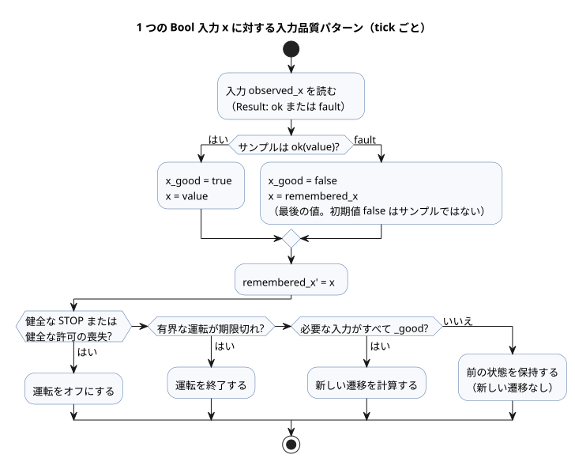
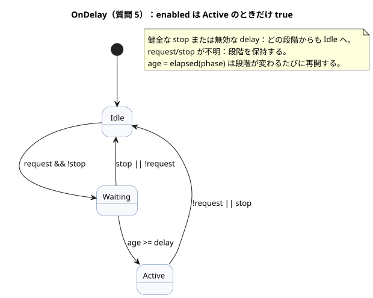
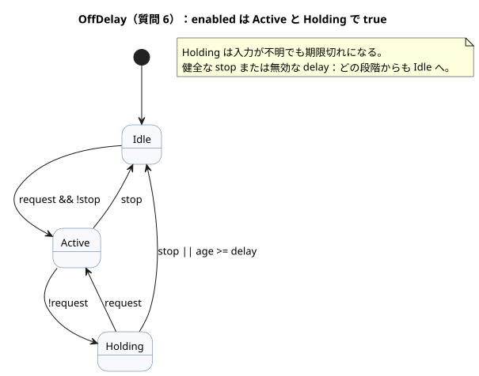
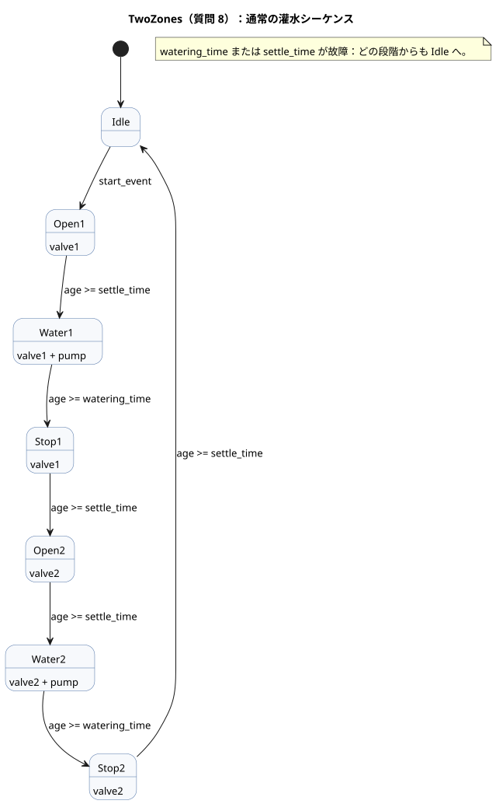
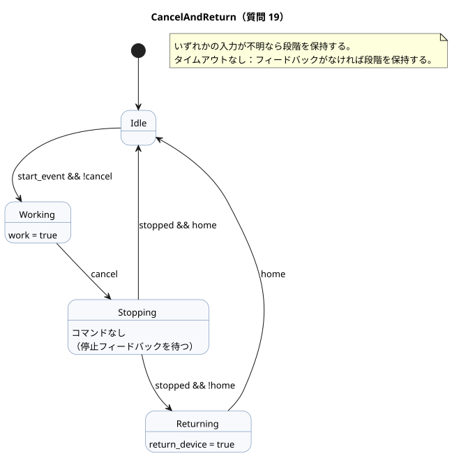
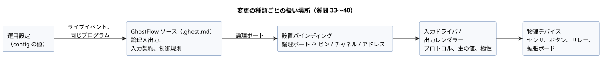

<!-- translation-source: docs/language_faq.en.md -->
[英語の原文](language_faq.en.md)

# GhostFlow コーディング FAQ

この FAQ が答えるのは「この動作はどうコーディングすればよいか」という種類の質問です。
各質問には、動作するコード、その動作の説明（境界的なケースを含む）、そしてそのように書く理由を示します。

- 言語の規則を定めるのはこの FAQ ではなく、[言語リファレンス](LANGUAGE-REFERENCE.ja.md)です。
- 要件のどの部分が言語・ランタイム・ドライバ・設置・UI のどれに属するかは、質問ごとに
  [リファレンス第 8 章](reference/08-language-runtime-and-device-boundaries.ja.md)にまとめています。

**この文書の内容**

- 質問 1〜16：基本パターン（ボタン、自己保持、タイマー、スケジュール、ヒステリシス、カウンタ、設定、アラーム、相互排他、関数）。
- 質問 17〜23：インターロック、キャンセル、カレンダーに基づくスケジュール、使用量に基づく制御。
- 質問 24〜31：オペレーターが編集できる設定、カレンダー、夏時間、潮汐、月相。
- 質問 32：停電後の動作。
- 質問 33〜40：制御コードを変えずにセンサ、リレー、GPIO ピン、拡張ボードを交換する方法。
- 質問 41：`ghostc` CLI による文書の検査とコンパイル。

**入力リビジョンについて。** 2026-10-05 の外部入力リビジョン以降、品質情報を伴う宣言はすべて `input` を使います。
既存の信号調整と明示的な `Result` の故障分岐は変わりません。以前の `sensor` の抜粋は `tests/fixtures/history/issue531/` に保存されています。

**改訂された例について。** 入力の生成元（producer）が不明な状態（故障）のとき、例ではソースの内部に 2 種類の記憶を明示的に保持します。最後に観測した値と、最後に表示した出力です。
この記憶の初期値は、生成元からの健全なサンプルでは*ありません*。
品質ガードにより、不明な要求が新しい遷移を生むことは決してありません。健全な STOP と許可の喪失は引き続き優先され、有界な運転期間も引き続き期限切れになります。
例は物理的な設備の故障を推論しません。また、自動コントローラが START を押すことも求めません。
このパターンの詳しい説明は[例の読み方](#例の読み方)を参照してください。

**レビュー状況。** 2026-10-01 に dev に対してレビューしました：[`a7333e56bc25c73fd6167b1182269b96cb671d05`](https://github.com/callin2/ghostflow-language/tree/a7333e56bc25c73fd6167b1182269b96cb671d05)。
一部の質問には状態タグが付いています。タグ付きの質問には、影響範囲を示す状態メモがあります。

| タグ | 意味 |
|---|---|
| `[未決定]` | 言語または契約の決定がまだ保留中です。 |
| `[一部未対応]` | 記載された範囲はこの dev では利用できません。 |
| `[変更あり]` | この dev では元の助言が置き換えられています。 |

タグのない質問も、物理デバイス、API、UI との統合に対してはまだ検証されていません。

## 質問一覧

1. [プログラムファイルはどう書くか](#q01)
2. [ボタンを押している間だけ出力をオンにするには](#q02)
3. [Start を離した後も運転を続け、Stop ボタンで止めるには](#q03)
4. [起動後 5 分間運転して自動で停止するには [変更あり]](#q04)
5. [要求が 2 秒続いたらオンにするには [変更あり]](#q05)
6. [要求がなくなってから 3 秒後にオフにするには [変更あり]](#q06)
7. [毎日午前 6 時と午後 6 時 45 分に灌水するには](#q07)
8. [区画 1、続いて区画 2 の順に灌水するには [変更あり]](#q08)
9. [境界で何度も切り替わらずに低水分でオンにするには](#q09)
10. [下限を下回ったらタンクに給水し、上限で止めるには](#q10)
11. [センサが 3 回検出したら完了信号を出すには](#q11)
12. [「5 分」を画面で編集できる項目にするには [変更あり]](#q12)
13. [故障が解消した後もアラームを保持し、Reset で解除するには](#q13)
14. [2 つの出力が同時にオンにならないようにするには](#q14)
15. [日の出の 30 分後に開始するには](#q15)
16. [同じ計算を複数の場所で再利用するには](#q16)
17. [インターロックを実装するには](#q17)
18. [自己保持はサポートされていますか](#q18)
19. [ユーザーが途中でキャンセルしたとき、特定の装置を動かせますか](#q19)
20. [日の出に合わせて運転をスケジュールするには](#q20)
21. [曜日ごとに運転をスケジュールできますか](#q21)
22. [累積稼働時間に基づいて装置を制御できますか [一部未対応]](#q22)
23. [自動・手動を問わず、1 日の運転回数に基づいて洗浄を実行できますか](#q23)
24. [ファームウェアを更新せずに運転時間だけを後から変更できますか [変更あり]](#q24)
25. [設定項目のラベルや UI コンポーネントを変更できますか](#q25)
26. [編集できる設定値の範囲を制限できますか](#q26)
27. [曜日ごとに異なる設定を使えますか [変更あり]](#q27)
28. [祝日だけ異なる制御ロジックを使えますか](#q28)
29. [制御で夏時間を考慮できますか](#q29)
30. [満潮・干潮に基づいて運転を制御できますか [一部未対応]](#q30)
31. [大潮・小潮や月相に基づいて運転を制御できますか [変更あり]](#q31)
32. [停電から電源が戻った後の動作をコードで書けますか](#q32)
33. [制御コードを変えずに温度センサを交換できますか [変更あり]](#q33)
34. [センサの設定は GhostFlow ソースとは別ですか。変更される周期も違いますか](#q34)
35. [プリンタのドライバだけを替えるように、制御プログラムを再コンパイルせずにセンサを交換できますか](#q35)
36. [デバイス交換と再コンパイルの分離は言語仕様にも含めるべきですか](#q36)
37. [ボタンを別の GPIO ピンにつなぎ替えたら、入力マッピングを変えるだけで済みますか](#q37)
38. [出力の GPIO マッピングだけを変えて別のリレーをつなげますか](#q38)
39. [Waveshare などの拡張ボードで出力数を増やせますか](#q39)
40. [RS485 I/O 拡張ボードの入出力もマッピングできますか](#q40)
41. [コンパイラ CLI で文書を検査またはコンパイルするには](#q41)

## 例の読み方

- **独立したプログラム。** 各 `control` の例は、それぞれが完結した独立のプログラムです。複数の例をそのまま 1 つの control に貼り付けないでください。
- **コードの置き場所。** コードは `.ghost.md` 文書のトップレベルの `ghost` ブロックに置きます。完全な文書の例は質問 1 にあります。
- **断片。** *断片*とは、既存の control の内部に置く宣言や式のことです。
- **設計表記。** *設計表記*とは、リファレンスでも設計表記として示されている表記です。現在のコンパイラは受け付けない場合があります。
- **入力の意味。** 各質問では、入力名が何を意味するかを述べています。変数名が物理的な接点の極性や通信方式を決めるわけではありません。
- **出力は意図です。** 出力は論理的な意図であり、確認ではありません。バルブが本当に開いたことを知るには、出力値を流用するのではなく、別のフィードバック入力を読んでください。
- **構文の根拠。** どの回答も最後に**構文の根拠**のリストがあり、使った表記ごとにリファレンスの章と節へリンクしています。
  共通の `control`、`input`、`output` 宣言は[リファレンス §1.4 文法の記法](reference/01-source-and-syntax.ja.md)に従います。

**繰り返し現れる入力品質パターン。** ほぼすべての例は、Bool 入力 `x` ごとに同じ 4 行で始まります。

- `input observed_x: Bool;` は入力を宣言します。読み取ると `Result` が得られます。健全なサンプルなら `ok(value)`、生成元の状態が不明なら `fault(reason)` です。
- `let x_good = ...` は、この tick のサンプルが健全な場合にだけ `true` です。
- `let x = ...` は健全な値です。故障時には `remembered_x` に記憶された最後の値になります。
- `remembered_x' = x;` はその記憶を更新します。初期値（`false`）はソース内の開始値であり、生成元からのサンプルではありません。

その後、遷移式はこれらの値を決まった順序で使います。

1. 健全な STOP、または健全な許可の喪失（たとえば `low_water_good && low_water`）が、最初に運転をオフにします。
2. 時間が切れた有界な運転は、一部の入力が故障していても終了します。
3. 新しい遷移は、それが依存するすべての入力が `_good` のときにだけ計算されます。
4. それ以外の場合は前の状態を保持します（`... else running`）。

一部の例では `displayed_<output>` 状態も保持します。これは入力が不明な間、同じ順序に従って最後の出力意図を保持します。
コード中のコメント `// Source-local display memory is initialized here; faults remain producer unknown.` がこのパターンの目印です。



この図は、1 つの入力サンプルが品質ガードをどう通るかを示します。健全なサンプルは値と記憶を更新し、故障は記憶した値を保持しつつ新しい遷移を止めます。

<a id="q01"></a>
## 1. プログラムファイルはどう書くか

`.ghost.md` 文書を書きます。この文書には説明とコードの両方が入ります。

````markdown
# 버튼으로 램프 켜기

버튼을 누르고 있는 동안 램프를 켠다.

```ghost
control ButtonLamp {
  state displayed_lamp: Bool = false;
  displayed_lamp' = if button_good && !button then false else if button_good then button else displayed_lamp;
  // Source-local display memory is initialized here; faults remain producer unknown.
  state remembered_button: Bool = false;
  let button_good = case observed_button { ok(_) => true; fault(_) => false; };
  let button = case observed_button { ok(value) => value; fault(_) => remembered_button; };
  remembered_button' = button;
  input observed_button: Bool;
  output lamp: Bool;

  lamp <- displayed_lamp';
}
```
````

人は Markdown の説明を読みます。`ghost` ブロックには制御規則が入ります。
1 つの文書の説明の段落の間に複数の `ghost` ブロックを置けます。それらは文書の順序で合わさり、1 つのプログラムになります。
コードをブロックに分けても、実行段階や待ち時間が生まれるわけではありません。

**なぜこう書くのか。** 動作と、それを選んだ理由が 1 つの文書の中に一緒に残ります。

**構文の根拠**

- `.ghost.md`、トップレベルの `ghost` ブロック：[リファレンス §1.1 — 実行可能ブロックの抽出](reference/01-source-and-syntax.ja.md)
- `control`、入出力宣言：[リファレンス §1.4 文法の記法](reference/01-source-and-syntax.ja.md)
- `<-` 出力接続：[リファレンス §2.8 tick と状態スナップショット](reference/02-types-expressions-state.ja.md)

<a id="q02"></a>
## 2. ボタンを押している間だけ出力をオンにするには

記憶は必要ないので、入力をそのまま出力につなぎます。
ここで `button = true` はボタンが押されていること、`stop = true` は停止が要求されていることを意味します。

```ghost
control HoldToRun {
  state displayed_pump: Bool = false;
  displayed_pump' = if button_good && !button then false else if stop_good && stop then false else if button_good && stop_good then button && !stop else displayed_pump;
  // Source-local display memory is initialized here; faults remain producer unknown.
  state remembered_button: Bool = false;
  let button_good = case observed_button { ok(_) => true; fault(_) => false; };
  let button = case observed_button { ok(value) => value; fault(_) => remembered_button; };
  remembered_button' = button;
  state remembered_stop: Bool = false;
  let stop_good = case observed_stop { ok(_) => true; fault(_) => false; };
  let stop = case observed_stop { ok(value) => value; fault(_) => remembered_stop; };
  remembered_stop' = stop;
  input observed_button: Bool;
  input observed_stop: Bool;
  output pump: Bool;

  pump <- displayed_pump';
}
```

ボタンを離すか停止が要求されると、同じ評価の中で出力意図がオフになります。
ボタンと stop が両方 true の場合は、`!stop` によって出力が false になります。

**なぜ状態がないのか。** 現在の入力だけで結果が決まります。以前に押されたことを記憶する必要はありません。

**構文の根拠**

- `Bool`、`true`/`false`：[リファレンス §2.1 値の種類](reference/02-types-expressions-state.ja.md)
- `&&`、`!`：[リファレンス §2.6 式と演算子](reference/02-types-expressions-state.ja.md)
- `<-`：[リファレンス §2.8 tick と状態スナップショット](reference/02-types-expressions-state.ja.md)

<a id="q03"></a>
## 3. Start を離した後も運転を続け、Stop ボタンで止めるには

ポンプが運転中かどうかを `state` に記憶します。この例では、Stop を離しても運転は自動的に再開しません。
再び起動するには、Start ボタンをいったん離してから、もう一度押す必要があります。

```ghost
control StartStop {
  // Source-local display memory is initialized here; faults remain producer unknown.
  state remembered_start: Bool = false;
  let start_good = case observed_start { ok(_) => true; fault(_) => false; };
  let start = case observed_start { ok(value) => value; fault(_) => remembered_start; };
  remembered_start' = start;
  state remembered_stop: Bool = false;
  let stop_good = case observed_stop { ok(_) => true; fault(_) => false; };
  let stop = case observed_stop { ok(value) => value; fault(_) => remembered_stop; };
  remembered_stop' = stop;
  input observed_start: Bool;
  input observed_stop: Bool;
  output pump: Bool;
  state armed: Bool = false;
  state running: Bool = false;

  let start_event = armed && start;

  armed' = if stop_good && stop then false else if start_good && stop_good then (!stop && !start) else armed;
  running' = if stop_good && stop then false else if start_good && stop_good then (!stop && (start_event || running)) else running;
  pump <- running';
}
```

- `running` は前の tick の運転状態です。起動後にボタンを離しても true のままです。
- `armed` は、停止が有効でない間に Start ボタンが離されたのを見たことを記憶します。
- 初期化の時点ですでに押されていたボタンでは運転は始まりません。新たな押下は、離されたのを見た後でだけ受け付けます。
- Stop は自己保持にも起動要求にも優先します。

**なぜ出力に `running'` を使うのか。** 現在の評価での停止を、同じ tick のうちにすぐ出力へ反映するためです。

**構文の根拠**

- `state`、前状態と `running'`：[リファレンス §2.8 tick と状態スナップショット](reference/02-types-expressions-state.ja.md)
- `let`：[リファレンス §2.7 純粋関数と計算の合成](reference/02-types-expressions-state.ja.md)
- `!`、`&&`、`||`：[リファレンス §2.6 式と演算子](reference/02-types-expressions-state.ja.md)

関連する例：[START/STOP](../examples/curriculum/pc-02-start-stop.ghost.md)。

<a id="q04"></a>
## 4. 起動後 5 分間運転して自動で停止するには [変更あり]

> **現在の dev の状況：** `duration` 設定は現在 `Result` を返します。下の `age < duration` の比較は、`case` で `ok`/`fault` を扱わない限りコンパイルできません。[現在の契約](reference/05-settings-and-observation.ja.md)。

運転状態と、その状態で過ごした時間を組み合わせます。
`stop` または `low_water` が true のときは運転を終了します。運転中は新しい起動要求を無視します。

```ghost
control FiveMinuteRun {
  // Source-local display memory is initialized here; faults remain producer unknown.
  state remembered_start: Bool = false;
  let start_good = case observed_start { ok(_) => true; fault(_) => false; };
  let start = case observed_start { ok(value) => value; fault(_) => remembered_start; };
  remembered_start' = start;
  state remembered_stop: Bool = false;
  let stop_good = case observed_stop { ok(_) => true; fault(_) => false; };
  let stop = case observed_stop { ok(value) => value; fault(_) => remembered_stop; };
  remembered_stop' = stop;
  state remembered_low_water: Bool = false;
  let low_water_good = case observed_low_water { ok(_) => true; fault(_) => false; };
  let low_water = case observed_low_water { ok(value) => value; fault(_) => remembered_low_water; };
  remembered_low_water' = low_water;
  input observed_start: Bool;
  input observed_stop: Bool;
  input observed_low_water: Bool;
  output pump, valve: Bool;
  config duration: Duration = 5min;
  state armed: Bool = false;
  state running: Bool = false;
  timer age = elapsed(running);

  let permit = !stop && !low_water;
  let start_event = armed && start;

  armed' = if low_water_good && low_water then false else if stop_good && stop then false else if start_good && stop_good && low_water_good then (permit && !start) else armed;
  running' = if low_water_good && low_water then false else if stop_good && stop then false else if running && !(case duration { ok(value) => age < value; fault(_) => false; }) then false else if start_good && stop_good && low_water_good then (if !permit then false
    else if running then (case duration { ok(value) => age < value; fault(_) => false; })
    else start_event) else running;

  valve <- running';
  pump <- running';
  require pump => valve;
}
```

`running` が true になると、`age` はゼロから数え始めます。運転は `age >= duration` となる最初の tick で終了します。
ボタンを押し続けても、次の 5 分間が自動的に始まることはありません。
時間切れの後に再起動するには、ボタンをもう一度押します。停止や低水位の後は、まず許可が回復し、ボタンが離されたのを見る必要があります。

**なぜ `sleep(5min)` ではないのか。** 待っている間も、停止と低水位を毎 tick 確認し続ける必要があるからです。

**構文の根拠**

- `config duration: Duration`、`5min`：[リファレンス §5.1 config 宣言](reference/05-settings-and-observation.ja.md)、[§3.1 — Duration](reference/03-time-and-schedules.ja.md)
- `timer age = elapsed(running)`：[リファレンス §3.2 状態変化後の経過時間](reference/03-time-and-schedules.ja.md)
- `if ... then ... else`：[リファレンス §2.6 — 条件式](reference/02-types-expressions-state.ja.md)
- `require pump => valve`：[リファレンス §4.7 出力意図と制約](reference/04-sensors-constraints-control.ja.md)

<a id="q05"></a>
## 5. 要求が 2 秒続いたらオンにするには [変更あり]

> **現在の dev の状況：** `delay` 設定は現在 `Result` を返します。下の `age >= delay` の比較の前に、`case` で `ok`/`fault` を扱ってください。[現在の契約](reference/05-settings-and-observation.ja.md)。

「要求を受け取った」状況と「出力が実際にオンである」状況を分けて扱います。

```ghost
control OnDelay {
  // Source-local display memory is initialized here; faults remain producer unknown.
  state remembered_request: Bool = false;
  let request_good = case observed_request { ok(_) => true; fault(_) => false; };
  let request = case observed_request { ok(value) => value; fault(_) => remembered_request; };
  remembered_request' = request;
  state remembered_stop: Bool = false;
  let stop_good = case observed_stop { ok(_) => true; fault(_) => false; };
  let stop = case observed_stop { ok(value) => value; fault(_) => remembered_stop; };
  remembered_stop' = stop;
  input observed_request: Bool;
  input observed_stop: Bool;
  output enabled: Bool;
  config delay: Duration = 2s;
  type Phase = Idle | Waiting | Active;
  state phase: Phase = Idle;
  timer age = elapsed(phase);

  phase' = if !(case delay { ok(_) => true; fault(_) => false; }) then Idle else if stop_good && stop then Idle else if request_good && stop_good then (case phase {
    Idle => if request && !stop then Waiting else Idle;
    Waiting => if stop || !request then Idle
      else if (case delay { ok(value) => age >= value; fault(_) => false; }) then Active else Waiting;
    Active => if request && !stop then Active else Idle;
  }) else phase;

  enabled <- phase' == Active;
}
```

待機中に要求がなくなると、待機は取り消されます。新しい要求が来ると、2 秒を最初から数え直します。
各遷移は、その条件を観測した tick で起こります。長い tick が 1 回あっても、複数の段階を一度に飛び越えることはありません。



この図は `OnDelay` の 3 つの段階を示します。`enabled` は `Active` のときだけ true です。

**なぜ段階が必要なのか。** 「要求なし」「2 秒待機中」「オン」を明示的に区別するためです。

**構文の根拠**

- `type Phase`、`case`：[リファレンス §2.4 列挙型と網羅的な分岐](reference/02-types-expressions-state.ja.md)
- `state phase`、`phase'`：[リファレンス §2.8 tick と状態スナップショット](reference/02-types-expressions-state.ja.md)
- `elapsed(phase)`、`2s`：[リファレンス §3.2 状態変化後の経過時間](reference/03-time-and-schedules.ja.md)、[§3.1 — Duration](reference/03-time-and-schedules.ja.md)

関連する例：[独立したタイマーパターン](../examples/curriculum/pc-06-timer-patterns.ghost.md)。

<a id="q06"></a>
## 6. 要求がなくなってから 3 秒後にオフにするには [変更あり]

> **現在の dev の状況：** `delay` 設定は現在 `Result` を返します。下の `age >= delay` の比較の前に、`case` で `ok`/`fault` を扱ってください。[現在の契約](reference/05-settings-and-observation.ja.md)。

要求が解除されたときに始まる*保持*段階を追加します。保持中に要求が戻ってきたら、オンのままにします。

```ghost
control OffDelay {
  // Source-local display memory is initialized here; faults remain producer unknown.
  state remembered_request: Bool = false;
  let request_good = case observed_request { ok(_) => true; fault(_) => false; };
  let request = case observed_request { ok(value) => value; fault(_) => remembered_request; };
  remembered_request' = request;
  state remembered_stop: Bool = false;
  let stop_good = case observed_stop { ok(_) => true; fault(_) => false; };
  let stop = case observed_stop { ok(value) => value; fault(_) => remembered_stop; };
  remembered_stop' = stop;
  input observed_request: Bool;
  input observed_stop: Bool;
  output enabled: Bool;
  config delay: Duration = 3s;
  type Phase = Idle | Active | Holding;
  state phase: Phase = Idle;
  timer age = elapsed(phase);

  phase' = if phase == Holding && (case delay { ok(value) => age >= value; fault(_) => true; }) then Idle else if !(case delay { ok(_) => true; fault(_) => false; }) then Idle else if stop_good && stop then Idle else if request_good && stop_good then (case phase {
    Idle => if request && !stop then Active else Idle;
    Active => if stop then Idle
      else if !request then Holding else Active;
    Holding => if stop then Idle
      else if request then Active
      else if (case delay { ok(value) => age >= value; fault(_) => false; }) then Idle else Holding;
  }) else phase;

  enabled <- phase' in {Active, Holding};
}
```

3 秒は `Holding` に入った時点から数えます。停止は遅延を待たずに、すぐに出力をオフにします。
`elapsed(phase)` は現在の段階で過ごした時間です。複数の ON 区間にわたる合計ではありません。



この図は `OffDelay` の段階を示します。`enabled` は `Active` と `Holding` で true です。

**なぜオンディレイのタイマーを共用しないのか。** 条件ごとに、記憶しておく開始時刻が別に必要だからです。

**構文の根拠**

- `type`、`case`、`in {Active, Holding}`：[リファレンス §2.4 列挙型と網羅的な分岐](reference/02-types-expressions-state.ja.md)
- `elapsed(phase)`：[リファレンス §3.2 状態変化後の経過時間](reference/03-time-and-schedules.ja.md)
- 段階の経過時間と累積の区別：[リファレンス §3.4 累積時間とローリング予算](reference/03-time-and-schedules.ja.md)

<a id="q07"></a>
## 7. 毎日午前 6 時と午後 6 時 45 分に灌水するには

スケジュールの `.due` を起動条件に使います。運転する長さにはタイマーを使います。

```ghost
control DailyWatering {
  // Source-local display memory is initialized here; faults remain producer unknown.
  state remembered_stop: Bool = false;
  let stop_good = case observed_stop { ok(_) => true; fault(_) => false; };
  let stop = case observed_stop { ok(value) => value; fault(_) => remembered_stop; };
  remembered_stop' = stop;
  input observed_stop: Bool;
  output pump: Bool;
  schedule starts: DailySlots<15min> {
    timezone = "Asia/Seoul";
    selected = [06:00, 18:45];
    dst_missing = skip;
    dst_repeated = first;
    basis = pulse;
    when = true;
    clock = trusted_only;
    gap = skip_after(60s);
    recovery = baseline;
    fallback = skip;
  }
  let duration = 5min;
  state running: Bool = false;
  timer age = elapsed(running);

  running' = if stop_good && stop then false else if running && !(age < duration) then false else if stop_good then (!stop && (if running then age < duration else starts.due)) else running;
  pump <- running';
}
```

`DailySlots<15min>` は「15 分ごとに運転する」という意味ではありません。開始時刻を 15 分刻みのグリッドから選び、`selected` の時刻だけが発生するという意味です。
この例では、すでに運転中に到来した予定の起動をキューに入れません。また、停止中に過ぎてしまった開始時刻を後から実行することもありません。

**なぜスケジュールとタイマーを分けるのか。** 暦の時刻は*いつ*始めるかを決め、単調な経過時間は*どれだけ*運転するかを決めます。

**構文の根拠**

- `schedule`、`DailySlots<15min>`、`timezone`、`selected`、`.due`：[リファレンス §3.6 選定された DailySlots](reference/03-time-and-schedules.ja.md)
- スケジュールの発生と運転の区別：[リファレンス §3.5 Schedule の共通意味論](reference/03-time-and-schedules.ja.md)
- `elapsed(running)`：[リファレンス §3.2 状態変化後の経過時間](reference/03-time-and-schedules.ja.md)

<a id="q08"></a>
## 8. 区画 1、続いて区画 2 の順に灌水するには [変更あり]

> **現在の dev の状況：** `watering_time` と `settle_time` の設定は現在 `Result` を返します。下の時間比較の前に、`case` で `ok`/`fault` を扱ってください。[現在の契約](reference/05-settings-and-observation.ja.md)。

シーケンスを列挙型として書き、各出力を、その出力が許される段階に接続します。
この例は通常の運転シーケンスを示します。各区画は次の 3 つのステップを経ます。
バルブを開くよう要求して 2 秒待ち、5 分間給水し、ポンプの停止を要求して落ち着くまで 2 秒待ちます。

```ghost
control TwoZones {
  // Source-local display memory is initialized here; faults remain producer unknown.
  state remembered_start: Bool = false;
  let start_good = case observed_start { ok(_) => true; fault(_) => false; };
  let start = case observed_start { ok(value) => value; fault(_) => remembered_start; };
  remembered_start' = start;
  input observed_start: Bool;
  output pump, valve1, valve2: Bool;
  type Phase = Idle | Open1 | Water1 | Stop1 | Open2 | Water2 | Stop2;
  state phase: Phase = Idle;
  state armed: Bool = false;
  timer age = elapsed(phase);
  config watering_time: Duration = 5min;
  config settle_time: Duration = 2s;

  let start_event = armed && start;
  armed' = if start_good then (phase == Idle && !start) else armed;

  phase' = if !(case watering_time { ok(_) => true; fault(_) => false; } && case settle_time { ok(_) => true; fault(_) => false; }) then Idle else if phase != Idle || start_good then (case phase {
    Idle => if start_event then Open1 else Idle;
    Open1 => if (case settle_time { ok(value) => age >= value; fault(_) => false; }) then Water1 else Open1;
    Water1 => if (case watering_time { ok(value) => age >= value; fault(_) => false; }) then Stop1 else Water1;
    Stop1 => if (case settle_time { ok(value) => age >= value; fault(_) => false; }) then Open2 else Stop1;
    Open2 => if (case settle_time { ok(value) => age >= value; fault(_) => false; }) then Water2 else Open2;
    Water2 => if (case watering_time { ok(value) => age >= value; fault(_) => false; }) then Stop2 else Water2;
    Stop2 => if (case settle_time { ok(value) => age >= value; fault(_) => false; }) then Idle else Stop2;
  }) else phase;

  valve1 <- phase' in {Open1, Water1, Stop1};
  valve2 <- phase' in {Open2, Water2, Stop2};
  pump <- phase' in {Water1, Water2};
  require pump => (valve1 || valve2);
  require !(valve1 && valve2);
}
```



この図は 7 つの段階を順に示し、各段階でどの出力がオンになるかを示します。

運転中に届いた要求はキューに入れません。シーケンスが完了したら、ボタンを離してもう一度押すと再起動します。
このコードの 2 秒の待機は、バルブが実際に開いたことを確認するものではありません。
開閉のフィードバックや、シーケンスを中断する手段が必要な場合は、
[フィードバックを使った順序制御の例](../examples/curriculum/pc-09-sequential-water-supply.ghost.md)に従ってください。

**なぜループを書かないのか。** どの段階でも、プログラムは新しい入力を評価し続けながら、今どこにいるかを記憶していなければならないからです。

**構文の根拠**

- `type Phase`、`case`、`in { ... }`：[リファレンス §2.4 列挙型と網羅的な分岐](reference/02-types-expressions-state.ja.md)
- `phase'` と同時の状態遷移：[リファレンス §2.8 tick と状態スナップショット](reference/02-types-expressions-state.ja.md)
- `elapsed(phase)`：[リファレンス §3.2 状態変化後の経過時間](reference/03-time-and-schedules.ja.md)
- `require`、`=>`、出力の相互排他：[リファレンス §4.7 出力意図と制約](reference/04-sensors-constraints-control.ja.md)

<a id="q09"></a>
## 9. 境界で何度も切り替わらずに低水分でオンにするには

オンにするしきい値とオフにするしきい値を別にします（ヒステリシス）。センサの故障も明示的に扱います。

```ghost
control MoistureControl {
  state displayed_pump: Bool = false;
  displayed_pump' = if stop_good && stop then false else if stop_good then requested && !stop else displayed_pump;
  // Source-local display memory is initialized here; faults remain producer unknown.
  state remembered_stop: Bool = false;
  let stop_good = case observed_stop { ok(_) => true; fault(_) => false; };
  let stop = case observed_stop { ok(value) => value; fault(_) => remembered_stop; };
  remembered_stop' = stop;
  input observed_stop: Bool;
  input moisture: Percent {
    sample = 1s;
    valid = 0% .. 100%;
    filter = median(5);
    stale_after = 3s;
    recover_after = 3 samples;
  }
  signal dry = hysteresis(moisture,
    on_below: 30%, off_above: 35%, initial: false);
  output pump: Bool;

  let requested = case dry {
    ok(value) => value;
    fault(_) => false;
  };
  pump <- displayed_pump';
}
```

- 健全な水分値が 30% を下回るとポンプがオンになります。35% を上回るとオフになります。どちらの境界上でも、その間のどこでも、前の判断を保持します。
- フィルタの準備がまだできていない場合や、復旧条件を満たしていない場合、値は故障の経路をたどり、ポンプもオフになります。
- サンプリング間隔と範囲は、このプログラムのために選んだ値です。すべてのセンサの既定値ではありません。
- 健全な測定値が戻ると、新たな水分の評価に基づいて運転が自動的に再開します。代わりに手動での再起動が必要なら、そのための状態を別に追加してください。

**なぜ単に `moisture < 30%` と書かないのか。** それだけでは信号の品質も、境界での振動も扱えないからです。

**構文の根拠**

- `input`、`sample`、`valid`、`filter`、`stale_after`、`recover_after`：[リファレンス §4.2 サンプル契約とセンサ処理順序](reference/04-sensors-constraints-control.ja.md)
- `median`、`signal`、`hysteresis`、名前付き引数：[リファレンス §4.3 フィルタと信号演算](reference/04-sensors-constraints-control.ja.md)
- `case`、`ok(value)`、`fault(_)`：[リファレンス §4.1 sensor と Result の品質](reference/04-sensors-constraints-control.ja.md)

<a id="q10"></a>
## 10. 下限を下回ったらタンクに給水し、上限で止めるには

給水中かどうかを記憶します。`low_level_reached` は水が下限の水位センサに達したこと、
`high_level_reached` は上限の水位センサに達したことを意味します。

```ghost
control TankLevel {
  // Source-local display memory is initialized here; faults remain producer unknown.
  state remembered_low_level_reached: Bool = false;
  let low_level_reached_good = case observed_low_level_reached { ok(_) => true; fault(_) => false; };
  let low_level_reached = case observed_low_level_reached { ok(value) => value; fault(_) => remembered_low_level_reached; };
  remembered_low_level_reached' = low_level_reached;
  state remembered_high_level_reached: Bool = false;
  let high_level_reached_good = case observed_high_level_reached { ok(_) => true; fault(_) => false; };
  let high_level_reached = case observed_high_level_reached { ok(value) => value; fault(_) => remembered_high_level_reached; };
  remembered_high_level_reached' = high_level_reached;
  input observed_low_level_reached: Bool;
  input observed_high_level_reached: Bool;
  output fill_pump: Bool;
  type Phase = Idle | Filling | SensorConflict;
  state phase: Phase = Idle;
  let conflict = high_level_reached && !low_level_reached;

  phase' = if low_level_reached_good && high_level_reached_good then (case phase {
    Idle => if conflict then SensorConflict
      else if !low_level_reached then Filling else Idle;
    Filling => if conflict then SensorConflict
      else if high_level_reached then Idle else Filling;
    SensorConflict => if conflict then SensorConflict else Idle;
  }) else phase;

  fill_pump <- phase' == Filling;
}
```

- 水位が再び下限を超えても、給水はすぐには止まりません。いったん給水を始めたら、上限まで続けます。
- 下限の入力が false なのに上限の入力だけが true の場合、センサどうしが矛盾しています。ポンプはオフになります（`SensorConflict`）。矛盾が解消すると、プログラムは一度 `Idle` を経てから再び評価します。

**なぜ 1 つの入力を反転するだけではだめなのか。** 起動と停止で別のしきい値を使うので、前の運転状態が必要だからです。

**構文の根拠**

- `type Phase`、`case`：[リファレンス §2.4 列挙型と網羅的な分岐](reference/02-types-expressions-state.ja.md)
- `state`、`phase'`、`<-`：[リファレンス §2.8 tick と状態スナップショット](reference/02-types-expressions-state.ja.md)
- `if`、`!`、`&&`：[リファレンス §2.6 式と演算子](reference/02-types-expressions-state.ja.md)

元の例：[タンクのヒステリシス](../examples/curriculum/pc-07-tank-hysteresis.ghost.md)。

<a id="q11"></a>
## 11. センサが 3 回検出したら完了信号を出すには

入力が true である tick ではなく、入力が false から true に変わる*イベント*（立ち上がりエッジ）を数えます。
この例では、リファレンスの厳密な整数型 `Int` を使います。

```ghost
control CountThree {
  // Source-local display memory is initialized here; faults remain producer unknown.
  state remembered_detected: Bool = false;
  let detected_good = case observed_detected { ok(_) => true; fault(_) => false; };
  let detected = case observed_detected { ok(value) => value; fault(_) => remembered_detected; };
  remembered_detected' = detected;
  state remembered_reset: Bool = false;
  let reset_good = case observed_reset { ok(_) => true; fault(_) => false; };
  let reset = case observed_reset { ok(value) => value; fault(_) => remembered_reset; };
  remembered_reset' = reset;
  input observed_detected: Bool;
  input observed_reset: Bool;
  output done: Bool;
  state previous: Bool = false;
  state count: Int = 0;
  let rising = detected && !previous;

  previous' = if detected_good && reset_good then (detected) else previous;
  count' = if reset_good && reset then 0 else if detected_good && reset_good then (if reset then 0
    else if rising && count < 3 then count + 1
    else count) else count;
  done <- count' >= 3;
}
```

- true のまま続く検出信号は 1 回しか数えません。カウンタは 3 で止まります。
- リセットと検出が同じ tick に来た場合は、リセットが優先します。
- 起動時にすでに true である入力は、最初の検出として数えます。
- カウンタを画面に表示する場合は、何を数えているかを意図リンクで明示してください。名前に頼らないでください。

**なぜ `Number` ではなく `Int` なのか。** 回数は決して近似値であってはならず、黙って丸められてもなりません。

**構文の根拠**

- `Int`、整数の演算と比較：[リファレンス §2.3 厳密な整数の設計](reference/02-types-expressions-state.ja.md)
- `previous`、`count`、`count'` での状態の記憶：[リファレンス §2.8 tick と状態スナップショット](reference/02-types-expressions-state.ja.md)
- カウンタの公開上の意味：[リファレンス §5.3 — ディスクリプタとスナップショット](reference/05-settings-and-observation.ja.md)

<a id="q12"></a>
## 12. 「5 分」を画面で編集できる項目にするには [変更あり]

> **現在の dev の状況：** 設定の宣言とライブ更新はサポートされています。下の `age < duration` という助言は、設定を単純なスカラーとして読んでいた以前のモデルに従っています。現在の設定の `Result` は `case` で扱ってください。[現在の契約](reference/05-settings-and-observation.ja.md)。

運用設定を、型、範囲、増分、権限、表示名とともに宣言します。
この**断片**は、[例 4](#q04) の `duration` 宣言の代わりに使います。

```ghost
config duration: Duration = 5min {
  min = 1min;
  max = 20min;
  step = 1min;
  access = operator;
  label = "관수 시간";
}
```

制御式は引き続き `age < duration` を使います。
画面は設定の説明を受け取り、1 分刻みで 1〜20 分を受け付ける時間項目を作ります。
テキスト欄、選択リスト、スライダーのどれを表示するかは画面が決めます。

運用設定の変更は*アトミックなライブイベント*です。同じプログラム、同じ実行の中で有効値を変更します。

- 複数の値を一度に変更する場合は、すべてを検証してからまとめて適用します。1 つでも無効なら、どれも変更しません。
- 動作中のタイマーをゼロに戻しません。
- 例：運転がすでに 6 分続いていて、上限が 10 分から 5 分に下げられたとします。新しい値を使う最初の評価で `age < duration` は false となり、運転は終了します。

**なぜ `5min` リテラルを見つけて画面に表示するだけではだめなのか。** すべての定数がオペレーターによる調整を意図しているわけではないからです。

**構文の根拠**

- `config`、`min`、`max`、`step`、`access`、`label`：[リファレンス §5.1 config 宣言](reference/05-settings-and-observation.ja.md)
- 既定値と有効値：[リファレンス §5.1 — 既定値と有効値](reference/05-settings-and-observation.ja.md)
- 実行中のアトミックな変更：[リファレンス §5.2 — アトミックなライブイベント](reference/05-settings-and-observation.ja.md)

<a id="q13"></a>
## 13. 故障が解消した後もアラームを保持し、Reset で解除するには

故障入力の現在の値と、故障を記憶する状態とを分けておきます。
この例はアラームの記憶だけを扱います。`fault_active = true` は原因がまだ存在することを意味します。

```ghost
control AlarmMemory {
  // Source-local display memory is initialized here; faults remain producer unknown.
  state remembered_fault_active: Bool = false;
  let fault_active_good = case observed_fault_active { ok(_) => true; fault(_) => false; };
  let fault_active = case observed_fault_active { ok(value) => value; fault(_) => remembered_fault_active; };
  remembered_fault_active' = fault_active;
  state remembered_reset: Bool = false;
  let reset_good = case observed_reset { ok(_) => true; fault(_) => false; };
  let reset = case observed_reset { ok(value) => value; fault(_) => remembered_reset; };
  remembered_reset' = reset;
  input observed_fault_active: Bool;
  input observed_reset: Bool;
  output alarm: Bool;
  state latched: Bool = false;
  state reset_armed: Bool = false;
  let reset_event = reset_armed && reset;

  reset_armed' = if fault_active_good && reset_good then (!fault_active && !reset) else reset_armed;
  latched' = if fault_active_good && reset_good then (fault_active || (latched && !reset_event)) else latched;
  alarm <- latched';
}
```

- `latched` は故障の原因が消えた後も true のままです。原因がなくなり、*かつ* Reset がいったん離されてから再び押されたときにだけ解除されます。
- `fault_active` と `reset` が両方 true の場合は、`fault_active` が優先します。
- Reset は設備を再起動するコマンドではありません。

**なぜ `alarm <- fault_active` とは違うのか。** 現在の原因と、過去の故障の記憶は別の情報だからです。
設備の後処理、位置フィードバック、複数の故障原因については、
[故障とリセットの例](../examples/curriculum/pc-10-fault-alarm-reset.ghost.md)を参照してください。

**構文の根拠**

- `state latched`、`reset_armed`、次状態 `'`：[リファレンス §2.8 tick と状態スナップショット](reference/02-types-expressions-state.ja.md)
- `let`、純粋なイベント条件：[リファレンス §2.7 純粋関数と計算の合成](reference/02-types-expressions-state.ja.md)
- `fault_active || (latched && !reset_event)`：[リファレンス §2.6 式と演算子](reference/02-types-expressions-state.ja.md)

<a id="q14"></a>
## 14. 2 つの出力が同時にオンにならないようにするには

各要求をそれぞれ単独で書き、そのうえで相互排他の制約を追加します。

```ghost
control ExclusiveDirections {
  state displayed_forward: Bool = false;
  displayed_forward' = if forward_request_good && !forward_request then false else if forward_request_good then forward_request else displayed_forward;
  state displayed_reverse: Bool = false;
  displayed_reverse' = if reverse_request_good && !reverse_request then false else if reverse_request_good then reverse_request else displayed_reverse;
  // Source-local display memory is initialized here; faults remain producer unknown.
  state remembered_forward_request: Bool = false;
  let forward_request_good = case observed_forward_request { ok(_) => true; fault(_) => false; };
  let forward_request = case observed_forward_request { ok(value) => value; fault(_) => remembered_forward_request; };
  remembered_forward_request' = forward_request;
  state remembered_reverse_request: Bool = false;
  let reverse_request_good = case observed_reverse_request { ok(_) => true; fault(_) => false; };
  let reverse_request = case observed_reverse_request { ok(value) => value; fault(_) => remembered_reverse_request; };
  remembered_reverse_request' = reverse_request;
  input observed_forward_request: Bool;
  input observed_reverse_request: Bool;
  output forward, reverse: Bool;

  forward <- displayed_forward';
  reverse <- displayed_reverse';
  require !(forward && reverse);
}
```

両方の要求が true のとき、制約の適用後は両方の出力が false になります。出力を書く順序で勝者が決まるわけではありません。
この制約だけでは、方向が変わるときに遅延は加わりません。遅延が必要な場合は、
[方向切替の状態とタイマーの例](../examples/curriculum/pc-04-direction-interlock.ghost.md)を参照してください。

**なぜ一方の式の中で他方の出力を黙って止めないのか。** 各要求と競合の規則を、それぞれ単独で読んで説明できるようにするためです。

**構文の根拠**

- `require !(forward && reverse)` と相互排他：[リファレンス §4.7 出力意図と制約](reference/04-sensors-constraints-control.ja.md)
- 制約の構文の骨格：[リファレンス §1.4 文法の記法](reference/01-source-and-syntax.ja.md)

<a id="q15"></a>
## 15. 日の出の 30 分後に開始するには

`Solar` スケジュールを宣言し、その `.due` を起動条件に使います。
この**断片**は、[例 7](#q07) の `starts` 宣言を置き換えます。

```ghost
schedule starts: Solar {
  timezone = "Asia/Seoul";
  latitude = 37.5665;
  longitude = 126.9780;
  at = sun`rise + 30min`;
  fallback = skip;
  basis = pulse;
  when = true;
  clock = trusted_only;
  gap = skip_after(60s);
  recovery = baseline;
}
```

- 例の座標は実際の現場の座標に置き換えてください。`starts.due` の後にどれだけ運転するかは、既存の `duration` とタイマーが決めます。
- 日の出を求められない場合、この例は新しい運転をスキップします。その理由を通常の「まだ開始時刻ではない」に見せかけることはしません。
- `fallback = skip` は、すでに始まった運転を取り消す規則を追加するものではありません。

**なぜ位置、タイムゾーン、フォールバックを指定するのか。** 自然現象はシステムが設置された場所に依存し、その情報が不明なときにどうするかも明示しなければならないからです。

**構文の根拠**

- `schedule ...: Solar`、位置／タイムゾーン、``sun`rise + 30min` ``：[リファレンス §3.9 — 選定された Solar 表記](reference/03-time-and-schedules.ja.md)
- `fallback = skip`：[リファレンス §3.9 — 自然現象の参照に対するフォールバックと recovery](reference/03-time-and-schedules.ja.md)
- `.due` の意味：[リファレンス §3.5 Schedule の共通意味論](reference/03-time-and-schedules.ja.md)

<a id="q16"></a>
## 16. 同じ計算を複数の場所で再利用するには

純粋関数を切り出し、必要な値を引数として渡します。

```ghost
fn permitted(request: Bool, stop: Bool, enabled: Bool) -> Bool {
  request && !stop && enabled
}

control TwoRequests {
  state displayed_zone1: Bool = false;
  displayed_zone1' = if enabled_good && !enabled then false else if request1_good && !request1 then false else if stop_good && !stop then false else if enabled_good && request1_good && stop_good then permitted(request1, stop, enabled) else displayed_zone1;
  state displayed_zone2: Bool = false;
  displayed_zone2' = if enabled_good && !enabled then false else if request2_good && !request2 then false else if stop_good && !stop then false else if enabled_good && request2_good && stop_good then permitted(request2, stop, enabled) else displayed_zone2;
  // Source-local display memory is initialized here; faults remain producer unknown.
  state remembered_request1: Bool = false;
  let request1_good = case observed_request1 { ok(_) => true; fault(_) => false; };
  let request1 = case observed_request1 { ok(value) => value; fault(_) => remembered_request1; };
  remembered_request1' = request1;
  state remembered_request2: Bool = false;
  let request2_good = case observed_request2 { ok(_) => true; fault(_) => false; };
  let request2 = case observed_request2 { ok(value) => value; fault(_) => remembered_request2; };
  remembered_request2' = request2;
  state remembered_stop: Bool = false;
  let stop_good = case observed_stop { ok(_) => true; fault(_) => false; };
  let stop = case observed_stop { ok(value) => value; fault(_) => remembered_stop; };
  remembered_stop' = stop;
  state remembered_enabled: Bool = false;
  let enabled_good = case observed_enabled { ok(_) => true; fault(_) => false; };
  let enabled = case observed_enabled { ok(value) => value; fault(_) => remembered_enabled; };
  remembered_enabled' = enabled;
  input observed_request1: Bool;
  input observed_request2: Bool;
  input observed_stop: Bool;
  input observed_enabled: Bool;
  output zone1, zone2: Bool;

  zone1 <- displayed_zone1';
  zone2 <- displayed_zone2';
}
```

関数は呼び出しの間で何も記憶しません。純粋な計算の再利用は、タイマーや自己保持の記憶を持つ*振る舞い*を複製することとは違います。
そうした振る舞いについては、独立した状態、ポート、設定、接続は[振る舞いの合成](reference/06-composition-and-replay.ja.md)に従います。

**なぜ関数に外部の状態を黙って読ませないのか。** 同じ引数は常に同じ結果を返さなければならず、呼び出しのすべての依存関係が呼び出し箇所で見えなければならないからです。

**構文の根拠**

- `fn`、パラメータ、`-> Bool`、関数呼び出し：[リファレンス §2.7 純粋関数と計算の合成](reference/02-types-expressions-state.ja.md)
- 関数宣言の構文の骨格：[リファレンス §1.4 文法の記法](reference/01-source-and-syntax.ja.md)
- 記憶を持つ振る舞いの独立性：[リファレンス §6.2 定義、インスタンス、論理ポート](reference/06-composition-and-replay.ja.md)

<a id="q17"></a>
## 17. インターロックを実装するには

*インターロック*は、条件を満たしていない動作や、互いに競合する動作を止める仕組みです。
次の 2 つの道具を使います。

- 運転を許可する条件を、状態遷移の式の中に置きます。
- 出力どうしに必要な関係を `require` で表します。

### 条件を満たしたときだけ運転する

ここでは「バルブが開いたことを確認でき、かつ低水位でないときだけポンプを運転する」を書きます。
`valve_open` はバルブが実際に開いたことを確認する入力です。`low_water` は低水位を検出し、
`stop` は停止要求です。`valve_open` の代わりに、バルブを開く*出力*の値を使ってはいけません。

```ghost
control PumpInterlock {
  // Source-local display memory is initialized here; faults remain producer unknown.
  state remembered_start: Bool = false;
  let start_good = case observed_start { ok(_) => true; fault(_) => false; };
  let start = case observed_start { ok(value) => value; fault(_) => remembered_start; };
  remembered_start' = start;
  state remembered_stop: Bool = false;
  let stop_good = case observed_stop { ok(_) => true; fault(_) => false; };
  let stop = case observed_stop { ok(value) => value; fault(_) => remembered_stop; };
  remembered_stop' = stop;
  state remembered_valve_open: Bool = false;
  let valve_open_good = case observed_valve_open { ok(_) => true; fault(_) => false; };
  let valve_open = case observed_valve_open { ok(value) => value; fault(_) => remembered_valve_open; };
  remembered_valve_open' = valve_open;
  state remembered_low_water: Bool = false;
  let low_water_good = case observed_low_water { ok(_) => true; fault(_) => false; };
  let low_water = case observed_low_water { ok(value) => value; fault(_) => remembered_low_water; };
  remembered_low_water' = low_water;
  input observed_start: Bool;
  input observed_stop: Bool;
  input observed_valve_open: Bool;
  input observed_low_water: Bool;
  output pump: Bool;
  state armed: Bool = false;
  state running: Bool = false;

  let permit = !stop && valve_open && !low_water;
  let start_event = armed && start;

  armed' = if low_water_good && low_water then false else if valve_open_good && !valve_open then false else if stop_good && stop then false else if start_good && stop_good && valve_open_good && low_water_good then (permit && !start) else armed;
  running' = if low_water_good && low_water then false else if valve_open_good && !valve_open then false else if stop_good && stop then false else if start_good && stop_good && valve_open_good && low_water_good then (permit && (running || start_event)) else running;
  pump <- running';
}
```

`permit` は運転中も含めて毎 tick 評価されます。バルブが開いたことの確認がなくなるか、低水位や停止が発生すると、
`running'` とポンプの意図が両方オフになります。条件が戻っても、運転は自動的には再開しません。
許可が戻った後に、Start をいったん離してから再び押してください。
これは、この例のために選んだ再起動のポリシーです。

### 2 つの出力の同時運転を防ぐ

正転と逆転のように、2 つの出力が同時にオンになることを禁止するには、出力制約を追加します。

```ghost
control DirectionInterlock {
  state displayed_forward: Bool = false;
  displayed_forward' = if forward_request_good && !forward_request then false else if forward_request_good then forward_request else displayed_forward;
  state displayed_reverse: Bool = false;
  displayed_reverse' = if reverse_request_good && !reverse_request then false else if reverse_request_good then reverse_request else displayed_reverse;
  // Source-local display memory is initialized here; faults remain producer unknown.
  state remembered_forward_request: Bool = false;
  let forward_request_good = case observed_forward_request { ok(_) => true; fault(_) => false; };
  let forward_request = case observed_forward_request { ok(value) => value; fault(_) => remembered_forward_request; };
  remembered_forward_request' = forward_request;
  state remembered_reverse_request: Bool = false;
  let reverse_request_good = case observed_reverse_request { ok(_) => true; fault(_) => false; };
  let reverse_request = case observed_reverse_request { ok(value) => value; fault(_) => remembered_reverse_request; };
  remembered_reverse_request' = reverse_request;
  input observed_forward_request: Bool;
  input observed_reverse_request: Bool;
  output forward, reverse: Bool;

  forward <- displayed_forward';
  reverse <- displayed_reverse';
  require !(forward && reverse);
}
```

- 両方の要求が true の場合、制約を受ける両方の出力が false になります。先に書いた出力が勝つわけではありません。
- 同じ相互排他は `mutex(forward, reverse);` でも表せます。
- 方向を変える前に待つには、別の状態とタイマーを使います。

`require pump => valve;` は「ポンプの出力意図には、バルブの出力意図が必要である」という意味です。
最初の例のように、バルブが実際に開いたことは別の入力で確認してください。
出力制約は状態を自動的にリセットすることもありません。条件が解消した後に新たな起動を求める必要がある場合は、
最初の例のように、状態遷移と再起動の条件を明示的に書いてください。
このソフトウェアのロジックは非常停止の代わりにはなりません。

### ローカル制約と共有リソース制約のグループ化

**ローカルグループ。** control の Bool 出力の制約を、
`constraints LocalRules { require pump => valve; }` のような名前付きのローカルグループにまとめられます。`mutex` もグループの中に置けます。

- 名前は読み手が説明を見つけやすくするためのものにすぎません。範囲をほかの control や物理設備全体に広げるものではありません。
- 必須の条件はすべて AND で結合されます。優先度でそれらを迂回することはできません。
- 任意の `check` 分析は別物です。これはブロックしない助言です。

**共有リソース。** 複数の要求経路が同じ論理リソースを使う場合は、
`constraints SharedRules for station` で共有規則を宣言します。[完全な実行例](../examples/bound-resource-execution.ghost.md)
は、自動・手動・フォールバックの要求を同じ Rust ガードで確認します。手順は次のとおりです。

1. `compileSourceSync` が検査済みのディスクリプタを生成します。このディスクリプタは実行可能ではありません。
2. 正確なソース／成果物の同一性、安定したリソース ID、モード／入力と出力のマッピングを、
   `compileBoundResourceControl` に明示的に渡します。
3. リファレンスホストの実際の Rust/WASM スキャン経路で実行します。

この例は、完全なバインディングと記録された入力を提供します。

**違反と復旧。**

- 起動前の違反は、新しい受け入れ（admission）を拒否します。
- 現在の保持者（incumbent）と競合する新しい要求（claim）では、保持者の受け入れと以前の安全な出力が維持されます。新しい要求が再試行キューに隠されることはありません。
- 実行中の違反に対して、この例で作成者が定めた応答は
  `pump1 = false; valve1 = true;` です。安全とは、普遍的な「すべて OFF」の規則ではありません。
- トリップの後、影響を受けた各排他グループでは、すべての要求が中立である観測と、その後の新たな要求が必要です。
- require だけのグループでは、まず要求値が作成者の定めた安全値と等しいことを観測し、その後に新たな要求を確認します。
- 接続されたグループは、同じスキャンでまとめて復旧しなければなりません。

**実行可能なサブセットの範囲。** すべての出力が明示的に保護された、1 つの Bool GFB1 v1/v3 control が対象です。
1 つの設置の書き込み側（writer）は、同じ安定 ID に対する追加の
アクティブな書き込み側を拒否するレジストリを共有します。Context/PID、共有ポリシーの import による
合成、複数の VM にまたがる協調的な調停は、このサブセットの範囲外です。
結果は論理的な requested/safe の意図です。レンダラーがそれを適用したこと、バルブが
開いたこと、現場の設置が正しいことの証拠ではありません。規則と段階については、[リファレンス §4.8](reference/04-sensors-constraints-control.ja.md)
と[制約の契約](CONSTRAINTS.ja.md)を参照してください。

**なぜこの 2 つのやり方を分けるのか。** 運転状態が*どのように*変わるかと、*どの*出力の組み合わせが許されるかは、
別々の制御規則であり、それぞれを明示的に書かなければならないからです。

**構文の根拠**

- `let permit`、名前付きの純粋な計算：[リファレンス §2.7 純粋関数と計算の合成](reference/02-types-expressions-state.ja.md)
- `state`、`running'`、`<-`：[リファレンス §2.8 tick と状態スナップショット](reference/02-types-expressions-state.ja.md)
- `!`、`&&`、`||`：[リファレンス §2.6 式と演算子](reference/02-types-expressions-state.ja.md)
- `require`、`mutex`、`=>`、requested/safe の出力の区別：[リファレンス §4.7 出力意図と制約](reference/04-sensors-constraints-control.ja.md)
- `require` と `mutex` の宣言形式：[リファレンス §1.4 文法の記法](reference/01-source-and-syntax.ja.md)

<a id="q18"></a>
## 18. 自己保持はサポートされていますか

はい。前の運転状態を `state` に記憶し、その値を次状態の式で再び使います。
次は、Start を離した後もオンのままになる基本的な自己保持です。

```ghost
control SelfHolding {
  // Source-local display memory is initialized here; faults remain producer unknown.
  state remembered_start: Bool = false;
  let start_good = case observed_start { ok(_) => true; fault(_) => false; };
  let start = case observed_start { ok(value) => value; fault(_) => remembered_start; };
  remembered_start' = start;
  state remembered_stop: Bool = false;
  let stop_good = case observed_stop { ok(_) => true; fault(_) => false; };
  let stop = case observed_stop { ok(value) => value; fault(_) => remembered_stop; };
  remembered_stop' = stop;
  input observed_start: Bool;
  input observed_stop: Bool;
  output pump: Bool;
  state running: Bool = false;

  running' = if stop_good && stop then false else if start_good && stop_good then (!stop && (start || running)) else running;
  pump <- running';
}
```

- `start` が true のとき、`running'` は true になります。
- 次の tick では `start` が false かもしれませんが、前の `running` が true なので運転は続きます。
- `stop` が true のとき、`running'` は false です。Start と Stop が同時に来ても Stop が優先します。
- `pump` は現在の評価の `running'` に従います。

この基本的な式では、Stop を離したときに `start` がまだ true だと、運転が再びオンになります。
「Start をいったん離してから再び押す」ことが必要なら、
[質問 3 の再起動許可の状態](#q03)も使ってください。

**なぜ式に前の状態を含めるのか。** 自己保持の記憶を `running` に明示しておくことで、
起動・保持・解除の条件を 1 つの式で読めるようになるからです。

**構文の根拠**

- `state running: Bool = false`、前状態 `running`、次状態 `running'`：[リファレンス §2.8 tick と状態スナップショット](reference/02-types-expressions-state.ja.md)
- `!stop && (start || running)`：[リファレンス §2.6 式と演算子](reference/02-types-expressions-state.ja.md)
- `pump <- running'`：[リファレンス §1.4 出力接続の構文](reference/01-source-and-syntax.ja.md)、[§2.8 出力での次状態の読み取り](reference/02-types-expressions-state.ja.md)

<a id="q19"></a>
## 19. ユーザーが途中でキャンセルしたとき、特定の装置を動かせますか

はい。キャンセル入力が来たら後続の段階に移り、その段階の出力を接続します。
この例は 4 つのステップを経ます。元の作業の停止を要求 → 停止を確認 → 戻し装置を運転 → 原点位置を確認。
`stopped` と `home` は、実際の停止と原点位置を確認する入力です。

```ghost
control CancelAndReturn {
  // Source-local display memory is initialized here; faults remain producer unknown.
  state remembered_start: Bool = false;
  let start_good = case observed_start { ok(_) => true; fault(_) => false; };
  let start = case observed_start { ok(value) => value; fault(_) => remembered_start; };
  remembered_start' = start;
  state remembered_cancel: Bool = false;
  let cancel_good = case observed_cancel { ok(_) => true; fault(_) => false; };
  let cancel = case observed_cancel { ok(value) => value; fault(_) => remembered_cancel; };
  remembered_cancel' = cancel;
  state remembered_stopped: Bool = false;
  let stopped_good = case observed_stopped { ok(_) => true; fault(_) => false; };
  let stopped = case observed_stopped { ok(value) => value; fault(_) => remembered_stopped; };
  remembered_stopped' = stopped;
  state remembered_home: Bool = false;
  let home_good = case observed_home { ok(_) => true; fault(_) => false; };
  let home = case observed_home { ok(value) => value; fault(_) => remembered_home; };
  remembered_home' = home;
  input observed_start: Bool;
  input observed_cancel: Bool;
  input observed_stopped: Bool;
  input observed_home: Bool;
  output work, return_device: Bool;
  type Phase = Idle | Working | Stopping | Returning;
  state phase: Phase = Idle;
  state armed: Bool = false;

  let start_event = armed && start;
  armed' = if start_good && cancel_good && stopped_good && home_good then (phase == Idle && !start && !cancel) else armed;
  phase' = if start_good && cancel_good && stopped_good && home_good then (case phase {
    Idle => if !cancel && start_event then Working else Idle;
    Working => if cancel then Stopping else Working;
    Stopping => if !stopped then Stopping else if home then Idle else Returning;
    Returning => if home then Idle else Returning;
  }) else phase;
  work <- phase' == Working;
  return_device <- phase' == Returning;
  require !(work && return_device);
}
```

- `Stopping` は、元の作業が停止したというフィードバックを待ちます。この時点ではまだ戻しのコマンドを送りません。
- 戻し装置にコマンドを出すのは `Returning` のときだけです。戻し動作は、キャンセルが解除されても、原点位置が確認されるまで続きます。
- 停止や原点位置の確認がなければ、プログラムはその段階にとどまります。この例にはタイムアウトのポリシーがありません。
- キャンセルの後に自動で再起動することはありません。待機状態で Start と Cancel を離してから、新たな起動要求を出してください。
- この例は通常の作業のキャンセルです。非常停止中に追加の動作を許す規則としては使わないでください。



この図は 4 つの段階と、ある段階から次の段階へプログラムを進めるフィードバックを示します。

**なぜ停止を確認してから戻すのか。** 元の作業と戻しのコマンドが決して同時に装置を動かさないようにし、
キャンセル中に論理状態と物理状態を混同しないようにするためです。

**構文の根拠**

- 段階遷移と状態スナップショットの意味：[リファレンス §2.8 tick と状態スナップショット](reference/02-types-expressions-state.ja.md)
- requested・applied・confirmed を区別するデバイスのフィードバック：[リファレンス §4.7 requested、safe、applied、confirmed](reference/04-sensors-constraints-control.ja.md)
- `type Phase`、`case`：[リファレンス §2.4 列挙型と網羅的な分岐](reference/02-types-expressions-state.ja.md)
- `let`、`if`、Bool の演算と比較：[リファレンス §2.6 式と演算子](reference/02-types-expressions-state.ja.md)

<a id="q20"></a>
## 20. 日の出に合わせて運転をスケジュールするには

`Solar` スケジュールの `.due` を起動条件に使います。この断片は、日の出の瞬間そのものを対象にします。

```ghost
schedule starts: Solar {
  timezone = "Asia/Seoul";
  latitude = 37.5665;
  longitude = 126.9780;
  at = sun`rise`;
  fallback = skip;
  basis = pulse;
  when = true;
  clock = trusted_only;
  gap = skip_after(60s);
  recovery = baseline;
}
```

座標とタイムゾーンは実際の現場のものに置き換えてください。`starts.due` が true のとき、新しい発生を受け入れます。
どれだけ運転するかは、既存の `duration` と制御状態が決めます。日の出を計算できない場合、
新しい運転はスキップされます。`fallback = skip` は、すでに受け入れた運転を取り消しません。

**なぜ `.due` を使うのか。** 自然現象の発生を運転状態の遷移から切り離しておけるので、
スケジュールの評価とデバイス制御の境界が保たれるからです。

**構文の根拠**

- `schedule ...: Solar`、``sun`rise` ``、位置／タイムゾーンと `fallback`：[リファレンス §3.9 選定された Solar 表記](reference/03-time-and-schedules.ja.md)
- `.due` と発生の受け入れ：[リファレンス §3.5 Schedule の共通意味論](reference/03-time-and-schedules.ja.md)
- `fallback = skip` と recovery：[リファレンス §3.9 自然現象の参照に対するフォールバックと recovery](reference/03-time-and-schedules.ja.md)

<a id="q21"></a>
## 21. 曜日ごとに運転をスケジュールできますか

``day`mon..fri` `` などの曜日範囲で、宣言した時間帯の `Daily` パルスを絞り込めます。`workday` と `offday` は設置カレンダーで定義します。[現在の契約](reference/03-time-and-schedules.ja.md)。

曜日の条件はスケジュールの `on` フィールドで表します。たとえば月曜から金曜の午前 6 時に開始するには、
時刻の条件と下の曜日の条件を組み合わせます。
現在のコンパイラでコンパイルして実行できるスケジュールには、設置カレンダーと組み合わせた ``day`workday` `` または ``day`offday` `` を使ってください。

```ghost
on = day`mon..fri`;
```

曜日フィルタは、計算された予定開始時刻のローカル日付に適用されます。祝日や現場の稼働日は曜日とは別の規則に従うので、
``day`mon..fri` `` を祝日カレンダーとして読まないでください。
夏時間（DST）や深夜 0 時の境界のポリシーも、スケジュールの契約に従います。

**なぜ曜日と時刻を分けておくのか。** 同じ開始時刻を、平日、祝日、現場の稼働日など、異なる日付条件と組み合わせられなければならないからです。

**構文の根拠**

- `on` と、曜日・祝日・稼働日の区別：[リファレンス §3.8 DST、深夜 0 時、稼働カレンダー](reference/03-time-and-schedules.ja.md)
- `DailySlots` と `.due` の選定されたスケジュール意味論：[リファレンス §3.6 選定された DailySlots](reference/03-time-and-schedules.ja.md)
- タイムゾーンとローカル日付の境界：[リファレンス §3.1 時間値とクロック領域](reference/03-time-and-schedules.ja.md)


<a id="q22"></a>
## 22. 累積稼働時間に基づいて装置を制御できますか [一部未対応]

> **現在の dev の状況：** 外部で確認済みの累積 `Duration` を利用する例はサポートされています。実行可能な `on_time` アカウントは、現在、永続的な *applied* 証拠だけをサポートしています。requested・safe・confirmed の各段階に対するネイティブなアカウント実行はサポートされていません。[現在の契約](../tools/control.mjs#L1521)。

累積稼働時間を `Duration` 値として受け取り、条件に使います。
まず、**どの期間にわたって累積するのか、そして何を運転として数えるのか**を決めます。

| 望む基準 | 累積の範囲 |
|---|---|
| この作業で合計 10 分運転 | 作業開始以降の ON 区間の合計 |
| 直近 1 時間で 20 分運転 | 連続的に移動する 1 時間のウィンドウ |
| 今日合計 1 時間運転 | 指定したタイムゾーンでの今日の日付 |
| 保守以降に合計 100 時間運転 | 明示的な保守リセット以降 |

この control の例は累積値を*利用する*側です。`used` は、選んだ範囲にわたって同じ装置の確認済み ON 区間を合計した入力です。
`usage_valid` はその合計が有効かどうかを示します。
累積値を生成する宣言はコードに含まれていません。

```ghost
control UsageLimit {
  state displayed_device: Bool = false;
  displayed_device' = if request_good && !request then false else if usage_valid_good && !usage_valid then false else if request_good && usage_valid_good && used_good then request && usage_valid && within_limit else displayed_device;
  // Source-local display memory is initialized here; faults remain producer unknown.
  state remembered_request: Bool = false;
  let request_good = case observed_request { ok(_) => true; fault(_) => false; };
  let request = case observed_request { ok(value) => value; fault(_) => remembered_request; };
  remembered_request' = request;
  state remembered_usage_valid: Bool = false;
  let usage_valid_good = case observed_usage_valid { ok(_) => true; fault(_) => false; };
  let usage_valid = case observed_usage_valid { ok(value) => value; fault(_) => remembered_usage_valid; };
  remembered_usage_valid' = usage_valid;
  state remembered_used: Duration = 0ms;
  let used_good = case observed_used { ok(_) => true; fault(_) => false; };
  let used = case observed_used { ok(value) => value; fault(_) => remembered_used; };
  remembered_used' = used;
  input observed_request: Bool;
  input observed_usage_valid: Bool;
  input observed_used: Duration;
  output device: Bool;
  config max_use: Duration = 1h;

  let within_limit = case max_use {
    ok(value) => used < value;
    fault(_) => false;
  };
  device <- displayed_device';
}
```

合計が上限に達すると、それ以上の運転要求は出されません。装置が物理的に止まるまでの遅れも含めた厳密な使用量の上限には、
リファレンス §3.10 の予約と精算の規則も必要です。
`elapsed(running)` は最後の状態変化からの時間を測ります。繰り返される ON/OFF 区間を足し合わせるものではありません。

自動運転と手動運転の両方を含めるには、指令元ごとにタイマーを持つのではなく、設備の共通の運転記録を 1 つ集計します。
数える対象を、出力要求、制約を通過した出力、適用されたコマンド、実際のフィードバックのどれにするかを決めてください。
フィードバックがない場合は、コマンドが適用された時間を「実際の稼働時間」と呼ばないでください。

累積記録は `account` で宣言し、たとえば直近 60 秒を `used(account, rolling(60s))` で照会します。
`on_time` 宣言は、対象、証拠の基準（requested、safe、applied、confirmed）、永続化を指定します。
この表記が、作業ごとや保守後のリセット・保持のポリシーを含意するとは考えないでください。

**なぜ別の累積の意味論が必要なのか。** 連続稼働時間だけを確認していると、短い運転を何度も繰り返す使い方を見逃すからです。

**構文の根拠**

- `Duration`、`1h`：[リファレンス §3.1 時間値とクロック領域 — Duration](reference/03-time-and-schedules.ja.md)
- `&&`、`<`：[リファレンス §2.6 式と演算子](reference/02-types-expressions-state.ja.md)
- `elapsed` と累積の違い：[リファレンス §3.2 状態変化後の経過時間](reference/03-time-and-schedules.ja.md)
- 累積の対象／範囲と `account`、`on_time`、`used`：[リファレンス §3.4 累積時間とローリング予算](reference/03-time-and-schedules.ja.md)
- 自動／手動を合わせた集計と 1 日の上限：[リファレンス §3.10 時間に基づく使用制約](reference/03-time-and-schedules.ja.md)
- `config max_use`：[リファレンス §5.1 config 宣言](reference/05-settings-and-observation.ja.md)

<a id="q23"></a>
## 23. 自動・手動を問わず、1 日の運転回数に基づいて洗浄を実行できますか

回数の条件と洗浄シーケンスを組み合わせます。
自動と手動の起動コマンドを別々に数えないでください。代わりに、**同じ装置の運転を 1 か所で数えます**。
装置が運転を続けたまま自動から手動に切り替わっても、新しい運転としては数えません。

たとえば次のポリシーを選びます。「今日（ソウル時間）通常運転の起動が 10 回に達したら、現在の運転が終わったときに 1 回洗浄する。」
ここでは、運転確認信号の OFF→ON の遷移 1 回を運転 1 回と数えます。
完了した運転だけを数えるべき場合は、起動ではなく完了イベントを数えます。

この**断片**は 1 日の回数を読み取ります。`Int` はリファレンスの厳密な整数型です。
`today_starts` は今日の自動・手動を合わせた通常運転の回数で、`count_valid` はその回数が有効かどうかを示します。

```ghost
input today_starts: Int;
input count_valid: Bool;
let wash_due = case count_valid {
  ok(valid) => if valid then case today_starts {
    ok(count) => count >= 10; fault(_) => false;
  } else false;
  fault(_) => false;
};
```

`today_starts` は組み込みの名前ではなく、この断片は 1 日のカウンタそのものは宣言しません。
1 日の回数は §3.10 の `account` と `count_events` で宣言します。入力イベントの ID、
証拠の基準、日付の境界を指定します。同じイベントの再送は 1 回だけ数えます。
`on_time` は時間を合計し、`count_events` はイベントを数えます。一方を他方の代わりに使わないでください。

上の例の洗浄シーケンスは次のように動作します。これは動作の説明であり、実行可能な構文ではありません。

```text
今日の通常運転が 10 回に達する → 洗浄が必要であることを記憶する
現在の通常運転が終了したことを確認する → 洗浄段階を開始する
洗浄の完了を確認する → 要求を解除し、その日付の洗浄が完了したことを記憶する
```

- 同じ装置を*洗浄のために*オンにすることは、この例では通常運転として数えません。
- 洗浄中は新しい通常運転を開始しません。同じ条件が自動と手動の要求に適用されます。
- 洗浄要求は状態に記憶します。1 tick だけのパルスは、装置がふさがっている間に失われることがあります。
- このポリシーでは、日付が変わっても、すでに記憶された洗浄要求や進行中の洗浄は取り消されません。
- 「1 日 1 回洗浄する」と「10 回運転するごとに洗浄する」は別のポリシーです。この例は 1 日 1 回洗浄します。

実際の 1 日の回数の契約では、タイムゾーン、日付の境界、再起動後の復元、時計の補正、回数が不明なときの扱いを定義しなければなりません。
単純な `state count = 0` の宣言では、日付ごとの永続的な回数は作られません。
洗浄段階と出力は、[質問 8 の順序制御](#q08)のように列挙型の状態で書いてください。

**なぜ運転モードと無関係に数えるのか。** 洗浄が必要かどうかは、誰が指令したかではなく、装置がどれだけ使われたかで決まるからです。

**構文の根拠**

- `Int` と厳密な回数：[リファレンス §2.3 厳密な整数の設計](reference/02-types-expressions-state.ja.md)
- `let`、`&&`、`>=`：[リファレンス §2.6 式と演算子](reference/02-types-expressions-state.ja.md)
- 洗浄段階の列挙型と `case`：[リファレンス §2.4 列挙型と網羅的な分岐](reference/02-types-expressions-state.ja.md)
- 前の入力、回数、洗浄要求の記憶：[リファレンス §2.8 tick と状態スナップショット](reference/02-types-expressions-state.ja.md)
- コマンドと物理的な運転の区別：[リファレンス §4.7 requested、safe、applied、confirmed](reference/04-sensors-constraints-control.ja.md)
- 設備の 1 日の集計に関する原則（回数の構文ではなく時間の集計規則）：[リファレンス §3.10 時間に基づく使用制約](reference/03-time-and-schedules.ja.md)

<a id="q24"></a>
## 24. ファームウェアを更新せずに運転時間だけを後から変更できますか [変更あり]

> **現在の dev の状況：** ライブ更新と `TimeSlots` の接続はサポートされています。下の `age < duration` という助言は、設定を単純なスカラーとして読んでいた以前のモデルに従っています。現在の設定の `Result` は `case` で扱ってください。[現在の契約](reference/05-settings-and-observation.ja.md)。

はい。**どれだけ運転するか**を、オペレーターが編集できる `Duration` 設定として宣言します。
この**断片**は、[質問 4 の時間付き運転](#q04)の `duration` 宣言を置き換えます。

```ghost
config duration: Duration = 5min {
  min = 1min;
  max = 20min;
  step = 1min;
  access = operator;
  label = "작동 시간";
}
```

画面で 5 分を 10 分に変更すると、設定の有効値が変わります。
ソースの編集、プログラムの再コンパイル、ファームウェアの更新、再起動は必要ありません。
宣言は型と範囲を定め、画面はその説明を使って項目を作ります。
通常の運用設定で受け入れられた値は、装置を再起動しても保持されます。

変更は同じ実行の中で適用され、経過時間はリセットされません。
`age < duration` の場合：

- 3 分経過した後に 5 分を 10 分に増やすと、運転は以後、合計 10 分と比較されます。
- 6 分経過した後に上限を 5 分に減らすと、新しい値を使う最初の評価で運転が終了します。

「現在の作業はそのままにして、次の作業から新しい時間を使う」には、明示的な制御規則が必要です。
作業の開始時に、設定を別の状態にコピーします。これは `config` の既定の変更動作ではありません。

**いつ開始するか**は、どれだけ運転するかとは別の設定です。
`DailySlots` の固定の `selected` リストの代わりに、`TimeSlots` の config を接続します。
次の設定宣言の断片は、15 分刻みのグリッド上で最大 8 つの時刻を受け付けます。

```ghost
config watering_slots: TimeSlots<15min, 8> = [time`06:00`, time`18:45`] {
  access = operator;
  label = "관수 시작 시각";
}
```

同じ control の `DailySlots<15min>` の中に `selected = watering_slots;` と書きます。
時刻の変更もライブイベントであり、再コンパイルは必要ありません。新しく追加した時刻がすでに過去であれば実行されず、
スロットを削除しても、それだけですでに始まった運転が取り消されることはありません。

**なぜ調整できる値をあらかじめ示しておくのか。** オペレーターが変更してよいものと、プログラムの規則の変更にあたるものとの間に、言語が明確な線を引くためです。

**構文の根拠**

- `config`、`Duration`、`min`、`max`、`step`、`access`、`label`：[リファレンス §5.1 config 宣言](reference/05-settings-and-observation.ja.md)
- ソースの既定値と運用上の有効値：[リファレンス §5.1 既定値と有効値](reference/05-settings-and-observation.ja.md)
- 再コンパイルや再起動なしの変更：[リファレンス §5.2 アトミックなライブイベント](reference/05-settings-and-observation.ja.md)
- 再起動後の通常設定の保持：[リファレンス §5.2 ライフサイクルと一時設定](reference/05-settings-and-observation.ja.md)
- `elapsed` と既存の経過時間：[リファレンス §3.2 状態変化後の経過時間](reference/03-time-and-schedules.ja.md)
- `selected` の予定時刻：[リファレンス §3.6 選定された DailySlots](reference/03-time-and-schedules.ja.md)

<a id="q25"></a>
## 25. 設定項目のラベルや UI コンポーネントを変更できますか

ラベルは言語の `label` フィールドで設定します。UI コンポーネントは、画面を作る cabinet-view が選びます。
この**断片**は、[質問 24](#q24) の設定を「洗浄時間」として表示します。

```ghost
config duration: Duration = 5min {
  min = 1min;
  max = 20min;
  step = 1min;
  access = operator;
  label = "세척 시간";
}
```

この宣言を使う画面は、たとえば次のように適切な入力方法を選べます。

| 画面の入力方法 | 守らなければならない設定の意味 |
|---|---|
| 時間入力欄 | Duration 値を読み取り、1〜20 分の範囲と 1 分刻みを確認する |
| 選択リスト | 1〜20 分の許可された値だけを提示する |
| スライダー | 同じ範囲と刻みを適用する |

どのコンポーネントを使っても、値の型、範囲、刻み、変更権限は同じです。
`label` は人が読むための名前です。設定 ID や権限を変えるものではありません。

GhostFlow には、特定のコンポーネントを選ぶ `widget = slider` のような構文はありません。
その選択は cabinet-view に属します。「画面が選べる」というのも、
言語がオペレーター自身にコンポーネントの種類を切り替えるメニューを提供するという意味ではありません。

**なぜ画面の見た目を言語の外で決めるのか。** 同じ「洗浄時間」の設定を、スマートフォンや装置の画面に合った方法で編集できるようにしつつ、
制御の意味と検証規則を同一に保つためです。

**構文の根拠**

- `config`、`label`、`min`、`max`、`step`、`access`：[リファレンス §5.1 config 宣言](reference/05-settings-and-observation.ja.md)
- UI の見た目と言語の意味の分離：[リファレンス §5.3 Cabinet-view に依存しない観測モデル](reference/05-settings-and-observation.ja.md)
- 設定 ID、型、権限を伝える説明：[リファレンス §5.3 ディスクリプタとスナップショット](reference/05-settings-and-observation.ja.md)

<a id="q26"></a>
## 26. 編集できる設定値の範囲を制限できますか

はい。`min` と `max` は両端を含む許容範囲を定め、`step` は増分を定めます。
この**断片**は、1〜20 分の運転時間を 1 分刻みでだけ許可します。

```ghost
config duration: Duration = 5min {
  min = 1min;
  max = 20min;
  step = 1min;
  access = operator;
  label = "작동 시간";
}
```

| 入力値 | 結果 |
|---|---|
| 1 分、5 分、20 分 | 受け入れ |
| 30 秒または 21 分 | 拒否：範囲外 |
| 1 分 30 秒 | 拒否：範囲内だが 1 分刻みのグリッド上にない |

`step` は `min` から始まるグリッドを定めます。たとえば最小値が 1 分で刻みが 2 分なら、
1 分、3 分、5 分…が許可されます。既定値も範囲内かつグリッド上になければなりません。
単位や型が異なる値も拒否されます。値が自動的に丸められたり、境界に切り詰められたりすることは決してありません。

検証規則は、スライダーが示す範囲に限らず、どこにでも適用されます。ほかの入力欄や設定要求も
同じ規則に従います。複数の設定を変更するときに 1 つでも無効な値があれば、どれも適用されません。
オペレーターによる変更を完全に禁止するには、`access = designer` を宣言します。

**なぜ範囲を言語に置くのか。** どの画面やどの要求経路からも、作成者が承認した値だけが制御に入るようにするためです。

**構文の根拠**

- `min`、`max`、`step`、既定値の検証と `access`：[リファレンス §5.1 config 宣言](reference/05-settings-and-observation.ja.md)
- 複数の設定をまとめて受け入れる／拒否する：[リファレンス §5.2 アトミックなライブイベント](reference/05-settings-and-observation.ja.md)

<a id="q27"></a>
## 27. 曜日ごとに異なる設定を使えますか [変更あり]

> **現在の dev の状況：** 条件式で選ばれた継続時間も `Result` です。運転時間を比較する前に、`case` で `ok`/`fault` を扱ってください。[現在の契約](reference/05-settings-and-observation.ja.md)。

はい。日の種類ごとの値をそれぞれ独立した `config` として宣言し、条件式でその 1 つを選びます。
たとえば平日は 5 分、週末は 10 分運転します。
各設定には、それぞれ独自のラベルと編集可能な範囲を持たせられます。

これは**設定選択の断片**です。`is_weekday` は、現場のタイムゾーンで月曜から金曜のときに true になる入力です。
`calendar_valid` はその日付の判定が有効かどうかを示します。
どちらの入力も組み込み変数ではありません。これらを生成する側が、現場の日付とその有効性を提供します。
スケジュールそのものを曜日で制限するには、リファレンス §3.8 の `on = day` フィルタを使います。

```ghost
input is_weekday, calendar_valid: Bool;
config weekday_duration: Duration = 5min {
  min = 1min;
  max = 20min;
  step = 1min;
  access = operator;
  label = "평일 작동 시간";
}
config weekend_duration: Duration = 10min {
  min = 1min;
  max = 20min;
  step = 1min;
  access = operator;
  label = "주말 작동 시간";
}
let duration = case is_weekday {
  ok(weekday) => case (if weekday then weekday_duration else weekend_duration) {
    ok(value) => present(value); fault(_) => absent;
  };
  fault(_) => absent;
};
let can_start = case calendar_valid { ok(valid) => valid; fault(_) => false; };
```

`can_start` を起動条件の一部として確認し、`duration` を運転時間の比較に使います。
日付が不明な場合に、週末の設定にフォールバックして新しい運転を始めてはいけません。
この断片は単独では装置を動かしません。起動、停止、出力は運転規則を通して接続してください。

月曜から日曜まで日ごとに別の値を使うには、同じやり方で 7 つの設定を定義し、
列挙型の曜日入力と網羅的な `case` 分岐で 1 つを選びます。
祝日や現場の稼働日は、曜日とは別の条件です。

上の `duration` の式を運転中に継続して読むと、曜日や設定が変わったときに評価は新しい値を使います。
現在の運転を、開始した日に選ばれた時間で終えるには、開始時に選んだ値を状態にコピーします。
曜日ごとの設定は、深夜 0 時をまたぐ作業をどう扱うかを決めません。そのポリシーは別に書かなければなりません。

**なぜ設定と選択条件を分けるのか。** オペレーターは日ごとの時間だけを変更でき、どの日にどの値を適用するかは、作成者が書いた制御規則が引き続き決めるからです。

**構文の根拠**

- 曜日ごとの `config`、ラベル、範囲、権限：[リファレンス §5.1 config 宣言](reference/05-settings-and-observation.ja.md)
- `let` と `if ... then ... else`：[リファレンス §2.6 式と演算子](reference/02-types-expressions-state.ja.md)
- 7 つの曜日の列挙型と `case`：[リファレンス §2.4 列挙型と網羅的な分岐](reference/02-types-expressions-state.ja.md)
- 開始時の値の記憶：[リファレンス §2.8 tick と状態スナップショット](reference/02-types-expressions-state.ja.md)
- 曜日、祝日、稼働日、日付の境界：[リファレンス §3.8 DST、深夜 0 時、稼働カレンダー](reference/03-time-and-schedules.ja.md)
- 実行中の設定変更：[リファレンス §5.2 アトミックなライブイベント](reference/05-settings-and-observation.ja.md)

<a id="q28"></a>
## 28. 祝日だけ異なる制御ロジックを使えますか

はい。祝日の条件を使って、異なる制御式のどちらかを選びます。
時刻や設定値だけでなく、運転条件やシーケンスも変えられます。

この例は、通常の日は人がいるか温度が高いときに換気し、
祝日は温度が高いときだけ換気します。
`is_holiday` は、現場のタイムゾーンと選んだ祝日カレンダーから判定される入力です。
`calendar_valid` は、その日付の祝日判定が有効かどうかを示します。
どちらの名前も組み込み変数ではなく、このコード自身が祝日を調べるわけではありません。

```ghost
control HolidayVentilation {
  state displayed_fan: Bool = false;
  displayed_fan' = if calendar_valid_good && !calendar_valid then false else if stop_good && stop then false else if calendar_valid_good && hot_good && is_holiday_good && occupied_good && stop_good then calendar_valid && !stop && request else displayed_fan;
  // Source-local display memory is initialized here; faults remain producer unknown.
  state remembered_is_holiday: Bool = false;
  let is_holiday_good = case observed_is_holiday { ok(_) => true; fault(_) => false; };
  let is_holiday = case observed_is_holiday { ok(value) => value; fault(_) => remembered_is_holiday; };
  remembered_is_holiday' = is_holiday;
  state remembered_calendar_valid: Bool = false;
  let calendar_valid_good = case observed_calendar_valid { ok(_) => true; fault(_) => false; };
  let calendar_valid = case observed_calendar_valid { ok(value) => value; fault(_) => remembered_calendar_valid; };
  remembered_calendar_valid' = calendar_valid;
  state remembered_occupied: Bool = false;
  let occupied_good = case observed_occupied { ok(_) => true; fault(_) => false; };
  let occupied = case observed_occupied { ok(value) => value; fault(_) => remembered_occupied; };
  remembered_occupied' = occupied;
  state remembered_hot: Bool = false;
  let hot_good = case observed_hot { ok(_) => true; fault(_) => false; };
  let hot = case observed_hot { ok(value) => value; fault(_) => remembered_hot; };
  remembered_hot' = hot;
  state remembered_stop: Bool = false;
  let stop_good = case observed_stop { ok(_) => true; fault(_) => false; };
  let stop = case observed_stop { ok(value) => value; fault(_) => remembered_stop; };
  remembered_stop' = stop;
  input observed_is_holiday: Bool;
  input observed_calendar_valid: Bool;
  input observed_occupied: Bool;
  input observed_hot: Bool;
  input observed_stop: Bool;
  output fan: Bool;

  let normal_request = occupied || hot;
  let holiday_request = hot;
  let request = if is_holiday then holiday_request else normal_request;
  fan <- displayed_fan';
}
```

- `stop` は両方の分岐に適用されます。
- カレンダーの判定が無効なとき、この例は換気をオフにすることを明示的に選んでいます。
- 高温保護など、設備に別の必須の動作が必要な場合は、カレンダーが不明なときの規則もその必要を満たさなければなりません。
- 不明な日付を、恣意的に通常の日や祝日として扱わないでください。

祝日は土曜日・日曜日と同じではありません。地域、振替休日を含めるかどうか、
カレンダーが有効な期間を定義してください。「現場が休みの日」を意味するなら、祝日ではなく現場の稼働カレンダーを使います。
スケジュールに祝日フィルタを付けるには、``on = day`holiday`;`` と `calendar = holidays;` を使います。
論理的なカレンダープロバイダは `calendar holidays: HolidayCalendar;` で宣言します。
この宣言によって、例の `is_holiday` という Bool 入力が自動的に作られるわけではありません。

この例は、評価のたびに現在の日付に対する分岐を選びます。日付が変わったときに、
進行中の順序作業を別のシーケンスに切り替える方法は示していません。始まった作業を元のシーケンスのまま続けるには、
開始時に選んだ分岐を状態に保存し、新しい日付の規則は新しい作業にだけ適用します。

**なぜ祝日の判定と制御式を分けるのか。** カレンダーは地域によって異なりますが、祝日に何をするかは、プログラムが引き続き明示的に示し、説明できなければならないからです。

**構文の根拠**

- `let`、`if ... then ... else`、`||`、`&&`、`!`：[リファレンス §2.6 式と演算子](reference/02-types-expressions-state.ja.md)
- `input`、`output`、`<-`：[リファレンス §1.4 文法の記法](reference/01-source-and-syntax.ja.md)
- 祝日、現場の稼働日、カレンダーの有効範囲：[リファレンス §3.8 DST、深夜 0 時、稼働カレンダー](reference/03-time-and-schedules.ja.md)
- 作業開始時の分岐の記憶：[リファレンス §2.8 tick と状態スナップショット](reference/02-types-expressions-state.ja.md)

<a id="q29"></a>
## 29. 制御で夏時間を考慮できますか

はい。**ローカル時刻に基づくスケジュール**では、IANA タイムゾーンを指定し、
夏時間（DST）の切り替えで消える時刻や重複する時刻に対する明示的なポリシーをあわせて指定します。
**どれだけ運転するか**には単調な経過時間を使うので、DST によって運転が延びたり縮んだりすることは決してありません。

これはタイムゾーンを持つスケジュール宣言の**断片**です。

```ghost
schedule starts: DailySlots<15min> {
  timezone = "America/New_York";
  selected = [06:00];
  dst_missing = skip;
  dst_repeated = first;
  basis = pulse;
  when = true;
  clock = trusted_only;
  gap = skip_after(60s);
  recovery = baseline;
  fallback = skip;
}
```

このスケジュールは、ニューヨークのローカル時刻の午前 6 時に発生します。これは固定の UTC オフセットを手で加えることとは違います。
この宣言は、存在しない時刻をスキップし、2 回現れる時刻のうち最初の方を選びます。
これらの切り替えのポリシーはリファレンス §3.8 で定義されています。

| 切り替えの状況 | ポリシー | 意味 |
|---|---|---|
| 時計が進み、予定時刻が存在しない | `skip` | その発生をスキップする |
| 同じ状況 | `next_valid` | 次の有効な時刻を使う |
| 時計が戻り、予定時刻が 2 回現れる | `first` | 最初の方だけを使う |
| 同じ状況 | `second` | 2 回目だけを使う |
| 同じ状況 | `both` | それぞれを別の発生として使う |
| 同じ状況 | `skip` | その発生をスキップする |

ポリシーは、たとえば `dst_missing = skip;` や `dst_repeated = first;` のようにスケジュールの中に書きます。
実際のポリシーは、現場をどう運用したいかに合わせて選んでください。
`both` では、2 つの発生は異なる識別子を持ちます。
それぞれが実際に運転を始めるかどうかは、運転中の要求をどう扱うかといった制御規則によります。
時計が補正されただけで同じ発生が再び見えた場合、それは新しい発生として数えません。

予定の開始後にどれだけ運転するかは、[質問 7](#q07) のように書きます。
`timer age = elapsed(running)` と `age < duration` を使えば、運転中にローカル時計が変わっても、
比較には同じ単調な経過時間が使われます。
日付や DST の期間が変わったというだけで、すでに始まった運転を取り消さないでください。

**なぜ 2 種類の時間を分けておくのか。** 「ローカル時刻の午前 6 時」は毎日の時刻表を表し、
「ポンプを 5 分間運転する」は実際の継続時間を表すからです。

**構文の根拠**

- タイムゾーンと、暦時間と単調時間の区別：[リファレンス §3.1 時間値とクロック領域](reference/03-time-and-schedules.ja.md)
- `DailySlots`、`timezone`、`selected`：[リファレンス §3.6 選定された DailySlots](reference/03-time-and-schedules.ja.md)
- 消える時刻と重複する時刻のポリシー：[リファレンス §3.8 DST、深夜 0 時、稼働カレンダー](reference/03-time-and-schedules.ja.md)
- スケジュールの発生の同一性と重複抑止：[リファレンス §3.5 発生の同一性と重複抑止](reference/03-time-and-schedules.ja.md)
- `elapsed(running)`：[リファレンス §3.2 状態変化後の経過時間](reference/03-time-and-schedules.ja.md)

<a id="q30"></a>
## 30. 満潮・干潮に基づいて運転を制御できますか [一部未対応]

> **現在の dev の状況：** 満潮・干潮のイベントとオフセットはサポートされています。下の `run(10min, on_time)` という表記は設計表記です。コンパイラがサポートしているのは `run(_, within(_))` です。[現在の契約](reference/03-time-and-schedules.ja.md)。

はい。予測された満潮または干潮の時刻をスケジュールの発生の基準点として使い、
その前後のオフセットを運転の長さとは別に指定します。
次の 2 つの要件は、基準点も運転の長さも異なります。

```text
満潮の 30 分前 → 運転を開始 → 10 分間運転
干潮の 20 分後 → 運転を開始 → 5 分間運転
```

`Tide` スケジュールでは、最初の要件は次のようになります。この断片では、宣言済みの予測プロバイダと共通のポリシーを省略しています。

```ghost
at = tide`high - 30min`;
basis = run(10min, on_time);
```

スケジュールは予測時刻から*いつ開始するか*を決めます。運転がいったん始まれば、その長さは単調時間で測ります。
その場所の潮位観測点または予測モデル、予測のリビジョン、有効期間、失効時刻を指定してください。
現場の満潮・干潮の時刻を月相だけから導いたり、1 日の潮の回数を固定と仮定したりしないでください。

- **満潮・干潮：** 特定の予測時刻です。「30 分前」や「20 分後」のような基準点として使えます。
- **大潮・小潮：** 潮位差の分類（状態または期間）です。「大潮の 30 分前」のような時点としてではなく、スケジュールを許可する条件として使います。
- **実際の水位：** 予測時刻とは別のセンサ条件です。制御で実際の水位を確認する必要がある場合は、別に接続します。

予測がない、または古い（stale）場合は、明示的なフォールバックに従います。最小のポリシーである `skip` は、新しい運転をスキップします。
予測が改訂されたときに、同じ潮汐イベントで 2 回運転してはいけません。
予測が改訂または撤回されても、それだけですでに始まった運転が取り消されることはありません。
また、後から戻ってきたデータによって、過去の発生が遅れて実行されることもありません。
これらの規則は、インターネット接続そのものではなく、予測データと時刻が有効かどうかに依存します。

**なぜ予測時刻と運転の長さを分けておくのか。** 予測の更新によってすでに始まった運転の長さが変わらないようにし、
起動のきっかけになった潮汐イベントを識別できる状態に保つためです。

**構文の根拠**

- 満潮・干潮の発生、オフセット、大潮・小潮、予測のリビジョン：[リファレンス §3.9 月と潮汐](reference/03-time-and-schedules.ja.md)
- 不明／失効した予測とフォールバック：[リファレンス §3.9 自然現象の参照に対するフォールバックと recovery](reference/03-time-and-schedules.ja.md)
- スケジュールの開始と `Run` の継続時間：[リファレンス §3.5 Pulse、Window、Run](reference/03-time-and-schedules.ja.md)
- 暦時間と単調な経過時間：[リファレンス §3.1 時間値とクロック領域](reference/03-time-and-schedules.ja.md)

<a id="q31"></a>
## 31. 大潮・小潮や月相に基づいて運転を制御できますか [変更あり]

> **現在の dev の状況：** `tide_is` と `moon_is` は `Result<Bool, TemporalContextFault>` を返します。下の `when = tide_is(...)` では、`case` で `ok`/`fault` を扱ってください。別の Bool 入力の断片は引き続き有効です。[現在の契約](reference/03-time-and-schedules.ja.md)。

はい。大潮・小潮は**潮位差の分類（状態または期間）**として扱い、
月相は別の条件として扱います。条件が成り立つとき、その条件でスケジュールを許可したり、
異なる制御規則を選んだりできます。スケジュールの条件には `tide_is` または `moon_is` を使います。

| 望む動作の例 | 条件の役割 |
|---|---|
| 午前 6 時に運転するが、小潮の間だけ | 小潮の状態が、時刻によるスケジュールの開始を許可する |
| 大潮の間は運転時間を短くする | 大潮の状態が設定値を選ぶ |
| 特定の月相の条件が成り立つときだけスケジュールを許可する | 月相の判定が開始を許可する |

このリファレンスの断片は、宣言済みの `TidePredictions` プロバイダをスケジュールの許可条件に接続します。

```ghost
when = tide_is(harbor_tides, tide`neap`);
```

次の**断片**のように、条件を入力として受け取り、制御式に接続することもできます。
`is_neap` は現場の潮汐データによる小潮の判定、`tide_valid` はその有効性、
`schedule_due` は別のスケジュールによる今回の開始イベントです。どれも組み込み変数ではなく、
この断片は潮汐を計算することも、データを照会することもしません。

```ghost
input is_neap, tide_valid, schedule_due: Bool;
let start_allowed = case tide_valid {
  ok(valid) => if valid then case is_neap {
    ok(neap) => if neap then case schedule_due {
      ok(due) => due; fault(_) => false;
    } else false;
    fault(_) => false;
  } else false;
  fault(_) => false;
};
```

`start_allowed` は、運転状態が待機中のときの起動条件として使います。
この一度きりのスケジュールイベントを出力に直接つないでも、持続した運転にはなりません。
開始後の運転は、[質問 7](#q07) のように状態とタイマーで継続させてください。
条件を開始の許可にだけ使う場合、小潮の期間が終わっても進行中の作業は取り消されません。

大潮・小潮は時点ではないので、「大潮の 30 分前」のようなオフセットを付けないでください。
「満潮の 30 分前」のような正確な開始点には、[質問 30 の満潮・干潮イベント](#q30)を使います。
現場の大潮・小潮の分類や満潮時刻の代わりに、月相だけを使わないでください。
データの契約では、大潮・小潮をどう分類するか、月相の条件をどの範囲で評価するかを明確に定義しなければなりません。
データがない、または失効している場合は、明示的なフォールバックに従ってください。通常の条件として扱ってはいけません。
上の断片は、有効性が false のとき新しい運転を禁止します。

**なぜイベントと状態条件を区別するのか。** 「いつ開始するか」と「どの期間なら開始してよいか」を分けることで、
同じ期間中に評価のたびに新しい運転を要求してしまうことを避けられるからです。

**構文の根拠**

- 大潮・小潮の分類としての意味と月相との区別：[リファレンス §3.9 月と潮汐](reference/03-time-and-schedules.ja.md)
- 確立された型付き表記と外部データの境界：[リファレンス §3.11 確立された時間構文と境界](reference/03-time-and-schedules.ja.md)
- 不明／失効したデータとフォールバック：[リファレンス §3.9 自然現象の参照に対するフォールバックと recovery](reference/03-time-and-schedules.ja.md)
- スケジュールの発生と開始の許可条件：[リファレンス §3.5 Schedule の共通意味論](reference/03-time-and-schedules.ja.md)
- `input`、`Bool`：[リファレンス §1.4 文法の記法](reference/01-source-and-syntax.ja.md)
- `let`、`&&`：[リファレンス §2.6 式と演算子](reference/02-types-expressions-state.ja.md)

<a id="q32"></a>
## 32. 停電から電源が戻った後の動作をコードで書けますか

はい。再起動後の動作は、初期状態と、それに続く遷移条件を選ぶことで書きます。
たとえば、停止状態で待つ、準備完了が確認されてから運転する、まず原点復帰の段階を実行する、といった動作を、
すべて状態と入力条件で書けます。`on_power_restore` のような組み込みの構文を前提にしないでください。

この例は、**前の運転状態を復元せず、宣言された初期値から始める**ことを選んでいます。
電源が戻った後、ポンプが運転するには、準備完了が確認され、Start をいったん離してから再び押す必要があります。
`ready` は、センサと装置が新しい運転の準備ができていることを確認します。

```ghost
control RestartAndWait {
  // Source-local display memory is initialized here; faults remain producer unknown.
  state remembered_ready: Bool = false;
  let ready_good = case observed_ready { ok(_) => true; fault(_) => false; };
  let ready = case observed_ready { ok(value) => value; fault(_) => remembered_ready; };
  remembered_ready' = ready;
  state remembered_start: Bool = false;
  let start_good = case observed_start { ok(_) => true; fault(_) => false; };
  let start = case observed_start { ok(value) => value; fault(_) => remembered_start; };
  remembered_start' = start;
  state remembered_stop: Bool = false;
  let stop_good = case observed_stop { ok(_) => true; fault(_) => false; };
  let stop = case observed_stop { ok(value) => value; fault(_) => remembered_stop; };
  remembered_stop' = stop;
  input observed_ready: Bool;
  input observed_start: Bool;
  input observed_stop: Bool;
  output pump: Bool;
  state armed: Bool = false;
  state running: Bool = false;

  let start_event = armed && start;
  armed' = if ready_good && !ready then false else if stop_good && stop then false else if ready_good && start_good && stop_good then (ready && !stop && !start) else armed;
  running' = if ready_good && !ready then false else if stop_good && stop then false else if ready_good && start_good && stop_good then (ready && !stop && (running || start_event)) else running;
  pump <- running';
}
```

- 起動時、`running` と `armed` は false です。Start を押したまま起動しても、ポンプは始動しません。
- 新しい起動要求は、`ready` が true で、Stop と Start がどちらも離されている評価があった後でだけ受け付けます。
- 運転中に `ready` が false になるか `stop` が true になると、運転は解除されます。準備完了が戻った後も、新しい起動要求が必要です。

原点復帰や点検など複数の段階が必要なら、準備段階を列挙型の初期状態にし、
[質問 19](#q19) のように装置のフィードバックで次へ進めます。
この規則は、GhostFlow が評価を始めた時点からの出力意図を決めます。
電源投入から最初の評価までの実際のピンやリレーの状態は、装置と出力レンダラーの起動時ポリシーで決まります。

**停電前に実行していた作業を再開するのは、別のポリシーです。** 通常の運用設定は再起動後も保持されますが、
それだけでは運転段階やタイマーは復元されません。
再開するには、どの状態と時間を保持するか、停電の時間を稼働時間として数えるか、
現在の装置の位置やセンサの読み取り値が復元した状態と一致するかを指定してください。
この例では、そうしたチェックポイントは何も復元しません。

既定では、センサは再起動後に再び `NotReady` から始まります。
古い健全な値を準備完了の確認として扱わないでください。
また、初期状態だけでは、停電からの復帰と通常の再起動を区別できません。
停電からの復帰の後だけ異なる動作をさせるには、契約に基づいて再起動の原因を別の入力で提供しなければなりません。

**なぜ再起動のポリシーを指定するのか。** 保持された設定、復元された作業状態、物理デバイスの現在の状態は、
それぞれ別の事実だからです。「電源が戻った」ということ自体は、前の運転の再開を説明する理由になりません。

**構文の根拠**

- `state` の初期値、前状態／次状態、出力意図：[リファレンス §2.8 tick と状態スナップショット](reference/02-types-expressions-state.ja.md)
- `let`、`&&`、`||`、`!`：[リファレンス §2.6 式と演算子](reference/02-types-expressions-state.ja.md)
- 準備／復帰段階の列挙型と `case`：[リファレンス §2.4 列挙型と網羅的な分岐](reference/02-types-expressions-state.ja.md)
- センサの再起動と明示的な復元：[リファレンス §4.2 サンプル契約とセンサ処理順序](reference/04-sensors-constraints-control.ja.md)
- 設定の保持、新しい実行、起動時出力の境界：[リファレンス §5.2 ライフサイクルと一時設定](reference/05-settings-and-observation.ja.md)

<a id="q33"></a>
## 33. 制御コードを変えずに温度センサを交換できますか [変更あり]

> **現在の dev の状況：** 下の `Number` の例は引き続き有効です。専用の物理量表記は設計範囲にすぎないという記述は古くなっています。`Temperature`、`TemperatureDelta`、単位付きリテラルは現在サポートされています。[現在の契約](reference/02-types-expressions-state.ja.md)。

**同じ論理入力の契約が保たれていれば、制御コードは変更しなくて済みます。**
プログラムは、センサの型番やピン番号ではなく、「温室の温度」のような論理的な役割を読みます。
値を供給する実際のセンサは、設置バインディングが接続します。

この例は、摂氏に正規化された温度を読みます。
この例の入力契約では、`temperature` の `Number` 値は摂氏であると定めています。
`Number` 自体は温度の単位を確認しません。専用の物理量表記はリファレンス §2.9 に記述されています（現在サポートされている内容は上の状況メモを参照してください）。

```ghost
control TemperatureMonitor {
  input temperature: Number;
  output high_temperature, sensor_fault: Bool;

  high_temperature <- case temperature {
    ok(value) => value >= 30.0;
    fault(_) => false;
  };
  sensor_fault <- case temperature {
    ok(_) => false;
    fault(_) => true;
  };
}
```

センサ B が同じ場所の温度を同じ契約で供給するなら、センサ A を B に交換してもこの式は変わりません。
センサのエラーは別の故障出力で報告されます。正常な温度 0 に変換されることは決してありません。

| 交換で変わるもの | 扱う場所 |
|---|---|
| 接続アドレス、ピン、物理デバイス | 設置バインディング |
| 通信方式、生の値の解釈、単位変換 | ドライバと入力供給の境界 |
| 論理的な温度と 30 度の比較 | 入力契約が変わらなければ、制御式はそのまま |
| 異なる測定対象、単位、範囲、サンプリング周期、品質保証 | 契約の互換性を確認し、必要に応じて宣言と規則を変更する |

たとえば、交換したセンサがはるかに遅いと、既存の `stale_after` の条件を満たせないことがあります。
2 つのセンサは、どちらも数値を出すというだけで互換になるわけではありません。
新しいセンサ自身のサンプルと品質を確認してください。古いセンサの最後の健全な値を、新しいセンサの測定値として扱わないでください。

制御ソースを維持できるということは、デバイスが自動的に検出されることや、ドライバが同じままであることを意味しません。
新しいセンサの通信がサポートされている必要があり、実際の接続と新しいバインディングを検証しなければなりません。
交換中に入力が途切れた場合は、プログラムにすでに書かれているセンサ故障の規則が適用されます。

**なぜ論理的な役割と実際のセンサを分けるのか。** 「温度が高いときに知らせる」という制御意図を、
メーカー、通信方式、配線に縛られずに再利用できるようにするためです。

**構文の根拠**

- `input`、`ok(value)`、`fault(_)`：[リファレンス §4.1 sensor と Result の品質](reference/04-sensors-constraints-control.ja.md)
- 単位、サンプル、品質、復旧の契約：[リファレンス §4.2 サンプル契約とセンサ処理順序](reference/04-sensors-constraints-control.ja.md)
- `Number` と専用の物理量の区別：[リファレンス §2.1 値の種類](reference/02-types-expressions-state.ja.md)、[§2.9 物理量と単位](reference/02-types-expressions-state.ja.md)
- `>=` の比較：[リファレンス §2.6 式と演算子](reference/02-types-expressions-state.ja.md)
- 論理入力と設置上の接続の分離：[リファレンス §6.3 パラメータ、設定、依存関係、バインディング](reference/06-composition-and-replay.ja.md)

<a id="q34"></a>
## 34. センサの設定は GhostFlow ソースとは別ですか。変更される周期も違いますか

**物理的なセンサの接続は制御ソースとは別に保たれ、独自の変更履歴を持ちます。**
ただし、「センサの設定」のすべてがソースの外にあるわけではありません。
制御がセンサの値をどう受け入れるかを定める宣言と規則は、GhostFlow ソースに属します。
ここで、制御の正本ソースは 1 つの `.ghost.md` 文書です。

| 区分 | 内容 | 変更によって生じるもの |
|---|---|---|
| GhostFlow ソース | 論理センサの宣言と型、`sample`、`valid`、`filter`、`stale_after`、`recover_after`、エラー処理、制御式 | ソースのリビジョン。実行規則が変わる場合は新しいプログラムの候補 |
| 設置プロファイル／バインディング | 各論理センサが使う実際のデバイス、ポート、アドレス、提供されるケイパビリティ | 設置／プロファイル／バインディングのリビジョンと互換性チェック |
| 運用設定 | ソースで `config` として公開された値の上書き | 同じプログラム・同じ実行の中での設定リビジョン |



この図は質問 33〜40 で使う層を示します。設定は同じプログラムの中で値を変え、ソースは論理ポートに名前を付け、バインディング、ドライバ、レンダラーがそれらのポートを物理デバイスに接続します。

たとえば、[質問 33](#q33) の論理的な宣言はソースに残ります。

```ghost
input temperature: Number;
```

センサ A を B に交換すると、次に示す接続が変わります。これは説明であり、ファイル形式や実行可能な構文ではありません。

```text
論理センサ temperature → 設置バインディング → 実際のセンサ A
論理センサ temperature → 新しいバインディング → 実際のセンサ B
```

B が同じ入力契約を満たすなら、制御ソースは変更しなくて済みます。
これに対して、ソースの `stale_after` の宣言を「3 秒間新しい測定値がなければエラー」から「10 秒」に変えることは、
制御の契約そのものを変えるので、ソースの変更です。
センサに関わる項目だからといって、ライブの運用設定になるわけではありません。

オペレーターが公開された運転時間を 5 分から 10 分に変えるのは、さらに別の種類の変更です。
ソースとプログラムは同じままで、同じ実行の中で設定値だけが変わります。
この運用設定の経路では、物理的なバインディングやセンサの依存関係は変わりません。

したがって、**変更の周期とリビジョンは別々ですが、これはちょうど 2 つのファイルという保存形式を規定するものではありません**。
設置情報をどう保存するか（ファイルかデータベースか）は、言語の `.ghost.md` ソースの契約とは別の問題です。
ソースとバインディングが独立に変わる場合でも、一緒に使うときにはそれらの入力契約の互換性を確認しなければなりません。
物理的な接続の変更を、通常の設定変更のように運転中にすぐ適用できるものとして扱わないでください。
構造的な変更の適用手順とリビジョンの境界は、設置の契約が定めます。

**なぜライフサイクルを分けるのか。** センサの交換、制御規則の変更、
運転時間の調整には、それぞれ異なる検証と異なる変更履歴が必要だからです。

**構文の根拠**

- 正本の `.ghost.md` 文書：[リファレンス §1.1 1 つの文書をソースとする理由](reference/01-source-and-syntax.ja.md)
- `input` 宣言：[リファレンス §4.1 sensor と Result の品質](reference/04-sensors-constraints-control.ja.md)
- ソースで宣言するサンプル／フィルタ／有効性の規則：[リファレンス §4.2 サンプル契約とセンサ処理順序](reference/04-sensors-constraints-control.ja.md)
- 論理的な役割と物理的なエンドポイント：[リファレンス §6.2 定義、インスタンス、論理ポート](reference/06-composition-and-replay.ja.md)
- 変更ごとに別のライフサイクル：[リファレンス §6.3 パラメータ、設定、依存関係、バインディング](reference/06-composition-and-replay.ja.md)
- ソースの変更とライブの設定変更：[リファレンス §5.2 ソースの変更と運用設定の変更](reference/05-settings-and-observation.ja.md)
- 構造的な変更と設定変更の適用境界：[リファレンス §4.10 モードとライブ設定](reference/04-sensors-constraints-control.ja.md)

<a id="q35"></a>
## 35. プリンタのドライバだけを替えるように、制御プログラムを再コンパイルせずにセンサを交換できますか

はい。**新しいセンサが既存の論理入力の契約を満たすなら、GhostFlow の制御プログラムは再コンパイルしません。**
これは、ワープロがプリンタごとに再コンパイルされるのではなく、共通の印刷インターフェイスを使うのと同じ分離です。
センサ固有の通信とデータの解釈はドライバが扱います。どのセンサを使うかは設置バインディングが選びます。

| たとえ | GhostFlow での役割 |
|---|---|
| ワープロの文書と印刷要求 | `.ghost.md` の制御規則と論理入出力 |
| 共通の印刷インターフェイス | 型、単位、品質などを定める論理デバイスの契約 |
| プリンタの選択 | 設置バインディングでの実際のデバイスの選択 |
| プリンタのドライバ | デバイス固有の通信と生の値の解釈を扱うドライバ |

たとえば次の**断片**は、温度を供給するメーカーや通信方式について何も述べていません。

```ghost
input temperature: Number;
```

設置の契約がこの値を摂氏の温度と定めているなら、新しいドライバは同じ意味と同じ品質情報を持つ値を供給しなければなりません。
`Number` 型が同じであることだけでは、単位やサンプリング周期の互換性は得られません。
同じ契約を満たす交換であれば、既存のソースとコンパイル済みのプログラムはそのままにし、設置上の接続だけを更新します。

ドライバをどう追加・変更するかは、実行環境の責任です。
この分離は、MCU にドライバを動的にインストールできるという意味ではありません。
デバイスのサポートにファームウェアの変更が必要かどうかと、GhostFlow の制御プログラムに再コンパイルが必要かどうかは、
別々の判断です。

**なぜこのように分けるのか。** ドライバがデバイス固有の違いを吸収すれば、同じプログラムを異なる設置で実行でき、
制御意図が特定のハードウェアに縛られないからです。

**構文の根拠**

- `input` と健全な値／エラーの契約：[リファレンス §4.1 sensor と Result の品質](reference/04-sensors-constraints-control.ja.md)
- ドライバが提供するサンプル／品質の情報：[リファレンス §4.2 サンプル契約とセンサ処理順序](reference/04-sensors-constraints-control.ja.md)
- 論理ポートと物理的なエンドポイントの分離：[リファレンス §6.2 定義、インスタンス、論理ポート](reference/06-composition-and-replay.ja.md)
- ソースとは独立に変更されるバインディング：[リファレンス §6.3 パラメータ、設定、依存関係、バインディング](reference/06-composition-and-replay.ja.md)
- 互換な交換でのソース／プログラムの維持：[リファレンス §6.3 互換デバイスの交換と再コンパイルからの独立](reference/06-composition-and-replay.ja.md)

<a id="q36"></a>
## 36. デバイス交換と再コンパイルの分離は言語仕様にも含めるべきですか

はい。使用例で示すだけでなく、言語とデバイスの境界における規則として明記すべきです。
その規則は次のとおりです。**「同じ論理デバイスの契約を満たすデバイスやドライバの交換には、制御ソースの変更も
プログラムの再コンパイルも必要ない。」**

この原則は、言語の契約の [§12.1](LANGUAGE.ja.md)
とリファレンス §6.3 に置かれています。FAQ では、[質問 35](#q35) のたとえと例でこれを説明しています。
この規則は構文を追加しません。論理ポート、ドライバ、バインディングの責任と変更の境界を定めるものです。

**理由：** この原則が FAQ にしか書かれていなければ、デバイスを交換するたびに、プログラムを再生成するのが適切かどうかを判断する規則がないことになります。

**構文の根拠**

- 論理デバイスの契約と物理的な接続：[リファレンス §6.2 定義、インスタンス、論理ポート](reference/06-composition-and-replay.ja.md)
- 再コンパイルからの独立と互換性の条件：[リファレンス §6.3 互換デバイスの交換と再コンパイルからの独立](reference/06-composition-and-replay.ja.md)

<a id="q37"></a>
## 37. ボタンを別の GPIO ピンにつなぎ替えたら、入力マッピングを変えるだけで済みますか

はい。**新しいピンが同じボタン入力の契約を提供するなら、設置バインディングだけを変更し、
制御ソースとコンパイル済みのプログラムはそのままにします。**
プログラムが読むのは GPIO 番号ではなく、論理入力 `start` です。

```ghost
control ButtonRequest {
  state displayed_request: Bool = false;
  displayed_request' = if start_good && !start then false else if start_good then start else displayed_request;
  // Source-local display memory is initialized here; faults remain producer unknown.
  state remembered_start: Bool = false;
  let start_good = case observed_start { ok(_) => true; fault(_) => false; };
  let start = case observed_start { ok(value) => value; fault(_) => remembered_start; };
  remembered_start' = start;
  input observed_start: Bool;
  output request: Bool;
  request <- displayed_request';
}
```

この例では、`start` の契約は「押すと true、離すと false」です。
次は変更前後の接続を示したものです。バインディングファイルの構文ではありません。

```text
変更前：GPIO A → ボタン入力ドライバ → 論理入力 start
変更後：GPIO B → ボタン入力ドライバ → 論理入力 start
```

ボタンの配線をピン B に移し、`start` に接続される実際の入力を B に変更します。

- 新しいピンは、そのボードでボタン入力として使えるものでなければなりません。
- 押したときに LOW と読むか HIGH と読むか、必要なプルアップやプルダウンといった物理的な詳細は、設置／ドライバの境界で扱い、プログラムが引き続き同じ true/false の意味を受け取れるようにします。
- GPIO 番号に合わせて論理入力の名前を変えたり、制御式を変更したりしないでください。

これは運転時間のようなライブの運用設定とは異なります。
新しい設置／バインディングのリビジョンとして管理し、設置の契約の適用手順に従ってください。
「再コンパイル不要」は、運転を止めずに配線を変えてよいという意味ではありません。

**なぜ GPIO 番号をソースに入れないのか。** ボタンの役割が同じで配線の場所だけが変わるなら、
制御意図やプログラムのリビジョンを変える理由はないからです。

**構文の根拠**

- `input start: Bool`、`output`、`<-`：[リファレンス §1.4 文法の記法](reference/01-source-and-syntax.ja.md)
- 論理ポートと実際のピンの分離：[リファレンス §6.2 定義、インスタンス、論理ポート](reference/06-composition-and-replay.ja.md)
- 互換な入力の交換でのソース／プログラムの維持：[リファレンス §6.3 互換デバイスの交換と再コンパイルからの独立](reference/06-composition-and-replay.ja.md)
- 物理的なバインディングの変更とライブの設定変更の区別：[リファレンス §4.10 モードとライブ設定](reference/04-sensors-constraints-control.ja.md)

<a id="q38"></a>
## 38. 出力の GPIO マッピングだけを変えて別のリレーをつなげますか

はい。**同じ論理出力の契約を満たすリレーなら、出力バインディングを変更し、
制御ソースとコンパイル済みのプログラムはそのままにします。**
プログラムが使うのは、リレーの GPIO 番号ではなく、`pump` のような論理出力です。

```ghost
control PumpRequest {
  state displayed_pump: Bool = false;
  displayed_pump' = if run_request_good && !run_request then false else if stop_good && stop then false else if run_request_good && stop_good then run_request && !stop else displayed_pump;
  // Source-local display memory is initialized here; faults remain producer unknown.
  state remembered_run_request: Bool = false;
  let run_request_good = case observed_run_request { ok(_) => true; fault(_) => false; };
  let run_request = case observed_run_request { ok(value) => value; fault(_) => remembered_run_request; };
  remembered_run_request' = run_request;
  state remembered_stop: Bool = false;
  let stop_good = case observed_stop { ok(_) => true; fault(_) => false; };
  let stop = case observed_stop { ok(value) => value; fault(_) => remembered_stop; };
  remembered_stop' = stop;
  input observed_run_request: Bool;
  input observed_stop: Bool;
  output pump: Bool;
  pump <- displayed_pump';
}
```

`pump = true` はポンプの運転要求です。直接「GPIO HIGH」を意味するものではありません。
次は接続を示したものです。バインディングファイルの構文ではありません。

```text
変更前：論理出力 pump → 出力レンダラー → GPIO A → リレー A
変更後：論理出力 pump → 出力レンダラー → GPIO B → リレー B
```

新しいリレーが LOW でオンになる場合は、同じ運転要求を引き続き実行できるよう、
レンダラー／設置の設定で極性を調整します。起動中や故障中の実際の出力値も、その境界で定義されます。
論理出力の `Bool` 型は、そのピンが出力をサポートすることも、電気的な駆動条件、
接点定格、配線、接続された負荷が互換であることも保証しません。

この例は、同じポンプの役割を担うリレーを交換するものです。
既存の制御規則が、異なる負荷や異なる役割の装置に適しているという意味ではありません。
また、`pump` が true でも、リレーの接点が閉じたことやポンプが実際に運転していることの確認にはなりません。
運転の確認が必要な規則では、別のフィードバック入力を使います。

出力バインディングの変更は、設置のリビジョンとその適用手順で管理してください。
再コンパイルが不要だからといって、運転を止めずに配線を変えてよいわけではありません。

**なぜ論理出力と GPIO を分けるのか。** 制御は「ポンプを運転する」という意図を表し、
レンダラーと設置上の接続が、それをリレーに必要な電気信号に変えるからです。

**構文の根拠**

- `input`、`output`、`<-`：[リファレンス §1.4 文法の記法](reference/01-source-and-syntax.ja.md)
- `&&`、`!`：[リファレンス §2.6 式と演算子](reference/02-types-expressions-state.ja.md)
- 出力要求と、適用・物理的な確認の区別：[リファレンス §4.7 requested、safe、applied、confirmed](reference/04-sensors-constraints-control.ja.md)
- 論理ポートと物理的なエンドポイント、極性、負荷：[リファレンス §6.2 定義、インスタンス、論理ポート](reference/06-composition-and-replay.ja.md)
- 互換な出力の交換でのソース／プログラムの維持：[リファレンス §6.3 互換デバイスの交換と再コンパイルからの独立](reference/06-composition-and-replay.ja.md)
- 設置の変更の適用境界：[リファレンス §4.10 モードとライブ設定](reference/04-sensors-constraints-control.ja.md)

<a id="q39"></a>
## 39. Waveshare などの拡張ボードで出力数を増やせますか

はい。**論理出力は、直接の GPIO ピンだけでなく、拡張デバイスのチャネルにも接続できます。**
拡張デバイスとの通信とチャネルの制御は出力レンダラーが扱います。各論理出力をそのチャネルに接続するのはバインディングです。

```ghost
control TwoRelayRequests {
  state displayed_relay1: Bool = false;
  displayed_relay1' = if request1_good && !request1 then false else if request1_good then request1 else displayed_relay1;
  state displayed_relay2: Bool = false;
  displayed_relay2' = if request2_good && !request2 then false else if request2_good then request2 else displayed_relay2;
  // Source-local display memory is initialized here; faults remain producer unknown.
  state remembered_request1: Bool = false;
  let request1_good = case observed_request1 { ok(_) => true; fault(_) => false; };
  let request1 = case observed_request1 { ok(value) => value; fault(_) => remembered_request1; };
  remembered_request1' = request1;
  state remembered_request2: Bool = false;
  let request2_good = case observed_request2 { ok(_) => true; fault(_) => false; };
  let request2 = case observed_request2 { ok(value) => value; fault(_) => remembered_request2; };
  remembered_request2' = request2;
  input observed_request1: Bool;
  input observed_request2: Bool;
  output relay1, relay2: Bool;
  relay1 <- displayed_relay1';
  relay2 <- displayed_relay2';
}
```

次は設置上の接続を示したものです。バインディングファイルの構文ではありません。

```text
relay1 → 拡張出力レンダラー → 拡張ボードのチャネル 1
relay2 → 拡張出力レンダラー → 拡張ボードのチャネル 2
```

たとえば、[Waveshare Modbus RTU Relay 16CH の公式ドキュメント](https://www.waveshare.com/wiki/Modbus_RTU_Relay_16CH)
では、RS485 経由の Modbus コマンドでリレーを制御する方法が説明されています。
その場合、GhostFlow の出力バインディングは、GPIO 番号の代わりにデバイスのアドレスとリレーのチャネルを指します。
Waveshare 製だからといって、すべてのボードが同じ通信方式を使うと仮定しないでください。

**単純なマルチプレクサと独立した出力の拡張を混同しないでください。**
たとえば、[TI CD74HC4067](https://www.ti.com/product/CD74HC4067) は 1 つのチャネルを選んで共通の信号線に接続します。
それ単体では、複数のリレーの ON/OFF 状態を保持する出力デバイスではありません。
独立して持続する出力には、各チャネルの状態を保持する拡張デバイスや回路と、それに合ったレンダラーの契約が必要です。

既存の論理出力を互換な拡張チャネルに移すのであれば、制御ソースの変更も再コンパイルも必要ありません。
ただし、新しいデバイスのために論理出力や制御動作を追加するのは、プログラムの変更です。
出力レンダラーは、必要なチャネル数、更新時間、出力の保持、通信障害時の動作を満たさなければなりません。
1 つの tick で複数の出力を計算しても、それだけで物理的なリレーが同じ瞬間に切り替わるわけではありません。

**なぜ拡張の方式をレンダラーに置くのか。** 同じ制御意図を、直接の GPIO、拡張チップ、通信で制御されるリレーのどれに接続する場合でも、
制御コードにバスのコマンドやチャネルのアドレスを追加する必要が決してないようにするためです。

**構文の根拠**

- 複数の `input`、`output` 宣言と `<-`：[リファレンス §1.4 文法の記法](reference/01-source-and-syntax.ja.md)
- 拡張デバイスのチャネルを含む物理的なエンドポイント：[リファレンス §6.2 定義、インスタンス、論理ポート](reference/06-composition-and-replay.ja.md)
- 互換なバインディングの変更とプログラムの維持：[リファレンス §6.3 互換デバイスの交換と再コンパイルからの独立](reference/06-composition-and-replay.ja.md)
- 論理的な確定と実際の出力の同時性の区別：[リファレンス §2.8 tick と状態スナップショット](reference/02-types-expressions-state.ja.md)

<a id="q40"></a>
## 40. RS485 I/O 拡張ボードの入出力もマッピングできますか

はい。**ボードの各入力チャネルと出力チャネルを GhostFlow の論理ポートに接続します。**
ボードの通信プロトコルに従って、入力ドライバが入力を読み、出力レンダラーが出力コマンドを送ります。
RS485 のアドレスや通信コマンドを制御ソースに入れないでください。

これは設置マッピングを説明するための例です。実行可能な構文でも、通信フレームの形式でもありません。

```text
ボードアドレス 1、DI チャネル 1 → 入力ドライバ → 論理入力 start
ボードアドレス 1、DI チャネル 2 → 入力ドライバ → 論理入力 stop
論理出力 pump → 出力レンダラー → ボードアドレス 1、DO チャネル 3
```

これらの接続を使う制御プログラムは、直接の GPIO の場合と同じです。

```ghost
control RemoteIoRequest {
  state displayed_pump: Bool = false;
  displayed_pump' = if start_good && !start then false else if stop_good && stop then false else if start_good && stop_good then start && !stop else displayed_pump;
  // Source-local display memory is initialized here; faults remain producer unknown.
  state remembered_start: Bool = false;
  let start_good = case observed_start { ok(_) => true; fault(_) => false; };
  let start = case observed_start { ok(value) => value; fault(_) => remembered_start; };
  remembered_start' = start;
  state remembered_stop: Bool = false;
  let stop_good = case observed_stop { ok(_) => true; fault(_) => false; };
  let stop = case observed_stop { ok(value) => value; fault(_) => remembered_stop; };
  remembered_stop' = stop;
  input observed_start: Bool;
  input observed_stop: Bool;
  output pump: Bool;
  pump <- displayed_pump';
}
```

この規則は、start 入力が true の間、出力をオンにします。自己保持の動作が必要なら、[質問 3](#q03) に従ってください。

- アドレス、チャネル、通信速度、フレームの設定は、設置／ドライバの境界で管理します。
- RS485 で接続するからといって、すべてのボードが同じコマンドを使うわけではありません。たとえば Modbus RTU のボードには、そのプロトコルに加えて、ボード独自のレジスタとチャネルの定義が必要です。
- 入力の更新間隔、有効性、通信障害の扱いは、既存の論理入力の契約を満たさなければなりません。
- コード中の 2 つの Bool 入力は、それ自体では通信障害を検出しません。制御で健全な測定入力と故障した入力を区別する必要がある場合は、[質問 33](#q33) の `input` の契約を使ってください。
- 出力コマンドを送ったことやその応答を受け取ったことと、接点や装置が実際に動作したことの確認も区別してください。

既存の入出力を互換な RS485 チャネルに移す場合は、バインディングを変更し、
制御ソースとコンパイル済みのプログラムはそのままにします。新しい論理ポートや制御動作を追加するのは、ソースの変更です。

**なぜ通信アドレスを制御コードに入れないのか。** 同じ start/stop/pump の規則を、
ローカルの GPIO でも通信ベースの I/O でも、変更せずにそのまま使えるようにするためです。

**構文の根拠**

- `input`、`output`、`<-`：[リファレンス §1.4 文法の記法](reference/01-source-and-syntax.ja.md)
- `&&`、`!`：[リファレンス §2.6 式と演算子](reference/02-types-expressions-state.ja.md)
- 通信デバイスのチャネルと論理ポートの接続：[リファレンス §6.2 定義、インスタンス、論理ポート](reference/06-composition-and-replay.ja.md)
- 互換なチャネルの変更でのソース／プログラムの維持：[リファレンス §6.3 互換デバイスの交換と再コンパイルからの独立](reference/06-composition-and-replay.ja.md)
- 入力のサンプル、品質、タイミングの契約：[リファレンス §4.2 サンプル契約とセンサ処理順序](reference/04-sensors-constraints-control.ja.md)
- 出力の適用と実際の動作の確認：[リファレンス §4.7 requested、safe、applied、confirmed](reference/04-sensors-constraints-control.ja.md)

<a id="q41"></a>
## 41. コンパイラ CLI で文書を検査またはコンパイルするには

Node.js ベースの `ghostc` CLI を使います。Node.js 22 以降が必要です。
以下のコマンドは `ghostflow-language` リポジトリのルートで実行します。

```sh
# 산출물을 저장하지 않고 검사
npm run compile -- --check examples/scheduled-watering.ghost.md

# 컴파일하여 산출물 저장
npm run compile -- examples/scheduled-watering.ghost.md build/scheduled-watering.gfb
```

CLI を直接実行するには、`node tools/ghostc.mjs` の後に同じ引数を渡します。

- 入力は、説明を含む完全な `.ghost.md` 文書です。コードブロックを抜き出して別々に渡さないでください。
- `--check` はソースをコンパイルして検査しますが、成果物は書き出しません。
- 検査は、プログラムの実行や、実際のセンサとリレーの動作確認の代わりにはなりません。

LLM からの呼び出しには、下のバージョン付き形式の TOON リクエストファイルを使います。リクエストは文書のパスと、
不変の文書 ID およびリビジョン ID を指します。コードをリクエストにコピーしないでください。

```toon
format: GhostFlow/cli-request-v1
operation: check
source:
  path: examples/authoring/pump-rev-2.ghost.md
  documentId: GF-EXAMPLE-PUMP
  revisionId: rev-2
```

上の文書には、出力と制約にリンクされた意図アンカーが含まれています。リクエストを実行するには、TOON の内容を
`build/request.toon` として保存します。

- コンパイルのリクエストでは、`operation: compile` と `artifactPath` を追加します。
- 結果は既定で TOON です。`--format json` を指定すると、同じ結果を JSON で出力します。
- コンパイルエラーでは終了コード 1 が返り、元のソースの位置を指す診断が出力されます。
- 無効なリクエストでは終了コード 2 と `GF_CLI` エラーが返ります。

```sh
node tools/ghostc.mjs --request build/request.toon
node tools/ghostc.mjs --request build/request.toon --format json
```

**なぜ文書全体を渡すのか。** 実行規則、作成者の意図、ソースの位置をすべて、同じ正本のリビジョンとして処理するためです。

**構文の根拠**

- 正本の `.ghost.md` と実行ブロック：[リファレンス §1.1 1 つの文書をソースとする理由](reference/01-source-and-syntax.ja.md)
- コンパイラ、実行環境、ドライバの責任：[リファレンス §8.2 層ごとの責任](reference/08-language-runtime-and-device-boundaries.ja.md)
- CLI の引数と実行のエントリポイント：[ghostc CLI](../tools/ghostc.mjs)、[npm コマンドと必要な Node.js のバージョン](../package.json)

## FAQ を追加するとき

各質問は「この構文は何か」ではなく、「この動作はどう書くか」という形で表現します。
回答では、入力の意味、コード、状態と時間の境界での動作、その実装を選んだ理由を扱います。

- 回答の最後には必ず**構文の根拠**を置きます。使った構文を列挙し、各項目に
  **リファレンスの章／節の番号、節のタイトル、その節への直接リンク**を付けます。
- 共通の宣言以外のすべての構文にリンクを付け、さらに読むための資料として例のファイルへのリンクも加えます。
- 断片、独立したプログラム、設計表記ははっきりと区別して示します。FAQ の中で新しい言語規則を黙って導入しては決してなりません。
