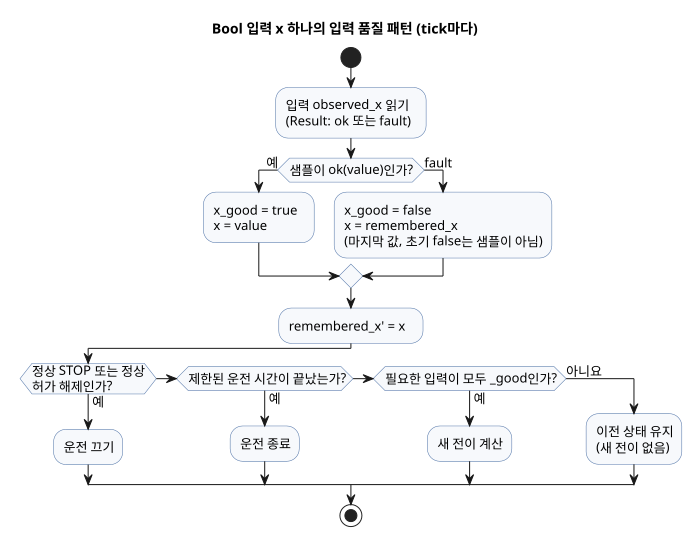
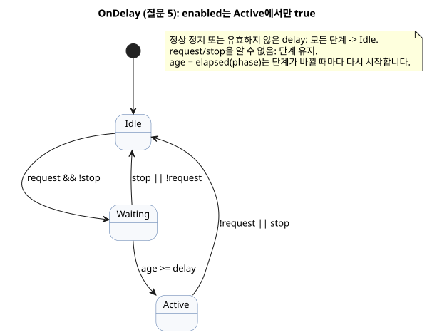
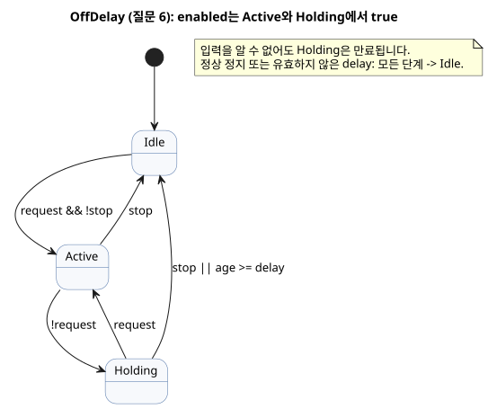
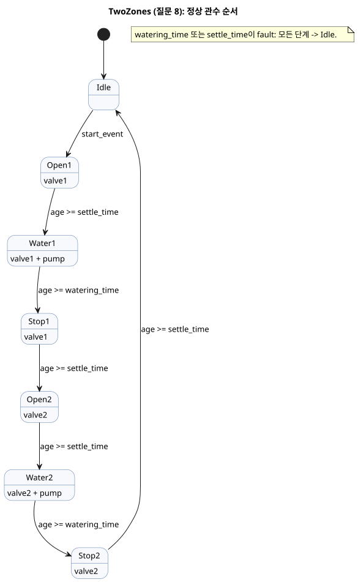
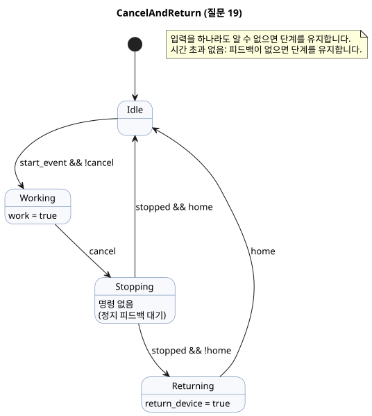
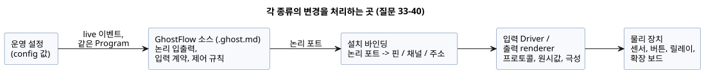

<!-- translation-source: docs/language_faq.en.md -->
[영문 원문](language_faq.en.md)

# GhostFlow Coding FAQ

이 FAQ는 “이런 동작은 어떻게 코딩하나요?”라는 한 가지 질문에 답합니다.
질문마다 실제로 동작하는 코드, 경계 상황을 포함한 동작 설명, 그렇게 작성하는 이유를 제공합니다.

- 언어 규칙은 이 FAQ가 아니라 [Language Reference](LANGUAGE-REFERENCE.md)가 정의합니다.
- 요구 사항의 어느 부분이 언어·런타임·Driver·설치·UI에 속하는지는 질문별로
  [Reference 8장](reference/08-language-runtime-and-device-boundaries.md#83-faq-전체-책임표)에 정리되어 있습니다.

**이 문서의 구성**

- 질문 1–16: 기본 패턴 — 버튼, 자기유지, 타이머, 예약, 히스테리시스, 카운터, 설정, 알람, 상호 배제, 함수.
- 질문 17–23: 인터록, 취소, 달력 기반 예약, 사용량 기반 제어.
- 질문 24–31: 운영자가 바꿀 수 있는 설정, 달력, 서머타임, 조석, 달의 위상.
- 질문 32: 정전 뒤의 동작.
- 질문 33–40: 제어 코드를 바꾸지 않고 센서·릴레이·GPIO 핀·확장 보드를 교체하는 방법.
- 질문 41: `ghostc` CLI로 문서를 검사하고 컴파일하는 방법.

**입력 개정에 대하여.** 2026-10-05 외부 입력 개정 이후로 품질 정보를 갖는 모든 선언은 `input`을 사용합니다.
기존 조건화와 명시적인 `Result` 고장 분기는 바뀌지 않았습니다. 이전 `sensor` 발췌는 `tests/fixtures/history/issue531/`에 보존되어 있습니다.

**개정된 예제에 대하여.** 입력의 생산자 상태를 알 수 없을 때(fault), 예제는 소스 안에 두 종류의 기억을 명시적으로 유지합니다. 마지막으로 관측한 값과 마지막으로 표시한 출력입니다.
이 기억의 초기값은 생산자가 보낸 정상 샘플이 *아닙니다*.
품질 조건은 알 수 없는 요청이 새 전이를 만들지 못하게 합니다. 정상적인 STOP과 허가 해제는 여전히 우선하며, 제한된 운전 기간도 여전히 만료됩니다.
예제는 물리적인 장비 고장을 추론하지 않으며, 자동 컨트롤러에 START를 누르라고 요구하지도 않습니다.
이 패턴의 자세한 설명은 [예제를 읽는 방법](#예제를-읽는-방법)을 참고하십시오.

**검토 상태.** 2026-10-01 dev 기준으로 검토했습니다: [`a7333e56bc25c73fd6167b1182269b96cb671d05`](https://github.com/callin2/ghostflow-language/tree/a7333e56bc25c73fd6167b1182269b96cb671d05).
일부 질문에는 상태 태그가 붙어 있습니다. 태그가 붙은 질문마다 해당 범위를 밝히는 상태 주석이 있습니다.

| 태그 | 의미 |
|---|---|
| `[미결정]` | 언어 또는 계약 결정이 아직 확정되지 않았습니다. |
| `[부분 미지원]` | 명시한 범위를 현재 dev에서 사용할 수 없습니다. |
| `[변경됨]` | 현재 dev가 원래 설명을 대체했습니다. |

태그가 없는 질문도 실제 장치·API·UI 통합으로 검증된 것은 아닙니다.

## 질문 목록

1. [프로그램 파일은 어떻게 작성하나요?](#q01)
2. [버튼을 누르는 동안만 출력을 켜려면?](#q02)
3. [시작 버튼을 놓아도 운전을 유지하고, 정지 버튼으로 끄려면?](#q03)
4. [한 번 시작하면 5분 운전하고 자동으로 멈추려면? [변경됨]](#q04)
5. [요청이 2초 동안 유지된 뒤 켜려면? [변경됨]](#q05)
6. [요청이 사라져도 3초 뒤에 끄려면? [변경됨]](#q06)
7. [매일 오전 6시와 오후 6시 45분에 관수하려면?](#q07)
8. [1번 구역 다음에 2번 구역을 순서대로 관수하려면? [변경됨]](#q08)
9. [수분이 낮을 때 켜고, 경계에서 켜졌다 꺼졌다 하지 않게 하려면?](#q09)
10. [탱크가 하한보다 낮아지면 채우고 상한에서 멈추려면?](#q10)
11. [센서가 세 번 감지하면 완료 신호를 내보내려면?](#q11)
12. [‘5분’을 화면에서 변경할 수 있는 입력창으로 만들려면? [변경됨]](#q12)
13. [고장이 사라져도 알람을 유지하고 리셋으로 해제하려면?](#q13)
14. [두 출력을 동시에 켜지 못하게 하려면?](#q14)
15. [일출 30분 뒤에 시작하려면?](#q15)
16. [같은 계산을 여러 곳에서 재사용하려면?](#q16)
17. [인터록은 어떻게 구현하나요?](#q17)
18. [자기유지 기능이 있나요?](#q18)
19. [사용자가 중간에 취소한 경우 특정 장치를 움직이게 할 수 있나요?](#q19)
20. [일출 시각에 맞춰 예약하려면?](#q20)
21. [요일을 기준으로 동작을 예약할 수 있나요?](#q21)
22. [특정 장치의 누적 동작 시간을 기준으로 제어할 수 있나요? [부분 미지원]](#q22)
23. [자동·수동 운전과 상관없이 하루 동작 횟수에 따라 세척 운전을 할 수 있나요?](#q23)
24. [펌웨어 업데이트 없이 나중에 작동 시간만 바꿀 수 있나요? [변경됨]](#q24)
25. [설정 입력창의 라벨과 UI 컴포넌트를 바꿀 수 있나요?](#q25)
26. [설정값의 변경 가능 범위를 제한할 수 있나요?](#q26)
27. [요일별로 다른 설정을 할 수 있나요? [변경됨]](#q27)
28. [공휴일에만 제어 로직을 다르게 할 수 있나요?](#q28)
29. [서머타임도 제어에 적용할 수 있나요?](#q29)
30. [만조·간조를 기준으로 제어할 수 있나요? [부분 미지원]](#q30)
31. [사리·조금이나 달의 위상을 기준으로 제어할 수 있나요? [변경됨]](#q31)
32. [정전 후 다시 켜졌을 때의 동작을 코딩할 수 있나요?](#q32)
33. [온도 센서를 바꿔도 제어 코드를 수정하지 않아도 되나요? [변경됨]](#q33)
34. [센서 설정과 GhostFlow 소스는 분리되나요? 변경 주기도 다른가요?](#q34)
35. [프린터 Driver만 바꾸듯 센서를 교체해도 제어 프로그램을 재컴파일하지 않아도 되나요?](#q35)
36. [장치 교체와 재컴파일 분리 원칙은 language spec에도 있어야 하나요?](#q36)
37. [버튼을 다른 GPIO 핀에 연결해도 입력 매핑만 바꾸면 되나요?](#q37)
38. [출력 GPIO 매핑만 바꿔 다른 릴레이를 연결할 수 있나요?](#q38)
39. [Waveshare 같은 확장 보드로 출력 수를 늘릴 수 있나요?](#q39)
40. [RS485 I/O 확장 보드의 입력과 출력도 매핑할 수 있나요?](#q40)
41. [컴파일러 CLI로 문서를 검사하거나 컴파일하려면?](#q41)

## 예제를 읽는 방법

- **독립된 프로그램.** 각 `control` 예제는 완전하고 독립된 프로그램입니다. 여러 예제를 한 control에 그대로 붙여 넣지 마십시오.
- **코드를 넣는 위치.** 코드는 `.ghost.md` 문서의 최상위 `ghost` 블록에 넣습니다. 질문 1에 완전한 문서 모양이 있습니다.
- **단편.** *단편*은 기존 control 안에 넣는 선언이나 식입니다.
- **설계 표기.** *설계 표기*는 Reference에서도 설계 표기로 구분한 표기입니다. 현재 컴파일러는 이를 받아들이지 않을 수 있습니다.
- **입력의 의미.** 입력 이름의 의미는 각 질문에서 정합니다. 변수 이름이 물리 접점의 극성이나 통신 방식을 결정하지는 않습니다.
- **출력은 의도입니다.** 출력은 확인이 아니라 논리적 의도입니다. 밸브가 실제로 열렸는지 알아야 한다면 출력값을 다시 쓰지 말고 별도의 피드백 입력을 읽으십시오.
- **문법 근거.** 모든 답변은 **문법 근거** 목록으로 끝납니다. 이 목록은 사용한 표기마다 해당 Reference 장·절로 연결됩니다.
  공통 `control`, `input`, `output` 선언은 [Reference §1.4 문법 표기법](reference/01-source-and-syntax.md#14-문법-표기법)을 따릅니다.

**반복되는 입력 품질 패턴.** 거의 모든 예제는 Bool 입력 `x`마다 같은 네 줄로 시작합니다.

- `input observed_x: Bool;`은 입력을 선언합니다. 이 입력을 읽으면 `Result`를 얻습니다. 정상 샘플이면 `ok(value)`, 생산자 상태를 알 수 없으면 `fault(reason)`입니다.
- `let x_good = ...`은 이번 tick의 샘플이 정상일 때만 `true`입니다.
- `let x = ...`은 정상 값이거나, fault일 때는 `remembered_x`에 기억해 둔 마지막 값입니다.
- `remembered_x' = x;`는 그 기억을 갱신합니다. 초기값(`false`)은 소스 내부의 시작값이지 생산자가 보낸 샘플이 아닙니다.

그다음 전이 식은 이 값들을 정해진 순서로 사용합니다.

1. 정상적인 STOP이나 정상적인 허가 해제(예: `low_water_good && low_water`)가 가장 먼저 운전을 끕니다.
2. 시간이 다 된 제한된 운전은 일부 입력에 fault가 있어도 끝납니다.
3. 새 전이는 그 전이가 의존하는 모든 입력이 `_good`일 때만 계산합니다.
4. 그 밖의 경우에는 이전 상태를 유지합니다(`... else running`).

일부 예제는 `displayed_<output>` 상태도 유지합니다. 이 상태는 입력을 알 수 없는 동안 같은 순서에 따라 마지막 출력 의도를 유지합니다.
코드의 주석 `// Source-local display memory is initialized here; faults remain producer unknown.`이 이 패턴을 표시합니다.



이 다이어그램은 입력 샘플 하나가 품질 조건을 거치는 흐름을 보여 줍니다. 정상 샘플은 값과 기억을 갱신하고, fault는 기억한 값을 유지하되 새 전이를 막습니다.

<a id="q01"></a>
## 1. 프로그램 파일은 어떻게 작성하나요?

`.ghost.md` 문서를 작성합니다. 이 문서에 설명과 코드를 함께 담습니다.

````markdown
# 버튼으로 램프 켜기

버튼을 누르고 있는 동안 램프를 켠다.

```ghost
control ButtonLamp {
  state displayed_lamp: Bool = false;
  displayed_lamp' = if button_good && !button then false else if button_good then button else displayed_lamp;
  // Source-local display memory is initialized here; faults remain producer unknown.
  state remembered_button: Bool = false;
  let button_good = case observed_button { ok(_) => true; fault(_) => false; };
  let button = case observed_button { ok(value) => value; fault(_) => remembered_button; };
  remembered_button' = button;
  input observed_button: Bool;
  output lamp: Bool;

  lamp <- displayed_lamp';
}
```
````

사람은 Markdown 설명을 읽습니다. `ghost` 블록에는 제어 규칙이 들어 있습니다.
한 문서에 설명 문단 사이사이로 여러 `ghost` 블록을 둘 수 있으며, 이 블록들이 문서 순서대로 모여 하나의 프로그램을 이룹니다.
코드를 여러 블록으로 나눈다고 실행 단계나 대기 시간이 생기지는 않습니다.

**왜 이렇게 작성하나요?** 동작과 그 동작을 선택한 이유가 한 문서에 함께 남기 때문입니다.

**문법 근거**

- `.ghost.md`, 최상위 `ghost` 블록: [Reference §1.1 — 실행 블록 추출](reference/01-source-and-syntax.md#실행-블록-추출)
- `control`, 입력·출력 선언: [Reference §1.4 문법 표기법](reference/01-source-and-syntax.md#14-문법-표기법)
- `<-` 출력 연결: [Reference §2.8 tick과 상태 snapshot](reference/02-types-expressions-state.md#28-tick과-상태-snapshot)

<a id="q02"></a>
## 2. 버튼을 누르는 동안만 출력을 켜려면?

기억할 것이 없으므로 입력을 출력에 바로 연결합니다.
여기서 `button = true`는 버튼이 눌렸다는 뜻이고, `stop = true`는 정지가 요청되었다는 뜻입니다.

```ghost
control HoldToRun {
  state displayed_pump: Bool = false;
  displayed_pump' = if button_good && !button then false else if stop_good && stop then false else if button_good && stop_good then button && !stop else displayed_pump;
  // Source-local display memory is initialized here; faults remain producer unknown.
  state remembered_button: Bool = false;
  let button_good = case observed_button { ok(_) => true; fault(_) => false; };
  let button = case observed_button { ok(value) => value; fault(_) => remembered_button; };
  remembered_button' = button;
  state remembered_stop: Bool = false;
  let stop_good = case observed_stop { ok(_) => true; fault(_) => false; };
  let stop = case observed_stop { ok(value) => value; fault(_) => remembered_stop; };
  remembered_stop' = stop;
  input observed_button: Bool;
  input observed_stop: Bool;
  output pump: Bool;

  pump <- displayed_pump';
}
```

버튼을 놓거나 정지가 요청되면 같은 평가에서 출력 의도가 꺼집니다.
버튼과 정지가 모두 true이면 `!stop` 때문에 출력은 false가 됩니다.

**왜 상태가 없나요?** 현재 입력만으로 결과가 정해집니다. 이전에 눌렀던 사실을 기억할 필요가 없습니다.

**문법 근거**

- `Bool`, `true`/`false`: [Reference §2.1 값 종류](reference/02-types-expressions-state.md#21-값-종류)
- `&&`, `!`: [Reference §2.6 표현식과 연산자](reference/02-types-expressions-state.md#26-표현식과-연산자)
- `<-`: [Reference §2.8 tick과 상태 snapshot](reference/02-types-expressions-state.md#28-tick과-상태-snapshot)

<a id="q03"></a>
## 3. 시작 버튼을 놓아도 운전을 유지하고, 정지 버튼으로 끄려면?

펌프가 운전 중인지를 `state`에 기억합니다. 이 예제에서는 정지 버튼을 놓는다고 운전이 저절로 다시 시작되지 않습니다.
다시 시작하려면 시작 버튼을 놓았다가 다시 눌러야 합니다.

```ghost
control StartStop {
  // Source-local display memory is initialized here; faults remain producer unknown.
  state remembered_start: Bool = false;
  let start_good = case observed_start { ok(_) => true; fault(_) => false; };
  let start = case observed_start { ok(value) => value; fault(_) => remembered_start; };
  remembered_start' = start;
  state remembered_stop: Bool = false;
  let stop_good = case observed_stop { ok(_) => true; fault(_) => false; };
  let stop = case observed_stop { ok(value) => value; fault(_) => remembered_stop; };
  remembered_stop' = stop;
  input observed_start: Bool;
  input observed_stop: Bool;
  output pump: Bool;
  state armed: Bool = false;
  state running: Bool = false;

  let start_event = armed && start;

  armed' = if stop_good && stop then false else if start_good && stop_good then (!stop && !start) else armed;
  running' = if stop_good && stop then false else if start_good && stop_good then (!stop && (start_event || running)) else running;
  pump <- running';
}
```

- `running`은 이전 tick의 운전 상태입니다. 시작한 뒤 버튼을 놓아도 true로 유지됩니다.
- `armed`는 정지가 걸려 있지 않은 동안 시작 버튼을 놓은 것이 관측되었음을 기억합니다.
- 초기화 시점에 이미 눌려 있던 버튼은 운전을 시작하지 않습니다. 새 누름은 버튼을 놓은 뒤에만 받아들입니다.
- 정지는 자기유지와 시작 요청보다 모두 우선합니다.

**왜 출력에 `running'`을 쓰나요?** 현재 평가에서 걸린 정지가 같은 tick 안에서 즉시 출력에 반영되도록 하기 위해서입니다.

**문법 근거**

- `state`, 이전 상태와 `running'`: [Reference §2.8 tick과 상태 snapshot](reference/02-types-expressions-state.md#28-tick과-상태-snapshot)
- `let`: [Reference §2.7 순수 함수와 계산 조합](reference/02-types-expressions-state.md#27-순수-함수와-계산-조합)
- `!`, `&&`, `||`: [Reference §2.6 표현식과 연산자](reference/02-types-expressions-state.md#26-표현식과-연산자)

관련 예제: [START/STOP](../examples/curriculum/pc-02-start-stop.ghost.md).

<a id="q04"></a>
## 4. 한 번 시작하면 5분 운전하고 자동으로 멈추려면? [변경됨]

> **현재 dev 상태:** 이제 `duration` 설정은 `Result`를 냅니다. 아래 `age < duration` 비교는 `case`로 `ok`/`fault`를 처리하지 않으면 컴파일되지 않습니다. [현재 계약](reference/05-settings-and-observation.md#기본값과-유효값).

운전 상태와 그 상태에 머문 시간을 함께 사용합니다.
`stop`이나 `low_water`가 true이면 운전을 끝냅니다. 운전하는 동안에는 새 시작 요청을 무시합니다.

```ghost
control FiveMinuteRun {
  // Source-local display memory is initialized here; faults remain producer unknown.
  state remembered_start: Bool = false;
  let start_good = case observed_start { ok(_) => true; fault(_) => false; };
  let start = case observed_start { ok(value) => value; fault(_) => remembered_start; };
  remembered_start' = start;
  state remembered_stop: Bool = false;
  let stop_good = case observed_stop { ok(_) => true; fault(_) => false; };
  let stop = case observed_stop { ok(value) => value; fault(_) => remembered_stop; };
  remembered_stop' = stop;
  state remembered_low_water: Bool = false;
  let low_water_good = case observed_low_water { ok(_) => true; fault(_) => false; };
  let low_water = case observed_low_water { ok(value) => value; fault(_) => remembered_low_water; };
  remembered_low_water' = low_water;
  input observed_start: Bool;
  input observed_stop: Bool;
  input observed_low_water: Bool;
  output pump, valve: Bool;
  config duration: Duration = 5min;
  state armed: Bool = false;
  state running: Bool = false;
  timer age = elapsed(running);

  let permit = !stop && !low_water;
  let start_event = armed && start;

  armed' = if low_water_good && low_water then false else if stop_good && stop then false else if start_good && stop_good && low_water_good then (permit && !start) else armed;
  running' = if low_water_good && low_water then false else if stop_good && stop then false else if running && !(case duration { ok(value) => age < value; fault(_) => false; }) then false else if start_good && stop_good && low_water_good then (if !permit then false
    else if running then (case duration { ok(value) => age < value; fault(_) => false; })
    else start_event) else running;

  valve <- running';
  pump <- running';
  require pump => valve;
}
```

`running`이 true가 되면 `age`가 0부터 시작합니다. 운전은 `age >= duration`이 되는 첫 tick에 끝납니다.
버튼을 계속 누르고 있어도 또 다른 5분이 자동으로 시작되지는 않습니다.
시간이 끝난 뒤 다시 시작하려면 버튼을 다시 누릅니다. 정지나 저수위 조건이 있었다면 먼저 허가가 회복되고 버튼을 놓은 것이 관측되어야 합니다.

**왜 `sleep(5min)`을 쓰지 않나요?** 기다리는 동안에도 매 tick 정지와 저수위를 확인해야 하기 때문입니다.

**문법 근거**

- `config duration: Duration`, `5min`: [Reference §5.1 config 선언](reference/05-settings-and-observation.md#51-config-선언), [§3.1 — Duration](reference/03-time-and-schedules.md#duration)
- `timer age = elapsed(running)`: [Reference §3.2 상태 변경 뒤의 경과 시간](reference/03-time-and-schedules.md#32-상태-변경-뒤의-경과-시간)
- `if ... then ... else`: [Reference §2.6 — 조건식](reference/02-types-expressions-state.md#조건식)
- `require pump => valve`: [Reference §4.7 출력 의도와 제약](reference/04-sensors-constraints-control.md#47-requested-safe-applied-confirmed)

<a id="q05"></a>
## 5. 요청이 2초 동안 유지된 뒤 켜려면? [변경됨]

> **현재 dev 상태:** 이제 `delay` 설정은 `Result`를 냅니다. 아래 `age >= delay` 비교 전에 `case`로 `ok`/`fault`를 처리하십시오. [현재 계약](reference/05-settings-and-observation.md#기본값과-유효값).

요청을 받은 상황과 출력이 실제로 켜진 상황을 구분합니다.

```ghost
control OnDelay {
  // Source-local display memory is initialized here; faults remain producer unknown.
  state remembered_request: Bool = false;
  let request_good = case observed_request { ok(_) => true; fault(_) => false; };
  let request = case observed_request { ok(value) => value; fault(_) => remembered_request; };
  remembered_request' = request;
  state remembered_stop: Bool = false;
  let stop_good = case observed_stop { ok(_) => true; fault(_) => false; };
  let stop = case observed_stop { ok(value) => value; fault(_) => remembered_stop; };
  remembered_stop' = stop;
  input observed_request: Bool;
  input observed_stop: Bool;
  output enabled: Bool;
  config delay: Duration = 2s;
  type Phase = Idle | Waiting | Active;
  state phase: Phase = Idle;
  timer age = elapsed(phase);

  phase' = if !(case delay { ok(_) => true; fault(_) => false; }) then Idle else if stop_good && stop then Idle else if request_good && stop_good then (case phase {
    Idle => if request && !stop then Waiting else Idle;
    Waiting => if stop || !request then Idle
      else if (case delay { ok(value) => age >= value; fault(_) => false; }) then Active else Waiting;
    Active => if request && !stop then Active else Idle;
  }) else phase;

  enabled <- phase' == Active;
}
```

기다리는 동안 요청이 사라지면 대기가 취소됩니다. 새 요청은 2초를 처음부터 다시 셉니다.
각 전이는 그 조건을 관측한 tick에서 일어납니다. 한 tick이 길었다고 여러 단계를 한꺼번에 건너뛰지 않습니다.



이 다이어그램은 `OnDelay`의 세 단계를 보여 줍니다. `enabled`는 `Active`에서만 true입니다.

**왜 단계가 필요한가요?** “요청 없음”, “2초 대기 중”, “켜짐”을 명시적으로 구분하기 위해서입니다.

**문법 근거**

- `type Phase`, `case`: [Reference §2.4 enum과 빠짐없는 분기](reference/02-types-expressions-state.md#24-enum과-빠짐없는-분기)
- `state phase`, `phase'`: [Reference §2.8 tick과 상태 snapshot](reference/02-types-expressions-state.md#28-tick과-상태-snapshot)
- `elapsed(phase)`, `2s`: [Reference §3.2 상태 변경 뒤의 경과 시간](reference/03-time-and-schedules.md#32-상태-변경-뒤의-경과-시간), [§3.1 — Duration](reference/03-time-and-schedules.md#duration)

관련 예제: [독립 타이머 패턴](../examples/curriculum/pc-06-timer-patterns.ghost.md).

<a id="q06"></a>
## 6. 요청이 사라져도 3초 뒤에 끄려면? [변경됨]

> **현재 dev 상태:** 이제 `delay` 설정은 `Result`를 냅니다. 아래 `age >= delay` 비교 전에 `case`로 `ok`/`fault`를 처리하십시오. [현재 계약](reference/05-settings-and-observation.md#기본값과-유효값).

요청이 해제될 때 시작하는 *유지* 단계를 추가합니다. 유지 단계 중에 요청이 다시 들어오면 켜진 상태를 유지합니다.

```ghost
control OffDelay {
  // Source-local display memory is initialized here; faults remain producer unknown.
  state remembered_request: Bool = false;
  let request_good = case observed_request { ok(_) => true; fault(_) => false; };
  let request = case observed_request { ok(value) => value; fault(_) => remembered_request; };
  remembered_request' = request;
  state remembered_stop: Bool = false;
  let stop_good = case observed_stop { ok(_) => true; fault(_) => false; };
  let stop = case observed_stop { ok(value) => value; fault(_) => remembered_stop; };
  remembered_stop' = stop;
  input observed_request: Bool;
  input observed_stop: Bool;
  output enabled: Bool;
  config delay: Duration = 3s;
  type Phase = Idle | Active | Holding;
  state phase: Phase = Idle;
  timer age = elapsed(phase);

  phase' = if phase == Holding && (case delay { ok(value) => age >= value; fault(_) => true; }) then Idle else if !(case delay { ok(_) => true; fault(_) => false; }) then Idle else if stop_good && stop then Idle else if request_good && stop_good then (case phase {
    Idle => if request && !stop then Active else Idle;
    Active => if stop then Idle
      else if !request then Holding else Active;
    Holding => if stop then Idle
      else if request then Active
      else if (case delay { ok(value) => age >= value; fault(_) => false; }) then Idle else Holding;
  }) else phase;

  enabled <- phase' in {Active, Holding};
}
```

3초는 `Holding`에 들어간 시점부터 셉니다. 정지는 지연을 기다리지 않고 출력을 즉시 끕니다.
`elapsed(phase)`는 현재 단계에 머문 시간입니다. 여러 ON 구간을 합산한 시간이 아닙니다.



이 다이어그램은 `OffDelay`의 단계를 보여 줍니다. `enabled`는 `Active`와 `Holding`에서 true입니다.

**왜 ON-delay 타이머를 함께 쓰지 않나요?** 조건마다 기억해 둔 시작 시각이 따로 필요하기 때문입니다.

**문법 근거**

- `type`, `case`, `in {Active, Holding}`: [Reference §2.4 enum과 빠짐없는 분기](reference/02-types-expressions-state.md#24-enum과-빠짐없는-분기)
- `elapsed(phase)`: [Reference §3.2 상태 변경 뒤의 경과 시간](reference/03-time-and-schedules.md#32-상태-변경-뒤의-경과-시간)
- 단계 경과 시간과 누적의 구분: [Reference §3.4 누적 시간과 rolling budget](reference/03-time-and-schedules.md#34-누적-시간과-rolling-budget)

<a id="q07"></a>
## 7. 매일 오전 6시와 오후 6시 45분에 관수하려면?

예약의 `.due`를 시작 조건으로 사용합니다. 얼마나 오래 운전할지는 타이머로 정합니다.

```ghost
control DailyWatering {
  // Source-local display memory is initialized here; faults remain producer unknown.
  state remembered_stop: Bool = false;
  let stop_good = case observed_stop { ok(_) => true; fault(_) => false; };
  let stop = case observed_stop { ok(value) => value; fault(_) => remembered_stop; };
  remembered_stop' = stop;
  input observed_stop: Bool;
  output pump: Bool;
  schedule starts: DailySlots<15min> {
    timezone = "Asia/Seoul";
    selected = [06:00, 18:45];
    dst_missing = skip;
    dst_repeated = first;
    basis = pulse;
    when = true;
    clock = trusted_only;
    gap = skip_after(60s);
    recovery = baseline;
    fallback = skip;
  }
  let duration = 5min;
  state running: Bool = false;
  timer age = elapsed(running);

  running' = if stop_good && stop then false else if running && !(age < duration) then false else if stop_good then (!stop && (if running then age < duration else starts.due)) else running;
  pump <- running';
}
```

`DailySlots<15min>`은 “15분마다 운전”이라는 뜻이 아닙니다. 시작 시각을 15분 격자에서 고르며, `selected`에 있는 시각만 발생한다는 뜻입니다.
이 예제는 이미 운전 중일 때 도착한 예약 시작을 대기열에 넣지 않습니다. 정지해 있는 동안 지나간 시작 시각을 나중에 실행하지도 않습니다.

**왜 예약과 타이머를 나누나요?** 달력 시간은 *언제* 시작할지를 정하고, 단조 경과 시간은 *얼마나 오래* 운전할지를 정하기 때문입니다.

**문법 근거**

- `schedule`, `DailySlots<15min>`, `timezone`, `selected`, `.due`: [Reference §3.6 선택된 DailySlots](reference/03-time-and-schedules.md#36-선택된-dailyslots)
- 예약 발생과 운전의 구분: [Reference §3.5 Schedule의 공통 의미](reference/03-time-and-schedules.md#35-schedule의-공통-의미)
- `elapsed(running)`: [Reference §3.2 상태 변경 뒤의 경과 시간](reference/03-time-and-schedules.md#32-상태-변경-뒤의-경과-시간)

<a id="q08"></a>
## 8. 1번 구역 다음에 2번 구역을 순서대로 관수하려면? [변경됨]

> **현재 dev 상태:** 이제 `watering_time`과 `settle_time` 설정은 `Result`를 냅니다. 아래 시간 비교 전에 `case`로 `ok`/`fault`를 처리하십시오. [현재 계약](reference/05-settings-and-observation.md#기본값과-유효값).

순서를 enum으로 작성하고, 각 출력을 그 출력이 허용되는 단계에 연결합니다.
이 예제는 정상 운전 순서를 보여 줍니다. 각 구역은 세 단계를 거칩니다.
밸브 열림을 요청하고 2초 기다리기, 5분 동안 급수하기, 펌프 정지를 요청하고 안정되도록 2초 기다리기입니다.

```ghost
control TwoZones {
  // Source-local display memory is initialized here; faults remain producer unknown.
  state remembered_start: Bool = false;
  let start_good = case observed_start { ok(_) => true; fault(_) => false; };
  let start = case observed_start { ok(value) => value; fault(_) => remembered_start; };
  remembered_start' = start;
  input observed_start: Bool;
  output pump, valve1, valve2: Bool;
  type Phase = Idle | Open1 | Water1 | Stop1 | Open2 | Water2 | Stop2;
  state phase: Phase = Idle;
  state armed: Bool = false;
  timer age = elapsed(phase);
  config watering_time: Duration = 5min;
  config settle_time: Duration = 2s;

  let start_event = armed && start;
  armed' = if start_good then (phase == Idle && !start) else armed;

  phase' = if !(case watering_time { ok(_) => true; fault(_) => false; } && case settle_time { ok(_) => true; fault(_) => false; }) then Idle else if phase != Idle || start_good then (case phase {
    Idle => if start_event then Open1 else Idle;
    Open1 => if (case settle_time { ok(value) => age >= value; fault(_) => false; }) then Water1 else Open1;
    Water1 => if (case watering_time { ok(value) => age >= value; fault(_) => false; }) then Stop1 else Water1;
    Stop1 => if (case settle_time { ok(value) => age >= value; fault(_) => false; }) then Open2 else Stop1;
    Open2 => if (case settle_time { ok(value) => age >= value; fault(_) => false; }) then Water2 else Open2;
    Water2 => if (case watering_time { ok(value) => age >= value; fault(_) => false; }) then Stop2 else Water2;
    Stop2 => if (case settle_time { ok(value) => age >= value; fault(_) => false; }) then Idle else Stop2;
  }) else phase;

  valve1 <- phase' in {Open1, Water1, Stop1};
  valve2 <- phase' in {Open2, Water2, Stop2};
  pump <- phase' in {Water1, Water2};
  require pump => (valve1 || valve2);
  require !(valve1 && valve2);
}
```



이 다이어그램은 일곱 단계를 순서대로 보여 주고, 각 단계에서 어떤 출력이 켜지는지 표시합니다.

운전 중에 들어온 요청은 대기열에 넣지 않습니다. 순서가 끝난 뒤 다시 시작하려면 버튼을 놓았다가 다시 누릅니다.
이 코드의 2초 대기는 밸브가 실제로 열렸음을 확인하지 않습니다.
열림·닫힘 피드백과 순서를 중단하는 방법이 필요하다면
[피드백을 사용하는 순차 제어 예제](../examples/curriculum/pc-09-sequential-water-supply.ghost.md)를 따르십시오.

**왜 반복문을 쓰지 않나요?** 모든 단계에서 프로그램은 새 입력을 계속 평가하면서 자신이 어디에 있는지 기억해야 하기 때문입니다.

**문법 근거**

- `type Phase`, `case`, `in { ... }`: [Reference §2.4 enum과 빠짐없는 분기](reference/02-types-expressions-state.md#24-enum과-빠짐없는-분기)
- `phase'`와 동시 상태 전이: [Reference §2.8 tick과 상태 snapshot](reference/02-types-expressions-state.md#28-tick과-상태-snapshot)
- `elapsed(phase)`: [Reference §3.2 상태 변경 뒤의 경과 시간](reference/03-time-and-schedules.md#32-상태-변경-뒤의-경과-시간)
- `require`, `=>`, 출력 상호 배제: [Reference §4.7 출력 의도와 제약](reference/04-sensors-constraints-control.md#47-requested-safe-applied-confirmed)

<a id="q09"></a>
## 9. 수분이 낮을 때 켜고, 경계에서 켜졌다 꺼졌다 하지 않게 하려면?

켜는 기준과 끄는 기준을 다르게 둡니다(히스테리시스). 센서 고장도 명시적으로 처리합니다.

```ghost
control MoistureControl {
  state displayed_pump: Bool = false;
  displayed_pump' = if stop_good && stop then false else if stop_good then requested && !stop else displayed_pump;
  // Source-local display memory is initialized here; faults remain producer unknown.
  state remembered_stop: Bool = false;
  let stop_good = case observed_stop { ok(_) => true; fault(_) => false; };
  let stop = case observed_stop { ok(value) => value; fault(_) => remembered_stop; };
  remembered_stop' = stop;
  input observed_stop: Bool;
  input moisture: Percent {
    sample = 1s;
    valid = 0% .. 100%;
    filter = median(5);
    stale_after = 3s;
    recover_after = 3 samples;
  }
  signal dry = hysteresis(moisture,
    on_below: 30%, off_above: 35%, initial: false);
  output pump: Bool;

  let requested = case dry {
    ok(value) => value;
    fault(_) => false;
  };
  pump <- displayed_pump';
}
```

- 정상 수분값이 30% 미만이면 펌프를 켭니다. 35%를 넘으면 끕니다. 두 경계 위에 있거나 그 사이에 있으면 이전 판단을 유지합니다.
- 필터가 아직 준비되지 않았거나 복구 조건을 만족하지 않으면 값은 fault 경로를 따르며, 펌프도 꺼집니다.
- 샘플링 간격과 한계값은 이 프로그램을 위해 정한 값입니다. 모든 센서의 기본값이 아닙니다.
- 정상 측정값이 돌아오면 새로 평가한 수분값에 따라 운전이 자동으로 다시 시작됩니다. 대신 수동 재시작이 필요하다면 그에 맞는 상태를 따로 추가하십시오.

**왜 `moisture < 30%`만 쓰지 않나요?** 그것만으로는 신호 품질도, 경계에서의 진동도 처리하지 못하기 때문입니다.

**문법 근거**

- `input`, `sample`, `valid`, `filter`, `stale_after`, `recover_after`: [Reference §4.2 샘플 계약과 sensor 처리 순서](reference/04-sensors-constraints-control.md#42-샘플-계약과-sensor-처리-순서)
- `median`, `signal`, `hysteresis`, 이름 붙은 인자: [Reference §4.3 filter와 signal 연산](reference/04-sensors-constraints-control.md#43-filter와-signal-연산)
- `case`, `ok(value)`, `fault(_)`: [Reference §4.1 sensor와 Result 품질](reference/04-sensors-constraints-control.md#41-sensor와-result-품질)

<a id="q10"></a>
## 10. 탱크가 하한보다 낮아지면 채우고 상한에서 멈추려면?

채우는 중인지를 기억합니다. `low_level_reached`는 물이 하한 수위 센서에 닿았다는 뜻이고,
`high_level_reached`는 상한 수위 센서에 닿았다는 뜻입니다.

```ghost
control TankLevel {
  // Source-local display memory is initialized here; faults remain producer unknown.
  state remembered_low_level_reached: Bool = false;
  let low_level_reached_good = case observed_low_level_reached { ok(_) => true; fault(_) => false; };
  let low_level_reached = case observed_low_level_reached { ok(value) => value; fault(_) => remembered_low_level_reached; };
  remembered_low_level_reached' = low_level_reached;
  state remembered_high_level_reached: Bool = false;
  let high_level_reached_good = case observed_high_level_reached { ok(_) => true; fault(_) => false; };
  let high_level_reached = case observed_high_level_reached { ok(value) => value; fault(_) => remembered_high_level_reached; };
  remembered_high_level_reached' = high_level_reached;
  input observed_low_level_reached: Bool;
  input observed_high_level_reached: Bool;
  output fill_pump: Bool;
  type Phase = Idle | Filling | SensorConflict;
  state phase: Phase = Idle;
  let conflict = high_level_reached && !low_level_reached;

  phase' = if low_level_reached_good && high_level_reached_good then (case phase {
    Idle => if conflict then SensorConflict
      else if !low_level_reached then Filling else Idle;
    Filling => if conflict then SensorConflict
      else if high_level_reached then Idle else Filling;
    SensorConflict => if conflict then SensorConflict else Idle;
  }) else phase;

  fill_pump <- phase' == Filling;
}
```

- 물이 다시 하한 수위를 넘었다고 바로 채우기를 멈추지 않습니다. 한 번 채우기 시작하면 상한 수위까지 계속합니다.
- 하한 입력이 false인데 상한 입력만 true이면 두 센서가 서로 모순됩니다. 이때 펌프는 꺼집니다(`SensorConflict`). 모순이 사라지면 프로그램은 한 번 `Idle`을 거친 뒤 다시 평가합니다.

**왜 입력 하나를 반전하지 않나요?** 시작과 정지의 기준이 서로 달라서 이전 운전 상태가 필요하기 때문입니다.

**문법 근거**

- `type Phase`, `case`: [Reference §2.4 enum과 빠짐없는 분기](reference/02-types-expressions-state.md#24-enum과-빠짐없는-분기)
- `state`, `phase'`, `<-`: [Reference §2.8 tick과 상태 snapshot](reference/02-types-expressions-state.md#28-tick과-상태-snapshot)
- `if`, `!`, `&&`: [Reference §2.6 표현식과 연산자](reference/02-types-expressions-state.md#26-표현식과-연산자)

원본 예제: [탱크 히스테리시스](../examples/curriculum/pc-07-tank-hysteresis.ghost.md).

<a id="q11"></a>
## 11. 센서가 세 번 감지하면 완료 신호를 내보내려면?

입력이 true인 tick이 아니라, 입력이 false에서 true로 바뀌는 *사건*(상승 에지)을 셉니다.
이 예제는 Reference의 정확한 정수 타입 `Int`를 사용합니다.

```ghost
control CountThree {
  // Source-local display memory is initialized here; faults remain producer unknown.
  state remembered_detected: Bool = false;
  let detected_good = case observed_detected { ok(_) => true; fault(_) => false; };
  let detected = case observed_detected { ok(value) => value; fault(_) => remembered_detected; };
  remembered_detected' = detected;
  state remembered_reset: Bool = false;
  let reset_good = case observed_reset { ok(_) => true; fault(_) => false; };
  let reset = case observed_reset { ok(value) => value; fault(_) => remembered_reset; };
  remembered_reset' = reset;
  input observed_detected: Bool;
  input observed_reset: Bool;
  output done: Bool;
  state previous: Bool = false;
  state count: Int = 0;
  let rising = detected && !previous;

  previous' = if detected_good && reset_good then (detected) else previous;
  count' = if reset_good && reset then 0 else if detected_good && reset_good then (if reset then 0
    else if rising && count < 3 then count + 1
    else count) else count;
  done <- count' >= 3;
}
```

- 계속 true로 유지되는 감지 신호는 한 번만 셉니다. 카운터는 3에서 멈춥니다.
- 같은 tick에 리셋과 감지가 함께 들어오면 리셋이 이깁니다.
- 시작할 때 이미 true인 입력은 첫 번째 감지로 셉니다.
- 카운터를 화면에 보여 준다면 무엇을 세는지 의도 연결에 명시하십시오. 이름에 의존하지 마십시오.

**왜 `Number`가 아니라 `Int`인가요?** 개수는 절대로 근삿값이 되거나 몰래 반올림되어서는 안 되기 때문입니다.

**문법 근거**

- `Int`, 정수 연산과 비교: [Reference §2.3 정확한 정수 설계](reference/02-types-expressions-state.md#23-정확한-정수-설계)
- `previous`, `count`, `count'`의 상태 기억: [Reference §2.8 tick과 상태 snapshot](reference/02-types-expressions-state.md#28-tick과-상태-snapshot)
- 카운터의 공개 의미: [Reference §5.3 — descriptor와 snapshot](reference/05-settings-and-observation.md#descriptor와-snapshot)

<a id="q12"></a>
## 12. ‘5분’을 화면에서 변경할 수 있는 입력창으로 만들려면? [변경됨]

> **현재 dev 상태:** 설정 선언과 live 갱신을 지원합니다. 아래 `age < duration` 설명은 설정을 단순한 스칼라 값으로 읽던 이전 모델을 따릅니다. 현재 설정의 `Result`는 `case`로 처리하십시오. [현재 계약](reference/05-settings-and-observation.md#기본값과-유효값).

운영 설정을 타입, 범위, 증감 단위, 권한, 표시 이름과 함께 선언합니다.
이 **단편**을 [예제 4](#q04)의 `duration` 선언 대신 사용합니다.

```ghost
config duration: Duration = 5min {
  min = 1min;
  max = 20min;
  step = 1min;
  access = operator;
  label = "관수 시간";
}
```

제어 식은 여전히 `age < duration`을 사용합니다.
화면은 설정의 설명을 받아 1분 단위로 1분부터 20분까지 입력받는 시간 입력창을 만듭니다.
텍스트 입력창, 선택 목록, 슬라이더 중 무엇을 보여 줄지는 화면이 정합니다.

운영 설정 변경은 *원자적 live 이벤트*입니다. 같은 프로그램, 같은 실행 안에서 유효값을 바꿉니다.

- 여러 값이 한꺼번에 바뀌면 모두 검증한 뒤 함께 적용합니다. 하나라도 유효하지 않으면 아무것도 바꾸지 않습니다.
- 진행 중인 타이머를 0으로 되돌리지 않습니다.
- 예: 운전이 이미 6분 동안 이어졌고, 한계가 10분에서 5분으로 줄었습니다. 새 값을 사용하는 첫 평가에서 `age < duration`이 false가 되어 운전이 끝납니다.

**왜 `5min` 리터럴을 찾아 화면에 보여 주지 않나요?** 모든 상수가 운영자가 조정하라고 둔 값은 아니기 때문입니다.

**문법 근거**

- `config`, `min`, `max`, `step`, `access`, `label`: [Reference §5.1 config 선언](reference/05-settings-and-observation.md#51-config-선언)
- 기본값과 유효값: [Reference §5.1 — 기본값과 유효값](reference/05-settings-and-observation.md#기본값과-유효값)
- 실행 중 원자적 변경: [Reference §5.2 — atomic live event](reference/05-settings-and-observation.md#atomic-live-event)

<a id="q13"></a>
## 13. 고장이 사라져도 알람을 유지하고 리셋으로 해제하려면?

고장 입력의 현재 값과 고장을 기억하는 상태를 분리합니다.
이 예제는 알람 기억만 다룹니다. `fault_active = true`는 원인이 아직 남아 있다는 뜻입니다.

```ghost
control AlarmMemory {
  // Source-local display memory is initialized here; faults remain producer unknown.
  state remembered_fault_active: Bool = false;
  let fault_active_good = case observed_fault_active { ok(_) => true; fault(_) => false; };
  let fault_active = case observed_fault_active { ok(value) => value; fault(_) => remembered_fault_active; };
  remembered_fault_active' = fault_active;
  state remembered_reset: Bool = false;
  let reset_good = case observed_reset { ok(_) => true; fault(_) => false; };
  let reset = case observed_reset { ok(value) => value; fault(_) => remembered_reset; };
  remembered_reset' = reset;
  input observed_fault_active: Bool;
  input observed_reset: Bool;
  output alarm: Bool;
  state latched: Bool = false;
  state reset_armed: Bool = false;
  let reset_event = reset_armed && reset;

  reset_armed' = if fault_active_good && reset_good then (!fault_active && !reset) else reset_armed;
  latched' = if fault_active_good && reset_good then (fault_active || (latched && !reset_event)) else latched;
  alarm <- latched';
}
```

- `latched`는 고장 원인이 사라진 뒤에도 true로 유지됩니다. 원인이 사라졌고 *그리고* 리셋 버튼을 놓았다가 다시 눌렀을 때만 해제됩니다.
- `fault_active`와 `reset`이 모두 true이면 `fault_active`가 이깁니다.
- 리셋은 장비를 다시 시작하라는 명령이 아닙니다.

**왜 `alarm <- fault_active`와 다른가요?** 현재 원인과 과거 고장의 기억은 서로 다른 정보이기 때문입니다.
장비 정리, 위치 피드백, 여러 고장 원인은
[고장과 리셋 예제](../examples/curriculum/pc-10-fault-alarm-reset.ghost.md)를 참고하십시오.

**문법 근거**

- `state latched`, `reset_armed`, 다음 상태 `'`: [Reference §2.8 tick과 상태 snapshot](reference/02-types-expressions-state.md#28-tick과-상태-snapshot)
- `let`, 순수한 사건 조건: [Reference §2.7 순수 함수와 계산 조합](reference/02-types-expressions-state.md#27-순수-함수와-계산-조합)
- `fault_active || (latched && !reset_event)`: [Reference §2.6 표현식과 연산자](reference/02-types-expressions-state.md#26-표현식과-연산자)

<a id="q14"></a>
## 14. 두 출력을 동시에 켜지 못하게 하려면?

각 요청을 따로 작성한 뒤 상호 배제 제약을 추가합니다.

```ghost
control ExclusiveDirections {
  state displayed_forward: Bool = false;
  displayed_forward' = if forward_request_good && !forward_request then false else if forward_request_good then forward_request else displayed_forward;
  state displayed_reverse: Bool = false;
  displayed_reverse' = if reverse_request_good && !reverse_request then false else if reverse_request_good then reverse_request else displayed_reverse;
  // Source-local display memory is initialized here; faults remain producer unknown.
  state remembered_forward_request: Bool = false;
  let forward_request_good = case observed_forward_request { ok(_) => true; fault(_) => false; };
  let forward_request = case observed_forward_request { ok(value) => value; fault(_) => remembered_forward_request; };
  remembered_forward_request' = forward_request;
  state remembered_reverse_request: Bool = false;
  let reverse_request_good = case observed_reverse_request { ok(_) => true; fault(_) => false; };
  let reverse_request = case observed_reverse_request { ok(value) => value; fault(_) => remembered_reverse_request; };
  remembered_reverse_request' = reverse_request;
  input observed_forward_request: Bool;
  input observed_reverse_request: Bool;
  output forward, reverse: Bool;

  forward <- displayed_forward';
  reverse <- displayed_reverse';
  require !(forward && reverse);
}
```

두 요청이 모두 true이면 제약을 적용한 뒤 두 출력은 모두 false입니다. 출력을 작성한 순서가 승자를 정하지 않습니다.
이 제약만으로는 방향이 바뀔 때 지연이 생기지 않습니다. 지연이 필요하다면
[방향전환 상태와 타이머 예제](../examples/curriculum/pc-04-direction-interlock.ghost.md)를 참고하십시오.

**왜 한 출력의 식 안에서 다른 출력을 조용히 막지 않나요?** 각 요청과 충돌 규칙을 따로 읽고 설명할 수 있게 하기 위해서입니다.

**문법 근거**

- `require !(forward && reverse)`와 상호 배제: [Reference §4.7 출력 의도와 제약](reference/04-sensors-constraints-control.md#47-requested-safe-applied-confirmed)
- 제약 문법 골격: [Reference §1.4 문법 표기법](reference/01-source-and-syntax.md#14-문법-표기법)

<a id="q15"></a>
## 15. 일출 30분 뒤에 시작하려면?

`Solar` 예약을 선언하고 그 `.due`를 시작 조건으로 사용합니다.
이 **단편**은 [예제 7](#q07)의 `starts` 선언을 대체합니다.

```ghost
schedule starts: Solar {
  timezone = "Asia/Seoul";
  latitude = 37.5665;
  longitude = 126.9780;
  at = sun`rise + 30min`;
  fallback = skip;
  basis = pulse;
  when = true;
  clock = trusted_only;
  gap = skip_after(60s);
  recovery = baseline;
}
```

- 예제 좌표를 실제 현장의 좌표로 바꾸십시오. `starts.due` 뒤에 얼마나 오래 운전할지는 기존 `duration`과 타이머가 정합니다.
- 일출을 판단할 수 없으면 이 예제는 새 운전을 건너뜁니다. 그 이유를 정상적인 “아직 시작 시각이 아님”으로 위장하지 않습니다.
- `fallback = skip`은 이미 시작한 운전을 취소하는 규칙을 추가하지 않습니다.

**왜 위치, 시간대, fallback을 지정하나요?** 자연 현상은 시스템이 설치된 위치에 따라 달라지며, 그 정보를 알 수 없을 때 무엇을 할지도 명시해야 하기 때문입니다.

**문법 근거**

- `schedule ...: Solar`, 위치·시간대, ``sun`rise + 30min` ``: [Reference §3.9 — 선택된 Solar 표기](reference/03-time-and-schedules.md#선택된-solar-표기)
- `fallback = skip`: [Reference §3.9 — 자연 기준의 fallback과 회복](reference/03-time-and-schedules.md#자연-기준의-fallback과-회복)
- `.due`의 의미: [Reference §3.5 Schedule의 공통 의미](reference/03-time-and-schedules.md#35-schedule의-공통-의미)

<a id="q16"></a>
## 16. 같은 계산을 여러 곳에서 재사용하려면?

순수 함수로 추출하고 필요한 값을 인자로 넘깁니다.

```ghost
fn permitted(request: Bool, stop: Bool, enabled: Bool) -> Bool {
  request && !stop && enabled
}

control TwoRequests {
  state displayed_zone1: Bool = false;
  displayed_zone1' = if enabled_good && !enabled then false else if request1_good && !request1 then false else if stop_good && !stop then false else if enabled_good && request1_good && stop_good then permitted(request1, stop, enabled) else displayed_zone1;
  state displayed_zone2: Bool = false;
  displayed_zone2' = if enabled_good && !enabled then false else if request2_good && !request2 then false else if stop_good && !stop then false else if enabled_good && request2_good && stop_good then permitted(request2, stop, enabled) else displayed_zone2;
  // Source-local display memory is initialized here; faults remain producer unknown.
  state remembered_request1: Bool = false;
  let request1_good = case observed_request1 { ok(_) => true; fault(_) => false; };
  let request1 = case observed_request1 { ok(value) => value; fault(_) => remembered_request1; };
  remembered_request1' = request1;
  state remembered_request2: Bool = false;
  let request2_good = case observed_request2 { ok(_) => true; fault(_) => false; };
  let request2 = case observed_request2 { ok(value) => value; fault(_) => remembered_request2; };
  remembered_request2' = request2;
  state remembered_stop: Bool = false;
  let stop_good = case observed_stop { ok(_) => true; fault(_) => false; };
  let stop = case observed_stop { ok(value) => value; fault(_) => remembered_stop; };
  remembered_stop' = stop;
  state remembered_enabled: Bool = false;
  let enabled_good = case observed_enabled { ok(_) => true; fault(_) => false; };
  let enabled = case observed_enabled { ok(value) => value; fault(_) => remembered_enabled; };
  remembered_enabled' = enabled;
  input observed_request1: Bool;
  input observed_request2: Bool;
  input observed_stop: Bool;
  input observed_enabled: Bool;
  output zone1, zone2: Bool;

  zone1 <- displayed_zone1';
  zone2 <- displayed_zone2';
}
```

함수는 호출 사이에 아무것도 기억하지 않습니다. 순수 계산을 재사용하는 것은 타이머나 자기유지 기억을 가진 *동작*을 복제하는 것과 다릅니다.
그런 동작의 독립 상태, 포트, 설정, 연결은 [동작 조합](reference/06-composition-and-replay.md)을 따릅니다.

**왜 함수가 외부 상태를 몰래 읽지 못하게 하나요?** 같은 인자는 항상 같은 결과를 내야 하며, 호출의 모든 의존성이 호출 위치에서 보여야 하기 때문입니다.

**문법 근거**

- `fn`, 파라미터, `-> Bool`, 함수 호출: [Reference §2.7 순수 함수와 계산 조합](reference/02-types-expressions-state.md#27-순수-함수와-계산-조합)
- 함수 선언 문법 골격: [Reference §1.4 문법 표기법](reference/01-source-and-syntax.md#14-문법-표기법)
- 기억을 가진 동작의 독립성: [Reference §6.2 definition, instance와 논리 port](reference/06-composition-and-replay.md#62-definition-instance와-논리-port)

<a id="q17"></a>
## 17. 인터록은 어떻게 구현하나요?

*인터록*은 조건을 만족하지 않은 동작이나 서로 충돌하는 동작을 막습니다.
두 가지 도구를 사용합니다.

- 운전을 허용하는 조건은 상태 전이 식에 넣습니다.
- 출력 사이에 반드시 있어야 하는 관계는 `require`로 표현합니다.

### 조건을 만족할 때만 운전하기

“밸브가 열린 것이 확인되고 저수위가 아닐 때만 펌프를 운전한다”를 예로 듭니다.
`valve_open`은 밸브가 실제로 열렸음을 확인하는 입력입니다. `low_water`는 저수위를 감지하고,
`stop`은 정지 요청입니다. `valve_open` 대신 밸브 열림 *출력* 값을 사용하지 마십시오.

```ghost
control PumpInterlock {
  // Source-local display memory is initialized here; faults remain producer unknown.
  state remembered_start: Bool = false;
  let start_good = case observed_start { ok(_) => true; fault(_) => false; };
  let start = case observed_start { ok(value) => value; fault(_) => remembered_start; };
  remembered_start' = start;
  state remembered_stop: Bool = false;
  let stop_good = case observed_stop { ok(_) => true; fault(_) => false; };
  let stop = case observed_stop { ok(value) => value; fault(_) => remembered_stop; };
  remembered_stop' = stop;
  state remembered_valve_open: Bool = false;
  let valve_open_good = case observed_valve_open { ok(_) => true; fault(_) => false; };
  let valve_open = case observed_valve_open { ok(value) => value; fault(_) => remembered_valve_open; };
  remembered_valve_open' = valve_open;
  state remembered_low_water: Bool = false;
  let low_water_good = case observed_low_water { ok(_) => true; fault(_) => false; };
  let low_water = case observed_low_water { ok(value) => value; fault(_) => remembered_low_water; };
  remembered_low_water' = low_water;
  input observed_start: Bool;
  input observed_stop: Bool;
  input observed_valve_open: Bool;
  input observed_low_water: Bool;
  output pump: Bool;
  state armed: Bool = false;
  state running: Bool = false;

  let permit = !stop && valve_open && !low_water;
  let start_event = armed && start;

  armed' = if low_water_good && low_water then false else if valve_open_good && !valve_open then false else if stop_good && stop then false else if start_good && stop_good && valve_open_good && low_water_good then (permit && !start) else armed;
  running' = if low_water_good && low_water then false else if valve_open_good && !valve_open then false else if stop_good && stop then false else if start_good && stop_good && valve_open_good && low_water_good then (permit && (running || start_event)) else running;
  pump <- running';
}
```

`permit`은 운전 중에도 매 tick 평가합니다. 밸브 열림 확인이 사라지거나 저수위나 정지가 발생하면
`running'`과 펌프 의도가 모두 꺼집니다. 조건이 돌아온다고 운전이 저절로 다시 시작되지는 않습니다.
허가가 돌아온 뒤 시작 버튼을 놓았다가 다시 누르십시오.
이것이 이 예제에서 선택한 재시작 정책입니다.

### 두 출력의 동시 동작 막기

정회전과 역회전처럼 두 출력이 함께 켜지는 것을 금지하려면 출력 제약을 추가합니다.

```ghost
control DirectionInterlock {
  state displayed_forward: Bool = false;
  displayed_forward' = if forward_request_good && !forward_request then false else if forward_request_good then forward_request else displayed_forward;
  state displayed_reverse: Bool = false;
  displayed_reverse' = if reverse_request_good && !reverse_request then false else if reverse_request_good then reverse_request else displayed_reverse;
  // Source-local display memory is initialized here; faults remain producer unknown.
  state remembered_forward_request: Bool = false;
  let forward_request_good = case observed_forward_request { ok(_) => true; fault(_) => false; };
  let forward_request = case observed_forward_request { ok(value) => value; fault(_) => remembered_forward_request; };
  remembered_forward_request' = forward_request;
  state remembered_reverse_request: Bool = false;
  let reverse_request_good = case observed_reverse_request { ok(_) => true; fault(_) => false; };
  let reverse_request = case observed_reverse_request { ok(value) => value; fault(_) => remembered_reverse_request; };
  remembered_reverse_request' = reverse_request;
  input observed_forward_request: Bool;
  input observed_reverse_request: Bool;
  output forward, reverse: Bool;

  forward <- displayed_forward';
  reverse <- displayed_reverse';
  require !(forward && reverse);
}
```

- 두 요청이 모두 true이면 제약을 받는 두 출력은 모두 false입니다. 먼저 작성한 출력이 이기지 않습니다.
- 같은 상호 배제를 `mutex(forward, reverse);`로도 표현할 수 있습니다.
- 방향을 바꾸기 전에 기다려야 한다면 별도의 상태와 타이머를 사용하십시오.

`require pump => valve;`는 “펌프 출력 의도에는 밸브 출력 의도가 필요하다”는 뜻입니다.
밸브가 실제로 열렸는지는 첫 번째 예제처럼 별도의 입력으로 확인하십시오.
출력 제약도 상태를 자동으로 초기화하지 않습니다. 조건이 해소된 뒤 새 시작을 요구해야 한다면
첫 번째 예제처럼 상태 전이와 재시작 조건을 명시적으로 작성하십시오.
이 소프트웨어 로직은 비상정지를 대신하지 않습니다.

### 지역 제약과 공유 자원 제약 묶기

**지역 그룹.** 한 control의 Bool 출력 제약을
`constraints LocalRules { require pump => valve; }`처럼 이름 붙은 지역 그룹으로 모을 수 있습니다. `mutex`도 그룹 안에 넣을 수 있습니다.

- 이름은 읽는 사람이 설명을 찾도록 도울 뿐입니다. 범위를 다른 control이나 물리 설비 전체로 넓히지 않습니다.
- 모든 필수 조건은 AND로 결합됩니다. 우선순위로 이를 우회할 수 없습니다.
- 선택적인 `check` 분석은 별개입니다. 동작을 막지 않는 권고입니다.

**공유 자원.** 여러 요청 경로가 같은 논리 자원을 사용한다면
`constraints SharedRules for station`으로 공유 규칙을 선언합니다. [완전한 실행 예제](../examples/bound-resource-execution.ghost.ko.md)는
자동·수동·fallback 요청을 같은 Rust guard로 검사합니다. 단계는 다음과 같습니다.

1. `compileSourceSync`가 검사된 descriptor를 만듭니다. 이 descriptor는 실행할 수 없습니다.
2. 정확한 소스·산출물 identity, 안정된 자원 ID, 모드·입력·출력 매핑을
   `compileBoundResourceControl`에 명시적으로 전달합니다.
3. 참조 호스트의 실제 Rust/WASM 스캔 경로로 실행합니다.

예제는 완전한 바인딩과 기록된 입력을 제공합니다.

**위반과 복구.**

- 시작 전의 위반은 새 admission을 거부합니다.
- 현재 보유자(incumbent)와 충돌하는 새 claim은 보유자의 admission과 이전 안전 출력을 유지합니다. 새 claim을 재시도 대기열에 숨기지 않습니다.
- 실행 중 위반에 대해 예제가 작성한 응답은
  `pump1 = false; valve1 = true;`입니다. 안전은 보편적인 “모두 OFF” 규칙이 아닙니다.
- 트립 뒤에는 영향을 받은 각 배타 그룹에서 모든 claim이 중립인 관측이 있어야 하고, 그다음 새 claim이 있어야 합니다.
- require만 있는 그룹은 먼저 요청값이 작성된 안전값과 같아지는 것을 관측해야 하며, 그다음 새 요청을 검사합니다.
- 연결된 그룹은 같은 스캔에서 함께 복구되어야 합니다.

**실행 가능한 부분 집합의 범위.** 모든 출력이 명시적으로 보호되는 Bool GFB1 v1/v3 control 하나를
다룹니다. 한 설비 안의 writer들은 레지스트리를 공유하며, 이 레지스트리는 같은 안정 ID에 대한 추가
활성 writer를 거부합니다. Context/PID, 공유 정책 import
조합, 여러 VM에 걸친 협력 중재는 이 부분 집합에 포함되지 않습니다.
결과는 논리적인 requested/safe 의도입니다. renderer가 이를 적용했다는 증거도,
밸브가 열렸다는 증거도, 현장 설치가 올바르다는 증거도 아닙니다. 규칙과 단계는 [Reference §4.8](reference/04-sensors-constraints-control.md#48-공통-constraints-표기와-연산)과
[제약 계약](CONSTRAINTS.md#공유-bool-실행)을 참고하십시오.

**왜 두 방법을 나누나요?** 운전 상태가 *어떻게* 바뀌는지와 *어떤* 출력 조합이 허용되는지는
서로 다른 제어 규칙이며, 각각 명시적으로 작성해야 하기 때문입니다.

**문법 근거**

- `let permit`, 이름 붙은 순수 계산: [Reference §2.7 순수 함수와 계산 조합](reference/02-types-expressions-state.md#27-순수-함수와-계산-조합)
- `state`, `running'`, `<-`: [Reference §2.8 tick과 상태 snapshot](reference/02-types-expressions-state.md#28-tick과-상태-snapshot)
- `!`, `&&`, `||`: [Reference §2.6 표현식과 연산자](reference/02-types-expressions-state.md#26-표현식과-연산자)
- `require`, `mutex`, `=>`, requested/safe 출력의 구분: [Reference §4.7 출력 의도와 제약](reference/04-sensors-constraints-control.md#47-requested-safe-applied-confirmed)
- `require`와 `mutex`의 선언 형태: [Reference §1.4 문법 표기법](reference/01-source-and-syntax.md#14-문법-표기법)

<a id="q18"></a>
## 18. 자기유지 기능이 있나요?

네. 이전 운전 상태를 `state`에 기억하고, 그 값을 다음 상태 식에서 다시 사용합니다.
다음은 시작 버튼을 놓아도 켜진 상태를 유지하는 기본 자기유지입니다.

```ghost
control SelfHolding {
  // Source-local display memory is initialized here; faults remain producer unknown.
  state remembered_start: Bool = false;
  let start_good = case observed_start { ok(_) => true; fault(_) => false; };
  let start = case observed_start { ok(value) => value; fault(_) => remembered_start; };
  remembered_start' = start;
  state remembered_stop: Bool = false;
  let stop_good = case observed_stop { ok(_) => true; fault(_) => false; };
  let stop = case observed_stop { ok(value) => value; fault(_) => remembered_stop; };
  remembered_stop' = stop;
  input observed_start: Bool;
  input observed_stop: Bool;
  output pump: Bool;
  state running: Bool = false;

  running' = if stop_good && stop then false else if start_good && stop_good then (!stop && (start || running)) else running;
  pump <- running';
}
```

- `start`가 true이면 `running'`이 true가 됩니다.
- 다음 tick에 `start`가 false여도 이전 `running`이 true이므로 운전이 계속됩니다.
- `stop`이 true이면 `running'`은 false입니다. 시작과 정지가 함께 들어와도 정지가 이깁니다.
- `pump`는 현재 평가의 `running'`을 따릅니다.

이 기본 식에서는 정지 버튼을 놓을 때 `start`가 아직 true이면 운전이 다시 켜집니다.
“시작 버튼을 놓았다가 다시 누르기”가 필요하다면
[질문 3의 재시작 허가 상태](#q03)도 함께 사용하십시오.

**왜 이전 상태를 식에 포함하나요?** 자기유지 기억을 `running`에 명시적으로 두면
시작·유지·해제 조건을 한 식에서 읽을 수 있기 때문입니다.

**문법 근거**

- `state running: Bool = false`, 이전 상태 `running`, 다음 상태 `running'`: [Reference §2.8 tick과 상태 snapshot](reference/02-types-expressions-state.md#28-tick과-상태-snapshot)
- `!stop && (start || running)`: [Reference §2.6 표현식과 연산자](reference/02-types-expressions-state.md#26-표현식과-연산자)
- `pump <- running'`: [Reference §1.4 출력 연결 문법](reference/01-source-and-syntax.md#14-문법-표기법), [§2.8 출력에서 다음 상태 읽기](reference/02-types-expressions-state.md#28-tick과-상태-snapshot)

<a id="q19"></a>
## 19. 사용자가 중간에 취소한 경우 특정 장치를 움직이게 할 수 있나요?

네. 취소 입력이 들어오면 후속 단계로 이동하고, 그 단계의 출력을 연결합니다.
이 예제는 네 단계를 거칩니다. 원래 작업의 정지 요청 → 정지 확인 → 복귀 장치 운전 → 원점 위치 확인입니다.
`stopped`와 `home`은 실제 정지와 원점 위치를 확인하는 입력입니다.

```ghost
control CancelAndReturn {
  // Source-local display memory is initialized here; faults remain producer unknown.
  state remembered_start: Bool = false;
  let start_good = case observed_start { ok(_) => true; fault(_) => false; };
  let start = case observed_start { ok(value) => value; fault(_) => remembered_start; };
  remembered_start' = start;
  state remembered_cancel: Bool = false;
  let cancel_good = case observed_cancel { ok(_) => true; fault(_) => false; };
  let cancel = case observed_cancel { ok(value) => value; fault(_) => remembered_cancel; };
  remembered_cancel' = cancel;
  state remembered_stopped: Bool = false;
  let stopped_good = case observed_stopped { ok(_) => true; fault(_) => false; };
  let stopped = case observed_stopped { ok(value) => value; fault(_) => remembered_stopped; };
  remembered_stopped' = stopped;
  state remembered_home: Bool = false;
  let home_good = case observed_home { ok(_) => true; fault(_) => false; };
  let home = case observed_home { ok(value) => value; fault(_) => remembered_home; };
  remembered_home' = home;
  input observed_start: Bool;
  input observed_cancel: Bool;
  input observed_stopped: Bool;
  input observed_home: Bool;
  output work, return_device: Bool;
  type Phase = Idle | Working | Stopping | Returning;
  state phase: Phase = Idle;
  state armed: Bool = false;

  let start_event = armed && start;
  armed' = if start_good && cancel_good && stopped_good && home_good then (phase == Idle && !start && !cancel) else armed;
  phase' = if start_good && cancel_good && stopped_good && home_good then (case phase {
    Idle => if !cancel && start_event then Working else Idle;
    Working => if cancel then Stopping else Working;
    Stopping => if !stopped then Stopping else if home then Idle else Returning;
    Returning => if home then Idle else Returning;
  }) else phase;
  work <- phase' == Working;
  return_device <- phase' == Returning;
  require !(work && return_device);
}
```

- `Stopping`은 원래 작업이 멈췄다는 피드백을 기다립니다. 아직 복귀 명령을 보내지 않습니다.
- 복귀 장치는 `Returning`에서만 명령을 받습니다. 취소가 해제되어도 원점 위치가 확인될 때까지 복귀를 계속합니다.
- 정지나 원점 위치 확인이 없으면 프로그램은 그 단계에 머뭅니다. 이 예제에는 시간 초과 정책이 없습니다.
- 취소 뒤에 자동으로 다시 시작하지 않습니다. 대기 상태에서 시작과 취소를 놓은 뒤 새 시작 요청을 주십시오.
- 이 예제는 일반적인 작업 취소입니다. 비상정지 중에 추가 동작을 허용하는 규칙으로 사용하지 마십시오.



이 다이어그램은 네 단계와, 한 단계에서 다음 단계로 넘어가게 하는 피드백을 보여 줍니다.

**왜 정지가 확인된 뒤에만 복귀하나요?** 원래 작업과 복귀 명령이 동시에 장치를 움직이지 않게 하고,
취소 중에 논리 상태와 물리 상태를 혼동하지 않게 하기 위해서입니다.

**문법 근거**

- 단계 전이와 상태 snapshot의 의미: [Reference §2.8 tick과 상태 snapshot](reference/02-types-expressions-state.md#28-tick과-상태-snapshot)
- requested, applied, confirmed를 구분하는 장치 피드백: [Reference §4.7 requested, safe, applied, confirmed](reference/04-sensors-constraints-control.md#47-requested-safe-applied-confirmed)
- `type Phase`, `case`: [Reference §2.4 enum과 빠짐없는 분기](reference/02-types-expressions-state.md#24-enum과-빠짐없는-분기)
- `let`, `if`, Bool 연산과 비교: [Reference §2.6 표현식과 연산자](reference/02-types-expressions-state.md#26-표현식과-연산자)

<a id="q20"></a>
## 20. 일출 시각에 맞춰 예약하려면?

`Solar` 예약의 `.due`를 시작 조건으로 사용합니다. 이 단편은 일출 순간 자체를 대상으로 합니다.

```ghost
schedule starts: Solar {
  timezone = "Asia/Seoul";
  latitude = 37.5665;
  longitude = 126.9780;
  at = sun`rise`;
  fallback = skip;
  basis = pulse;
  when = true;
  clock = trusted_only;
  gap = skip_after(60s);
  recovery = baseline;
}
```

좌표와 시간대를 실제 현장의 값으로 바꾸십시오. `starts.due`가 true이면 새 발생을 admission(수용)합니다.
얼마나 오래 운전할지는 기존 `duration`과 제어 상태가 정합니다. 일출을 계산할 수 없으면
새 운전을 건너뜁니다. `fallback = skip`은 이미 수용된 운전을 취소하지 않습니다.

**왜 `.due`를 사용하나요?** 자연 현상의 발생을 운전 상태 전이와 분리하여,
예약 평가와 장치 제어 사이의 경계를 지키기 위해서입니다.

**문법 근거**

- `schedule ...: Solar`, ``sun`rise` ``, 위치·시간대와 `fallback`: [Reference §3.9 선택된 Solar 표기](reference/03-time-and-schedules.md#선택된-solar-표기)
- `.due`와 발생 admission: [Reference §3.5 Schedule의 공통 의미](reference/03-time-and-schedules.md#35-schedule의-공통-의미)
- `fallback = skip`과 회복: [Reference §3.9 자연 기준의 fallback과 회복](reference/03-time-and-schedules.md#자연-기준의-fallback과-회복)

<a id="q21"></a>
## 21. 요일을 기준으로 동작을 예약할 수 있나요?

``day`mon..fri` `` 같은 요일 범위로 `Daily` 펄스를 걸러낼 수 있습니다. 예약에 지정한 시간대의 날짜가 기준입니다. `workday`와 `offday`는 설치 달력을 사용합니다. [현재 계약](reference/03-time-and-schedules.md#38-dst-자정과-work-calendar).

요일 조건은 예약의 `on` 필드에 표현합니다. 예를 들어 월요일부터 금요일까지 오전 6시에 시작하려면
시각 조건과 아래 요일 조건을 결합합니다.
현재 컴파일러로 컴파일하고 실행할 수 있는 예약에는 설치 달력과 함께 ``day`workday` ``나 ``day`offday` ``를 사용하십시오.

```ghost
on = day`mon..fri`;
```

요일 필터는 계산된 예약 시작 시각의 지역 날짜에 적용됩니다. 공휴일과 현장 업무일은 요일과 다른 규칙을 따르므로
``day`mon..fri` ``를 공휴일 달력으로 읽지 마십시오.
서머타임과 자정 경계 정책도 예약 계약을 따릅니다.

**왜 요일과 시각을 분리하나요?** 같은 시작 시각을 요일, 공휴일, 현장 업무일 같은 서로 다른 날짜 조건과 결합할 수 있어야 하기 때문입니다.

**문법 근거**

- `on`과 요일·공휴일·업무일의 구분: [Reference §3.8 DST, 자정과 work calendar](reference/03-time-and-schedules.md#38-dst-자정과-work-calendar)
- `DailySlots`와 `.due`의 선택된 예약 의미: [Reference §3.6 선택된 DailySlots](reference/03-time-and-schedules.md#36-선택된-dailyslots)
- 시간대와 지역 날짜 경계: [Reference §3.1 시간값과 시계 영역](reference/03-time-and-schedules.md#31-시간값과-시계-영역)


<a id="q22"></a>
## 22. 특정 장치의 누적 동작 시간을 기준으로 제어할 수 있나요? [부분 미지원]

> **현재 dev 상태:** 외부에서 확인한 누적 `Duration`을 소비하는 예제는 지원합니다. 실행 가능한 `on_time` account는 현재 내구성 있는 *applied* 증거만 지원하며, requested·safe·confirmed 단계의 native account 실행은 지원하지 않습니다. [현재 계약](../tools/control.mjs#L1521).

누적 동작 시간을 `Duration` 값으로 받아 조건에 사용합니다.
먼저 **어느 기간에 걸쳐 누적하는지, 무엇을 동작으로 셀지**를 정하십시오.

| 원하는 기준 | 누적 범위 |
|---|---|
| 이번 작업에서 총 10분 동작 | 작업 시작 이후 ON 구간의 합 |
| 최근 1시간 동안 20분 동작 | 계속 이동하는 1시간 구간 |
| 오늘 총 1시간 동작 | 지정한 시간대 기준의 오늘 날짜 |
| 정비 이후 총 100시간 동작 | 명시적인 정비 리셋 이후 |

이 control 예제는 누적값을 *소비*합니다. `used`는 선택한 범위에서 같은 장치의 확인된 ON 구간을 합산한 입력이고,
`usage_valid`는 그 합이 유효한지를 알려 줍니다.
코드에는 누적값을 만드는 선언이 포함되어 있지 않습니다.

```ghost
control UsageLimit {
  state displayed_device: Bool = false;
  displayed_device' = if request_good && !request then false else if usage_valid_good && !usage_valid then false else if request_good && usage_valid_good && used_good then request && usage_valid && within_limit else displayed_device;
  // Source-local display memory is initialized here; faults remain producer unknown.
  state remembered_request: Bool = false;
  let request_good = case observed_request { ok(_) => true; fault(_) => false; };
  let request = case observed_request { ok(value) => value; fault(_) => remembered_request; };
  remembered_request' = request;
  state remembered_usage_valid: Bool = false;
  let usage_valid_good = case observed_usage_valid { ok(_) => true; fault(_) => false; };
  let usage_valid = case observed_usage_valid { ok(value) => value; fault(_) => remembered_usage_valid; };
  remembered_usage_valid' = usage_valid;
  state remembered_used: Duration = 0ms;
  let used_good = case observed_used { ok(_) => true; fault(_) => false; };
  let used = case observed_used { ok(value) => value; fault(_) => remembered_used; };
  remembered_used' = used;
  input observed_request: Bool;
  input observed_usage_valid: Bool;
  input observed_used: Duration;
  output device: Bool;
  config max_use: Duration = 1h;

  let within_limit = case max_use {
    ok(value) => used < value;
    fault(_) => false;
  };
  device <- displayed_device';
}
```

합계가 한계에 도달하면 더 이상 운전 요청을 내지 않습니다. 장치가 물리적으로 멈출 때까지의 지연까지 포함하는 엄격한 사용량 한계에는
Reference §3.10의 예약(reservation)과 정산 규칙도 필요합니다.
`elapsed(running)`은 마지막 상태 변경 이후의 시간을 잽니다. 반복된 ON/OFF 구간을 합산하지 않습니다.

자동과 수동 운전을 모두 포함하려면 명령 출처별로 타이머를 두지 말고, 장비에 대한 하나의 공통 동작 기록을 집계하십시오.
출력 요청, 제약을 통과한 출력, 적용된 명령, 실제 피드백 중 무엇을 셀지 정하십시오.
피드백이 없으면 명령이 적용된 시간을 “실제 동작 시간”이라고 부르지 마십시오.

누적 기록은 `account`로 선언하고, 예를 들어 최근 60초는 `used(account, rolling(60s))`로 조회합니다.
`on_time` 선언은 대상, 증거 기준(requested, safe, applied, confirmed), 지속성을 지정합니다.
이 표기가 작업별 리셋이나 정비 후 리셋, 보존 정책을 암시한다고 가정하지 마십시오.

**왜 별도의 누적 의미가 필요한가요?** 연속 동작 시간만 확인하면 여러 번의 짧은 운전에 걸쳐 흩어진 사용량을 놓치기 때문입니다.

**문법 근거**

- `Duration`, `1h`: [Reference §3.1 시간값과 시계 영역 — Duration](reference/03-time-and-schedules.md#duration)
- `&&`, `<`: [Reference §2.6 표현식과 연산자](reference/02-types-expressions-state.md#26-표현식과-연산자)
- `elapsed`와 누적의 차이: [Reference §3.2 상태 변경 뒤의 경과 시간](reference/03-time-and-schedules.md#32-상태-변경-뒤의-경과-시간)
- 누적 대상·범위와 `account`, `on_time`, `used`: [Reference §3.4 누적 시간과 rolling budget](reference/03-time-and-schedules.md#34-누적-시간과-rolling-budget)
- 자동·수동 통합 집계와 일일 한계: [Reference §3.10 시간 기반 사용량 제약](reference/03-time-and-schedules.md#310-시간-기반-사용량-제약)
- `config max_use`: [Reference §5.1 config 선언](reference/05-settings-and-observation.md#51-config-선언)

<a id="q23"></a>
## 23. 자동·수동 운전과 상관없이 하루 동작 횟수에 따라 세척 운전을 할 수 있나요?

횟수 조건과 세척 순서를 결합합니다.
자동 시작 명령과 수동 시작 명령을 따로 세지 마십시오. 대신 **같은 장치의 동작을 한곳에서 셉니다**.
장치가 계속 운전하는 동안 자동에서 수동으로 전환하는 것은 새 동작으로 세지 않습니다.

예를 들어 다음 정책을 선택합니다. “오늘(서울 시간) 정상 운전이 10회 시작된 뒤, 현재 운전이 끝나면 한 번 세척한다.”
여기서는 운전 확인 신호의 OFF→ON 전이 한 번을 동작 한 번으로 셉니다.
완료된 운전만 세야 한다면 시작 대신 완료 사건을 세십시오.

이 **단편**은 하루 횟수를 읽습니다. `Int`는 Reference의 정확한 정수 타입입니다.
`today_starts`는 오늘의 자동·수동 정상 운전 합산 횟수이고, `count_valid`는 그 횟수가 유효한지를 알려 줍니다.

```ghost
input today_starts: Int;
input count_valid: Bool;
let wash_due = case count_valid {
  ok(valid) => if valid then case today_starts {
    ok(count) => count >= 10; fault(_) => false;
  } else false;
  fault(_) => false;
};
```

`today_starts`는 내장 이름이 아니며, 이 단편은 하루 카운터 자체를 선언하지 않습니다.
하루 횟수는 §3.10의 `account`와 `count_events`로 선언합니다. 입력 event ID,
증거 기준, 날짜 경계를 지정하십시오. 같은 event를 재전송해도 한 번만 셉니다.
`on_time`은 시간을 합산하고, `count_events`는 event를 셉니다. 하나를 다른 하나 대신 사용하지 마십시오.

위 예의 세척 순서는 다음과 같이 동작합니다. 이것은 동작 설명이며 실행 가능한 문법이 아닙니다.

```text
오늘 정상 운전 10회 도달 → 세척 필요를 기억
현재 정상 운전 종료 확인 → 세척 단계 시작
세척 완료 확인 → 요청을 해제하고 해당 날짜의 세척 완료를 기억
```

- 이 예제에서는 같은 장치를 *세척을 위해* 켜는 것을 정상 운전으로 세지 않습니다.
- 세척 중에는 새 정상 운전을 시작하지 않습니다. 자동 요청과 수동 요청에 같은 조건이 적용됩니다.
- 세척 요청은 상태에 기억하십시오. 한 tick짜리 펄스는 장치가 바쁜 동안 사라질 수 있습니다.
- 이 정책에서는 날짜가 바뀌어도 이미 기억한 세척 요청이나 진행 중인 세척을 취소하지 않습니다.
- “하루에 한 번 세척”과 “10회 동작마다 세척”은 서로 다른 정책입니다. 이 예제는 하루에 한 번 세척합니다.

실제 하루 횟수 계약은 시간대, 날짜 경계, 재시작 뒤의 복원, 시계 보정, 횟수를 알 수 없을 때의 처리를 정의해야 합니다.
단순한 `state count = 0` 선언은 날짜별로 지속되는 횟수를 만들지 않습니다.
세척 단계와 출력은 [질문 8의 순차 제어](#q08)처럼 enum 상태로 작성하십시오.

**왜 운전 모드와 무관하게 세나요?** 세척이 필요한지는 누가 명령했는지가 아니라 장치를 얼마나 사용했는지에 달려 있기 때문입니다.

**문법 근거**

- `Int`와 정확한 횟수: [Reference §2.3 정확한 정수 설계](reference/02-types-expressions-state.md#23-정확한-정수-설계)
- `let`, `&&`, `>=`: [Reference §2.6 표현식과 연산자](reference/02-types-expressions-state.md#26-표현식과-연산자)
- 세척 단계 enum과 `case`: [Reference §2.4 enum과 빠짐없는 분기](reference/02-types-expressions-state.md#24-enum과-빠짐없는-분기)
- 이전 입력, 횟수, 세척 요청의 기억: [Reference §2.8 tick과 상태 snapshot](reference/02-types-expressions-state.md#28-tick과-상태-snapshot)
- 명령과 물리 동작의 구분: [Reference §4.7 requested, safe, applied, confirmed](reference/04-sensors-constraints-control.md#47-requested-safe-applied-confirmed)
- 장비별 하루 집계의 관련 원칙(횟수 문법이 아닌 시간 집계 규칙): [Reference §3.10 시간 기반 사용량 제약](reference/03-time-and-schedules.md#310-시간-기반-사용량-제약)

<a id="q24"></a>
## 24. 펌웨어 업데이트 없이 나중에 작동 시간만 바꿀 수 있나요? [변경됨]

> **현재 dev 상태:** live 갱신과 `TimeSlots` 연결을 지원합니다. 아래 `age < duration` 설명은 설정을 단순한 스칼라 값으로 읽던 이전 모델을 따릅니다. 현재 설정의 `Result`는 `case`로 처리하십시오. [현재 계약](reference/05-settings-and-observation.md#기본값과-유효값).

네. **얼마나 오래 운전할지**를 운영자가 편집할 수 있는 `Duration` 설정으로 선언합니다.
이 **단편**은 [질문 4의 시간 운전](#q04)에 있는 `duration` 선언을 대체합니다.

```ghost
config duration: Duration = 5min {
  min = 1min;
  max = 20min;
  step = 1min;
  access = operator;
  label = "작동 시간";
}
```

화면에서 5분을 10분으로 바꾸면 설정의 유효값이 바뀝니다.
소스를 편집하거나, 프로그램을 재컴파일하거나, 펌웨어를 업데이트하거나, 재시작할 필요가 없습니다.
선언은 타입과 범위를 정의하고, 화면은 그 설명을 사용해 입력창을 만듭니다.
일반 운영 설정에서 수락된 값은 장치를 재시작해도 유지됩니다.

변경은 같은 실행 안에서 적용되며, 경과 시간은 초기화되지 않습니다.
`age < duration`에서는 다음과 같습니다.

- 3분이 지난 뒤 5분을 10분으로 늘리면, 이제 운전은 총 10분을 기준으로 비교됩니다.
- 6분이 지난 뒤 한계를 5분으로 줄이면, 새 값을 사용하는 첫 평가에서 운전이 끝납니다.

“현재 작업은 그대로 두고 다음 작업부터 새 시간을 사용”하려면 명시적인 제어 규칙이 필요합니다.
작업이 시작될 때 설정을 별도의 상태에 복사하십시오. 이것은 `config`의 기본 변경 동작이 아닙니다.

**언제 시작할지**는 얼마나 오래 운전할지와 다른 설정입니다.
`DailySlots`의 고정된 `selected` 목록 대신 `TimeSlots` config를 연결하십시오.
다음 설정 선언 단편은 15분 격자에서 최대 여덟 개의 시각을 받습니다.

```ghost
config watering_slots: TimeSlots<15min, 8> = [time`06:00`, time`18:45`] {
  access = operator;
  label = "관수 시작 시각";
}
```

같은 control의 `DailySlots<15min>` 안에 `selected = watering_slots;`를 작성합니다.
시각 변경도 live 이벤트이며 재컴파일이 필요 없습니다. 새로 추가한 시각이 이미 지났다면 실행되지 않고,
슬롯을 제거해도 그것만으로 이미 시작한 운전이 취소되지는 않습니다.

**왜 조정 가능한 값을 미리 표시하나요?** 운영자가 바꿀 수 있는 것과 프로그램 규칙의 변경에 해당하는 것 사이에 언어가 분명한 선을 긋기 위해서입니다.

**문법 근거**

- `config`, `Duration`, `min`, `max`, `step`, `access`, `label`: [Reference §5.1 config 선언](reference/05-settings-and-observation.md#51-config-선언)
- 소스 기본값과 운영 유효값: [Reference §5.1 기본값과 유효값](reference/05-settings-and-observation.md#기본값과-유효값)
- 재컴파일이나 재시작 없는 변경: [Reference §5.2 atomic live event](reference/05-settings-and-observation.md#atomic-live-event)
- 재시작 뒤 일반 설정의 보존: [Reference §5.2 생명주기와 임시 설정](reference/05-settings-and-observation.md#생명주기와-임시-설정)
- `elapsed`와 기존 경과 시간: [Reference §3.2 상태 변경 뒤의 경과 시간](reference/03-time-and-schedules.md#32-상태-변경-뒤의-경과-시간)
- `selected`의 예약 시각: [Reference §3.6 선택된 DailySlots](reference/03-time-and-schedules.md#36-선택된-dailyslots)

<a id="q25"></a>
## 25. 설정 입력창의 라벨과 UI 컴포넌트를 바꿀 수 있나요?

라벨은 언어의 `label` 필드로 지정합니다. UI 컴포넌트는 화면을 만드는 cabinet-view가 선택합니다.
이 **단편**은 [질문 24](#q24)의 설정을 “세척 시간”으로 표시합니다.

```ghost
config duration: Duration = 5min {
  min = 1min;
  max = 20min;
  step = 1min;
  access = operator;
  label = "세척 시간";
}
```

이 선언을 사용하는 화면은 예를 들어 다음과 같이 알맞은 입력 방식을 고를 수 있습니다.

| 화면 입력 방식 | 지켜야 하는 설정 의미 |
|---|---|
| 시간 입력창 | Duration 값을 읽고 1–20분 범위와 1분 단위를 검사 |
| 선택 목록 | 1분부터 20분까지 허용된 값만 제공 |
| 슬라이더 | 같은 범위와 단위를 적용 |

어떤 컴포넌트를 사용하든 값의 타입, 범위, 단위, 변경 권한은 같습니다.
`label`은 사람이 읽는 이름입니다. 설정 ID나 권한을 바꾸지 않습니다.

GhostFlow에는 특정 컴포넌트를 고르는 `widget = slider` 같은 문법이 없습니다.
그 선택은 cabinet-view의 몫입니다. “화면이 고를 수 있다”는 말이
운영자가 직접 컴포넌트 종류를 바꾸는 메뉴를 언어가 제공한다는 뜻도 아닙니다.

**왜 화면의 모양을 언어 밖에서 정하나요?** 같은 “세척 시간” 설정을 휴대폰과 장치 화면에 맞는 방식으로 편집하면서도,
제어 의미와 검증 규칙은 똑같이 유지하기 위해서입니다.

**문법 근거**

- `config`, `label`, `min`, `max`, `step`, `access`: [Reference §5.1 config 선언](reference/05-settings-and-observation.md#51-config-선언)
- UI 모양과 언어 의미의 분리: [Reference §5.3 cabinet-view 독립 관찰 모델](reference/05-settings-and-observation.md#53-cabinet-view-독립-관찰-모델)
- 설정 ID·타입·권한을 전달하는 설명: [Reference §5.3 descriptor와 snapshot](reference/05-settings-and-observation.md#descriptor와-snapshot)

<a id="q26"></a>
## 26. 설정값의 변경 가능 범위를 제한할 수 있나요?

네. `min`과 `max`는 양 끝을 포함하는 허용 범위를 정의하고, `step`은 증감 단위를 정의합니다.
이 **단편**은 1분부터 20분까지, 1분 단위로만 운전 시간을 허용합니다.

```ghost
config duration: Duration = 5min {
  min = 1min;
  max = 20min;
  step = 1min;
  access = operator;
  label = "작동 시간";
}
```

| 입력값 | 결과 |
|---|---|
| 1분, 5분, 20분 | 수락 |
| 30초 또는 21분 | 거부: 범위 밖 |
| 1분 30초 | 거부: 범위 안이지만 1분 격자에 있지 않음 |

`step`은 `min`에서 시작하는 격자를 정의합니다. 예를 들어 최솟값이 1분이고 단위가 2분이면
1분, 3분, 5분 등을 허용합니다. 기본값도 범위 안에 있고 격자 위에 있어야 합니다.
단위나 타입이 다른 값도 거부됩니다. 값을 자동으로 반올림하거나 경계로 잘라 맞추지 않습니다.

검증 규칙은 슬라이더가 보여 주는 범위에만 적용되는 것이 아니라 모든 곳에 적용됩니다. 다른 입력창과 설정 요청도
같은 규칙을 따릅니다. 여러 설정을 함께 바꿀 때 하나라도 유효하지 않으면 아무것도 적용하지 않습니다.
운영자의 변경을 완전히 금지하려면 `access = designer`를 선언하십시오.

**왜 범위를 언어에 두나요?** 모든 화면과 모든 요청 경로가 작성자가 승인한 값만 제어에 넣을 수 있게 하기 위해서입니다.

**문법 근거**

- `min`, `max`, `step`, 기본값 검증과 `access`: [Reference §5.1 config 선언](reference/05-settings-and-observation.md#51-config-선언)
- 여러 설정의 일괄 수락·거부: [Reference §5.2 atomic live event](reference/05-settings-and-observation.md#atomic-live-event)

<a id="q27"></a>
## 27. 요일별로 다른 설정을 할 수 있나요? [변경됨]

> **현재 dev 상태:** 조건식이 고른 duration도 `Result`입니다. 운전 시간을 비교하기 전에 `case`로 `ok`/`fault`를 처리하십시오. [현재 계약](reference/05-settings-and-observation.md#기본값과-유효값).

네. 날짜 종류별 값을 각각의 `config`로 선언한 뒤 조건식으로 하나를 고릅니다.
예를 들어 평일에는 5분, 주말에는 10분 운전합니다.
각 설정은 고유한 라벨과 편집 범위를 가질 수 있습니다.

이것은 **설정 선택 단편**입니다. `is_weekday`는 현장 시간대에서 월요일부터 금요일까지 true인
입력입니다. `calendar_valid`는 그 날짜 판단이 유효한지를 알려 줍니다.
두 입력 모두 내장 변수가 아닙니다. 이 입력을 만드는 쪽이 현장 날짜와 그 유효성을 제공합니다.
예약 자체를 요일로 제한하려면 Reference §3.8의 `on = day` 필터를 사용하십시오.

```ghost
input is_weekday, calendar_valid: Bool;
config weekday_duration: Duration = 5min {
  min = 1min;
  max = 20min;
  step = 1min;
  access = operator;
  label = "평일 작동 시간";
}
config weekend_duration: Duration = 10min {
  min = 1min;
  max = 20min;
  step = 1min;
  access = operator;
  label = "주말 작동 시간";
}
let duration = case is_weekday {
  ok(weekday) => case (if weekday then weekday_duration else weekend_duration) {
    ok(value) => present(value); fault(_) => absent;
  };
  fault(_) => absent;
};
let can_start = case calendar_valid { ok(valid) => valid; fault(_) => false; };
```

`can_start`는 시작 조건의 일부로 확인하고, `duration`은 운전 시간 비교에 사용하십시오.
날짜를 알 수 없을 때 주말 설정으로 대신하여 새 운전을 시작하지 마십시오.
이 단편만으로는 장치를 운전하지 않습니다. 시작, 정지, 출력은 운전 규칙을 통해 연결하십시오.

월요일부터 일요일까지 요일마다 다른 값을 쓰려면 같은 방식으로 설정 일곱 개를 정의하고,
enum 요일 입력과 빠짐없는 `case` 분기로 하나를 고르십시오.
공휴일과 현장 업무일은 요일과 별개의 조건입니다.

위 `duration` 식을 운전 중에 계속 읽으면, 요일이나 설정이 바뀌는 순간 평가가 새 값을 사용합니다.
현재 운전을 시작한 날에 고른 시간으로 끝내려면 시작할 때 고른 값을 상태에 복사하십시오.
요일별 설정은 자정을 넘는 작업을 어떻게 할지 정하지 않습니다. 그 정책은 따로 작성해야 합니다.

**왜 설정과 선택 조건을 분리하나요?** 운영자는 요일별 시간만 바꿀 수 있고, 어느 날에 어떤 값을 적용할지는 작성된 제어 규칙이 계속 결정하기 때문입니다.

**문법 근거**

- 요일별 `config`, 라벨, 범위, 권한: [Reference §5.1 config 선언](reference/05-settings-and-observation.md#51-config-선언)
- `let`과 `if ... then ... else`: [Reference §2.6 표현식과 연산자](reference/02-types-expressions-state.md#26-표현식과-연산자)
- 일곱 요일의 enum과 `case`: [Reference §2.4 enum과 빠짐없는 분기](reference/02-types-expressions-state.md#24-enum과-빠짐없는-분기)
- 시작 시점의 값 기억: [Reference §2.8 tick과 상태 snapshot](reference/02-types-expressions-state.md#28-tick과-상태-snapshot)
- 요일, 공휴일, 업무일, 날짜 경계: [Reference §3.8 DST, 자정과 work calendar](reference/03-time-and-schedules.md#38-dst-자정과-work-calendar)
- 실행 중 설정 변경: [Reference §5.2 atomic live event](reference/05-settings-and-observation.md#atomic-live-event)

<a id="q28"></a>
## 28. 공휴일에만 제어 로직을 다르게 할 수 있나요?

네. 공휴일 조건을 사용해 서로 다른 제어 식 중 하나를 고릅니다.
시간이나 설정값뿐 아니라 운전 조건과 순서도 바꿀 수 있습니다.

이 예제는 평상시에는 사람이 있거나 온도가 높을 때 환기하고,
공휴일에는 온도가 높을 때만 환기합니다.
`is_holiday`는 현장 시간대와 선택한 공휴일 달력으로 판단한 입력입니다.
`calendar_valid`는 그 날짜의 공휴일 판단이 유효한지를 알려 줍니다.
두 이름 모두 내장 변수가 아니며, 이 코드는 공휴일을 직접 조회하지 않습니다.

```ghost
control HolidayVentilation {
  state displayed_fan: Bool = false;
  displayed_fan' = if calendar_valid_good && !calendar_valid then false else if stop_good && stop then false else if calendar_valid_good && hot_good && is_holiday_good && occupied_good && stop_good then calendar_valid && !stop && request else displayed_fan;
  // Source-local display memory is initialized here; faults remain producer unknown.
  state remembered_is_holiday: Bool = false;
  let is_holiday_good = case observed_is_holiday { ok(_) => true; fault(_) => false; };
  let is_holiday = case observed_is_holiday { ok(value) => value; fault(_) => remembered_is_holiday; };
  remembered_is_holiday' = is_holiday;
  state remembered_calendar_valid: Bool = false;
  let calendar_valid_good = case observed_calendar_valid { ok(_) => true; fault(_) => false; };
  let calendar_valid = case observed_calendar_valid { ok(value) => value; fault(_) => remembered_calendar_valid; };
  remembered_calendar_valid' = calendar_valid;
  state remembered_occupied: Bool = false;
  let occupied_good = case observed_occupied { ok(_) => true; fault(_) => false; };
  let occupied = case observed_occupied { ok(value) => value; fault(_) => remembered_occupied; };
  remembered_occupied' = occupied;
  state remembered_hot: Bool = false;
  let hot_good = case observed_hot { ok(_) => true; fault(_) => false; };
  let hot = case observed_hot { ok(value) => value; fault(_) => remembered_hot; };
  remembered_hot' = hot;
  state remembered_stop: Bool = false;
  let stop_good = case observed_stop { ok(_) => true; fault(_) => false; };
  let stop = case observed_stop { ok(value) => value; fault(_) => remembered_stop; };
  remembered_stop' = stop;
  input observed_is_holiday: Bool;
  input observed_calendar_valid: Bool;
  input observed_occupied: Bool;
  input observed_hot: Bool;
  input observed_stop: Bool;
  output fan: Bool;

  let normal_request = occupied || hot;
  let holiday_request = hot;
  let request = if is_holiday then holiday_request else normal_request;
  fan <- displayed_fan';
}
```

- `stop`은 두 분기 모두에 적용됩니다.
- 달력 판단이 유효하지 않으면 이 예제는 환기를 끄는 쪽을 명시적으로 선택합니다.
- 장비에 고온 보호 같은 다른 필수 동작이 필요하다면, 달력을 알 수 없을 때의 규칙도 그 요구를 만족해야 합니다.
- 알 수 없는 날짜를 임의로 평일이나 공휴일로 취급하지 마십시오.

공휴일은 토요일·일요일과 같지 않습니다. 지역, 대체공휴일 포함 여부,
달력이 유효한 기간을 정의하십시오. “현장이 쉬는 날”을 뜻한다면 공휴일 대신 현장 업무 달력을 사용하십시오.
예약에 공휴일 필터를 붙이려면 ``on = day`holiday`;``와 `calendar = holidays;`를 사용합니다.
논리 달력 provider는 `calendar holidays: HolidayCalendar;`로 선언합니다.
이 선언이 예제의 `is_holiday` Bool 입력을 자동으로 만들지는 않습니다.

예제는 평가할 때마다 현재 날짜에 대한 분기를 고릅니다. 날짜가 바뀔 때 진행 중인 순차 작업을
다른 순서로 전환하는 방법은 보여 주지 않습니다. 시작한 작업을 원래 순서대로 유지하려면
시작할 때 고른 분기를 상태에 저장하고, 새 날짜의 규칙은 새 작업에만 적용하십시오.

**왜 공휴일 판단과 제어 식을 분리하나요?** 달력은 지역마다 다르지만, 공휴일에 무엇을 할지는 프로그램이 여전히 명시적으로 보여 주고 설명해야 하기 때문입니다.

**문법 근거**

- `let`, `if ... then ... else`, `||`, `&&`, `!`: [Reference §2.6 표현식과 연산자](reference/02-types-expressions-state.md#26-표현식과-연산자)
- `input`, `output`, `<-`: [Reference §1.4 문법 표기법](reference/01-source-and-syntax.md#14-문법-표기법)
- 공휴일, 현장 업무일, 달력 유효 범위: [Reference §3.8 DST, 자정과 work calendar](reference/03-time-and-schedules.md#38-dst-자정과-work-calendar)
- 작업 시작 시점의 분기 기억: [Reference §2.8 tick과 상태 snapshot](reference/02-types-expressions-state.md#28-tick과-상태-snapshot)

<a id="q29"></a>
## 29. 서머타임도 제어에 적용할 수 있나요?

네. **지역 시각 기반 예약**에는 IANA 시간대를 지정하고,
서머타임(DST) 전환 때 사라지거나 반복되는 시각에 대한 명시적 정책도 함께 지정합니다.
**얼마나 오래 운전할지**는 단조 경과 시간을 사용하므로, 서머타임 때문에 운전이 길어지거나 짧아지지 않습니다.

다음은 시간대를 지정한 예약 선언 **단편**입니다.

```ghost
schedule starts: DailySlots<15min> {
  timezone = "America/New_York";
  selected = [06:00];
  dst_missing = skip;
  dst_repeated = first;
  basis = pulse;
  when = true;
  clock = trusted_only;
  gap = skip_after(60s);
  recovery = baseline;
  fallback = skip;
}
```

이 예약은 뉴욕 지역 시각 오전 6시에 발생합니다. 고정된 UTC 오프셋을 손으로 더하는 것과는 다릅니다.
이 선언은 존재하지 않는 시각을 건너뛰고, 두 번 반복되는 시각 중 첫 번째를 고릅니다.
이 전환 정책은 Reference §3.8이 정의합니다.

| 전환 상황 | 정책 | 의미 |
|---|---|---|
| 시계가 앞으로 이동하여 예약 시각이 존재하지 않음 | `skip` | 그 발생을 건너뜀 |
| 같은 상황 | `next_valid` | 다음 유효 시각을 사용 |
| 시계가 뒤로 이동하여 예약 시각이 두 번 나타남 | `first` | 첫 번째만 사용 |
| 같은 상황 | `second` | 두 번째만 사용 |
| 같은 상황 | `both` | 각각을 별도의 발생으로 사용 |
| 같은 상황 | `skip` | 그 발생을 건너뜀 |

정책은 `dst_missing = skip;`, `dst_repeated = first;`처럼 예약 안에 작성합니다.
실제 정책은 현장의 운영 방식에 맞게 고르십시오.
`both`에서는 두 발생의 식별자가 서로 다릅니다.
각 발생이 실제로 운전을 시작하는지는 운전 중 요청을 어떻게 처리하는지 같은 제어 규칙에 달려 있습니다.
시계가 보정되었다는 이유만으로 같은 발생이 다시 보인 경우에는 새 발생으로 세지 않습니다.

예약 시작 뒤 얼마나 오래 운전할지는 [질문 7](#q07)처럼 작성합니다.
`timer age = elapsed(running)`과 `age < duration`을 사용하면, 운전 중에 지역 시계가 바뀌어도
비교는 같은 단조 경과 시간을 사용합니다.
날짜나 서머타임 기간이 바뀌었다는 이유만으로 이미 시작한 운전을 취소하지 마십시오.

**왜 두 종류의 시간을 분리하나요?** “지역 시각 오전 6시”는 매일의 시간표를 나타내지만,
“펌프를 5분 동안 운전”은 실제 지속 시간을 나타내기 때문입니다.

**문법 근거**

- 시간대와 달력 시간·단조 시간의 구분: [Reference §3.1 시간값과 시계 영역](reference/03-time-and-schedules.md#31-시간값과-시계-영역)
- `DailySlots`, `timezone`, `selected`: [Reference §3.6 선택된 DailySlots](reference/03-time-and-schedules.md#36-선택된-dailyslots)
- 사라지는 시각과 반복되는 시각의 정책: [Reference §3.8 DST, 자정과 work calendar](reference/03-time-and-schedules.md#38-dst-자정과-work-calendar)
- 예약 발생의 identity와 중복 억제: [Reference §3.5 occurrence identity와 중복 억제](reference/03-time-and-schedules.md#occurrence-identity와-중복-억제)
- `elapsed(running)`: [Reference §3.2 상태 변경 뒤의 경과 시간](reference/03-time-and-schedules.md#32-상태-변경-뒤의-경과-시간)

<a id="q30"></a>
## 30. 만조·간조를 기준으로 제어할 수 있나요? [부분 미지원]

> **현재 dev 상태:** 만조·간조 event와 오프셋을 지원합니다. 아래 `run(10min, on_time)` 표기는 설계 표기이며, 컴파일러는 `run(_, within(_))`를 지원합니다. [현재 계약](reference/03-time-and-schedules.md#pulse-window-run-range).

네. 예측된 만조 또는 간조 시각을 예약 발생의 기준점으로 사용하고,
그 앞뒤의 오프셋은 운전 길이와 따로 지정합니다.
아래 두 요구는 기준점도 다르고 운전 길이도 다릅니다.

```text
만조 30분 전 → 운전 시작 → 10분 동안 운전
간조 20분 후 → 운전 시작 → 5분 동안 운전
```

`Tide` 예약에서 첫 번째 요구는 다음과 같습니다. 이 단편은 선언된 예측 provider와 공통 정책을 생략합니다.

```ghost
at = tide`high - 30min`;
basis = run(10min, on_time);
```

예약은 예측 시각으로부터 *언제 시작할지*를 정합니다. 운전이 일단 시작되면 그 길이는 단조 시간으로 잽니다.
해당 위치의 조위 관측소나 예측 모델, 예측 revision, 유효 기간, 만료 시각을 지정하십시오.
달의 위상만으로 현장의 만조·간조 시각을 도출하지 말고, 하루의 조석 횟수가 고정되어 있다고 가정하지 마십시오.

- **만조·간조:** 예측된 특정 시각입니다. “30분 전”이나 “20분 후” 같은 기준점으로 쓸 수 있습니다.
- **사리·조금:** 조차(潮差)의 분류(상태 또는 기간)입니다. “사리 30분 전” 같은 시점이 아니라 예약을 허용하는 조건으로 사용하십시오.
- **실제 수위:** 예측 시각과 별개인 센서 조건입니다. 제어가 실제 수위를 확인해야 한다면 따로 연결하십시오.

예측이 없거나 오래되었으면 명시적 fallback을 따릅니다. 최소 정책인 `skip`은 새 운전을 건너뜁니다.
예측이 개정되었다고 같은 조석 event로 두 번 운전하지 마십시오.
개정되거나 철회된 예측은 그것만으로 이미 시작한 운전을 취소하지 않으며,
나중에 돌아온 자료가 지나간 발생을 늦게 실행시키지도 않습니다.
이 규칙은 인터넷 연결 여부 자체가 아니라 예측 자료와 시각이 유효한지에 달려 있습니다.

**왜 예측 시각과 운전 길이를 분리하나요?** 예측이 갱신되어도 이미 시작한 운전의 길이가 바뀌지 않게 하고,
시작을 일으킨 조석 event를 계속 식별할 수 있게 하기 위해서입니다.

**문법 근거**

- 만조·간조 발생, 오프셋, 사리·조금, 예측 revision: [Reference §3.9 달과 조석](reference/03-time-and-schedules.md#달과-조석)
- 알 수 없거나 만료된 예측과 fallback: [Reference §3.9 자연 기준의 fallback과 회복](reference/03-time-and-schedules.md#자연-기준의-fallback과-회복)
- 예약 시작과 `Run` 지속 시간: [Reference §3.5 Pulse, Window, Run](reference/03-time-and-schedules.md#pulse-window-run-range)
- 달력 시간과 단조 경과 시간: [Reference §3.1 시간값과 시계 영역](reference/03-time-and-schedules.md#31-시간값과-시계-영역)

<a id="q31"></a>
## 31. 사리·조금이나 달의 위상을 기준으로 제어할 수 있나요? [변경됨]

> **현재 dev 상태:** `tide_is`와 `moon_is`는 `Result<Bool, TemporalContextFault>`를 반환합니다. 아래 `when = tide_is(...)`에서는 `case`로 `ok`/`fault`를 처리하십시오. 별도의 Bool 입력 단편은 여전히 유효합니다. [현재 계약](reference/03-time-and-schedules.md#달과-조석).

네. 사리·조금은 **조차의 분류(상태 또는 기간)**로,
달의 위상은 별도의 조건으로 다룹니다. 조건이 성립하면 예약을 허용하거나
다른 제어 규칙을 고를 수 있습니다. 예약 조건에는 `tide_is`나 `moon_is`를 사용합니다.

| 원하는 동작의 예 | 조건의 역할 |
|---|---|
| 오전 6시에 운전하되 조금 기간에만 | 조금 상태가 시각 예약의 시작을 허용 |
| 사리 기간에는 더 짧은 운전 시간 사용 | 사리 상태가 설정값을 선택 |
| 특정 달의 위상 조건이 성립할 때만 예약 허용 | 달의 위상 판단이 시작을 허용 |

다음 Reference 단편은 선언된 `TidePredictions` provider를 예약의 허용 조건에 연결합니다.

```ghost
when = tide_is(harbor_tides, tide`neap`);
```

다음 **단편**처럼 조건을 입력으로 받아 제어 식에 연결할 수도 있습니다.
`is_neap`은 현장 조석 자료로 판단한 조금 여부이고, `tide_valid`는 그 유효성이며,
`schedule_due`는 별도 예약에서 온 이번 시작 event입니다. 어느 것도 내장 변수가 아니며,
이 단편은 조석을 계산하지도 자료를 조회하지도 않습니다.

```ghost
input is_neap, tide_valid, schedule_due: Bool;
let start_allowed = case tide_valid {
  ok(valid) => if valid then case is_neap {
    ok(neap) => if neap then case schedule_due {
      ok(due) => due; fault(_) => false;
    } else false;
    fault(_) => false;
  } else false;
  fault(_) => false;
};
```

운전 상태가 대기 중일 때 `start_allowed`를 시작 조건으로 사용하십시오.
이 일회성 예약 event를 출력에 바로 연결하면 지속적인 운전이 되지 않습니다.
시작 뒤의 운전은 [질문 7](#q07)처럼 상태와 타이머로 유지하십시오.
조건을 시작 허용에만 사용한다면, 조금 기간이 끝나도 진행 중인 작업은 취소되지 않습니다.

사리·조금은 시점이 아니므로 “사리 30분 전” 같은 오프셋을 붙이지 마십시오.
“만조 30분 전”처럼 정확한 시작 시점이 필요하면 [질문 30의 만조·간조 event](#q30)를 사용하십시오.
달의 위상만으로 현장의 사리·조금 분류나 만조 시각을 대신하지 마십시오.
자료 계약은 사리·조금을 어떻게 분류하는지, 달의 위상 조건을 어떤 범위에서 평가하는지 분명히 정의해야 합니다.
자료가 없거나 만료되었으면 명시적 fallback을 따르고, 정상 조건으로 취급하지 마십시오.
위 단편은 유효성이 false이면 새 운전을 금지합니다.

**왜 event와 상태 조건을 구분하나요?** “언제 시작할지”와 “어느 기간에 시작을 허용할지”를 분리하면,
같은 기간 내내 평가할 때마다 새 운전을 요청하는 일을 피할 수 있기 때문입니다.

**문법 근거**

- 사리·조금의 분류 의미와 달의 위상과의 구분: [Reference §3.9 달과 조석](reference/03-time-and-schedules.md#달과-조석)
- 확정된 타입 표기와 외부 자료의 경계: [Reference §3.11 확정된 시간 문법과 경계](reference/03-time-and-schedules.md#311-확정된-시간-문법과-경계)
- 알 수 없거나 만료된 자료와 fallback: [Reference §3.9 자연 기준의 fallback과 회복](reference/03-time-and-schedules.md#자연-기준의-fallback과-회복)
- 예약 발생과 시작 허용 조건: [Reference §3.5 Schedule의 공통 의미](reference/03-time-and-schedules.md#35-schedule의-공통-의미)
- `input`, `Bool`: [Reference §1.4 문법 표기법](reference/01-source-and-syntax.md#14-문법-표기법)
- `let`, `&&`: [Reference §2.6 표현식과 연산자](reference/02-types-expressions-state.md#26-표현식과-연산자)

<a id="q32"></a>
## 32. 정전 후 다시 켜졌을 때의 동작을 코딩할 수 있나요?

네. 재시작 뒤의 동작은 초기 상태와 그 뒤의 전이 조건을 골라서 작성합니다.
예를 들어 정지 상태에서 기다리기, 준비가 확인된 뒤에만 운전하기, 원점 복귀 단계를 먼저 실행하기 등을 모두
상태와 입력 조건으로 작성할 수 있습니다. `on_power_restore` 같은 내장 구문을 가정하지 마십시오.

이 예제는 **이전 운전 상태를 복원하지 않고 선언된 초기값에서 시작**하는 쪽을 선택합니다.
전원이 돌아온 뒤 펌프가 운전하려면 준비가 확인되어야 하고, 시작 버튼을 놓았다가 다시 눌러야 합니다.
`ready`는 센서와 장치가 새 운전을 할 준비가 되었음을 확인합니다.

```ghost
control RestartAndWait {
  // Source-local display memory is initialized here; faults remain producer unknown.
  state remembered_ready: Bool = false;
  let ready_good = case observed_ready { ok(_) => true; fault(_) => false; };
  let ready = case observed_ready { ok(value) => value; fault(_) => remembered_ready; };
  remembered_ready' = ready;
  state remembered_start: Bool = false;
  let start_good = case observed_start { ok(_) => true; fault(_) => false; };
  let start = case observed_start { ok(value) => value; fault(_) => remembered_start; };
  remembered_start' = start;
  state remembered_stop: Bool = false;
  let stop_good = case observed_stop { ok(_) => true; fault(_) => false; };
  let stop = case observed_stop { ok(value) => value; fault(_) => remembered_stop; };
  remembered_stop' = stop;
  input observed_ready: Bool;
  input observed_start: Bool;
  input observed_stop: Bool;
  output pump: Bool;
  state armed: Bool = false;
  state running: Bool = false;

  let start_event = armed && start;
  armed' = if ready_good && !ready then false else if stop_good && stop then false else if ready_good && start_good && stop_good then (ready && !stop && !start) else armed;
  running' = if ready_good && !ready then false else if stop_good && stop then false else if ready_good && start_good && stop_good then (ready && !stop && (running || start_event)) else running;
  pump <- running';
}
```

- 시작 시점에 `running`과 `armed`는 false입니다. 시작 버튼을 누른 채로 부팅해도 펌프는 시작하지 않습니다.
- 새 시작 요청은 `ready`가 true이고 정지와 시작 버튼이 모두 놓인 평가를 거친 뒤에만 받아들입니다.
- 운전 중에 `ready`가 false가 되거나 `stop`이 true가 되면 운전이 해제됩니다. 준비가 회복된 뒤에도 새 시작 요청이 필요합니다.

원점 복귀나 점검처럼 여러 단계가 필요하다면 준비 단계를 enum의 초기 상태로 두고,
[질문 19](#q19)처럼 장치 피드백에 따라 이동하십시오.
이 규칙은 GhostFlow가 평가를 시작한 순간부터의 출력 의도를 결정합니다.
전원이 들어온 뒤 첫 평가까지의 실제 핀과 릴레이 상태는 장치와 출력 renderer의 부팅 정책이 결정합니다.

**정전 전에 진행 중이던 작업을 재개하는 것은 별도의 정책입니다.** 일반 운영 설정은 재시작 뒤에도 유지되지만,
그것만으로 운전 단계나 타이머가 복원되지는 않습니다.
재개하려면 어떤 상태와 시간을 유지할지, 정전 시간을 운전 시간으로 셀지,
현재 장치 위치와 센서 값이 복원된 상태와 일치하는지를 명시하십시오.
이 예제는 그런 checkpoint를 복원하지 않습니다.

기본적으로 센서는 재부팅 뒤 `NotReady`에서 다시 시작합니다.
예전의 정상 값을 준비 확인으로 취급하지 마십시오.
초기 상태만으로는 전원 복구와 일반 재시작을 구분할 수도 없습니다.
전원 복구 뒤에만 다르게 동작하려면 계약이 별도의 입력으로 재시작 원인을 제공해야 합니다.

**왜 재시작 정책을 명시하나요?** 유지된 설정, 복원된 작업 상태, 물리 장치의 현재 상태는
서로 다른 사실입니다. “전원이 돌아왔다”는 것만으로는 이전 운전을 재개하는 이유가 되지 않습니다.

**문법 근거**

- `state` 초기값, 이전·다음 상태, 출력 의도: [Reference §2.8 tick과 상태 snapshot](reference/02-types-expressions-state.md#28-tick과-상태-snapshot)
- `let`, `&&`, `||`, `!`: [Reference §2.6 표현식과 연산자](reference/02-types-expressions-state.md#26-표현식과-연산자)
- 준비·복귀 단계 enum과 `case`: [Reference §2.4 enum과 빠짐없는 분기](reference/02-types-expressions-state.md#24-enum과-빠짐없는-분기)
- 센서 재부팅과 명시적 복원: [Reference §4.2 샘플 계약과 sensor 처리 순서](reference/04-sensors-constraints-control.md#42-샘플-계약과-sensor-처리-순서)
- 설정 유지, 새 실행, 부팅 출력의 경계: [Reference §5.2 생명주기와 임시 설정](reference/05-settings-and-observation.md#생명주기와-임시-설정)

<a id="q33"></a>
## 33. 온도 센서를 바꿔도 제어 코드를 수정하지 않아도 되나요? [변경됨]

> **현재 dev 상태:** 아래 `Number` 예제는 여전히 유효합니다. 전용 물리량 표기가 설계 범위일 뿐이라는 설명은 낡았습니다. 이제 `Temperature`, `TemperatureDelta`, 단위 리터럴을 지원합니다. [현재 계약](reference/02-types-expressions-state.md#29-물리량과-단위).

**같은 논리 입력 계약을 유지한다면 제어 코드는 바꾸지 않아도 됩니다.**
프로그램은 센서 모델명이나 핀 번호 대신 “온실 온도” 같은 논리 역할을 읽습니다.
설치 바인딩이 그 값을 공급하는 실제 센서를 연결합니다.

이 예제는 섭씨로 정규화된 온도를 읽습니다.
이 예제의 입력 계약은 `temperature`의 `Number` 값이 섭씨라고 명시합니다.
`Number` 자체는 온도 단위를 검사하지 않습니다. 전용 물리량 표기는 Reference §2.9에 설명되어 있습니다(현재 지원 범위는 위 상태 주석을 참고하십시오).

```ghost
control TemperatureMonitor {
  input temperature: Number;
  output high_temperature, sensor_fault: Bool;

  high_temperature <- case temperature {
    ok(value) => value >= 30.0;
    fault(_) => false;
  };
  sensor_fault <- case temperature {
    ok(_) => false;
    fault(_) => true;
  };
}
```

센서 B가 같은 위치의 온도를 같은 계약으로 공급한다면, 센서 A를 B로 교체해도 이 식은 바뀌지 않습니다.
센서 오류는 별도의 고장 출력으로 알리며, 절대로 정상 온도 0으로 바뀌지 않습니다.

| 교체로 바뀌는 것 | 처리하는 곳 |
|---|---|
| 연결 주소, 핀, 물리 장치 | 설치 바인딩 |
| 통신 방식, 원시값 해석, 단위 변환 | Driver와 입력 공급 경계 |
| 논리 온도를 30도와 비교 | 입력 계약이 바뀌지 않으면 제어 식은 그대로 |
| 측정 대상, 단위, 범위, 샘플링 주기, 품질 보장이 다름 | 계약 호환성을 확인하고 필요에 따라 선언과 규칙을 변경 |

예를 들어 훨씬 느린 교체 센서는 기존 `stale_after` 조건을 만족하지 못할 수 있습니다.
두 센서가 모두 숫자를 낸다는 이유만으로 호환되는 것은 아닙니다.
새 센서 자신의 샘플과 품질을 확인하십시오. 이전 센서의 마지막 정상 값을 새 센서의 측정값으로 취급하지 마십시오.

제어 소스를 유지한다는 것이 장치가 자동으로 발견된다거나 Driver가 그대로라는 뜻은 아닙니다.
새 센서의 통신이 지원되어야 하고, 실제 연결과 새 바인딩을 검증해야 합니다.
교체 중에 입력이 끊기면 프로그램에 이미 작성된 센서 고장 규칙이 적용됩니다.

**왜 논리 역할과 실제 센서를 분리하나요?** “온도가 높으면 알린다”는 제어 의도를
제조사, 통신 방식, 배선에 묶지 않고 재사용하기 위해서입니다.

**문법 근거**

- `input`, `ok(value)`, `fault(_)`: [Reference §4.1 sensor와 Result 품질](reference/04-sensors-constraints-control.md#41-sensor와-result-품질)
- 단위, 샘플, 품질, 복구 계약: [Reference §4.2 샘플 계약과 sensor 처리 순서](reference/04-sensors-constraints-control.md#42-샘플-계약과-sensor-처리-순서)
- `Number`와 전용 물리량의 구분: [Reference §2.1 값 종류](reference/02-types-expressions-state.md#21-값-종류), [§2.9 물리량과 단위](reference/02-types-expressions-state.md#29-물리량과-단위)
- `>=` 비교: [Reference §2.6 표현식과 연산자](reference/02-types-expressions-state.md#26-표현식과-연산자)
- 논리 입력과 설치 연결의 분리: [Reference §6.3 parameters, settings, dependencies와 bindings](reference/06-composition-and-replay.md#63-parameters-settings-dependencies와-bindings)

<a id="q34"></a>
## 34. 센서 설정과 GhostFlow 소스는 분리되나요? 변경 주기도 다른가요?

**물리 센서 연결은 제어 소스와 분리되어 있으며, 고유한 변경 이력을 가집니다.**
다만 모든 “센서 설정”이 소스 밖에 있는 것은 아닙니다.
제어가 센서 값을 어떻게 받아들일지 정하는 선언과 규칙은 GhostFlow 소스에 속합니다.
여기서 정본 제어 소스는 `.ghost.md` 문서 하나입니다.

| 구분 | 내용 | 변경이 만드는 것 |
|---|---|---|
| GhostFlow 소스 | 논리 센서 선언과 타입, `sample`, `valid`, `filter`, `stale_after`, `recover_after`, 오류 처리, 제어 식 | 소스 revision, 실행 규칙이 바뀌면 새 Program 후보 |
| 설치 프로필·바인딩 | 각 논리 센서가 사용하는 실제 장치·포트·주소, 제공되는 capability | 설치·프로필·바인딩 revision과 호환성 검사 |
| 운영 설정 | 소스에서 `config`로 공개한 값의 재정의 | 같은 Program, 같은 실행 안의 설정 revision |



이 다이어그램은 질문 33–40에서 사용하는 계층을 보여 줍니다. 설정은 같은 Program 안에서 값을 바꾸고, 소스는 논리 포트에 이름을 붙이며, 바인딩·Driver·renderer는 그 포트를 물리 장치에 연결합니다.

예를 들어 [질문 33](#q33)의 논리 선언은 소스에 남습니다.

```ghost
input temperature: Number;
```

센서 A를 B로 교체하면 아래와 같이 연결이 바뀝니다. 이것은 설명이며 파일 형식이나 실행 가능한 문법이 아닙니다.

```text
논리 센서 temperature → 설치 바인딩 → 실제 센서 A
논리 센서 temperature → 새 바인딩 → 실제 센서 B
```

B가 같은 입력 계약을 만족한다면 제어 소스는 그대로 둘 수 있습니다.
반면 소스의 `stale_after` 선언을 “3초 동안 새 측정값이 없으면 오류”에서 “10초”로 바꾸면
제어 계약 자체가 바뀌므로 소스 변경입니다.
센서에 관한 항목이라는 이유만으로 live 운영 설정이 되지는 않습니다.

운영자가 공개된 운전 시간을 5분에서 10분으로 바꾸는 것은 또 다른 종류의 변경입니다.
소스와 Program은 그대로이며, 같은 실행 안에서 설정값만 바뀝니다.
이 운영 설정 경로는 물리 바인딩이나 센서 의존성을 바꾸지 않습니다.

따라서 **변경 주기와 revision은 분리되지만, 이것이 정확히 파일 두 개라는 저장 형식을 규정하지는 않습니다**.
설치 정보를 어떻게 저장할지(파일 또는 데이터베이스)는 언어의 `.ghost.md` 소스 계약과 별개입니다.
소스와 바인딩이 독립적으로 바뀌더라도, 함께 사용할 때는 입력 계약의 호환성을 검사해야 합니다.
물리 연결 변경을 일반 설정 변경처럼 운전 중에 즉시 적용할 수 있는 것으로 취급하지 마십시오.
구조적 변경의 적용 절차와 revision 경계는 설치 계약이 정의합니다.

**왜 생명주기를 분리하나요?** 센서 교체, 제어 규칙 변경,
운전 시간 조정은 각각 다른 검증과 다른 변경 이력이 필요하기 때문입니다.

**문법 근거**

- 정본 `.ghost.md` 문서: [Reference §1.1 왜 문서 하나가 소스인가](reference/01-source-and-syntax.md#11-왜-문서-하나가-소스인가)
- `input` 선언: [Reference §4.1 sensor와 Result 품질](reference/04-sensors-constraints-control.md#41-sensor와-result-품질)
- 소스에 선언하는 sample·filter·유효성 규칙: [Reference §4.2 샘플 계약과 sensor 처리 순서](reference/04-sensors-constraints-control.md#42-샘플-계약과-sensor-처리-순서)
- 논리 역할과 물리 endpoint: [Reference §6.2 definition, instance와 논리 port](reference/06-composition-and-replay.md#62-definition-instance와-논리-port)
- 변경마다 분리된 생명주기: [Reference §6.3 parameters, settings, dependencies와 bindings](reference/06-composition-and-replay.md#63-parameters-settings-dependencies와-bindings)
- 소스 변경과 live 설정 변경: [Reference §5.2 소스 변경과 운영 설정 변경](reference/05-settings-and-observation.md#52-소스-변경과-운영-설정-변경)
- 구조적 변경과 설정 변경의 적용 경계: [Reference §4.10 mode와 live settings](reference/04-sensors-constraints-control.md#410-mode와-live-settings)

<a id="q35"></a>
## 35. 프린터 Driver만 바꾸듯 센서를 교체해도 제어 프로그램을 재컴파일하지 않아도 되나요?

네. **새 센서가 기존 논리 입력 계약을 만족한다면 GhostFlow 제어 프로그램을 재컴파일하지 않습니다.**
워드프로세서가 프린터마다 재컴파일되지 않고 공통 인쇄 인터페이스를 사용하는 것과 같은 분리입니다.
Driver는 센서별 통신과 데이터 해석을 처리합니다. 설치 바인딩은 어떤 센서를 사용할지 고릅니다.

| 비유 | GhostFlow에서의 역할 |
|---|---|
| 워드 문서와 인쇄 요청 | `.ghost.md`의 제어 규칙과 논리 입출력 |
| 공통 인쇄 인터페이스 | 타입·단위·품질 등을 정하는 논리 장치 계약 |
| 프린터 선택 | 설치 바인딩에서의 실제 장치 선택 |
| 프린터 Driver | 장치별 통신과 원시값 해석을 처리하는 Driver |

예를 들어 이 **단편**은 온도를 공급하는 제조사나 통신 방식에 대해 아무것도 말하지 않습니다.

```ghost
input temperature: Number;
```

설치 계약이 이 값을 섭씨 온도로 정의한다면, 새 Driver는 같은 의미와 같은 품질 정보를 가진 값을 공급해야 합니다.
`Number` 타입을 공유한다는 것만으로 단위나 샘플링 주기가 호환되지는 않습니다.
같은 계약을 만족하는 교체라면 기존 소스와 컴파일된 Program을 유지하고 설치 연결만 갱신하십시오.

Driver를 추가하거나 바꾸는 방법은 실행 환경의 책임입니다.
이 분리가 MCU에 Driver를 동적으로 설치할 수 있다는 뜻은 아닙니다.
장치를 지원하는 데 펌웨어 변경이 필요한지와 GhostFlow 제어 프로그램을 재컴파일해야 하는지는
서로 별개의 판단입니다.

**왜 이렇게 분리하나요?** Driver가 장치별 차이를 흡수하면 같은 프로그램을 여러 설비에서 실행할 수 있고,
제어 의도가 특정 하드웨어에 묶이지 않기 때문입니다.

**문법 근거**

- `input`과 정상값·오류 계약: [Reference §4.1 sensor와 Result 품질](reference/04-sensors-constraints-control.md#41-sensor와-result-품질)
- Driver가 제공하는 sample·품질 정보: [Reference §4.2 샘플 계약과 sensor 처리 순서](reference/04-sensors-constraints-control.md#42-샘플-계약과-sensor-처리-순서)
- 논리 port와 물리 endpoint의 분리: [Reference §6.2 definition, instance와 논리 port](reference/06-composition-and-replay.md#62-definition-instance와-논리-port)
- 소스와 독립적으로 바뀌는 bindings: [Reference §6.3 parameters, settings, dependencies와 bindings](reference/06-composition-and-replay.md#63-parameters-settings-dependencies와-bindings)
- 호환 교체 시 소스·Program 유지: [Reference §6.3 호환 장치 교체와 재컴파일 독립성](reference/06-composition-and-replay.md#호환-장치-교체와-재컴파일-독립성)

<a id="q36"></a>
## 36. 장치 교체와 재컴파일 분리 원칙은 language spec에도 있어야 하나요?

네. 사용 예로만 보여 줄 것이 아니라 언어·장치 경계의 규칙으로 명시해야 합니다.
규칙은 다음과 같습니다. **“같은 논리 장치 계약을 만족하는 장치나 Driver의 교체에는 제어 소스 변경도,
Program 재컴파일도 필요하지 않다.”**

이 원칙은 언어 계약의 [§12.1](LANGUAGE.md#121-호환-장치-교체는-제어-프로그램-교체가-아니다)과
Reference §6.3에 속합니다. FAQ는 [질문 35](#q35)의 비유와 예제로 이를 설명합니다.
이 규칙은 문법을 추가하지 않습니다. 논리 포트, Driver, 바인딩의 책임과 변경 경계를 정의합니다.

**이유:** 원칙이 FAQ에만 있다면, 장치를 교체할 때마다 프로그램을 다시 생성하는 것이 적절한지 판단할 규칙이 없게 됩니다.

**문법 근거**

- 논리 장치 계약과 물리 연결: [Reference §6.2 definition, instance와 논리 port](reference/06-composition-and-replay.md#62-definition-instance와-논리-port)
- 재컴파일 독립성과 호환 조건: [Reference §6.3 호환 장치 교체와 재컴파일 독립성](reference/06-composition-and-replay.md#호환-장치-교체와-재컴파일-독립성)

<a id="q37"></a>
## 37. 버튼을 다른 GPIO 핀에 연결해도 입력 매핑만 바꾸면 되나요?

네. **새 핀이 같은 버튼 입력 계약을 제공한다면 설치 바인딩만 바꾸고,
제어 소스와 컴파일된 Program은 유지합니다.**
프로그램은 GPIO 번호가 아니라 논리 입력 `start`를 읽습니다.

```ghost
control ButtonRequest {
  state displayed_request: Bool = false;
  displayed_request' = if start_good && !start then false else if start_good then start else displayed_request;
  // Source-local display memory is initialized here; faults remain producer unknown.
  state remembered_start: Bool = false;
  let start_good = case observed_start { ok(_) => true; fault(_) => false; };
  let start = case observed_start { ok(value) => value; fault(_) => remembered_start; };
  remembered_start' = start;
  input observed_start: Bool;
  output request: Bool;
  request <- displayed_request';
}
```

이 예제에서 `start`의 계약은 누르면 true, 놓으면 false입니다.
다음은 변경 전후의 연결을 보여 줍니다. 바인딩 파일 문법이 아닙니다.

```text
변경 전: GPIO A → 버튼 입력 Driver → 논리 입력 start
변경 후: GPIO B → 버튼 입력 Driver → 논리 입력 start
```

버튼 배선을 B 핀으로 옮기고, `start`에 연결된 실제 입력을 B로 바꿉니다.

- 새 핀은 해당 보드에서 버튼 입력으로 사용할 수 있어야 합니다.
- 누름이 LOW로 읽히는지 HIGH로 읽히는지, 풀업이나 풀다운이 필요한지 같은 물리적 세부 사항은 설치·Driver 경계에서 처리하여, 프로그램이 여전히 같은 true/false 의미를 받게 하십시오.
- GPIO 번호에 맞추려고 논리 입력 이름을 바꾸거나 제어 식을 고치지 마십시오.

이것은 운전 시간 같은 live 운영 설정과 다릅니다.
새 설치·바인딩 revision으로 관리하고, 설치 계약의 적용 절차를 따르십시오.
“재컴파일이 필요 없다”는 것이 중단 없는 운전 중에 배선을 바꿔도 된다는 뜻은 아닙니다.

**왜 GPIO 번호를 소스에 두지 않나요?** 버튼의 역할은 그대로이고 배선 위치만 바뀐다면,
제어 의도나 프로그램 revision을 바꿀 이유가 없기 때문입니다.

**문법 근거**

- `input start: Bool`, `output`, `<-`: [Reference §1.4 문법 표기법](reference/01-source-and-syntax.md#14-문법-표기법)
- 논리 port와 실제 핀의 분리: [Reference §6.2 definition, instance와 논리 port](reference/06-composition-and-replay.md#62-definition-instance와-논리-port)
- 호환 입력 교체 시 소스·Program 유지: [Reference §6.3 호환 장치 교체와 재컴파일 독립성](reference/06-composition-and-replay.md#호환-장치-교체와-재컴파일-독립성)
- 물리 바인딩 변경과 live 설정 변경의 구분: [Reference §4.10 mode와 live settings](reference/04-sensors-constraints-control.md#410-mode와-live-settings)

<a id="q38"></a>
## 38. 출력 GPIO 매핑만 바꿔 다른 릴레이를 연결할 수 있나요?

네. **같은 논리 출력 계약을 만족하는 릴레이라면 출력 바인딩을 바꾸고,
제어 소스와 컴파일된 Program은 유지합니다.**
프로그램은 릴레이 GPIO 번호가 아니라 `pump` 같은 논리 출력을 사용합니다.

```ghost
control PumpRequest {
  state displayed_pump: Bool = false;
  displayed_pump' = if run_request_good && !run_request then false else if stop_good && stop then false else if run_request_good && stop_good then run_request && !stop else displayed_pump;
  // Source-local display memory is initialized here; faults remain producer unknown.
  state remembered_run_request: Bool = false;
  let run_request_good = case observed_run_request { ok(_) => true; fault(_) => false; };
  let run_request = case observed_run_request { ok(value) => value; fault(_) => remembered_run_request; };
  remembered_run_request' = run_request;
  state remembered_stop: Bool = false;
  let stop_good = case observed_stop { ok(_) => true; fault(_) => false; };
  let stop = case observed_stop { ok(value) => value; fault(_) => remembered_stop; };
  remembered_stop' = stop;
  input observed_run_request: Bool;
  input observed_stop: Bool;
  output pump: Bool;
  pump <- displayed_pump';
}
```

`pump = true`는 펌프를 운전하라는 요청입니다. 곧바로 “GPIO HIGH”를 뜻하지 않습니다.
다음은 연결을 보여 주며, 바인딩 파일 문법이 아닙니다.

```text
변경 전: 논리 출력 pump → 출력 renderer → GPIO A → 릴레이 A
변경 후: 논리 출력 pump → 출력 renderer → GPIO B → 릴레이 B
```

새 릴레이가 LOW에서 켜지는 방식이라면 renderer·설치 설정에서 극성을 맞춰
같은 운전 요청을 그대로 수행하게 하십시오. 부팅 중과 고장 중의 실제 출력값도 그 경계에서 정의합니다.
논리 출력의 `Bool` 타입은 그 핀이 출력을 지원한다는 것도, 전기적 구동 조건,
접점 정격, 배선, 연결된 부하가 호환된다는 것도 보장하지 않습니다.

이 예제는 같은 펌프 역할을 하는 릴레이를 교체합니다.
기존 제어 규칙이 다른 부하나 다른 역할의 장치에 맞는다는 뜻이 아닙니다.
또한 `pump`가 true라고 해서 릴레이 접점이 닫혔거나 펌프가 실제로 돌고 있음이 확인되지는 않습니다.
동작 확인이 필요한 규칙은 별도의 피드백 입력을 사용합니다.

출력 바인딩 변경은 설치 revision과 그 적용 절차로 관리하십시오.
재컴파일이 필요 없다는 것이 중단 없는 운전 중에 배선을 바꿔도 된다는 뜻은 아닙니다.

**왜 논리 출력과 GPIO를 분리하나요?** 제어는 “펌프를 운전하라”는 의도를 표현하고,
renderer와 설치 연결이 그 의도를 릴레이에 필요한 전기 신호로 바꾸기 때문입니다.

**문법 근거**

- `input`, `output`, `<-`: [Reference §1.4 문법 표기법](reference/01-source-and-syntax.md#14-문법-표기법)
- `&&`, `!`: [Reference §2.6 표현식과 연산자](reference/02-types-expressions-state.md#26-표현식과-연산자)
- 출력 요청과 적용·물리 확인의 구분: [Reference §4.7 requested, safe, applied, confirmed](reference/04-sensors-constraints-control.md#47-requested-safe-applied-confirmed)
- 논리 port와 물리 endpoint·극성·부하: [Reference §6.2 definition, instance와 논리 port](reference/06-composition-and-replay.md#62-definition-instance와-논리-port)
- 호환 출력 교체 시 소스·Program 유지: [Reference §6.3 호환 장치 교체와 재컴파일 독립성](reference/06-composition-and-replay.md#호환-장치-교체와-재컴파일-독립성)
- 설치 변경의 적용 경계: [Reference §4.10 mode와 live settings](reference/04-sensors-constraints-control.md#410-mode와-live-settings)

<a id="q39"></a>
## 39. Waveshare 같은 확장 보드로 출력 수를 늘릴 수 있나요?

네. **논리 출력은 GPIO 핀에 직접 연결될 뿐 아니라 확장 장치의 채널에도 연결될 수 있습니다.**
출력 renderer가 확장 장치와의 통신과 채널 제어를 처리합니다. 바인딩은 각 논리 출력을 해당 채널에 연결합니다.

```ghost
control TwoRelayRequests {
  state displayed_relay1: Bool = false;
  displayed_relay1' = if request1_good && !request1 then false else if request1_good then request1 else displayed_relay1;
  state displayed_relay2: Bool = false;
  displayed_relay2' = if request2_good && !request2 then false else if request2_good then request2 else displayed_relay2;
  // Source-local display memory is initialized here; faults remain producer unknown.
  state remembered_request1: Bool = false;
  let request1_good = case observed_request1 { ok(_) => true; fault(_) => false; };
  let request1 = case observed_request1 { ok(value) => value; fault(_) => remembered_request1; };
  remembered_request1' = request1;
  state remembered_request2: Bool = false;
  let request2_good = case observed_request2 { ok(_) => true; fault(_) => false; };
  let request2 = case observed_request2 { ok(value) => value; fault(_) => remembered_request2; };
  remembered_request2' = request2;
  input observed_request1: Bool;
  input observed_request2: Bool;
  output relay1, relay2: Bool;
  relay1 <- displayed_relay1';
  relay2 <- displayed_relay2';
}
```

다음은 설치 연결을 보여 주며, 바인딩 파일 문법이 아닙니다.

```text
relay1 → 확장 출력 renderer → 확장 보드 채널 1
relay2 → 확장 출력 renderer → 확장 보드 채널 2
```

예를 들어 [Waveshare Modbus RTU Relay 16CH 공식 문서](https://www.waveshare.com/wiki/Modbus_RTU_Relay_16CH)는
RS485를 통해 Modbus 명령으로 릴레이를 제어한다고 설명합니다.
이 경우 GhostFlow 출력 바인딩은 GPIO 번호 대신 장치 주소와 릴레이 채널을 가리킵니다.
Waveshare 제품이라는 이유만으로 모든 보드가 같은 통신 방식을 사용한다고 가정하지 마십시오.

**단순 멀티플렉서와 독립 출력 확장을 혼동하지 마십시오.**
예를 들어 [TI CD74HC4067](https://www.ti.com/product/CD74HC4067)은 채널 하나를 골라 공통 신호에 연결합니다.
그 자체로는 여러 릴레이의 ON/OFF 상태를 유지하는 출력 장치가 아닙니다.
독립적으로 유지되는 출력에는 채널별 상태를 유지하는 확장 장치나 회로와, 그에 맞는 renderer 계약이 필요합니다.

기존 논리 출력을 호환되는 확장 채널로 옮기는 데에는 제어 소스 변경이나 재컴파일이 필요 없습니다.
그러나 새 장치를 위한 논리 출력과 제어 동작을 추가하는 것은 프로그램 변경입니다.
출력 renderer는 필요한 채널 수, 갱신 시간, 출력 유지, 통신 실패 시 동작을 만족해야 합니다.
한 tick에서 여러 출력을 계산했다는 것만으로 물리 릴레이들이 같은 순간에 전환된다는 뜻은 아닙니다.

**왜 확장 방식을 renderer에 두나요?** 같은 제어 의도를 직접 GPIO, 확장 칩, 통신 제어 릴레이 중 어디에 연결하든
제어 코드에 버스 명령과 채널 주소를 추가할 필요가 없게 하기 위해서입니다.

**문법 근거**

- 여러 `input`, `output` 선언과 `<-`: [Reference §1.4 문법 표기법](reference/01-source-and-syntax.md#14-문법-표기법)
- 확장 장치 채널을 포함한 물리 endpoint: [Reference §6.2 definition, instance와 논리 port](reference/06-composition-and-replay.md#62-definition-instance와-논리-port)
- 호환 바인딩 변경과 Program 유지: [Reference §6.3 호환 장치 교체와 재컴파일 독립성](reference/06-composition-and-replay.md#호환-장치-교체와-재컴파일-독립성)
- 논리적 확정과 실제 출력 동시성의 구분: [Reference §2.8 tick과 상태 snapshot](reference/02-types-expressions-state.md#28-tick과-상태-snapshot)

<a id="q40"></a>
## 40. RS485 I/O 확장 보드의 입력과 출력도 매핑할 수 있나요?

네. **보드의 각 입력·출력 채널을 GhostFlow 논리 포트에 연결합니다.**
보드의 통신 프로토콜에 따라 입력 Driver가 입력을 읽고, 출력 renderer가 출력 명령을 보냅니다.
RS485 주소나 통신 명령을 제어 소스에 넣지 마십시오.

다음은 설치 매핑의 설명용 예입니다. 실행 가능한 문법도 통신 프레임 형식도 아닙니다.

```text
보드 주소 1, DI 채널 1 → 입력 Driver → 논리 입력 start
보드 주소 1, DI 채널 2 → 입력 Driver → 논리 입력 stop
논리 출력 pump → 출력 renderer → 보드 주소 1, DO 채널 3
```

이 연결을 사용하는 제어 프로그램은 직접 GPIO를 쓸 때와 같습니다.

```ghost
control RemoteIoRequest {
  state displayed_pump: Bool = false;
  displayed_pump' = if start_good && !start then false else if stop_good && stop then false else if start_good && stop_good then start && !stop else displayed_pump;
  // Source-local display memory is initialized here; faults remain producer unknown.
  state remembered_start: Bool = false;
  let start_good = case observed_start { ok(_) => true; fault(_) => false; };
  let start = case observed_start { ok(value) => value; fault(_) => remembered_start; };
  remembered_start' = start;
  state remembered_stop: Bool = false;
  let stop_good = case observed_stop { ok(_) => true; fault(_) => false; };
  let stop = case observed_stop { ok(value) => value; fault(_) => remembered_stop; };
  remembered_stop' = stop;
  input observed_start: Bool;
  input observed_stop: Bool;
  output pump: Bool;
  pump <- displayed_pump';
}
```

이 규칙은 시작 입력이 true인 동안 출력을 켭니다. 자기유지 동작은 [질문 3](#q03)을 따르십시오.

- 주소, 채널, 통신 속도, 프레임 설정은 설치·Driver 경계에서 관리하십시오.
- RS485로 연결한다고 모든 보드가 같은 명령을 사용하는 것은 아닙니다. 예를 들어 Modbus RTU 보드에는 그 프로토콜과 함께 보드 고유의 레지스터·채널 정의가 필요합니다.
- 입력 갱신 간격, 유효성, 통신 실패 처리는 기존 논리 입력 계약을 만족해야 합니다.
- 코드의 두 Bool 입력은 그 자체로 통신 실패를 감지하지 않습니다. 제어가 정상 측정 입력과 고장 난 입력을 구분해야 한다면 [질문 33](#q33)의 `input` 계약을 사용하십시오.
- 출력 명령을 보내거나 그 응답을 받는 것과, 접점이나 장치가 실제로 동작했음을 확인하는 것도 구분하십시오.

기존 입력과 출력을 호환되는 RS485 채널로 옮길 때는 바인딩을 바꾸고
제어 소스와 컴파일된 Program은 유지합니다. 새 논리 포트나 제어 동작을 추가하는 것은 소스 변경입니다.

**왜 통신 주소를 제어 코드에 두지 않나요?** 같은 시작·정지·펌프 규칙이
로컬 GPIO와 통신 기반 I/O 모두에서 그대로 동작하게 하기 위해서입니다.

**문법 근거**

- `input`, `output`, `<-`: [Reference §1.4 문법 표기법](reference/01-source-and-syntax.md#14-문법-표기법)
- `&&`, `!`: [Reference §2.6 표현식과 연산자](reference/02-types-expressions-state.md#26-표현식과-연산자)
- 통신 장치 채널과 논리 port의 연결: [Reference §6.2 definition, instance와 논리 port](reference/06-composition-and-replay.md#62-definition-instance와-논리-port)
- 호환 채널 변경 시 소스·Program 유지: [Reference §6.3 호환 장치 교체와 재컴파일 독립성](reference/06-composition-and-replay.md#호환-장치-교체와-재컴파일-독립성)
- 입력 sample, 품질, 시간 계약: [Reference §4.2 샘플 계약과 sensor 처리 순서](reference/04-sensors-constraints-control.md#42-샘플-계약과-sensor-처리-순서)
- 출력 적용과 실제 동작 확인: [Reference §4.7 requested, safe, applied, confirmed](reference/04-sensors-constraints-control.md#47-requested-safe-applied-confirmed)

<a id="q41"></a>
## 41. 컴파일러 CLI로 문서를 검사하거나 컴파일하려면?

Node.js 기반 `ghostc` CLI를 사용합니다. Node.js 22 이상이 필요합니다.
다음 명령은 `ghostflow-language` 저장소의 루트에서 실행합니다.

```sh
# 산출물을 저장하지 않고 검사
npm run compile -- --check examples/scheduled-watering.ghost.md

# 컴파일하여 산출물 저장
npm run compile -- examples/scheduled-watering.ghost.md build/scheduled-watering.gfb
```

CLI를 직접 실행하려면 `node tools/ghostc.mjs` 뒤에 같은 인자를 넘깁니다.

- 입력은 설명을 포함한 완전한 `.ghost.md` 문서입니다. 코드 블록만 추출해서 따로 넘기지 마십시오.
- `--check`는 소스를 컴파일하고 검사하지만 산출물을 쓰지 않습니다.
- 검사는 프로그램 실행이나 실제 센서·릴레이 동작 확인을 대신하지 않습니다.

LLM 호출에는 아래의 버전이 지정된 형식의 TOON 요청 파일을 사용합니다. 요청은 문서 경로와
불변 문서 ID·revision ID를 가리킵니다. 요청에 코드를 복사하지 마십시오.

```toon
format: GhostFlow/cli-request-v1
operation: check
source:
  path: examples/authoring/pump-rev-2.ghost.md
  documentId: GF-EXAMPLE-PUMP
  revisionId: rev-2
```

위 문서에는 출력과 제약에 연결된 의도 앵커가 들어 있습니다. 요청을 실행하려면 TOON 내용을
`build/request.toon`으로 저장하십시오.

- 컴파일 요청에는 `operation: compile`과 `artifactPath`를 추가합니다.
- 결과는 기본적으로 TOON입니다. `--format json`은 같은 결과를 JSON으로 출력합니다.
- 컴파일 오류는 종료 코드 1과 함께, 원래 소스 위치를 가리키는 진단을 반환합니다.
- 유효하지 않은 요청은 종료 코드 2와 `GF_CLI` 오류를 반환합니다.

```sh
node tools/ghostc.mjs --request build/request.toon
node tools/ghostc.mjs --request build/request.toon --format json
```

**왜 문서 전체를 넘기나요?** 실행 규칙, 작성 의도, 소스 위치를 모두 같은 정본 revision으로 처리하기 위해서입니다.

**문법 근거**

- 정본 `.ghost.md`와 실행 블록: [Reference §1.1 왜 문서 하나가 소스인가](reference/01-source-and-syntax.md#11-왜-문서-하나가-소스인가)
- 컴파일러, 실행 환경, Driver의 책임: [Reference §8.2 계층별 책임](reference/08-language-runtime-and-device-boundaries.md#82-계층별-책임)
- CLI 인자와 실행 진입점: [ghostc CLI](../tools/ghostc.mjs), [npm 명령과 필요한 Node.js 버전](../package.json)

## FAQ를 추가할 때

질문은 “이 구문은 무엇인가요?”가 아니라 “이 동작은 어떻게 작성하나요?”라는 형태로 표현하십시오.
답변은 입력의 의미, 코드, 상태와 시간 경계에서의 동작, 그리고 구현 이유를 다룹니다.

- 답변은 항상 **문법 근거**로 끝내십시오. 사용한 문법을 나열하고, 각 항목에
  **Reference 장·절 번호, 절 제목, 그 절로 바로 가는 링크**를 붙이십시오.
- 공통 선언 이외의 모든 문법에 링크를 달고, 더 읽을거리로 예제 파일 링크를 추가하십시오.
- 단편, 독립 프로그램, 설계 표기를 분명히 구분하여 표시하십시오. FAQ에서 새 언어 규칙을 조용히 도입해서는 절대 안 됩니다.
