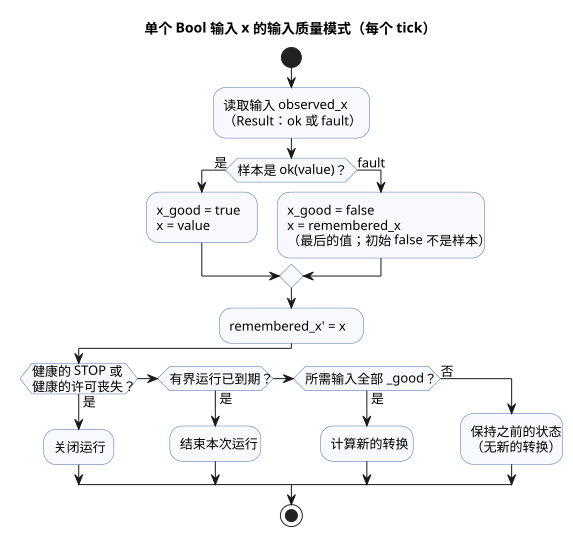
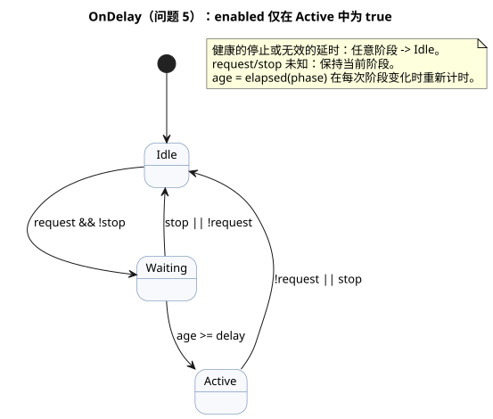
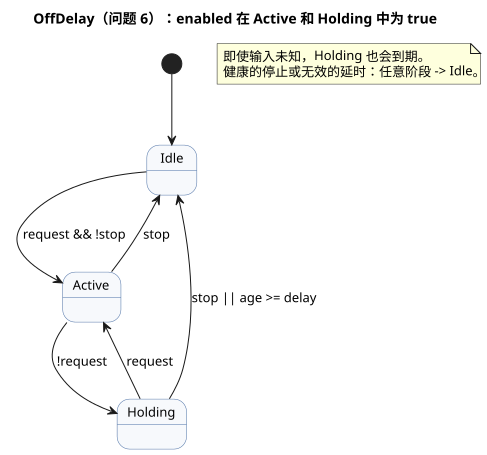
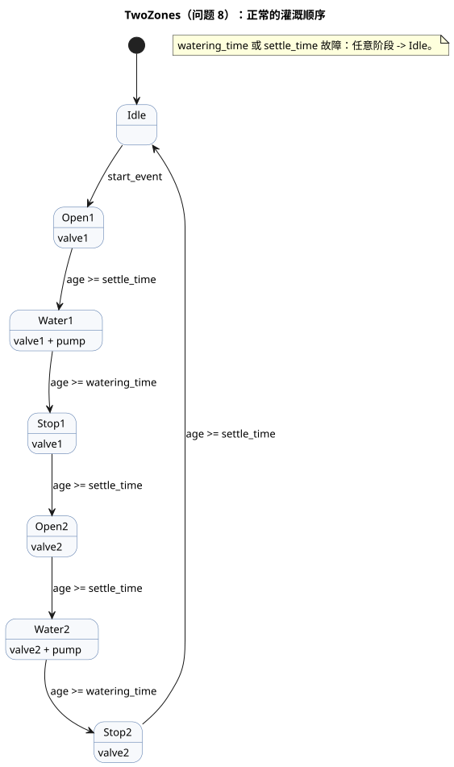
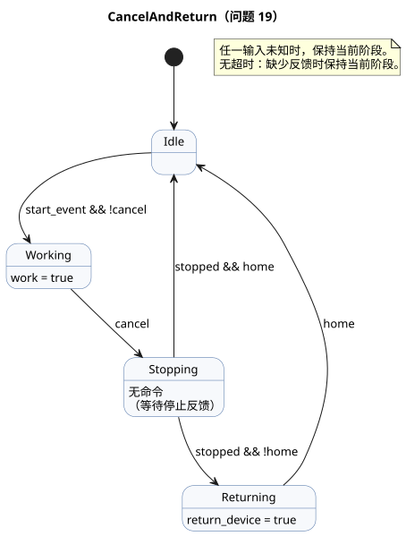
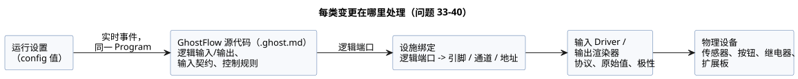

<!-- translation-source: docs/language_faq.en.md -->
[英文原文](language_faq.en.md)

# GhostFlow 编码 FAQ

本 FAQ 只回答一类问题：“这种行为该如何编码？”
每个问题都给出可运行的代码、对其行为的说明（包括边界情况），以及这样编写的理由。

- 语言规则由 [语言参考](LANGUAGE-REFERENCE.zh.md) 定义，而不是由本 FAQ 定义。
- 需求中的哪一部分属于语言、运行时、Driver、设施还是 UI，按问题逐一列在
  [参考第 8 章](reference/08-language-runtime-and-device-boundaries.zh.md) 中。

**本文内容**

- 问题 1–16：基本模式——按钮、自锁、定时器、调度计划、迟滞、计数器、设置、报警、互斥和函数。
- 问题 17–23：互锁、取消、基于日历的调度，以及基于用量的控制。
- 问题 24–31：操作员可编辑的设置、日历、夏令时、潮汐和月相。
- 问题 32：停电后的行为。
- 问题 33–40：在不修改控制代码的前提下更换传感器、继电器、GPIO 引脚和扩展板。
- 问题 41：使用 `ghostc` CLI 检查和编译文档。

**关于输入修订。** 自 2026-10-05 的外部输入修订起，所有携带质量信息的声明都使用 `input`。
现有的信号调理和显式 `Result` 故障分支保持不变。早期的 `sensor` 摘录保存在 `tests/fixtures/history/issue531/` 下。

**关于修订后的示例。** 当某个输入的生产者处于未知状态（故障）时，示例会在源代码内部显式保存两种记忆：最后一次观测到的值和最后一次显示的输出。
这些记忆的初始值*不是*来自生产者的健康样本。
质量守卫确保未知的请求绝不会产生新的转换。健康的 STOP 和许可的丧失仍然优先，有界的运行时段仍会到期。
示例不推断物理设备故障，也不要求自动控制器去按 START。
关于这一模式的详细说明，参见 [如何阅读示例](#如何阅读示例)。

**审阅状态。** 已于 2026-10-01 对照 dev 审阅：[`a7333e56bc25c73fd6167b1182269b96cb671d05`](https://github.com/callin2/ghostflow-language/tree/a7333e56bc25c73fd6167b1182269b96cb671d05)。
部分问题带有状态标签。每个带标签的问题都有一条状态说明，指出受影响的范围。

| 标签 | 含义 |
|---|---|
| `[未决定]`（Undecided） | 某项语言或契约决定仍未确定。 |
| `[部分不支持]`（Partially unsupported） | 所述范围在此 dev 中不可用。 |
| `[已变更]`（Changed） | 此 dev 取代了原先的建议。 |

不带标签的问题同样尚未针对物理 Device、API 或 UI 集成进行验证。

## 问题列表

1. [如何编写程序文件？](#q01)
2. [如何只在按住按钮时打开输出？](#q02)
3. [如何在松开 Start 后继续运行，并用 Stop 按钮停止？](#q03)
4. [如何在启动后运行五分钟并自动停止？[已变更]](#q04)
5. [如何在请求持续两秒后再打开？[已变更]](#q05)
6. [如何在请求消失三秒后关闭？[已变更]](#q06)
7. [如何在每天上午 6:00 和下午 6:45 浇水？](#q07)
8. [如何先灌溉区域 1，再灌溉区域 2？[已变更]](#q08)
9. [如何在湿度低时打开，又不在边界处反复切换？](#q09)
10. [如何在低于下限时给水箱注水，并在达到上限时停止？](#q10)
11. [如何在传感器检测到三次后发出完成信号？](#q11)
12. [如何把“五分钟”做成屏幕上可编辑的字段？[已变更]](#q12)
13. [如何在故障消除后保持报警，并用 Reset 解除？](#q13)
14. [如何防止两个输出同时打开？](#q14)
15. [如何在日出 30 分钟后启动？](#q15)
16. [如何在多处复用同一个计算？](#q16)
17. [如何实现互锁？](#q17)
18. [是否支持自锁？](#q18)
19. [用户中途取消时，能否让某个特定设备动作？](#q19)
20. [如何在日出时调度一项操作？](#q20)
21. [能否按星期几调度操作？](#q21)
22. [能否根据设备的累计运行时间控制设备？[部分不支持]](#q22)
23. [能否不论自动还是手动模式，都根据每日运行次数执行清洗？](#q23)
24. [能否在不更新固件的情况下，之后只修改运行时间？[已变更]](#q24)
25. [能否修改设置字段的标签和 UI 组件？](#q25)
26. [能否限制可编辑设置值的范围？](#q26)
27. [能否为一周中的每一天使用不同的设置？[已变更]](#q27)
28. [能否只在法定节假日使用不同的控制逻辑？](#q28)
29. [能否在控制中考虑夏令时？](#q29)
30. [能否根据高潮和低潮控制操作？[部分不支持]](#q30)
31. [能否根据大潮/小潮或月相控制操作？[已变更]](#q31)
32. [能否编写停电后恢复供电时的行为？](#q32)
33. [能否在不修改控制代码的情况下更换温度传感器？[已变更]](#q33)
34. [传感器设置是否与 GhostFlow 源代码分离？它们的变更周期是否不同？](#q34)
35. [能否像只更换打印机 Driver 那样，在不重新编译控制程序的情况下更换传感器？](#q35)
36. [设备更换与重新编译的分离是否也应写入语言规范？](#q36)
37. [如果把按钮接到另一个 GPIO 引脚，是否只需修改输入映射？](#q37)
38. [能否只修改输出 GPIO 映射来连接另一个继电器？](#q38)
39. [能否用 Waveshare 等扩展板增加输出数量？](#q39)
40. [能否同样映射 RS485 I/O 扩展板的输入和输出？](#q40)
41. [如何使用编译器 CLI 检查或编译文档？](#q41)

## 如何阅读示例

- **独立程序。** 每个 `control` 示例都是一个完整、独立的程序。不要把多个示例原样粘贴到同一个 control 中。
- **代码放在哪里。** 把代码放在 `.ghost.md` 文档的顶层 `ghost` 块中。问题 1 展示了一个完整的文档。
- **片段。** *片段*是放进现有 control 内部的一条声明或一个表达式。
- **设计写法。** *设计写法*是参考文档中同样标记为设计写法的写法；当前编译器可能不接受它。
- **输入的含义。** 每个问题都会说明其输入名称的含义。变量名并不决定物理触点的极性或通信方式。
- **输出是意图。** 输出是逻辑意图，而不是确认。要知道阀门是否真的打开，应读取单独的反馈输入，不要复用输出值。
- **语法依据。** 每个回答末尾都有一个 **语法依据** 列表，为所用的每种写法链接到参考文档的章和节。
  通用的 `control`、`input` 和 `output` 声明遵循 [参考 §1.4 语法表示法](reference/01-source-and-syntax.zh.md)。

**反复出现的输入质量模式。** 几乎每个示例都会针对每个 Bool 输入 `x` 以同样的四行开头：

- `input observed_x: Bool;` 声明输入。读取它得到一个 `Result`：健康样本为 `ok(value)`，生产者状态未知时为 `fault(reason)`。
- `let x_good = ...` 仅当本 tick 的样本健康时为 `true`。
- `let x = ...` 是健康的值；发生故障时，则是记在 `remembered_x` 中的最后一个值。
- `remembered_x' = x;` 更新这份记忆。它的初始值（`false`）是源代码本地的起始值，而不是来自生产者的样本。

随后，转换表达式按固定顺序使用这些值：

1. 健康的 STOP，或健康的许可丧失（例如 `low_water_good && low_water`），最先关闭运行。
2. 时间已到的有界运行结束，即使某些输入处于故障状态。
3. 只有当新转换所依赖的每个输入都为 `_good` 时，才计算新转换。
4. 否则保持之前的状态（`... else running`）。

有些示例还保留一个 `displayed_<output>` 状态。它在输入未知期间按同样的顺序保持最后一次的输出意图。
代码中的注释 `// Source-local display memory is initialized here; faults remain producer unknown.` 标记了这一模式。



该图展示一个输入样本如何流经质量守卫：健康样本会更新值和记忆；故障则保留记住的值，但阻止新的转换。

<a id="q01"></a>
## 1. 如何编写程序文件？

编写一个 `.ghost.md` 文档。它同时容纳说明和代码。

````markdown
# 버튼으로 램프 켜기

버튼을 누르고 있는 동안 램프를 켠다.

```ghost
control ButtonLamp {
  state displayed_lamp: Bool = false;
  displayed_lamp' = if button_good && !button then false else if button_good then button else displayed_lamp;
  // Source-local display memory is initialized here; faults remain producer unknown.
  state remembered_button: Bool = false;
  let button_good = case observed_button { ok(_) => true; fault(_) => false; };
  let button = case observed_button { ok(value) => value; fault(_) => remembered_button; };
  remembered_button' = button;
  input observed_button: Bool;
  output lamp: Bool;

  lamp <- displayed_lamp';
}
```
````

人阅读 Markdown 说明，`ghost` 块包含控制规则。
一个文档可以在说明段落之间放置多个 `ghost` 块；它们按文档顺序共同构成一个程序。
把代码拆分成多个块并不会产生执行阶段或等待时段。

**为什么这样写？** 行为和选择该行为的理由一同保存在一个文档中。

**语法依据**

- `.ghost.md`、顶层 `ghost` 块：[参考 §1.1——执行块提取](reference/01-source-and-syntax.zh.md)
- `control`、输入/输出声明：[参考 §1.4 语法表示法](reference/01-source-and-syntax.zh.md)
- `<-` 输出连接：[参考 §2.8 tick 与状态快照](reference/02-types-expressions-state.zh.md)

<a id="q02"></a>
## 2. 如何只在按住按钮时打开输出？

这里不需要记忆，因此把输入直接连接到输出。
此处 `button = true` 表示按钮被按下，`stop = true` 表示请求停止。

```ghost
control HoldToRun {
  state displayed_pump: Bool = false;
  displayed_pump' = if button_good && !button then false else if stop_good && stop then false else if button_good && stop_good then button && !stop else displayed_pump;
  // Source-local display memory is initialized here; faults remain producer unknown.
  state remembered_button: Bool = false;
  let button_good = case observed_button { ok(_) => true; fault(_) => false; };
  let button = case observed_button { ok(value) => value; fault(_) => remembered_button; };
  remembered_button' = button;
  state remembered_stop: Bool = false;
  let stop_good = case observed_stop { ok(_) => true; fault(_) => false; };
  let stop = case observed_stop { ok(value) => value; fault(_) => remembered_stop; };
  remembered_stop' = stop;
  input observed_button: Bool;
  input observed_stop: Bool;
  output pump: Bool;

  pump <- displayed_pump';
}
```

当按钮松开或请求停止时，输出意图会在同一次求值中关闭。
如果按钮和停止同时为 true，`!stop` 会使输出为 false。

**为什么没有状态？** 仅凭当前输入就能决定结果，无需记住之前的任何按压。

**语法依据**

- `Bool`、`true`/`false`：[参考 §2.1 值的种类](reference/02-types-expressions-state.zh.md)
- `&&`、`!`：[参考 §2.6 表达式与运算符](reference/02-types-expressions-state.zh.md)
- `<-`：[参考 §2.8 tick 与状态快照](reference/02-types-expressions-state.zh.md)

<a id="q03"></a>
## 3. 如何在松开 Start 后继续运行，并用 Stop 按钮停止？

在 `state` 中记住泵是否正在运行。在本例中，松开 Stop 本身不会重新启动运行。
要再次启动，必须先松开 Start 按钮，然后再次按下。

```ghost
control StartStop {
  // Source-local display memory is initialized here; faults remain producer unknown.
  state remembered_start: Bool = false;
  let start_good = case observed_start { ok(_) => true; fault(_) => false; };
  let start = case observed_start { ok(value) => value; fault(_) => remembered_start; };
  remembered_start' = start;
  state remembered_stop: Bool = false;
  let stop_good = case observed_stop { ok(_) => true; fault(_) => false; };
  let stop = case observed_stop { ok(value) => value; fault(_) => remembered_stop; };
  remembered_stop' = stop;
  input observed_start: Bool;
  input observed_stop: Bool;
  output pump: Bool;
  state armed: Bool = false;
  state running: Bool = false;

  let start_event = armed && start;

  armed' = if stop_good && stop then false else if start_good && stop_good then (!stop && !start) else armed;
  running' = if stop_good && stop then false else if start_good && stop_good then (!stop && (start_event || running)) else running;
  pump <- running';
}
```

- `running` 是上一 tick 的运行状态。启动后松开按钮，它仍保持为 true。
- `armed` 记住：在没有停止生效时，已经看到 Start 按钮被松开。
- 初始化时已经按住的按钮不会启动运行。只有在看到一次松开之后，才接受新的按压。
- Stop 的优先级高于自锁和启动请求。

**为什么输出使用 `running'`？** 这样当前求值中的停止能在同一 tick 内立即反映到输出。

**语法依据**

- `state`、前一状态与 `running'`：[参考 §2.8 tick 与状态快照](reference/02-types-expressions-state.zh.md)
- `let`：[参考 §2.7 纯函数与计算组合](reference/02-types-expressions-state.zh.md)
- `!`、`&&`、`||`：[参考 §2.6 表达式与运算符](reference/02-types-expressions-state.zh.md)

相关示例：[START/STOP](../examples/curriculum/pc-02-start-stop.ghost.zh.md)。

<a id="q04"></a>
## 4. 如何在启动后运行五分钟并自动停止？[已变更]

> **当前 dev 状态：** `duration` 设置现在产生一个 `Result`。除非用 `case` 处理 `ok`/`fault`，否则下面的 `age < duration` 比较无法编译。[当前契约](reference/05-settings-and-observation.zh.md)。

把运行状态与处于该状态的时间结合起来。
当 `stop` 或 `low_water` 为 true 时结束运行。运行期间忽略新的启动请求。

```ghost
control FiveMinuteRun {
  // Source-local display memory is initialized here; faults remain producer unknown.
  state remembered_start: Bool = false;
  let start_good = case observed_start { ok(_) => true; fault(_) => false; };
  let start = case observed_start { ok(value) => value; fault(_) => remembered_start; };
  remembered_start' = start;
  state remembered_stop: Bool = false;
  let stop_good = case observed_stop { ok(_) => true; fault(_) => false; };
  let stop = case observed_stop { ok(value) => value; fault(_) => remembered_stop; };
  remembered_stop' = stop;
  state remembered_low_water: Bool = false;
  let low_water_good = case observed_low_water { ok(_) => true; fault(_) => false; };
  let low_water = case observed_low_water { ok(value) => value; fault(_) => remembered_low_water; };
  remembered_low_water' = low_water;
  input observed_start: Bool;
  input observed_stop: Bool;
  input observed_low_water: Bool;
  output pump, valve: Bool;
  config duration: Duration = 5min;
  state armed: Bool = false;
  state running: Bool = false;
  timer age = elapsed(running);

  let permit = !stop && !low_water;
  let start_event = armed && start;

  armed' = if low_water_good && low_water then false else if stop_good && stop then false else if start_good && stop_good && low_water_good then (permit && !start) else armed;
  running' = if low_water_good && low_water then false else if stop_good && stop then false else if running && !(case duration { ok(value) => age < value; fault(_) => false; }) then false else if start_good && stop_good && low_water_good then (if !permit then false
    else if running then (case duration { ok(value) => age < value; fault(_) => false; })
    else start_event) else running;

  valve <- running';
  pump <- running';
  require pump => valve;
}
```

当 `running` 变为 true 时，`age` 从零开始计时。运行在 `age >= duration` 的第一个 tick 结束。
按住按钮不会自动再启动一个五分钟。
时间到期后要重新启动，需要再次按下按钮。在停止或低水位之后，必须先恢复许可，并先看到一次按钮松开。

**为什么不用 `sleep(5min)`？** 等待期间仍必须在每个 tick 检查停止和低水位。

**语法依据**

- `config duration: Duration`、`5min`：[参考 §5.1 config 声明](reference/05-settings-and-observation.zh.md)，[§3.1——Duration](reference/03-time-and-schedules.zh.md)
- `timer age = elapsed(running)`：[参考 §3.2 状态变化后的经过时间](reference/03-time-and-schedules.zh.md)
- `if ... then ... else`：[参考 §2.6——条件表达式](reference/02-types-expressions-state.zh.md)
- `require pump => valve`：[参考 §4.7 输出意图与约束](reference/04-sensors-constraints-control.zh.md)

<a id="q05"></a>
## 5. 如何在请求持续两秒后再打开？[已变更]

> **当前 dev 状态：** `delay` 设置现在产生一个 `Result`。在下面的 `age >= delay` 比较之前，先用 `case` 处理 `ok`/`fault`。[当前契约](reference/05-settings-and-observation.zh.md)。

把两种情况区分开：已收到请求，以及输出确实已打开。

```ghost
control OnDelay {
  // Source-local display memory is initialized here; faults remain producer unknown.
  state remembered_request: Bool = false;
  let request_good = case observed_request { ok(_) => true; fault(_) => false; };
  let request = case observed_request { ok(value) => value; fault(_) => remembered_request; };
  remembered_request' = request;
  state remembered_stop: Bool = false;
  let stop_good = case observed_stop { ok(_) => true; fault(_) => false; };
  let stop = case observed_stop { ok(value) => value; fault(_) => remembered_stop; };
  remembered_stop' = stop;
  input observed_request: Bool;
  input observed_stop: Bool;
  output enabled: Bool;
  config delay: Duration = 2s;
  type Phase = Idle | Waiting | Active;
  state phase: Phase = Idle;
  timer age = elapsed(phase);

  phase' = if !(case delay { ok(_) => true; fault(_) => false; }) then Idle else if stop_good && stop then Idle else if request_good && stop_good then (case phase {
    Idle => if request && !stop then Waiting else Idle;
    Waiting => if stop || !request then Idle
      else if (case delay { ok(value) => age >= value; fault(_) => false; }) then Active else Waiting;
    Active => if request && !stop then Active else Idle;
  }) else phase;

  enabled <- phase' == Active;
}
```

如果等待期间请求消失，等待即被取消。新的请求会重新开始计算两秒。
每次转换都发生在观测到其条件的那个 tick。一个很长的 tick 不会一次跳过多个阶段。



该图展示 `OnDelay` 的三个阶段；`enabled` 仅在 `Active` 中为 true。

**为什么需要阶段？** 它们把“没有请求”“正在等待两秒”和“已打开”明确地区分开。

**语法依据**

- `type Phase`、`case`：[参考 §2.4 枚举与穷尽分支](reference/02-types-expressions-state.zh.md)
- `state phase`、`phase'`：[参考 §2.8 tick 与状态快照](reference/02-types-expressions-state.zh.md)
- `elapsed(phase)`、`2s`：[参考 §3.2 状态变化后的经过时间](reference/03-time-and-schedules.zh.md)，[§3.1——Duration](reference/03-time-and-schedules.zh.md)

相关示例：[独立的定时器模式](../examples/curriculum/pc-06-timer-patterns.ghost.zh.md)。

<a id="q06"></a>
## 6. 如何在请求消失三秒后关闭？[已变更]

> **当前 dev 状态：** `delay` 设置现在产生一个 `Result`。在下面的 `age >= delay` 比较之前，先用 `case` 处理 `ok`/`fault`。[当前契约](reference/05-settings-and-observation.zh.md)。

增加一个在请求松开时开始的*保持*阶段。如果在保持期间请求再次出现，则保持打开。

```ghost
control OffDelay {
  // Source-local display memory is initialized here; faults remain producer unknown.
  state remembered_request: Bool = false;
  let request_good = case observed_request { ok(_) => true; fault(_) => false; };
  let request = case observed_request { ok(value) => value; fault(_) => remembered_request; };
  remembered_request' = request;
  state remembered_stop: Bool = false;
  let stop_good = case observed_stop { ok(_) => true; fault(_) => false; };
  let stop = case observed_stop { ok(value) => value; fault(_) => remembered_stop; };
  remembered_stop' = stop;
  input observed_request: Bool;
  input observed_stop: Bool;
  output enabled: Bool;
  config delay: Duration = 3s;
  type Phase = Idle | Active | Holding;
  state phase: Phase = Idle;
  timer age = elapsed(phase);

  phase' = if phase == Holding && (case delay { ok(value) => age >= value; fault(_) => true; }) then Idle else if !(case delay { ok(_) => true; fault(_) => false; }) then Idle else if stop_good && stop then Idle else if request_good && stop_good then (case phase {
    Idle => if request && !stop then Active else Idle;
    Active => if stop then Idle
      else if !request then Holding else Active;
    Holding => if stop then Idle
      else if request then Active
      else if (case delay { ok(value) => age >= value; fault(_) => false; }) then Idle else Holding;
  }) else phase;

  enabled <- phase' in {Active, Holding};
}
```

三秒从进入 `Holding` 时开始计算。停止会立即关闭输出，无需等待延时。
`elapsed(phase)` 是在当前阶段中经过的时间，而不是多个 ON 区间的总和。



该图展示 `OffDelay` 的各个阶段；`enabled` 在 `Active` 和 `Holding` 中为 true。

**为什么不共用通电延时的定时器？** 每个条件都需要各自记住的起始时间。

**语法依据**

- `type`、`case`、`in {Active, Holding}`：[参考 §2.4 枚举与穷尽分支](reference/02-types-expressions-state.zh.md)
- `elapsed(phase)`：[参考 §3.2 状态变化后的经过时间](reference/03-time-and-schedules.zh.md)
- 区分阶段经过时间与累计时间：[参考 §3.4 累计时间与滚动预算](reference/03-time-and-schedules.zh.md)

<a id="q07"></a>
## 7. 如何在每天上午 6:00 和下午 6:45 浇水？

用调度计划的 `.due` 作为启动条件，用定时器决定运行多长时间。

```ghost
control DailyWatering {
  // Source-local display memory is initialized here; faults remain producer unknown.
  state remembered_stop: Bool = false;
  let stop_good = case observed_stop { ok(_) => true; fault(_) => false; };
  let stop = case observed_stop { ok(value) => value; fault(_) => remembered_stop; };
  remembered_stop' = stop;
  input observed_stop: Bool;
  output pump: Bool;
  schedule starts: DailySlots<15min> {
    timezone = "Asia/Seoul";
    selected = [06:00, 18:45];
    dst_missing = skip;
    dst_repeated = first;
    basis = pulse;
    when = true;
    clock = trusted_only;
    gap = skip_after(60s);
    recovery = baseline;
    fallback = skip;
  }
  let duration = 5min;
  state running: Bool = false;
  timer age = elapsed(running);

  running' = if stop_good && stop then false else if running && !(age < duration) then false else if stop_good then (!stop && (if running then age < duration else starts.due)) else running;
  pump <- running';
}
```

`DailySlots<15min>` 并不表示“每 15 分钟运行一次”。它表示启动时间从 15 分钟的网格中选取，并且只有 `selected` 中的时间才会触发。
本例不会把运行期间到来的调度启动排队，也不会在之后补运行停止期间已经错过的启动时间。

**为什么把调度计划和定时器分开？** 日历时间决定*何时*启动；单调的经过时间决定运行*多长时间*。

**语法依据**

- `schedule`、`DailySlots<15min>`、`timezone`、`selected`、`.due`：[参考 §3.6 选定的 DailySlots](reference/03-time-and-schedules.zh.md)
- 区分调度触发实例与运行：[参考 §3.5 Schedule 的通用语义](reference/03-time-and-schedules.zh.md)
- `elapsed(running)`：[参考 §3.2 状态变化后的经过时间](reference/03-time-and-schedules.zh.md)

<a id="q08"></a>
## 8. 如何先灌溉区域 1，再灌溉区域 2？[已变更]

> **当前 dev 状态：** `watering_time` 和 `settle_time` 设置现在产生 `Result`。在下面的时间比较之前，先用 `case` 处理 `ok`/`fault`。[当前契约](reference/05-settings-and-observation.zh.md)。

把顺序写成一个枚举，并把每个输出连接到允许它打开的阶段。
本例展示正常的运行顺序。每个区域经历三个步骤：
请求打开阀门并等待两秒，供水五分钟，然后请求停泵并等待两秒使其稳定。

```ghost
control TwoZones {
  // Source-local display memory is initialized here; faults remain producer unknown.
  state remembered_start: Bool = false;
  let start_good = case observed_start { ok(_) => true; fault(_) => false; };
  let start = case observed_start { ok(value) => value; fault(_) => remembered_start; };
  remembered_start' = start;
  input observed_start: Bool;
  output pump, valve1, valve2: Bool;
  type Phase = Idle | Open1 | Water1 | Stop1 | Open2 | Water2 | Stop2;
  state phase: Phase = Idle;
  state armed: Bool = false;
  timer age = elapsed(phase);
  config watering_time: Duration = 5min;
  config settle_time: Duration = 2s;

  let start_event = armed && start;
  armed' = if start_good then (phase == Idle && !start) else armed;

  phase' = if !(case watering_time { ok(_) => true; fault(_) => false; } && case settle_time { ok(_) => true; fault(_) => false; }) then Idle else if phase != Idle || start_good then (case phase {
    Idle => if start_event then Open1 else Idle;
    Open1 => if (case settle_time { ok(value) => age >= value; fault(_) => false; }) then Water1 else Open1;
    Water1 => if (case watering_time { ok(value) => age >= value; fault(_) => false; }) then Stop1 else Water1;
    Stop1 => if (case settle_time { ok(value) => age >= value; fault(_) => false; }) then Open2 else Stop1;
    Open2 => if (case settle_time { ok(value) => age >= value; fault(_) => false; }) then Water2 else Open2;
    Water2 => if (case watering_time { ok(value) => age >= value; fault(_) => false; }) then Stop2 else Water2;
    Stop2 => if (case settle_time { ok(value) => age >= value; fault(_) => false; }) then Idle else Stop2;
  }) else phase;

  valve1 <- phase' in {Open1, Water1, Stop1};
  valve2 <- phase' in {Open2, Water2, Stop2};
  pump <- phase' in {Water1, Water2};
  require pump => (valve1 || valve2);
  require !(valve1 && valve2);
}
```



该图按顺序展示七个阶段，以及每个阶段打开哪些输出。

运行期间到来的请求不会排队。顺序完成后，松开按钮再按下即可重新启动。
这段代码中的两秒等待并不能确认阀门已经真正打开。
如果需要开/关反馈以及中断顺序的方法，请参考
[使用反馈的顺序控制示例](../examples/curriculum/pc-09-sequential-water-supply.ghost.zh.md)。

**为什么不写循环？** 在每个阶段，程序都必须一边持续求值新的输入，一边记住自己所处的位置。

**语法依据**

- `type Phase`、`case`、`in { ... }`：[参考 §2.4 枚举与穷尽分支](reference/02-types-expressions-state.zh.md)
- `phase'` 与同时发生的状态转换：[参考 §2.8 tick 与状态快照](reference/02-types-expressions-state.zh.md)
- `elapsed(phase)`：[参考 §3.2 状态变化后的经过时间](reference/03-time-and-schedules.zh.md)
- `require`、`=>`、输出互斥：[参考 §4.7 输出意图与约束](reference/04-sensors-constraints-control.zh.md)

<a id="q09"></a>
## 9. 如何在湿度低时打开，又不在边界处反复切换？

为开启和关闭使用不同的阈值（迟滞）。同时显式处理传感器故障。

```ghost
control MoistureControl {
  state displayed_pump: Bool = false;
  displayed_pump' = if stop_good && stop then false else if stop_good then requested && !stop else displayed_pump;
  // Source-local display memory is initialized here; faults remain producer unknown.
  state remembered_stop: Bool = false;
  let stop_good = case observed_stop { ok(_) => true; fault(_) => false; };
  let stop = case observed_stop { ok(value) => value; fault(_) => remembered_stop; };
  remembered_stop' = stop;
  input observed_stop: Bool;
  input moisture: Percent {
    sample = 1s;
    valid = 0% .. 100%;
    filter = median(5);
    stale_after = 3s;
    recover_after = 3 samples;
  }
  signal dry = hysteresis(moisture,
    on_below: 30%, off_above: 35%, initial: false);
  output pump: Bool;

  let requested = case dry {
    ok(value) => value;
    fault(_) => false;
  };
  pump <- displayed_pump';
}
```

- 健康的湿度值低于 30% 时打开泵，高于 35% 时关闭泵。在任一边界上以及两者之间，保持之前的判定。
- 如果滤波器尚未就绪，或尚未满足恢复条件，该值走故障路径，泵同样关闭。
- 采样间隔和限值是为本程序所做的选择，并不是所有传感器的默认值。
- 当健康的测量值恢复后，运行会根据新的湿度求值自动恢复。如果需要的是手动重启，请为此另加状态。

**为什么不直接写 `moisture < 30%`？** 仅凭这一条，既无法处理信号质量，也无法处理边界处的振荡。

**语法依据**

- `input`、`sample`、`valid`、`filter`、`stale_after`、`recover_after`：[参考 §4.2 样本契约与 sensor 处理顺序](reference/04-sensors-constraints-control.zh.md)
- `median`、`signal`、`hysteresis`、命名参数：[参考 §4.3 filter 与 signal 运算](reference/04-sensors-constraints-control.zh.md)
- `case`、`ok(value)`、`fault(_)`：[参考 §4.1 sensor 与 Result 质量](reference/04-sensors-constraints-control.zh.md)

<a id="q10"></a>
## 10. 如何在低于下限时给水箱注水，并在达到上限时停止？

记住是否正在注水。`low_level_reached` 表示水已到达下限液位传感器，
`high_level_reached` 表示水已到达上限液位传感器。

```ghost
control TankLevel {
  // Source-local display memory is initialized here; faults remain producer unknown.
  state remembered_low_level_reached: Bool = false;
  let low_level_reached_good = case observed_low_level_reached { ok(_) => true; fault(_) => false; };
  let low_level_reached = case observed_low_level_reached { ok(value) => value; fault(_) => remembered_low_level_reached; };
  remembered_low_level_reached' = low_level_reached;
  state remembered_high_level_reached: Bool = false;
  let high_level_reached_good = case observed_high_level_reached { ok(_) => true; fault(_) => false; };
  let high_level_reached = case observed_high_level_reached { ok(value) => value; fault(_) => remembered_high_level_reached; };
  remembered_high_level_reached' = high_level_reached;
  input observed_low_level_reached: Bool;
  input observed_high_level_reached: Bool;
  output fill_pump: Bool;
  type Phase = Idle | Filling | SensorConflict;
  state phase: Phase = Idle;
  let conflict = high_level_reached && !low_level_reached;

  phase' = if low_level_reached_good && high_level_reached_good then (case phase {
    Idle => if conflict then SensorConflict
      else if !low_level_reached then Filling else Idle;
    Filling => if conflict then SensorConflict
      else if high_level_reached then Idle else Filling;
    SensorConflict => if conflict then SensorConflict else Idle;
  }) else phase;

  fill_pump <- phase' == Filling;
}
```

- 水位再次升过下限时，注水不会立即停止。一旦开始注水，就会一直持续到上限。
- 如果只有上限输入为 true 而下限输入为 false，说明传感器相互矛盾。此时泵关闭（`SensorConflict`）。矛盾消除后，程序先经过一次 `Idle`，然后再重新求值。

**为什么不直接把一个输入取反？** 启动和停止使用不同的阈值，因此需要之前的运行状态。

**语法依据**

- `type Phase`、`case`：[参考 §2.4 枚举与穷尽分支](reference/02-types-expressions-state.zh.md)
- `state`、`phase'`、`<-`：[参考 §2.8 tick 与状态快照](reference/02-types-expressions-state.zh.md)
- `if`、`!`、`&&`：[参考 §2.6 表达式与运算符](reference/02-types-expressions-state.zh.md)

原始示例：[水箱迟滞](../examples/curriculum/pc-07-tank-hysteresis.ghost.zh.md)。

<a id="q11"></a>
## 11. 如何在传感器检测到三次后发出完成信号？

统计输入从 false 变为 true 的*事件*（上升沿），而不是输入为 true 的 tick 数。
本例使用参考文档中的精确整数类型 `Int`。

```ghost
control CountThree {
  // Source-local display memory is initialized here; faults remain producer unknown.
  state remembered_detected: Bool = false;
  let detected_good = case observed_detected { ok(_) => true; fault(_) => false; };
  let detected = case observed_detected { ok(value) => value; fault(_) => remembered_detected; };
  remembered_detected' = detected;
  state remembered_reset: Bool = false;
  let reset_good = case observed_reset { ok(_) => true; fault(_) => false; };
  let reset = case observed_reset { ok(value) => value; fault(_) => remembered_reset; };
  remembered_reset' = reset;
  input observed_detected: Bool;
  input observed_reset: Bool;
  output done: Bool;
  state previous: Bool = false;
  state count: Int = 0;
  let rising = detected && !previous;

  previous' = if detected_good && reset_good then (detected) else previous;
  count' = if reset_good && reset then 0 else if detected_good && reset_good then (if reset then 0
    else if rising && count < 3 then count + 1
    else count) else count;
  done <- count' >= 3;
}
```

- 一直保持为 true 的检测信号只计数一次。计数器计到 3 即停止。
- 如果复位和检测在同一 tick 到来，复位优先。
- 启动时已经为 true 的输入计为第一次检测。
- 如果在屏幕上显示计数器，请在意图链接中明确说明它统计的是什么，不要依赖它的名称。

**为什么用 `Int` 而不是 `Number`？** 计数绝不能是近似值，也绝不能被悄悄舍入。

**语法依据**

- `Int`、整数运算与比较：[参考 §2.3 精确整数设计](reference/02-types-expressions-state.zh.md)
- `previous`、`count` 和 `count'` 中的状态记忆：[参考 §2.8 tick 与状态快照](reference/02-types-expressions-state.zh.md)
- 计数器的公开含义：[参考 §5.3——描述符与快照](reference/05-settings-and-observation.zh.md)

<a id="q12"></a>
## 12. 如何把“五分钟”做成屏幕上可编辑的字段？[已变更]

> **当前 dev 状态：** 设置声明和实时更新均已支持。下面的 `age < duration` 建议沿用早期模型，即把设置当作普通标量读取。请用 `case` 处理当前设置的 `Result`。[当前契约](reference/05-settings-and-observation.zh.md)。

声明一个运行设置，并给出其类型、范围、步长、权限和显示名称。
用这个**片段**替换[示例 4](#q04) 中的 `duration` 声明。

```ghost
config duration: Duration = 5min {
  min = 1min;
  max = 20min;
  step = 1min;
  access = operator;
  label = "관수 시간";
}
```

控制表达式仍然使用 `age < duration`。
屏幕接收该设置的描述，并据此构建一个时间字段，接受 1 到 20 分钟、以 1 分钟为步长的值。
由屏幕决定显示文本框、选择列表还是滑块。

修改运行设置是一个*原子实时事件*：它在同一程序、同一次运行中改变生效值。

- 当多个值同时修改时，先全部校验再一起应用。只要有一个无效，就一个也不修改。
- 不要把正在运行的定时器重置为零。
- 示例：某次运行已持续六分钟，此时上限从十分钟降为五分钟。在首次使用新值的求值中，`age < duration` 为 false，运行结束。

**为什么不直接找到 `5min` 字面量并显示在屏幕上？** 并不是每个常量都打算让操作员调整。

**语法依据**

- `config`、`min`、`max`、`step`、`access`、`label`：[参考 §5.1 config 声明](reference/05-settings-and-observation.zh.md)
- 默认值与生效值：[参考 §5.1——默认值与生效值](reference/05-settings-and-observation.zh.md)
- 执行期间的原子修改：[参考 §5.2——atomic live event](reference/05-settings-and-observation.zh.md)

<a id="q13"></a>
## 13. 如何在故障消除后保持报警，并用 Reset 解除？

把故障输入的当前值与记住故障的状态分开。
本例只处理报警记忆。`fault_active = true` 表示原因仍然存在。

```ghost
control AlarmMemory {
  // Source-local display memory is initialized here; faults remain producer unknown.
  state remembered_fault_active: Bool = false;
  let fault_active_good = case observed_fault_active { ok(_) => true; fault(_) => false; };
  let fault_active = case observed_fault_active { ok(value) => value; fault(_) => remembered_fault_active; };
  remembered_fault_active' = fault_active;
  state remembered_reset: Bool = false;
  let reset_good = case observed_reset { ok(_) => true; fault(_) => false; };
  let reset = case observed_reset { ok(value) => value; fault(_) => remembered_reset; };
  remembered_reset' = reset;
  input observed_fault_active: Bool;
  input observed_reset: Bool;
  output alarm: Bool;
  state latched: Bool = false;
  state reset_armed: Bool = false;
  let reset_event = reset_armed && reset;

  reset_armed' = if fault_active_good && reset_good then (!fault_active && !reset) else reset_armed;
  latched' = if fault_active_good && reset_good then (fault_active || (latched && !reset_event)) else latched;
  alarm <- latched';
}
```

- 故障原因消失后，`latched` 仍保持为 true。只有在原因消失*并且* Reset 被松开后再次按下时，它才清除。
- 如果 `fault_active` 和 `reset` 同时为 true，`fault_active` 优先。
- Reset 不是重启设备的命令。

**为什么这与 `alarm <- fault_active` 不同？** 当前原因与对过去故障的记忆是不同的信息。
关于设备清理、位置反馈和多个故障原因，参见
[故障与复位示例](../examples/curriculum/pc-10-fault-alarm-reset.ghost.zh.md)。

**语法依据**

- `state latched`、`reset_armed`、下一状态 `'`：[参考 §2.8 tick 与状态快照](reference/02-types-expressions-state.zh.md)
- `let`、纯事件条件：[参考 §2.7 纯函数与计算组合](reference/02-types-expressions-state.zh.md)
- `fault_active || (latched && !reset_event)`：[参考 §2.6 表达式与运算符](reference/02-types-expressions-state.zh.md)

<a id="q14"></a>
## 14. 如何防止两个输出同时打开？

分别写出每个请求，然后添加一条互斥约束。

```ghost
control ExclusiveDirections {
  state displayed_forward: Bool = false;
  displayed_forward' = if forward_request_good && !forward_request then false else if forward_request_good then forward_request else displayed_forward;
  state displayed_reverse: Bool = false;
  displayed_reverse' = if reverse_request_good && !reverse_request then false else if reverse_request_good then reverse_request else displayed_reverse;
  // Source-local display memory is initialized here; faults remain producer unknown.
  state remembered_forward_request: Bool = false;
  let forward_request_good = case observed_forward_request { ok(_) => true; fault(_) => false; };
  let forward_request = case observed_forward_request { ok(value) => value; fault(_) => remembered_forward_request; };
  remembered_forward_request' = forward_request;
  state remembered_reverse_request: Bool = false;
  let reverse_request_good = case observed_reverse_request { ok(_) => true; fault(_) => false; };
  let reverse_request = case observed_reverse_request { ok(value) => value; fault(_) => remembered_reverse_request; };
  remembered_reverse_request' = reverse_request;
  input observed_forward_request: Bool;
  input observed_reverse_request: Bool;
  output forward, reverse: Bool;

  forward <- displayed_forward';
  reverse <- displayed_reverse';
  require !(forward && reverse);
}
```

当两个请求都为 true 时，应用约束后两个输出都为 false。输出的书写顺序并不决定哪一个胜出。
这条约束本身不会在换向时增加延时。如需延时，参见
[换向状态与定时器示例](../examples/curriculum/pc-04-direction-interlock.ghost.zh.md)。

**为什么不在另一个输出的表达式中悄悄阻止这个输出？** 这样每个请求和冲突规则都可以单独阅读和解释。

**语法依据**

- `require !(forward && reverse)` 与互斥：[参考 §4.7 输出意图与约束](reference/04-sensors-constraints-control.zh.md)
- 约束的语法骨架：[参考 §1.4 语法表示法](reference/01-source-and-syntax.zh.md)

<a id="q15"></a>
## 15. 如何在日出 30 分钟后启动？

声明一个 `Solar` 调度计划，并用其 `.due` 作为启动条件。
这个**片段**替换[示例 7](#q07) 中的 `starts` 声明。

```ghost
schedule starts: Solar {
  timezone = "Asia/Seoul";
  latitude = 37.5665;
  longitude = 126.9780;
  at = sun`rise + 30min`;
  fallback = skip;
  basis = pulse;
  when = true;
  clock = trusted_only;
  gap = skip_after(60s);
  recovery = baseline;
}
```

- 把示例坐标替换为实际现场的坐标。现有的 `duration` 和定时器决定 `starts.due` 之后运行多长时间。
- 如果无法确定日出时间，本例会跳过新的运行。它不会把这一原因伪装成正常的“尚未到启动时间”。
- `fallback = skip` 不会增加取消已启动运行的规则。

**为什么要指定位置、时区和 fallback？** 自然事件取决于系统的安装地点，而且在这些信息未知时该怎么做也必须明确写出。

**语法依据**

- `schedule ...: Solar`、位置/时区、``sun`rise + 30min` ``：[参考 §3.9——选定的 Solar 写法](reference/03-time-and-schedules.zh.md)
- `fallback = skip`：[参考 §3.9——自然基准的 fallback 与恢复](reference/03-time-and-schedules.zh.md)
- `.due` 的含义：[参考 §3.5 Schedule 的通用语义](reference/03-time-and-schedules.zh.md)

<a id="q16"></a>
## 16. 如何在多处复用同一个计算？

提取一个纯函数，并把它需要的值作为参数传入。

```ghost
fn permitted(request: Bool, stop: Bool, enabled: Bool) -> Bool {
  request && !stop && enabled
}

control TwoRequests {
  state displayed_zone1: Bool = false;
  displayed_zone1' = if enabled_good && !enabled then false else if request1_good && !request1 then false else if stop_good && !stop then false else if enabled_good && request1_good && stop_good then permitted(request1, stop, enabled) else displayed_zone1;
  state displayed_zone2: Bool = false;
  displayed_zone2' = if enabled_good && !enabled then false else if request2_good && !request2 then false else if stop_good && !stop then false else if enabled_good && request2_good && stop_good then permitted(request2, stop, enabled) else displayed_zone2;
  // Source-local display memory is initialized here; faults remain producer unknown.
  state remembered_request1: Bool = false;
  let request1_good = case observed_request1 { ok(_) => true; fault(_) => false; };
  let request1 = case observed_request1 { ok(value) => value; fault(_) => remembered_request1; };
  remembered_request1' = request1;
  state remembered_request2: Bool = false;
  let request2_good = case observed_request2 { ok(_) => true; fault(_) => false; };
  let request2 = case observed_request2 { ok(value) => value; fault(_) => remembered_request2; };
  remembered_request2' = request2;
  state remembered_stop: Bool = false;
  let stop_good = case observed_stop { ok(_) => true; fault(_) => false; };
  let stop = case observed_stop { ok(value) => value; fault(_) => remembered_stop; };
  remembered_stop' = stop;
  state remembered_enabled: Bool = false;
  let enabled_good = case observed_enabled { ok(_) => true; fault(_) => false; };
  let enabled = case observed_enabled { ok(value) => value; fault(_) => remembered_enabled; };
  remembered_enabled' = enabled;
  input observed_request1: Bool;
  input observed_request2: Bool;
  input observed_stop: Bool;
  input observed_enabled: Bool;
  output zone1, zone2: Bool;

  zone1 <- displayed_zone1';
  zone2 <- displayed_zone2';
}
```

函数在两次调用之间不记住任何东西。复用纯计算，与复制带有定时器或自锁记忆的*行为*是两回事。
对于这类行为，独立的状态、端口、设置和连接遵循 [行为组合](reference/06-composition-and-replay.zh.md)。

**为什么不让函数悄悄读取外部状态？** 相同的参数必须总是给出相同的结果，而且一次调用的每个依赖都必须在调用处可见。

**语法依据**

- `fn`、参数、`-> Bool`、函数调用：[参考 §2.7 纯函数与计算组合](reference/02-types-expressions-state.zh.md)
- 函数声明的语法骨架：[参考 §1.4 语法表示法](reference/01-source-and-syntax.zh.md)
- 带记忆的行为的独立性：[参考 §6.2 定义、实例与逻辑端口](reference/06-composition-and-replay.zh.md)

<a id="q17"></a>
## 17. 如何实现互锁？

*互锁*会阻止条件不满足的操作，或彼此冲突的操作。
使用两种手段：

- 把允许运行的条件写进状态转换表达式。
- 用 `require` 表达输出之间必须满足的关系。

### 仅在条件满足时运行

下面实现“只有在确认阀门已打开且不缺水时才运行泵”。
`valve_open` 是确认阀门确实已打开的输入。`low_water` 检测低水位，
`stop` 是停止请求。不要用阀门打开的*输出*值代替 `valve_open`。

```ghost
control PumpInterlock {
  // Source-local display memory is initialized here; faults remain producer unknown.
  state remembered_start: Bool = false;
  let start_good = case observed_start { ok(_) => true; fault(_) => false; };
  let start = case observed_start { ok(value) => value; fault(_) => remembered_start; };
  remembered_start' = start;
  state remembered_stop: Bool = false;
  let stop_good = case observed_stop { ok(_) => true; fault(_) => false; };
  let stop = case observed_stop { ok(value) => value; fault(_) => remembered_stop; };
  remembered_stop' = stop;
  state remembered_valve_open: Bool = false;
  let valve_open_good = case observed_valve_open { ok(_) => true; fault(_) => false; };
  let valve_open = case observed_valve_open { ok(value) => value; fault(_) => remembered_valve_open; };
  remembered_valve_open' = valve_open;
  state remembered_low_water: Bool = false;
  let low_water_good = case observed_low_water { ok(_) => true; fault(_) => false; };
  let low_water = case observed_low_water { ok(value) => value; fault(_) => remembered_low_water; };
  remembered_low_water' = low_water;
  input observed_start: Bool;
  input observed_stop: Bool;
  input observed_valve_open: Bool;
  input observed_low_water: Bool;
  output pump: Bool;
  state armed: Bool = false;
  state running: Bool = false;

  let permit = !stop && valve_open && !low_water;
  let start_event = armed && start;

  armed' = if low_water_good && low_water then false else if valve_open_good && !valve_open then false else if stop_good && stop then false else if start_good && stop_good && valve_open_good && low_water_good then (permit && !start) else armed;
  running' = if low_water_good && low_water then false else if valve_open_good && !valve_open then false else if stop_good && stop then false else if start_good && stop_good && valve_open_good && low_water_good then (permit && (running || start_event)) else running;
  pump <- running';
}
```

`permit` 在每个 tick 都会求值，运行期间也不例外。如果阀门打开的确认消失，或出现低水位或停止，
`running'` 和泵的意图都会关闭。条件恢复本身不会重新启动运行。
许可恢复后，需要松开 Start 再按下。
这是本例所选择的重启策略。

### 防止两个输出同时运行

要禁止两个输出同时打开（例如正转和反转），请添加一条输出约束。

```ghost
control DirectionInterlock {
  state displayed_forward: Bool = false;
  displayed_forward' = if forward_request_good && !forward_request then false else if forward_request_good then forward_request else displayed_forward;
  state displayed_reverse: Bool = false;
  displayed_reverse' = if reverse_request_good && !reverse_request then false else if reverse_request_good then reverse_request else displayed_reverse;
  // Source-local display memory is initialized here; faults remain producer unknown.
  state remembered_forward_request: Bool = false;
  let forward_request_good = case observed_forward_request { ok(_) => true; fault(_) => false; };
  let forward_request = case observed_forward_request { ok(value) => value; fault(_) => remembered_forward_request; };
  remembered_forward_request' = forward_request;
  state remembered_reverse_request: Bool = false;
  let reverse_request_good = case observed_reverse_request { ok(_) => true; fault(_) => false; };
  let reverse_request = case observed_reverse_request { ok(value) => value; fault(_) => remembered_reverse_request; };
  remembered_reverse_request' = reverse_request;
  input observed_forward_request: Bool;
  input observed_reverse_request: Bool;
  output forward, reverse: Bool;

  forward <- displayed_forward';
  reverse <- displayed_reverse';
  require !(forward && reverse);
}
```

- 如果两个请求都为 true，两个受约束的输出都为 false。先写的输出并不会胜出。
- 同样的互斥也可以用 `mutex(forward, reverse);` 表达。
- 如需在换向前等待，请使用单独的状态和定时器。

`require pump => valve;` 的含义是“泵的输出意图要求阀门的输出意图”。
阀门是否真正打开，应像第一个示例那样通过单独的输入来确认。
输出约束也不会自动重置状态。如果条件解除后必须要求一次新的启动，
请像第一个示例那样显式写出状态转换和重启条件。
这种软件逻辑不能替代急停。

### 局部约束与共享资源约束的分组

**局部组。** 可以把一个 control 的 Bool 输出约束收集到一个命名的局部组中，例如
`constraints LocalRules { require pump => valve; }`。`mutex` 也可以放进该组。

- 名称只是帮助读者找到说明，并不会把作用范围扩大到其他 control 或整个物理设施。
- 所有强制条件以 AND 组合，优先级无法绕过它们。
- 可选的 `check` 分析是独立的：它是一种不阻断的提示。

**共享资源。** 当多条请求路径使用同一个逻辑资源时，用
`constraints SharedRules for station` 声明共享规则。[完整的执行示例](../examples/bound-resource-execution.ghost.zh.md)
通过同一个 Rust 守卫检查自动、手动和 fallback 请求。步骤如下：

1. `compileSourceSync` 生成一个经过检查的描述符。该描述符不可执行。
2. 把确切的源代码/产物身份标识、稳定的资源 ID 以及模式/输入与输出映射
   显式传给 `compileBoundResourceControl`。
3. 通过参考宿主实际的 Rust/WASM 扫描路径执行。

该示例提供了完整的绑定和记录的输入。

**违反与恢复。**

- 启动前的违反会拒绝新的准入。
- 与当前持有者（现任者）冲突的新申请，会保留现任者的准入和之前的安全输出。新申请不会被藏进重试队列。
- 对于执行期间的违反，示例中编写的响应是
  `pump1 = false; valve1 = true;`。安全并不是一条通用的“全部 OFF”规则。
- 跳闸后，每个受影响的排他组都需要先观测到所有申请均为中性，再出现一次新的申请。
- 仅含 require 的组必须先观测到请求值等于编写的安全值，然后再检查新的请求。
- 相互连接的组必须在同一次扫描中一起恢复。

**可执行子集的范围。** 它覆盖一个 Bool GFB1 v1/v3 control，其中每个输出都受到显式
保护。同一设施中的写入方共享一个注册表，该注册表拒绝同一稳定 ID 上任何额外的
活动写入方。Context/PID、共享策略的 import
组合，以及跨多个 VM 的协作仲裁，均不在此子集中。
结果是逻辑上的请求意图/安全意图（requested/safe）。它们并不能证明渲染器已经应用了它们、
阀门已经打开，或现场设施是正确的。关于规则和阶段，参见 [参考 §4.8](reference/04-sensors-constraints-control.zh.md)
和 [约束契约](CONSTRAINTS.zh.md)。

**为什么把这两种方法分开？** 运行状态*如何*变化与允许*哪些*输出组合，
是两条不同的控制规则，二者都必须显式写出。

**语法依据**

- `let permit`、命名的纯计算：[参考 §2.7 纯函数与计算组合](reference/02-types-expressions-state.zh.md)
- `state`、`running'`、`<-`：[参考 §2.8 tick 与状态快照](reference/02-types-expressions-state.zh.md)
- `!`、`&&`、`||`：[参考 §2.6 表达式与运算符](reference/02-types-expressions-state.zh.md)
- `require`、`mutex`、`=>`，区分请求输出与安全输出：[参考 §4.7 输出意图与约束](reference/04-sensors-constraints-control.zh.md)
- `require` 和 `mutex` 的声明形式：[参考 §1.4 语法表示法](reference/01-source-and-syntax.zh.md)

<a id="q18"></a>
## 18. 是否支持自锁？

支持。在 `state` 中记住之前的运行状态，并在下一状态表达式中再次使用该值。
下面是基本的自锁：松开 Start 后仍保持打开。

```ghost
control SelfHolding {
  // Source-local display memory is initialized here; faults remain producer unknown.
  state remembered_start: Bool = false;
  let start_good = case observed_start { ok(_) => true; fault(_) => false; };
  let start = case observed_start { ok(value) => value; fault(_) => remembered_start; };
  remembered_start' = start;
  state remembered_stop: Bool = false;
  let stop_good = case observed_stop { ok(_) => true; fault(_) => false; };
  let stop = case observed_stop { ok(value) => value; fault(_) => remembered_stop; };
  remembered_stop' = stop;
  input observed_start: Bool;
  input observed_stop: Bool;
  output pump: Bool;
  state running: Bool = false;

  running' = if stop_good && stop then false else if start_good && stop_good then (!stop && (start || running)) else running;
  pump <- running';
}
```

- 当 `start` 为 true 时，`running'` 变为 true。
- 在下一个 tick，`start` 可能为 false，但之前的 `running` 为 true，因此运行继续。
- 当 `stop` 为 true 时，`running'` 为 false。即使 Start 和 Stop 同时到来，Stop 也优先。
- `pump` 跟随当前求值中的 `running'`。

使用这个基本表达式时，如果松开 Stop 时 `start` 仍为 true，运行会重新打开。
如果需要“松开 Start 再按下”，还要使用
[问题 3 中的重启许可状态](#q03)。

**为什么在表达式中包含之前的状态？** 把自锁记忆显式保存在 `running` 中，
就能在一个表达式中读出启动、保持和解除的条件。

**语法依据**

- `state running: Bool = false`、前一状态 `running`、下一状态 `running'`：[参考 §2.8 tick 与状态快照](reference/02-types-expressions-state.zh.md)
- `!stop && (start || running)`：[参考 §2.6 表达式与运算符](reference/02-types-expressions-state.zh.md)
- `pump <- running'`：[参考 §1.4 输出连接语法](reference/01-source-and-syntax.zh.md)，[§2.8 在输出中读取下一状态](reference/02-types-expressions-state.zh.md)

<a id="q19"></a>
## 19. 用户中途取消时，能否让某个特定设备动作？

可以。当取消输入到来时，转入一个后续阶段，并连接该阶段的输出。
本例经历四个步骤：请求原任务停止 → 确认已停止 → 运行返回设备 → 确认回到原位。
`stopped` 和 `home` 是确认实际停止和原位的输入。

```ghost
control CancelAndReturn {
  // Source-local display memory is initialized here; faults remain producer unknown.
  state remembered_start: Bool = false;
  let start_good = case observed_start { ok(_) => true; fault(_) => false; };
  let start = case observed_start { ok(value) => value; fault(_) => remembered_start; };
  remembered_start' = start;
  state remembered_cancel: Bool = false;
  let cancel_good = case observed_cancel { ok(_) => true; fault(_) => false; };
  let cancel = case observed_cancel { ok(value) => value; fault(_) => remembered_cancel; };
  remembered_cancel' = cancel;
  state remembered_stopped: Bool = false;
  let stopped_good = case observed_stopped { ok(_) => true; fault(_) => false; };
  let stopped = case observed_stopped { ok(value) => value; fault(_) => remembered_stopped; };
  remembered_stopped' = stopped;
  state remembered_home: Bool = false;
  let home_good = case observed_home { ok(_) => true; fault(_) => false; };
  let home = case observed_home { ok(value) => value; fault(_) => remembered_home; };
  remembered_home' = home;
  input observed_start: Bool;
  input observed_cancel: Bool;
  input observed_stopped: Bool;
  input observed_home: Bool;
  output work, return_device: Bool;
  type Phase = Idle | Working | Stopping | Returning;
  state phase: Phase = Idle;
  state armed: Bool = false;

  let start_event = armed && start;
  armed' = if start_good && cancel_good && stopped_good && home_good then (phase == Idle && !start && !cancel) else armed;
  phase' = if start_good && cancel_good && stopped_good && home_good then (case phase {
    Idle => if !cancel && start_event then Working else Idle;
    Working => if cancel then Stopping else Working;
    Stopping => if !stopped then Stopping else if home then Idle else Returning;
    Returning => if home then Idle else Returning;
  }) else phase;
  work <- phase' == Working;
  return_device <- phase' == Returning;
  require !(work && return_device);
}
```

- `Stopping` 等待原任务已停止的反馈，此时尚不发送返回命令。
- 只有在 `Returning` 中才会命令返回设备。即使取消被松开，返回也会持续到确认回到原位为止。
- 如果没有停止确认或原位确认，程序就停留在该阶段。本例没有超时策略。
- 取消之后不会自动重启。在等待状态下，松开 Start 和 Cancel，然后发出新的启动请求。
- 本例是普通的任务取消。不要把它当作在急停期间允许额外动作的规则。



该图展示四个阶段，以及使程序从一个阶段进入下一个阶段的反馈。

**为什么要在确认停止后才返回？** 这样原任务和返回命令就绝不会同时驱动设备，
取消期间也不会把逻辑状态与物理状态混为一谈。

**语法依据**

- 阶段转换与状态快照的含义：[参考 §2.8 tick 与状态快照](reference/02-types-expressions-state.zh.md)
- 区分请求、已应用和已确认的设备反馈：[参考 §4.7 requested、safe、applied、confirmed](reference/04-sensors-constraints-control.zh.md)
- `type Phase`、`case`：[参考 §2.4 枚举与穷尽分支](reference/02-types-expressions-state.zh.md)
- `let`、`if`、Bool 运算与比较：[参考 §2.6 表达式与运算符](reference/02-types-expressions-state.zh.md)

<a id="q20"></a>
## 20. 如何在日出时调度一项操作？

用 `Solar` 调度计划的 `.due` 作为启动条件。这个片段针对的是日出那一刻本身。

```ghost
schedule starts: Solar {
  timezone = "Asia/Seoul";
  latitude = 37.5665;
  longitude = 126.9780;
  at = sun`rise`;
  fallback = skip;
  basis = pulse;
  when = true;
  clock = trusted_only;
  gap = skip_after(60s);
  recovery = baseline;
}
```

把坐标和时区替换为实际现场的值。当 `starts.due` 为 true 时，准入一个新的触发实例。
现有的 `duration` 和控制状态决定运行多长时间。如果无法计算日出时间，
则跳过新的运行。`fallback = skip` 不会取消已经准入的运行。

**为什么使用 `.due`？** 它把自然事件的触发与运行状态转换分开，
从而保持调度求值与设备控制之间的边界。

**语法依据**

- `schedule ...: Solar`、``sun`rise` ``、位置/时区和 `fallback`：[参考 §3.9 选定的 Solar 写法](reference/03-time-and-schedules.zh.md)
- `.due` 与触发实例的准入：[参考 §3.5 Schedule 的通用语义](reference/03-time-and-schedules.zh.md)
- `fallback = skip` 与恢复：[参考 §3.9 自然基准的 fallback 与恢复](reference/03-time-and-schedules.zh.md)

<a id="q21"></a>
## 21. 能否按星期几调度操作？

``day`mon..fri` `` 等星期范围可按声明的时区筛选 `Daily` 脉冲。`workday` 和 `offday` 仍由设施日历定义。[当前契约](reference/03-time-and-schedules.zh.md)。

在调度计划的 `on` 字段中表达星期条件。例如，要在周一至周五上午 6:00 启动，
就把时间条件与下面的星期条件组合起来。
要得到能用当前编译器编译并运行的调度计划，请配合设施日历使用 ``day`workday` `` 或 ``day`offday` ``。

```ghost
on = day`mon..fri`;
```

星期过滤器作用于计算出的计划启动时刻的本地日期。法定节假日和现场工作日遵循与星期不同的规则，
因此不要把 ``day`mon..fri` `` 理解为法定节假日日历。
DST 和午夜边界策略同样遵循调度契约。

**为什么把星期和时间分开？** 同一个启动时间必须能与不同的日期条件组合，例如星期、法定节假日或现场工作日。

**语法依据**

- `on` 以及星期、法定节假日与工作日的区分：[参考 §3.8 DST、午夜与工作日历](reference/03-time-and-schedules.zh.md)
- `DailySlots` 和 `.due` 的选定调度语义：[参考 §3.6 选定的 DailySlots](reference/03-time-and-schedules.zh.md)
- 时区与本地日期边界：[参考 §3.1 时间值与时钟域](reference/03-time-and-schedules.zh.md)


<a id="q22"></a>
## 22. 能否根据设备的累计运行时间控制设备？[部分不支持]

> **当前 dev 状态：** 消费外部已确认的累计 `Duration` 的示例是支持的。可执行的 `on_time` 账目目前只支持持久的*已应用（applied）*证据；请求（requested）、安全（safe）和已确认（confirmed）阶段的原生账目执行不支持。[当前契约](../tools/control.mjs#L1521)。

以 `Duration` 值接收累计运行时间，并在条件中使用它。
首先确定**在哪个时段内累计，以及什么算作运行**。

| 期望的判据 | 累计范围 |
|---|---|
| 本次任务中总计运行十分钟 | 自任务开始以来各 ON 区间之和 |
| 最近一小时内运行二十分钟 | 连续移动的一小时窗口 |
| 今天总计运行一小时 | 指定时区中的今天这个日期 |
| 自维护以来总计运行一百小时 | 自一次显式的维护复位以来 |

这个控制示例*消费*一个累计值。`used` 是一个输入，表示在所选范围内同一设备已确认的 ON 区间之和。
`usage_valid` 表示该总和是否有效。
代码中不包含产生该累计值的声明。

```ghost
control UsageLimit {
  state displayed_device: Bool = false;
  displayed_device' = if request_good && !request then false else if usage_valid_good && !usage_valid then false else if request_good && usage_valid_good && used_good then request && usage_valid && within_limit else displayed_device;
  // Source-local display memory is initialized here; faults remain producer unknown.
  state remembered_request: Bool = false;
  let request_good = case observed_request { ok(_) => true; fault(_) => false; };
  let request = case observed_request { ok(value) => value; fault(_) => remembered_request; };
  remembered_request' = request;
  state remembered_usage_valid: Bool = false;
  let usage_valid_good = case observed_usage_valid { ok(_) => true; fault(_) => false; };
  let usage_valid = case observed_usage_valid { ok(value) => value; fault(_) => remembered_usage_valid; };
  remembered_usage_valid' = usage_valid;
  state remembered_used: Duration = 0ms;
  let used_good = case observed_used { ok(_) => true; fault(_) => false; };
  let used = case observed_used { ok(value) => value; fault(_) => remembered_used; };
  remembered_used' = used;
  input observed_request: Bool;
  input observed_usage_valid: Bool;
  input observed_used: Duration;
  output device: Bool;
  config max_use: Duration = 1h;

  let within_limit = case max_use {
    ok(value) => used < value;
    fault(_) => false;
  };
  device <- displayed_device';
}
```

一旦总和达到上限，就不再发出新的运行请求。如果严格的用量上限还需覆盖设备在物理上停止之前的延迟，
则还需要参考 §3.10 中的预留与结算规则。
`elapsed(running)` 测量的是自上一次状态变化以来的时间，它不会把反复的 ON/OFF 区间加起来。

要同时包括自动和手动运行，应为设备汇总一份共同的运行记录，而不是为每个命令来源各保留一个定时器。
要决定统计的是输出请求、通过约束的输出、已应用的命令，还是实际反馈。
没有反馈时，不要把命令被应用的时间称为“实际运行时间”。

用 `account` 声明一份累计记录，并通过例如 `used(account, rolling(60s))` 查询最近 60 秒。
`on_time` 声明指定目标、证据基准（requested、safe、applied 或 confirmed）以及持久化方式。
不要假定这种写法隐含了按任务或维护后复位的策略和保留策略。

**为什么需要单独的累计语义？** 只检查连续运行时间，会漏掉分散在许多短运行中的用量。

**语法依据**

- `Duration`、`1h`：[参考 §3.1 时间值与时钟域——Duration](reference/03-time-and-schedules.zh.md)
- `&&`、`<`：[参考 §2.6 表达式与运算符](reference/02-types-expressions-state.zh.md)
- `elapsed` 与累计的区别：[参考 §3.2 状态变化后的经过时间](reference/03-time-and-schedules.zh.md)
- 累计目标/范围与 `account`、`on_time`、`used`：[参考 §3.4 累计时间与滚动预算](reference/03-time-and-schedules.zh.md)
- 自动/手动合并汇总与每日上限：[参考 §3.10 基于时间的用量约束](reference/03-time-and-schedules.zh.md)
- `config max_use`：[参考 §5.1 config 声明](reference/05-settings-and-observation.zh.md)

<a id="q23"></a>
## 23. 能否不论自动还是手动模式，都根据每日运行次数执行清洗？

把计数条件与清洗顺序结合起来。
不要分别统计自动和手动的启动命令，而应**在一处统计同一设备的运行次数**。
设备持续运行期间从自动切换到手动，不算作一次新的运行。

例如，选择这样的策略：“今天（首尔时间）正常运行启动十次后，在当前这次运行结束时清洗一次。”
这里，运行确认信号的一次 OFF→ON 转换计为一次运行。
如果只应统计已完成的运行，就统计完成事件而不是启动事件。

这个**片段**读取每日计数。`Int` 是参考文档中的精确整数类型。
`today_starts` 是今天自动与手动正常运行的合计次数；`count_valid` 表示该计数是否有效。

```ghost
input today_starts: Int;
input count_valid: Bool;
let wash_due = case count_valid {
  ok(valid) => if valid then case today_starts {
    ok(count) => count >= 10; fault(_) => false;
  } else false;
  fault(_) => false;
};
```

`today_starts` 不是内置名称，这个片段也没有声明每日计数器本身。
请用 §3.10 中的 `account` 和 `count_events` 声明每日计数，并指定输入事件 ID、
证据基准和日期边界。同一事件的重传只计一次。
`on_time` 累加时间；`count_events` 统计事件。不要用其中一个代替另一个。

上面示例的清洗顺序如下。这里描述的是行为，不是可执行的语法。

```text
今天达到十次正常运行 → 记住需要清洗
确认当前这次正常运行已结束 → 开始清洗阶段
确认清洗完成 → 清除请求，并记住该日期的清洗已完成
```

- 在本例中，*为清洗*而打开同一设备不计为正常运行。
- 清洗期间不会开始新的正常运行。同样的条件适用于自动和手动请求。
- 在状态中记住清洗请求。设备忙碌时，一个 tick 宽的脉冲可能会丢失。
- 在此策略下，日期变更不会取消已经记住的清洗请求，也不会取消正在进行的清洗。
- “每天清洗一次”和“每十次运行清洗一次”是不同的策略。本例每天清洗一次。

真正的每日计数契约必须定义时区、日期边界、重启后的恢复、时钟校正，以及计数未知时的处理方式。
一个普通的 `state count = 0` 声明并不能产生按日期持久保存的计数。
请像[问题 8 的顺序控制](#q08)那样，用枚举状态编写清洗阶段和输出。

**为什么要独立于运行模式来计数？** 是否需要清洗取决于设备用了多少，而不是由谁下达的命令。

**语法依据**

- `Int` 与精确计数：[参考 §2.3 精确整数设计](reference/02-types-expressions-state.zh.md)
- `let`、`&&`、`>=`：[参考 §2.6 表达式与运算符](reference/02-types-expressions-state.zh.md)
- 清洗阶段的枚举与 `case`：[参考 §2.4 枚举与穷尽分支](reference/02-types-expressions-state.zh.md)
- 记住之前的输入、计数和清洗请求：[参考 §2.8 tick 与状态快照](reference/02-types-expressions-state.zh.md)
- 区分命令与物理运行：[参考 §4.7 requested、safe、applied、confirmed](reference/04-sensors-constraints-control.zh.md)
- 设备每日汇总的相关原则——这是时间汇总规则，而不是计数语法：[参考 §3.10 基于时间的用量约束](reference/03-time-and-schedules.zh.md)

<a id="q24"></a>
## 24. 能否在不更新固件的情况下，之后只修改运行时间？[已变更]

> **当前 dev 状态：** 实时更新和 `TimeSlots` 连接均已支持。下面的 `age < duration` 建议沿用早期模型，即把设置当作普通标量读取。请用 `case` 处理当前设置的 `Result`。[当前契约](reference/05-settings-and-observation.zh.md)。

可以。把**运行多长时间**声明为操作员可编辑的 `Duration` 设置。
这个**片段**替换[问题 4 的定时运行](#q04)中的 `duration` 声明。

```ghost
config duration: Duration = 5min {
  min = 1min;
  max = 20min;
  step = 1min;
  access = operator;
  label = "작동 시간";
}
```

在屏幕上把五分钟改为十分钟，会改变该设置的生效值。
无需编辑源代码、重新编译程序、更新固件或重启。
声明定义类型和范围；屏幕根据这份描述构建字段。
普通运行设置被接受的值在设备重启后仍会保留。

修改在同一次运行中生效，经过时间不会被重置。
对于 `age < duration`：

- 如果在经过三分钟后把五分钟增加到十分钟，这次运行将改为与总计十分钟比较。
- 如果在经过六分钟后把上限降到五分钟，运行会在首次使用新值的求值中结束。

“当前任务保持不变，从下一次任务起使用新时间”需要一条显式的控制规则：
在任务开始时把设置复制到单独的状态中。这不是 `config` 默认的修改行为。

**何时启动**是与运行多长时间不同的设置。
不要使用 `DailySlots` 中固定的 `selected` 列表，而是连接一个 `TimeSlots` config。
下面这个设置声明片段在 15 分钟的网格上最多接受八个时间。

```ghost
config watering_slots: TimeSlots<15min, 8> = [time`06:00`, time`18:45`] {
  access = operator;
  label = "관수 시작 시각";
}
```

在同一个 control 的 `DailySlots<15min>` 中写入 `selected = watering_slots;`。
修改时间同样是一个实时事件，无需重新编译。新增的时间如果已经过去，则不会运行；
删除一个时间槽本身也不会取消已经开始的运行。

**为什么要预先标出可调整的值？** 这样语言就能清楚地划出界线：哪些是操作员可以修改的，哪些属于修改程序的规则。

**语法依据**

- `config`、`Duration`、`min`、`max`、`step`、`access`、`label`：[参考 §5.1 config 声明](reference/05-settings-and-observation.zh.md)
- 源代码默认值与运行中的生效值：[参考 §5.1 默认值与生效值](reference/05-settings-and-observation.zh.md)
- 无需重新编译或重启的修改：[参考 §5.2 atomic live event](reference/05-settings-and-observation.zh.md)
- 重启后保留普通设置：[参考 §5.2 生命周期与临时设置](reference/05-settings-and-observation.zh.md)
- `elapsed` 与已有的经过时间：[参考 §3.2 状态变化后的经过时间](reference/03-time-and-schedules.zh.md)
- `selected` 中的计划时间：[参考 §3.6 选定的 DailySlots](reference/03-time-and-schedules.zh.md)

<a id="q25"></a>
## 25. 能否修改设置字段的标签和 UI 组件？

用语言的 `label` 字段设置标签。UI 组件由生成屏幕的 cabinet-view 选择。
这个**片段**把[问题 24](#q24) 中的设置显示为“清洗时间”。

```ghost
config duration: Duration = 5min {
  min = 1min;
  max = 20min;
  step = 1min;
  access = operator;
  label = "세척 시간";
}
```

使用这条声明的屏幕可以选择合适的输入方式，例如：

| 屏幕输入方式 | 必须保持的设置语义 |
|---|---|
| 时间字段 | 读取一个 Duration 值，并检查 1–20 分钟的范围和 1 分钟的步长 |
| 选择列表 | 只提供 1 到 20 分钟之间允许的值 |
| 滑块 | 应用相同的范围和步长 |

无论使用哪种组件，值的类型、范围、步长和修改权限都保持不变。
`label` 是供人阅读的名称，它不会改变设置 ID 或其权限。

GhostFlow 没有 `widget = slider` 之类用于选择具体组件的语法。
这一选择属于 cabinet-view。“屏幕可以选择”也不意味着
语言为操作员提供一个可以自行切换组件类型的菜单。

**为什么在语言之外决定屏幕的外观？** 这样同一个“清洗时间”设置可以在手机和设备屏幕上以各自合适的方式编辑，
而控制语义和校验规则保持完全一致。

**语法依据**

- `config`、`label`、`min`、`max`、`step`、`access`：[参考 §5.1 config 声明](reference/05-settings-and-observation.zh.md)
- 将 UI 外观与语言语义分离：[参考 §5.3 独立于 Cabinet-view 的观测模型](reference/05-settings-and-observation.zh.md)
- 传达设置 ID、类型和权限的描述：[参考 §5.3 描述符与快照](reference/05-settings-and-observation.zh.md)

<a id="q26"></a>
## 26. 能否限制可编辑设置值的范围？

可以。`min` 和 `max` 定义一个包含两端的允许范围，`step` 定义步长。
这个**片段**允许 1 到 20 分钟的运行时间，并且只能以 1 分钟为步长。

```ghost
config duration: Duration = 5min {
  min = 1min;
  max = 20min;
  step = 1min;
  access = operator;
  label = "작동 시간";
}
```

| 输入值 | 结果 |
|---|---|
| 1、5 或 20 分钟 | 接受 |
| 30 秒或 21 分钟 | 拒绝：超出范围 |
| 1 分 30 秒 | 拒绝：在范围内，但不在 1 分钟的网格上 |

`step` 定义一个从 `min` 开始的网格。例如，最小值 1 分钟、步长 2 分钟时，
允许 1、3、5 分钟等。默认值也必须在范围内并位于网格上。
单位或类型不同的值同样被拒绝。值绝不会被自动舍入，也不会被自动钳制到边界。

校验规则在所有地方都适用，而不只是滑块所显示的范围。其他字段和设置请求
遵循同样的规则。在一次多设置修改中，只要有任何一个值无效，就一个也不应用。
要完全禁止操作员修改，请声明 `access = designer`。

**为什么要把范围写进语言？** 这样每个屏幕和每条请求路径都只能把作者认可的值送入控制。

**语法依据**

- `min`、`max`、`step`、默认值校验与 `access`：[参考 §5.1 config 声明](reference/05-settings-and-observation.zh.md)
- 一起接受或拒绝多个设置：[参考 §5.2 atomic live event](reference/05-settings-and-observation.zh.md)

<a id="q27"></a>
## 27. 能否为一周中的每一天使用不同的设置？[已变更]

> **当前 dev 状态：** 条件表达式选出的 duration 同样是一个 `Result`。在比较运行时间之前，先用 `case` 处理 `ok`/`fault`。[当前契约](reference/05-settings-and-observation.zh.md)。

可以。把每种日期类型的值分别声明为一个 `config`，然后用条件表达式选出其中一个。
例如，工作日运行五分钟，周末运行十分钟。
每个设置都可以有自己的标签和可编辑范围。

这是一个**设置选择片段**。`is_weekday` 是一个输入，在现场时区的周一至周五为 true。
`calendar_valid` 表示该日期判定是否有效。
这两个输入都不是内置变量；由产生它们的一方提供现场日期及其有效性。
若要按星期限制调度计划本身，请使用参考 §3.8 中的 `on = day` 过滤器。

```ghost
input is_weekday, calendar_valid: Bool;
config weekday_duration: Duration = 5min {
  min = 1min;
  max = 20min;
  step = 1min;
  access = operator;
  label = "평일 작동 시간";
}
config weekend_duration: Duration = 10min {
  min = 1min;
  max = 20min;
  step = 1min;
  access = operator;
  label = "주말 작동 시간";
}
let duration = case is_weekday {
  ok(weekday) => case (if weekday then weekday_duration else weekend_duration) {
    ok(value) => present(value); fault(_) => absent;
  };
  fault(_) => absent;
};
let can_start = case calendar_valid { ok(valid) => valid; fault(_) => false; };
```

把 `can_start` 作为启动条件的一部分进行检查，并在运行时间比较中使用 `duration`。
如果日期未知，不要回退到周末设置去启动新的运行。
这个片段本身不会驱动设备。请通过运行规则连接启动、停止和输出。

如果要为周一到周日的每一天分别设定一个值，就以同样方式定义七个设置，
并用一个枚举类型的星期输入和穷尽的 `case` 分支选出其中一个。
法定节假日和现场工作日是与星期分开的条件。

如果在运行期间持续读取上面的 `duration` 表达式，星期或设置的变化会使求值改用新值。
若要让当前运行按其开始当天所选的时长结束，请在开始时把选中的值复制到状态中。
按日设置并不决定跨越午夜的任务如何处理；这一策略必须另行编写。

**为什么把设置与选择条件分开？** 操作员只能修改每天的时长，而由作者编写的控制规则继续决定哪一天使用哪个值。

**语法依据**

- 按星期的 `config`、标签、范围和权限：[参考 §5.1 config 声明](reference/05-settings-and-observation.zh.md)
- `let` 与 `if ... then ... else`：[参考 §2.6 表达式与运算符](reference/02-types-expressions-state.zh.md)
- 七个星期的枚举与 `case`：[参考 §2.4 枚举与穷尽分支](reference/02-types-expressions-state.zh.md)
- 在开始时记住值：[参考 §2.8 tick 与状态快照](reference/02-types-expressions-state.zh.md)
- 星期、法定节假日、工作日与日期边界：[参考 §3.8 DST、午夜与工作日历](reference/03-time-and-schedules.zh.md)
- 执行期间的设置修改：[参考 §5.2 atomic live event](reference/05-settings-and-observation.zh.md)

<a id="q28"></a>
## 28. 能否只在法定节假日使用不同的控制逻辑？

可以。用法定节假日条件在不同的控制表达式之间进行选择。
可以改变的不只是时间或设置值，还包括运行条件和顺序。

本例在普通日子里，有人在场或温度高时通风；
在法定节假日，只在温度高时通风。
`is_holiday` 是根据现场时区和所选法定节假日日历判定的输入。
`calendar_valid` 表示该日期的节假日判定是否有效。
这两个名称都不是内置变量，这段代码本身也不查询节假日。

```ghost
control HolidayVentilation {
  state displayed_fan: Bool = false;
  displayed_fan' = if calendar_valid_good && !calendar_valid then false else if stop_good && stop then false else if calendar_valid_good && hot_good && is_holiday_good && occupied_good && stop_good then calendar_valid && !stop && request else displayed_fan;
  // Source-local display memory is initialized here; faults remain producer unknown.
  state remembered_is_holiday: Bool = false;
  let is_holiday_good = case observed_is_holiday { ok(_) => true; fault(_) => false; };
  let is_holiday = case observed_is_holiday { ok(value) => value; fault(_) => remembered_is_holiday; };
  remembered_is_holiday' = is_holiday;
  state remembered_calendar_valid: Bool = false;
  let calendar_valid_good = case observed_calendar_valid { ok(_) => true; fault(_) => false; };
  let calendar_valid = case observed_calendar_valid { ok(value) => value; fault(_) => remembered_calendar_valid; };
  remembered_calendar_valid' = calendar_valid;
  state remembered_occupied: Bool = false;
  let occupied_good = case observed_occupied { ok(_) => true; fault(_) => false; };
  let occupied = case observed_occupied { ok(value) => value; fault(_) => remembered_occupied; };
  remembered_occupied' = occupied;
  state remembered_hot: Bool = false;
  let hot_good = case observed_hot { ok(_) => true; fault(_) => false; };
  let hot = case observed_hot { ok(value) => value; fault(_) => remembered_hot; };
  remembered_hot' = hot;
  state remembered_stop: Bool = false;
  let stop_good = case observed_stop { ok(_) => true; fault(_) => false; };
  let stop = case observed_stop { ok(value) => value; fault(_) => remembered_stop; };
  remembered_stop' = stop;
  input observed_is_holiday: Bool;
  input observed_calendar_valid: Bool;
  input observed_occupied: Bool;
  input observed_hot: Bool;
  input observed_stop: Bool;
  output fan: Bool;

  let normal_request = occupied || hot;
  let holiday_request = hot;
  let request = if is_holiday then holiday_request else normal_request;
  fan <- displayed_fan';
}
```

- `stop` 对两个分支都适用。
- 当日历判定无效时，本例明确选择关闭通风。
- 如果设备还需要其他强制动作（例如高温保护），那么它在日历未知时的规则也必须满足这一需要。
- 不要随意把未知日期当作普通日子或法定节假日。

法定节假日与周六、周日并不相同。请定义地区、是否包括调休补假，
以及日历的有效期。如果你指的是“现场不开工的日子”，请使用现场工作日历，而不是法定节假日。
要给调度计划附加节假日过滤器，请使用 ``on = day`holiday`;`` 和 `calendar = holidays;`。
用 `calendar holidays: HolidayCalendar;` 声明逻辑日历提供方。
这条声明并不会自动产生示例中的 `is_holiday` Bool 输入。

本例在每次求值时为当前日期选择一个分支。它没有展示在日期变化时如何把
正在进行的顺序任务切换到另一个顺序。若要让已开始的任务保持原来的顺序，
请在开始时把所选分支存入状态，并只对新任务应用新日期的规则。

**为什么把节假日判定与控制表达式分开？** 日历因地区而异，但程序仍必须明确地展示并解释在法定节假日应做什么。

**语法依据**

- `let`、`if ... then ... else`、`||`、`&&`、`!`：[参考 §2.6 表达式与运算符](reference/02-types-expressions-state.zh.md)
- `input`、`output`、`<-`：[参考 §1.4 语法表示法](reference/01-source-and-syntax.zh.md)
- 法定节假日、现场工作日与日历的有效范围：[参考 §3.8 DST、午夜与工作日历](reference/03-time-and-schedules.zh.md)
- 在任务开始时记住分支：[参考 §2.8 tick 与状态快照](reference/02-types-expressions-state.zh.md)

<a id="q29"></a>
## 29. 能否在控制中考虑夏令时？

可以。对于**基于本地时间的调度计划**，请指定一个 IANA 时区，
并为夏令时（DST）切换期间消失或重复的时间给出显式策略。
**运行多长时间**使用单调的经过时间，因此 DST 绝不会使一次运行变长或变短。

下面是一个带时区的调度计划声明**片段**。

```ghost
schedule starts: DailySlots<15min> {
  timezone = "America/New_York";
  selected = [06:00];
  dst_missing = skip;
  dst_repeated = first;
  basis = pulse;
  when = true;
  clock = trusted_only;
  gap = skip_after(60s);
  recovery = baseline;
  fallback = skip;
}
```

这个调度计划在纽约本地时间上午 6:00 触发。这与手动加上一个固定的 UTC 偏移不同。
该声明会跳过不存在的时间，并在两个重复的时间中选择第一个。
参考 §3.8 定义了这些切换策略。

| 切换情形 | 策略 | 含义 |
|---|---|---|
| 时钟向前跳；计划时间不存在 | `skip` | 跳过该触发实例 |
| 同上 | `next_valid` | 使用下一个有效时间 |
| 时钟回拨；计划时间出现两次 | `first` | 只使用第一次 |
| 同上 | `second` | 只使用第二次 |
| 同上 | `both` | 把每一次都作为单独的触发实例 |
| 同上 | `skip` | 跳过该触发实例 |

把策略写在调度计划内部，例如 `dst_missing = skip;` 和 `dst_repeated = first;`。
请根据现场预期的运行方式选择实际策略。
使用 `both` 时，两个触发实例具有不同的标识符。
每个实例是否真正启动运行，取决于控制规则，例如运行期间如何处理请求。
仅因时钟被校正而再次看到同一个触发实例时，它不算作新的触发实例。

调度启动之后运行多长时间，请按[问题 7](#q07) 的方式编写。
使用 `timer age = elapsed(running)` 和 `age < duration` 时，即使本地时钟在运行期间发生变化，
比较仍使用同一个单调的经过时间。
不要仅因日期或 DST 时段发生变化就取消已经开始的运行。

**为什么要把两种时间分开？** “本地时间上午 6:00”描述的是每天的时间表，
而“让泵运行五分钟”描述的是一段真实的持续时间。

**语法依据**

- 时区，以及日历时间与单调时间的区分：[参考 §3.1 时间值与时钟域](reference/03-time-and-schedules.zh.md)
- `DailySlots`、`timezone`、`selected`：[参考 §3.6 选定的 DailySlots](reference/03-time-and-schedules.zh.md)
- 缺失时间与重复时间的策略：[参考 §3.8 DST、午夜与工作日历](reference/03-time-and-schedules.zh.md)
- 调度触发实例的身份标识与重复抑制：[参考 §3.5 触发实例身份标识与重复抑制](reference/03-time-and-schedules.zh.md)
- `elapsed(running)`：[参考 §3.2 状态变化后的经过时间](reference/03-time-and-schedules.zh.md)

<a id="q30"></a>
## 30. 能否根据高潮和低潮控制操作？[部分不支持]

> **当前 dev 状态：** 高潮/低潮事件和偏移均已支持。下面的 `run(10min, on_time)` 写法是设计写法；编译器支持的是 `run(_, within(_))`。[当前契约](reference/03-time-and-schedules.zh.md)。

可以。把预测的高潮或低潮时间作为调度触发实例的参考点，
并把它之前或之后的偏移与运行时长分开指定。
下面两个需求的参考点不同，运行时长也不同。

```text
高潮前 30 分钟 → 启动运行 → 运行十分钟
低潮后 20 分钟 → 启动运行 → 运行五分钟
```

在 `Tide` 调度计划中，第一个需求写法如下。该片段省略了已声明的预测提供方和通用策略。

```ghost
at = tide`high - 30min`;
basis = run(10min, on_time);
```

调度计划根据预测时间决定*何时启动*。一旦运行开始，其时长用单调时间测量。
请为该地点指定潮汐站或预测模型、预测修订版、其有效期以及过期时间。
不要仅凭月相推算现场的高潮/低潮时间，也不要假定每天的潮汐次数固定。

- **高潮/低潮：** 一个具体的预测时刻。它可以充当参考点，例如“之前 30 分钟”或“之后 20 分钟”。
- **大潮/小潮：** 潮差的一种分类（状态或时段）。应把它用作允许调度计划的条件，而不是像“大潮前 30 分钟”那样当作时间点。
- **实际水位：** 一个传感器条件，与预测时间相互独立。如果控制必须确认真实水位，请单独连接它。

如果预测缺失或陈旧，按显式的 fallback 处理。最简策略 `skip` 会跳过新的运行。
预测被修订时，不要让同一个潮汐事件运行两次。
被修订或撤回的预测本身不会取消已经开始的运行，
之后才到达的数据也不会让过去的触发实例延迟运行。
这些规则取决于预测数据和时间是否有效，而不取决于互联网连接本身。

**为什么要把预测时间与运行时长分开？** 这样预测更新就无法改变已经开始的运行的时长，
而且导致启动的潮汐事件始终可以识别。

**语法依据**

- 高潮/低潮触发实例、偏移、大潮/小潮与预测修订版：[参考 §3.9 月亮与潮汐](reference/03-time-and-schedules.zh.md)
- 未知/过期的预测与 fallback：[参考 §3.9 自然基准的 fallback 与恢复](reference/03-time-and-schedules.zh.md)
- 调度启动与 `Run` 时长：[参考 §3.5 Pulse、Window、Run](reference/03-time-and-schedules.zh.md)
- 日历时间与单调的经过时间：[参考 §3.1 时间值与时钟域](reference/03-time-and-schedules.zh.md)

<a id="q31"></a>
## 31. 能否根据大潮/小潮或月相控制操作？[已变更]

> **当前 dev 状态：** `tide_is` 和 `moon_is` 返回 `Result<Bool, TemporalContextFault>`。对于下面的 `when = tide_is(...)`，请用 `case` 处理 `ok`/`fault`。单独的 Bool 输入片段仍然有效。[当前契约](reference/03-time-and-schedules.zh.md)。

可以。把大潮/小潮视为**潮差的一种分类（状态或时段）**，
把月相视为另一个独立条件。条件成立时，它可以允许调度计划，或选择
不同的控制规则。请在调度条件中使用 `tide_is` 或 `moon_is`。

| 期望行为示例 | 条件的作用 |
|---|---|
| 上午 6:00 运行，但仅在小潮期间 | 小潮状态允许定时调度计划启动 |
| 在大潮期间使用较短的运行时间 | 大潮状态选择设置值 |
| 仅当某个月相条件成立时才允许调度 | 月相判定允许启动 |

这个参考片段把一个已声明的 `TidePredictions` 提供方连接到调度计划的许可条件。

```ghost
when = tide_is(harbor_tides, tide`neap`);
```

也可以像下面这个**片段**一样，把条件作为输入接收，并连接到控制表达式。
`is_neap` 是根据现场潮汐数据得出的小潮判定，`tide_valid` 是其有效性，
`schedule_due` 是来自另一个调度计划的这次启动事件。它们都不是内置变量，
该片段既不计算潮汐，也不查询数据。

```ghost
input is_neap, tide_valid, schedule_due: Bool;
let start_allowed = case tide_valid {
  ok(valid) => if valid then case is_neap {
    ok(neap) => if neap then case schedule_due {
      ok(due) => due; fault(_) => false;
    } else false;
    fault(_) => false;
  } else false;
  fault(_) => false;
};
```

在运行状态处于等待时，把 `start_allowed` 用作启动条件。
如果把这个一次性的调度事件直接连到输出，就得不到持续的运行。
启动之后，请像[问题 7](#q07) 那样用状态和定时器保持运行。
如果该条件只用于允许启动，那么小潮时段结束并不会取消正在进行的任务。

大潮/小潮不是时间点，因此不要附加“大潮前 30 分钟”之类的偏移。
对于“高潮前 30 分钟”这样精确的起始点，请使用[问题 30 中的高潮/低潮事件](#q30)。
不要仅用月相来代替现场的大潮/小潮分类或高潮时间。
数据契约必须清楚地定义大潮/小潮如何分类，以及月相条件在什么范围内求值。
如果数据缺失或过期，按显式的 fallback 处理，不要把它当作正常条件。
上面的片段在有效性为 false 时禁止新的运行。

**为什么要区分事件与状态条件？** 把“何时启动”与“在哪个时段内允许启动”分开，
可以避免在同一时段内的每次求值都请求一次新的运行。

**语法依据**

- 大潮/小潮的分类含义及其与月相的区别：[参考 §3.9 月亮与潮汐](reference/03-time-and-schedules.zh.md)
- 已确定的类型化写法与外部数据边界：[参考 §3.11 已确定的时间语法与边界](reference/03-time-and-schedules.zh.md)
- 未知/过期的数据与 fallback：[参考 §3.9 自然基准的 fallback 与恢复](reference/03-time-and-schedules.zh.md)
- 调度触发实例与启动许可条件：[参考 §3.5 Schedule 的通用语义](reference/03-time-and-schedules.zh.md)
- `input`、`Bool`：[参考 §1.4 语法表示法](reference/01-source-and-syntax.zh.md)
- `let`、`&&`：[参考 §2.6 表达式与运算符](reference/02-types-expressions-state.zh.md)

<a id="q32"></a>
## 32. 能否编写停电后恢复供电时的行为？

可以。通过选择初始状态以及其后的转换条件，来编写重启后的行为。
例如，可以在停止状态等待、只在确认就绪后运行，或者先执行一个回原位阶段——这些都
用状态和输入条件实现。不要假定存在 `on_power_restore` 这样的内置结构。

本例选择**从声明的初始值开始，而不恢复之前的运行状态**。
恢复供电后，必须先确认就绪，并且必须松开 Start 再按下，泵才会运行。
`ready` 确认传感器和设备已为新的运行做好准备。

```ghost
control RestartAndWait {
  // Source-local display memory is initialized here; faults remain producer unknown.
  state remembered_ready: Bool = false;
  let ready_good = case observed_ready { ok(_) => true; fault(_) => false; };
  let ready = case observed_ready { ok(value) => value; fault(_) => remembered_ready; };
  remembered_ready' = ready;
  state remembered_start: Bool = false;
  let start_good = case observed_start { ok(_) => true; fault(_) => false; };
  let start = case observed_start { ok(value) => value; fault(_) => remembered_start; };
  remembered_start' = start;
  state remembered_stop: Bool = false;
  let stop_good = case observed_stop { ok(_) => true; fault(_) => false; };
  let stop = case observed_stop { ok(value) => value; fault(_) => remembered_stop; };
  remembered_stop' = stop;
  input observed_ready: Bool;
  input observed_start: Bool;
  input observed_stop: Bool;
  output pump: Bool;
  state armed: Bool = false;
  state running: Bool = false;

  let start_event = armed && start;
  armed' = if ready_good && !ready then false else if stop_good && stop then false else if ready_good && start_good && stop_good then (ready && !stop && !start) else armed;
  running' = if ready_good && !ready then false else if stop_good && stop then false else if ready_good && start_good && stop_good then (ready && !stop && (running || start_event)) else running;
  pump <- running';
}
```

- 启动时，`running` 和 `armed` 为 false。按住 Start 开机不会启动泵。
- 只有在一次 `ready` 为 true 且 Stop 和 Start 都已松开的求值之后，才接受新的启动请求。
- 如果运行期间 `ready` 变为 false 或 `stop` 变为 true，运行即被解除。即使就绪恢复，也需要新的启动请求。

如果需要多个阶段（例如回原位或检查），请把一个准备阶段设为枚举的初始状态，
并像[问题 19](#q19) 那样依据设备反馈推进。
这条规则从 GhostFlow 开始求值的那一刻起决定输出意图。
从上电到第一次求值之间，实际的引脚和继电器状态由设备和输出渲染器的启动策略决定。

**恢复停电前正在运行的任务是另一项策略。** 普通运行设置在重启后会保留，
但仅凭这一点并不能恢复运行阶段或定时器。
若要恢复，需要指定保留哪些状态和时间、停电时间是否计入运行时间，
以及当前的设备位置和传感器读数是否与恢复的状态一致。
本例不恢复任何这样的检查点。

默认情况下，传感器在重启后会从 `NotReady` 重新开始。
不要把旧的健康值当作就绪的确认。
仅凭初始状态也无法区分恢复供电与普通重启。
如果只想在恢复供电后采取不同的行为，必须由某个契约通过单独的输入提供重启原因。

**为什么要指定重启策略？** 保留的设置、恢复的任务状态以及物理设备的当前状态
是不同的事实。“电来了”本身并不是能够解释为何恢复之前运行的理由。

**语法依据**

- `state` 初始值、前一/下一状态、输出意图：[参考 §2.8 tick 与状态快照](reference/02-types-expressions-state.zh.md)
- `let`、`&&`、`||`、`!`：[参考 §2.6 表达式与运算符](reference/02-types-expressions-state.zh.md)
- 准备/返回阶段的枚举与 `case`：[参考 §2.4 枚举与穷尽分支](reference/02-types-expressions-state.zh.md)
- 传感器重启与显式恢复：[参考 §4.2 样本契约与 sensor 处理顺序](reference/04-sensors-constraints-control.zh.md)
- 设置保留、新的执行与启动时输出的边界：[参考 §5.2 生命周期与临时设置](reference/05-settings-and-observation.zh.md)

<a id="q33"></a>
## 33. 能否在不修改控制代码的情况下更换温度传感器？[已变更]

> **当前 dev 状态：** 下面的 `Number` 示例仍然有效。“专用的物理量写法只属于设计范围”这一说法已经过时：`Temperature`、`TemperatureDelta` 和带单位的字面量现在均已支持。[当前契约](reference/02-types-expressions-state.zh.md)。

**只要保持相同的逻辑输入契约，控制代码就可以不变。**
程序读取的是“温室温度”这样的逻辑角色，而不是传感器型号或引脚编号。
设施绑定负责连接实际提供该值的传感器。

本例读取一个已归一化为摄氏度的温度。
本例的输入契约规定 `temperature` 的 `Number` 值以摄氏度为单位。
`Number` 本身不检查温度单位。专用的物理量写法见参考 §2.9（目前已支持的内容见上面的状态说明）。

```ghost
control TemperatureMonitor {
  input temperature: Number;
  output high_temperature, sensor_fault: Bool;

  high_temperature <- case temperature {
    ok(value) => value >= 30.0;
    fault(_) => false;
  };
  sensor_fault <- case temperature {
    ok(_) => false;
    fault(_) => true;
  };
}
```

如果传感器 B 按相同的契约提供同一位置的温度，那么把传感器 A 换成 B 后，这个表达式保持不变。
传感器错误通过单独的故障输出报告，绝不会被变成一个正常的零度温度。

| 更换后发生变化的内容 | 在哪里处理 |
|---|---|
| 连接地址、引脚、物理设备 | 设施绑定 |
| 通信方式、原始值解释、单位换算 | Driver 与输入供给边界 |
| 将逻辑温度与 30 度比较 | 只要输入契约不变，控制表达式就保持不变 |
| 不同的测量对象、单位、范围、采样周期或质量保证 | 检查契约兼容性，并按需修改声明和规则 |

例如，速度慢得多的替换传感器可能无法满足现有的 `stale_after` 条件。
两个传感器并不会仅因为都产生数字就是兼容的。
请检查新传感器自身的样本和质量。不要把旧传感器最后的健康值当作新传感器的测量值。

保留控制源代码并不意味着设备会被自动发现，也不意味着 Driver 保持不变。
新传感器的通信必须得到支持，实际连接和新的绑定也必须经过验证。
如果更换期间输入中断，程序中已经写好的传感器故障规则会生效。

**为什么要把逻辑角色与实际传感器分开？** 这样“温度高时发出通知”这一控制意图就可以复用，
而不必与制造商、通信方式或接线绑定在一起。

**语法依据**

- `input`、`ok(value)`、`fault(_)`：[参考 §4.1 sensor 与 Result 质量](reference/04-sensors-constraints-control.zh.md)
- 单位、样本、质量与恢复契约：[参考 §4.2 样本契约与 sensor 处理顺序](reference/04-sensors-constraints-control.zh.md)
- 区分 `Number` 与专用物理量：[参考 §2.1 值的种类](reference/02-types-expressions-state.zh.md)，[§2.9 物理量与单位](reference/02-types-expressions-state.zh.md)
- `>=` 比较：[参考 §2.6 表达式与运算符](reference/02-types-expressions-state.zh.md)
- 将逻辑输入与设施连接分开：[参考 §6.3 参数、设置、依赖与绑定](reference/06-composition-and-replay.zh.md)

<a id="q34"></a>
## 34. 传感器设置是否与 GhostFlow 源代码分离？它们的变更周期是否不同？

**物理传感器连接与控制源代码保持分离，并且有自己的变更历史。**
不过，并非所有“传感器设置”都位于源代码之外。
定义控制如何接受传感器值的声明和规则属于 GhostFlow 源代码。
这里，规范的控制源是一个 `.ghost.md` 文档。

| 类别 | 内容 | 变更产生什么 |
|---|---|---|
| GhostFlow 源代码 | 逻辑传感器声明与类型；`sample`、`valid`、`filter`、`stale_after`、`recover_after`；错误处理；控制表达式 | 一个源代码修订版；当执行规则变化时，产生一个新的 Program 候选 |
| 设施 profile/绑定 | 每个逻辑传感器使用哪个实际设备、端口和地址；所提供的能力 | 一个设施/profile/绑定修订版，外加一次兼容性检查 |
| 运行设置 | 对源代码中作为 `config` 公开的值的覆盖 | 同一 Program、同一次运行中的一个设置修订版 |



该图展示问题 33–40 中用到的各个层次：设置在同一 Program 内改变值，源代码命名逻辑端口，而绑定、Driver 和渲染器把这些端口连接到物理设备。

例如，[问题 33](#q33) 中的逻辑声明保留在源代码中。

```ghost
input temperature: Number;
```

把传感器 A 换成 B 会改变下面所示的连接。这是说明，不是文件格式或可执行语法。

```text
逻辑传感器 temperature → 设施绑定 → 实际传感器 A
逻辑传感器 temperature → 新的绑定 → 实际传感器 B
```

如果 B 满足相同的输入契约，控制源代码就可以保持不变。
相反，把源代码中的 `stale_after` 声明从“三秒内没有新测量值即报错”改为“十秒”，
会改变控制契约本身，因此属于源代码变更。
一个字段并不会仅因为与传感器有关就成为实时运行设置。

操作员把公开的运行时间从五分钟改为十分钟，则是另一类变更。
源代码和 Program 保持不变；只有设置值在同一次运行中改变。
这条运行设置路径不会改变物理绑定或传感器依赖。

因此，**变更周期和修订版是分开的，但这并不规定恰好由两个文件构成的存储格式**。
设施信息如何存储（文件或数据库）与语言的 `.ghost.md` 源代码契约是两回事。
即使源代码和绑定各自独立变更，在一起使用时也必须检查它们的输入契约是否兼容。
不要把物理连接变更当作像普通设置变更那样可以在运行中立即应用的东西。
设施契约定义结构性变更的应用流程和修订边界。

**为什么要把生命周期分开？** 更换传感器、修改控制规则
和调整运行时间，各自需要不同的验证和不同的变更历史。

**语法依据**

- 规范的 `.ghost.md` 文档：[参考 §1.1 为什么一个文档就是源代码](reference/01-source-and-syntax.zh.md)
- `input` 声明：[参考 §4.1 sensor 与 Result 质量](reference/04-sensors-constraints-control.zh.md)
- 在源代码中声明的样本/滤波/有效性规则：[参考 §4.2 样本契约与 sensor 处理顺序](reference/04-sensors-constraints-control.zh.md)
- 逻辑角色与物理端点：[参考 §6.2 定义、实例与逻辑端口](reference/06-composition-and-replay.zh.md)
- 每类变更各自的生命周期：[参考 §6.3 参数、设置、依赖与绑定](reference/06-composition-and-replay.zh.md)
- 源代码变更与实时设置变更：[参考 §5.2 源代码变更与运行设置变更](reference/05-settings-and-observation.zh.md)
- 结构性变更与设置变更的应用边界：[参考 §4.10 模式与实时设置](reference/04-sensors-constraints-control.zh.md)

<a id="q35"></a>
## 35. 能否像只更换打印机 Driver 那样，在不重新编译控制程序的情况下更换传感器？

可以。**如果新传感器满足现有的逻辑输入契约，就无需重新编译 GhostFlow 控制程序。**
这与文字处理软件使用通用打印接口、而不必为每台打印机重新编译是同一种分离。
Driver 处理传感器特有的通信和数据解释，设施绑定选择使用哪个传感器。

| 类比 | 在 GhostFlow 中的角色 |
|---|---|
| 文字文档与打印请求 | `.ghost.md` 中的控制规则与逻辑输入/输出 |
| 通用打印接口 | 规定类型、单位、质量等的逻辑设备契约 |
| 选择打印机 | 在设施绑定中选择实际设备 |
| 打印机 Driver | 处理设备特有通信和原始值解释的 Driver |

例如，下面这个**片段**完全没有提及提供温度的制造商或通信方式。

```ghost
input temperature: Number;
```

如果设施契约把该值定义为摄氏温度，新的 Driver 就必须提供含义相同、质量信息相同的值。
共用 `Number` 类型本身并不能使单位或采样周期兼容。
对于满足同一契约的更换，保留现有的源代码和已编译的 Program，只更新设施连接。

Driver 如何添加或更改由执行环境负责。
这种分离并不意味着可以在 MCU 上动态安装 Driver。
支持某个设备是否需要更改固件，与 GhostFlow 控制程序是否需要重新编译，
是两个相互独立的决定。

**为什么要这样分离？** 当 Driver 吸收设备特有的差异时，同一个程序就可以在不同的设施中运行，
控制意图也不会被绑定到特定硬件上。

**语法依据**

- `input` 与健康值/错误契约：[参考 §4.1 sensor 与 Result 质量](reference/04-sensors-constraints-control.zh.md)
- Driver 提供的样本/质量信息：[参考 §4.2 样本契约与 sensor 处理顺序](reference/04-sensors-constraints-control.zh.md)
- 将逻辑端口与物理端点分开：[参考 §6.2 定义、实例与逻辑端口](reference/06-composition-and-replay.zh.md)
- 独立于源代码变更的绑定：[参考 §6.3 参数、设置、依赖与绑定](reference/06-composition-and-replay.zh.md)
- 兼容更换时保留源代码/Program：[参考 §6.3 兼容设备替换与重新编译的独立性](reference/06-composition-and-replay.zh.md)

<a id="q36"></a>
## 36. 设备更换与重新编译的分离是否也应写入语言规范？

应该。它应当作为语言/设备边界上的一条规则加以陈述，而不只是在用法示例中展示。
这条规则是：**“更换满足同一逻辑设备契约的设备或 Driver，既不需要修改控制源代码，
也不需要重新编译 Program。”**

这一原则属于语言契约的 [§12.1](LANGUAGE.zh.md)
以及参考 §6.3。本 FAQ 用[问题 35](#q35) 中的类比和示例来解释它。
这条规则不增加任何语法。它定义逻辑端口、Driver 和绑定的职责与变更边界。

**原因：** 如果这一原则只出现在 FAQ 中，那么每次更换设备时，就没有规则可以判断重新生成程序是否合适。

**语法依据**

- 逻辑设备契约与物理连接：[参考 §6.2 定义、实例与逻辑端口](reference/06-composition-and-replay.zh.md)
- 重新编译的独立性与兼容条件：[参考 §6.3 兼容设备替换与重新编译的独立性](reference/06-composition-and-replay.zh.md)

<a id="q37"></a>
## 37. 如果把按钮接到另一个 GPIO 引脚，是否只需修改输入映射？

是的。**如果新引脚提供相同的按钮输入契约，就只修改设施绑定，
保留控制源代码和已编译的 Program。**
程序读取的是逻辑输入 `start`，而不是 GPIO 编号。

```ghost
control ButtonRequest {
  state displayed_request: Bool = false;
  displayed_request' = if start_good && !start then false else if start_good then start else displayed_request;
  // Source-local display memory is initialized here; faults remain producer unknown.
  state remembered_start: Bool = false;
  let start_good = case observed_start { ok(_) => true; fault(_) => false; };
  let start = case observed_start { ok(value) => value; fault(_) => remembered_start; };
  remembered_start' = start;
  input observed_start: Bool;
  output request: Bool;
  request <- displayed_request';
}
```

在本例中，`start` 的契约是：按下时为 true，松开时为 false。
下面展示变更前后的连接。这不是绑定文件的语法。

```text
变更前：GPIO A → 按钮输入 Driver → 逻辑输入 start
变更后：GPIO B → 按钮输入 Driver → 逻辑输入 start
```

把按钮接线移到引脚 B，并把连接到 `start` 的实际输入改为 B。

- 新引脚必须能在该板上用作按钮输入。
- 物理细节——按下时读为 LOW 还是 HIGH，以及是否需要上拉或下拉——应在设施/Driver 边界处理，使程序仍然收到相同的 true/false 含义。
- 不要为了配合 GPIO 编号而重命名逻辑输入或修改控制表达式。

这与运行时间之类的实时运行设置不同。
请把它作为一个新的设施/绑定修订版来管理，并遵循设施契约的应用流程。
“无需重新编译”并不意味着可以在不中断运行的情况下重新接线。

**为什么不把 GPIO 编号写进源代码？** 当按钮的角色不变、只有接线位置改变时，
没有理由去改变控制意图或程序修订版。

**语法依据**

- `input start: Bool`、`output`、`<-`：[参考 §1.4 语法表示法](reference/01-source-and-syntax.zh.md)
- 将逻辑端口与实际引脚分开：[参考 §6.2 定义、实例与逻辑端口](reference/06-composition-and-replay.zh.md)
- 兼容的输入更换时保留源代码/Program：[参考 §6.3 兼容设备替换与重新编译的独立性](reference/06-composition-and-replay.zh.md)
- 区分物理绑定变更与实时设置变更：[参考 §4.10 模式与实时设置](reference/04-sensors-constraints-control.zh.md)

<a id="q38"></a>
## 38. 能否只修改输出 GPIO 映射来连接另一个继电器？

可以。**对于满足同一逻辑输出契约的继电器，修改输出绑定，
并保留控制源代码和已编译的 Program。**
程序使用的是 `pump` 这样的逻辑输出，而不是继电器的 GPIO 编号。

```ghost
control PumpRequest {
  state displayed_pump: Bool = false;
  displayed_pump' = if run_request_good && !run_request then false else if stop_good && stop then false else if run_request_good && stop_good then run_request && !stop else displayed_pump;
  // Source-local display memory is initialized here; faults remain producer unknown.
  state remembered_run_request: Bool = false;
  let run_request_good = case observed_run_request { ok(_) => true; fault(_) => false; };
  let run_request = case observed_run_request { ok(value) => value; fault(_) => remembered_run_request; };
  remembered_run_request' = run_request;
  state remembered_stop: Bool = false;
  let stop_good = case observed_stop { ok(_) => true; fault(_) => false; };
  let stop = case observed_stop { ok(value) => value; fault(_) => remembered_stop; };
  remembered_stop' = stop;
  input observed_run_request: Bool;
  input observed_stop: Bool;
  output pump: Bool;
  pump <- displayed_pump';
}
```

`pump = true` 是让泵运行的请求，它并不直接表示“GPIO HIGH”。
下面展示的是连接关系，不是绑定文件的语法。

```text
变更前：逻辑输出 pump → 输出渲染器 → GPIO A → 继电器 A
变更后：逻辑输出 pump → 输出渲染器 → GPIO B → 继电器 B
```

如果新继电器在 LOW 时接通，请在渲染器/设施设置中调整极性，
使它仍然执行同样的运行请求。启动期间和故障期间的实际输出值也在该边界定义。
逻辑输出的 `Bool` 类型并不能保证该引脚支持输出，也不能保证电气驱动条件、
触点额定值、接线和所连负载是兼容的。

本例更换的是承担同一泵角色的继电器。
这并不意味着现有的控制规则适用于不同的负载或承担不同角色的设备。
此外，`pump` 为 true 并不能确认继电器触点已经闭合，或泵确实在运行。
需要确认运行的规则应使用单独的反馈输入。

请通过设施修订版及其应用流程来管理输出绑定变更。
无需重新编译并不意味着可以在不中断运行的情况下重新接线。

**为什么要把逻辑输出与 GPIO 分开？** 控制表达的是“运行泵”这一意图，
而渲染器和设施连接负责把它转换为继电器所需的电信号。

**语法依据**

- `input`、`output`、`<-`：[参考 §1.4 语法表示法](reference/01-source-and-syntax.zh.md)
- `&&`、`!`：[参考 §2.6 表达式与运算符](reference/02-types-expressions-state.zh.md)
- 区分输出请求、应用与物理确认：[参考 §4.7 requested、safe、applied、confirmed](reference/04-sensors-constraints-control.zh.md)
- 逻辑端口与物理端点、极性和负载：[参考 §6.2 定义、实例与逻辑端口](reference/06-composition-and-replay.zh.md)
- 兼容的输出更换时保留源代码/Program：[参考 §6.3 兼容设备替换与重新编译的独立性](reference/06-composition-and-replay.zh.md)
- 设施变更的应用边界：[参考 §4.10 模式与实时设置](reference/04-sensors-constraints-control.zh.md)

<a id="q39"></a>
## 39. 能否用 Waveshare 等扩展板增加输出数量？

可以。**逻辑输出不仅可以连接到直接的 GPIO 引脚，还可以连接到扩展设备的通道。**
输出渲染器负责与扩展设备通信并控制其通道，绑定把每个逻辑输出连接到对应的通道。

```ghost
control TwoRelayRequests {
  state displayed_relay1: Bool = false;
  displayed_relay1' = if request1_good && !request1 then false else if request1_good then request1 else displayed_relay1;
  state displayed_relay2: Bool = false;
  displayed_relay2' = if request2_good && !request2 then false else if request2_good then request2 else displayed_relay2;
  // Source-local display memory is initialized here; faults remain producer unknown.
  state remembered_request1: Bool = false;
  let request1_good = case observed_request1 { ok(_) => true; fault(_) => false; };
  let request1 = case observed_request1 { ok(value) => value; fault(_) => remembered_request1; };
  remembered_request1' = request1;
  state remembered_request2: Bool = false;
  let request2_good = case observed_request2 { ok(_) => true; fault(_) => false; };
  let request2 = case observed_request2 { ok(value) => value; fault(_) => remembered_request2; };
  remembered_request2' = request2;
  input observed_request1: Bool;
  input observed_request2: Bool;
  output relay1, relay2: Bool;
  relay1 <- displayed_relay1';
  relay2 <- displayed_relay2';
}
```

下面展示的是设施连接，不是绑定文件的语法。

```text
relay1 → 扩展输出渲染器 → 扩展板通道 1
relay2 → 扩展输出渲染器 → 扩展板通道 2
```

例如，[Waveshare Modbus RTU Relay 16CH 官方文档](https://www.waveshare.com/wiki/Modbus_RTU_Relay_16CH)
描述了通过 RS485 用 Modbus 命令控制继电器的方法。
这种情况下，GhostFlow 的输出绑定指向的是设备地址和继电器通道，而不是 GPIO 编号。
不要仅因为都是 Waveshare 的产品，就假定所有板子使用相同的通信方式。

**不要把简单的多路复用器与独立的输出扩展混为一谈。**
例如，[TI CD74HC4067](https://www.ti.com/product/CD74HC4067) 选择一个通道并将其连接到公共信号。
它本身并不是一个能保持多个继电器 ON/OFF 状态的输出设备。
独立且持续的输出需要能保持每个通道状态的扩展设备或电路，以及与之匹配的渲染器契约。

把现有的逻辑输出移到兼容的扩展通道，无需修改控制源代码，也无需重新编译。
但是，为新设备增加逻辑输出和控制行为属于程序变更。
输出渲染器必须满足所需的通道数、更新时间、输出保持以及通信失败时的行为。
在一个 tick 中计算多个输出，本身并不意味着物理继电器会在同一瞬间切换。

**为什么把扩展方式放在渲染器中？** 这样无论把同一控制意图连接到直接 GPIO、扩展芯片还是通信控制的继电器，
都无需在控制代码中加入总线命令和通道地址。

**语法依据**

- 多个 `input`、`output` 声明与 `<-`：[参考 §1.4 语法表示法](reference/01-source-and-syntax.zh.md)
- 包括扩展设备通道在内的物理端点：[参考 §6.2 定义、实例与逻辑端口](reference/06-composition-and-replay.zh.md)
- 兼容的绑定变更与 Program 的保留：[参考 §6.3 兼容设备替换与重新编译的独立性](reference/06-composition-and-replay.zh.md)
- 区分逻辑上的提交与实际输出的同时性：[参考 §2.8 tick 与状态快照](reference/02-types-expressions-state.zh.md)

<a id="q40"></a>
## 40. 能否同样映射 RS485 I/O 扩展板的输入和输出？

可以。**把板上的每个输入和输出通道连接到一个 GhostFlow 逻辑端口。**
输入 Driver 按照板子的通信协议读取输入，输出渲染器发送输出命令。
不要把 RS485 地址或通信命令写进控制源代码。

下面是设施映射的说明性示例。它既不是可执行语法，也不是通信帧格式。

```text
板地址 1，DI 通道 1 → 输入 Driver → 逻辑输入 start
板地址 1，DI 通道 2 → 输入 Driver → 逻辑输入 stop
逻辑输出 pump → 输出渲染器 → 板地址 1，DO 通道 3
```

使用这些连接的控制程序与直接使用 GPIO 时相同。

```ghost
control RemoteIoRequest {
  state displayed_pump: Bool = false;
  displayed_pump' = if start_good && !start then false else if stop_good && stop then false else if start_good && stop_good then start && !stop else displayed_pump;
  // Source-local display memory is initialized here; faults remain producer unknown.
  state remembered_start: Bool = false;
  let start_good = case observed_start { ok(_) => true; fault(_) => false; };
  let start = case observed_start { ok(value) => value; fault(_) => remembered_start; };
  remembered_start' = start;
  state remembered_stop: Bool = false;
  let stop_good = case observed_stop { ok(_) => true; fault(_) => false; };
  let stop = case observed_stop { ok(value) => value; fault(_) => remembered_stop; };
  remembered_stop' = stop;
  input observed_start: Bool;
  input observed_stop: Bool;
  output pump: Bool;
  pump <- displayed_pump';
}
```

这条规则在启动输入为 true 时打开输出。如需自锁行为，请参考[问题 3](#q03)。

- 地址、通道、通信速率和帧设置应在设施/Driver 边界管理。
- RS485 连接并不意味着所有板子都使用相同的命令。例如，Modbus RTU 板需要该协议，外加该板自身的寄存器和通道定义。
- 输入更新间隔、有效性以及通信失败的处理必须满足现有的逻辑输入契约。
- 代码中的两个 Bool 输入本身无法检测通信失败。如果控制必须区分健康的测量输入与故障输入，请使用[问题 33](#q33) 中的 `input` 契约。
- 还要把发送输出命令或收到其响应，与确认触点或设备确实动作区分开。

把现有的输入和输出移到兼容的 RS485 通道时，修改绑定，
并保留控制源代码和已编译的 Program。增加新的逻辑端口或控制行为属于源代码变更。

**为什么不把通信地址写进控制代码？** 这样同一套启动/停止/泵的规则
对本地 GPIO 和基于通信的 I/O 都可以原样使用。

**语法依据**

- `input`、`output`、`<-`：[参考 §1.4 语法表示法](reference/01-source-and-syntax.zh.md)
- `&&`、`!`：[参考 §2.6 表达式与运算符](reference/02-types-expressions-state.zh.md)
- 连接通信设备通道与逻辑端口：[参考 §6.2 定义、实例与逻辑端口](reference/06-composition-and-replay.zh.md)
- 兼容的通道变更时保留源代码/Program：[参考 §6.3 兼容设备替换与重新编译的独立性](reference/06-composition-and-replay.zh.md)
- 输入样本、质量与时序契约：[参考 §4.2 样本契约与 sensor 处理顺序](reference/04-sensors-constraints-control.zh.md)
- 输出应用与实际动作确认：[参考 §4.7 requested、safe、applied、confirmed](reference/04-sensors-constraints-control.zh.md)

<a id="q41"></a>
## 41. 如何使用编译器 CLI 检查或编译文档？

使用基于 Node.js 的 `ghostc` CLI。它需要 Node.js 22 或更高版本。
请在 `ghostflow-language` 仓库的根目录下运行这些命令。

```sh
# 산출물을 저장하지 않고 검사
npm run compile -- --check examples/scheduled-watering.ghost.md

# 컴파일하여 산출물 저장
npm run compile -- examples/scheduled-watering.ghost.md build/scheduled-watering.gfb
```

要直接运行 CLI，请在 `node tools/ghostc.mjs` 之后传入相同的参数。

- 输入是包括说明在内的完整 `.ghost.md` 文档。不要把代码块提取出来单独传入。
- `--check` 会编译并检查源代码，但不写出任何产物。
- 检查不能代替运行程序，也不能代替确认真实传感器和继电器的行为。

对于 LLM 调用，请使用下面这种带版本的格式的 TOON 请求文件。请求指向文档路径
以及不可变的文档 ID 和修订版 ID。不要把代码复制到请求中。

```toon
format: GhostFlow/cli-request-v1
operation: check
source:
  path: examples/authoring/pump-rev-2.ghost.md
  documentId: GF-EXAMPLE-PUMP
  revisionId: rev-2
```

上面的文档包含与输出和约束相关联的意图锚点。要运行该请求，请把 TOON 内容保存为
`build/request.toon`。

- 编译请求会增加 `operation: compile` 和 `artifactPath`。
- 结果默认为 TOON；`--format json` 以 JSON 输出同样的结果。
- 编译错误返回退出码 1，并附带指向原始源代码位置的诊断。
- 无效的请求返回退出码 2 和一个 `GF_CLI` 错误。

```sh
node tools/ghostc.mjs --request build/request.toon
node tools/ghostc.mjs --request build/request.toon --format json
```

**为什么要传入整个文档？** 这样执行规则、编写意图和源代码位置都作为同一个规范修订版来处理。

**语法依据**

- 规范的 `.ghost.md` 与执行块：[参考 §1.1 为什么一个文档就是源代码](reference/01-source-and-syntax.zh.md)
- 编译器、执行环境与 Driver 的职责：[参考 §8.2 各层的职责](reference/08-language-runtime-and-device-boundaries.zh.md)
- CLI 参数与执行入口：[ghostc CLI](../tools/ghostc.mjs)，[npm 命令与所需的 Node.js 版本](../package.json)

## 添加 FAQ 时

把每个问题表述为“这种行为该如何编写？”，而不是“这个结构是什么？”
回答应涵盖输入的含义、代码、状态与时间边界处的行为，以及这样实现的理由。

- 回答必须始终以 **语法依据** 结尾。列出所用的语法，并为每一项给出
  **参考文档的章/节编号、节标题，以及直达该节的链接**。
- 除通用声明外，为每一处语法都加上链接，并添加示例文件的链接作为延伸阅读。
- 清楚标注片段、独立程序和设计写法。绝不要在 FAQ 中悄悄引入新的语言规则。
