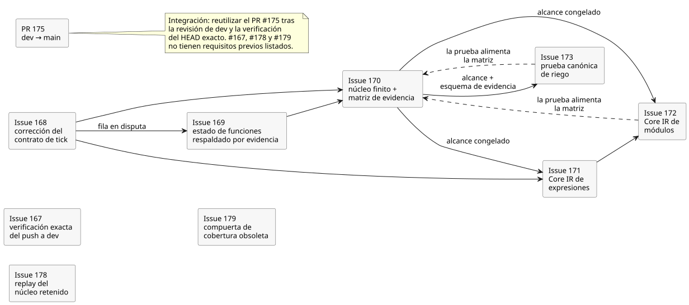
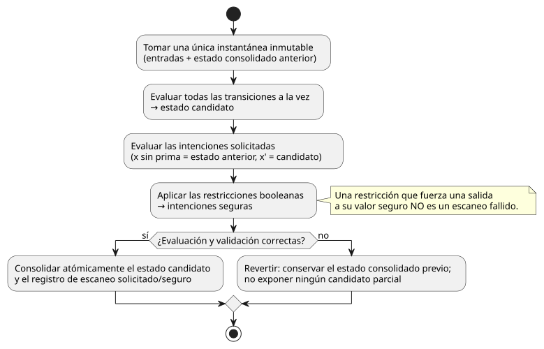
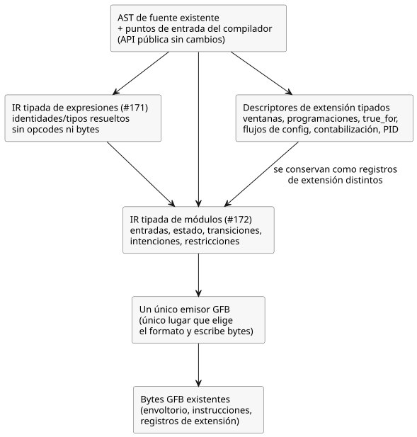

<!-- translation-source: docs/plans/2026-09-28-semantic-kernel.md -->
[Original en inglés](2026-09-28-semantic-kernel.md)

# Plan de revisión de Semantic Kernel 0.1

Issue principal: [#166 Semantic Kernel 0.1](https://github.com/callin2/ghostflow-language/issues/166)

Este plan establece el orden de trabajo del hito de revisión del núcleo semántico congelado. El hito es una revisión, no una versión con funciones nuevas: **no permite funciones nuevas del lenguaje**. Cuando la revisión encuentre una carencia real, regístrela como carencia. No la haga desaparecer cambiándole la etiqueta.

En este documento:

- **Orden de dependencias**: los issues de este hito y de qué depende cada uno.
- **Regla de ejecución y frontera de representación**: la semántica de escaneo que debe cumplirse y las capas internas del compilador que se introducen.
- **Diez criterios de aceptación**: qué significa "terminado" para el hito.
- **Verificación y límites**: qué comprobaciones cuentan como evidencia y qué no afirma este plan.

## Orden de dependencias

El diagrama siguiente muestra los requisitos previos enumerados en esta sección. Las flechas continuas significan "debe ir después de". Las flechas discontinuas significan "la prueba de este issue alimenta la matriz de evidencia de #170 antes de la aceptación final".

1. **#167 — verificación exacta del push a dev.** Es independiente del trabajo del compilador. Añade `dev` al disparador de push existente de Verified WASM y agrega comprobaciones de regresión para la vinculación de la fuente y el orden de la compuerta completa. La aceptación sigue requiriendo una ejecución completa y exitosa de CI sobre el commit exacto actual de `dev`.
2. **#168 — corrección del contrato de tick.** Resuelve el conflicto del catálogo activo alineándolo con la Referencia §2.8. Conserva el comportamiento de runtime que ya está probado. Es solo trabajo de documentación y catálogo: no cambia el compilador, GFB, la VM ni ninguna salida física.
3. **#169 — estado de funciones respaldado por evidencia.** Va después de #168 para la fila en disputa. Inventaría las principales familias de funciones de la Referencia y registra el responsable y la madurez como atributos separados. No debe degradar a `DESIGN` una función central que está implementada pero insuficientemente probada solo para forzar un resultado verde.
4. **#170 — núcleo finito y matriz de evidencia.** Depende de #168 y #169. Congela el conjunto de construcciones del núcleo junto con su evidencia positiva, negativa, de límites, de paridad entre destinos y de reproducción (replay). Los TODO que queden fuera del núcleo explícitamente congelado deben seguir identificados honestamente como tales.
5. **#171 — Core IR de expresiones.** Puede comenzar en cuanto #168 esté terminado y #170 haya declarado el alcance de construcciones congelado, incluso antes de que la matriz de evidencia de #170 esté completamente implementada. La integración sigue respetando la compuerta de evidencia de #170. Introduce una etapa interna de reducción (lowering) tipada de expresiones que se ejecuta antes de la emisión de instrucciones GFB. Las API públicas del compilador de fuente y los bytes de salida existentes no cambian.
6. **#172 — Core IR de módulos.** Depende de #171 y del alcance de construcciones congelado declarado en #170. La matriz de evidencia de #170 puede consumir su prueba antes de la aceptación final. Sustituye el viaje de ida y vuelta por texto de S-expressions generadas por registros de módulo tipados y normalizados, y por un único emisor GFB. Se conservan los descriptores de extensión distintos.
7. **#173 — prueba canónica de riego.** Depende del alcance y del esquema de evidencia declarados en #170. La matriz de #170 puede consumir su prueba antes de la aceptación final. PC-02 es el programa de riego que se ejecuta íntegramente dentro del núcleo. PC-09 (temporizador/replay secuencial) sigue siendo una regresión de extensión y no se usa como prueba del núcleo. Reutilice el trabajo existente de fuente/traza y el trabajo de explicación de #88.

8. **#178 — replay del núcleo retenido.** Es responsable de la prueba abierta REF-06-017. Una regresión de replay o un replay local del host cuenta como evidencia del núcleo con punto de control (checkpoint) retenido solo si satisface el oráculo exacto de ese caso.
9. **#179 — compuerta de cobertura obsoleta.** Repara siete oráculos de prueba de cobertura obsoletos y la deuda en las precondiciones y umbrales de compilación. La contabilización de los casos del núcleo congelado corresponde a #170. Se conservan el texto y el estado especificados de cada caso.

Para la integración, reutilice el PR #175 existente de dev a main después de que `dev` haya sido revisado y su HEAD exacto verificado. No lo sustituya por el backport MIT separado exclusivo de main.

**El núcleo congelado (#170).** Las construcciones congeladas son:

- fuente literaria (literate) canónica e identidad de intención;
- valores de fuente Bool, Int, Number, Percent y Duration, con su semántica de literales, unidades y rangos;
- `input` tipado y `config` acotado;
- expresiones puras;
- estado y `next` simultáneo;
- tiempo lógico de escaneo explícito y no decreciente;
- intenciones solicitadas;
- restricciones booleanas;
- comportamiento atómico del tick;
- traza vinculada a la fuente;
- replay determinista del núcleo con punto de control retenido.

Documente el tipo de la fuente por separado de su representación en runtime. Un tipo de fuente verificado que se reduce a Number sigue obedeciendo sus reglas de unidad, rango y exactitud.

**El conflicto de redacción del MVP (#168).** `LANGUAGE-MVP-0.1.md` dice actualmente que toda intención lee el estado siguiente consolidado. Esa afirmación es precisamente lo que entra en conflicto con el resto del contrato. La Referencia §2.8 actual, `docs/LANGUAGE.md` §7, la ejecución GFB y `GF-TEST-snapshot-commit` establecen todos una regla distinta:

- Una lectura sin prima (`x`) lee el estado anterior.
- Una lectura explícita con prima (`x'`) lee el estado candidato.
- Cuando la evaluación y la validación tienen éxito, el estado candidato y los resultados solicitado/seguro se consolidan de forma atómica.
- Una restricción booleana puede inhibir válidamente una salida solicitada y producir una salida segura. Que una restricción convierta una intención solicitada en una intención segura **no** es un escaneo fallido.
- Solo un fallo de evaluación o de validación provoca una reversión (rollback).

Los requisitos activos todavía citan el documento del MVP. Por lo tanto, reemplace únicamente la afirmación en conflicto: conserve su enunciado antiguo y su ID derivado del contenido como evidencia, y enlace el requisito que lo sustituye. No cambie el comportamiento del runtime.

## Regla de ejecución y frontera de representación

Todo escaneo aceptado sigue la misma regla, que se muestra a continuación.

1. Tomar una única instantánea inmutable de las entradas y del estado anterior.
2. Evaluar todas las transiciones simultáneamente a partir de esa instantánea para producir el estado candidato.
3. Evaluar las intenciones solicitadas. En la intención de salida, una referencia de estado sin prima lee el estado anterior; una referencia explícita con prima lee el valor candidato.
4. Aplicar las restricciones booleanas para derivar las intenciones seguras. Una restricción válida puede forzar una salida a su valor seguro sin que el escaneo falle.
5. Una vez completadas la evaluación y la validación, consolidar atómicamente el estado candidato y el registro de escaneo solicitado/seguro resultante.
6. Si la evaluación o la validación fallan, conservar el estado consolidado previo y no exponer ningún candidato parcial.

El compilador debería exponer una frontera semántica interna. No debe prometer un AST ni una API públicos nuevos. Las capas son:

- **IR tipada de expresiones (#171):** nodos semánticos con identidades y tipos resueltos. Abarca las lecturas del estado anterior y del siguiente candidato, el comportamiento condicional y lógico, la aritmética y la conversión, las guardas de tiempo, la proyección de contexto y los marcadores de traza. No contiene opcodes, bytes, elección de formato GFB ni desplazamientos codificados. Solo el emisor la reduce a instrucciones de la VM.
- **IR tipada de módulos (#172):** entradas resueltas, valores predeterminados de estado, estrategia/consulta, transiciones, intenciones solicitadas, restricciones booleanas e IR de expresiones. Las ventanas temporales, las programaciones (`schedule`), `true_for`, los flujos de configuración, los resultados naturales/de contabilización de uso y los objetivos PID siguen siendo descriptores de extensión tipados y explícitos. Cada uno conserva sus propias reglas de validación, procedencia, calidad, tiempo y recursos. Nunca se tratan silenciosamente como expresiones puras del núcleo.
- **Frontera GFB:** el AST de fuente existente y los puntos de entrada del compilador se mantienen. Exactamente un emisor selecciona el formato GFB existente y escribe el envoltorio, el flujo de instrucciones y los registros de extensión establecidos. Debe preservar:
  - los bytes exactos;
  - las identidades del manifiesto, del mapa de fuente y de la traza;
  - los diagnósticos y los límites;
  - las importaciones seguras para el navegador;
  - el comportamiento nativo y WASM;
  - los hashes esperados históricos.

  Fuera del alcance: una nueva versión del formato de transmisión, un compilador paralelo, una ruta de respaldo (fallback), nueva semántica de extensiones o cualquier cambio en el runtime de Rust.

## Diez criterios de aceptación

1. Las construcciones semánticas del núcleo para este hito están fijadas.
2. Las fronteras de la reducción de superficie a tipado, de CoreIR y de GFB están documentadas con honestidad.
3. Cada construcción del núcleo tiene pruebas ejecutables positivas, negativas y de límites.
4. Nativo y WASM producen resultados idénticos para los vectores de conformidad del núcleo.
5. Hay cero casos TODO dentro del alcance del núcleo congelado de la Referencia.
6. Hay cero discrepancias semánticas conocidas en el núcleo.
7. El HEAD exacto actual de `dev` tiene una ejecución completa en verde de Verified WASM CI.
8. Un programa de riego real se ejecuta íntegramente dentro del núcleo declarado.
9. El replay determinista reproduce un resultado idéntico.
10. Queda establecida la trazabilidad causal de fuente a traza y de traza a decisión.

El DAG completo de explicación causal es un trabajo aparte. La procedencia de fuente a traza a decisión para las rutas aceptadas del núcleo **no** demuestra que el grafo completo de explicación de rutas evaluadas de #88 esté terminado. #70, #74, #88 y #115 siguen definiendo o dando seguimiento a los contratos más amplios de Interaction IR, flujos, explicación y orden de eventos. No afirme que esas funciones están terminadas basándose en la prueba del núcleo de este hito.

## Verificación y límites

Para cada parte de la implementación:

1. Ejecute los comandos específicos que se indican en su issue.
2. Cuando cambien las fuentes o las pruebas, ejecute también la compuerta de integración `npm test` del repositorio.

La compuerta completa ejecuta una lista explícita de pruebas más las comprobaciones del verificador: formato de Rust y workspace, nativo en debug y release, WASM, replay y tutorial, y procedencia de los artefactos. Verifique que los artefactos identifiquen el SHA exacto de la fuente probada.

Después del merge, el commit exacto resultante de `dev` debe pasar **tanto** `Verify WASM (current)` **como** `Verify WASM (frontend-pin)`. Ninguno de los siguientes es suficiente por sí solo: una comprobación del PR, un resultado correcto de frontend-pin, un hash de fuente coincidente o una suite exclusiva de Rust.

Este plan no afirma ninguna grabación en el Device, ninguna salida física, ninguna aceptación por parte del agricultor ni ninguna verificación completa del DAG de explicación.

Una vez integrado en `main` el trabajo revisado de `dev`, verifique esa revisión integrada exacta y sus compuertas antes de la publicación pública bajo MIT. No haga merge del backport MIT separado exclusivo de main como sustituto de la integración de dev a main.
