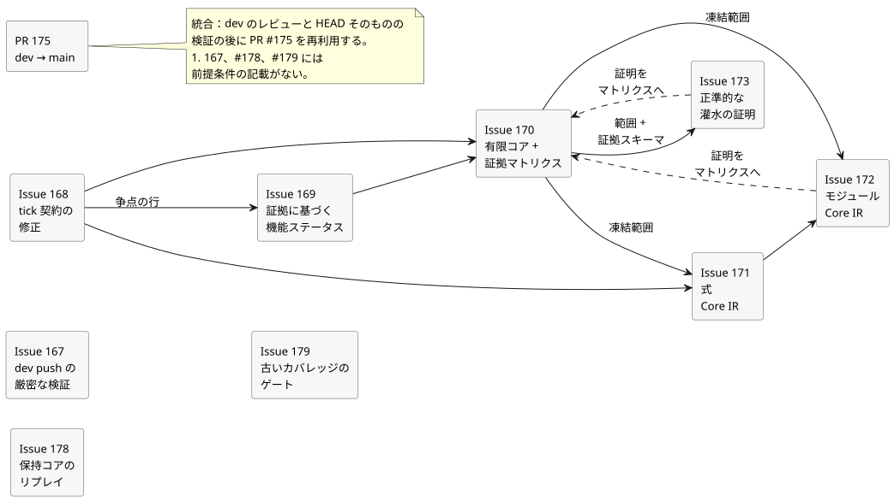
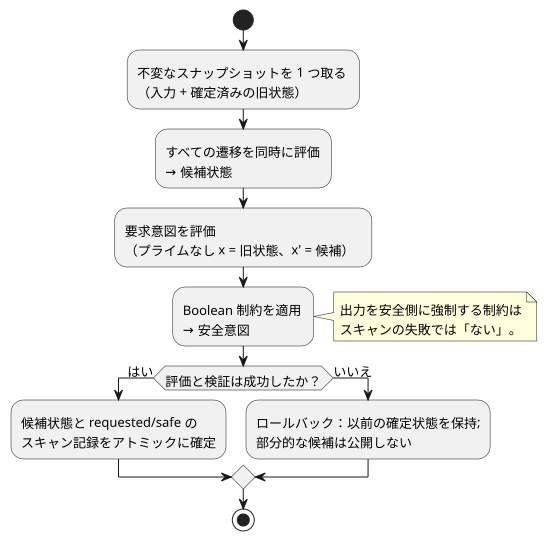
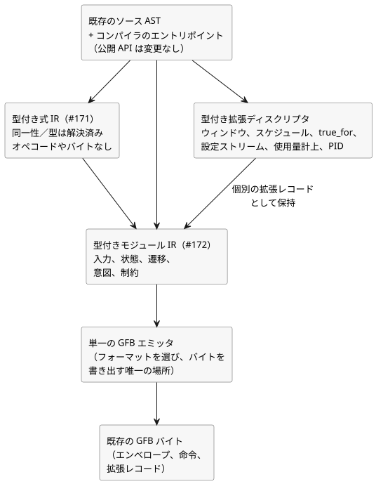

<!-- translation-source: docs/plans/2026-09-28-semantic-kernel.md -->
[英語の原文](2026-09-28-semantic-kernel.md)

# Semantic Kernel 0.1 レビュー計画

親 issue：[#166 Semantic Kernel 0.1](https://github.com/callin2/ghostflow-language/issues/166)

この計画は、凍結されたセマンティックカーネル（semantic kernel）レビューのマイルストーンにおける作業順序を定めます。このマイルストーンは機能リリースではなくレビューであり、**新しい言語機能は一切認めません**。レビューで実際のギャップが見つかった場合は、ギャップとして記録してください。ラベルを付け替えることでギャップを消してはなりません。

この文書の内容：

- **依存順序** — このマイルストーンに含まれる issue と、それぞれが何を待つか。
- **実行規則と表現の境界** — 守らなければならないスキャンのセマンティクスと、導入するコンパイラ内部の層。
- **10 個の受け入れ基準** — このマイルストーンにおける「完了」の意味。
- **検証と限界** — どのチェックを証拠（エビデンス）とみなすか、そしてこの計画が主張しないこと。

## 依存順序

下の図は、この節に挙げた前提条件を示します。実線の矢印は「後に行わなければならない」を意味します。破線の矢印は「この issue の証明は、最終的な受け入れの前に #170 の証拠マトリクスに取り込まれる」を意味します。

1. **#167 — dev push の厳密な検証。** コンパイラ作業とは独立しています。既存の Verified WASM の push トリガーに `dev` を追加し、ソースのバインディングとフルゲートの実行順序に対する回帰チェックを追加します。受け入れには、引き続き現在の `dev` コミットそのものに対するフル CI の成功が必要です。
2. **#168 — tick 契約の修正。** 有効なカタログ内の矛盾を、Reference §2.8 に合わせることで解消します。すでにテストされているランタイムの動作は維持します。これは文書とカタログの作業のみであり、コンパイラ、GFB、VM、物理出力には変更を加えません。
3. **#169 — 証拠に裏付けられた機能ステータス。** 争点となっている行については #168 の後に行います。Reference の主要な機能ファミリーを棚卸しし、オーナーと成熟度を別々の属性として記録します。結果をグリーンにするためだけに、実装済みだがテスト不足のコア機能を `DESIGN` に格下げしてはなりません。
4. **#170 — 有限コアと証拠マトリクス。** #168 と #169 に依存します。コア構成要素の集合を、その正例・負例・境界・ターゲット間パリティ・リプレイの証拠とともに凍結します。明示的に凍結されたコアの外にある TODO は、そのことを正直に示したままにしなければなりません。
5. **#171 — 式 Core IR。** #168 が完了し、#170 が凍結する構成要素の範囲を宣言した時点で、#170 の証拠マトリクスが完全に実装される前でも着手できます。統合は引き続き #170 の証拠ゲートに従います。GFB 命令の生成より前に実行される、内部の型付き式の lowering 段階を導入します。公開されているソースコンパイラ API と既存の出力バイトは変わりません。
6. **#172 — モジュール Core IR。** #171 と、#170 で宣言された凍結構成要素の範囲に依存します。#170 の証拠マトリクスは、最終的な受け入れの前にその証明を取り込めます。生成された S 式テキストを往復させる方式を、正規化された型付きモジュールレコードと単一の GFB エミッタに置き換えます。個別の拡張ディスクリプタは維持されます。
7. **#173 — 正準的な灌水の証明。** 宣言された #170 の範囲と証拠スキーマに依存します。#170 のマトリクスは、最終的な受け入れの前にその証明を取り込めます。PC-02 は、完全にコアの中だけで動作する灌水プログラムです。PC-09（タイマー／シーケンシャルリプレイ）は拡張の回帰テストとして残し、コアの証明には使いません。既存のソース／トレースの作業と #88 の説明の作業を再利用します。

8. **#178 — 保持コアのリプレイ。** 未解決の REF-06-017 の証明を担当します。リプレイの回帰テストやホストローカルのリプレイは、そのケースの厳密なオラクルを満たす場合に限り、保持チェックポイントのコア証拠とみなします。
9. **#179 — 古いカバレッジのゲート。** 古くなった 7 つのカバレッジテストのオラクルと、ビルドの前提条件およびしきい値の負債を修復します。凍結コアのケースの集計は #170 の担当です。仕様化されたケースのテキストとステータスは維持します。

統合には、`dev` がレビューされ、その HEAD そのものが検証された後に、既存の dev-to-main PR #175 を再利用します。main 専用の別の MIT バックポートで代用してはなりません。

**凍結コア（#170）。** 凍結される構成要素は次のとおりです。

- 正準的な文芸的ソース（literate source）と意図の同一性
- Bool、Int、Number、Percent、Duration のソース値と、そのリテラル・単位・範囲のセマンティクス
- 型付きの input と有界な config
- 純粋な式
- state と同時的な `next`
- 明示的で減少しない論理スキャン時間
- 要求意図（requested）
- Boolean 制約
- アトミックな tick の動作
- ソースに紐づいたトレース
- 保持チェックポイントによる決定的なコアリプレイ

ソースの型は、そのランタイム表現とは分けて記述してください。Number に lowering される検査済みのソース型も、その単位・範囲・厳密性の規則に従います。

**MVP の記述の矛盾（#168）。** `LANGUAGE-MVP-0.1.md` は現在、すべての意図が確定済みの次状態を読むと述べています。この主張こそが契約の他の部分と矛盾しています。現在の Reference §2.8、`docs/LANGUAGE.md` §7、GFB の実行、そして `GF-TEST-snapshot-commit` はすべて、別の規則を定めています。

- プライムなしの読み取り（`x`）は旧状態を読みます。
- 明示的なプライム付きの読み取り（`x'`）は候補状態を読みます。
- 評価と検証が成功すると、候補状態と requested/safe の結果がアトミックに確定します。
- Boolean 制約は、要求された出力を正当に抑止し、安全な出力を生成できます。制約が要求意図を安全意図に変えることは、スキャンの失敗では**ありません**。
- ロールバックするのは、評価または検証の失敗のときだけです。

有効な要件は今も MVP 文書を引用しています。したがって、矛盾している主張だけを置き換えてください。古い記述と内容から導出された ID は証拠として残し、置き換え先の要件へリンクします。ランタイムの動作は変更しません。

## 実行規則と表現の境界

受け入れられるすべてのスキャンは、下に示す同じ規則に従います。

1. 入力と旧状態の不変なスナップショットを 1 つ取ります。
2. そのスナップショットから、すべての遷移を同時に評価して候補状態を作ります。
3. 要求意図を評価します。出力意図の中では、プライムなしの状態参照は旧状態を読み、明示的なプライム付きの参照は候補値を読みます。
4. Boolean 制約を適用して安全意図を導出します。正当な制約は、スキャンを失敗させずに出力を安全値に強制できます。
5. 評価と検証が完了したら、候補状態と、その結果である requested/safe のスキャン記録をアトミックに確定します。
6. 評価または検証が失敗した場合は、以前に確定した状態を保持し、部分的な候補を一切公開しません。

コンパイラは内部のセマンティックな境界を公開するべきです。新しい公開 AST や API を約束してはなりません。層は次のとおりです。

- **型付き式 IR（#171）：** 同一性と型が解決済みのセマンティックノードです。旧状態と候補次状態の読み取り、条件と論理の動作、算術と変換、時間ガード、コンテキストの射影、トレースマーカーを扱います。オペコード、バイト、GFB フォーマットの選択、エンコードされたオフセットは含みません。VM 命令への lowering を行うのはエミッタだけです。
- **型付きモジュール IR（#172）：** 解決済みの入力、状態の既定値、戦略／照会、遷移、要求意図、Boolean 制約、式 IR です。時間ウィンドウ、スケジュール、`true_for`、設定ストリーム、自然／使用量計上の結果、PID 目標は、明示的な型付き拡張ディスクリプタとして残ります。それぞれが独自の検証・来歴・品質・時間・リソースの規則を保持します。純粋なコアの式として黙って扱われることは決してありません。
- **GFB の境界：** 既存のソース AST とコンパイラのエントリポイントは残ります。ちょうど 1 つのエミッタが既存の GFB フォーマットを選択し、確立されたエンベロープ、命令ストリーム、拡張レコードを書き出します。エミッタは次のものを維持しなければなりません。
  - 正確なバイト列
  - マニフェスト、ソースマップ、トレースの同一性
  - 診断と制限
  - ブラウザで安全なインポート
  - ネイティブと WASM の動作
  - 過去の期待ハッシュ

  範囲外：新しいワイヤバージョン、並行するコンパイラ、フォールバック経路、新しい拡張セマンティクス、Rust ランタイムの変更。

## 10 個の受け入れ基準

1. このマイルストーンのコアとなるセマンティック構成要素が確定している。
2. 表層から型付き表現への lowering、CoreIR、GFB の境界が正直に文書化されている。
3. すべてのコア構成要素に、実行可能な正例・負例・境界のテストがある。
4. コア適合ベクトルについて、ネイティブと WASM が同一の結果を出す。
5. 凍結された Reference コアの範囲内に TODO ケースが 0 件である。
6. 既知のコアセマンティクスの不一致が 0 件である。
7. 現在の `dev` の HEAD そのものに、グリーンなフル Verified WASM CI の実行がある。
8. 実際の灌水プログラム 1 つが、宣言されたコアの中だけで動作する。
9. 決定的なリプレイが同一の結果を再現する。
10. ソースからトレース、判断へと至る原因の追跡可能性が確立されている。

完全な因果説明 DAG は別の作業です。受け入れられたコア経路について、ソースからトレース、判断へと至る来歴があっても、#88 の完全な評価経路説明グラフが完成していることの証明には**なりません**。#70、#74、#88、#115 は引き続き、より広い Interaction IR、ストリーム、説明、イベント順序の契約を定義または追跡します。このマイルストーンのコアの証明を根拠に、それらの機能が完了したと主張してはなりません。

## 検証と限界

各実装スライスについて：

1. その issue に挙げられた対象を絞ったコマンドを実行します。
2. ソースやテストが変わった場合は、リポジトリの `npm test` 統合ゲートも実行します。

フルゲートは、明示的なテストの一覧と検証器のチェックを実行します。チェックの内容は、Rust のフォーマットとワークスペース、ネイティブのデバッグとリリース、WASM、リプレイとチュートリアル、成果物の来歴です。成果物が、テストされたソースの SHA そのものを識別していることを確認してください。

マージ後、結果として得られた `dev` コミットそのものが、`Verify WASM (current)` と `Verify WASM (frontend-pin)` の**両方**に合格しなければなりません。次のいずれも、それだけでは十分ではありません：PR チェック、frontend-pin の合格、ソースハッシュの一致、Rust のみのテストスイート。

この計画は、Device への書き込み、物理出力、農家による受け入れ、完全な説明 DAG の検証のいずれも主張しません。

レビュー済みの `dev` の作業が `main` に統合されたら、公開 MIT リリースの前に、統合されたそのリビジョンそのものとそのゲートを検証してください。dev-to-main の統合の代わりに、main 専用の別の MIT バックポートをマージしてはなりません。
