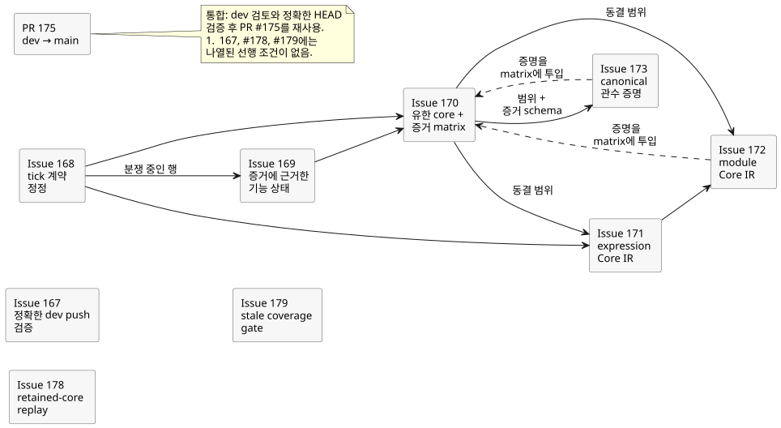
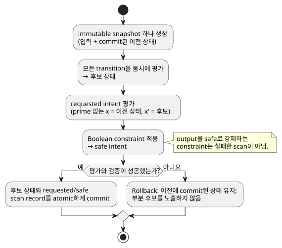
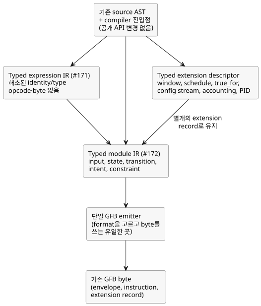

<!-- translation-source: docs/plans/2026-09-28-semantic-kernel.md -->
[영문 원문](2026-09-28-semantic-kernel.md)

# Semantic Kernel 0.1 검토 계획

상위 항목: [#166 Semantic Kernel 0.1](https://github.com/callin2/ghostflow-language/issues/166)

이 계획은 동결된 semantic-kernel 검토 milestone의 작업 순서를 정합니다. 이 milestone은 기능 출시가 아니라 검토이며, **새 언어 기능을 허용하지 않습니다**. 검토에서 실제 빈틈을 찾으면 빈틈으로 기록하세요. 이름을 바꿔 빈틈이 사라진 것처럼 만들지 마세요.

이 문서의 구성:

- **의존 순서** — 이 milestone의 이슈와 각 이슈가 기다리는 선행 작업
- **실행 규칙과 표현 경계** — 반드시 지켜야 하는 scan 의미와, 새로 도입하는 내부 compiler 계층
- **Acceptance 기준 열 가지** — milestone이 "완료"되었다는 뜻
- **검증과 한계** — 어떤 검사를 증거로 인정하는지, 그리고 이 계획이 주장하지 않는 것

## 의존 순서

아래 그림은 이 절에 나열한 선행 관계를 보여 줍니다. 실선 화살표는 "그 뒤에 와야 함"을 뜻합니다. 점선 화살표는 "이 이슈의 증명이 최종 acceptance 전에 #170 증거 matrix에 투입됨"을 뜻합니다.

1. **#167 — 정확한 dev push 검증.** compiler 작업과 독립적입니다. 기존 Verified WASM push trigger에 `dev`를 추가하고, source 결속과 전체 gate 순서에 대한 regression 검사를 추가합니다. acceptance에는 여전히 정확한 현재 `dev` commit에서 성공한 전체 CI 실행이 필요합니다.
2. **#168 — tick 계약 정정.** Reference §2.8에 맞추어 활성 catalog의 충돌을 해결합니다. 이미 테스트된 runtime 동작은 보존합니다. 문서와 catalog 작업일 뿐이며 compiler, GFB, VM, 물리 출력은 바뀌지 않습니다.
3. **#169 — 증거에 근거한 기능 상태.** 분쟁 중인 행에 대해서는 #168을 따릅니다. 주요 Reference 기능 family의 목록을 만들고 소유자와 성숙도를 별개 속성으로 기록합니다. green 결과를 억지로 만들려고, 구현되었지만 테스트가 부족한 core 기능을 `DESIGN`으로 낮추어서는 안 됩니다.
4. **#170 — 유한 core와 증거 matrix.** #168과 #169에 의존합니다. core construct 집합을 그 positive, negative, boundary, target-parity, replay 증거와 함께 동결합니다. 명시적으로 동결된 core 밖에 있는 TODO는 그렇다고 정직하게 식별된 상태로 남아야 합니다.
5. **#171 — expression Core IR.** #168이 끝나고 #170이 동결 construct 범위를 선언하면, #170 증거 matrix가 완전히 구현되기 전이라도 시작할 수 있습니다. 통합은 여전히 #170 증거 gate를 따릅니다. GFB instruction emission 앞에서 실행되는 내부 typed expression lowering 단계를 도입합니다. 공개 source compiler API와 기존 출력 byte는 바뀌지 않습니다.
6. **#172 — module Core IR.** #171과, #170에 선언된 동결 construct 범위에 의존합니다. #170 증거 matrix는 최종 acceptance 전에 이 증명을 사용할 수 있습니다. 생성된 S-expression text round trip을 정규화된 typed module record와 단일 GFB emitter로 교체합니다. 서로 다른 extension descriptor는 보존합니다.
7. **#173 — canonical 관수 증명.** 선언된 #170 범위와 증거 schema에 의존합니다. #170 matrix는 최종 acceptance 전에 이 증명을 사용할 수 있습니다. PC-02는 전부 core 안에서 실행되는 관수 프로그램입니다. PC-09(timer/sequential replay)는 extension regression으로 남으며 core 증명으로 쓰지 않습니다. 기존 source/trace 작업과 #88 explanation 작업을 재사용합니다.

8. **#178 — retained-core replay.** 열려 있는 REF-06-017 증명을 소유합니다. replay regression이나 host-local replay는 해당 사례의 정확한 oracle을 만족할 때에만 retained-checkpoint core 증거로 셉니다.
9. **#179 — stale coverage gate.** 오래된 coverage test oracle 7개와 build precondition·threshold 부채를 수리합니다. 동결 core 사례의 accounting은 #170의 몫입니다. 명세된 사례의 text와 status는 보존합니다.

통합에는 `dev`를 검토하고 정확한 HEAD를 검증한 뒤 기존 dev-to-main PR #175를 재사용합니다. 별도의 main-only MIT backport로 대체하지 마세요.

**동결 core (#170).** 동결되는 construct는 다음과 같습니다.

- canonical literate source와 intent identity
- literal, unit, range 의미를 가진 Bool, Int, Number, Percent, Duration source 값
- typed input과 bounded config
- 순수 식
- state와 동시 `next`
- 명시적이며 감소하지 않는 logical scan time
- requested intent
- Boolean constraint
- atomic tick 동작
- source에 연결된 trace
- retained-checkpoint 결정적 core replay

source type은 runtime 표현과 별도로 문서화하세요. 검사된 source type이 Number로 lowering되더라도 여전히 그 unit, range, exactness 규칙을 따릅니다.

**MVP 문구 충돌 (#168).** `LANGUAGE-MVP-0.1.md`는 현재 모든 intent가 commit된 다음 상태를 읽는다고 말합니다. 바로 이 주장이 계약의 나머지 부분과 충돌합니다. 현재 Reference §2.8, `docs/LANGUAGE.md` §7, GFB 실행, `GF-TEST-snapshot-commit`은 모두 다른 규칙을 확립합니다.

- prime 없는 읽기(`x`)는 이전 상태를 읽습니다.
- 명시적인 prime 읽기(`x'`)는 후보 상태를 읽습니다.
- 평가와 검증이 성공하면 후보 상태와 requested/safe 결과가 atomic하게 commit됩니다.
- Boolean constraint는 requested output을 정당하게 억제하고 safe output을 만들 수 있습니다. constraint가 requested intent를 safe intent로 바꾸는 것은 실패한 scan이 **아닙니다**.
- 평가 또는 검증 실패만 rollback합니다.

활성 요구사항은 여전히 MVP 문서를 인용합니다. 따라서 충돌하는 주장만 대체하세요. 이전 문장과 content-derived ID는 증거로 남기고, 대체 요구사항을 연결합니다. runtime 동작은 바꾸지 마세요.

## 실행 규칙과 표현 경계

승인되는 모든 scan은 아래 그림과 같은 규칙을 따릅니다.

1. 입력과 이전 상태의 immutable snapshot 하나를 만듭니다.
2. 그 snapshot에서 모든 transition을 동시에 평가하여 후보 상태를 만듭니다.
3. requested intent를 평가합니다. output intent 안에서 prime 없는 state 참조는 이전 상태를 읽고, 명시적인 prime 참조는 후보 값을 읽습니다.
4. Boolean constraint를 적용하여 safe intent를 도출합니다. 유효한 constraint는 scan을 실패시키지 않고 output을 safe 값으로 강제할 수 있습니다.
5. 평가와 검증이 끝나면 후보 상태와 그 결과인 requested/safe scan record를 atomic하게 commit합니다.
6. 평가나 검증이 실패하면 이전에 commit된 상태를 유지하고 부분 후보를 노출하지 않습니다.

compiler는 내부 semantic 경계를 드러내는 것이 좋습니다. 새 공개 AST나 API를 약속해서는 안 됩니다. 계층은 다음과 같습니다.

- **Typed expression IR (#171):** identity와 type이 해소된 semantic node입니다. old-state 읽기와 candidate-next 읽기, conditional·logical 동작, arithmetic·conversion, time guard, context projection, trace marker를 다룹니다. opcode, byte, GFB format 선택, encoded offset은 포함하지 않습니다. emitter만이 이를 VM instruction으로 lowering합니다.
- **Typed module IR (#172):** 해소된 input, state default, strategy/query, transition, requested intent, Boolean constraint와 expression IR입니다. temporal window, schedule, `true_for`, configuration stream, natural/accounting 결과, PID objective는 명시적인 typed extension descriptor로 남습니다. 각각은 자신의 validation, provenance, quality, time, resource 규칙을 유지합니다. 이들을 순수 core expression으로 조용히 취급하는 일은 결코 없습니다.
- **GFB 경계:** 기존 source AST와 compiler 진입점은 그대로 유지합니다. 정확히 하나의 emitter가 기존 GFB format을 선택하고, 확립된 envelope, instruction stream, extension record를 씁니다. 다음을 보존해야 합니다.
  - 정확한 byte
  - manifest, source-map, trace identity
  - 진단과 상한
  - browser-safe import
  - native와 WASM 동작
  - 역사적 expected hash

  범위 밖: 새 wire version, 병렬 compiler, fallback 경로, 새 extension 의미, Rust runtime 변경.

## Acceptance 기준 열 가지

1. 이 milestone의 core semantic construct가 고정되어 있습니다.
2. surface-to-typed lowering, CoreIR, GFB 경계가 정직하게 문서화되어 있습니다.
3. 모든 core construct에 실행 가능한 positive, negative, boundary 테스트가 있습니다.
4. native와 WASM이 core conformance vector에서 동일한 결과를 만듭니다.
5. 동결된 Reference core 범위 안의 TODO 사례가 0개입니다.
6. 알려진 core semantic 불일치가 0개입니다.
7. 정확한 현재 `dev` HEAD에 green인 전체 Verified WASM CI 실행이 있습니다.
8. 실제 관수 프로그램 하나가 선언된 core 안에서 완전히 실행됩니다.
9. 결정적 replay가 동일한 결과를 재현합니다.
10. source에서 trace를 거쳐 판단에 이르는 원인 추적 가능성이 확립되어 있습니다.

전체 causal explanation DAG는 별개의 작업입니다. 승인된 core 경로의 source-to-trace-to-decision provenance가 #88의 전체 evaluated-path explanation graph 완료를 증명하지는 **않습니다**. #70, #74, #88, #115는 더 넓은 Interaction IR, stream, explanation, event-order 계약을 계속 정의하거나 추적합니다. 이 milestone의 core 증명을 근거로 그 기능들이 완료되었다고 주장하지 마세요.

## 검증과 한계

각 구현 단위마다 다음을 수행합니다.

1. 해당 이슈에 나열된 focused command를 실행합니다.
2. source나 test가 바뀌면 저장소의 `npm test` integration gate도 실행합니다.

전체 gate는 명시적으로 나열된 테스트와 verifier의 검사를 실행합니다. verifier 검사에는 Rust formatting과 workspace, native debug와 release, WASM, replay와 tutorial, artifact provenance가 포함됩니다. artifact가 정확히 테스트한 source SHA를 식별하는지 검증하세요.

merge 후에는 그 결과인 정확한 `dev` commit이 `Verify WASM (current)`와 `Verify WASM (frontend-pin)`을 **모두** 통과해야 합니다. 다음 중 어느 것도 그것만으로는 충분하지 않습니다: PR 검사, frontend-pin 통과, source hash 일치, Rust-only suite.

이 계획은 Device flash, 물리 출력, 농가 acceptance, 완전한 explanation-DAG 검증을 주장하지 않습니다.

검토된 `dev` 작업을 `main`에 통합한 뒤에는, 공개 MIT 게시 전에 그 정확한 통합 revision과 gate를 검증하세요. dev-to-main 통합 대신 별도의 main-only MIT backport를 merge하지 마세요.
