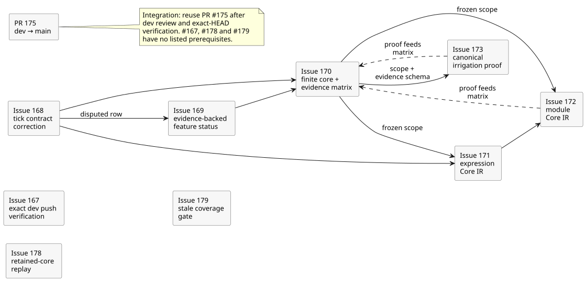
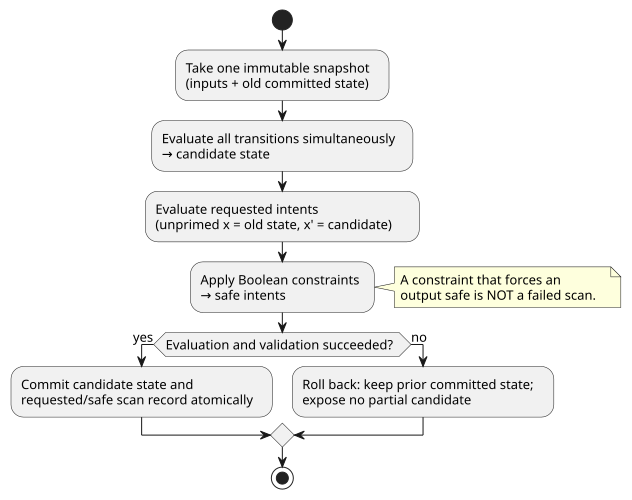
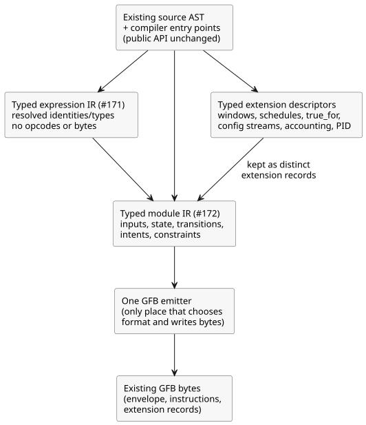

# Semantic Kernel 0.1 review plan

Parent: [#166 Semantic Kernel 0.1](https://github.com/callin2/ghostflow-language/issues/166)

This plan sets the order of work for the frozen semantic-kernel review milestone. The milestone is a review, not a feature release: it permits **no new language features**. When the review finds a real gap, record it as a gap. Do not make it disappear by relabeling it.

In this document:

- **Dependency order** — the issues in this milestone and what each one waits for.
- **Execution rule and representation boundary** — the scan semantics that must hold, and the internal compiler layers being introduced.
- **Ten acceptance criteria** — what "done" means for the milestone.
- **Verification and limits** — which checks count as evidence, and what this plan does not claim.

## Dependency order

The diagram below shows the prerequisites listed in this section. Solid arrows mean "must come after". Dashed arrows mean "the proof from this issue feeds the #170 evidence matrix before final acceptance".

1. **#167 — exact dev push verification.** Independent of compiler work. It adds `dev` to the existing Verified WASM push trigger and adds regression checks for source binding and the order of the full gate. Acceptance still requires a successful full CI run on the exact current `dev` commit.
2. **#168 — tick contract correction.** Resolves the conflict in the active catalog by aligning it with Reference §2.8. It preserves the runtime behavior that is already tested. This is documentation and catalog work only: no compiler, GFB, VM, or physical output change.
3. **#169 — evidence-backed feature status.** Follows #168 for the disputed row. It inventories the principal Reference feature families and records owner and maturity as separate attributes. It must not demote a core feature that is implemented but under-tested to `DESIGN` just to force a green result.
4. **#170 — finite core and evidence matrix.** Depends on #168 and #169. It freezes the set of core constructs together with their positive, negative, boundary, target-parity, and replay evidence. TODOs that lie outside the explicitly frozen core must stay honestly identified as such.
5. **#171 — expression Core IR.** May start once #168 is done and #170 has declared the frozen construct scope, even before the #170 evidence matrix is fully implemented. Integration still respects the #170 evidence gate. It introduces an internal typed expression lowering stage that runs before GFB instruction emission. The public source compiler APIs and the existing output bytes stay unchanged.
6. **#172 — module Core IR.** Depends on #171 and on the frozen construct scope declared in #170. The #170 evidence matrix can consume its proof before final acceptance. It replaces the generated S-expression text round trip with normalized typed module records and a single GFB emitter. Distinct extension descriptors are preserved.
7. **#173 — canonical irrigation proof.** Depends on the declared #170 scope and evidence schema. The #170 matrix can consume its proof before final acceptance. PC-02 is the irrigation program that runs wholly within the core. PC-09 (timer/sequential replay) stays an extension regression and is not used as the core proof. Reuse the existing source/trace work and the #88 explanation work.

8. **#178 — retained-core replay.** Owns the open REF-06-017 proof. A replay regression or a host-local replay counts as retained-checkpoint core evidence only if it satisfies that case's exact oracle.
9. **#179 — stale coverage gate.** Repairs seven stale coverage test oracles and the debt in build preconditions and thresholds. Accounting for frozen-core cases belongs to #170. The specified case text and status are preserved.

For integration, reuse the existing dev-to-main PR #175 after `dev` has been reviewed and its exact HEAD verified. Do not substitute the separate main-only MIT backport.

**The frozen core (#170).** The frozen constructs are:

- canonical literate source and intent identity;
- Bool, Int, Number, Percent, and Duration source values, with their literal, unit, and range semantics;
- typed input and bounded config;
- pure expressions;
- state and simultaneous `next`;
- explicit, nondecreasing logical scan time;
- requested intents;
- Boolean constraints;
- atomic tick behavior;
- source-linked trace;
- retained-checkpoint deterministic core replay.

Document the source type separately from its runtime representation. A checked source type that is lowered to Number still obeys its unit, range, and exactness rules.

**The MVP wording conflict (#168).** `LANGUAGE-MVP-0.1.md` currently says that every intent reads the committed next state. That claim is precisely what conflicts with the rest of the contract. Current Reference §2.8, `docs/LANGUAGE.md` §7, GFB execution, and `GF-TEST-snapshot-commit` all establish a different rule:

- An unprimed read (`x`) reads the old state.
- An explicit primed read (`x'`) reads the candidate state.
- When evaluation and validation succeed, the candidate state and the requested/safe results commit atomically.
- A Boolean constraint may validly inhibit a requested output and produce a safe output. A constraint changing a requested intent into a safe intent is **not** a failed scan.
- Only an evaluation or validation failure rolls back.

Active requirements still cite the MVP document. Therefore supersede only the conflicting claim: keep its old statement and content-derived ID as evidence, and link the replacement requirement. Do not change runtime behavior.

## Execution rule and representation boundary

Every accepted scan follows the same rule, shown below.

1. Take one immutable snapshot of the inputs and the old state.
2. Evaluate all transitions simultaneously from that snapshot to produce the candidate state.
3. Evaluate requested intents. In output intent, an unprimed state reference reads the old state; an explicit primed reference reads the candidate value.
4. Apply the Boolean constraints to derive safe intents. A valid constraint may force an output to its safe value without failing the scan.
5. After evaluation and validation complete, commit the candidate state and the resulting requested/safe scan record atomically.
6. If evaluation or validation fails, keep the prior committed state and do not expose any partial candidate.

The compiler should expose an internal semantic boundary. It must not promise a new public AST or API. The layers are:

- **Typed expression IR (#171):** semantic nodes with resolved identities and types. It covers old-state and candidate-next reads, conditional and logical behavior, arithmetic and conversion, time guards, context projection, and trace markers. It contains no opcodes, bytes, GFB format choice, or encoded offsets. Only the emitter lowers it to VM instructions.
- **Typed module IR (#172):** resolved inputs, state defaults, strategy/query, transitions, requested intents, Boolean constraints, and expression IR. Temporal windows, schedules, `true_for`, configuration streams, natural/accounting results, and PID objectives remain explicit typed extension descriptors. Each keeps its own validation, provenance, quality, time, and resource rules. They are never silently treated as pure core expressions.
- **GFB boundary:** the existing source AST and compiler entry points remain. Exactly one emitter selects the existing GFB format and writes the established envelope, instruction stream, and extension records. It must preserve:
  - exact bytes;
  - manifest, source-map, and trace identities;
  - diagnostics and limits;
  - browser-safe imports;
  - native and WASM behavior;
  - historical expected hashes.

  Out of scope: a new wire version, a parallel compiler, a fallback path, new extension semantics, or any Rust runtime change.

## Ten acceptance criteria

1. The core semantic constructs for this milestone are fixed.
2. The surface-to-typed lowering, CoreIR, and GFB boundaries are documented honestly.
3. Every core construct has executable positive, negative, and boundary tests.
4. Native and WASM produce identical results for the core conformance vectors.
5. There are zero TODO cases inside the frozen Reference core scope.
6. There are zero known core semantic mismatches.
7. The exact current `dev` HEAD has a green full Verified WASM CI run.
8. One real irrigation program runs wholly within the declared core.
9. Deterministic replay reproduces an identical result.
10. Cause traceability from source to trace to decision is established.

The full causal explanation DAG is a separate piece of work. Source-to-trace-to-decision provenance for accepted core paths does **not** prove that #88's full evaluated-path explanation graph is complete. #70, #74, #88, and #115 continue to define or track the wider Interaction IR, stream, explanation, and event-order contracts. Do not claim those features are done on the strength of this milestone's core proof.

## Verification and limits

For each implementation slice:

1. Run the focused commands listed in its issue.
2. When sources or tests change, also run the repository's `npm test` integration gate.

The full gate runs an explicit list of tests plus the verifier's checks: Rust formatting and workspace, native debug and release, WASM, replay and tutorial, and artifact provenance. Verify that the artifacts identify the exact tested source SHA.

After merge, the exact resulting `dev` commit must pass **both** `Verify WASM (current)` and `Verify WASM (frontend-pin)`. None of the following is sufficient on its own: a PR check, a frontend-pin pass, a matching source hash, or a Rust-only suite.

This plan claims no Device flash, no physical output, no farmer acceptance, and no complete explanation-DAG verification.

Once reviewed `dev` work is integrated into `main`, verify that exact integrated revision and its gates before public MIT publication. Do not merge the separate main-only MIT backport as a substitute for dev-to-main integration.
