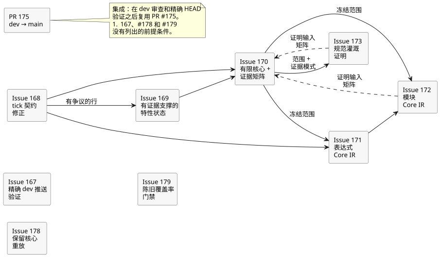
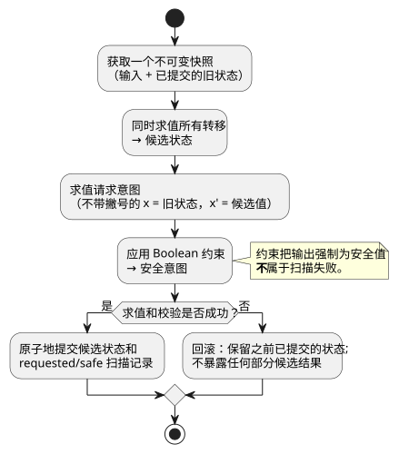
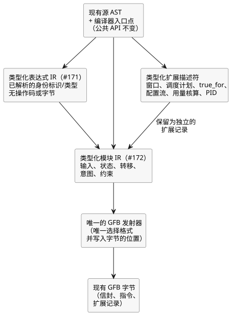

<!-- translation-source: docs/plans/2026-09-28-semantic-kernel.md -->
[英文原文](2026-09-28-semantic-kernel.md)

# Semantic Kernel 0.1 审查计划

上级：[#166 Semantic Kernel 0.1](https://github.com/callin2/ghostflow-language/issues/166)

本计划规定冻结的语义内核（semantic kernel）审查里程碑的工作顺序。该里程碑是一次审查，而不是功能发布：它**不允许新增任何语言特性**。审查发现真实缺口时，应将其记录为缺口，不得通过重新贴标签让它消失。

本文内容：

- **依赖顺序**——本里程碑包含的 issue，以及每个 issue 需要等待什么。
- **执行规则与表示边界**——必须成立的扫描语义，以及正在引入的编译器内部层次。
- **十项验收标准**——本里程碑“完成”的含义。
- **验证与限制**——哪些检查可以算作证据，以及本计划不主张什么。

## 依赖顺序

下图展示本节列出的前提条件。实线箭头表示“必须在其后进行”。虚线箭头表示“该 issue 的证明在最终验收之前输入 #170 证据矩阵”。

1. **#167——精确的 dev 推送验证。** 与编译器工作无关。它把 `dev` 加入现有的 Verified WASM 推送触发器，并为源绑定和完整门禁的顺序添加回归检查。验收仍然要求在精确的当前 `dev` 提交上成功完成一次完整 CI 运行。
2. **#168——tick 契约修正。** 通过让当前目录与 Reference §2.8 保持一致，解决其中的冲突。它保留已经过测试的运行时行为。这只是文档和目录工作：不改变编译器、GFB、VM 或物理输出。
3. **#169——有证据支撑的特性状态。** 就有争议的那一行而言，它在 #168 之后进行。它盘点 Reference 的主要特性族，并把所有者（owner）和成熟度记录为两个独立属性。不得为了强行得到通过结果，把已实现但测试不足的核心特性降级为 `DESIGN`。
4. **#170——有限核心与证据矩阵。** 依赖 #168 和 #169。它冻结核心构造的集合，以及这些构造的正向、负向、边界、目标一致性和重放证据。位于明确冻结的核心之外的 TODO 必须如实标明为核心之外。
5. **#171——表达式 Core IR。** 只要 #168 已完成且 #170 已声明冻结的构造范围，就可以开始，即使 #170 证据矩阵尚未完全实现。集成仍然遵守 #170 的证据门禁。它引入一个内部的类型化表达式降级（lowering）阶段，在 GFB 指令发射之前运行。公共源编译器 API 和现有输出字节保持不变。
6. **#172——模块 Core IR。** 依赖 #171 以及 #170 声明的冻结构造范围。#170 证据矩阵可以在最终验收之前使用其证明。它用规范化的类型化模块记录和单一 GFB 发射器，取代生成 S 表达式文本再往返解析的做法。各不相同的扩展描述符得以保留。
7. **#173——规范灌溉证明。** 依赖 #170 声明的范围和证据模式（schema）。#170 矩阵可以在最终验收之前使用其证明。PC-02 是完全在核心内运行的灌溉程序。PC-09（定时器/顺序重放）仍然是扩展回归，不用作核心证明。复用现有的源/追踪工作和 #88 的解释工作。

8. **#178——保留核心重放。** 负责尚未完成的 REF-06-017 证明。重放回归或宿主本地重放，只有在满足该用例的精确判定标准（oracle）时，才算作保留检查点（retained-checkpoint）核心证据。
9. **#179——陈旧覆盖率门禁。** 修复七个陈旧的覆盖率测试判定标准，以及构建前提条件和阈值方面的欠账。冻结核心用例的统计归属 #170。已规定的用例文本和状态保持不变。

集成时，在 `dev` 经过审查且其精确 HEAD 已验证之后，复用现有的 dev 到 main 的 PR #175。不得用单独的、仅针对 main 的 MIT 向后移植来代替。

**冻结的核心（#170）。** 冻结的构造如下：

- 规范的文学式源文件（literate）与意图身份标识；
- Bool、Int、Number、Percent 和 Duration 源值，以及它们的字面量、单位和范围语义；
- 类型化输入和有界配置；
- 纯表达式；
- 状态与同时的 `next`；
- 显式的、非递减的逻辑扫描时间；
- 请求意图；
- Boolean 约束；
- 原子的 tick 行为；
- 与源关联的追踪；
- 保留检查点的确定性核心重放。

源类型应与其运行时表示分开记录。经过检查、降级为 Number 的源类型，仍然遵守其单位、范围和精确性规则。

**MVP 措辞冲突（#168）。** `LANGUAGE-MVP-0.1.md` 目前写道，每个意图都读取已提交的下一状态。这一主张恰恰与契约的其余部分相冲突。当前 Reference §2.8、`docs/LANGUAGE.md` §7、GFB 执行以及 `GF-TEST-snapshot-commit` 都确立了另一条规则：

- 不带撇号的读取（`x`）读取旧状态。
- 显式带撇号的读取（`x'`）读取候选状态。
- 求值和校验成功时，候选状态与 requested/safe 结果被原子地提交。
- Boolean 约束可以合法地抑制请求的输出并产生安全输出。约束把请求意图变为安全意图，**不**属于扫描失败。
- 只有求值或校验失败才会回滚。

现行需求仍然引用 MVP 文档。因此只取代存在冲突的那条主张：保留其旧表述和由内容派生的 ID 作为证据，并链接替代需求。不改变运行时行为。

## 执行规则与表示边界

每一次被接受的扫描都遵循同一条规则，如下所示。

1. 获取输入和旧状态的一个不可变快照。
2. 从该快照同时求值所有转移，得到候选状态。
3. 求值请求意图。在输出意图中，不带撇号的状态引用读取旧状态；显式带撇号的引用读取候选值。
4. 应用 Boolean 约束，推导出安全意图。合法的约束可以把输出强制为其安全值，而不使扫描失败。
5. 求值和校验完成后，原子地提交候选状态以及由此得到的 requested/safe 扫描记录。
6. 如果求值或校验失败，则保留之前已提交的状态，并且不暴露任何部分候选结果。

编译器应当暴露一个内部语义边界。它不得承诺新的公共 AST 或 API。各层如下：

- **类型化表达式 IR（#171）：** 带有已解析身份标识和类型的语义节点。它涵盖旧状态读取和候选下一状态读取、条件与逻辑行为、算术与转换、时间守卫、上下文投影以及追踪标记。它不包含操作码、字节、GFB 格式选择或编码后的偏移量。只有发射器会把它降级为 VM 指令。
- **类型化模块 IR（#172）：** 已解析的输入、状态默认值、strategy/query、转移、请求意图、Boolean 约束以及表达式 IR。时间窗口、调度计划、`true_for`、配置流、自然/用量核算结果和 PID 目标仍然是显式的类型化扩展描述符。每一项都保留自己的校验、来源、质量、时间和资源规则。它们绝不会被悄悄当作纯核心表达式处理。
- **GFB 边界：** 现有源 AST 和编译器入口点保持不变。恰好一个发射器选择现有 GFB 格式，并写出既定的信封（envelope）、指令流和扩展记录。它必须保持：
  - 精确的字节；
  - 清单（manifest）、源映射和追踪的身份标识；
  - 诊断和限制；
  - 浏览器安全的导入；
  - 原生和 WASM 行为；
  - 历史预期哈希。

  不在范围内：新的线格式版本、并行编译器、回退（fallback）路径、新的扩展语义，或任何 Rust 运行时改动。

## 十项验收标准

1. 本里程碑的核心语义构造已固定。
2. 从表层到类型化的降级、CoreIR 和 GFB 边界都有如实的文档记录。
3. 每个核心构造都有可执行的正向、负向和边界测试。
4. 对于核心一致性向量，原生与 WASM 产生相同的结果。
5. 冻结的 Reference 核心范围内没有任何 TODO 用例。
6. 没有任何已知的核心语义不一致。
7. 精确的当前 `dev` HEAD 有一次通过的完整 Verified WASM CI 运行。
8. 一个真实的灌溉程序完全在声明的核心内运行。
9. 确定性重放复现出相同的结果。
10. 建立了从源到追踪再到判定的因果可追溯性。

完整的因果解释 DAG 是另一项独立工作。被接受的核心路径上的“源到追踪到判定”来源，**并不**证明 #88 的完整已求值路径解释图已经完成。#70、#74、#88 和 #115 继续定义或跟踪更广泛的 Interaction IR、流、解释和事件顺序契约。不得凭借本里程碑的核心证明就宣称这些特性已经完成。

## 验证与限制

对于每个实现切片：

1. 运行其 issue 中列出的针对性命令。
2. 当源或测试发生变化时，还要运行仓库的 `npm test` 集成门禁。

完整门禁运行一份明确的测试列表以及验证器的检查：Rust 格式化与工作区、原生 debug 与 release、WASM、重放与教程，以及制品来源。要验证制品标识的是精确的被测源 SHA。

合并之后，得到的精确 `dev` 提交必须**同时**通过 `Verify WASM (current)` 和 `Verify WASM (frontend-pin)`。以下任何一项单独都不够：PR 检查、frontend-pin 通过、匹配的源哈希，或仅 Rust 的测试套件。

本计划不主张任何 Device 烧录、物理输出、农户验收，也不主张完整的解释 DAG 验证。

经过审查的 `dev` 工作集成到 `main` 之后，在公开发布 MIT 版本之前，要验证该精确的集成修订版及其门禁。不得合并单独的、仅针对 main 的 MIT 向后移植来代替 dev 到 main 的集成。
