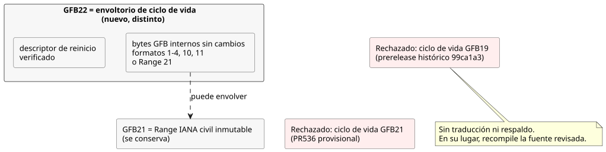
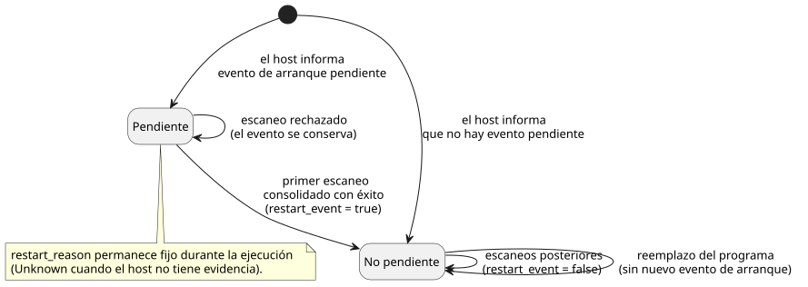

<!-- translation-source: docs/plans/2026-10-14-lifecycle-range-integration.md -->
[Original en inglés](2026-10-14-lifecycle-range-integration.md)

# Integración del ciclo de vida y de Range IANA inmutable

Esta integración de la fuente del responsable mantiene dos funciones trabajando
juntas: el **ciclo de vida de reinicio** (entradas de reinicio propiedad del
runtime) y **Range IANA inmutable** (programaciones Range en tiempo civil). Es
únicamente una integración de fuente. **No** publica un runtime, no despliega
consumidores ni establece evidencia de salidas físicas.

Referencias: [PR536](https://github.com/callin2/ghostflow-language/pull/536)
e [issue541](https://github.com/callin2/ghostflow-language/issues/541).

## Evidencia y asignación

Ambas funciones querían el mismo número de formato GFB. Esta sección registra los
hechos y la decisión de asignación.

**Hechos verificados**

- Línea base: `dev` en `06c09444fda9acee04ecc96d5e549deac85f91df`.
- El PR536 de ciclo de vida en `2e59196e25bc46deab3ce93b375f54dd35b35b9c`
  describe su envoltorio GFB21 como provisional y no publicado.
- Range en `d8ffb18eef3a970c96356375597b52783ea4c6d2` asigna GFB21 a Range civil
  inmutable.
- El prerelease publicado `ghostflow-runtime-99ca1a3` usó GFB19, no GFB21, para
  un envoltorio de ciclo de vida. Conserve esa versión y los pines de sus
  consumidores.

**Decisión:** conservar Range21 y asignar un envoltorio lifecycle22 distinto. El
envoltorio lifecycle22 contiene los bytes GFB internos sin cambios más un
descriptor de reinicio verificado.

GFB22 estaba libre. El cargador, las herramientas, las pruebas y la documentación
verificados de las seis etiquetas de runtime existentes `0c545af`, `81814e4`,
`9155047`, `96cab9b`, `99ca1a3` y `b50bec3`, junto con estas refs del
responsable, no contenían ninguna asignación de GFB22. Esta afirmación se refiere
solo al alcance histórico verificado, no a todas las ramas futuras. El registro
de la versión de GitHub `81f2532` sigue siendo un borrador sin marca de tiempo de
publicación.

**Por qué 22 y no otra opción**

- Renumerar Range desecharía su asignación de fuente actual sin ningún beneficio.
- Reutilizar 21 para ambos, y distinguirlos por inspección (sniffing) o mediante
  una etiqueta nueva, pondría dos significados incompatibles detrás de una misma
  cabecera. Los bytes guardados podrían entonces interpretarse de forma errónea.
- Un 22 distinto elimina esa ambigüedad.

El lifecycle19 histórico y el lifecycle21 provisional se rechazan
explícitamente, sin traducción y sin respaldo (fallback). Para migrar, recompile
la fuente revisada con este candidato del responsable y luego coordine los pines
exactos de los consumidores.

## Responsabilidades y admisión

**Quién es responsable de qué**

| Responsable | Responsabilidad |
|---|---|
| Language | Compilación, validación de descriptores, ejecución del bytecode interno e inicialización del reinicio en el runtime enmarcado. |
| Host | El motivo real del reinicio (o `Unknown` cuando no hay evidencia) y si el evento de arranque sigue pendiente. |
| Preparación de la autoría y de la vinculación (binding) de consumidores | Excluir estos puertos propiedad del runtime de las entradas de adquisición física. Nunca suministran observaciones inventadas ni estado reanudado. |
| Transiciones escritas por el autor | El comportamiento de recuperación. |
| Política de instalación del Device y renderizador (renderer) de salidas | La aplicación de las salidas físicas y la evidencia de ellas. |

**Reglas del evento de arranque.** El motivo del reinicio permanece fijo durante
toda la ejecución. El primer escaneo consolidado con éxito consume el evento de
arranque pendiente; un escaneo rechazado lo mantiene pendiente. Reemplazar el
programa después de que el evento se haya consumido no crea un nuevo evento de
arranque.

**Admisión de paquetes portables**

- La admisión existente del perfil base no cambia: los formatos 1–4, 10 y 11
  pueden envolverse con 22.
- Esta integración también admite Range21 IANA inmutable, y 22 envolviendo un 21
  interno, cuando se combinan con control-v21 y context-scan-abi-v5.
- Antes de que se ejecute el cargador de destino, un replay completo del
  responsable en JS y comprobaciones nativas de los bytes decodificados del
  descriptor y de las expresiones vinculan el manifiesto firmado. Esto incluye
  predicados arbitrarios admitidos.
- El envoltorio no admite todos los perfiles Range en los paquetes portables. El
  formato 11 conserva sus límites de scalar-config/Periodic.

No se necesita ningún cambio en la ejecución de la VM ni en el significado de
GFB. Los bytes del runtime pueden coincidir con el build35 anterior, mientras que
la nueva revisión de la fuente y la identidad de paquete/build emitida
oficialmente siguen siendo distintas. Para la ejecución de Range, el host sigue
suministrando una cobertura de tiempo válida y los hechos de las ocurrencias; el
núcleo compartido valida y ejecuta la programación escrita por el autor.

## Verificación y orden de integración

**Cobertura de regresión.** Las regresiones nativas y WASM cubren el
comportamiento combinado de Range IANA inmutable y de reinicio. Esto incluye el
primer evento pendiente y su consumo solo después de la consolidación. La
cobertura de rechazo incluye:

- el 19 histórico;
- el lifecycle21 provisional;
- descriptores mal formados;
- envoltorios anidados;
- truncamiento y bytes sobrantes al final.

Los perfiles admitidos existentes siguen siendo admitidos. Estas pruebas ejercitan
hechos de software, no causas confirmadas por hardware.

**Cambio en la planificación del verificador.** El verificador completo puso de
manifiesto dos problemas bajo carga concurrente:

- Varios archivos de prueba provocaron recompilaciones de Cargo superpuestas de
  la salida WASM compartida. Un lector falló con ENOENT mientras otra
  compilación estaba reemplazando ese artefacto.
- Un caso de consola de 256 escaneos superó su límite de 90 segundos. Ejecutadas
  de forma aislada, las comprobaciones de calendario y de consola terminaron en
  0,626 y 43,8 segundos.

Por ello, el verificador ejecuta los archivos de prueba de Node en serie con
`--test-concurrency=1`, mantiene el lote aislado de pruebas de consola de dev y
concede 600 segundos a cada compuerta de suite. Las demás compuertas mantienen
180 segundos. Esto cambia solo la planificación de la verificación y el tiempo
límite de la suite. No cambia la semántica de escaneo, las cuotas de usuario, los
oráculos de las pruebas individuales ni los límites del runtime.

**Orden de integración**

1. Integrar y verificar Language.
2. Después, sus consumidores exactos de Authoring/Simulator.
3. Después, las vinculaciones y la presentación de API/Web.

Mantenga separados estos cuatro tipos de evidencia: fuente candidata, identidad
del paquete, artefacto publicado y el servicio que realmente se está ejecutando.
Un PR en borrador y el éxito de pruebas locales no establecen por sí solos la
publicación ni el despliegue.
