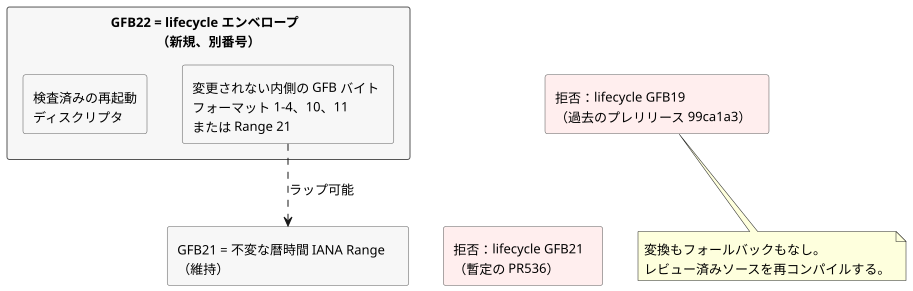

<!-- translation-source: docs/plans/2026-10-14-lifecycle-range-integration.md -->
[英語の原文](2026-10-14-lifecycle-range-integration.md)

# lifecycle と不変な IANA Range の統合

このオーナーソースの統合は、2 つの機能を連携させたまま保ちます。**再起動 lifecycle**（ランタイムが所有する再起動入力）と、**不変な IANA Range**（暦時間の Range スケジュール）です。これはソースの統合だけです。ランタイムの公開、利用側へのデプロイ、物理出力の証拠の確立は**行いません**。

参照：[PR536](https://github.com/callin2/ghostflow-language/pull/536)
と [issue541](https://github.com/callin2/ghostflow-language/issues/541)。

## 証拠と割り当て

両方の機能が同じ GFB フォーマット番号を求めていました。この節では、事実と割り当ての決定を記録します。

**確認済みの事実**

- ベースライン：`06c09444fda9acee04ecc96d5e549deac85f91df` の `dev`。
- `2e59196e25bc46deab3ce93b375f54dd35b35b9c` の lifecycle PR536 は、その GFB21 エンベロープを暫定かつ未公開と記述しています。
- `d8ffb18eef3a970c96356375597b52783ea4c6d2` の Range は、GFB21 を不変な暦時間の Range に割り当てています。
- 公開済みのプレリリース `ghostflow-runtime-99ca1a3` は、lifecycle エンベロープに GFB21 ではなく GFB19 を使っていました。そのリリースと、利用側のピン留めは維持してください。

**決定：** Range21 を維持し、別の lifecycle22 エンベロープを割り当てます。lifecycle22 エンベロープには、変更されない内側の GFB バイトと、検査済みの再起動ディスクリプタが含まれます。

GFB22 は空いていました。既存の 6 つのランタイムタグ `0c545af`、`81814e4`、`9155047`、`96cab9b`、`99ca1a3`、`b50bec3` の検査済みのローダー、ツール、テスト、文書、およびこれらのオーナー ref には、GFB22 の割り当てはありませんでした。これは確認した過去の範囲についての記述であり、将来のすべてのブランチについての記述ではありません。`81f2532` の GitHub リリース記録は依然としてドラフトで、公開日時がありません。

**なぜ他の選択肢ではなく 22 なのか**

- Range の番号を付け直すと、現在のソース割り当てを何の利益もなく捨てることになります。
- 21 を両方に再利用し、スニッフィングや新しいタグで区別すると、1 つのヘッダーの背後に互換性のない 2 つの意味を置くことになります。保存済みのバイトが誤って解釈されるおそれがあります。
- 別の 22 にすれば、その曖昧さがなくなります。

過去の lifecycle19 と暫定の lifecycle21 は明示的に拒否され、変換もフォールバックもありません。移行するには、レビュー済みのソースをこのオーナー候補で再コンパイルし、その後で利用側の正確なピン留めを調整してください。

## 責任とアドミッション

**誰が何を所有するか**

| オーナー | 責任 |
|---|---|
| Language | コンパイル、ディスクリプタの検証、内側のバイトコードの実行、フレーム化されたランタイムでの再起動の初期化。 |
| Host | 実際の再起動理由（証拠がない場合は `Unknown`）と、起動イベントがまだ保留中かどうか。 |
| Authoring と利用側のバインディング準備 | これらのランタイム所有ポートを、物理的な取得入力から除外します。でっち上げた観測値や再開した状態を決して供給しません。 |
| 作成者が書いた遷移 | 復旧時の動作。 |
| Device の設置ポリシーと出力レンダラー | 物理出力の適用と、その証拠。 |

**起動イベントの規則。** 再起動理由は実行（run）全体を通じて固定されます。最初に確定に成功したスキャンが、保留中の起動イベントを消費します。拒否されたスキャンは、イベントを保留中のまま残します。イベントが消費された後にプログラムを置き換えても、新しい起動イベントは生じません。

**ポータブルパッケージのアドミッション**

- 既存のベースプロファイルのアドミッションは変わりません。フォーマット 1–4、10、11 は 22 でラップできます。
- この統合では、control-v21 および context-scan-abi-v5 と組み合わせた場合に、不変な IANA Range21 と、内側の 21 をラップする 22 も受け入れます。
- ターゲットのローダーが実行される前に、完全な JS オーナーリプレイと、デコードされたディスクリプタおよび式バイトのネイティブチェックが、署名済みマニフェストをバインドします。これにはサポートされる任意の述語も含まれます。
- ラップしても、すべての Range プロファイルがポータブルパッケージに受け入れられるわけではありません。フォーマット 11 は、そのスカラー設定／Periodic の制限を維持します。

VM の実行や GFB の意味を変更する必要はありません。ランタイムのバイトは以前の build35 と一致する可能性がありますが、新しいソースのリビジョンと、公式に発行されたパッケージ／ビルドの同一性は区別されたままです。Range の実行では、ホストが引き続き有効な時間範囲のカバレッジと発生（オカレンス）の事実を供給し、共有コアが作成者の書いたスケジュールを検証して実行します。

## 検証と統合の順序

**回帰テストのカバレッジ。** ネイティブと WASM の回帰テストは、不変な IANA Range と再起動の動作の組み合わせをカバーします。これには、最初の保留イベントと、確定後に限った消費が含まれます。拒否のカバレッジには次のものが含まれます。

- 過去の 19
- 暫定の lifecycle21
- 不正なディスクリプタ
- 入れ子のラッパー
- 切り詰めと末尾の余分なバイト

既存のサポート済みプロファイルは引き続きサポートされます。これらのテストはソフトウェア上の事実を検証するものであり、ハードウェアで確認された原因を検証するものではありません。

**検証器のスケジューリング変更。** フル検証器は、並行負荷の下で 2 つの問題を露呈しました。

- 複数のテストファイルが、共有 WASM 出力に対する Cargo の再コンパイルを重複して引き起こしました。別のコンパイルがその成果物を置き換えている最中に、ある読み取り側が ENOENT で失敗しました。
- 256 スキャンのコンソールケースが、90 秒の上限を超えました。単独で実行すると、カレンダーとコンソールのチェックは 0.626 秒と 43.8 秒で完了しました。

そのため検証器は、Node のテストファイルを `--test-concurrency=1` で直列に実行し、dev の分離されたコンソールテストのバッチを維持し、各スイートゲートに 600 秒を許容します。その他のゲートは 180 秒のままです。これは検証のスケジューリングとスイートのタイムアウトだけを変更するものです。スキャンのセマンティクス、ユーザーのクォータ、個々のテストのオラクル、ランタイムの制限は変更しません。

**統合の順序**

1. Language を統合して検証します。
2. 次に、その正確な Authoring/Simulator の利用側。
3. 次に、API/Web のバインディングと表示。

次の 4 種類の証拠は区別して扱ってください：候補ソース、パッケージの同一性、公開された成果物、実際に稼働しているサービス。ドラフト PR とローカルでのテストの成功だけでは、公開やデプロイは確立されません。
