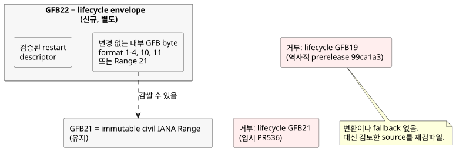
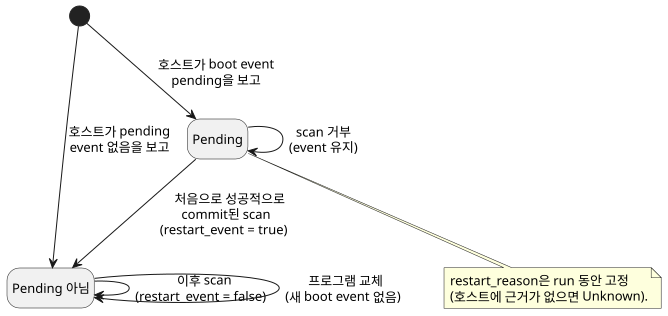

<!-- translation-source: docs/plans/2026-10-14-lifecycle-range-integration.md -->
[영문 원문](2026-10-14-lifecycle-range-integration.md)

# Lifecycle과 immutable IANA Range 통합

이 owner source 통합은 두 기능이 함께 동작하도록 유지합니다. 하나는 **restart
lifecycle**(runtime이 소유하는 재시작 입력)이고, 다른 하나는 **immutable IANA Range**(civil
time 기반 Range schedule)입니다. 이 작업은 source 통합일 뿐입니다. runtime 발행, consumer
배포, 물리 출력 증거 확보를 뜻하지 **않습니다**.

근거 항목: [PR536](https://github.com/callin2/ghostflow-language/pull/536)과
[issue541](https://github.com/callin2/ghostflow-language/issues/541).

## 근거와 번호 할당

두 기능은 같은 GFB format 번호를 원했습니다. 이 절은 확인한 사실과 할당 결정을
기록합니다.

**확인한 사실**

- 기준: `dev`의 `06c09444fda9acee04ecc96d5e549deac85f91df`.
- Lifecycle PR536의 `2e59196e25bc46deab3ce93b375f54dd35b35b9c`는 자신의 GFB21
  envelope를 임시이며 미발행이라고 설명합니다.
- Range의 `d8ffb18eef3a970c96356375597b52783ea4c6d2`는 GFB21을 immutable civil
  Range에 할당합니다.
- 공개된 prerelease `ghostflow-runtime-99ca1a3`는 lifecycle envelope에 GFB21이 아니라
  GFB19를 사용했습니다. 이 release와 그 consumer pin을 보존합니다.

**결정:** Range21을 유지하고 별도의 lifecycle22 envelope를 할당합니다.
lifecycle22 envelope는 변경되지 않은 내부 GFB byte와 검증된 restart descriptor를
담습니다.

GFB22는 비어 있었습니다. 기존 runtime tag 여섯 개 `0c545af`, `81814e4`, `9155047`,
`96cab9b`, `99ca1a3`, `b50bec3`와 위 owner ref의 loader, tools, tests, 문서를
확인했으며 GFB22 할당은 없었습니다. 이는 확인한 역사적 범위에 대한 진술일 뿐이며,
모든 미래 branch에 대한 주장이 아닙니다. `81f2532` GitHub release 기록은 여전히 발행
시각이 없는 draft입니다.

**다른 선택지가 아니라 22인 이유**

- Range의 번호를 바꾸면 현재 source 할당을 아무 이득 없이 버리게 됩니다.
- 21을 둘 다에 재사용하고 탐지(sniffing)나 새 tag로 구별하면, 양립할 수 없는 두 의미가
  하나의 header 뒤에 놓입니다. 그러면 저장된 byte가 잘못 해석될 수 있습니다.
- 별도의 22는 이 모호함을 없앱니다.

역사적 lifecycle19와 임시 lifecycle21은 변환이나 fallback 없이 명시적으로 거부합니다.
이전하려면 검토한 source를 이 owner 후보로 재컴파일한 다음, 정확한 consumer pin을
조정하세요.

## 책임과 허용 범위

**누가 무엇을 소유하는가**

| 소유자 | 책임 |
|---|---|
| Language | 컴파일, descriptor 검증, 내부 bytecode 실행, framed runtime의 restart 초기화. |
| 호스트 | 실제 restart 원인(근거가 없으면 `Unknown`)과 boot event가 아직 pending인지 여부. |
| Authoring과 consumer binding 준비 | runtime이 소유하는 이 port들을 물리 취득 입력에서 제외합니다. 꾸며낸 관측값이나 재개된 state를 결코 공급하지 않습니다. |
| 작성한 transition | 복구 동작. |
| Device 설치 정책과 출력 렌더러 | 물리 출력 적용과 그 증거. |

**Boot event 규칙.** restart 원인은 run 전체 동안 고정됩니다. 처음으로 성공적으로 commit된
scan이 pending boot event를 소비합니다. 거부된 scan은 event를 pending 상태로 유지합니다.
event가 소비된 뒤 프로그램을 교체해도 새 boot event는 생기지 않습니다.

**Portable package 허용 범위**

- 기존 base-profile 허용 범위는 바뀌지 않습니다. format 1–4, 10, 11은 22로 감쌀 수
  있습니다.
- 이번 통합은 control-v21 및 context-scan-abi-v5와 짝을 이룰 때 immutable IANA
  Range21과, 내부 21을 감싼 22도 허용합니다.
- target loader가 실행되기 전에, 전체 JS owner replay와 decoded descriptor 및 expression
  byte에 대한 native 검사가 signed manifest를 결속합니다. 지원되는 임의의 predicate도
  여기에 포함됩니다.
- 감싸기가 모든 Range profile을 portable package에 허용한다는 뜻은 아닙니다. format 11은
  scalar-config/Periodic 제한을 유지합니다.

VM 실행이나 GFB 의미를 바꿀 필요는 없습니다. runtime byte는 이전 build35와 같을 수
있지만, 새 source revision과 공식 발급된 package/build identity는 서로 별개입니다. Range
실행을 위해 호스트는 여전히 유효한 시간 coverage와 occurrence fact를 공급하고, shared
core는 작성된 schedule을 검증하고 실행합니다.

## 검증과 통합 순서

**회귀 검사 범위.** native와 WASM 회귀 검사는 immutable IANA Range와 restart의 결합
동작을 다룹니다. 첫 pending event와, commit 후에만 이루어지는 소비도 포함합니다.
거부 검사는 다음을 포함합니다.

- 역사적 19
- 임시 lifecycle21
- 잘못된 descriptor
- 중첩 wrapper
- 잘림과 후행 byte

기존 지원 profile은 계속 지원합니다. 이 테스트는 software fact를 검사하며, 하드웨어로
확인한 원인을 검사하는 것이 아닙니다.

**Verifier 실행 순서 변경.** 전체 verifier는 동시 부하에서 두 가지 문제를
드러냈습니다.

- 여러 test file이 shared WASM 출력을 Cargo로 겹쳐서 재컴파일했습니다. 한 compile이
  artifact를 교체하는 동안 다른 reader가 ENOENT로 실패했습니다.
- 256-scan console 사례가 90초 제한을 넘었습니다. 단독으로 실행하면 calendar와
  console 검사는 각각 0.626초와 43.8초에 완료되었습니다.

따라서 verifier는 `--test-concurrency=1`로 Node test file을 순차 실행하고, dev의 단독
console test batch를 유지하며, 각 suite gate에 600초를 허용합니다. 다른 gate는
180초를 유지합니다. 이는 검증 실행 순서와 suite timeout만 바꿉니다. scan 의미, 사용자
quota, 개별 test oracle, runtime 제한은 바꾸지 않습니다.

**통합 순서**

1. Language를 통합하고 검증합니다.
2. 그다음 그 정확한 Authoring/Simulator consumer를 연결합니다.
3. 그다음 API/Web binding과 표시를 연결합니다.

다음 네 종류의 증거를 구분하세요: 후보 source, package identity, 발행 artifact, 실제로
구동 중인 service. draft PR과 로컬 테스트 성공만으로는 발행이나 배포가 확인되지
않습니다.
