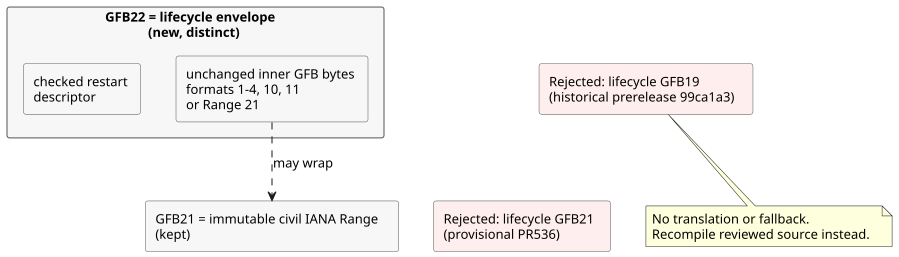
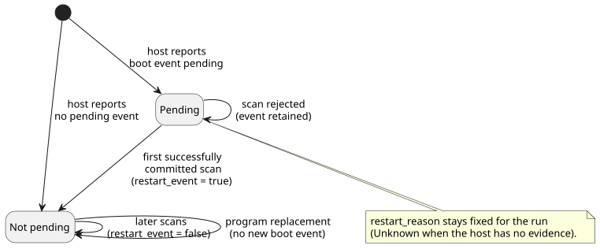

# Lifecycle and immutable IANA Range integration

This owner-source integration keeps two features working together: the **restart
lifecycle** (runtime-owned restart inputs) and **immutable IANA Range** (civil-time
Range schedules). It is source integration only. It does **not** publish a runtime,
deploy consumers, or establish physical output evidence.

References: [PR536](https://github.com/callin2/ghostflow-language/pull/536)
and [issue541](https://github.com/callin2/ghostflow-language/issues/541).

## Evidence and allocation

Both features wanted the same GFB format number. This section records the facts
and the allocation decision.

**Checked facts**

- Baseline: `dev` at `06c09444fda9acee04ecc96d5e549deac85f91df`.
- Lifecycle PR536 at `2e59196e25bc46deab3ce93b375f54dd35b35b9c` describes its
  GFB21 envelope as provisional and unpublished.
- Range at `d8ffb18eef3a970c96356375597b52783ea4c6d2` assigns GFB21 to immutable
  civil Range.
- The published prerelease `ghostflow-runtime-99ca1a3` used GFB19, not GFB21,
  for a lifecycle envelope. Preserve that release and its consumer pins.

**Decision:** keep Range21 and allocate a distinct lifecycle22 envelope. The
lifecycle22 envelope contains the unchanged inner GFB bytes plus a checked
restart descriptor.

GFB22 was free. The checked loader, tools, tests, and documentation of the six
existing runtime tags `0c545af`, `81814e4`, `9155047`, `96cab9b`, `99ca1a3` and
`b50bec3`, together with these owner refs, contained no GFB22 allocation. This is
a statement about the checked historical scope only, not about all future
branches. The `81f2532` GitHub release record is still a draft with no
publication timestamp.

**Why 22, and not another option**

- Renumbering Range would throw away its current source allocation for no benefit.
- Reusing 21 for both, and telling them apart by sniffing or by a new tag, would
  put two incompatible meanings behind one header. Saved bytes could then be
  misinterpreted.
- A distinct 22 removes that ambiguity.

Historical lifecycle19 and provisional lifecycle21 are explicitly rejected, with
no translation and no fallback. To migrate, recompile the reviewed source with
this owner candidate, then coordinate the exact consumer pins.

## Responsibilities and admission

**Who owns what**

| Owner | Responsibility |
|---|---|
| Language | Compilation, descriptor validation, inner bytecode execution, and restart initialization in the framed runtime. |
| Host | The actual restart reason (or `Unknown` when there is no evidence), and whether the boot event is still pending. |
| Authoring and consumer binding preparation | Exclude these runtime-owned ports from physical acquisition inputs. They never supply invented observations or resumed state. |
| Authored transitions | Recovery behavior. |
| Device installation policy and the output renderer | Applying physical outputs, and the evidence for them. |

**Boot event rules.** The restart reason stays fixed for the whole run. The first
successfully committed scan consumes the pending boot event; a rejected scan keeps
it pending. Replacing the program after the event was consumed does not create a
new boot event.

**Portable package admission**

- Existing base-profile admission is unchanged: formats 1–4, 10 and 11 may be
  wrapped with 22.
- This integration also admits immutable IANA Range21, and 22 wrapping an inner
  21, when paired with control-v21 and context-scan-abi-v5.
- Before the target loader runs, full JS owner replay and native checks of the
  decoded descriptor and expression bytes bind the signed manifest. This includes
  arbitrary supported predicates.
- Wrapping does not admit every Range profile into portable packages. Format 11
  keeps its scalar-config/Periodic limits.

No change to VM execution or to GFB meaning is needed. Runtime bytes may match
the prior build35, while the new source revision and the officially issued
package/build identity remain distinct. For Range execution, the host still
supplies valid time coverage and occurrence facts; the shared core validates and
executes the authored schedule.

## Verification and integration order

**Regression coverage.** Native and WASM regressions cover combined immutable
IANA Range and restart behavior. This includes the first pending event and
consumption only after commit. Rejection coverage includes:

- historical 19;
- provisional lifecycle21;
- malformed descriptors;
- nested wrappers;
- truncation and trailing bytes.

Existing supported profiles remain supported. These tests exercise software
facts, not hardware-confirmed causes.

**Verifier scheduling change.** The full verifier exposed two problems under
concurrent load:

- Several test files triggered overlapping Cargo recompiles of the shared WASM
  output. One reader failed with ENOENT while another compilation was replacing
  that artifact.
- A 256-scan console case exceeded its 90-second bound. Run in isolation, the
  calendar and console checks completed in 0.626 and 43.8 seconds.

The verifier therefore runs Node test files serially with
`--test-concurrency=1`, keeps dev's isolated console test batch, and allows 600
seconds for each suite gate. Other gates keep 180 seconds. This changes only
verification scheduling and the suite timeout. It does not change scan
semantics, user quotas, individual test oracles, or runtime limits.

**Integration order**

1. Integrate and verify Language.
2. Then its exact Authoring/Simulator consumers.
3. Then API/Web bindings and presentation.

Keep these four kinds of evidence separate: candidate source, package identity,
published artifact, and the actually running service. A draft PR and local test
success alone do not establish publication or deployment.
