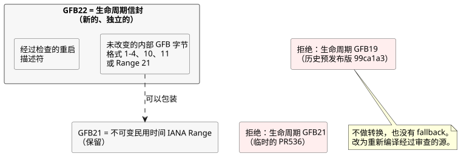

<!-- translation-source: docs/plans/2026-10-14-lifecycle-range-integration.md -->
[英文原文](2026-10-14-lifecycle-range-integration.md)

# 生命周期与不可变 IANA Range 的集成

这项所有者源（owner-source）集成让两个特性协同工作：**重启生命周期**（由运行时拥有的重启输入）和**不可变 IANA Range**（民用时间 Range 调度计划）。它只是源集成，**不**发布运行时、不部署消费方，也不建立物理输出证据。

参考：[PR536](https://github.com/callin2/ghostflow-language/pull/536)
和 [issue541](https://github.com/callin2/ghostflow-language/issues/541)。

## 证据与分配

两个特性都想要同一个 GFB 格式编号。本节记录相关事实和分配决定。

**已核实的事实**

- 基线：`dev` 位于 `06c09444fda9acee04ecc96d5e549deac85f91df`。
- 位于 `2e59196e25bc46deab3ce93b375f54dd35b35b9c` 的生命周期 PR536 将其 GFB21 信封描述为临时的、未发布的。
- 位于 `d8ffb18eef3a970c96356375597b52783ea4c6d2` 的 Range 把 GFB21 分配给不可变民用时间 Range。
- 已发布的预发布版 `ghostflow-runtime-99ca1a3` 的生命周期信封使用的是 GFB19，而不是 GFB21。应保留该发布版及其消费方固定版本（pin）。

**决定：** 保留 Range21，并分配一个独立的 lifecycle22 信封。lifecycle22 信封包含未改变的内部 GFB 字节，外加一个经过检查的重启描述符。

GFB22 尚未被占用。六个现有运行时标签 `0c545af`、`81814e4`、`9155047`、`96cab9b`、`99ca1a3` 和 `b50bec3` 中经过检查的加载器、工具、测试和文档，以及这些所有者引用，都没有 GFB22 分配。这只是对已检查的历史范围的陈述，并不涉及所有未来分支。`81f2532` 的 GitHub 发布记录仍是草稿，没有发布时间戳。

**为什么是 22，而不是其他方案**

- 给 Range 重新编号会白白丢弃其当前的源分配，没有任何好处。
- 让两者共用 21，再通过嗅探或新标签区分，会让一个头部背后存在两种互不兼容的含义。已保存的字节随后可能被误解。
- 独立的 22 消除了这种歧义。

历史上的 lifecycle19 和临时的 lifecycle21 被明确拒绝，不做转换，也没有回退（fallback）。迁移时，用此所有者候选版本重新编译经过审查的源，然后协调精确的消费方固定版本。

## 职责与准入

**谁负责什么**

| 所有者 | 职责 |
|---|---|
| Language | 编译、描述符校验、内部字节码执行，以及在带帧（framed）运行时中的重启初始化。 |
| 宿主（Host） | 实际的重启原因（没有证据时为 `Unknown`），以及启动事件是否仍处于待处理状态。 |
| 编写（Authoring）与消费方绑定准备 | 将这些由运行时拥有的端口排除在物理采集输入之外。它们绝不提供编造的观测或恢复的状态。 |
| 编写的转移 | 恢复行为。 |
| Device 安装策略与输出渲染器 | 应用物理输出，以及相应的证据。 |

**启动事件规则。** 重启原因在整个运行期间保持不变。第一次成功提交的扫描会消费待处理的启动事件；被拒绝的扫描会让它继续处于待处理状态。事件被消费之后再替换程序，不会产生新的启动事件。

**可移植包准入**

- 现有基础 profile 的准入保持不变：格式 1–4、10 和 11 可以用 22 包装。
- 本次集成还准入不可变 IANA Range21，以及包装内部 21 的 22，前提是与 control-v21 和 context-scan-abi-v5 搭配。
- 在目标加载器运行之前，完整的 JS 所有者重放以及对已解码描述符和表达式字节的原生检查，会绑定已签名的清单（manifest）。这包括任意受支持的谓词。
- 包装并不会把所有 Range profile 都准入可移植包。格式 11 保持其标量配置/Periodic 限制。

不需要改变 VM 执行或 GFB 含义。运行时字节可以与之前的 build35 相同，而新的源修订版与正式签发的包/构建身份仍然彼此不同。对于 Range 执行，仍由宿主提供有效的时间覆盖和触发实例（occurrence）事实；共享核心负责校验并执行编写的调度计划。

## 验证与集成顺序

**回归覆盖。** 原生和 WASM 回归测试覆盖不可变 IANA Range 与重启行为的组合，包括第一个待处理事件以及只在提交后才消费事件。拒绝覆盖包括：

- 历史上的 19；
- 临时的 lifecycle21；
- 格式错误的描述符；
- 嵌套包装；
- 截断和尾随字节。

现有受支持的 profile 仍然受支持。这些测试检验的是软件事实，而不是经硬件确认的原因。

**验证器调度变更。** 完整验证器在并发负载下暴露出两个问题：

- 多个测试文件触发了对共享 WASM 输出的重叠 Cargo 重新编译。一个读取方在另一个编译正在替换该制品时以 ENOENT 失败。
- 一个 256 次扫描的控制台用例超出了其 90 秒的上限。单独运行时，日历检查和控制台检查分别在 0.626 秒和 43.8 秒内完成。

因此，验证器使用 `--test-concurrency=1` 串行运行 Node 测试文件，保留 dev 中隔离的控制台测试批次，并为每个套件门禁允许 600 秒。其他门禁保持 180 秒。这只改变验证调度和套件超时，不改变扫描语义、用户配额、单个测试判定标准或运行时限制。

**集成顺序**

1. 集成并验证 Language。
2. 然后是其精确的 Authoring/Simulator 消费方。
3. 然后是 API/Web 绑定和展示层。

将以下四类证据分开：候选源、包身份、已发布制品，以及实际运行的服务。仅凭草稿 PR 和本地测试成功，不能确立发布或部署。
