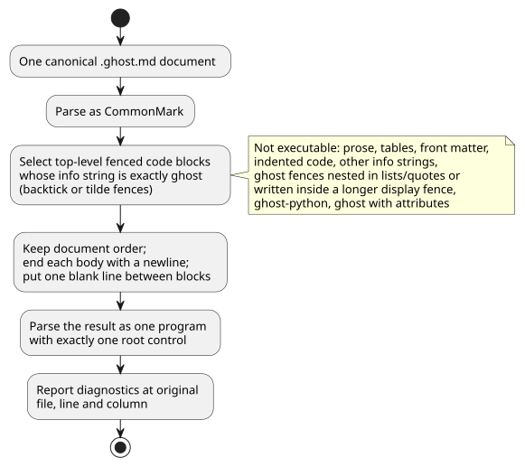
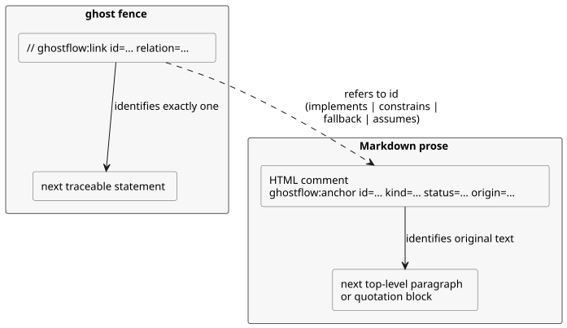

<!-- translation-source: docs/reference/01-source-and-syntax.md -->
[Korean original](01-source-and-syntax.md)

# 1. Source and syntax

[Complete contents](../LANGUAGE-REFERENCE.en.md) · [Next: Types, expressions, and state](02-types-expressions-state.en.md)

A canonical GhostFlow program is a single `.ghost.md` document. It holds both the explanation and the executable rules. The language's representative surface is the **control syntax**: `control Name { ... }` with braces, semicolons, expressions, explicit next state, and output connections.

This chapter defines:

- how executable source is selected from a document (§1.1);
- how original text, locations, and intent links are preserved (§1.2);
- the vocabulary: identifiers, reserved words, comments, and symbols (§1.3);
- the grammar notation and the declaration forms (§1.4);
- the representative declaration structure and name-resolution rules (§1.5);
- rejected historical notation (§1.6) and which chapter owns which syntax (§1.7).

The `ghost` fragments in this chapter illustrate syntax and semantics.

Rationale: [Selected syntax](../LANGUAGE-SURFACE.en.md), [Common language contract](../LANGUAGE.en.md), [Literate source](../LITERATE.en.md), [Intent anchors](../INTENT-ANCHOR-MAP.md), [Source preservation](../SOURCE-MAP.md), [Design notes](../DESIGN-NOTES.md). The [complete language reference](../LANGUAGE-REFERENCE.en.md) indexes this chapter and the other detailed chapters.

**External inputs.** The canonical declaration for an external input is `input`. Reading an input yields `Result<T, SensorFault>`.

**Restart inputs are the one exception.** The exact reserved declarations
`restart_reason: RestartReason` and `restart_event: Bool` are runtime-owned
lifecycle inputs, not externally acquired ones. They read directly as
`RestartReason` and `Bool`. Optional markers, conditioning settings, and
caller-provided values are forbidden for them. See
[the restart contract](05-settings-and-observation.en.md).

The examples in this chapter explicitly choose `false` when reading `start` fails
and `true` when reading `stop` fails. These are illustrative author policies, never
implicit defaults.

The former `sensor` declaration is rejected. Preserve old documents and create
explicit, reviewed revisions. See [the migration contract](../INPUT-MIGRATION.md)
for acquisition and compatibility.

## 1.1 Why one document is the source

If you keep only the control rules, you lose the reasons behind each condition and the field premises. If you keep only the explanation, no one can mechanically check which rules actually execute. GhostFlow therefore keeps explanation, comments, intent, and executable code together in one revision. Review has a single starting point.

- Product input is one complete `.ghost.md` document.
- An ordinary `.ghost` file is not executable input, and it is not an alternative input either.
- Editors, forms, and graphs may be different views of this document. They never create an independent control source.
- Document revision and executable-structure identity are different things. Editing only the explanation creates a new document revision. If the executable token structure is unchanged, the computation keeps the same meaning.

### Executable block extraction

Parse the document as CommonMark. Extract only the **top-level fenced code blocks** whose info string is exactly `ghost`, in document order. Both backtick and tilde fences are permitted. End each block body with a newline and put one blank line between blocks. Headings and explanations are never turned into code comments.

The extraction steps are summarized below.



Here is a complete `.ghost.md` document as an example.

````markdown
# 펌프 요청

정지가 시작보다 우선한다.

```ghost
control PumpRequest {
  input start, stop: Bool;
```

두 입력의 판단을 출력에 연결한다.

```ghost
  output pump: Bool;
  pump <- (start |> recover(false)) && !(stop |> recover(true));
}
```
````

The two `ghost` blocks together form one `control`. A block does not create its own execution or its own state commit. Missing braces or statements are never supplied automatically. Place block boundaries at the end of a declaration or statement. Never split a token, string, comment, or expression across blocks.

The following are **not** executable code:

- Ordinary paragraphs, tables, links, images, and front matter
- Indented code blocks and fences with other info strings, such as `text`
- Nested `ghost` fences inside lists or quotations
- `ghost` fences written as text inside a longer display fence
- Tags that do not match exactly, such as `ghost-python` or `ghost` with attributes

The following produce diagnostics: an unclosed executable fence, a document with no executable code, and an excluded nested block that looks executable. Implementations must not imitate Markdown structure with regular expressions and then execute nested blocks.

### Hardware front matter

The reserved top-level YAML field `hardware` declares, for input drivers and
output renderers, their pinned dependencies, configuration, and logical bindings.

- Compilation returns a derived plan bound to the exact source SHA-256 and source
  locations. The executable GFB bytes do not change.
- Invalid schemas, duplicate keys, missing references, and role mismatches fail
  at their canonical locations.
- Other front matter stays non-executable, as before.

See [Hardware declarations](../HARDWARE-FRONT-MATTER.md) for structure, examples,
and provider validation boundaries.
Why: installation intent and control rules are reviewed in one revision, while Device owns board behavior.

The compact authoring form reserves the root fields `profile`, `devices`
(optional), and `bindings`.

- Supply a pinned `hardwareProfiles` closure to `compileSource`/`compileSourceSync`.
  The compiler then validates inheritance, explicit default connections, parameters,
  communication conditions, address conflicts, and channel types.
- Every logical input and output needs a binding.
- The returned `hardwarePlan` has format `GhostFlow/profile-resolution-v1`. It is a
  resolved plan, not an unresolved declaration.
- Missing profiles are never guessed.

Follow the [design and staged scope](../PROFILE-FRONT-MATTER.en.md). The purpose
of this form is that customers do not have to repeat facts the board and driver
already know.

## 1.2 Original source, locations, and intent links

The original document's prose, `//` comments, Unicode text, line endings, and final newline are language assets. They must be preserved exactly. Syntax and type diagnostics point to the file, line, and column in the original `.ghost.md`, not to the merged temporary text. If a closing brace is missing across several fences, the diagnostic must be able to point to both the start of the declaration and the end of the document.

Node identity is not derived from Markdown line numbers. Adding explanation at the top may move a location, but the same executable structure must still be identifiable as the same computation. A location always belongs to a specific document revision. Digests of the original source and of the executable artifact prevent mixing different revisions. This preservation does not, on its own, prove that the original source is authentic.

### Intent anchors

The design record for this contract links to [#31](https://github.com/callin2/ghostflow-language/issues/31) and [#60](https://github.com/callin2/ghostflow-language/issues/60).

An **anchor** is a non-executable, top-level Markdown HTML comment. It marks the top-level paragraph or quotation block that immediately follows it as its original text. One blank line between the comment and that block is allowed.

The diagram shows how anchors and executable links (described below) refer to each other.



```markdown
<!-- ghostflow:anchor id=GF-INT-PUMP-001 kind=intent status=confirmed origin=user -->
> 급수 요청이 있고 정지가 없을 때 펌프를 요청한다.
```

Field order and the allowed values are fixed:

- `id`: `[A-Za-z][A-Za-z0-9._:-]{0,127}`. It is unique within the document and stays stable for the same intent.
- `kind`: `intent | premise | assumption`
- `status`: `confirmed | unconfirmed | superseded`
- `origin`: `user | operator | engineer | ai | imported`
- An `assumption` cannot be `confirmed`. Once it is confirmed, reclassify it as `intent` or `premise`.

A heading, list, nested block, code fence, another anchor, or the end of the document cannot be an anchor body. To anchor an explanation that spans several blocks, use several anchors.

### Executable node links

Inside an executable `ghost` fence, a whole-line comment of the following form identifies exactly one traceable statement: the one immediately after it.

```ghost
// ghostflow:link id=GF-INT-PUMP-001 relation=implements
pump <- request;
```

Rules for links:

- `relation` is one of `implements | constrains | fallback | assumes`.
- `assumes` may refer only to an `unconfirmed assumption`. The other relations never refer to assumptions.
- A `superseded` anchor cannot be linked to a current node.
- Several consecutive link lines may refer to the same next statement.
- If a blank line, an ordinary comment, a nested expression, a `control` header, or the end of the fence comes next instead of a target, the link is an orphan link.

Link targets are `input`, `output`, `state`, `config`, `let`, enum, function, `sensor`, `signal`, `schedule`, `timer`, `require`, `mutex`, next-state definitions, and output connections.

Links do not interpret natural language or discover tacit knowledge. They preserve the classifications and relations exactly as written. They never turn an unconfirmed relation into proof or approval.

## 1.3 Vocabulary

### Identifiers and case sensitivity

Identifiers match `[A-Za-z_][A-Za-z0-9_]*` and are case-sensitive: `start` and `Start` are different names.

- `.` is not an identifier character. It is the settled path separator, as in `starts.due`, `Alias.name`, and `instance.port`.
- Inputs and previous state are read directly by name, as `start` and `running`. The old aliases `input.start`, `state.running`, and `next.running` are rejected.
- `'` is not an identifier character either. It is next-state notation, as in `running'`.

**Reserved words.** The following language words cannot be user-defined names.

```text
control fn input output state config let type sensor signal schedule timer
calendar provider event require mutex if then else case in true false
div ok fault syntax adapt constraints check limit quote instance connect elapsed
```

**Removed notation.** `purefn`, `enum`, `next`, `ifthenelse`, `not`, `and`, `or`, `is`, and `isnt` are also reserved. They are rejected with migration diagnostics, so that removed notation can never be reinterpreted with a different meaning.

**Built-in namespaces.** `Bool`, `Int`, `Number`, `Percent`, `Duration`, `Result`, `SensorFault`, `Expr`, `Date`, `TimeOfDay`, `DateTime`, `TimeSlots`, `WorkCalendar`, `HolidayCalendar`, `TidePredictions`, `LunarEphemeris`, `BoolActuator`, `Event`, `ClockFault`, `CalendarFault`, `TemporalContextFault`, `AccountingFault`, and the physical-quantity types in Chapter 2 are the built-in type namespace. `number`, `int_exact`, `int_floor`, `int_ceil`, `int_trunc`, `int_nearest_even`, `elapsed`, `median`, `hysteresis`, `date`, `time`, `datetime`, `cron5`, `sun`, `tide`, `day`, `moon`, `continuous_true`, `instant`, `civil`, `on_time`, `count_events`, `local_day_is`, `calendar_is`, `tide_is`, `moon_is`, `used`, `rolling`, `local_day`, and the Result conversion names are the built-in callable namespace. User declarations cannot shadow these names. Names with the internal prefix `__gf_` and the discard pattern `_` cannot be declared either.

**Built-in projections.** `.due`, `.open`, `.active`, and `.count`, supplied by schedules and accounts, are projections of those built-in types. A schedule's `.missed` is also a projection. Do not assume members with these names exist on other types, and do not redefine them as user projections. For the semantics of `.missed`, see §3.5 in [Chapter 3](03-time-and-schedules.en.md).

**Contextual words.** `parameter`, `resource`, `account`, `import`, `from`, `revision`, `sha256`, `timezone`, `selected`, `basis`, `when`, `clock`, `gap`, `recovery`, `fallback`, `dst_missing`, `dst_repeated`, `sample`, `valid`, `filter`, `stale_after`, `recover_after`, `samples`, `min`, `max`, `step`, `access`, and `label` are **contextual words**: they are special only in their own syntax positions. Elsewhere they are ordinary identifiers. The context of `has` is defined in [Chapter 4](04-sensors-constraints-control.en.md). By contrast, `adapt`, `constraints`, `check`, `limit`, `quote`, `instance`, and `connect` are reserved in every position.

### Whitespace, statement endings, and comments

Whitespace and indentation separate tokens and help people read the structure. They never create blocks. Tabs and column counts carry no meaning in the representative control syntax. Declarations and expression definitions normally end with `;`. A line break does not replace it.

**`;` is required after:** `input`, `output`, `state`, `config`, `let`, next-state definitions, output connections, `require`, `mutex`, `signal`, `timer`, `type X = ...`, and each entry in a settings block.

**`;` may be omitted after:** a function's final result expression, a function's closing `}`, and a `case` branch.

A code comment runs from `//` to the end of the line. `#` comments and `/* ... */` comments are not comments in the representative control syntax. Write explanations for readers in the Markdown body.

### Symbols and delimiters

| Notation | Role |
|---|---|
| `{ }` | control, functions, case, settings blocks, and `in` sets |
| `( )` | Expression grouping, function calls, parameters |
| `[ ]` | Lists of selected schedule times; not general-purpose list syntax |
| `:` | Names and types, named built-in arguments |
| `,` | Separating names, arguments, elements |
| `=` | Definitions and initial values |
| `'` | Next-state definitions and references |
| `<-` | Output intent connection |
| `->` | Function result type |
| `=>` | `case` branch or output constraint relation |
| `?` | Optional sensor capability declaration |
| `..` | Sensor valid range |

`=>` is not a logical operator. It cannot be used in ordinary expressions.

## 1.4 Grammar notation

The grammar summaries in this reference use the following metanotation:

- Characters inside single quotes are literal tokens.
- Non-italic lowercase names such as `name` are other grammar items.
- `[ item ]` means optional; `{ item }` means zero or more repetitions.
- `(a | b)` selects one of the alternatives. Actual GhostFlow `{}`, `[]`, and `|` tokens are written in single quotes.

These summaries state this chapter's rules unambiguously. They are not a complete generative grammar and do not replace the parser grammar.

```text
document       ::= Markdown containing one or more top-level ghost fences
program        ::= { import_decl | top_level_function | top_level_type | syntax_decl }
                   control_decl
control_decl   ::= 'control' Identifier '{' { control_item } '}'
top_level_function ::= function_decl
top_level_type ::= enum_decl

control_item   ::= declaration | function_decl | next_definition
                 | output_connection | constraint | parameter_decl
                 | instance_decl | connect_decl
declaration    ::= input_decl | output_decl | config_decl
                 | state_decl | let_decl | enum_decl | signal_decl
                 | schedule_decl | timer_decl
```

A program has exactly one `control` as its execution root.

- A document-scope import pins one complete `.ghost.md` definition by revision and digest.
- Imported functions and types are referenced only as `Alias.name`.
- Inside the control, `instance` and `connect` compose imported controls.
- There is no wildcard import, no implicit export, and no second root control.

The exact syntax of import, parameter, instance, connect, and typed expression macros is defined in §6.4 of [Chapter 6](06-composition-and-replay.en.md).

The declaration forms of the selected syntax are listed below. Detailed rules for `expr`, `type`, and `pattern` are in the [next chapter](02-types-expressions-state.en.md).

```text
input_decl       ::= 'input' input_names ':' payload_type
                     ( ';' | '{' { input_setting ';' } '}' )
input_names      ::= Identifier [ '?' ] { ',' Identifier [ '?' ] }
output_decl      ::= 'output' name_list ':' type ';'
config_decl      ::= 'config' Identifier ':' type '=' expr
                     ( ';' | '{' { config_setting ';' } '}' )
parameter_decl   ::= 'parameter' Identifier ':' type '=' constant_expr ';'
state_decl       ::= 'state' Identifier ':' type '=' constant_expr ';'
let_decl         ::= 'let' Identifier '=' expr ';'
enum_decl        ::= 'type' Identifier '=' Identifier { '|' Identifier } ';'
function_decl    ::= 'fn' Identifier '(' [ parameter_list ] ')' '->' type
                     '{' expr [ ';' ] '}'
next_definition  ::= Identifier "'" '=' expr ';'
output_connection ::= Identifier '<-' expr ';'
signal_decl      ::= 'signal' Identifier '=' expr ';'
timer_decl       ::= 'timer' Identifier '=' ( 'elapsed' '(' Identifier ')'
                     | 'continuous_true' '(' expr ')' ) ';'
constraint       ::= 'require' ( '!' expr | expr '=>' expr ) ';'
                   | 'mutex' '(' name_list ')' ';'
name_list        ::= Identifier { ',' Identifier }
parameter_list   ::= Identifier ':' type { ',' Identifier ':' type }
```

`input` declares names and types only. An initializer such as `input x: Bool = false;`
is a compile error, reported at the source location of `=`. The host supplies input
values, and the declaration introduces no implicit default or fallback. Declare
`input x: Bool;` and supply the value from the host. For internal program memory
that needs an initial value, use `state`.

**Why**: An initializer that is never used must not look like an executable fallback.

`schedule` does not follow the general declaration structure. Each schedule type has its own settings block. The settled daily-slot form is:

```ghost
schedule starts: DailySlots<15min> {
  timezone = "Asia/Seoul";
  selected = [06:00, 18:45];
  basis = pulse;
  when = true;
  clock = trusted_only;
  gap = skip_after(60s);
  recovery = baseline;
  fallback = skip;
  dst_missing = skip;
  dst_repeated = first;
}
```

`timezone`, `selected`, the time literals, and the list are syntax that exists only in this schedule position. Do not read them as general strings, general lists, or arbitrary generic type syntax.

## 1.5 Representative declaration structure

```ghost
fn allowed(request: Bool, enabled: Bool) -> Bool {
  request && enabled
}

control Example {
  input start, stop: Bool;
  input moisture?: Percent;
  output pump: Bool;
  config threshold: Percent = 30%;
  type Phase = Idle | Running;
  state phase: Phase = Idle;
  let request = (start |> recover(false)) && !(stop |> recover(true));
  timer age = elapsed(phase);

  phase' = if request then Running else Idle;
  pump <- phase' == Running;
}
```

Each role has its own keyword because external inputs, operating settings, memory, temporary computation, and output requests change and are observed in different ways. `let` creates no memory. An `output` declaration creates neither a value nor a safe default.

### Name scope and resolution

- A function parameter exists only inside its function and must be unique within its parameter list. Pure functions do not capture control values, so a parameter may have the same spelling as a control value. It must not shadow another function, type, enum case, or built-in name.
- A function receives the control values and state it needs through parameters. It never implicitly captures outer inputs or state.
- The document's control, functions, types, enum cases, import aliases, syntax names, and control value names must be unambiguous.
  - `input`, `output`, `state`, `config`, `parameter`, `let`, `sensor`, `signal`, `schedule`, `timer`, functions, and instances share **one value namespace**. A name cannot be reused, even by a different kind of declaration.
  - Enum cases are also unique within the document.
  - Imported internal names stay under `Alias.name`.
- Each output has exactly one direct connection expression or one `connect`.
- The source order of `let` declarations does not define dependency order. The `let` declarations form an acyclic dependency graph; a cycle of mutual dependencies is an error.
- Local computation does not shadow function names or reserved namespaces.

Conflicts are reported as compile diagnostics. They are never resolved by declaration order or by kind-specific shadowing.

## 1.6 Representative notation, reference aliases, and historical alternatives

New documents use only the representative notation in the left column. The older notation in the right column is not a syntax alias. It is listed as history, to help readers and to drive migration diagnostics, and it is rejected as executable input.

| Representative notation | Rejected older notation |
|---|---|
| `fn` | `purefn` |
| `type Mode = Off \| On;` | `enum Mode { Off, On }`, `enum Mode = Off \| On;` |
| `running' = expr;` | `next running = expr;` |
| `running'` in an output expression | `next.running` |
| `start`, `running` | `input.start`, `state.running` |
| `if c then a else b` | `ifthenelse(c, a, b)` |

The compiler does not automatically convert the right-hand notation, and it does not run it under a separate profile. If you use a conversion tool, explicitly revise the original into a new canonical `.ghost.md` revision and review it again.

The initial A/B/C comparison considered a YAML hierarchical notation, a CoffeeScript-style notation (indentation and `not/and/or`), and a Cypher-style notation (`MATCH/WHERE/WITH/NEXT/EMIT`). These are design history, not permitted aliases of the selected control syntax. The individual notations listed in the table do not mean that the block structures and operators of those initial alternatives can be mixed in.

## 1.7 Chapter boundaries for source rules

This chapter defines canonical document extraction, vocabulary, namespaces, and the root program structure. The detailed syntax of each feature belongs to another chapter of this reference:

- Values, Result, expressions, and state: [Chapter 2](02-types-expressions-state.en.md)
- Time values and schedules: [Chapter 3](03-time-and-schedules.en.md)
- `adapt`, `has`, capabilities, and constraints: [Chapter 4](04-sensors-constraints-control.en.md)
- Immutable import, parameter, instance, connect, and typed expression macro: [Chapter 6](06-composition-and-replay.en.md)

Each piece of syntax may appear only at the position its chapter explicitly declares. There is no implicit import, no wildcard export, no compatibility-alias fallback, no runtime macro execution, and no runtime search for files outside the document.
