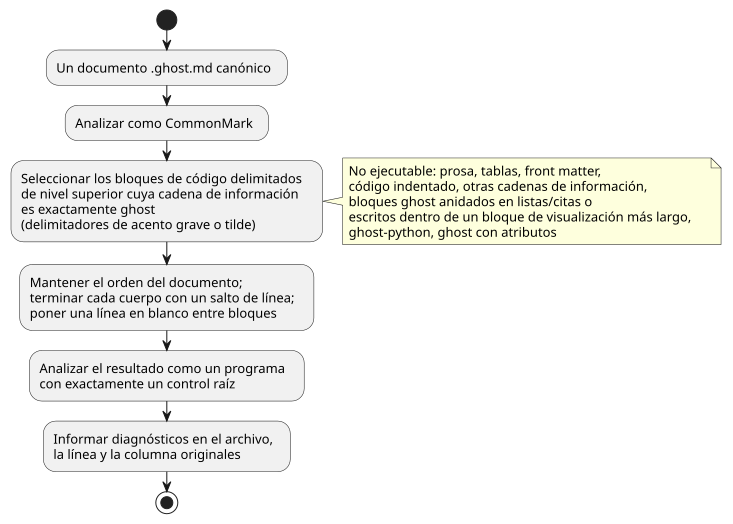
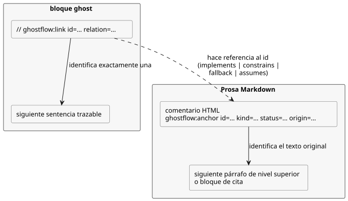

<!-- translation-source: docs/reference/01-source-and-syntax.en.md -->
[Original en inglés](01-source-and-syntax.en.md)

# 1. Fuente y sintaxis

[Índice completo](../LANGUAGE-REFERENCE.es.md) · [Siguiente: Tipos, expresiones y estado](02-types-expressions-state.es.md)

Un programa GhostFlow canónico es un único documento `.ghost.md`. Contiene tanto la explicación como las reglas ejecutables. La superficie representativa del lenguaje es la **sintaxis de control**: `control Name { ... }` con llaves, punto y coma, expresiones, estado siguiente explícito y conexiones de salida.

Este capítulo define:

- cómo se selecciona la fuente ejecutable de un documento (§1.1);
- cómo se preservan el texto original, las ubicaciones y los enlaces de intención (§1.2);
- el vocabulario: identificadores, palabras reservadas, comentarios y símbolos (§1.3);
- la notación gramatical y las formas de declaración (§1.4);
- la estructura representativa de declaraciones y las reglas de resolución de nombres (§1.5);
- la notación histórica rechazada (§1.6) y qué capítulo es responsable de cada sintaxis (§1.7).

Los fragmentos `ghost` de este capítulo ilustran la sintaxis y la semántica.

Fundamento: [Sintaxis seleccionada](../LANGUAGE-SURFACE.es.md), [Contrato común del lenguaje](../LANGUAGE.es.md), [Fuente literaria](../LITERATE.es.md), [Anclas de intención](../INTENT-ANCHOR-MAP.es.md), [Preservación de la fuente](../SOURCE-MAP.es.md), [Notas de diseño](../DESIGN-NOTES.es.md). La [referencia completa del lenguaje](../LANGUAGE-REFERENCE.es.md) indexa este capítulo y los demás capítulos detallados.

**Entradas externas.** La declaración canónica de una entrada externa es `input`. Leer una entrada produce `Result<T, SensorFault>`.

**Las entradas de reinicio son la única excepción.** Las declaraciones reservadas
exactas `restart_reason: RestartReason` y `restart_event: Bool` son entradas de
ciclo de vida propiedad del runtime, no entradas adquiridas externamente. Se leen
directamente como `RestartReason` y `Bool`. Para ellas están prohibidos los
marcadores de opcionalidad, los ajustes de acondicionamiento y los valores
suministrados por quien llama. Consulte
[el contrato de reinicio](05-settings-and-observation.es.md).

Los ejemplos de este capítulo eligen explícitamente `false` cuando falla la lectura
de `start` y `true` cuando falla la lectura de `stop`. Son políticas ilustrativas
del autor, nunca valores predeterminados implícitos.

La antigua declaración `sensor` se rechaza. Conserve los documentos antiguos y cree
revisiones explícitas y revisadas. Consulte [el contrato de migración](../INPUT-MIGRATION.es.md)
para la adquisición y la compatibilidad.

## 1.1 Por qué un solo documento es la fuente

Si solo se conservan las reglas de control, se pierden las razones de cada condición y las premisas de campo. Si solo se conserva la explicación, nadie puede comprobar mecánicamente qué reglas se ejecutan realmente. Por eso GhostFlow mantiene la explicación, los comentarios, la intención y el código ejecutable juntos en una sola revisión. La revisión tiene un único punto de partida.

- La entrada del producto es un documento `.ghost.md` completo.
- Un archivo `.ghost` ordinario no es una entrada ejecutable, ni tampoco una entrada alternativa.
- Los editores, formularios y grafos pueden ser vistas distintas de este documento. Nunca crean una fuente de control independiente.
- La revisión del documento y la identidad de la estructura ejecutable son cosas distintas. Editar solo la explicación crea una nueva revisión del documento. Si la estructura de tokens ejecutables no cambia, el cálculo conserva el mismo significado.

### Extracción de bloques ejecutables

Analice el documento como CommonMark. Extraiga solo los **bloques de código delimitados de nivel superior** cuya cadena de información sea exactamente `ghost`, en el orden del documento. Se permiten tanto los delimitadores de acento grave como los de tilde. Termine el cuerpo de cada bloque con un salto de línea y ponga una línea en blanco entre bloques. Los encabezados y las explicaciones nunca se convierten en comentarios de código.

Los pasos de extracción se resumen a continuación.



Este es un documento `.ghost.md` completo como ejemplo.

````markdown
# 펌프 요청

정지가 시작보다 우선한다.

```ghost
control PumpRequest {
  input start, stop: Bool;
```

두 입력의 판단을 출력에 연결한다.

```ghost
  output pump: Bool;
  pump <- (start |> recover(false)) && !(stop |> recover(true));
}
```
````

Los dos bloques `ghost` forman juntos un único `control`. Un bloque no crea su propia ejecución ni su propia consolidación de estado. Las llaves o sentencias que falten nunca se suministran automáticamente. Coloque los límites de bloque al final de una declaración o sentencia. Nunca divida un token, una cadena, un comentario o una expresión entre bloques.

Lo siguiente **no** es código ejecutable:

- Párrafos ordinarios, tablas, enlaces, imágenes y front matter (metadatos iniciales)
- Bloques de código indentados y bloques delimitados con otras cadenas de información, como `text`
- Bloques `ghost` anidados dentro de listas o citas
- Bloques `ghost` escritos como texto dentro de un bloque de visualización más largo
- Etiquetas que no coinciden exactamente, como `ghost-python` o `ghost` con atributos

Lo siguiente produce diagnósticos: un bloque ejecutable sin cerrar, un documento sin código ejecutable y un bloque anidado excluido que parece ejecutable. Las implementaciones no deben imitar la estructura de Markdown con expresiones regulares y luego ejecutar bloques anidados.

### Front matter de hardware

El campo YAML reservado de nivel superior `hardware` declara, para los drivers de
entrada y los renderizadores de salida, sus dependencias fijadas, su configuración
y sus vinculaciones lógicas.

- La compilación devuelve un plan derivado vinculado al SHA-256 exacto de la fuente
  y a las ubicaciones en la fuente. Los bytes GFB ejecutables no cambian.
- Los esquemas no válidos, las claves duplicadas, las referencias faltantes y las
  discrepancias de rol fallan en sus ubicaciones canónicas.
- El resto del front matter sigue siendo no ejecutable, como antes.

Consulte [Declaraciones de hardware](../HARDWARE-FRONT-MATTER.es.md) para conocer la
estructura, ejemplos y los límites de validación de los proveedores.
Por qué: la intención de instalación y las reglas de control se revisan en una sola revisión, mientras que el Device es responsable del comportamiento de la placa.

La forma compacta de autoría reserva los campos raíz `profile`, `devices`
(opcional) y `bindings`.

- Suministre un cierre `hardwareProfiles` fijado a `compileSource`/`compileSourceSync`.
  El compilador valida entonces la herencia, las conexiones predeterminadas
  explícitas, los parámetros, las condiciones de comunicación, los conflictos de
  direcciones y los tipos de canal.
- Toda entrada y salida lógica necesita una vinculación.
- El `hardwarePlan` devuelto tiene el formato `GhostFlow/profile-resolution-v1`. Es
  un plan resuelto, no una declaración sin resolver.
- Los perfiles faltantes nunca se adivinan.

Siga el [diseño y el alcance por etapas](../PROFILE-FRONT-MATTER.es.md). El propósito
de esta forma es que los clientes no tengan que repetir hechos que la placa y el
driver ya conocen.

## 1.2 Fuente original, ubicaciones y enlaces de intención

La prosa del documento original, los comentarios `//`, el texto Unicode, los finales de línea y el salto de línea final son activos del lenguaje. Deben preservarse exactamente. Los diagnósticos de sintaxis y de tipos señalan el archivo, la línea y la columna en el `.ghost.md` original, no en el texto temporal combinado. Si falta una llave de cierre a lo largo de varios bloques, el diagnóstico debe poder señalar tanto el inicio de la declaración como el final del documento.

La identidad de los nodos no se deriva de los números de línea de Markdown. Añadir explicación al principio puede mover una ubicación, pero la misma estructura ejecutable debe seguir siendo identificable como el mismo cálculo. Una ubicación siempre pertenece a una revisión específica del documento. Los resúmenes criptográficos (digests) de la fuente original y del artefacto ejecutable impiden mezclar revisiones distintas. Esta preservación no demuestra, por sí sola, que la fuente original sea auténtica.

### Anclas de intención

El registro de diseño de este contrato enlaza con [#31](https://github.com/callin2/ghostflow-language/issues/31) y [#60](https://github.com/callin2/ghostflow-language/issues/60).

Un **ancla** es un comentario HTML de Markdown de nivel superior y no ejecutable. Marca como su texto original el párrafo o bloque de cita de nivel superior que le sigue inmediatamente. Se permite una línea en blanco entre el comentario y ese bloque.

El diagrama muestra cómo se relacionan entre sí las anclas y los enlaces ejecutables (descritos más abajo).



```markdown
<!-- ghostflow:anchor id=GF-INT-PUMP-001 kind=intent status=confirmed origin=user -->
> 급수 요청이 있고 정지가 없을 때 펌프를 요청한다.
```

El orden de los campos y los valores permitidos son fijos:

- `id`: `[A-Za-z][A-Za-z0-9._:-]{0,127}`. Es único dentro del documento y se mantiene estable para la misma intención.
- `kind`: `intent | premise | assumption`
- `status`: `confirmed | unconfirmed | superseded`
- `origin`: `user | operator | engineer | ai | imported`
- Un `assumption` no puede ser `confirmed`. Una vez confirmado, reclasifíquelo como `intent` o `premise`.

Un encabezado, una lista, un bloque anidado, un bloque de código, otra ancla o el final del documento no pueden ser el cuerpo de un ancla. Para anclar una explicación que abarca varios bloques, use varias anclas.

### Enlaces de nodos ejecutables

Dentro de un bloque `ghost` ejecutable, un comentario de línea completa con la siguiente forma identifica exactamente una sentencia trazable: la que le sigue inmediatamente.

```ghost
// ghostflow:link id=GF-INT-PUMP-001 relation=implements
pump <- request;
```

Reglas de los enlaces:

- `relation` es uno de `implements | constrains | fallback | assumes`.
- `assumes` solo puede hacer referencia a un `unconfirmed assumption`. Las demás relaciones nunca hacen referencia a supuestos.
- Un ancla `superseded` no puede enlazarse con un nodo actual.
- Varias líneas de enlace consecutivas pueden hacer referencia a la misma sentencia siguiente.
- Si lo que viene a continuación, en lugar de un destino, es una línea en blanco, un comentario ordinario, una expresión anidada, una cabecera `control` o el final del bloque, el enlace es un enlace huérfano.

Los destinos de los enlaces son `input`, `output`, `state`, `config`, `let`, enumeraciones, funciones, `sensor`, `signal`, `schedule`, `timer`, `require`, `mutex`, definiciones de estado siguiente y conexiones de salida.

Los enlaces no interpretan el lenguaje natural ni descubren conocimiento tácito. Preservan las clasificaciones y relaciones exactamente como están escritas. Nunca convierten una relación no confirmada en prueba o aprobación.

## 1.3 Vocabulario

### Identificadores y distinción entre mayúsculas y minúsculas

Los identificadores coinciden con `[A-Za-z_][A-Za-z0-9_]*` y distinguen entre mayúsculas y minúsculas: `start` y `Start` son nombres distintos.

- `.` no es un carácter de identificador. Es el separador de ruta establecido, como en `starts.due`, `Alias.name` e `instance.port`.
- Las entradas y el estado anterior se leen directamente por su nombre, como `start` y `running`. Los alias antiguos `input.start`, `state.running` y `next.running` se rechazan.
- `'` tampoco es un carácter de identificador. Es la notación de estado siguiente, como en `running'`.

**Palabras reservadas.** Las siguientes palabras del lenguaje no pueden usarse como nombres definidos por el usuario.

```text
control fn input output state config let type sensor signal schedule timer
calendar provider event require mutex if then else case in true false
div ok fault syntax adapt constraints check limit quote instance connect elapsed
```

**Notación eliminada.** `purefn`, `enum`, `next`, `ifthenelse`, `not`, `and`, `or`, `is` e `isnt` también están reservadas. Se rechazan con diagnósticos de migración, de modo que la notación eliminada nunca pueda reinterpretarse con un significado distinto.

**Espacios de nombres integrados.** `Bool`, `Int`, `Number`, `Percent`, `Duration`, `Result`, `SensorFault`, `Expr`, `Date`, `TimeOfDay`, `DateTime`, `TimeSlots`, `WorkCalendar`, `HolidayCalendar`, `TidePredictions`, `LunarEphemeris`, `BoolActuator`, `Event`, `ClockFault`, `CalendarFault`, `TemporalContextFault`, `AccountingFault` y los tipos de magnitud física del Capítulo 2 forman el espacio de nombres de tipos integrados. `number`, `int_exact`, `int_floor`, `int_ceil`, `int_trunc`, `int_nearest_even`, `elapsed`, `median`, `hysteresis`, `date`, `time`, `datetime`, `cron5`, `sun`, `tide`, `day`, `moon`, `continuous_true`, `instant`, `civil`, `on_time`, `count_events`, `local_day_is`, `calendar_is`, `tide_is`, `moon_is`, `used`, `rolling`, `local_day` y los nombres de conversión de Result forman el espacio de nombres de invocables integrados. Las declaraciones del usuario no pueden ocultar estos nombres. Tampoco pueden declararse nombres con el prefijo interno `__gf_` ni el patrón de descarte `_`.

**Proyecciones integradas.** `.due`, `.open`, `.active` y `.count`, que aportan las programaciones y las cuentas, son proyecciones de esos tipos integrados. El `.missed` de una programación también es una proyección. No suponga que existen miembros con estos nombres en otros tipos ni los redefina como proyecciones de usuario. Para la semántica de `.missed`, consulte §3.5 en el [Capítulo 3](03-time-and-schedules.es.md).

**Palabras contextuales.** `parameter`, `resource`, `account`, `import`, `from`, `revision`, `sha256`, `timezone`, `selected`, `basis`, `when`, `clock`, `gap`, `recovery`, `fallback`, `dst_missing`, `dst_repeated`, `sample`, `valid`, `filter`, `stale_after`, `recover_after`, `samples`, `min`, `max`, `step`, `access` y `label` son **palabras contextuales**: solo son especiales en sus propias posiciones sintácticas. En cualquier otro lugar son identificadores ordinarios. El contexto de `has` se define en el [Capítulo 4](04-sensors-constraints-control.es.md). En cambio, `adapt`, `constraints`, `check`, `limit`, `quote`, `instance` y `connect` están reservadas en cualquier posición.

### Espacios en blanco, fin de sentencia y comentarios

Los espacios en blanco y la indentación separan tokens y ayudan a las personas a leer la estructura. Nunca crean bloques. Las tabulaciones y el número de columna no tienen significado en la sintaxis de control representativa. Las declaraciones y las definiciones de expresiones terminan normalmente con `;`. Un salto de línea no lo sustituye.

**`;` es obligatorio después de:** `input`, `output`, `state`, `config`, `let`, las definiciones de estado siguiente, las conexiones de salida, `require`, `mutex`, `signal`, `timer`, `type X = ...` y cada entrada de un bloque de ajustes.

**`;` puede omitirse después de:** la expresión de resultado final de una función, la `}` de cierre de una función y una rama de `case`.

Un comentario de código va desde `//` hasta el final de la línea. Los comentarios `#` y `/* ... */` no son comentarios en la sintaxis de control representativa. Escriba las explicaciones para los lectores en el cuerpo Markdown.

### Símbolos y delimitadores

| Notación | Rol |
|---|---|
| `{ }` | control, funciones, case, bloques de ajustes y conjuntos `in` |
| `( )` | Agrupación de expresiones, llamadas a funciones, parámetros |
| `[ ]` | Listas de horas seleccionadas de una programación; no es una sintaxis de listas de uso general |
| `:` | Nombres y tipos, argumentos con nombre de los integrados |
| `,` | Separación de nombres, argumentos y elementos |
| `=` | Definiciones y valores iniciales |
| `'` | Definiciones y referencias de estado siguiente |
| `<-` | Conexión de intención de salida |
| `->` | Tipo de resultado de una función |
| `=>` | Rama de `case` o relación de restricción de salida |
| `?` | Declaración de capacidad de sensor opcional |
| `..` | Rango válido del sensor |

`=>` no es un operador lógico. No puede usarse en expresiones ordinarias.

## 1.4 Notación gramatical

Los resúmenes gramaticales de esta referencia usan la siguiente metanotación:

- Los caracteres entre comillas simples son tokens literales.
- Los nombres en minúscula no cursivos, como `name`, son otros elementos gramaticales.
- `[ item ]` significa opcional; `{ item }` significa cero o más repeticiones.
- `(a | b)` selecciona una de las alternativas. Los tokens reales `{}`, `[]` y `|` de GhostFlow se escriben entre comillas simples.

Estos resúmenes enuncian las reglas de este capítulo sin ambigüedad. No son una gramática generativa completa y no sustituyen a la gramática del analizador.

```text
document       ::= Markdown containing one or more top-level ghost fences
program        ::= { import_decl | top_level_function | top_level_type | syntax_decl }
                   control_decl
control_decl   ::= 'control' Identifier '{' { control_item } '}'
top_level_function ::= function_decl
top_level_type ::= enum_decl

control_item   ::= declaration | function_decl | next_definition
                 | output_connection | constraint | parameter_decl
                 | instance_decl | connect_decl
declaration    ::= input_decl | output_decl | config_decl
                 | state_decl | let_decl | enum_decl | signal_decl
                 | schedule_decl | timer_decl
```

Un programa tiene exactamente un `control` como raíz de ejecución.

- Una importación con ámbito de documento fija una definición `.ghost.md` completa por revisión y resumen criptográfico (digest).
- Las funciones y los tipos importados solo se referencian como `Alias.name`.
- Dentro del control, `instance` y `connect` componen controles importados.
- No hay importación con comodín, ni exportación implícita, ni un segundo control raíz.

La sintaxis exacta de import, parameter, instance, connect y las macros de expresiones tipadas se define en §6.4 del [Capítulo 6](06-composition-and-replay.es.md).

A continuación se enumeran las formas de declaración de la sintaxis seleccionada. Las reglas detalladas de `expr`, `type` y `pattern` están en el [capítulo siguiente](02-types-expressions-state.es.md).

```text
input_decl       ::= 'input' input_names ':' payload_type
                     ( ';' | '{' { input_setting ';' } '}' )
input_names      ::= Identifier [ '?' ] { ',' Identifier [ '?' ] }
output_decl      ::= 'output' name_list ':' type ';'
config_decl      ::= 'config' Identifier ':' type '=' expr
                     ( ';' | '{' { config_setting ';' } '}' )
parameter_decl   ::= 'parameter' Identifier ':' type '=' constant_expr ';'
state_decl       ::= 'state' Identifier ':' type '=' constant_expr ';'
let_decl         ::= 'let' Identifier '=' expr ';'
enum_decl        ::= 'type' Identifier '=' Identifier { '|' Identifier } ';'
function_decl    ::= 'fn' Identifier '(' [ parameter_list ] ')' '->' type
                     '{' expr [ ';' ] '}'
next_definition  ::= Identifier "'" '=' expr ';'
output_connection ::= Identifier '<-' expr ';'
signal_decl      ::= 'signal' Identifier '=' expr ';'
timer_decl       ::= 'timer' Identifier '=' ( 'elapsed' '(' Identifier ')'
                     | 'continuous_true' '(' expr ')' ) ';'
constraint       ::= 'require' ( '!' expr | expr '=>' expr ) ';'
                   | 'mutex' '(' name_list ')' ';'
name_list        ::= Identifier { ',' Identifier }
parameter_list   ::= Identifier ':' type { ',' Identifier ':' type }
```

`input` declara solo nombres y tipos. Un inicializador como `input x: Bool = false;`
es un error de compilación, que se informa en la ubicación del `=` en la fuente. El
host suministra los valores de entrada, y la declaración no introduce ningún valor
predeterminado ni respaldo (fallback) implícito. Declare `input x: Bool;` y
suministre el valor desde el host. Para la memoria interna del programa que necesita
un valor inicial, use `state`.

**Por qué**: un inicializador que nunca se usa no debe parecer un respaldo ejecutable.

`schedule` no sigue la estructura general de declaración. Cada tipo de programación tiene su propio bloque de ajustes. La forma establecida de franjas diarias es:

```ghost
schedule starts: DailySlots<15min> {
  timezone = "Asia/Seoul";
  selected = [06:00, 18:45];
  basis = pulse;
  when = true;
  clock = trusted_only;
  gap = skip_after(60s);
  recovery = baseline;
  fallback = skip;
  dst_missing = skip;
  dst_repeated = first;
}
```

`timezone`, `selected`, los literales de hora y la lista son sintaxis que solo existe en esta posición de programación. No los interprete como cadenas generales, listas generales ni una sintaxis arbitraria de tipos genéricos.

## 1.5 Estructura representativa de declaraciones

```ghost
fn allowed(request: Bool, enabled: Bool) -> Bool {
  request && enabled
}

control Example {
  input start, stop: Bool;
  input moisture?: Percent;
  output pump: Bool;
  config threshold: Percent = 30%;
  type Phase = Idle | Running;
  state phase: Phase = Idle;
  let request = (start |> recover(false)) && !(stop |> recover(true));
  timer age = elapsed(phase);

  phase' = if request then Running else Idle;
  pump <- phase' == Running;
}
```

Cada rol tiene su propia palabra clave porque las entradas externas, los ajustes operativos, la memoria, el cálculo temporal y las solicitudes de salida cambian y se observan de maneras distintas. `let` no crea memoria. Una declaración `output` no crea ni un valor ni un valor seguro predeterminado.

### Ámbito y resolución de nombres

- Un parámetro de función existe solo dentro de su función y debe ser único dentro de su lista de parámetros. Las funciones puras no capturan valores del control, por lo que un parámetro puede escribirse igual que un valor del control. No debe ocultar otra función, tipo, caso de enumeración ni nombre integrado.
- Una función recibe a través de parámetros los valores del control y el estado que necesita. Nunca captura implícitamente entradas ni estado externos.
- El control, las funciones, los tipos, los casos de enumeración, los alias de importación, los nombres de sintaxis y los nombres de valores del control del documento deben ser inequívocos.
  - `input`, `output`, `state`, `config`, `parameter`, `let`, `sensor`, `signal`, `schedule`, `timer`, las funciones y las instancias comparten **un único espacio de nombres de valores**. Un nombre no puede reutilizarse, ni siquiera en una declaración de otro tipo.
  - Los casos de enumeración también son únicos dentro del documento.
  - Los nombres internos importados permanecen bajo `Alias.name`.
- Cada salida tiene exactamente una expresión de conexión directa o un `connect`.
- El orden de las declaraciones `let` en la fuente no define el orden de dependencias. Las declaraciones `let` forman un grafo de dependencias acíclico; un ciclo de dependencias mutuas es un error.
- El cálculo local no oculta nombres de funciones ni espacios de nombres reservados.

Los conflictos se informan como diagnósticos de compilación. Nunca se resuelven por el orden de declaración ni por ocultación específica según el tipo de declaración.

## 1.6 Notación representativa, alias de referencia y alternativas históricas

Los documentos nuevos usan solo la notación representativa de la columna izquierda. La notación antigua de la columna derecha no es un alias sintáctico. Se incluye como historia, para ayudar a los lectores y para generar los diagnósticos de migración, y se rechaza como entrada ejecutable.

| Notación representativa | Notación antigua rechazada |
|---|---|
| `fn` | `purefn` |
| `type Mode = Off \| On;` | `enum Mode { Off, On }`, `enum Mode = Off \| On;` |
| `running' = expr;` | `next running = expr;` |
| `running'` en una expresión de salida | `next.running` |
| `start`, `running` | `input.start`, `state.running` |
| `if c then a else b` | `ifthenelse(c, a, b)` |

El compilador no convierte automáticamente la notación de la derecha ni la ejecuta con un perfil aparte. Si usa una herramienta de conversión, revise explícitamente el original para obtener una nueva revisión `.ghost.md` canónica y vuelva a revisarla.

La comparación inicial A/B/C consideró una notación jerárquica en YAML, una notación al estilo CoffeeScript (indentación y `not/and/or`) y una notación al estilo Cypher (`MATCH/WHERE/WITH/NEXT/EMIT`). Son historia del diseño, no alias permitidos de la sintaxis de control seleccionada. Las notaciones individuales que aparecen en la tabla no significan que puedan mezclarse las estructuras de bloques y los operadores de esas alternativas iniciales.

## 1.7 Límites entre capítulos para las reglas de la fuente

Este capítulo define la extracción del documento canónico, el vocabulario, los espacios de nombres y la estructura raíz del programa. La sintaxis detallada de cada función pertenece a otro capítulo de esta referencia:

- Valores, Result, expresiones y estado: [Capítulo 2](02-types-expressions-state.es.md)
- Valores de tiempo y programaciones: [Capítulo 3](03-time-and-schedules.es.md)
- `adapt`, `has`, capacidades y restricciones: [Capítulo 4](04-sensors-constraints-control.es.md)
- import inmutable, parameter, instance, connect y macros de expresiones tipadas: [Capítulo 6](06-composition-and-replay.es.md)

Cada elemento de sintaxis solo puede aparecer en la posición que su capítulo declara explícitamente. No hay importación implícita, ni exportación con comodín, ni respaldo mediante alias de compatibilidad, ni ejecución de macros en runtime, ni búsqueda en runtime de archivos fuera del documento.
