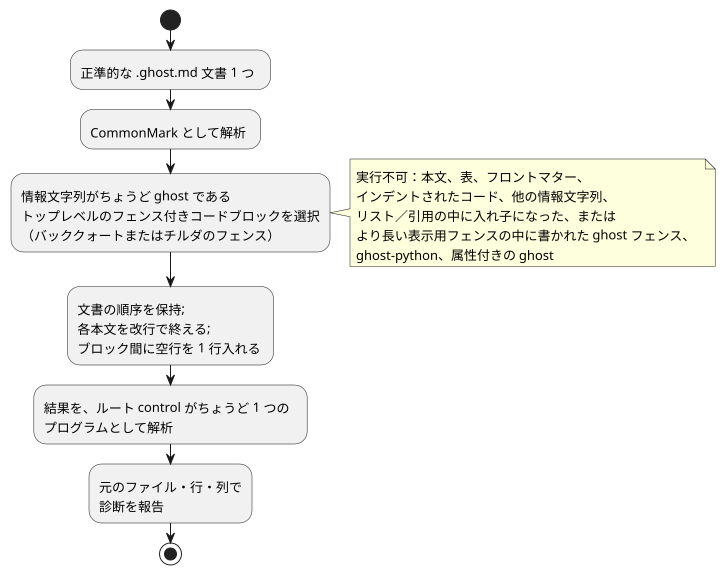
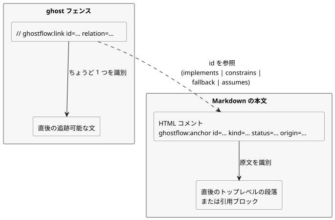

<!-- translation-source: docs/reference/01-source-and-syntax.en.md -->
[英語の原文](01-source-and-syntax.en.md)

# 1. ソースと構文

[全体の目次](../LANGUAGE-REFERENCE.ja.md) · [次へ：型、式、状態](02-types-expressions-state.ja.md)

正準的な GhostFlow プログラムは、1 つの `.ghost.md` 文書です。この文書は説明と実行可能な規則の両方を保持します。この言語の代表的な表層は **control 構文**です。波かっこ、セミコロン、式、明示的な次状態、出力接続を使う `control Name { ... }` の形です。

この章では次のことを定義します。

- 文書から実行可能なソースをどのように選び出すか（§1.1）
- 原文、位置、意図のリンクをどのように保持するか（§1.2）
- 語彙：識別子、予約語、コメント、記号（§1.3）
- 文法の記法と宣言の形（§1.4）
- 代表的な宣言構造と名前解決の規則（§1.5）
- 拒否される過去の記法（§1.6）と、どの章がどの構文を担当するか（§1.7）

この章の `ghost` 断片は、構文とセマンティクスを説明するための例です。

根拠：[選択された構文](../LANGUAGE-SURFACE.ja.md)、[共通の言語契約](../LANGUAGE.ja.md)、[文芸的ソース](../LITERATE.ja.md)、[意図アンカー](../INTENT-ANCHOR-MAP.ja.md)、[ソースの保持](../SOURCE-MAP.ja.md)、[設計ノート](../DESIGN-NOTES.ja.md)。[言語リファレンス全体](../LANGUAGE-REFERENCE.ja.md)が、この章と他の詳細な章の索引になっています。

**外部入力。** 外部入力の正準的な宣言は `input` です。入力を読むと `Result<T, SensorFault>` が得られます。

**再起動入力だけは例外です。** 厳密に予約された宣言 `restart_reason: RestartReason` と `restart_event: Bool` は、外部から取得される入力ではなく、ランタイムが所有する lifecycle 入力です。これらは直接 `RestartReason` と `Bool` として読まれます。オプションのマーカー、コンディショニング設定、呼び出し側が与える値は、これらには禁止されています。[再起動の契約](05-settings-and-observation.ja.md)を参照してください。

この章の例では、`start` の読み取りが失敗したときは明示的に `false` を、`stop` の読み取りが失敗したときは `true` を選んでいます。これらは作成者のポリシーの例示であり、暗黙の既定値では決してありません。

以前の `sensor` 宣言は拒否されます。古い文書は保存しておき、明示的でレビュー済みのリビジョンを作成してください。取得と互換性については[移行の契約](../INPUT-MIGRATION.ja.md)を参照してください。

## 1.1 1 つの文書をソースとする理由

制御規則だけを残すと、各条件の背後にある理由や現場の前提が失われます。説明だけを残すと、どの規則が実際に実行されるかを誰も機械的に確認できません。そこで GhostFlow は、説明、コメント、意図、実行可能なコードを 1 つのリビジョンにまとめて保持します。レビューの出発点は 1 つになります。

- 製品の入力は、1 つの完全な `.ghost.md` 文書です。
- 普通の `.ghost` ファイルは実行可能な入力ではなく、代替の入力でもありません。
- エディタ、フォーム、グラフは、この文書の異なるビューであってもかまいません。それらが独立した制御ソースを作ることは決してありません。
- 文書のリビジョンと、実行可能な構造の同一性は別物です。説明だけを編集すると、新しい文書リビジョンが作られます。実行可能なトークン構造が変わらなければ、計算は同じ意味を保ちます。

### 実行可能ブロックの抽出

文書を CommonMark として解析します。情報文字列がちょうど `ghost` である**トップレベルのフェンス付きコードブロック**だけを、文書の順序どおりに抽出します。バッククォートとチルダのどちらのフェンスも使えます。各ブロックの本文は改行で終え、ブロックの間には空行を 1 行入れます。見出しや説明がコードのコメントに変換されることは決してありません。

抽出の手順を以下にまとめます。



例として、完全な `.ghost.md` 文書を示します。

````markdown
# 펌프 요청

정지가 시작보다 우선한다.

```ghost
control PumpRequest {
  input start, stop: Bool;
```

두 입력의 판단을 출력에 연결한다.

```ghost
  output pump: Bool;
  pump <- (start |> recover(false)) && !(stop |> recover(true));
}
```
````

2 つの `ghost` ブロックは合わせて 1 つの `control` を構成します。ブロックが独自の実行や独自の状態の確定を作ることはありません。欠けている波かっこや文が自動的に補われることは決してありません。ブロックの境界は、宣言や文の終わりに置いてください。トークン、文字列、コメント、式をブロックをまたいで分割してはなりません。

次のものは実行可能なコードでは**ありません**。

- 普通の段落、表、リンク、画像、フロントマター
- インデントされたコードブロックと、`text` など他の情報文字列を持つフェンス
- リストや引用の中に入れ子になった `ghost` フェンス
- より長い表示用フェンスの中にテキストとして書かれた `ghost` フェンス
- `ghost-python` や属性付きの `ghost` など、厳密に一致しないタグ

次のものは診断を生成します：閉じられていない実行可能フェンス、実行可能なコードを含まない文書、実行可能に見えるが除外された入れ子のブロック。実装は、正規表現で Markdown の構造を模倣して入れ子のブロックを実行してはなりません。

### ハードウェアのフロントマター

予約されたトップレベルの YAML フィールド `hardware` は、入力ドライバと出力レンダラーについて、ピン留めされた依存関係、構成、論理バインディングを宣言します。

- コンパイルは、正確なソースの SHA-256 とソース位置に結びついた派生プランを返します。実行可能な GFB バイトは変わりません。
- 不正なスキーマ、重複したキー、欠けている参照、役割の不一致は、それぞれの正準的な位置で失敗します。
- その他のフロントマターは、これまでどおり実行されません。

構造、例、プロバイダの検証の境界については[ハードウェア宣言](../HARDWARE-FRONT-MATTER.ja.md)を参照してください。
理由：設置の意図と制御規則が 1 つのリビジョンでレビューされ、ボードの動作は Device が担当するためです。

簡潔な記述形式では、ルートフィールド `profile`、`devices`（任意）、`bindings` が予約されています。

- `compileSource`/`compileSourceSync` に、ピン留めされた `hardwareProfiles` の閉包を渡します。するとコンパイラは、継承、明示的な既定の接続、パラメータ、通信条件、アドレスの衝突、チャネルの型を検証します。
- すべての論理入力と論理出力にはバインディングが必要です。
- 返される `hardwarePlan` のフォーマットは `GhostFlow/profile-resolution-v1` です。これは解決済みのプランであり、未解決の宣言ではありません。
- 欠けているプロファイルが推測されることは決してありません。

[設計と段階的な範囲](../PROFILE-FRONT-MATTER.ja.md)に従ってください。この形式の目的は、ボードとドライバがすでに知っている事実を顧客が繰り返し書かなくて済むようにすることです。

## 1.2 原文、位置、意図のリンク

元の文書の本文、`//` コメント、Unicode テキスト、改行コード、最後の改行は言語の資産です。これらは正確に保持しなければなりません。構文と型の診断は、結合された一時テキストではなく、元の `.ghost.md` のファイル、行、列を指します。閉じ波かっこが複数のフェンスにわたって欠けている場合、診断は宣言の開始位置と文書の終わりの両方を指せなければなりません。

ノードの同一性は Markdown の行番号からは導出されません。先頭に説明を追加すると位置がずれることはありますが、同じ実行可能な構造は引き続き同じ計算として識別できなければなりません。位置は常に特定の文書リビジョンに属します。原文と実行可能な成果物のダイジェストによって、異なるリビジョンが混ざることを防ぎます。この保持だけでは、原文が真正であることの証明にはなりません。

### 意図アンカー

この契約の設計記録は [#31](https://github.com/callin2/ghostflow-language/issues/31) と [#60](https://github.com/callin2/ghostflow-language/issues/60) にリンクしています。

**アンカー**は、実行されないトップレベルの Markdown HTML コメントです。直後に続くトップレベルの段落または引用ブロックを、その原文として示します。コメントとそのブロックの間には空行を 1 行入れてもかまいません。

下の図は、アンカーと（後述する）実行可能なリンクが互いにどう参照し合うかを示します。



```markdown
<!-- ghostflow:anchor id=GF-INT-PUMP-001 kind=intent status=confirmed origin=user -->
> 급수 요청이 있고 정지가 없을 때 펌프를 요청한다.
```

フィールドの順序と許される値は固定されています。

- `id`：`[A-Za-z][A-Za-z0-9._:-]{0,127}`。文書内で一意であり、同じ意図に対しては安定したまま変わりません。
- `kind`：`intent | premise | assumption`
- `status`：`confirmed | unconfirmed | superseded`
- `origin`：`user | operator | engineer | ai | imported`
- `assumption` は `confirmed` にはできません。確認されたら、`intent` または `premise` に分類し直してください。

見出し、リスト、入れ子のブロック、コードフェンス、別のアンカー、文書の終わりは、アンカーの本体にはなれません。複数のブロックにまたがる説明にアンカーを付けるには、複数のアンカーを使ってください。

### 実行可能ノードのリンク

実行可能な `ghost` フェンスの中では、次の形の行全体のコメントが、ちょうど 1 つの追跡可能な文、つまり直後の文を識別します。

```ghost
// ghostflow:link id=GF-INT-PUMP-001 relation=implements
pump <- request;
```

リンクの規則：

- `relation` は `implements | constrains | fallback | assumes` のいずれかです。
- `assumes` が参照できるのは `unconfirmed assumption` だけです。他の関係が仮定を参照することは決してありません。
- `superseded` のアンカーを現在のノードにリンクすることはできません。
- 連続する複数のリンク行が、同じ次の文を参照してもかまいません。
- 対象の代わりに空行、普通のコメント、入れ子の式、`control` ヘッダー、フェンスの終わりが続く場合、そのリンクは孤立リンクになります。

リンクの対象は、`input`、`output`、`state`、`config`、`let`、enum、関数、`sensor`、`signal`、`schedule`、`timer`、`require`、`mutex`、次状態の定義、出力接続です。

リンクは自然言語を解釈せず、暗黙知を発見することもありません。書かれたとおりの分類と関係を正確に保持します。未確認の関係を証明や承認に変えることは決してありません。

## 1.3 語彙

### 識別子と大文字・小文字の区別

識別子は `[A-Za-z_][A-Za-z0-9_]*` に一致し、大文字と小文字を区別します。`start` と `Start` は別の名前です。

- `.` は識別子の文字ではありません。`starts.due`、`Alias.name`、`instance.port` のように、確定したパス区切りです。
- 入力と前状態は、`start` や `running` のように名前で直接読みます。古い別名 `input.start`、`state.running`、`next.running` は拒否されます。
- `'` も識別子の文字ではありません。`running'` のように、次状態の記法です。

**予約語。** 次の言語の語は、ユーザー定義の名前にはできません。

```text
control fn input output state config let type sensor signal schedule timer
calendar provider event require mutex if then else case in true false
div ok fault syntax adapt constraints check limit quote instance connect elapsed
```

**削除された記法。** `purefn`、`enum`、`next`、`ifthenelse`、`not`、`and`、`or`、`is`、`isnt` も予約されています。これらは移行用の診断とともに拒否されるため、削除された記法が別の意味で再解釈されることは決してありません。

**組み込みの名前空間。** `Bool`、`Int`、`Number`、`Percent`、`Duration`、`Result`、`SensorFault`、`Expr`、`Date`、`TimeOfDay`、`DateTime`、`TimeSlots`、`WorkCalendar`、`HolidayCalendar`、`TidePredictions`、`LunarEphemeris`、`BoolActuator`、`Event`、`ClockFault`、`CalendarFault`、`TemporalContextFault`、`AccountingFault`、および第 2 章の物理量の型は、組み込みの型の名前空間です。`number`、`int_exact`、`int_floor`、`int_ceil`、`int_trunc`、`int_nearest_even`、`elapsed`、`median`、`hysteresis`、`date`、`time`、`datetime`、`cron5`、`sun`、`tide`、`day`、`moon`、`continuous_true`、`instant`、`civil`、`on_time`、`count_events`、`local_day_is`、`calendar_is`、`tide_is`、`moon_is`、`used`、`rolling`、`local_day`、および Result の変換名は、組み込みの呼び出し可能な名前空間です。ユーザーの宣言でこれらの名前を隠すことはできません。内部用の接頭辞 `__gf_` を持つ名前と、破棄パターン `_` も宣言できません。

**組み込みの射影。** スケジュールとアカウントが提供する `.due`、`.open`、`.active`、`.count` は、それらの組み込み型の射影です。スケジュールの `.missed` も射影です。これらの名前のメンバーが他の型にも存在すると仮定してはならず、ユーザー定義の射影として再定義してもなりません。`.missed` のセマンティクスについては、[第 3 章](03-time-and-schedules.ja.md)の §3.5 を参照してください。

**文脈キーワード。** `parameter`、`resource`、`account`、`import`、`from`、`revision`、`sha256`、`timezone`、`selected`、`basis`、`when`、`clock`、`gap`、`recovery`、`fallback`、`dst_missing`、`dst_repeated`、`sample`、`valid`、`filter`、`stale_after`、`recover_after`、`samples`、`min`、`max`、`step`、`access`、`label` は**文脈キーワード**です。これらは自分の構文上の位置でだけ特別な意味を持ち、それ以外の場所では普通の識別子です。`has` の文脈は[第 4 章](04-sensors-constraints-control.ja.md)で定義されています。これに対して、`adapt`、`constraints`、`check`、`limit`、`quote`、`instance`、`connect` はすべての位置で予約されています。

### 空白、文の終わり、コメント

空白とインデントはトークンを区切り、人が構造を読む助けになります。ブロックを作ることは決してありません。代表的な control 構文では、タブや桁数に意味はありません。宣言と式の定義は通常 `;` で終わります。改行がその代わりになることはありません。

**`;` が必要なもの：** `input`、`output`、`state`、`config`、`let`、次状態の定義、出力接続、`require`、`mutex`、`signal`、`timer`、`type X = ...`、および設定ブロックの各エントリ。

**`;` を省略できるもの：** 関数の最後の結果式、関数の閉じ `}`、`case` の分岐。

コードのコメントは `//` から行末までです。`#` コメントと `/* ... */` コメントは、代表的な control 構文ではコメントではありません。読者向けの説明は Markdown の本文に書いてください。

### 記号と区切り文字

| 記法 | 役割 |
|---|---|
| `{ }` | control、関数、case、設定ブロック、`in` 集合 |
| `( )` | 式のグループ化、関数呼び出し、パラメータ |
| `[ ]` | 選択されたスケジュール時刻のリスト。汎用のリスト構文ではない |
| `:` | 名前と型、名前付きの組み込み引数 |
| `,` | 名前、引数、要素の区切り |
| `=` | 定義と初期値 |
| `'` | 次状態の定義と参照 |
| `<-` | 出力意図の接続 |
| `->` | 関数の結果の型 |
| `=>` | `case` の分岐、または出力制約の関係 |
| `?` | オプションのセンサのケイパビリティ宣言 |
| `..` | センサの有効範囲 |

`=>` は論理演算子ではありません。普通の式では使えません。

## 1.4 文法の記法

このリファレンスの文法の要約では、次のメタ記法を使います。

- 単一引用符の中の文字は、リテラルのトークンです。
- `name` のような斜体でない小文字の名前は、他の文法項目です。
- `[ item ]` は省略可能、`{ item }` は 0 回以上の繰り返しを意味します。
- `(a | b)` は選択肢のうち 1 つを選びます。GhostFlow の実際の `{}`、`[]`、`|` トークンは単一引用符で囲んで書きます。

これらの要約は、この章の規則を曖昧さなく述べるためのものです。完全な生成文法ではなく、パーサの文法の代わりにもなりません。

```text
document       ::= Markdown containing one or more top-level ghost fences
program        ::= { import_decl | top_level_function | top_level_type | syntax_decl }
                   control_decl
control_decl   ::= 'control' Identifier '{' { control_item } '}'
top_level_function ::= function_decl
top_level_type ::= enum_decl

control_item   ::= declaration | function_decl | next_definition
                 | output_connection | constraint | parameter_decl
                 | instance_decl | connect_decl
declaration    ::= input_decl | output_decl | config_decl
                 | state_decl | let_decl | enum_decl | signal_decl
                 | schedule_decl | timer_decl
```

プログラムは、実行のルートとしてちょうど 1 つの `control` を持ちます。

- 文書スコープのインポートは、1 つの完全な `.ghost.md` 定義をリビジョンとダイジェストでピン留めします。
- インポートした関数と型は、`Alias.name` としてのみ参照します。
- control の中では、`instance` と `connect` がインポートした control を合成します。
- ワイルドカードのインポート、暗黙のエクスポート、2 つ目のルート control はありません。

import、parameter、instance、connect、型付き式マクロの正確な構文は、[第 6 章](06-composition-and-replay.ja.md)の §6.4 で定義されています。

選択された構文の宣言の形を以下に示します。`expr`、`type`、`pattern` の詳細な規則は[次の章](02-types-expressions-state.ja.md)にあります。

```text
input_decl       ::= 'input' input_names ':' payload_type
                     ( ';' | '{' { input_setting ';' } '}' )
input_names      ::= Identifier [ '?' ] { ',' Identifier [ '?' ] }
output_decl      ::= 'output' name_list ':' type ';'
config_decl      ::= 'config' Identifier ':' type '=' expr
                     ( ';' | '{' { config_setting ';' } '}' )
parameter_decl   ::= 'parameter' Identifier ':' type '=' constant_expr ';'
state_decl       ::= 'state' Identifier ':' type '=' constant_expr ';'
let_decl         ::= 'let' Identifier '=' expr ';'
enum_decl        ::= 'type' Identifier '=' Identifier { '|' Identifier } ';'
function_decl    ::= 'fn' Identifier '(' [ parameter_list ] ')' '->' type
                     '{' expr [ ';' ] '}'
next_definition  ::= Identifier "'" '=' expr ';'
output_connection ::= Identifier '<-' expr ';'
signal_decl      ::= 'signal' Identifier '=' expr ';'
timer_decl       ::= 'timer' Identifier '=' ( 'elapsed' '(' Identifier ')'
                     | 'continuous_true' '(' expr ')' ) ';'
constraint       ::= 'require' ( '!' expr | expr '=>' expr ) ';'
                   | 'mutex' '(' name_list ')' ';'
name_list        ::= Identifier { ',' Identifier }
parameter_list   ::= Identifier ':' type { ',' Identifier ':' type }
```

`input` は名前と型だけを宣言します。`input x: Bool = false;` のような初期化子はコンパイルエラーになり、`=` のソース位置で報告されます。入力値はホストが供給し、宣言が暗黙の既定値やフォールバックを導入することはありません。`input x: Bool;` と宣言し、値はホストから供給してください。初期値が必要なプログラム内部のメモリには `state` を使ってください。

**理由**：決して使われない初期化子が、実行可能なフォールバックのように見えてはならないためです。

`schedule` は一般的な宣言構造に従いません。スケジュールの型ごとに独自の設定ブロックがあります。確定している日次スロットの形は次のとおりです。

```ghost
schedule starts: DailySlots<15min> {
  timezone = "Asia/Seoul";
  selected = [06:00, 18:45];
  basis = pulse;
  when = true;
  clock = trusted_only;
  gap = skip_after(60s);
  recovery = baseline;
  fallback = skip;
  dst_missing = skip;
  dst_repeated = first;
}
```

`timezone`、`selected`、時刻リテラル、そしてリストは、このスケジュールの位置にだけ存在する構文です。一般的な文字列、一般的なリスト、任意のジェネリック型の構文として読んではなりません。

## 1.5 代表的な宣言構造

```ghost
fn allowed(request: Bool, enabled: Bool) -> Bool {
  request && enabled
}

control Example {
  input start, stop: Bool;
  input moisture?: Percent;
  output pump: Bool;
  config threshold: Percent = 30%;
  type Phase = Idle | Running;
  state phase: Phase = Idle;
  let request = (start |> recover(false)) && !(stop |> recover(true));
  timer age = elapsed(phase);

  phase' = if request then Running else Idle;
  pump <- phase' == Running;
}
```

外部入力、運用設定、メモリ、一時的な計算、出力要求は、それぞれ変化の仕方と観測のされ方が異なるため、役割ごとに独自のキーワードがあります。`let` はメモリを作りません。`output` 宣言は、値も安全な既定値も作りません。

### 名前のスコープと解決

- 関数のパラメータはその関数の中にだけ存在し、パラメータリストの中で一意でなければなりません。純粋関数は control の値を捕捉しないため、パラメータは control の値と同じ綴りでもかまいません。他の関数、型、enum のケース、組み込みの名前を隠してはなりません。
- 関数は、必要な control の値と状態をパラメータを通じて受け取ります。外側の入力や状態を暗黙に捕捉することは決してありません。
- 文書の control、関数、型、enum のケース、インポートの別名、構文の名前、control の値の名前は曖昧であってはなりません。
  - `input`、`output`、`state`、`config`、`parameter`、`let`、`sensor`、`signal`、`schedule`、`timer`、関数、インスタンスは、**1 つの値の名前空間**を共有します。種類の異なる宣言であっても、名前を再利用することはできません。
  - enum のケースも文書内で一意です。
  - インポートされた内部の名前は `Alias.name` の下にとどまります。
- 各出力は、ちょうど 1 つの直接の接続式、またはちょうど 1 つの `connect` を持ちます。
- `let` 宣言のソース上の順序は、依存の順序を定めません。`let` 宣言は非巡回の依存グラフを形成し、相互依存の循環はエラーです。
- ローカルな計算が、関数名や予約された名前空間を隠すことはありません。

衝突はコンパイル時の診断として報告されます。宣言の順序や、種類ごとの隠蔽によって解決されることは決してありません。

## 1.6 代表的な記法、参照用の別名、過去の代替案

新しい文書では、左の列の代表的な記法だけを使います。右の列の古い記法は構文の別名ではありません。読者の助けと移行用の診断のために履歴として載せているもので、実行可能な入力としては拒否されます。

| 代表的な記法 | 拒否される古い記法 |
|---|---|
| `fn` | `purefn` |
| `type Mode = Off \| On;` | `enum Mode { Off, On }`, `enum Mode = Off \| On;` |
| `running' = expr;` | `next running = expr;` |
| 出力式の中の `running'` | `next.running` |
| `start`, `running` | `input.start`, `state.running` |
| `if c then a else b` | `ifthenelse(c, a, b)` |

コンパイラは右側の記法を自動的に変換せず、別のプロファイルの下で実行することもありません。変換ツールを使う場合は、原文を新しい正準的な `.ghost.md` リビジョンへ明示的に改訂し、もう一度レビューしてください。

初期の A/B/C 比較では、YAML の階層的な記法、CoffeeScript 風の記法（インデントと `not/and/or`）、Cypher 風の記法（`MATCH/WHERE/WITH/NEXT/EMIT`）が検討されました。これらは設計の履歴であり、選択された control 構文の許容される別名ではありません。表に挙げた個々の記法は、それらの初期の代替案のブロック構造や演算子を混ぜてよいという意味ではありません。

## 1.7 ソース規則の章の境界

この章は、正準的な文書の抽出、語彙、名前空間、ルートのプログラム構造を定義します。各機能の詳細な構文は、このリファレンスの別の章に属します。

- 値、Result、式、状態：[第 2 章](02-types-expressions-state.ja.md)
- 時間の値とスケジュール：[第 3 章](03-time-and-schedules.ja.md)
- `adapt`、`has`、ケイパビリティ、制約：[第 4 章](04-sensors-constraints-control.ja.md)
- 不変な import、parameter、instance、connect、型付き式マクロ：[第 6 章](06-composition-and-replay.ja.md)

各構文は、その章が明示的に宣言した位置にだけ現れることができます。暗黙のインポート、ワイルドカードのエクスポート、互換性のための別名のフォールバック、実行時のマクロ実行、文書の外にあるファイルの実行時の検索は、いずれもありません。
