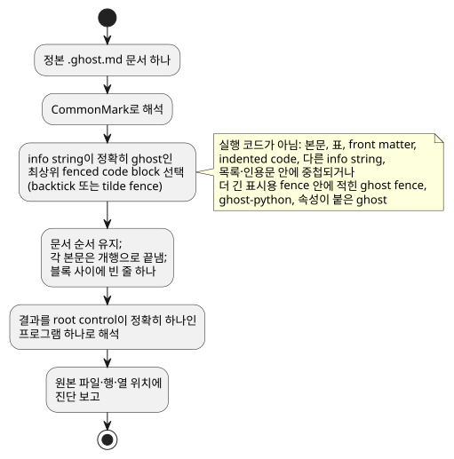
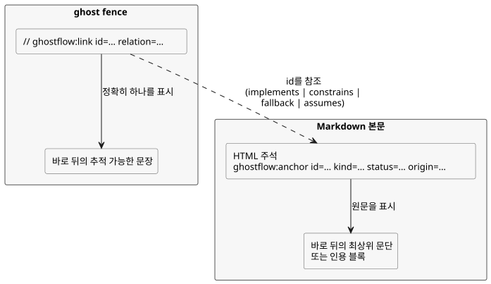

<!-- translation-source: docs/reference/01-source-and-syntax.en.md -->
[영문 원문](01-source-and-syntax.en.md)

# 1. 소스와 문법

[전체 목차](../LANGUAGE-REFERENCE.md) · [다음: 타입·표현식·상태](02-types-expressions-state.md)

GhostFlow 프로그램의 정본은 하나의 `.ghost.md` 문서입니다. 이 문서는 설명과 실행 규칙을 함께 담습니다. 언어의 대표 표면은 **control 문법**입니다. 중괄호를 쓰는 `control Name { ... }`, 세미콜론, 식, 명시적인 다음 상태와 출력 연결로 이루어집니다.

이 장에서 정의하는 내용은 다음과 같습니다.

- 문서에서 실행 소스를 고르는 방법 (§1.1)
- 원문, 위치와 의도 연결을 보존하는 방법 (§1.2)
- 어휘: 식별자, 예약어, 주석과 기호 (§1.3)
- 문법 표기법과 선언 형태 (§1.4)
- 대표 선언 골격과 이름 해석 규칙 (§1.5)
- 거부하는 역사적 표기 (§1.6)와 어떤 장이 어떤 문법을 소유하는지 (§1.7)

이 장의 `ghost` 조각은 문법과 의미를 설명하는 예시입니다.

근거: [선택 문법](../LANGUAGE-SURFACE.md), [공통 언어 계약](../LANGUAGE.md), [literate 소스](../LITERATE.md), [의도 앵커](../INTENT-ANCHOR-MAP.ko.md), [소스 보존](../SOURCE-MAP.ko.md), [설계 노트](../DESIGN-NOTES.ko.md). [전체 언어 reference](../LANGUAGE-REFERENCE.md)는 이 장과 나머지 상세 장의 색인입니다.

**외부 입력.** 외부 입력의 canonical 선언은 `input`입니다. 입력을 읽으면 `Result<T, SensorFault>`가 나옵니다.

**재시작 입력은 유일한 예외입니다.** 정확한 예약 선언
`restart_reason: RestartReason`과 `restart_event: Bool`은 외부에서 취득하는 입력이 아니라
runtime이 소유하는 lifecycle 입력입니다. 각각 `RestartReason`과 `Bool`로 직접 읽습니다.
이 입력에는 optional 표기, conditioning 설정과 호출자가 공급하는 값을 쓸 수 없습니다.
[재시작 계약](05-settings-and-observation.md)을 참조하세요.

이 장의 예제는 `start` 읽기가 실패하면 `false`를, `stop` 읽기가 실패하면 `true`를
명시적으로 선택합니다. 이는 설명용 작성 정책이며 결코 암묵적인 기본값이 아닙니다.

기존 `sensor` 선언은 거부합니다. 이전 문서는 보존하고, 명시적으로 검토한 새
revision을 만드세요. 취득과 호환성은 [migration 계약](../INPUT-MIGRATION.ko.md)을 참조하세요.

## 1.1 왜 문서 하나가 소스인가

제어 규칙만 남기면 각 조건을 둔 이유와 현장 전제가 사라집니다. 반대로 설명만 남기면 어떤 규칙이 실제로 실행되는지 아무도 기계적으로 확인할 수 없습니다. 그래서 GhostFlow는 설명, 주석, 의도와 실행 코드를 한 판본(revision)에 함께 보존합니다. 검토의 출발점은 하나입니다.

- 제품 입력은 완전한 `.ghost.md` 문서 하나입니다.
- 일반 `.ghost` 파일은 실행 입력이 아니며 대체 입력도 아닙니다.
- 편집기, 폼, 그래프는 이 문서의 다른 보기일 수 있습니다. 그러나 독립된 제어 원본을 만들지는 않습니다.
- 문서 판본과 실행 구조의 정체성은 서로 다릅니다. 설명만 고쳐도 새 문서 판본이 생깁니다. 실행 토큰 구조가 같으면 계산의 의미는 그대로입니다.

### 실행 블록 추출

문서를 CommonMark로 해석합니다. info string이 정확히 `ghost`인 **최상위 fenced code block**만 문서 순서대로 추출합니다. backtick fence와 tilde fence를 모두 쓸 수 있습니다. 각 블록 본문은 개행으로 끝내고 블록 사이에는 빈 줄 하나를 둡니다. 제목과 설명은 결코 코드 주석으로 바뀌지 않습니다.

추출 단계를 요약하면 다음과 같습니다.



다음은 완전한 `.ghost.md` 문서의 예입니다.

````markdown
# 펌프 요청

정지가 시작보다 우선한다.

```ghost
control PumpRequest {
  input start, stop: Bool;
```

두 입력의 판단을 출력에 연결한다.

```ghost
  output pump: Bool;
  pump <- (start |> recover(false)) && !(stop |> recover(true));
}
```
````

두 `ghost` 블록은 함께 하나의 `control`을 이룹니다. 블록마다 별도의 실행이나 상태 확정이 생기지 않습니다. 빠진 중괄호나 문장을 자동으로 보충하지도 않습니다. 블록 경계는 선언이나 문장의 끝에 두세요. 토큰, 문자열, 주석 또는 표현식을 블록 사이에서 나누어서는 안 됩니다.

다음은 실행 코드가 **아닙니다**.

- 일반 문단, 표, 링크, 이미지와 front matter
- indented code block, 그리고 `text`처럼 다른 info string을 가진 fence
- 목록이나 인용문 안에 중첩된 `ghost` fence
- 더 긴 표시용 fence 안에 문자로 적힌 `ghost` fence
- `ghost-python`이나 속성이 붙은 `ghost`처럼 정확히 일치하지 않는 태그

닫히지 않은 실행 fence, 실행 코드가 없는 문서, 실행 코드처럼 보이지만 제외되는 중첩 블록은 진단을 만듭니다. 구현은 Markdown 구조를 정규식으로 흉내 낸 뒤 중첩 블록을 실행해서는 안 됩니다.

### 하드웨어 front matter

최상위 YAML 예약 필드 `hardware`는 입력 드라이버와 출력 렌더러의 고정된 의존성,
설정과 논리 바인딩을 선언합니다.

- 컴파일은 정확한 소스 SHA-256과 소스 위치에 묶인 파생 plan을 반환합니다. 실행 GFB
  바이트는 바뀌지 않습니다.
- 잘못된 schema, 중복 키, 없는 참조와 역할 불일치는 각각의 정본 위치에서 실패합니다.
- 그 밖의 front matter는 이전과 같이 실행되지 않습니다.

구조, 예제와 provider 검증 경계는 [하드웨어 선언](../HARDWARE-FRONT-MATTER.ko.md)을 참조하세요.
Why: 설치 의도와 제어 규칙을 한 revision에서 검토하되, 보드 동작은 Device가 소유합니다.

간결한 작성 형식은 최상위 필드 `profile`, `devices`(선택)와 `bindings`를 예약합니다.

- `compileSource`/`compileSourceSync`에 고정된 `hardwareProfiles` closure를 공급하세요.
  그러면 컴파일러가 상속, 명시적 기본 연결, 파라미터, 통신 조건, 주소 충돌과 채널
  타입을 검증합니다.
- 모든 논리 입력과 출력에는 바인딩이 필요합니다.
- 반환되는 `hardwarePlan`의 형식은 `GhostFlow/profile-resolution-v1`입니다. 이는
  해석이 끝난 plan이며 미해석 선언이 아닙니다.
- 누락된 profile을 추측으로 채우지 않습니다.

[설계와 단계별 범위](../PROFILE-FRONT-MATTER.md)를 따르세요. 이 형식의 목적은 보드와
드라이버가 이미 알고 있는 사실을 고객이 반복해서 적지 않아도 되게 하는 것입니다.

## 1.2 원문, 위치와 의도 연결

원본 문서의 prose, `//` 주석, Unicode 텍스트, 줄바꿈과 마지막 개행은 언어 자산입니다. 이것들은 정확히 그대로 보존해야 합니다. 문법·타입 진단은 합쳐진 임시 텍스트가 아니라 원본 `.ghost.md`의 파일, 행, 열을 가리킵니다. 여러 fence에 걸쳐 닫는 중괄호가 빠졌다면, 진단은 선언의 시작과 문서의 끝을 함께 가리킬 수 있어야 합니다.

노드 정체성은 Markdown 행 번호에서 만들지 않습니다. 앞쪽에 설명을 추가하면 위치가 이동할 수 있지만, 같은 실행 구조는 여전히 같은 계산으로 식별할 수 있어야 합니다. 위치는 항상 특정 문서 판본에 속합니다. 원문과 실행 artifact의 digest는 서로 다른 판본이 섞이지 않게 합니다. 이 보존만으로 원문이 진본임이 증명되지는 않습니다.

### 의도 앵커

이 계약의 설계 기록은 [#31](https://github.com/callin2/ghostflow-language/issues/31)과 [#60](https://github.com/callin2/ghostflow-language/issues/60)에 연결됩니다.

**앵커**는 실행되지 않는 최상위 Markdown HTML 주석입니다. 바로 뒤에 오는 최상위 문단 또는 인용 블록 하나를 자신의 원문으로 표시합니다. 주석과 그 블록 사이에는 빈 줄 하나를 둘 수 있습니다.

다음 그림은 앵커와 (아래에서 설명할) 실행 링크가 서로를 어떻게 가리키는지 보여 줍니다.



```markdown
<!-- ghostflow:anchor id=GF-INT-PUMP-001 kind=intent status=confirmed origin=user -->
> 급수 요청이 있고 정지가 없을 때 펌프를 요청한다.
```

필드 순서와 허용 값은 고정되어 있습니다.

- `id`: `[A-Za-z][A-Za-z0-9._:-]{0,127}`. 문서 안에서 유일하며 같은 의도에 대해서는 안정적으로 유지됩니다.
- `kind`: `intent | premise | assumption`
- `status`: `confirmed | unconfirmed | superseded`
- `origin`: `user | operator | engineer | ai | imported`
- `assumption`은 `confirmed`일 수 없습니다. 확인되면 `intent` 또는 `premise`로 다시 분류하세요.

heading, list, 중첩 블록, code fence, 다른 앵커 또는 문서 끝은 앵커 본문이 될 수 없습니다. 여러 블록에 걸친 설명에 앵커를 달려면 앵커를 여러 개 쓰세요.

### 실행 노드 링크

실행 `ghost` fence 안에서 다음 형태의 whole-line 주석은 바로 뒤에 오는 추적 가능한 문장 정확히 하나를 가리킵니다.

```ghost
// ghostflow:link id=GF-INT-PUMP-001 relation=implements
pump <- request;
```

링크 규칙은 다음과 같습니다.

- `relation`은 `implements | constrains | fallback | assumes` 중 하나입니다.
- `assumes`는 `unconfirmed assumption`만 가리킬 수 있습니다. 다른 relation은 결코 assumption을 가리키지 않습니다.
- `superseded` 앵커는 현재 노드에 연결할 수 없습니다.
- 연속된 여러 link line이 같은 다음 문장을 가리킬 수 있습니다.
- 대상 대신 빈 줄, 일반 주석, 중첩 표현식, `control` header 또는 fence 끝이 오면 그 링크는 고아 링크입니다.

링크 대상은 `input`, `output`, `state`, `config`, `let`, enum, function, `sensor`, `signal`, `schedule`, `timer`, `require`, `mutex`, 다음 상태 정의와 출력 연결입니다.

링크는 자연어를 해석하거나 암묵지를 발견하지 않습니다. 작성된 분류와 관계를 그대로 보존합니다. 미확인 관계를 증명이나 승인으로 바꾸는 일은 결코 없습니다.

## 1.3 어휘

### 식별자와 대소문자

식별자는 `[A-Za-z_][A-Za-z0-9_]*`이며 대소문자를 구별합니다. `start`와 `Start`는 다른 이름입니다.

- `.`은 식별자 문자가 아닙니다. `starts.due`, `Alias.name`, `instance.port`처럼 확정된 경로 구분자입니다.
- 입력과 이전 상태는 `start`, `running`처럼 이름으로 직접 읽습니다. 이전 별칭 `input.start`, `state.running`, `next.running`은 거부합니다.
- `'`도 식별자 문자가 아닙니다. `running'`처럼 다음 상태를 나타내는 표기입니다.

**예약어.** 다음 언어 단어는 사용자 정의 이름으로 쓸 수 없습니다.

```text
control fn input output state config let type sensor signal schedule timer
calendar provider event require mutex if then else case in true false
div ok fault syntax adapt constraints check limit quote instance connect elapsed
```

**제거된 표기.** `purefn`, `enum`, `next`, `ifthenelse`, `not`, `and`, `or`, `is`, `isnt`도 예약되어 있습니다. 제거된 표기가 다른 뜻으로 재해석되는 일이 없도록 migration 진단과 함께 거부합니다.

**내장 namespace.** `Bool`, `Int`, `Number`, `Percent`, `Duration`, `Result`, `SensorFault`, `Expr`, `Date`, `TimeOfDay`, `DateTime`, `TimeSlots`, `WorkCalendar`, `HolidayCalendar`, `TidePredictions`, `LunarEphemeris`, `BoolActuator`, `Event`, `ClockFault`, `CalendarFault`, `TemporalContextFault`, `AccountingFault`와 2장의 물리량 타입은 내장 타입 namespace입니다. `number`, `int_exact`, `int_floor`, `int_ceil`, `int_trunc`, `int_nearest_even`, `elapsed`, `median`, `hysteresis`, `date`, `time`, `datetime`, `cron5`, `sun`, `tide`, `day`, `moon`, `continuous_true`, `instant`, `civil`, `on_time`, `count_events`, `local_day_is`, `calendar_is`, `tide_is`, `moon_is`, `used`, `rolling`, `local_day`와 Result 변환 이름은 내장 callable namespace입니다. 사용자 선언은 이 이름들을 가릴 수 없습니다. 내부용 접두사 `__gf_`가 붙은 이름과 discard pattern `_`도 선언할 수 없습니다.

**내장 projection.** schedule과 account가 제공하는 `.due`, `.open`, `.active`, `.count`는 해당 내장 타입의 projection입니다. schedule의 `.missed`도 projection입니다. 다른 타입에 같은 이름의 member가 있다고 가정하지 말고, 사용자 projection으로 재정의하지도 마세요. `.missed`의 의미는 [3장](03-time-and-schedules.md#35-schedule의-공통-의미)의 §3.5를 참조하세요.

**문맥 단어.** `parameter`, `resource`, `account`, `import`, `from`, `revision`, `sha256`, `timezone`, `selected`, `basis`, `when`, `clock`, `gap`, `recovery`, `fallback`, `dst_missing`, `dst_repeated`, `sample`, `valid`, `filter`, `stale_after`, `recover_after`, `samples`, `min`, `max`, `step`, `access`, `label`은 **문맥 단어**입니다. 해당 문법 위치에서만 특별하며, 다른 위치에서는 일반 식별자입니다. `has`의 문맥은 [4장](04-sensors-constraints-control.md)이 정합니다. 반면 `adapt`, `constraints`, `check`, `limit`, `quote`, `instance`, `connect`는 모든 위치에서 예약됩니다.

### 공백, 문장 끝과 주석

공백과 들여쓰기는 토큰을 나누고 사람이 구조를 읽도록 돕습니다. 그러나 결코 block을 만들지 않습니다. 대표 control 문법에서 탭과 칸 수에는 의미가 없습니다. 선언과 식 정의는 원칙적으로 `;`로 끝납니다. 줄바꿈이 이를 대신하지 않습니다.

**`;`가 필요한 곳:** `input`, `output`, `state`, `config`, `let`, 다음 상태 정의, 출력 연결, `require`, `mutex`, `signal`, `timer`, `type X = ...`, 그리고 설정 block의 각 항목 뒤.

**`;`를 생략할 수 있는 곳:** 함수의 마지막 결과식, 함수의 닫는 `}`, `case` branch 뒤.

코드 주석은 `//`부터 줄 끝까지입니다. `#` 주석과 `/* ... */` 주석은 대표 control 문법의 주석이 아닙니다. 읽는 사람을 위한 설명은 Markdown 본문에 쓰세요.

### 기호와 구분자

| 표기 | 역할 |
|---|---|
| `{ }` | control, 함수, case, 설정 block 및 `in` 집합 |
| `( )` | 식 묶음, 함수 호출, 매개변수 |
| `[ ]` | schedule의 선택 시각 목록; 범용 list 문법은 아님 |
| `:` | 이름과 타입, 이름 있는 내장 인수 |
| `,` | 이름, 인수, 원소 구분 |
| `=` | 정의와 초기값 |
| `'` | 다음 상태 정의·참조 |
| `<-` | 출력 intent 연결 |
| `->` | 함수 결과 타입 |
| `=>` | `case` branch 또는 출력 제약 관계 |
| `?` | 선택적 sensor capability 선언 |
| `..` | sensor 유효 범위 |

`=>`는 논리 연산자가 아닙니다. 일반 식에서 쓸 수 없습니다.

## 1.4 문법 표기법

이 reference의 문법 요약은 다음 메타 표기법을 사용합니다.

- 작은따옴표 안의 글자는 그대로 쓰는 token입니다.
- `name`처럼 기울이지 않은 소문자 이름은 다른 문법 항목입니다.
- `[ item ]`은 선택, `{ item }`은 0회 이상 반복을 뜻합니다.
- `(a | b)`는 대안 중 하나를 고릅니다. 실제 GhostFlow의 `{}`, `[]`, `|` token은 작은따옴표로 적습니다.

이 요약은 이 장의 규칙을 모호하지 않게 설명하기 위한 것입니다. 완전한 생성 문법이 아니며 parser 문법을 대신하지 않습니다.

```text
document       ::= Markdown containing one or more top-level ghost fences
program        ::= { import_decl | top_level_function | top_level_type | syntax_decl }
                   control_decl
control_decl   ::= 'control' Identifier '{' { control_item } '}'
top_level_function ::= function_decl
top_level_type ::= enum_decl

control_item   ::= declaration | function_decl | next_definition
                 | output_connection | constraint | parameter_decl
                 | instance_decl | connect_decl
declaration    ::= input_decl | output_decl | config_decl
                 | state_decl | let_decl | enum_decl | signal_decl
                 | schedule_decl | timer_decl
```

프로그램의 실행 root는 정확히 하나의 `control`입니다.

- document-scope import는 완전한 `.ghost.md` definition 하나를 revision과 digest로 고정합니다.
- import한 함수와 타입은 `Alias.name`으로만 참조합니다.
- control 안에서는 `instance`와 `connect`가 import한 control을 조합합니다.
- wildcard import, 암묵적 export, 두 번째 root control은 없습니다.

import, parameter, instance, connect와 typed expression macro의 정확한 문법은 [6장](06-composition-and-replay.md#64-import와-연결의-문법)의 §6.4에서 정의합니다.

선택 문법의 선언 형태는 다음과 같습니다. `expr`, `type`, `pattern`의 세부 규칙은 [다음 장](02-types-expressions-state.md)에서 다룹니다.

```text
input_decl       ::= 'input' input_names ':' payload_type
                     ( ';' | '{' { input_setting ';' } '}' )
input_names      ::= Identifier [ '?' ] { ',' Identifier [ '?' ] }
output_decl      ::= 'output' name_list ':' type ';'
config_decl      ::= 'config' Identifier ':' type '=' expr
                     ( ';' | '{' { config_setting ';' } '}' )
parameter_decl   ::= 'parameter' Identifier ':' type '=' constant_expr ';'
state_decl       ::= 'state' Identifier ':' type '=' constant_expr ';'
let_decl         ::= 'let' Identifier '=' expr ';'
enum_decl        ::= 'type' Identifier '=' Identifier { '|' Identifier } ';'
function_decl    ::= 'fn' Identifier '(' [ parameter_list ] ')' '->' type
                     '{' expr [ ';' ] '}'
next_definition  ::= Identifier "'" '=' expr ';'
output_connection ::= Identifier '<-' expr ';'
signal_decl      ::= 'signal' Identifier '=' expr ';'
timer_decl       ::= 'timer' Identifier '=' ( 'elapsed' '(' Identifier ')'
                     | 'continuous_true' '(' expr ')' ) ';'
constraint       ::= 'require' ( '!' expr | expr '=>' expr ) ';'
                   | 'mutex' '(' name_list ')' ';'
name_list        ::= Identifier { ',' Identifier }
parameter_list   ::= Identifier ':' type { ',' Identifier ':' type }
```

`input`은 이름과 타입만 선언합니다. `input x: Bool = false;`처럼 초기값을 쓰면
컴파일 오류이며, `=`의 소스 위치에서 보고됩니다. 입력값은 host가 공급하며, 선언은
암묵적인 기본값이나 fallback을 만들지 않습니다. `input x: Bool;`로 선언하고 값은
host에서 공급하세요. 초기값이 필요한 프로그램 내부 기억에는 `state`를 사용하세요.

**Why**: 사용되지 않는 초기값이 실행 시 대체값(fallback)처럼 보여서는 안 됩니다.

`schedule`은 일반 선언 골격을 따르지 않습니다. 각 schedule 타입에는 고유한 설정 block이 있습니다. 확정된 일일 슬롯 형태는 다음과 같습니다.

```ghost
schedule starts: DailySlots<15min> {
  timezone = "Asia/Seoul";
  selected = [06:00, 18:45];
  basis = pulse;
  when = true;
  clock = trusted_only;
  gap = skip_after(60s);
  recovery = baseline;
  fallback = skip;
  dst_missing = skip;
  dst_repeated = first;
}
```

`timezone`, `selected`, 시각 리터럴과 목록은 이 schedule 위치에만 있는 문법입니다. 일반 문자열, 일반 list 또는 임의의 generic type 문법으로 읽지 마세요.

## 1.5 대표 선언 골격

```ghost
fn allowed(request: Bool, enabled: Bool) -> Bool {
  request && enabled
}

control Example {
  input start, stop: Bool;
  input moisture?: Percent;
  output pump: Bool;
  config threshold: Percent = 30%;
  type Phase = Idle | Running;
  state phase: Phase = Idle;
  let request = (start |> recover(false)) && !(stop |> recover(true));
  timer age = elapsed(phase);

  phase' = if request then Running else Idle;
  pump <- phase' == Running;
}
```

역할마다 별도의 keyword가 있는 이유는 외부 입력, 운영 설정, 기억, 일시적 계산과 출력 요청이 서로 다른 방식으로 바뀌고 관찰되기 때문입니다. `let`은 기억을 만들지 않습니다. `output` 선언은 값도, 안전 기본값도 만들지 않습니다.

### 이름 범위와 해석

- 함수 매개변수는 해당 함수 안에서만 존재하며 매개변수 목록 안에서 유일해야 합니다. 순수 함수는 control 값을 포획하지 않으므로 매개변수가 control 값과 같은 철자를 가질 수 있습니다. 그러나 다른 함수, 타입, enum case 또는 내장 이름을 가려서는 안 됩니다.
- 함수는 필요한 control 값과 상태를 매개변수로 받습니다. 바깥의 입력이나 상태를 결코 암묵적으로 포획하지 않습니다.
- 문서의 control, 함수, 타입, enum case, import alias, syntax 이름과 control 값 이름은 모호하지 않아야 합니다.
  - `input`, `output`, `state`, `config`, `parameter`, `let`, `sensor`, `signal`, `schedule`, `timer`, 함수와 instance는 **하나의 값 namespace**를 공유합니다. 선언 종류가 달라도 같은 이름을 다시 쓸 수 없습니다.
  - enum case도 문서 안에서 유일합니다.
  - import한 내부 이름은 `Alias.name` 아래에 남습니다.
- 각 output에는 정확히 하나의 직접 연결식 또는 하나의 `connect`만 둡니다.
- `let` 선언의 소스 순서는 의존 순서를 정하지 않습니다. `let` 선언들은 비순환 의존 그래프를 이루며, 서로를 필요로 하는 순환은 오류입니다.
- 지역 계산은 함수 이름이나 예약 namespace를 가리지 않습니다.

충돌은 compile 진단으로 보고합니다. 선언 순서나 종류별 shadowing으로 해결하는 일은 결코 없습니다.

## 1.6 대표 표기, 참고 별칭과 역사적 대안

새 문서는 왼쪽 열의 대표 표기만 사용합니다. 오른쪽 열의 이전 표기는 문법 alias가 아닙니다. 읽는 사람을 돕고 migration 진단을 이끌기 위한 역사 기록으로 실었으며, 실행 입력으로는 거부합니다.

| 대표 표기 | 거부하는 이전 표기 |
|---|---|
| `fn` | `purefn` |
| `type Mode = Off \| On;` | `enum Mode { Off, On }`, `enum Mode = Off \| On;` |
| `running' = expr;` | `next running = expr;` |
| 출력식의 `running'` | `next.running` |
| `start`, `running` | `input.start`, `state.running` |
| `if c then a else b` | `ifthenelse(c, a, b)` |

컴파일러는 오른쪽 표기를 자동으로 변환하지 않으며 별도 profile로 실행하지도 않습니다. 변환 도구를 쓴다면, 원문을 새 canonical `.ghost.md` revision으로 명시적으로 고치고 다시 검토하세요.

초기 A/B/C 비교에서는 YAML 계층 표기, CoffeeScript 계열 표기(들여쓰기와 `not/and/or`), Cypher 계열 표기(`MATCH/WHERE/WITH/NEXT/EMIT`)를 검토했습니다. 이들은 설계 역사이며, 선택된 control 문법의 허용 alias가 아닙니다. 표에 나열한 개별 표기가 있다고 해서 초기 대안의 블록 구조와 연산자를 섞어 쓸 수 있다는 뜻은 아닙니다.

## 1.7 소스 규칙의 장별 경계

이 장은 canonical 문서 추출, 어휘, namespace와 root 프로그램 골격을 정의합니다. 각 기능의 세부 문법은 이 reference의 다른 장이 소유합니다.

- 값, Result, 표현식과 상태: [2장](02-types-expressions-state.md)
- 시간값과 schedule: [3장](03-time-and-schedules.md)
- `adapt`, `has`, capability와 constraints: [4장](04-sensors-constraints-control.md)
- immutable import, parameter, instance, connect와 typed expression macro: [6장](06-composition-and-replay.md)

각 문법은 해당 장이 명시적으로 선언한 위치에서만 쓸 수 있습니다. 암묵적 import, wildcard export, 호환 alias fallback, runtime macro 실행, 문서 밖 파일의 runtime 탐색은 없습니다.
